**12**

# Ket Quantum Programming

EVANDRO CHAGAS RIBEIRO DA ROSA and RAFAEL DE SANTIAGO, Universidade Federal de Santa Catarina, Brazil

Quantum programming languages (QPL) fill the gap between quantum mechanics and classical programming constructions, simplifying the development of quantum applications. However, most QPL addresses the inherent quantum programming problem, neglecting quantum computer implementation constraints. We present a runtime architecture for classical-quantum execution that mitigates the limitation of interaction between classical and quantum computers originated from the cloud-based model of quantum computation provided by several vendors, which implies a quantum computer processing in batch. In the proposed runtime architecture, we introduce (i) runtime quantum code generation to enable generic quantum programming and dynamic quantum execution; and (ii) the concept of futures to handle dynamic interaction between classical and quantum computers. To support our proposal, we have implemented the Ket Quantum Programming framework that features a Python-embedded classical-quantum programming language named Ket, the C++ quantum programming library Libket, and Ket Bitwise (quantum computing) Simulator. The last one improves over the bitwise representation, making the simulation time not dependent on the number of qubits but the amount of superposition and entanglement of simulation.

CCS Concepts: • **Computer systems organization** → **Quantum computing** ; • **Software and its engineering** → **Runtime environments** ; **General programming languages** ; • **Computing methodologies** → _Quantum mechanic simulation;_ Additional Key Words and Phrases: Quantum programming, cloud quantum computation, qubit simulation

### ACM Reference format:

Evandro Chagas Ribeiro da Rosa and Rafael de Santiago. 2021. Ket Quantum Programming. _J. Emerg. Technol. Comput. Syst._ 18, 1, Article 12 (October 2021), 25 pages. https://doi.org/10.1145/3474224

## 1 INTRODUCTION

Motivated by the difficulty of simulating the evolution of quantum states, Feynman [12] conjectures that a computer using quantum mechanics phenomena, such as superposition and entanglement, could solve some problems faster than conventional supercomputers. The works of Shor [34] and Grover [15] confirm this advantage of quantum computers over classical ones with the proposal of quantum algorithms for, respectively, factoring an integer in polynomial time, an NP problem, and search in an unordered database in _O_ (~~√~~ _<u>n</u>_ <u>), a problem with the classical lower bound</u> of _O_ ( _n_ ). Arute et al. [2] also experimentally demonstrated this quantum speed up.

This study was financed in part by the Coordenação de Aperfeiçoamento de Pessoal de Nível Superior, Brazil (CAPES), Finance Code 001.

Authors’ address: E. C. R. da Rosa and R. de Santiago, Departamento de Informática e Estatística, Universidade Federal de Santa Catarina, Trindade, Florianópolis, SC, Brazil, 88040-900; emails: evandro.crr@posgrad.ufsc.br, r.santiago@ufsc.br. Publication rights licensed to ACM. ACM acknowledges that this contribution was authored or co-authored by an employee, contractor or affiliate of a national government. As such, the Government retains a nonexclusive, royalty-free right to publish or reproduce this article, or to allow others to do so, for Government purposes only.

© 2021 Copyright held by the owner/author(s). Publication rights licensed to ACM. 1550-4832/2021/10-ART12 $15.00

https://doi.org/10.1145/3474224

ACM Journal on Emerging Technologies in Computing Systems, Vol. 18, No. 1, Article 12. Pub. date: October 2021.

E. C. R. da Rosa and R. de Santiago

12:2

Today, we are in the **Noisy Intermediate-scale Quantum (NISQ)** era [33] with quantum computers featuring a few dozen qubits operated by low-fidelity quantum gates that limit the input size and time of computation. Also, NISQ computers require specific conditions to work, and even idle time can invalidate its execution. Those are some reasons why most companies opt to provide quantum computation via a cloud-based model [3] with batch processing, forbidding interaction between local classical computers and quantum computers during the quantum execution.

This lack of interaction between local classical and cloud-based quantum computers prohibits the implementation of a broad spectrum of quantum applications in high-level quantum programming languages. Examples of quantum applications are quantum teleportation [4] and repeat-untilsuccess circuits [30], applications that use classical control flow. Although it is possible to implement those applications using quantum programming libraries [1, 36], those libraries have no way of abstracting the classical control flow, forcing the programmer to differentiate between classical data available on the quantum computer from the ones on the classical computer.

With the presented constraints size, time, and interaction, we address two quantum programming problems in this work. First, with the strict limit of qubits and quantum gates, how does one implement a generic quantum application with dynamic execution? Second, with quantum computes processing in batch, how does one implement an interactive classical-quantum program that runs on a local classical computer with access to a cloud-based quantum computer? As a solution, we propose a runtime architecture that relies on (i) runtime quantum code generation and (ii) the use of futures to handle classical information produced by a quantum computer, e.g., quantum measurement results.

The proposed runtime architecture addresses hybrid classical-quantum programming centering on the batch quantum execution problem of cloud-based quantum computers. As some quantum algorithms are indeed classical-quantum, e.g., Shor’s factorization algorithms [34], there is a need for efficient architectures to implement classical applications with quantum speedup. To implement the dynamic interaction between classical and quantum computers of the proposed runtime architecture, we depend on the quantum computer ability to support control flow [13]. Although today’s quantum computers has limited control flow, which limits the classical-quantum interaction, we believe that complete control flow support will be available soon.

Our work focuses on NISQ and near-future quantum computers. However, we argue that our proposal is also suitable for future fault-tolerant quantum computers [9], which has enough qubits to run expensive **quantum error correction (QEC)** codes [9] on top of quantum applications. We consider that such computers may have the same accessibility restrictions (in the cloud, not locally) and the strict limit of qubits and quantum gates due to the high cost of QEC.

Supported by the proposed runtime architecture, we implement the Ket Quantum Programming framework that features the C++ quantum programming library Libket, the Python-embedded classical-quantum programming language Ket, and the **Ket Bitwise Simulator (KBW)** for quantum executions. As Python has a large quantum programming community, we believe that it is a good start point to introduce new concepts. That is why we choose to extend Python with the functionalities of Libket, making Ket. Also, we consider that the dynamism of Python and the Libket combined will smooth the development of new quantum algorithms and applications.

KBW implements and improves the bitwise representation [7] that uses bitwise operations to manipulate the quantum states stored on hashmap data structures. This representation has an advantage over other models when simulating quantum states with a low amount of superposition. In this work, we introduce a new optimization that makes the simulator require exponential execution time just when computing an entangle set of qubits in superposition. We benchmark the KBW against other quantum computer simulators to evaluate the optimization.

ACM Journal on Emerging Technologies in Computing Systems, Vol. 18, No. 1, Article 12. Pub. date: October 2021.

Ket Quantum Programming

12:3

With the proposal runtime architecture and the Ket Quantum Programming implementation, the main contributions of this work are:

- The design and implementation of the Ket classical-quantum programming language that generates a well-separated classical and quantum code and has dynamic interaction between classical and cloud-based-quantum computes, problems that are not fully addressed by the related works;

- The use of future variables as the return of quantum measurements to delay the quantum execution, seamless integrating those variables with the programming language constructs in order to control the quantum execution, even without the measurement result;

- The improvement of the Bitwise representation [7] with an optimization inspired by the simulator Qrack [38] that uses a different approach to store and manipulate the qubits and quantum gates.

We organized the remainder of this article as follows. In Section 2, we present a brief introduction to quantum computation. We discuss the related works in quantum programming languages in Section 3. In Section 4, we discuss the quantum programming constraints that we consider for our proposal. In Section 5, we detail the proposed runtime architecture. In Sections 6 and 7, we describe the Libket and Ket programming language implementations. We present the Ket Bitwise Simulator and the benchmarks in Section 8. Finally, we present conclusions and further research in Section 9.

## 2 QUANTUM COMPUTATION

In this section, we quickly introduce some basic quantum computation concepts like qubit, measurement, entanglement, quantum circuit, and decoherence. For an extensive introduction, we refer the reader to Reference [28]. A reader familiar with quantum computing can skip to Section 3.

A quantum bit or a qubit is the basic unit of computation of a quantum computer. Similar to a bit, a qubit has two possible states, 0 and 1, or |0⟩ and |1⟩ following the Dirac notation [10]. Different from a bit, a qubit can be at both states 0 and 1 at the same time, in what we call a superposition. It means that the amount of information that a sequence of qubits can store is exponential with the number of qubits. For example, a four-bit integer can represent a number between 0 and 15, but a four-qubit integer can represent all integers from 0 up to 15 at the same time. In general terms, a string composed of _n_ qubits can store 2_n_ bits of information.

There is no polynomial-time method to evaluate a quantum superposition, in other words, to identify all the states (numbers) of a qubit sequence. So, in quantum computation, the only viable way to collect classical information out of a quantum superposition is by performing a measurement. A measurement will destroy the superposition and leave the qubit in a quantum state relative to the measurement result. For example, consider a sequence of four qubits being at in a superposition of the states |0010⟩, |0100⟩, and |0110⟩; suppose that the measurement of those qubits returns 0100, the following measurement results will always be 0100, because the qubit has collapsed to |0100⟩.

A qubit in a superposition is represented by _α_ |0⟩+ _β_ |1⟩, where _α_ and _β_ are complex numbers and | _α_ |2 + | _β_ |2 = 1. The numbers _α_ and _β_ are probability amplitudes that weigh the random outcome of a measurement. For example, the measurement of the qubit _α_ |0⟩ + _β_ |1⟩ has probability | _α_ |2 of return 0 and | _β_ |2 of return 1. In general terms, the measurement of a _n_ qubit sequence� _k_2_n_ =− 01_αk_|_k_⟩, where� _k_2_n_ =0|_αk_|2= 1, has probability |_αk_|2of return_k_.

There is no classical analog to quantum entanglement. If a set of quantum bits are entangled, then it is not possible to completely describe a single qubit apart of the whole collection. Consequently, a change in one qubit changes the state of all qubits in the entangled set. For example, if

ACM Journal on Emerging Technologies in Computing Systems, Vol. 18, No. 1, Article 12. Pub. date: October 2021.

12:4

E. C. R. da Rosa and R. de Santiago

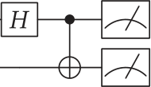

Fig. 1. Example of quantum circuit.

we measure a single qubit of the pair of entangled qubits | _β_ 00⟩ =<u>|00⟩</u> ~~√~~+ 2<u>|11⟩</u> , then we know the state of the other without measuring it, because if the result is 0 or 1, then the qubits will collapse to |00⟩ or |11⟩, respectively.

To take a quantum bit from a state | _ψA_ ⟩ to | _ψB_ ⟩, we use a quantum gate. Examples of quantum gates are the Hadamard gate,

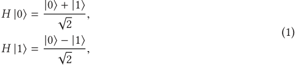

H |0⟩ = |0⟩ + |1⟩ , √ 2 (1) H |1⟩ = |0⟩−|1⟩ , √ 2 

and the CNOT gate

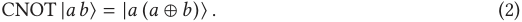

CNOT | ab ⟩ = | a  ( a  ⊕ b )⟩ . (2) 

Quantum gates are unitary operations. Consequently, they are time-reversible, and it is impossible to design a quantum gate to make a copy of a qubit state [43].

A quantum circuit is a diagram that specifies a sequence of quantum gates. For example, the circuit of Figure 1 with qubits | _xy_ ⟩ has the following gate order _H_ | _x_ ⟩, CNOT | _x y_ ⟩, and measures _x_ and _y_ . With the same circuit, if _x_ = 0 and _y_ = 0, the evolution will be

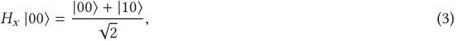

Hx |00⟩ = |00⟩ + |10⟩ , (3) √ 2 

CNOT |00⟩ + |10⟩ = |00⟩ + |11⟩ , (4) √ 2 √ 2 

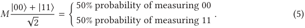

M |00⟩ + |11⟩ = (5) √ 2 � 50% probability of measuring 1150% probability of measuring 00 . 

Decoherence is the process of loss of information that a quantum computer suffers due to its interaction with the environment or the inaccurate execution of quantum operations. It is the primary barrier for quantum computation, limiting the time that a quantum computer can maintain the quantum information, and consequently, the circuit depth (number of quantum gates). To overcome this limitation, we can encode the quantum state in a **quantum error correction (QEC)** code [9]. However, this approach adds a costly overhead in the number of qubits and quantum gates used.

## 3 RELATED WORKS

Quantum programming is a relatively new paradigm with notable contributions from both the industry and the academy [6, 11, 13, 14, 16, 19, 22, 23, 26, 29, 31, 32, 36, 39, 42]. With a few exceptions [26, 29], the past ten years cover the development of most quantum programming language and quantum programming software [1, 7, 8, 21, 37, 38], like libraries and simulators.

Analog to classical programming languages, we can divide quantum programming languages into low and high-level. The low-level quantum programming languages, known as quantum assembly or quantum instruction set, are the quantum variant of the classical assembly. Similar to

ACM Journal on Emerging Technologies in Computing Systems, Vol. 18, No. 1, Article 12. Pub. date: October 2021.

Ket Quantum Programming

12:5

assembly languages that describe instructions that have a straight translation to machine code, the quantum assembly describes operations that have a direct translation to control signals of a quantum processor.

OpenQASM [6] and Quil [36] are quantum assembly languages used to program the quantum computers of IBM and Rigetti, respectively. OpenQASM is a straightforward description of a quantum circuit used as a compilation target of some high-level quantum programming languages [19, 32], and as an intermediary representation of some quantum computing software [24]. The cQASM [22] language is a quantum assembly comparable to OpenQASM used in the OpenQL [21] quantum computer stack. Quil has a classical state composed of the measurement results and the program counter, and a quantum state composed of the qubits’ state. Similar to ordinary assembly, Quil has jump instructions to control the program counter, allowing it to describe classical control statements like if-then-else, for, and while. The ability to control the program counter is the main difference between Quil and OpenQASM (and cQASM).

Between the high-level quantum programming languages, there is a subset of quantum circuit description languages with the focus on a scalable description of larger quantum circuits. Examples are the languages LIQ _Ui_ |⟩ [42], Quipper [14], QWIRE [32], and Scaffold [19]. The LIQ _Ui_ |⟩ is a hardware-independent language embedded in F# that supports architecture-specific timing and layout constraints and provides tools for studying quantum noise and quantum error correction code. Quipper is a Haskell-embedded language used to estimate and reduce resources of quantum circuit execution. QWIRE is a Coq-embedded language that uses a linear type system to ensures the non-violation of the no-cloning theorem [43]. The Scaffold is a C-embedded language that can describe quantum sub-circuits as a classical logic circuit with the Classical-to-Quantum-Gate modules. Implementing a quantum programming language as an embedded programming language is a usual strategy [14, 16, 19, 32, 42] that can reduce development costs and provide vast libraries for the quantum programming language.

Q# [39] and Silq [5] are high-level quantum programming languages not limited by the quantum circuit model. Q# allows the descriptions of statements with classical control and quantum body, e.g., the repeat-until-success statements [30], similar to the C do-while, that execute a quantum operation until the test, that is boolean, hit success. Such construction is not possible in a quantum circuit. However, quantum circuit description languages can implement loops with classical control and quantum body if it can run at compilation time, e.g., Scaffold implements a for loop using the loop-unrolling strategy. Silq provides construction safely to discard temporary quantum variables by reversing the computation to undone possible entanglements. The objective of Silq is to reduce the quantum primitives needed to describe some quantum operations, and consequently, the size of the quantum code.

The most evident target for a quantum programming language is a quantum computer. Although, most quantum programming languages provide constructions that go beyond the NISQ computer processing power [14, 39]. This way, several targets are also provided. For example, classical simulators with usually less than 30 qubits; resource estimators to calculate the cost of a particular quantum execution, usually in numbers of qubits (circuit width) and gates (circuit depth).

In comparison with the related works, Ket is a high-level quantum programming language with expressivity similar to Q#. The main difference between Ket and the other high-level quantum programming languages is the quantum programming scenario in which we developed Ket to operate. We highlight that none of the related works is suitable for our quantum programming scenario. We present our quantum programming scenario in the next section. Since Ket is more expressive than the quantum circuit description languages [14, 19, 32, 42], we only compare Ket with Q# (Subsection 7.1). Silq also has the same expressivity power as Ket but focuses on different

ACM Journal on Emerging Technologies in Computing Systems, Vol. 18, No. 1, Article 12. Pub. date: October 2021.

E. C. R. da Rosa and R. de Santiago

12:6

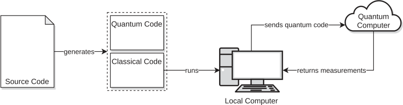

Fig. 2. The flow of execution of the runtime architecture.

aspects of quantum programming, making the comparison between Ket and Silq have the same effect as the comparison between Q# and Silq (provided by Silq authors [5]).

Ket uses Libket to generate quantum code in **Ket Quantum Assembly (KQASM)** , a low-level quantum programming language part of the framework that has an expressive power comparable to Quil. As we designed KQASM to provide the minimum needs of the proposed runtime architecture and take advantage of the Ket Bitwise Simulator, KQASM does not have any breakthrough over other quantum assemblies languages. The execution target available, KBW, can run KQASM codes and return measurement results and dumps of the quantum state.

Libraries like Cirq [8], OpenQL [21], ProjectQ [37], PyQuill [36], and Qiskit [1] also address quantum programming but from a different perspective. Those libraries provide means to programming a quantum computer by directly appending operations to a quantum circuit/program and explicitly choosing when and where the quantum code will run, while Ket and other quantum programming languages abstract those and other steps from the programmer. We do not consider those libraries as related works. To highlight this different perspective between Ket and quantum programming libraries, we compare Ket and Qiskit in Subsection 7.1. We chose Qiskit as the base for this comparison as it is the most widespread quantum programming library.

## 4 QUANTUM PROGRAMMING SCENARIO

We summarized the execution flow of our proposed runtime architecture in Figure 2. In it, a compiler or interpreter inputs a single source code and output both the classical and quantum codes that efficiently run on its corresponding architecture. Next, a local computer runs its respective output, which coordinates the execution of the quantum code in a quantum computer, that is available in the cloud.

Based on NISQ and near-future quantum computers, we designed the runtime architecture following the constraints that a quantum computer is available in the cloud with a batch scheduler that does not allow interaction during its execution. These restrictions comply with the quantum computing service provided by IBM and Amazon Braket. Within this limitation, a local computer coordinates the quantum execution by sending a batch job to the quantum computer in the cloud, which sends back the measurement results. However, in the meantime, no interaction is possible between the local and the cloud-based quantum computer.

Quantum computers also have severe time constraints due to decoherence and gates fidelity, which impose restrictions on the complexity of the quantum execution. This limitation takes form in the number of operations that a quantum execution can perform before the qubits lose information. This way, any quantum code needs to be as specific as possible, making it hard to program generic and dynamic quantum applications.

One of the problems solved by the proposed runtime architecture is how to program an interactive classical-quantum application. Other quantum programming languages [5, 13, 36, 39] also

ACM Journal on Emerging Technologies in Computing Systems, Vol. 18, No. 1, Article 12. Pub. date: October 2021.

Ket Quantum Programming

12:7

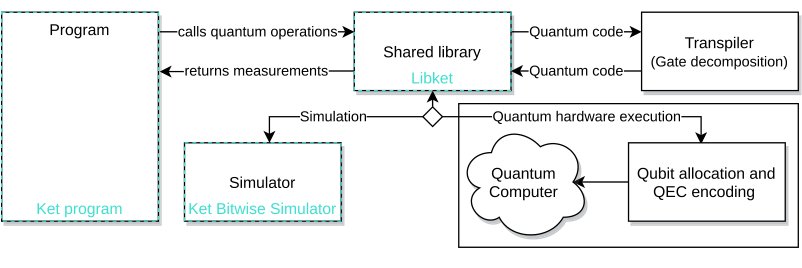

Fig. 3. The proposed runtime architecture for dynamic interaction between local classical and cloud-based quantum computers, with the quantum computer processing in batch.

address this problem but not considering the presented scenario of cloud-based quantum computation. Also, the proposed runtime architecture is suitable whenever classical and quantum computers cannot communicate fast enough that the quantum computer does not idle. The cloud is one possible and likely scenario.

Another constraint that is not addressed by the related works is for a single source code to generates well-separated classical and quantum codes. You can use embedded languages like Quipper to implement a whole classical-quantum application, but you cannot separate the quantum end classical execution to run on its respective computers. However, Q# has a well-separated quantum code. However, a general-purpose programming language (Python, C#, or F#) is required to coordinate the quantum execution and implement the classical one. We consider that a single source code for a whole classical-quantum application facilitates its development, since there is no need to interface two programming languages.

We assume that the quantum computer can execute simple classical expressions and branch instructions to support the execution of loops (feedback) and controls (feedforward) statements, e.g., while and if-then-else. Although today’s quantum computers are limited in terms of control flow, which impacts the classical-quantum interaction, there are experimental results of quantum computers with full dynamic execution capacity [13].

We emphasize that none of the related works are suitable for the quantum programming scenario shown. Different from the Ket quantum programming language that was designed specifically for this scenario.

## 5 PROPOSED RUNTIME ARCHITECTURE

We designed the runtime architecture summarized in Figure 3 for dynamic interaction between classical and quantum computers, following the constraints of Section 4. The main limitation of this dynamic interaction is the batch execution of the quantum computer. This problem implies that the classical computer cannot interact with the quantum one during the computation, e.g., it cannot decide which operation will be executed by the quantum computer based on some measurement performed on the same execution. This lack of interaction causes difficulties on programming of some quantum algorithms and protocols, e.g., the quantum teleportation shown in Figure 4. The proposed runtime architecture relies on quantum computer’s ability to execute simple expressions and branch instructions [13] and the generation of the quantum code during the classical runtime to overcome these limitations.

The proposed architecture is composed of several components with the following workflow. First, a program makes calls to a shared library that handles the quantum operations. This program

ACM Journal on Emerging Technologies in Computing Systems, Vol. 18, No. 1, Article 12. Pub. date: October 2021.

E. C. R. da Rosa and R. de Santiago

12:8

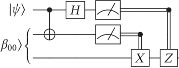

Fig. 4. The quantum teleportation circuit, where | _β_ 00⟩ =<u>|00⟩+|11⟩</u> . The last two quantum gates _Z_ and _X_ are ~~√~~ 2 controlled by the measurement result of the top two qubits.

can be a binary file generated by a compilation process or an interpreter executing a source code. Then the shared library generates the quantum code during runtime and sends it to a transpiler that decomposes the controlled quantum gates and returns the processed quantum code. After that, the shared library sends the quantum code to a simulator or a quantum computer, which needs extra steps to execute. Finally, the results of the quantum code execution, which are the measurement results, are returned to the shared library and then returned to the program. The measurement results are classical data and can be used by the program as such.

The Ket Quantum Programming framework implements part of the proposed runtime architecture. As we initially focus on simulated quantum execution, quantum gate decomposition, quantum code optimization, and execution in quantum hardware are future works. The following subsections detail every component of the runtime architecture as well as their interactions and intermediaries.

## 5.1 Shared Library

The shared library is an intermediary for other components of the runtime architecture. It handles calls to allocate and free qubits, applies quantum operations and measurements. We detail the shared library implementation, the Libket, in Section 6, and next, we present its functionality.

The shared library uses the calls performed by the program to generate the quantum code, which is a quantum intermediary representation that is not necessarily equivalent to a quantum circuit. The quantum code can have higher-level constructions, such as functions, loops, classical conditional statements, and arbitrary gates with an unlimited number of control qubits. As the library is independent of the quantum execution target, the quantum code has no preset limit of qubits.

To improve performance and coding dynamism, the library shall produce multiple unrelated quantum codes at the same time. For example, if we need a random number1 for a quantum operation, then we can initialize a second independent quantum code to generate the random number. This approach reduces the number of qubits and (consequently) gates required to run the quantum application by splitting it into several quantum executions.

The two main traits of the shared library are the ability to generate the quantum code at runtime and that measurements return futures, in other words, promises of results. Those two features are essential for the runtime architecture ability to execute generic quantum applications with dynamic execution and interaction between classical and quantum computers.

Due to decoherence, every quantum operation needs to be as optimized as possible. Therefore, it is discouraged to construct a sequence of gates that operates based on an undefined classical input. For example, Shor’s algorithm needs to perform modular exponentiation on a superposition taking a state | _x_ ⟩|0⟩ into | _x_ ⟩| _a__x_ mod _N_ ⟩, where _a_ and _N_ are classical parameters. So, to optimize a quantum execution for specific classical parameters, either they need to be statically defined

> 1Quantum computers can generate truly random numbers.

ACM Journal on Emerging Technologies in Computing Systems, Vol. 18, No. 1, Article 12. Pub. date: October 2021.

Ket Quantum Programming

12:9

(compile-time resolvable), or we need to delay the quantum code generation to runtime where those parameter values are available.

Besides enabling the description of parameterized quantum applications, as described above, the generation of quantum code at runtime also permits programming responsive quantum applications, which can change its execution based on user input, sensor measurement, or quantum execution. For example, those are features necessary for information systems that use quantum computation for data processing.

Some quantum application, like the quantum teleportation of Figure 4, uses the result of a measurement to control which gates are applied. However, as the quantum computer’s decoherence time may be shorter than the response time between the classical and the quantum computer, a quantum computer executes in batch. So, in those situations, it is the quantum computer that needs to use the measurement results to decide what to do. That is in which measurement results as a future take place.

Inspired by concurrent programming, when a program calls for a measurement, the shared library returns a future instead of the measurement result. A future holds a promise for the measurement result that is fulfilled by the shared library when the classical computer needs it. Using future variables, control statements with quantum operations are possible in the runtime architecture, since they can be placed in the quantum code and executed by the quantum computer. A future can hold other information that is not necessarily a measurement result but is only available in the quantum computer, e.g., the result of expressions with measurement results and loop control variables. We present examples of future usage in the Ket programming language in Section 7.

A shared library, in contrast to a static one, is loaded during the execution and not linked statically into the binary executable. It means that there is no need to recompile the code on every update as soon as it maintains the same interface. Still, with limitations, a static library can replace the shared library.

## 5.2 Quantum Gate Decomposition

The transpiler performs source-to-source translation with quantum gate decomposition [17, 41] and architecture-independent optimizations [17, 41] to prepare the quantum code for quantum hardware execution or to estimate the resources needed for a quantum execution. The input and output languages can be the same, with just the decomposition of the multi-controlled quantum gates. On the current NISQ computers, we can use the languages OpenQASM and Quill for IBM and Rigetti quantum computer execution, respectively.

The output language, usually a quantum assembly, must be expressive enough to represent every possible construction of the quantum code and simple enough to be efficiently executed by a quantum computer or simulator. Some quantum programming languages are more expressive than others. For example, the Quil can represent loops, using label and branch instructions, that is not possible with the OpenQASM.

The Ket Quantum programming framework does not yet implement quantum gate decomposition and architecture-independent quantum code optimizations.

## 5.3 Quantum Simulator

While we are in the NISQ era, far from large scale fault-tolerant quantum computers, simulating a quantum computation may be the best option to test a quantum algorithm or application. However, even with the arrival of better quantum computers and despite the exponential simulation time, simulators are still useful for debugging quantum applications due to the impossibility of looking into a non-simulated quantum superposition.

ACM Journal on Emerging Technologies in Computing Systems, Vol. 18, No. 1, Article 12. Pub. date: October 2021.

E. C. R. da Rosa and R. de Santiago

12:10

Simulators can apply multi-qubit gates like the Toffoli gate, an oracle for Grover’s algorithm [15], and modular exponentiation [34] in a single quantum operation. So simulated quantum executions can improve performance by executing the quantum code without the gate decomposition process needed for a quantum hardware execution.

## 5.4 Quantum Hardware Execution

Quantum assembly describes the execution of a quantum application in terms of logical qubits. Those are ideal qubits, free of noise and fully connected, where no error corrections are needed, and every qubit communicates with each other, e.g., it is possible to apply a CNOT between any qubit. However, quantum computers work with physical qubits subject to noise (errors) and connectivity limitations.

Logical qubits of a quantum assembly need to be mapped into physical qubits to run on a quantum computer. We call this process of qubit allocation [35] or quantum circuit mapping [18]. Heuristics for optimization may vary from each quantum computer vendor, since each one explores different qubits layouts and construction technology.

Despite being too expensive for NISQ computers, quantum error correction is a fundamental part of fault-tolerant quantum computers. So, the quantum assembly may pass through a QEC encoder before the quantum hardware execution. Similar to the qubit allocation, QEC encoding also depends on the quantum architecture and may be performed by a proprietary software provided by the quantum computer vendor.

The Ket Quantum Programming framework does not yet implement quantum hardware execution.

## 6 LIBKET IMPLEMENTATION

The core of the Ket Quantum Programming is the Libket, a C++ implementation of the shared library proposed with the runtime architecture. KQASM is the quantum code generated by Libket. We designed KQASM to take advantage of Ket Bitwise Simulator (presented in Section 8). It features a classical control with labels and branch instructions, similar to Quil. The Ket language uses a Python wrapper of Libket with some adaptations.

Libket features three main classes, process, quant, and future. The process class, not accessible in the Python wrapper, controls the quantum code generation, which among other things, handles (logical) qubit allocation, quantum gate application, measurement, and label name conflict. The quant class store an array of qubits’ reference resulting from an allocation call to a process. The future class stores an int that is only available after the quantum execution.

For a programmer be able to describe several unrelated quantum executions inside of a single application, the library used a global stack to store process instances, where every class and method of the Libket always communicates with the top process instance. A process in the global stack does not have access to the process below like a programming language scope does. In Section 7, we present how to handle the process stack in the Ket programming language.

KQASM has a basic bock structure similar to LLVM IR [25], where a block of code begins with a label and ends, except the last block, with a jump or branch instruction. The first block started by the label @entry is the entry point for execution, which ends at the **end of the file (EOF)** . The assembly also has an infinite number of qubits and registers that need to be managed by the execution target. For KQASM code examples, see Section 7.

In addition to the traditional one-qubit gates Pauli _X_ , _Y_ , and _Z_ , Hadamard, _S_ , _S_† , _T_ , and _T_† , the KQASM also provides a parameterized phase and the rotation gates RX (Equation (6)), RY (Equation (7)), and RZ (Equation (8)):

ACM Journal on Emerging Technologies in Computing Systems, Vol. 18, No. 1, Article 12. Pub. date: October 2021.

Ket Quantum Programming

12:11

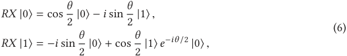

RX |0⟩ = cos θ 2 |0⟩− i  sin  θ 2 |1⟩ , (6) RX |1⟩ = − i  sin θ 2 |0⟩ + cos  θ 2 |1⟩ e − iθ  /2 |0⟩ , 

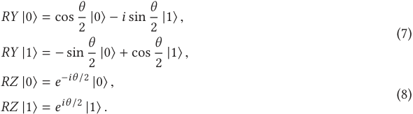

RY |0⟩ = cos θ 2 |0⟩− i  sin  θ 2 |1⟩ , (7) RY |1⟩ = − sin θ 2 |0⟩ + cos  θ 2 |1⟩ , RZ |0⟩ =  e − iθ  /2 |0⟩ , (8) RZ |1⟩ =  e iθ  /2 |1⟩ . 

The assembly does not implement any multiple qubit gate, though it is possible to add qubits of control for any one-qubit quantum gate. For example, the instruction CTRL [q0], X q1 performs a CNOT gate, and CTRL [q0, q1], X q2 a Toffoli gate. To perform a controlled operation, first, Libket stacks the qubits of control, and then the quantum gates are called.

As quantum computation is inherently reversible, Libket can generate the adjunct of a quantum operation inverting the order of the quantum gates and change it for its inverse. This functionality is only available for quantum gates. The library constructs KQASM with the inverse operation using a stack of stacks of gates as follows. A call to begin an inverse section pushes an empty stack of gates. However, a call to end an inverse segment has two possibilities. First, if the outer stack has one element, the inner stack pops the gates into the KQASM file; else, the inner stack pops the gates into the stack below. Inside of an inverse section, the library places the quantum gates into the top stack. If the outer stack has an odd number of elements, then the library pushes the adjunct quantum gate instead.

Every call to Libket directly or indirectly append instructions to a KQASM file, which has all the information needed for the quantum execution. The quantum code execution is the last action of a process. When requested by a future variable, the library sends the generated KQASM file to Ket Bitwise Simulator, which returns the value of the integers, so that the process can fulfill the future variables. Optionally, Libket can also export the KQASM file.

Libket also provides the dump class that makes an image of a quantum state, returning the superposition with its probability amplitude. We can use this class to debug a quantum application with a simulation. As with future variables, the result of a dump variable is only available after the quantum execution. Dumping a quantum state has no side effect on it, but in some cases, it can exponentially increase the simulation time. It is impossible to implement the behavior of a dump in quantum hardware due to the effect of measurement of the no-cloning theorem.

## 7 KET PROGRAMMING LANGUAGE

Ket is a Python-embedded classical-quantum programming language that friendly exposes the Libket functionalities enabling dynamic quantum programming in an architecture that is suitable for the current and near-future quantum computers. As a high-level quantum programming language, Ket provides quick development of quantum applications using the well-known Python constructions with the addition of a few quantum specifics. This approach should be a natural way for Python programmers to deal with quantum programming, allowing them to quickly implement and test quantum applications, smoothing the learning of quantum computation and the development of new quantum algorithms and applications.

In addition to the Python types, Ket offers two new ones, the quant type, which implements an array of qubits references, and the future type, which is used to store variables in the quantum

ACM Journal on Emerging Technologies in Computing Systems, Vol. 18, No. 1, Article 12. Pub. date: October 2021.

E. C. R. da Rosa and R. de Santiago

12:12

Table 1. Quantum Gates Available in Ket

|Gate|Function|Eff|fect|
|---|---|---|---|
|Pauli_X_|X(q : quant)|_X_ |0⟩= _X_ |1⟩=||1⟩ |0⟩|
|Pauli_Y_|Y(q : quant)|_Y_ |0⟩= _Y_ |1⟩=|−_i_|1⟩ _i_|0⟩|
|Pauli_Z_|Z(q : quant)|_Z_ |0⟩= _Z_ |1⟩=||0⟩ −|1⟩|
|Hadamard|H(q : quant)|Equation|(1)|
|_S_|S(q : quant)|_S_|0⟩= _S_|1⟩= ||0⟩ _i_|1⟩|
|_S_Dar|SD(uant)|_S_† |0⟩= ||0⟩|
|gge|q : q|_S_† |1⟩=|−_i_|1⟩|
|_T_|T(q : quant)|_T_ |0⟩= _T_ |1⟩= ||0⟩ 1+_i_ ~~√~~ 2 |1⟩|
|_T_ Dagger|TD(q : quant)|_T_ † |0⟩= _T_ † |1⟩=||0⟩ 1−_i_ ~~√~~ 2 |1⟩|
|Phase|phase(_λ_ : float, q : quant)|_P_ |0⟩= _P_ |1⟩=||0⟩ _e__iλ_ |1⟩|
|RX|RX(_θ_ : float, q : quant)|Equation|(6)|
|RY|RY(_θ_ : float, q : quant)|Equation|(7)|
|RZ|RZ(_θ_ : float, q : quant)|Equation|(8)|

computer. It also provides a universal set of quantum gates, presented in Table 1, and statements to operate with controlled and inverse quantum operations.

The quant type provides a default constructor that initializes the qubits in the state |0⟩, and a dirty constructor that assigns dirty qubits to a new quant variable. When no longer in usage, you can free a quant variable, so their qubits can be allocated by another quant. Before calling free, all qubits must be at the state |0⟩, or the dirty flag must be set True. A quant variable can reallocate free dirty qubits, but their usage may cause side effects due to previous entanglements. The functions of Table 1 apply the quantum gate on every qubit of a quant variable. However, the quant type permits the use of brackets to address a range of qubits, as a Python list.

To implement multi-qubits quantum gates, the Ket language allows the addition of qubits of control in existing quantum operations with the function ctrl(c, gate, *args, **kwargs) and the statement with control . For example, Code 1 presents a possible implementation for the CNOT gate for same size quant variables, and Code 2 presents a possible implementation for the Fredkin gate (Equation (9)), also known as the CSWAP gate:

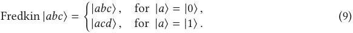

for | a ⟩ = |0⟩ , Fredkin | abc ⟩ = (9) �|| acdabc ⟩⟩ ,, for | a ⟩ = |1⟩ . 

As several quantum algorithms take advantage of the quantum computing reversibility, the Ket language provides constructions to make easy the application of inverse quantum gates. The function adj(gate, *args, **kwargs) calls the inverse of a quantum operation, and the statement with inverse initializes a scope that executes backward. For example, with the **Quantum Fourier Transformation (QFT)** of Code 3, the adj function can be used to call the inverses QFT.

ACM Journal on Emerging Technologies in Computing Systems, Vol. 18, No. 1, Article 12. Pub. date: October 2021.

Ket Quantum Programming

12:13

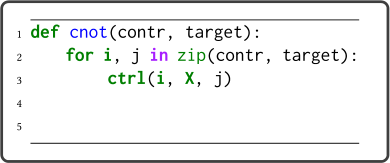

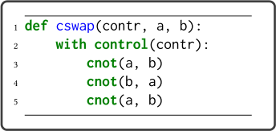

Code 1. CNOT gate implementations in Ket.

Code 2. Fredkin gate implementation in Ket.

Code 4 presents examples of the KQASM generated by the call of the QFT and the inverse QFT with three-qubits quant variable.

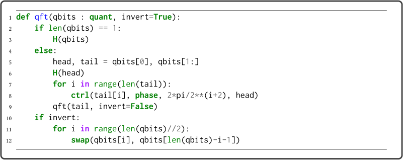

Code 3. Quantum Fourier Transformation implementation.

The QFT of Code 4 is an example of the benefits of the runtime quantum code generation. The code defines an operation for an unknown number of qubits, so if the quantum code generations were in the compilation time, additional controls, loop, and recursion would be necessary for the quantum execution. However, since the runtime has this information, Libket will perform a loop unrolling to generate the quantum code with the required operation only.

Quantum measurements in the Ket quantum programming language do not directly return the result. Instead, it returns a future variable as a promise that the value will be available when needed by the classical computer. And until then, Ket can use the measurement results to control operations on the quantum computer. A future variable can operate with another future or an int, with the outcome still been a future. Ket also integrates the future type with the if and while statements changing their semantics, so they run on the quantum computer if the _test_ is a future variable.

An example where the return as a future is useful is the implementation of the quantum teleportation of Figure 4. There the application of some quantum gates depends on classical information obtained by measurements. Code 5 shows the implementation of the quantum teleportation and the KQASM generated during runtime. Note that the if statements of the function bell (lines 3–6, left) are not present in the quantum code, since the values aux0 and aux1 are known by the classical computer. However, Libket places the if statements of the function teleport (lines 17–20, left) that operates with a measurement result in the quantum code (lines 11–23, right). The method get

ACM Journal on Emerging Technologies in Computing Systems, Vol. 18, No. 1, Article 12. Pub. date: October 2021.

E. C. R. da Rosa and R. de Santiago

12:14

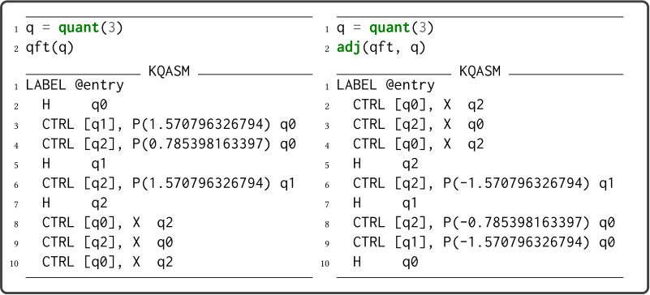

Code 4. The KQASM generated by calling qft from Code 3.

of the last line informs Libket that the classical computer needs the measurement result, triggering the quantum code execution and return the measurement.

Quantum error correction protocols are good examples of interactive quantum applications. To illustrate how Ket handles classical-quantum interaction, we implement a class that inherits from quant, implementing a one-logical-qubit encoded in the Steane stabilizer code [9]. We implement the Steane code class of Code 6 just as an example. As presented in the proposed runtime architecture, we expect quantum error correction in a lower-level of abstraction. Stabilizer codes can correct errors through projection operations. Those operations use auxiliary qubits measured to form the error syndrome, which tells which error occurred in which qubit. As implemented in lines 37–50 of Code 6, the error syndrome processing is classical but executed in the quantum computer. However, as Ket dynamically performs control statements accordingly where the information is available, the programmer does not need to worry if it is the classical or the quantum computer that corrects the error.

Every operation performed in the quantum computer is attached to a process, which you can create using the statement with run. Ket allows to nest process, but as they are a separated quantum execution, there is no communication between them (like a scope in programming languages). The operations performed outside of a with run statement communicates with the global process, initialized at the program startup.

In short, every Ket’s quantum operation calls Libket, which adds instruction in the quantum code (KQASM). Binary operations with future variables are also placed in the quantum code, since the values are not available to the local classical computer. We emphasize that quantum measurements return a future variable. Before executing an if or while statement, Ket checks if the _test_ is evaluable by the local classical computer. If so, then the classical computer runs the statement as defined by Python. Otherwise, the local computer calls Libket to reconstruct the statement semantics in the quantum code, using jump and branch instructions. The method get of future requests the value from the cloud-based quantum computer, making it available to the classical computer. As we assumed that a quantum computer process in batch, once it returns the measurement results, its quantum state is dissolved. In the loop of Libket sending the quantum code to the quantum computer that returns the measurements, Ket can adapt the quantum code as needed in every interaction.

ACM Journal on Emerging Technologies in Computing Systems, Vol. 18, No. 1, Article 12. Pub. date: October 2021.

Ket Quantum Programming

12:15

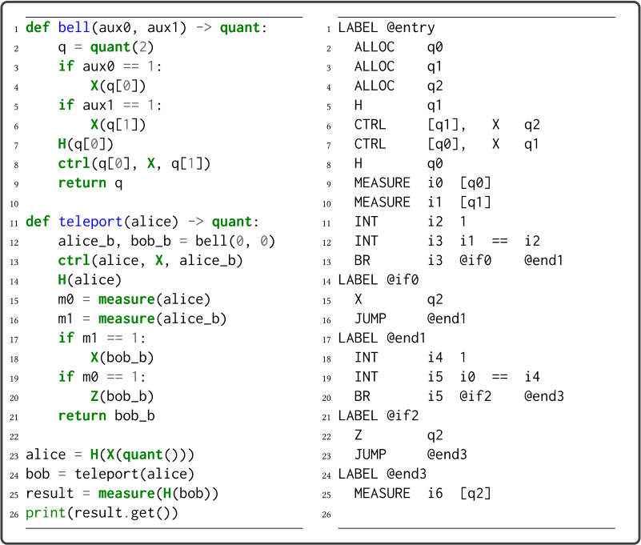

Code 5. Implementation of the quantum teleportation circuit of Figure 4 in Ket (left). On the right is the KQASM generated during the runtime. The future variables m0, m1, and result reference the values of the INT registers i0, i1, and i6, respectively.

## 7.1 Comparative with Other Quantum Programming Platforms

Next, we present a comparison between Ket and two relevant quantum programming platforms, Qiskit and Q#. We already discuss them in Section 3.

Qiskit is a quantum programming library for Python and not a programming language. It has a lower level of abstraction compared with Ket. To highlight this difference, we present Code 7 that has two equivalent implementations using Ket and Qiskit. The code prepares three qubits in the state

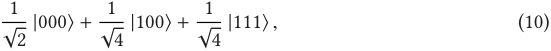

1 |000⟩ + 1 |100⟩ + 1 |111⟩ , (10) √ 2 √ 4 √ 4 

using a controlled version of the Bell circuit (the quantum circuit of Figure 1 without the measurements) and dumps the quantum state.

In Code 7, we can see that Qiskit quantum programming focuses on quantum circuit composition, while Ket treats qubits (quant) as first-class citizens. Also, note that the trigger for the quantum execution is abstracted in Ket (it happens on line 11). However, using Qiskit, the quantum execution needs to be explicitly requested.

ACM Journal on Emerging Technologies in Computing Systems, Vol. 18, No. 1, Article 12. Pub. date: October 2021.

E. C. R. da Rosa and R. de Santiago

12:16

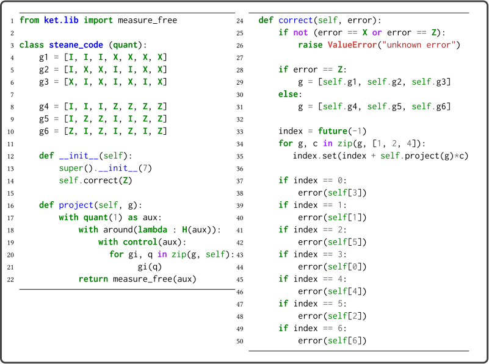

Code 6. Class for one-logical-qubit in the quantum error correction Steane Code [9].

With Ket, you program manipulating variables, while with Qiskit, you program generating the quantum assembly. We believe that manipulate qubits is a more intuitive way for quantum programming than compose quantum circuits. Also, in contrast with Qiskit, Ket requires fewer operations to get started with quantum programming.

Q# is a high-level quantum programming language as Ket, and they are similar in terms of expressive power and abstraction. In Code 8, we present two equivalent implementations in Ket and Q# to prepare two qubits in the state

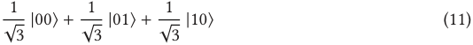

1 |00⟩ + 1 |01⟩ + 1 |10⟩ (11) √ 3 √ 3 √ 3 

using postselection. Note that we can simulate the Q# statement repeat-until-success in Ket with a while loop. Although Q# can run stand-alone, it is designed to be called by general-purpose programming languages.

Ignoring the list of open statements, Q# and Ket programs are similar in the number of lines of code. But we believe that the Python base of Ket makes the language quick and easy to learn than Q# with its C#/F# inspired syntax.

Since the repeat-until-success construction is out of the bound of the quantum circuit model expressiveness, we cannot implement Code 8 in a quantum circuit description language. To execute this implementation, we also need the quantum computer to support control flow, which is limited in today’s quantum computer, but we expected it to be available soon [13].

ACM Journal on Emerging Technologies in Computing Systems, Vol. 18, No. 1, Article 12. Pub. date: October 2021.

Ket Quantum Programming

12:17

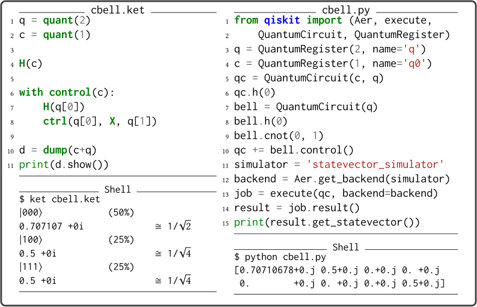

Code 7. Quantum program to prepare three qubits in the state ~~√~~ <u>12</u>|000⟩+ ~~√~~<u>1</u> 4|100⟩+ ~~√~~<u>1</u> 4|111⟩imple- mented in Ket (left) and Python using Qiskit (right). At the bottom is the output of the execution of each program.

## 7.2 Design Decisions and Limitations

In the next paragraphs, we will discuss some design decisions and limitations of the Ket programming language implementation.

_With control:_ uantum controlled operations are the quantum analog of the if statement, so why does not use the Python pyif to apply controlled gates instead of the ketwith control? The answer is: to avoid confusing programmers. A controlled operation is not equal to a quantum if, because it requires all qubits to be in the state |1⟩ to execute, and not in a state different of |0 . . . 0⟩ to execute. So, the use of pyif to express controlled operation could mislead programmers, hoping the quantum program to apply the traditional semantics into the quantum state.

_With run:_ The ability to describe multiple unrelated quantum execution is essential to program a more extensive quantum application. In the Ket programming language, it is achieved by using the ketwith run statement. However, the ability to automatically attach the operations on the quantum computer to a process based on the qubit entanglement would increase the coding dynamism. We plan this feature for future implementations.

_No-cloning theorem:_ The no-cloning theorem [43] tells us that we cannot copy a qubit. So, the semantic of a quantum programming language should ensure this property. A possible strategy, implemented in QWIRE [32], is to use a linear type system on the quantum variables to secure the no-violation of the theorem. However, Ket uses a different approach. A quant variable holds an array of qubits reference and not the actual qubits. This perspective allows the use of the quant

ACM Journal on Emerging Technologies in Computing Systems, Vol. 18, No. 1, Article 12. Pub. date: October 2021.

E. C. R. da Rosa and R. de Santiago

12:18

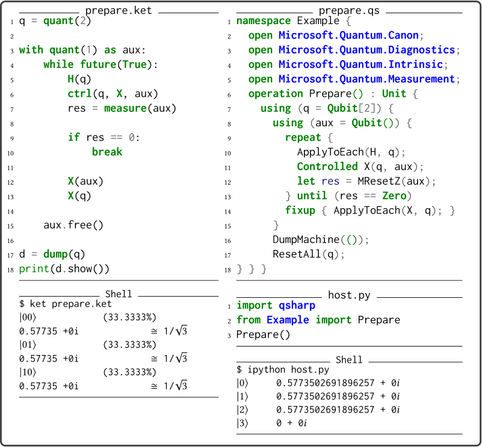

Code 8. Quantum program to prepare two qubits in the state ~~√~~ <u>13</u>|00⟩+ ~~√~~ <u>13</u>|01⟩+ ~~√~~ <u>13</u>|10⟩(using postselection) implemented in Ket (left) and Q# (right). At the bottom is the output of the execution of each program.

type in assign statements without the worry of the no-cloning theorem, since the language will perform it by referencing and not copying (see Code 9 as an example).

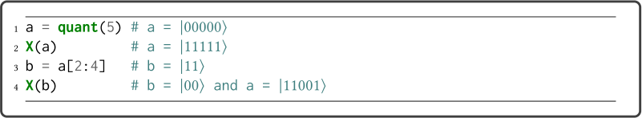

Code 9. Example of the effect of an assignment with a quant.

ACM Journal on Emerging Technologies in Computing Systems, Vol. 18, No. 1, Article 12. Pub. date: October 2021.

Ket Quantum Programming

12:19

_Future indexing qubits:_ While indexing the qubits of a quant using a future variable would improve coding dynamics, e.g., refactoring Code 6 to change the lines 37–50 for something like keterror(self[index]). This feature would make it impossible to identify the violation of the no-cloning theorem during the classical computer runtime. For example, in a controlled quantum operation, we cannot ensure that a future variable is not indexing a control qubit used as a target and vice versa.

_Future get:_ The future.get tells Libket that the local computer needs a value from the quantum computer. Ideally, a static analysis of the source code should provide this information, performing the get when necessary. However, this analysis would either fail or impose a limitation in a language like Python, the Ket base-language.

_Future set:_ Since the assign statement is essential for the Python dynamism, it does not allow the overload of the operator (the __setattr__ does not qualify). So, Ket provides the method future.set to assign a value to a future variable. We chose not to change the language semantic for this type.

_Overhead:_ As Python only defines the variable types at runtime, the integration of the future type in the statements ketif and ketwhile requires additional instructions to identify if it will run in the classical or quantum computer. Those supplementary operations introduce overhead on the statement execution.

_A new language?_ Why do we not provide Ket as a Python package instead of a new language? As the integration of the future type with the Python control statements is fundamental for our proposal, providing Ket only as a Python package would not support it. The Ket interpreter uses the Python parser to generate the program AST and the Python compiler to compile it. However, before sending the tree for the compiler, the interpreter performs some additional transformations. You can also use Ket as a Python library (with limitation), and we provide the function import_ket to import a Ket code as a Python module and the decorator code_ket to handle future variables inside a Python function.

## 8 KET BITWISE SIMULATOR

Although some small quantum computers are freely accessible through the Internet, simulating one is useful to test and debug quantum applications, even with the exponential complexity of the problem. Besides the need to wait in a queue, a quantum hardware execution is subject to noise that can invalidate the computation. However, simulated quantum executions do not need to comply with some quantum limitations, like the impossibility to check into the superposition and qubits connectivity (a construction constraint).

KBW uses the bitwise representation [7]. In contrast to the usual approach that uses matrix multiplication to handle quantum numeric simulations, the bitwise representation uses a hashmap to store the quantum state and bitwise operations to apply quantum gates. In summary, KBW represents a qubit | _ψ_ ⟩ in the hashmap qubits with the following equivalence:

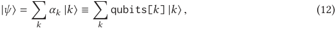

| ψ ⟩ = � αk | k ⟩≡ � qubits[ k ] | k ⟩ , (12) k k 

and it iterates over the data structure to apply quantum gates.

KBW implements the quantum gates available on KQASM. However, it also allows the application of user-defined quantum gates through plugins, using the C++ Ket Bitwise API that exposes the hashmap of the quantum simulation. In contrast to gate decomposition of complex quantum operations, plugins are easier and fast to implement. For example, the modular exponentiation

ACM Journal on Emerging Technologies in Computing Systems, Vol. 18, No. 1, Article 12. Pub. date: October 2021.

E. C. R. da Rosa and R. de Santiago

12:20

needed by Shor’s algorithm [34] has a complexity of _O_ ( _n_3 ) in terms of gates [40], and you need to perform the decomposition for every possible value of the parameters _n_ and a. But you can implement it using a plugin that works on a range of input parameters, all with constructions that are more familiar for programmers. Code 10 presents the core of the plugin libket_pown.so that implements the modular exponentiation.

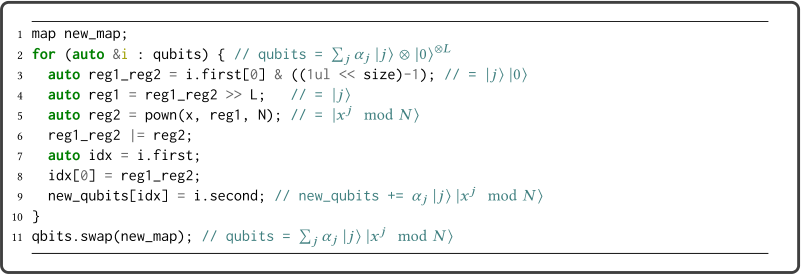

Code 10. Core of the libket_pown.so that implements the quantum operation | _j_ ⟩|0⟩ → | _j_ ⟩| _x__j_ mod _N_ ⟩. Variable L is equal to ⌈log2 _N_ ⌉ and size is equal to 3 × _L_ + 1.

The computational time of the bitwise representation grows exponentially with the amount of superposition in the quantum system and not with the number of qubits as usual. However, our implementation also limits this exponential scaling by the amount of entanglement in the quantum system. It means that simulating a quantum system with all qubits in superposition but with sets of few entangled qubits can have up to an exponential speedup comparing with other simulators. Inspired in the Qrack simulator [38], we arrange this improvement by keeping the qubits in separate hashmaps when they are not entangled. As KBW only implements one-qubit gates, besides plugins, the only way to generate entanglement is by adding control qubits to the quantum gate. However, KBW only considers that the target and the control qubits are entangled if the control is under superposition. Also, control qubits that do not generate entanglement only add linear (small) time to the application of the quantum gate.

Qrack does not use the Bitwise representation. Instead, it stores qubits and quantum gates in matrices and operates with them through matrix multiplication. With the KBW implementation, we show that Qrack optimization (keep qubits separated while they are not entangled) is possible in the Bitwise representation.

We propose three benchmarks that vary in terms of superposition and entanglement to evaluate the KBW performance. We compare the KBW performance with Cirq (0.9.1) [8], Forest QVM (1.17.1) [36], ProjectQ (0.5.1) [37], Q# simulator (0.15) [39], QSystem (1.2.0) [7], QX Simulator (0.3) [27], Qiskit-Aer’s QasmSimulator (0.7.6) [1], Qrack (5.4.0) [38], and QuEST (3.2.0) [20]. We run the benchmarks on a computer with an Intel Core i7-8565U CPU, 2x 8 GB DDR4 (Speed: 2667 MT/s), using the Linux Kernel 5.10.18-1-MANJARO.

All benchmarks start with the qubits at the state |0⟩. The first benchmark prepares and measures a maximum entangled GHZ state of _n_ qubits:

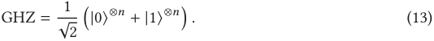

GHZ = 1 �|0⟩ ⊗ n + |1⟩ ⊗ n � . (13) √ 2 

ACM Journal on Emerging Technologies in Computing Systems, Vol. 18, No. 1, Article 12. Pub. date: October 2021.

Ket Quantum Programming

12:21

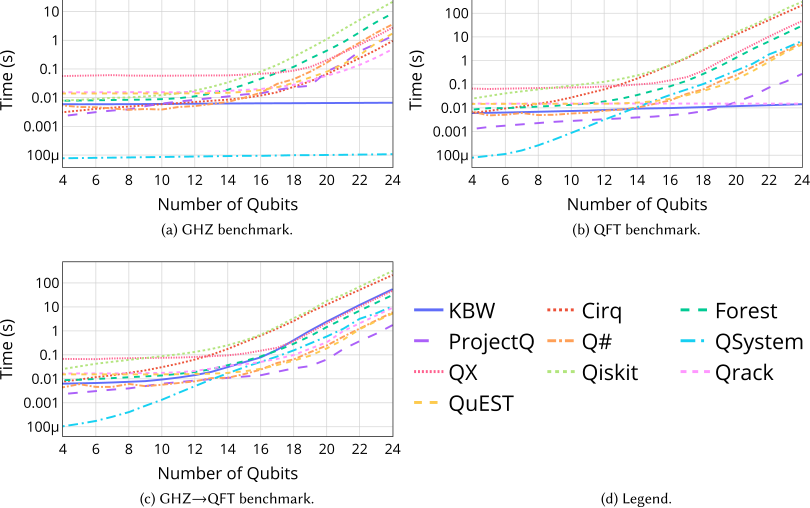

Fig. 5. Benchmarks.

As shown in Figure 5(a), since the qubits are at two quantum states on every step of the computation, KBW has a linear scale as QSystem (the original implementation of the bitwise representation).

The second benchmark applies the QFT on _n_ qubits and measures them. We present the results in Figure 5(b). Before the measurement, all qubits are in superposition on the state

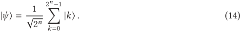

2 n −1 1 | ψ ⟩ = � | k ⟩ . (14) √ 2 n k =0 

However, since this benchmark generates no entanglement, the KBW has a linear scale similar to Qrack, as expected.

The final benchmark applies the QFT on a GHZ state of _n_ qubits and measures them. As shown in Figure 5(c), this benchmark is the worst case of presented an exponential scaling like the other simulators.

The benchmarks demonstrate the power of KBW. We do not address any benefit of the Ket programming language on them. We chose these simple benchmarks to illustrate where the KBW can have an advantage. Those advantages have a different impact on different algorithms. For example, Shor’s algorithm runs faster than Grover’s algorithm in KBW, even that Shor’s factorization algorithm uses more qubits. In Figure 6(a), we compare Grover’s and Shor’s algorithms execution time in KBW. Code 11 presents the used Grover’s algorithm implementation, and Code 12, the order-finding algorithm used in Shor’s algorithm. The execution time of Figure 6(a) considers the execution of Shor’s algorithm as a whole and not only the order-finding routine.

In Grover’s algorithm, to execute an oracle _U_ | _a_ ⟩| _b_ ⟩ = | _a_ ⟩| _f_ ( _a_ ) ⊕ _b_ ⟩, where the _f_ ( _a_ ) has 2_s_ possible entries, we need _s_ + 1 qubits where all of them are entangled and in total superposition. KBW’s worst-case scenario. However, while Shor’s algorithm needs 3 _L_ + 1 qubits to factor an

ACM Journal on Emerging Technologies in Computing Systems, Vol. 18, No. 1, Article 12. Pub. date: October 2021.

E. C. R. da Rosa and R. de Santiago

12:22

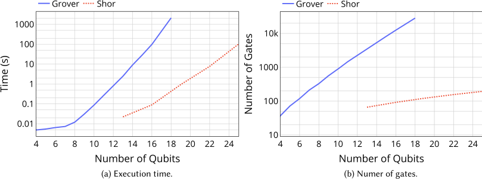

Fig. 6. Comparison between Grover’s search algorithm and Shor’s factorization algorithm.

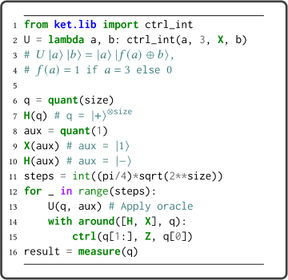

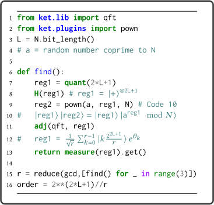

Code 11. Grover’s search algorithm [15].

Code 12. Order-finding quantum algorithm used in Shor’s factorization algorithm [34].

_L_ -bits number, we only need to simulate 22_L_+1 quantum states (≈2/3 of the qubits in superposition). Also, we can efficiently execute the modular exponentiation need by Shor’s algorithm using a Ket Bitwise plugin, drastically reducing the number of quantum gates needed. We present the number of quantum gates that each algorithm needs in Figure 6(b). While we need to execute the order-finding routine three times, we plot the number of quantum gates for one execution only.

## 9 CONCLUSION

With the constraint that a quantum computer is available through a cloud-based service that processes in batch, we propose a runtime architecture that enables dynamic interaction between classical and quantum computers. We validated this proposal with the implementation of the Ket Quantum Programming framework2 that features a Python-embedded classical-quantum

> 2https://quantum-ket.gitlab.io.

> ACM Journal on Emerging Technologies in Computing Systems, Vol. 18, No. 1, Article 12. Pub. date: October 2021.

Ket Quantum Programming

12:23

programming language named Ket, the C++ quantum programming library Libket, and the KBW for quantum execution.

The proposed runtime architecture uses runtime quantum code generation to enable generic quantum programming while keeping the quantum code as specific as possible, minimizing unnecessary quantum executions. We also introduce the concept of futures to handle classical information generated during the quantum execution, allowing the program to control the quantum execution without the intervention of the local computer. We implement all these concepts in the C++ library Libket, turning it transparent for the programmer in the Ket programming language.

We believe that Ket is easier to get started and a more intuitive way to program quantum computers, especially for the part of the quantum programming community that is already familiar with Python because of its vast number of libraries for quantum computation. With Ket, we show that we can have a separable quantum and classical code/execution using a single classical-quantum programming language and without needing to interface a general-purpose language with a quantum specific one like Q# [39]. Also, we consider that the higher-level abstraction of Ket over quantum programming libraries like Qiskit [1] and others [8, 21, 36, 37] can stimulate the development of new quantum algorithms and applications.

Even though the Ket programming language allows construction that goes beyond NISQ [33] computer capacities, the proposed runtime architecture is suitable for current and near-future quantum computers. Although, the implementation of quantum hardware execution in the Ket quantum programming is future work. However, since the KQASM is more expressive than some quantum assembly, quantum platforms that use those assemblies impose limitations to the quantum execution, e.g., the IBM Q computers that use the OpenQASM [6] is unable to execute while loops.

With the KBW implementation, we improve over the bitwise representation [7], allowing the simulation of multiple qubits with a low amount of superposition or entanglement, demonstrating that the exponential execution time of a quantum simulator is not dependent on the number of qubits. We can see these results in the benchmarks, where KBW shows an exponential advantage in some cases and an exponential scale similar to the other simulator in the worst case. This implementation has a high potential for parallel execution, because the order of quantum gate execution is irrelevant among qubits that are not entangled. However, making KBW multithreading is future work.

The limitation for the batch execution of a cloud-based quantum computer is not valid for quantum computer simulators. However, we implement KBW with the same classical and quantum computers interaction restriction of Section 4. So, even though the final goal of Ket is real quantum hardware programming, we can validate the proposed runtime architecture with the KBW simulator.

The KQASM language takes advantage of the KBW ability to execute any one-qubit gate with many qubits of control without the need for quantum gate decomposition. Also, when the controlled gate does not entangle the control and target qubits, the simulation time increases linearly compared with the execution of the non-controlled gate. As KBW simulation time is independent of the number of qubits, QASM does not need to provide any information _a priori_ on the total number of qubits that KBW needs to simulate, since it can arbitrarily allocate and free qubits.

In the proposal of the runtime architecture and the implementation of the Ket Quantum Programming, we do not rightly address the problem of debugging quantum programs, and there is a lack of precision in the description of the quantum hardware execution. In future works, we also want to address the problem of quantum debugging and answer the following questions: With the inability to look into the superposition and the no-cloning theorem, how does one debug a

ACM Journal on Emerging Technologies in Computing Systems, Vol. 18, No. 1, Article 12. Pub. date: October 2021.

E. C. R. da Rosa and R. de Santiago

12:24

quantum hardware execution? And, considering the exponential increase in information, how does one efficiently debug a simulated quantum execution?

## REFERENCES

- [1] Héctor Abraham et al. 2019. Qiskit: An Open-source Framework for Quantum Computing. https://zenodo.org/record/ 2562111/export/hx.

- [2] Frank Arute et al. 2019. Quantum supremacy using a programmable superconducting processor. _Nature_ 574, 7779 (Oct. 2019), 505–510. https://doi.org/10.1038/s41586-019-1666-5

- [3] Jeff Barr. 2019. Amazon Braket—Get Started with Quantum Computing. AWS News Blog. https://aws.amazon.com/ blogs/aws/amazon-braket-get-started-with-quantum-computing/.

- [4] Charles H. Bennett, Gilles Brassard, Claude Crépeau, Richard Jozsa, Asher Peres, and William K. Wootters. 1993. Teleporting an unknown quantum state via dual classical and Einstein-Podolsky-Rosen channels. _Phys. Rev. Lett._ 70 (Mar. 1993), 1895–1899. Issue 13. https://doi.org/10.1103/PhysRevLett.70.1895

- [5] Benjamin Bichsel, Maximilian Baader, Timon Gehr, and Martin Vechev. 2020. Silq: A high-level quantum language with safe uncomputation and intuitive semantics. In _Proceedings of the 41st ACM SIGPLAN Conference on Programming Language Design and Implementation (PLDI’20)_ . Association for Computing Machinery, New York, NY, 286–300. https://doi.org/10.1145/3385412.3386007

- [6] Andrew W. Cross, Lev S. Bishop, John A. Smolin, and Jay M. Gambetta. 2017. Open Quantum Assembly Language. Retrieved from https://arXiv:1707.03429.

- [7] Evandro Chagas Ribeiro da Rosa and Bruno G. Taketani. 2020. QSystem: Bitwise Representation for Quantum Circuit Simulations. Retrieved from https://arXiv:2004.03560.

- [8] Cirq Developers. 2021. _Cirq_ . https://doi.org/10.5281/zenodo.4750446 See full list of authors on Github. Retrieved from https://github.com/quantumlib/Cirq/graphs/contributors.

- [9] Simon J. Devitt, William J. Munro, and Kae Nemoto. 2013. Quantum error correction for beginners. _Rep. Progr. Phys._ 76, 7 (July 2013), 076001. https://doi.org/10.1088/0034-4885/76/7/076001

- [10] P. A. M. Dirac. 1939. A new notation for quantum mechanics. _Math. Proc. Cambridge Philos. Soc._ 35, 3 (July 1939), 416–418. https://doi.org/10.1017/S0305004100021162

- [11] Samuel S. Feitosa, Juliana K. Vizzotto, Eduardo K. Piveta, and Andre R. Du Bois. 2016. FJQuantum—A quantum object oriented language. _Electr. Notes Theoret. Comput. Sci._ 324 (Sep. 2016), 67–77. https://doi.org/10.1016/j.entcs.2016.09. 007

- [12] Richard P. Feynman. 1982. Simulating physics with computers. _Int. J. Theoret. Phys._ 21, 6–7 (June 1982), 467–488. https://doi.org/10.1007/BF02650179

- [13] X. Fu, L. Riesebos, M. A. Rol, Jeroen van Straten, J. van Someren, N. Khammassi, I. Ashraf, R. F. L. Vermeulen, V. Newsum, K. K. L. Loh, J. C. de Sterke, W. J. Vlothuizen, R. N. Schouten, C. G. Almudever, L. DiCarlo, and K. Bertels. 2019. eQASM: An executable quantum instruction set architecture. In _Proceedings of the IEEE International Symposium on High Performance Computer Architecture (HPCA’19)_ . 224–237. https://doi.org/10.1109/HPCA.2019.00040

- [14] Alexander S. Green, Peter LeFanu Lumsdaine, Neil J. Ross, Peter Selinger, and Benoît Valiron. 2013. Quipper: A scalable quantum programming language. _ACM SIGPLAN Notices_ 48, 6 (June 2013), 333–342. https://doi.org/10.1145/ 2499370.2462177

- [15] Lov K. Grover. 1997. Quantum mechanics helps in searching for a needle in a haystack. _Phys. Rev. Lett._ 79, 2 (July 1997), 325–328. https://doi.org/10.1103/PhysRevLett.79.325

- [16] Ji Guan, Mingsheng Ying, Runyao Duan, Li Zhou, Yang He, and Shusen Liu. 2017. _Q_ | _SI_ ⟩: A quantum programming environment. _Sci. Sinica Inform._ 47, 10 (Oct. 2017), 1300–1315. https://doi.org/10.1360/N112017-00095

- [17] Raban Iten, Roger Colbeck, Ivan Kukuljan, Jonathan Home, and Matthias Christandl. 2016. Quantum circuits for isometries. _Phys. Rev. A_ 93, 3 (Mar. 2016), 032318. https://doi.org/10.1103/PhysRevA.93.032318

- [18] Toshinari Itoko, Rudy Raymond, Takashi Imamichi, and Atsushi Matsuo. 2020. Optimization of quantum circuit mapping using gate transformation and commutation. _Integration_ 70 (Jan. 2020), 43–50. https://doi.org/10.1016/j.vlsi. 2019.10.004

- [19] Ali JavadiAbhari, Shruti Patil, Daniel Kudrow, Jeff Heckey, Alexey Lvov, Frederic T. Chong, and Margaret Martonosi. 2014. ScaffCC: A framework for compilation and analysis of quantum computing programs. In _Proceedings of the 11th ACM Conference on Computing Frontiers (CF’14)_ . ACM Press, New York, New York, 1–10. https://doi.org/10. 1145/2597917.2597939

- [20] Tyson Jones, Anna Brown, Ian Bush, and Simon C. Benjamin. 2019. QuEST and high performance simulation of quantum computers. _Sci. Rep._ 9, 1 (2019), 1–11.

- [21] N. Khammassi, I. Ashraf, J. v. Someren, R. Nane, A. M. Krol, M. A. Rol, L. Lao, K. Bertels, and C. G. Almudever. 2020. OpenQL : A Portable Quantum Programming Framework for Quantum Accelerators. Retrieved from https://arXiv: 2005.13283.

ACM Journal on Emerging Technologies in Computing Systems, Vol. 18, No. 1, Article 12. Pub. date: October 2021.

Ket Quantum Programming

12:25

- [22] N. Khammassi, G. G. Guerreschi, I. Ashraf, J. W. Hogaboam, C. G. Almudever, and K. Bertels. 2018. cQASM v1.0: Towards a Common Quantum Assembly Language. Retrieved from https://arXiv:1805.09607.

- [23] Nathan Killoran, Josh Izaac, Nicolás Quesada, Ville Bergholm, Matthew Amy, and Christian Weedbrook. 2019. Strawberry fields: A software platform for photonic quantum computing. _Quantum_ 3 (Mar. 2019), 129. https://doi.org/10. 22331/q-2019-03-11-129

- [24] Aleks Kissinger and John van de Wetering. 2020. PyZX: Large scale automated diagrammatic reasoning. _Electr. Proc. Theoret. Comput. Sci._ 318 (May 2020), 229–241. https://doi.org/10.4204/EPTCS.318.14

- [25] LLVM Project. 2021. LLVM Language Reference Manual—LLVM 10 documentation. https://llvm.org/docs/LangRef. html.

- [26] Hynek Mlnarik. 2007. Operational Semantics and Type Soundness of Quantum Programming Language LanQ. Retrieved from https://arXiv:0708.0890.

- [27] Nader Khammassi. 2021. QE-Lab/qx-simulator: QX Simulator. Retrieved from https://github.com/QE-Lab/qxsimulator.

- [28] Michael A. Nielsen and Isaac L. Chuang. 2010. Introduction and overview. In _Quantum Computation and Quantum Information_ . Cambridge University Press, Cambridge, 1–59. https://doi.org/10.1017/CBO9780511976667.005

- [29] Bernhard Ömer. 2005. Classical concepts in quantum programming. _Int. J. Theoret. Phys._ 44, 7 (July 2005), 943–955. https://doi.org/10.1007/s10773-005-7071-x

- [30] Adam Paetznick and Krysta M. Svore. 2014. Repeat-until-success: Non-deterministic decomposition of single-qubit unitaries. _Quantum Info. Comput._ 14, 15–16 (Nov. 2014), 1277–1301.

- [31] Scott Pakin. 2016. A quantum macro assembler. In _Proceedings of the IEEE High Performance Extreme Computing Conference (HPEC’16)_ . 1–8. https://doi.org/10.1109/HPEC.2016.7761637

- [32] Jennifer Paykin, Robert Rand, and Steve Zdancewic. 2017. QWIRE: A core language for quantum circuits. _ACM SIGPLAN Notices_ 52, 1 (May 2017), 846–858. https://doi.org/10.1145/3093333.3009894

- [33] John Preskill. 2018. Quantum computing in the NISQ era and beyond. _Quantum_ 2 (Aug. 2018), 79. https://doi.org/10. 22331/q-2018-08-06-79

- [34] Peter W. Shor. 1997. Polynomial-time algorithms for prime factorization and discrete logarithms on a quantum computer. _SIAM J. Comput._ 26, 5 (Oct. 1997), 1484–1509. https://doi.org/10.1137/S0097539795293172

- [35] Marcos Yukio Siraichi, Vinícius Fernandes dos Santos, Sylvain Collange, and Fernando Magno Quintao Pereira. 2018. Qubit allocation. In _Proceedings of the International Symposium on Code Generation and Optimization (CGO’18)_ . ACM Press, New York, New York, 113–125. https://doi.org/10.1145/3179541.3168822

- [36] Robert S. Smith, Michael J. Curtis, and William J. Zeng. 2017. A Practical Quantum Instruction Set Architecture. Retrieved from https://arXiv:1608.03355.

- [37] Damian S. Steiger, Thomas Häner, and Matthias Troyer. 2018. ProjectQ: An open source software framework for quantum computing. _Quantum_ 2 (Jan. 2018), 49. https://doi.org/10.22331/q-2018-01-31-49

- [38] Daniel Strano, Benn Bollay, nlewycky, and Tomas Babej. 2020. vm6502q/qrack: Issue #357 Addressed. https://doi.org/ 10.5281/zenodo.3842287

- [39] Krysta Svore, Martin Roetteler, Alan Geller, Matthias Troyer, John Azariah, Christopher Granade, Bettina Heim, Vadym Kliuchnikov, Mariia Mykhailova, and Andres Paz. 2018. Q#: Enabling scalable quantum computing and development with a high-level DSL. In _Proceedings of the Real World Domain Specific Languages Workshop (RWDSL’18)_ . ACM Press, New York, New York, 1–10. https://doi.org/10.1145/3183895.3183901

- [40] Rodney Van Meter and Kohei M. Itoh. 2005. Fast quantum modular exponentiation. _Phys. Rev. A_ 71, 5 (May 2005), 052320. https://doi.org/10.1103/PhysRevA.71.052320

- [41] Juha J. Vartiainen, Mikko Möttönen, and Martti M. Salomaa. 2004. Efficient decomposition of quantum gates. _Phys. Rev. Lett._ 92, 17 (Apr. 2004), 177902. https://doi.org/10.1103/PhysRevLett.92.177902

- [42] Dave Wecker and Krysta M. Svore. 2014. LIQUi|>: A Software Design Architecture and Domain-Specific Language for Quantum Computing. Retrieved from https://arXiv:1402.4467.

- [43] W. K. Wootters and W. H. Zurek. 1982. A single quantum cannot be cloned. _Nature_ 299, 5886 (Oct. 1982), 802–803. https://doi.org/10.1038/299802a0

Received November 2020; revised March 2021; accepted July 2021

ACM Journal on Emerging Technologies in Computing Systems, Vol. 18, No. 1, Article 12. Pub. date: October 2021.
