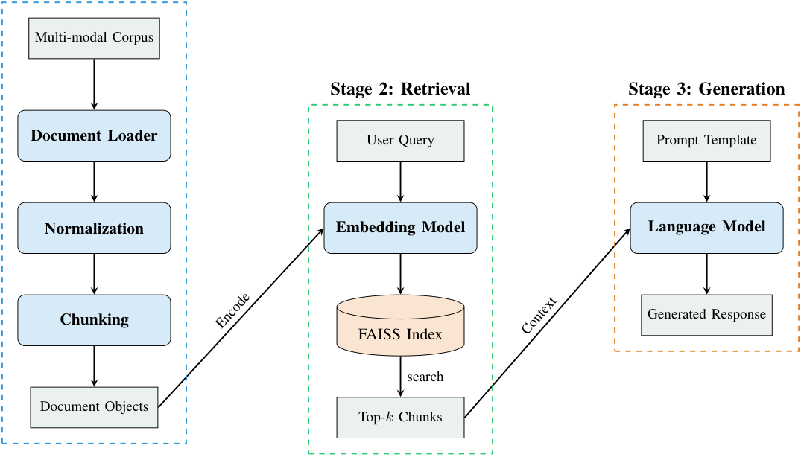

# Quantum-RAG: Retrieval-Augmented Generation Framework for Quantum Circuit Code Generation

Nicholas Stapleton_∗_ , Sharmin Afrose_†_ , Ethan Seefried_‡_ , Vicente Leyton Ortega_§_ , Travis S. Humble_¶_ , Tirthankar Ghosal_†_

_∗_ The Bredesen Center for Interdisciplinary Research & Education, University of Tennessee, Knoxville, Tennessee

_†_ Computer Science and Mathematics Division, Oak Ridge National Laboratory, Oak Ridge, Tennessee

_‡_ Computer Science, Colorado State University, Fort Collins, Colorado

_§_ Computational Sciences and Engineering Division, Oak Ridge National Laboratory, Oak Ridge, Tennessee

- Quantum Science Center, Oak Ridge National Laboratory, Oak Ridge, Tennessee

nstaple3@vols.utk.edu, (afroses, leytonorteva, humblets, ghosalt)@ornl.gov, eseefrie@colostate.edu

**_Abstract_ —Generating correct and executable quantum circuit code remains a significant barrier for both newcomers and experienced practitioners in quantum computing. While Large Language Models (LLMs) have shown promise in classical code generation, their application to quantum programming is hampered by limited domain-specific training data and the rapidly evolving nature of quantum software frameworks. In this work, we present Quantum-RAG, an extended Retrieval-Augmented Generation framework that couples a domain-specialized language model with a curated, multi-source knowledge corpus to produce Qiskit-based quantum circuit code. Our three-stage pipeline ingests documentation, educational notebooks, and research literature into a dense retrieval index and augments the generation model with the most relevant context at inference time. Evaluated on the Qiskit HumanEval benchmark, QuantumRAG achieves a Pass@1 of 0.4132, a Pass@3 of 0.6291, and a Pass@5 of 0.7020, surpassing the domain-adapted GraniteQiskit baseline by 101%, 72%, and 47% at each respective threshold. These results demonstrate that retrieval-augmented approaches can substantially improve quantum code generation without expensive model retraining.**

**_Index Terms_ —Quantum computing, quantum circuits, code generation, retrieval-augmented generation, large language models, Qiskit**

### I. INTRODUCTION

Quantum computing has the potential to offer considerable speed-ups over classical methods for problems in optimization, cryptography, and materials science [1]. However, writing correct quantum programs remains a specialized and error-prone activity that demands expertise in both quantum information theory and software engineering [2]. High-level frameworks such as Qiskit [1] lower the entry barrier by abstracting hardware details, yet practitioners still struggle with evolving

This manuscript has been authored by UT-Battelle, LLC, under Contract No. DEAC0500OR22725 with the U.S. Department of Energy. The United States Government retains and the publisher, by accepting the article for publication, acknowledges that the United States Government retains a nonexclusive, paid-up, irrevocable, worldwide license to publish or reproduce the published form of this manuscript, or allow others to do so, for the United States Government purposes. The Department of Energy will provide public access to these results of federally sponsored research in accordance with the DOE Public Access Plan.

979-8-3315-5193-3/26/$31.00 ©2026 IEEE

APIs, non-trivial gate-level reasoning, and the subtleties of qubit management [20].

The emergence of code-specialized Large Language Models (LLMs) has transformed classical software development through autocompletion, generation, and repair [3], with open models such as Code Llama [15] and Granite Code [16] achieving strong results across multiple programming languages. Extending these capabilities to quantum programming, however, introduces challenges that set it apart from generalpurpose coding: the scarcity of publicly available quantum code, the need for valid circuit constructions, and the rapid release cycle of quantum SDKs that quickly renders training data outdated [2], [4].

Recent efforts have begun to address this gap. Dupuis et al. introduced the Qiskit Code Assistant, a series of Granite-based LLMs fine-tuned on curated Qiskit corpora [2]. Vishwakarma et al. proposed the Qiskit HumanEval (QHE) benchmark, a hand-curated set of 150 quantum programming tasks that enables automated, reproducible evaluation of code LLMs [4]. More recently, Kheiri et al. [5] applied reinforcement-learningbased preference optimization to Qiskit code generation. Beyond Qiskit, Basit et al. introduced QHackBench for PennyLane [6], and multi-agent architectures such as QAgent [7] have shown that iterative debugging and tool use can further improve correctness.

Despite these advances, most existing approaches rely on computationally expensive fine-tuning or complex multi-agent orchestration. Retrieval-Augmented Generation (RAG) [11] offers a complementary path: by dynamically injecting relevant documentation and code snippets at inference time, a RAG system can keep a generation model up to date without retraining [6], [8]. Recent surveys [12] highlight the flexibility of RAG across diverse knowledge-intensive tasks, and DocPrompting [17] has demonstrated that retrieving official documentation at inference time significantly improves code generation for rapidly evolving libraries. In this paper, we present **Quantum-RAG** , a lightweight yet effective framework that pairs a domain-specialized generator with an extensive, multi-source retrieval corpus. Unlike general-purpose code RAG systems, Quantum-RAG addresses challenges unique

TABLE I

CORPUS COMPOSITION BY SOURCE CATEGORY.

|**Source Category**|**Files**|**Size**|**Chunks**|
|---|---|---|---|
|Qiskit 2.2 API Docs|679|11.4 MB|5,250|
|Educational Notebooks|127|4.7 MB|950|
|QCE 2023–2025 Proceedings|1,264|1.22 GB|11,370|
|arXiv Preprints|118|31.8 MB|1,060|
|**Total**|**2,188**|**1.24 GB**|**18,630**|

to quantum programming: rapidly evolving APIs that change semantics across Qiskit releases, the need to ground circuit construction in physical constraints, and the scarcity of idiomatic quantum code in general pretraining corpora. We evaluate Quantum-RAG on the Qiskit HumanEval benchmark and show that it doubles the Pass@1 of the Granite-Qiskit baseline, establishing a new state of the art for RAG-only quantum code generation.

### II. METHODOLOGY

Quantum-RAG follows a three-stage pipeline, illustrated in Figure 1: document ingestion, semantic retrieval, and contextaware generation. Each stage is designed for modularity, allowing independent updates to the corpus or the models.

### _A. Document Ingestion_

Table I summarizes the knowledge corpus, which comprises 2,188 files totaling 1.24 GB drawn from four complementary source categories.

The four source categories are: (i) Qiskit 2.2 API reference and developer guides (679 files, combining API reference pages with tutorial guides), (ii) educational Jupyter notebooks from Qiskit learning courses (127 files), (iii) research papers from IEEE Quantum Computing and Engineering (QCE) 2023–2025 proceedings (1,264 PDFs), and (iv) a curated set of arXiv preprints on quantum computing (118 PDFs). An extension-based dispatcher routes each file to an appropriate loader: DirectoryLoader for Markdown/MDX/RST, PyMuPDF for PDFs, and nbconvert for Jupyter notebooks. After extraction, a normalization step removes metadata, markup tags, and excess whitespace. The cleaned text is split into 2,400-character chunks with 200-character overlap using a recursive character splitter, producing approximately 18,630 chunks. A weighted stratified sampling strategy controls the proportion of chunks drawn from each source.

### _B. Semantic Retrieval_

Each chunk is embedded using the IBM Granite Embedding model [19] (30M parameters, 384 dimensions). The resulting vectors are indexed in a FAISS store [14], enabling cosine-similarity search, following the dense-passage retrieval paradigm introduced by Karpukhin et al. [13]. At query time, the user prompt is embedded with the same model, and the top-_k_ ( _k_ =6) most relevant chunks are retrieved and combined into a structured context block.

### _C. Context-Aware Generation_

The retrieved context and the original query are assembled into a prompt template that provides the model with both domain knowledge and the task description. We use the Qiskit Granite 3.2 8B model [16] as the generator, loaded in 4-bit quantization [18] to reduce memory usage to approximately 6 GB. Key decoding parameters include a temperature of 0.15, nucleus sampling with _p_ =0 _._ 95, a repetition penalty of 1.05, and a maximum output length of 512 tokens, favoring precise code completions over creative diversity. The prompt template instructs the model to treat retrieved documentation snippets as the primary source of truth and, critically, to detect physically impossible or ill-posed quantum requests, for example attempting to entangle a single qubit, and to suggest a correct Qiskit formulation instead. This zero-shot, retrievalgrounded prompting strategy differs from standard few-shot code generation prompts, which rely on static examples that may become outdated as APIs evolve.

### _D. Quantum-Specific Design Choices_

Several design decisions distinguish Quantum-RAG from a general-purpose code retrieval system. First, the corpus is anchored to the Qiskit 2.0+ API surface: documentation and educational materials reference the current qiskit distribution, and pre-2.x patterns such as the removed execute() function, the deprecated BasicAer provider, and the legacy .c_if() conditional syntax are absent from the indexed sources. This version-aware curation reduces the risk of generating deprecated or non-functional code, a particularly acute problem for quantum frameworks that undergo rapid API evolution [1].

Second, the multi-source corpus strategy is tailored to the structure of quantum programming knowledge. API documentation grounds the generator in correct function signatures and parameter types; educational Jupyter notebooks supply idiomatic usage patterns such as circuit construction, transpilation, and measurement workflows; and research literature from QCE proceedings and arXiv provides algorithmic context for tasks that require understanding of quantum algorithms rather than mere API fluency. A general Python code corpus would lack coverage of quantum gate semantics, qubit allocation strategies, and the physical constraints that distinguish valid circuits from syntactically plausible but logically incorrect ones.

### _E. Retrieval Parameter Rationale_

The chunk size of 2,400 characters was chosen to approximate the Granite Embedding model’s 512-token context window: at roughly 4.7 characters per token for code-heavy technical text, 2,400 characters maps to approximately 510 tokens, ensuring that each chunk is fully encoded without truncation. The 200-character overlap ( _∼_ 42 tokens) preserves function signatures and import statements that may span chunk boundaries. Top-_k_ =6 was selected to balance context richness against the generator’s 4,096-token context window: six chunks of _∼_ 510 tokens each consume approximately 3,060

## Stage 1: Ingestion

Multi-modal Corpus Stage 2: Retrieval Stage 3: Generation Document Loader User Query Prompt Template Normalization Embedding Model Language Model Chunking Generated Response FAISS Index search Document Objects Top-k Chunks Encode Context 

Fig. 1. Quantum-RAG system architecture showing the three-stage pipeline: (1) document ingestion with normalization and chunking, (2) semantic retrieval using dense embeddings and FAISS, and (3) context-aware generation using a domain-specialized language model.

tokens, leaving sufficient headroom for the prompt template and generated output. A systematic ablation study across these parameters is planned as future work.

### III. RESULTS

We evaluate Quantum-RAG on the Qiskit HumanEval (QHE) benchmark [4], which consists of 151 hand-curated quantum programming tasks spanning quantum circuit generation, simulation and execution, algorithm implementation, and gate operations. Following the established protocol, we measure functional correctness using the Pass@ _K_ metric, which estimates the probability that at least one of _K_ generated samples passes all unit tests.

Table II presents the Pass@ _K_ results for Quantum-RAG alongside the Granite-Qiskit baseline [2]. Our framework achieves a Pass@1 of 0.4132, representing a 101.4% relative improvement over Granite-Qiskit’s 0.2050. At higher sample budgets, the gains remain substantial: Pass@3 rises from 0.3650 to 0.6291 (+72.4%), and Pass@5 from 0.4770 to 0.7020 (+47.2%). These results confirm that augmenting the generation model with dynamically retrieved context significantly boosts code correctness across all evaluation thresholds.

The largest improvement appears at Pass@1, the most practically relevant metric, since it reflects the quality of the very first code suggestion a developer receives. The strong Pass@5 of 0.7020 further indicates that, with a modest sample budget,

#### TABLE II

PASS@ _K_ RESULTS ON THE QISKIT HUMANEVAL BENCHMARK. RELATIVE IMPROVEMENT OF QUANTUM-RAG OVER GRANITE-QISKIT IS SHOWN IN PARENTHESES.

|**Model**|**Pass@1**|**Pass@3**|**Pass@5**|
|---|---|---|---|
|Granite-Qiskit [2]|0.2050|0.3650|0.4770|
|**Quantum-RAG (Ours)**|**0.4132**|**0.6291**|**0.7020**|
|_Relative Improvement_|_+101.4%_|_+72.4%_|_+47.2%_|

Quantum-RAG can solve more than 70% of the benchmark tasks, a level of coverage that begins to approach practical utility for interactive coding assistance.

These gains can be attributed to two complementary factors. First, the retrieval component grounds the generator in up-to-date API documentation and idiomatic usage patterns, reducing hallucinated or deprecated function calls. Second, the inclusion of research literature and educational notebooks provides the model with algorithmic context that goes beyond surface-level API knowledge, enabling it to construct semantically meaningful circuits rather than syntactically plausible but logically incorrect ones.

### _A. Error Analysis_

To understand the nature of improvements, we categorize all 755 generated samples (151 tasks _×_ 5 samples each) by

TABLE III

OUTCOME DISTRIBUTION ACROSS 755 GENERATED SAMPLES PER MODEL. RESULTS ARE REPORTED UNDER THE PASS@1 METRIC, WITH 5 CANDIDATE PROGRAMS GENERATED PER PROMPT.

|||**Fail**|**/ Error Cases**||
|---|---|---|---|---|
|**Method**|**Passed**|**Syntax** **Error**|**Runtime** **Error**|**Logic** **Fail**|
|Granite-Qiskit|155 (20.5%)|348 (46.1%)|234 (31.0%)|18 (2.4%)|
|Quantum-RAG|312 (41.3%)|17 (2.3%)|399 (52.8%)|27 (3.6%)|

outcome type. Table III shows the distribution across four categories: passed (all unit tests pass), syntax error, runtime error, and logic failure (executes but produces incorrect results).

The most striking effect of retrieval augmentation is the near-elimination of syntax errors, which drop from 46.1% to 2.3%. By grounding generation in up-to-date API documentation, Quantum-RAG produces code that references valid function signatures and parameter names. However, the dominant failure mode shifts to runtime errors (52.8%), indicating that the model generates syntactically valid but semantically incorrect circuits, for instance, applying gates to non-existent qubits or constructing measurement operations with incorrect classical register mappings. This suggests that retrieval successfully addresses API-level correctness while deeper circuitlevel reasoning remains a challenge.

Table IV breaks down Pass@1 accuracy by task category. Quantum-RAG performs strongest on well-documented task types: Quantum Circuit Generation (61%), Gate Operations and Manipulation (60%), and State Preparation and Analysis (57%). Substantial gains also appear in Algorithm Implementation (43% vs. 16%) and Quantum Circuit Serialization (53% vs. 28%), where retrieval of idiomatic code patterns proves especially beneficial. Performance degrades on Backend and Runtime (28%), Visualization and Post-Processing (27%), and Simulation and Execution (17%), which are less represented in the corpus and require multi-step reasoning that extends beyond what single-chunk retrieval can provide. Notably, Simulation and Execution shows only a modest gain (17% vs. 14%), suggesting that execution-oriented tasks demand runtime reasoning that static retrieval alone cannot supply. In contrast, the Granite-Qiskit baseline achieves its highest accuracy on Quantum Information tasks (78%) but struggles broadly across all other categories, confirming that domainadapted fine-tuning alone is insufficient without access to current documentation.

### IV. CONCLUSION

We presented Quantum-RAG, a retrieval-augmented generation framework for quantum circuit code generation that achieves substantial improvements over the domain-adapted Granite-Qiskit baseline on the Qiskit HumanEval benchmark. By coupling a curated multi-source corpus of over 18,600 indexed chunks with a lightweight quantized generator, our approach demonstrates that dynamically retrieved context can serve as a powerful, cost-effective alternative to expensive

TABLE IV

PASS@1 ACCURACY (%) BY QHE TASK CATEGORY.

|**Task Category**|**Granite-Qiskit**|**Quantum-RAG**|
|---|---|---|
|Quantum Circuit Generation|20|**61**|
|Gate Operations & Manipulation|39|**60**|
|State Preparation & Analysis|17|**57**|
|Quantum Information|**78**|53|
|Algorithm Implementation|16|**43**|
|Advanced Circuit Manipulation|8|**33**|
|Quantum Circuit Serialization|28|**32**|
|Backend and Runtime|10|**28**|
|Visualization & Post-Processing|3|**27**|
|Simulation and Execution|14|**17**|

model fine-tuning. Our error analysis reveals that retrieval augmentation nearly eliminates syntax errors (from 46% to 2%), shifting the many failure mode to runtime errors that require deeper circuit-level reasoning. This finding highlights the complementary roles of retrieval-based grounding and model-internal knowledge.

Looking ahead, we plan to extend the corpus to cover additional quantum frameworks such as PennyLane and Cirq, incorporate multi-agent refinement loops for iterative debugging, and evaluate on emerging cross-framework benchmarks to assess generalization. We also intend to broaden comparisons to frontier LLMs and alternative code generation techniques. Future work will explore combining RAG with fine-tuning and conducting systematic ablation studies over retrieval parameters such as chunk size, top-k, and embedding model selection.

### ACKNOWLEDGMENT

This material is based upon work supported by the U.S. Department of Energy, Office of Science, National Quantum Information Science Research Centers, Quantum Science Center.

### REFERENCES

- [1] A. Javadi-Abhari, M. Treinish, K. Krsulich, C. J. Wood, J. Lishman, J. Gacon, S. Martiel, P. D. Nation, L. S. Bishop, A. W. Cross _et al._ , “Quantum computing with Qiskit,” _arXiv preprint arXiv:2405.08810_ , 2024.

- [2] N. Dupuis, L. Buratti, S. Vishwakarma, A. Viudes Forrat, D. Kremer, I. Faro, R. Puri, and J. Cruz-Benito, “Qiskit Code Assistant: Training LLMs for generating quantum computing code,” _arXiv preprint arXiv:2405.19495_ , 2024.

- [3] M. Chen _et al._ , “Evaluating large language models trained on code,” _arXiv preprint arXiv:2107.03374_ , 2021.

- [4] S. Vishwakarma, F. Harkins, S. Golecha, V. S. Bajpe, N. Dupuis, L. Buratti, D. Kremer, I. Faro, R. Puri, and J. Cruz-Benito, “Qiskit HumanEval: An evaluation benchmark for quantum code generative models,” in _Proc. IEEE Int. Conf. Quantum Computing and Engineering (QCE)_ , 2024, pp. 1170–1176.

- [5] K. Kheiri, A. Aamir, A. Miranskyy, and C. Ding, “QSpark: Towards reliable Qiskit code generation,” _arXiv preprint arXiv:2507.01594_ , 2025.

- [6] A. Basit, M. Shao, M. H. Asif, N. Innan, M. Kashif, A. Marchisio, and M. Shafique, “QHackBench: Benchmarking large language models for quantum code generation using PennyLane hackathon challenges,” _arXiv preprint arXiv:2506.20008_ , 2025.

- [7] N. Quetschlich, A. Schuckert, P. S. Gerjets, and R. Wille, “QAgent: A hierarchical multi-agent framework for autonomous quantum circuit synthesis,” _arXiv preprint arXiv:2505.13467_ , 2025.

- [8] A. Basit, M. H. Asif, N. Innan, M. Kashif, A. Marchisio, and M. Shafique, “PennyCoder: A lightweight on-device LLM for quantum code generation,” _arXiv preprint arXiv:2507.19562_ , 2025.

- [9] A. Szalay, V. Koch, E. A. Coello P´erez, G. d’Adesky, V. Divakar, and C. Wilson, “AGENT-Q: Generating executable quantum circuits from natural language,” in _Proc. IEEE Int. Conf. Quantum Computing and Engineering (QCE)_ , 2025.

- [10] A. Basit, M. H. Asif, N. Innan, M. Kashif, A. Marchisio, and M. Shafique, “PennyLang: A curated dataset for quantum code generation with PennyLane,” in _Proc. IEEE Int. Conf. Quantum Computing and Engineering (QCE)_ , 2025.

- [11] P. Lewis, E. Perez, A. Piktus, F. Petroni, V. Karpukhin, N. Goyal, H. K¨uttler, M. Lewis, W.-t. Yih, T. Rockt¨aschel, S. Riedel, and D. Kiela, “Retrieval-augmented generation for knowledge-intensive NLP tasks,” in _Advances in Neural Information Processing Systems (NeurIPS)_ , vol. 33, 2020, pp. 9459–9474.

- [12] Y. Gao, Y. Xiong, X. Gao, K. Jia, J. Pan, Y. Bi, Y. Dai, J. Sun, Q. Guo, M. Wang, and H. Wang, “Retrieval-augmented generation for large language models: A survey,” _arXiv preprint arXiv:2312.10997_ , 2024.

- [13] V. Karpukhin, B. O˘guz, S. Min, P. Lewis, L. Wu, S. Edunov, D. Chen, and W.-t. Yih, “Dense passage retrieval for open-domain question answering,” in _Proc. Conf. Empirical Methods in Natural Language Processing (EMNLP)_ , 2020, pp. 6769–6781.

- [14] J. Johnson, M. Douze, and H. J´egou, “Billion-scale similarity search with GPUs,” _IEEE Trans. Big Data_ , vol. 7, no. 3, pp. 535–547, 2021.

- [15] B. Rozi`ere, J. Gehring, F. Gloeckle, S. Sootla, I. Gat, X. E. Tan, Y. Adi, J. Liu, R. Sauvestre, T. Remez _et al._ , “Code Llama: Open foundation models for code,” _arXiv preprint arXiv:2308.12950_ , 2023.

- [16] M. Mishra, M. Stallone, G. Zhang, Y. Shen, A. Prasad, A. Meza Soria, M. Merler, P. Selvam, S. Surendran, S. Singh _et al._ , “Granite code models: A family of open foundation models for code intelligence,” _arXiv preprint arXiv:2405.04324_ , 2024.

- [17] S. Zhou, U. Alon, F. F. Xu, Z. Wang, Z. Jiang, and G. Neubig, “DocPrompting: Generating code by retrieving the docs,” in _Proc. Int. Conf. Learning Representations (ICLR)_ , 2023.

- [18] T. Dettmers, A. Pagnoni, A. Holtzman, and L. Zettlemoyer, “QLoRA: Efficient finetuning of quantized LLMs,” in _Advances in Neural Information Processing Systems (NeurIPS)_ , vol. 36, 2023.

- [19] P. Awasthy, A. Trivedi, Y. Li, M. Bornea, D. Cox, A. Daniels, M. Franz, G. Goodhart, B. Iyer, V. Kumar _et al._ , “Granite embedding models,” _arXiv preprint arXiv:2502.20204_ , 2025.

- [20] F. Leymann and J. Barzen, “The bitter truth about gate-based quantum algorithms in the NISQ era,” _Quantum Science and Technology_ , vol. 5, no. 4, p. 044007, 2020.
