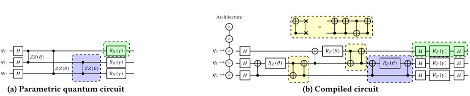
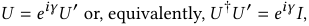
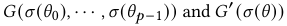
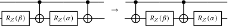
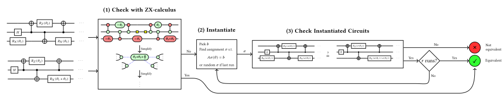
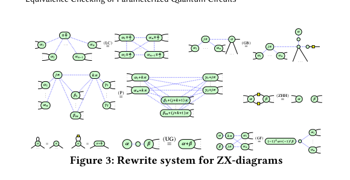
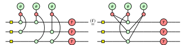
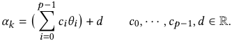
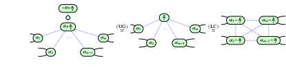

# Equivalence Checking of Parameterized Qantum Circuits

Verifying the Compilation of Variational Qantum Algorithms

|Tom Peham|Lukas Burgholzer|Robert Wille|
|---|---|---|
|Chair for Design Automation,|Institute for Integrated Circuits,|Chair for Design Automation,|
|Technical University of Munich, Germany|Johannes Kepler University Linz, Austria|Technical University of Munich, Germany|
|tom.peham@tum.de|lukas.burgolzer@jku.at|Software Competence Center Hagenberg GmbH, Austria robert.wille@tum.de|

## ABSTRACT

Variational quantum algorithms have been introduced as a promising class of quantum-classical hybrid algorithms that can already be used with the noisy quantum computing hardware available today by employing parameterized quantum circuits. Considering the non-trivial nature of quantum circuit compilation and the subtleties of quantum computing, it is essential to verify that these parameterized circuits have been compiled correctly. Established equivalence checking procedures that handle parameter-free circuits already exist. However, no methodology capable of handling circuits with parameters has been proposed yet. This work lls this gap by showing that verifying the equivalence of parameterized circuits can be achieved in a purely symbolic fashion using an equivalence checking approach based on the ZX-calculus. At the same time, proofs of inequality can be eciently obtained with conventional methods by taking advantage of the degrees of freedom inherent to parameterized circuits. We implemented the corresponding methods and proved that the resulting methodology is complete. Experimental evaluations (using the entire parametric ansatz circuit library provided by Qiskit as benchmarks) demonstrate the ecacy of the proposed approach. The implementation is open source and publicly available as part of the equivalence checking tool QCEC (https://github.com/cda-tum/qcec) which is part of the Munich Quantum Toolkit (MQT).

## 1 INTRODUCTION

Quantum computers promise a computational advantage over classical computers for certain problems [1]ś[3]. Far-term quantum algorithms such as Shor’s algorithm for integer factorization [4] and Grover search [5] require robust, large-scale error correction schemes to retrieve a meaningful result from their execution [6]. Noisy Intermediate Scale Quantum (NISQ) computers [7], the ones that are available today, are not able to implement this error correction yet. Due to the high gate error rates and short coherence times of NISQ devices, the depth of any quantum circuit to be run on them is inherently limited.

Variational Quantum Algorithms [8] have been proposed to achieve a computational advantage despite these limitations. These algorithms use quantum programs as subroutines in a classical optimization routine. The optimization loop iteratively improves the parameters of a quantum circuit ansatz, which, in turn, is used to estimate some desired quantity, such as the expectation value of some observable. This general variational

framework has been applied to solve problems in chemistry [9], nance [10], discrete optimization [11], and more.

But, before running an ansatz on a target device, a compilation step has to be performed where the circuit is translated into a natively supported gate-set and routed such that it conforms to the device’s topological constraintsÐa costly and non-trivial procedure [12]ś[15]. To avoid the necessity of recompiling a quantum circuit in each iteration step of a variational algorithm, the circuit is usually compiled once in parameterized form in which the parameters tuned by the classical optimization routine are not bound to specic values. This compiled parameterized circuit can then be used in the optimization loop without having to perform all compilation steps over and over again.

The increasing use of parameterized circuits in the development of quantum algorithms has also brought along the need for verifying that these circuits have been compiled correctly. Established equivalence checking methods such as proposed in [16]ś[20] are able to prove that a compiled circuit still adheres to its specication after compilation. However, these approaches cannot handle parameterized circuits. The only way to verify the compilation of variational quantum algorithms with these methods is to check the equivalence of the original and the instantiated compiled ansatz in each iteration. Since equivalence checking is a hard problem for even one instanceÐit is, in fact, a QMA-complete problem [21]Ðsolving it over and over again is hardly a feasible approach.

In this work, we propose, for the rst time, a methodology to solve the equivalence checking problem for parameterized quantum circuits. The proposed, multi-stage method starts out by using an approach based on the ZX-calculus [22], [23] to try and prove the equivalence of both parameterized circuits. If this does not succeed, parameters of the circuits are instantiated, and a conventional, complete equivalence checker is employed. In order to make this check as easy as possible, we derive an instantiation scheme that allows simplifying most of the parameterized gates from the circuits. Furthermore, we prove this yields a complete equivalence checking procedure for parameterized quantum circuits.

The resulting methodology has been evaluated on the entire Qiskit [24] parameterized circuit library, which shows that the proposed approach can decide the equivalence of variational ansatz circuits for a high number of qubits and larger circuit depth than is even practically executable today. The instantiation scheme, in particular, allows for checking instances that would be infeasible to handle otherwiseÐreducing the equivalence checking runtime

Tom Peham, Lukas Burgholzer, and Robert Wille

Architecture 4 = 3 2:   ( ) 0 ↦→ 2   ( )   ( )   ( ) 1:   ( ) 1 ↦→ 1   ( )  ( )   ( )   ( )  ( ) 0:   ( ) 2 ↦→ 0    ( )  (a) Parametric quantum circuit (b) Compiled circuit 

Figure 1: Compiling a parametric circuit to a device

by orders of magnitude in many cases. While this method has been developed with variational algorithms in mind, the approach is much more general and works for any application that uses parameterized quantum circuits. The implementation is open source and publicly available at https://github.com/cda-tum/qcec.

The remainder of this paper is structured as follows. To keep this work self-contained, Section 2 establishes the necessary background on quantum computing and variational quantum algorithms. Section 3 motivates the problem of equivalence checking of parameterized quantum circuits, discussing the shortcomings of existing equivalence checking approaches in the parameterized case and proposes a complete equivalence checking ow for parameterized circuits. After elaborating the details of the proposed methods in Section 4, results obtained from the experimental evaluations are provided in Section 5. Finally, Section 6 concludes this paper.

## 2 BACKGROUND

This section briey covers the necessary background to keep this work self-contained as well as the relevant related work from the literature. For an in-depth introduction, see [25].

## 2.1 Quantum Computing

In quantum computing, information is represented in the form of quantum bits (short qubits) which, contrary to the classical world, cannot only be in the basis states |0⟩ =  01  and |1⟩ =  10 , but also in a superposition

0 |0⟩+ 1 |1⟩ with 0, 1 ∈ C and |0|2 + |1|2 = 1. Multi-qubit systems are then described as superpositions of basis states in the product Hilbert space (C2 )⊗ . All transformations of qubits have to be unitary transformations, i.e., linear transformations  : C2 → C2 such that † =  , where † is the conjugate transpose of  and  is the identity transformation. Quantum computations are typically described as quantum circuits which are diagrams composed of wires (representing qubits) as well as boxes and interconnections on these wires called gates (representing transformations of qubits). If the gate set is expressive enough, any quantum computation can be written as a quantum circuit using only gates from this set.

Example 1. The Hadamard gate  = ~~√~~ <u>12</u>  11 −11  is one of the fundamental single-qubit quantum gates because it puts a qubit in a basis state |0⟩ or |1⟩ into an equal superposition of these basis states. The two-qubit controlled not (CNOT) gate (which is natively supported on many quantum computers) ips the second qubit if the rst qubit is in the |1⟩ state and leaves it unchanged otherwise.

Although quantum algorithms are commonly described via quantum circuits across dierent abstraction levels, their initial description usually contains high-level gates and concepts that are not directly supported by actual quantum computers. In fact, existing quantum computers only support a limited gate library and frequently have limited connectivity between the qubits which means that not every pair of qubits on a quantum hardware can interact in a two-qubit gate. Hence, in order to run a quantum algorithm on an actual device, a compilation step has to be performed which consists of synthesizing the gates of a quantum circuit to the supported gate set, mapping logical to physical qubits, inserting SWAP gates such that all two-qubit gates can be properly executed, and applying optimizations to reduce the size of the circuit [12]ś[15].

Example 2. Assume the circuit in Fig. 1a shall be compiled to an architecture which supports a gate library consisting of CNOT,  , and  gates, and has limited two-qubit interactions as shown on the left-hand side of Fig. 1b. Then, Fig. 1b shows a possible way of compiling this circuit. Because the ZZ gate (which is synthesized to two CNOT gates and an  gate) between physical qubit 2 and 0 cannot be executed directly, a SWAP gate has to be introduced into the circuit. As shown above the circuit, this SWAP gate is synthesized as a sequence of three CNOT gates. One of these CNOTs can be cancelled with the CNOT of the synthesized ZZ gate, simplifying the circuit in the process.

## 2.2 Variational Quantum Algorithms

Even with sophisticated compilation schemes, the noisy nature of state-of-the-art quantum computing devices makes it impossible to run far-term quantum algorithms such as Shor’s algorithm [4], which require a substantial amount of gates. As every gate potentially introduces an error into the system and, due to the short coherence times of qubits, the maximal depth of quantum circuits is limited on NISQ devices [7].

Variational Quantum Algorithms have been proposed to allow for expressing more functionality even with low-depth circuits. The quantum computations in variational algorithms are expressed via ansatz circuits. These are shallow parameterized quantum circuits  ( ) with a parameter vector  = (0, · · · , −1). Each assignment  : { | 0 ≤  < } →(−, ] yields an instantiated circuit  ( ( )). The goal of a variational algorithm is to successively adapt the circuit parameters using a classical optimization routine (e.g., gradient descent) so that the resulting circuit can be used to estimate some desired quantity, i.e, the ground state of a molecule. By using classical computing, variational ansatz circuits can be deliberately kept shallow. However, shallow circuits are generally less expressive then more

Equivalence Checking of Parameterized Qantum Circuits

complex circuits and ansatz circuits of dierent complexity have been developed.

Example 3. The parameterized circuit shown in Fig. 1a represents an instance of an Quantum Alternating Operator Ansatz (QAOA, [11]) which can be used to solve problems such as quadratic unconstrained binary optimization problems. The name comes from the fact that a QAOA ansatz is comprised of two circuit blocks, each of which is parameterized by a dierent parameter.

Note that, throughout the iterations in the variational algorithm, only the values of the parameters change, while the general circuit structure of the ansatz stays the same. Therefore, it is common to perform the costly compilation of an ansatz in its parametric form only once and, then, instantiate the parameters of this compiled circuit in each iteration instead of instantiating the parameters and compiling each time. This saves a lot of overhead incurred by repeated and potentially expensive compilation steps.

## 3 VERIFYING VARIATIONAL QUANTUM CIRCUITS

Compiling a variational ansatz can signicantly change its structure due to synthesized gates, SWAP insertions, and optimizations applied during the compilation process. Because compilation errors are hard to detect from the results of an iteration of a variational algorithm alone, it is paramount to ensure a priori that the compiled ansatz still adheres to its specication. This section reviews the equivalence checking problem, describes how existing techniques can be used to solve it, and discusses why they do not work for parameterized circuits. Based on this, a methodology is proposed that deals with these shortcomings.

## 3.1 Equivalence Checking

In general, given two quantum circuits  and ′ that represent the unitary matrices  and ′ , the equivalence checking problem for quantum circuits asks whether

 =    ′ or, equivalently,  †  ′ =   , 

where  ∈(−, ] denotes a physically unobservable global phase. In other words, equivalence checking asks whether two quantum circuits  and ′ realize the same functionality (described by  and ′ , respectively).

Solving this problem is conceptually very simple. After constructing the matrices  and ′ , an element-wise comparison of them shows whether the circuits are equivalent or not. However, because of the exponential size of the matrices in question, this strategy is hardly feasible for practical quantum circuits. This problem has already been studied extensively. As a result, more sophisticated approaches have been proposed that can frequently solve the equivalence checking problem for large circuits and many qubits [16]ś[20].

However, when allowing parameterized gates in the circuits to be checked, the equivalence checking problem becomes even more general. Checking the equivalence of two parameterized circuits  ( ) and ′ ( ) requires showing that

 ( (0), · · · ,  ( −1)) and  ′ ( ( )) 

are equivalent for all assignments . The naive approach to circumvent this problem would be to just construct the matrices of  ( ) and ′ ( ) symbolically. But then, in addition to the

exponential size of the matrices, one also has to deal with symbolic variables when constructing the matrices. As known from computer algebra systems, trying to represent symbolic matrix entries precisely requires a lot of space for storing the coecients of the symbolic variables.

Alternatively, one might be tempted to simply check the equivalence for one specic instantiation of two parameterized circuits to conclude equivalence. Unfortunately, this brings along a couple of dicult challenges in and of itself. On the one hand, instantiating parameters in a random or unstructured fashion produces circuits that are hardÐif not impossibleÐto check with existing methods. On the other hand, instantiating parameters non-randomly can, as the following example shows, lead to false positives and, hence, also does not provide a sucient solution.

Example 4. Consider the following incorrect application of a commutation rule for the  gate:

→  ( )  ( )  ( )  ( ) 

Even though the two circuits are not equivalent for all ,  ∈(−, ], they are equivalent if  = . Therefore, equivalence of parametric circuits cannot be decided by checking equivalence of any one instantiation.

Because variational ansatz circuits are instantiated with dierent parameters in each iteration, verifying the compilation results of such circuits without symbolic equivalence checking methods requires checking the equivalence of  ( (0), · · · ,  ( −1)) and ′ ( ( )) for the parameter assignment  at each iteration  of the hybrid optimization loop. Repeatedly checking equivalence in this fashion leads to obvious problemsÐin particular when checking a single instance is already costly. Therefore, dedicated methods for equivalence checking of variational ansatz circuits are desperately needed.

## 3.2 Related Work

Before developing solutions to the equivalence checking problem for parameterized quantum circuits completely from scratch, it is helpful to consider existing solutions for the parameter-free case and see whether they can be extended to the parameterized case. Previous approaches to verication and equivalence checking broadly fall into three categories.

- Fully automated methods capable of checking equivalence of two specic parameter-free quantum circuits [17], [18], [20]: While these methods are able to check equivalence of many parameter-free circuits, they cannot be directly applied to parameterized circuits. More precisely, [20] only works with a limited gate set as all verication rules need to be explicitly derived manually for each gate and parameter. The approach proposed in [18] works with quantum decision diagrams which provide compact representations of unitary matrices by exploiting redundancies. But accurately detecting redundancies in the parametric case requires an exact representation of the respective symbolic matrix entries. Symbolic versions of decision diagrams have been employed previously [26] but exhibited large space requirements due to the exploding

Tom Peham, Lukas Burgholzer, and Robert Wille

(1) Check with ZX-calculus  (2 ) · · · −2 2  · · · (2) Instantiate (3) Check Instantiated Circuits  (1 )  (2 )  (3 ) · · ·· · · −3 ... −2+13Simplify+  2 ... 2+3 No PickFind assignment  ( ) =   s.t.   ((1 ))  ( (2 ))  ( (3 )) · · ·· · ·· · · =?   ( (2 ))  ( (1 ) +  (3 )) · · ·· · ·· · · Yes  runs?No Yes ✓× EquivalentNotequivalent  · · · ... ... or random  if last run  (1 + 3 ) · · · Simplify Yes No ... 

Figure 2: Proposed equivalence checking method for parameterized quantum circuits

symbolic coecients. Finally, [17] expresses rotations in the form of dyadic fractions similar to [26]. But dyadic fractions are insucient when working with gates that are not in the Cliord hierarchy as arbitrary rotations can only be approximated with dyadic fractions.

- Semi-automatic methods using formal languages for quantum computing and proof assistants [27]ś[29]: While these methods are very general when it comes to proving equalities in quantum computing, employing them requires expert knowledge about the languages and tools being used and, therefore, they are not suited for verication from a design automation perspective.

- Compiler-and domain-specic methods [30]ś[32]: These methods are based on the idea of writing compiler passes in a domain-specic language. Those languages are constructed in a way that allows for automated verication of entire compilation ows and, therefore, are more general than an equivalence checking method that only checks the equivalence of two specic circuits. The drawback of these methods is that they require dedicated implementations of compilation ows which frequently have to be updated once even small aspects of the compiler are changed. Automated equivalence checking, on the other hand, is agnostic to future improvements in compilation and optimization methods as it only operates on the circuit and not the compilation level.

Due to these shortcomings of existing equivalence checking methods, new methods dedicated to handling parameterized methods must be developed.

## 3.3 An Equivalence Checking Method for Parameterized Quantum Circuits

In this work, we propose a fully automated, ecient, and complete method for checking the equivalence of arbitrary parameterized quantum circuits. To this end, a dedicated multi-stage process, as depicted in Fig. 2, is used. The main ideas behind this method are sketched in the following.

First, the parameterized circuits are converted into parameterized ZX-diagramsÐa graphic description of quantum processesÐthat are then checked with a parametric version of the ZX-calculus simplication algorithm described in [19], [33] (step (1) in Fig. 2). If this check yields an armative answer to the question of equivalence, then the two parameterized circuits have been proven to be equivalent, and the algorithm terminates. However, due to the incompleteness of this rewriting approach, a non-armative answer does, in general, not imply that the circuits in question are non-equivalent.

Therefore, if the ZX-calculus approach is not able to prove equivalence, further steps have to be taken. To this end, note that, in order to prove non-equivalence of two parameterized circuits  ( ) and ′ ( ) it suces to nd one assignment  :  →(−, ] such that  ( ( )) ≠ ′ ( ( )).

As discussed above, choosing a good assignment is a delicate issue, as random assignments may produce hard equivalence checking instances, and non-random assignments can (as discussed in Example 4) lead to false positives. Instantiation can never produce false negatives, however. Hence, rather than choosing a random assignment, one can take advantage of the degrees of freedom provided by the parameters and instantiate the circuits in such a fashion as to make the subsequent equivalence check as simple as possible. In the proposed method, this is achieved by solving a linear system obtained from the expressions in parameterized gates (step (2) in Fig. 2). The instantiated circuits are then checked with an existing, complete equivalence checking method (step (3) in Fig. 2). If this method manages to prove non-equivalence of the instantiated circuits, it can be concluded that the parameterized circuits are not equivalent either.

To counteract the possibility of false positives, multiple non-random instantiations are checked. In the worst case, however, all these instantiations could yield false positives. Therefore, the circuits are instantiated randomly as the last resort before being checked one last time. This has the disadvantage of handing very complicated circuits over to the equivalence checker, but the advantageÐas proven in this workÐis that the probability of obtaining a false positive through random instantiation is 0. Hence, the output of this last check is returned as the nal result.

## 4 IMPLEMENTATION AND COMPLETENESS

Having the ideas and concepts discussed above (and illustrated in Fig. 2), this section now provides implementation details on the respective steps and proves that the resulting overall methodology is indeed complete.

## 4.1 Equivalence Checking of Parameterized Circuits with the ZX-calculus

This section describes how equivalence of parameterized circuits can be checked with the ZX-calculus. To this end, we rst review the basics of ZX-diagrams and the ZX-calculus.

ZX-diagrams [22], [23] are undirected, vertex-labelled graphs consisting of two kinds of nodes (also called spiders), namely the Z-spider ...  ... and X-spider ...  ... which carry a phase  ∈[0, 2) (a phase of 0 is usually omitted). Any quantum circuit can be expressed as a ZX-diagram.

Equivalence Checking of Parameterized Qantum Circuits

... 1 ±  2  ... (LC= ) ... 1 ∓  2  ∓  2 ... ... 1   ...  (GB= )   ... 2 −1 ... ... 2 ∓  2 −1 ∓  2 ... ... 1  ...   ... 1+ 1+ ... ... 1 1 ... ... ... ... 1 ... ... (=P) ... + 1+(++1) ...  + ... ...   ... (ZHH= ) ...   ... ...  ...  ... ...  ... +(++1) ...  =   =  +  2   ... (UG= )  + ...   ...1 ...... (GF= ) (−1)   +(−1)   ...1 ...... Figure 3: Rewrite system for ZX-diagrams ... ... ... ... ... ... ... ... ... ... 

The ZX-calculus is a set of axioms that can be used for equational reasoning about quantum processes solely through diagrammatic manipulations of ZX-diagrams. An example of one of the axioms of this calculus is the spider fusion rule ... ... ... ... (=f ) ...  + ..., which allows to combine connected spiders of the same colour.

Example 5. The circuit shown in Fig. 1a can be translated to the a ZX-diagram and simplied by applying the spider fusion rule.

       (=f )      

Although this ZX-diagram looks very similar to the original circuit, the ZZ gates have been translated into a form (so-called phase gadgets) that has no direct interpretation as a quantum circuit anymore.

The ZX-calculus has, among other applications, proven useful for equivalence checking [19], [33]. Given two quantum circuits  and ′ , one can check them for equivalence by constructing the ZX-diagram of −1 ′ and, then, simplifying the diagram as much as possible using the rewriting system shown in Fig. 3. If the ZX-diagram can be reduced to the identity diagram (the ZX-diagram consisting only of wires and no spiders), the two circuits are shown to be equivalent.

This method can be used to handle parameterized circuits as well, since all phases , , in Fig. 3 are just symbolic. For the sake of nding matches for the rewriting rules their precise value does not matter.

Whether or not the ZX-diagram of the circuit −1 ( )′ ( ) can be rewritten to the identity diagram depends on the symbolic expressions appearing in the diagram. It is reasonable to assume that all phases  are linear functions of the parameters  = (0, · · · , −1), i.e., they are of the form

 =   ∑ −1   +  0, · · · , −1, ∈ R. =0 

This assumption is justied considering that many optimizations of quantum circuits involve gate commutations and summation of rotation angles for rotation gates [34].

Under this assumption it is easy to see that all phases resulting from the application of the rules shown in Fig. 3 are also just linear functions of these parameters. If some parameters cancel and the resulting phase has the form <u></u> <u>2</u>,∈Z, new simplications become possible.

Example 6. Cancellation of parameters during simplication can lead to further simplications as, e.g., for following ZX-diagram.

− +  4  +  4 (UG= ) ... 1  2  ... (LC= ) ... 1 −  2  −  2 ... ... 1  ... ... 2 −1 ... ... 2 −  2 −1 −  2 ... ... 2 −1 ... ... ... ... 

If, eventually, all parameters cancel and the diagram is reduces to the identity when simplifying −1 ( )′ ( ), it can be concluded that  ( ) is equivalent to ′ ( ) entirely in parameterized form.

## 4.2 Determining Instantiation Parameters

Established equivalence checking methods like [18] greatly benet from circuits that have a certain repeating structure in their functionality [33], [35]. When using such methods to check equivalence of instantiated circuits, one can exploit the degrees of freedom in the parameters to try to create such structures. As shown in our experimental evaluations later in Section 5, this can signicantly decrease the complexity of checking the resulting parameter-free instance.

Based on previous assumptions, if the rotation angles are of the form  =  =− 01  +  for some constant  , then one can try to instantiate the angles  to a predened value by solving a linear system. This system has as many equations as there are parameterized angles in the circuits. When choosing the angles to solve for, one has to distinguish two cases in checking non-equivalent circuits:

- The error in the circuit appears in one of the parameter-free gates. In this case, one can try to solve for  = 0, for all parameterized angles. This eectively removes the entire parameterized gatesÐleading to a simpler circuit.

- The error in the circuit appears in one of the parameterized gates. In this case, removing the gates from the circuit would mask the error and lead to false conclusions. Then, one can still try to solve for rotation angles of 0. Nevertheless, when solving the linear system, some of the equations will, in practice, not have a solution precisely because of erroneous optimizations. The gates that cannot be removed will, therefore, usually be the ones containing an error.

In general, the linear system can be overdetermined and may not have a solution. It is NP-hard in general to nd a solution such that the maximal number of equations are satised [36]. One can still try to satisfy equations in a greedy fashion which, although not optimal, can be done in polynomial time.

## 4.3 Completeness Proof

If both the ZX-checker and the previously described instantiation method fail to show that two parameterized circuits are not equivalent, then it cannot be concluded with absolute certainty that the circuits are equivalent. However, in the following, we prove that it suces to randomly instantiate the parameters and check the equivalence of the resulting parameter-free circuits. The core observation is that, statistically, two random instantiations can be proven to almost never produce a subsequent false positive. Here, łalmost neverž means that out of the innitely many choices for the real-valued parameters  , the probability of choosing a combination of values that results in a false positive is 0.

Tom Peham, Lukas Burgholzer, and Robert Wille

The following assumes a familiarity with complex analysis and measure theory to keep the proofs as concise as possible. Any reader unfamiliar with these concepts might skip to the last paragraph of this section.

The following lemma will be the workhorse in the proof of Theorem 4.2.

Lemma 4.1. Let  : C → C be an analytic function,  be the Lebesgue measure on R , and  ( ) = { ∈ R |  () = 0} the set of real zeros of  . If  ( ( )) > 0 then,  = 0.

Proof. Since  ( ( )) > 0 implies that  ( ) contains an accumulation point, this lemma follows directly from the identity principle for analytic functions. □

The converse of this lemma states that a non-trivial analytic function can have only countably many real zeros. With this lemma, we can now show the desired result.

Theorem 4.2. Let  ( ) and ′ ( ) be two non-equivalent quantum circuits with parameter vector  ∈(−, ] . Suppose that all rotation angles in the gates of  ( ) and ′ ( ) are linear functions of  . Then, P{ |  ( ) = ′ ( )} = 0.

Proof. Due to the assumption on the angles of  ( ) and ′ ( ), all matrix entries of their respective gate matrices are of the form  =0+ , which is a complex analytic function in  . The system matrices  ( ) and ′ ( ) are the product of the respective gate matrices of the circuits  and ′ . Therefore, all entries of  and ′ are analytic in  . Without loss of generality, consider the , -th entries , ( ),,′().Then,,()− ,′()isalso analytic. By Theorem 4.1, the set of zeros of , ( ) − ,′()has measure zero. Therefore, the probability of choosing random parameters in (−, ] such that , ( ) = ,′()is 0. Since this holds for one matrix entry, it follows immediately that P{ |  ( ) = ′ ( )} = 0. □

The attentive reader might argue that this fact negates the need for the previously discussed methods. While this is true in theory, our experimental evaluations clearly demonstrate that, in practice, equivalence checking of circuits with random rotations is a computationally dicult task. It is, therefore, only used as a last resort in the proposed equivalence checking method.

## 5 EXPERIMENTAL EVALUATION

To evaluate the equivalence checking method proposed in this work, it has been implemented using a combination of C++ and Python. In order to utilize the ZX-calculus, a parameterized version of the rules in Fig. 3 and the resulting equivalence checking method have been implemented. For verifying instantiated circuits the approach presented in [18] has been used. The resulting implementation is publicly available under https://github.com/cda-tum/qcec. The resulting tool works as a push-button method, requiring few lines of code and no expert knowledge on verication. To demonstrate the eectiveness of the proposed method, we conducted a broad set of experiments discussed in the following.

## 5.1 Setup

To test a wide range of parameterized ansatz circuits, the proposed method was evaluated on the entire available library of parameterized ansatz circuits provided by the Qiskit circuit library [24]. The circuits have been created with varying depths and dierent entanglement patterns (linear, circular, full, and SCA).

In order to also evaluate the proposed method on non-equivalent circuits, two kinds of errors were injected into the compiled circuits. The rst type of error were incorrect applications of control and target qubits in two-qubit gates. The goal of the rst type of error was to mimic situations where the control and targets of certain twoqubit gates have been erroneously exchangedÐa common mistake that can happen in compilers. To this end, every two-qubit gate had a low chance (0.5%) of being ipped. The second type of error was concerned with errors in the parameters. Many optimizations on rotation gates involve phase shifts in the rotation angles of a gate. Therefore, with a low probability (1%), each parameterized angle had a chance of having an erroneous phase shift applied to it.

All circuits have been compiled using qiskit-terra 0.21.0 with optimization level O2. The target devices for compilation were the 20-qubit ibmq-singapore, the 27-qubit ibmq-cairo, the 65-qubit ibmqmanhattan and the 127-qubit ibmq-washington devices. The circuits have been compiled to the next smallest viable architecture.

## 5.2 Results and Discussion

Table 1 shows the runtime () of the proposed approach for circuits with varying numbers of qubits (), parameters (#), and gates for both the original () and compiled version (′ ) of each equivalent ansatz circuit 1. All considered circuits were successfully veried completely with the ZX-calculus, and no instantiation was necessary. As can be seen from these results, the proposed approach scales to the largest quantum systems available today and is capable of verifying the compilation results of any of the variational algorithms that are currently being explored for near-term applications.

Table 2 compares the instantiation approach proposed in Section 4.2 with random instantiation for both considered types of errors. The table shows runtimes for both the proposed instantiation method using linear systems (lin) and random instantiation (rand). These are listed along with the number of errors (# ) for ipped two-qubit gate errors (Flipped) and phase shift errors (Shift). While the state-of-the-art method from [18] used to conduct the equivalence check of the instantiated circuits quickly runs into the set timeout of 1h when using random instantiation, the instantiation approach through solving linear systems allows to conclude the non-equivalence for a much larger range of circuitsÐin many cases within fractions of a second. This underlines the point made at the end of the previous section that, while random instantiations would be łgood enoughž for equivalence checking parameterized circuits in theory, they are hardly practical.

## 6 CONCLUSION

This paper proposes a methodology that, for the rst time, allows for checking the equivalence of parameterized quantum circuits. The proposed equivalence checking methodology is complete, i.e., it can check equivalence for any pair of quantum circuits. This is achieved by combining a ZX-calculus approach working directly on parameterized circuits and an instantiation strategy to create parameter-free circuits that are eciently checkable by existing equivalence checking methods. The resulting tool has been demonstrated to be capable of verifying the compilation of any of

1Due to space restrictions, only a representative sample of the results is provided. All results are available at https://github.com/cda-tum/qcec

Equivalence Checking of Parameterized Qantum Circuits

Table 1: Equivalent ansatz circuits

### Table 2: Non-equivalent circuits with dierent instantiations

|Benchmark|n |#param|||||′|||Flipped|||Shift||
|---|---|---|---|---|---|---|---|---|---|---|
||||||#err|lin[s]|rand[s]|#err|lin[s]|rand[s]|
|ExcitationPreserving-FSIM-Full|15|690|6061|8487|48|0.19|1178.81|9|0.20|668.49|
|RealAmplitudes-Full|15|60|391|1735|10|0.02|77.73|2|0.20|83.12|
|ExcitationPreserving-ISWAP-Full|15|375|4486|6090|24|0.21|636.63|6|0.22|542.35|
|TwoLocal-Full|20|40|631|1432|9|0.01|>3600|1|0.33|0.60|
|ExcitationPreserving-FSIM-Circular|35|560|3571|6666|21|0.15|>3600|13|0.14|>3600|
|ExcitationPreserving-ISWAP-Circular|35|385|2696|5557|30|0.12|>3600|6|0.12|>3600|
|RealAmplitudes-Full|35|210|3221|27718|117|0.16|>3600|3|0.16|>3600|
|EcientSU2-Full|35|210|3431|28055|151|0.18|>3600|2|0.18|>3600|
|EcientSU2-Full|35|140|2101|17705|77|0.11|>3600|1|0.10|>3600|
|ExcitationPreserving-FSIM-Linear|35|550|3476|4836|26|0.13|>3600|8|0.12|>3600|
|ExcitationPreserving-FSIM-Linear|35|344|2114|2930|8|0.10|>3600|8|0.12|>3600|
|TwoLocal-Full|35|70|1891|9261|44|0.16|>3600|2|0.13|>3600|
|TwoLocal-Full|35|105|3711|19152|92|0.43|>3600|2|0.25|>3600|
|TwoLocal-Full|35|140|5531|27878|128|1.21|>3600|2|0.43|>3600|
|ExcitationPreserving-ISWAP-Full|35|665|8436|19992|93|2.03|>3600|11|2.15|>3600|
|ExcitationPreserving-FSIM-Full|35|1260|11411|25245|124|2.03|>3600|35|11.40|>3600|
|ExcitationPreserving-ISWAP-Full|35|1295|16801|41715|211|7.79|>3600|26|204.66|>3600|
|EcientSU2-Full|40|160|2701|19823|91|0.28|>3600|2|0.28|>3600|
|TwoLocal-Full|40|160|7221|37293|192|2.31|>3600|1|0.73|>3600|
|ExcitationPreserving-FSIM-Circular|40|640|4081|5681|29|0.16|>3600|10|0.16|>3600|
|ExcitationPreserving-ISWAP-Linear|40|435|3011|4001|24|0.15|>3600|2|0.12|>3600|
|ExcitationPreserving-FSIM-Linear|40|630|3986|5546|21|0.18|>3600|12|0.15|>3600|
|RealAmplitudes-Full|40|160|2541|22750|95|0.25|>3600|2|0.21|>3600|
|ExcitationPreserving-FSIM-Linear|45|710|4496|6256|40|0.22|>3600|14|0.18|>3600|
|ExcitationPreserving-FSIM-Circular|45|450|2791|5827|37|0.15|>3600|13|0.14|>3600|
|ExcitationPreserving-ISWAP-Linear|45|490|3396|4511|23|0.19|>3600|4|0.16|>3600|
|ExcitationPreserving-ISWAP-Circular|45|495|3466|7921|40|0.24|>3600|11|0.20|>3600|
|ExcitationPreserving-FSIM-Circular|45|720|4591|9010|41|0.23|>3600|10|0.21|>3600|
|ExcitationPreserving-ISWAP-Circular|45|315|2116|4975|23|0.14|>3600|10|0.14|>3600|
|EcientSU2-Circular|45|270|811|4330|19|0.13|>3600|6|0.10|>3600|
|ExcitationPreserving-FSIM-Linear|50|494|3044|4220|28|0.16|>3600|14|0.14|>3600|

|Benchmark| |#param|||||′||[s]|
|---|---|---|---|---|---|
|TwoLocal-Circular|27|837|3295|13683|2.95|
|EcientSU2-Full|27|837|12232|115099|2.11|
|ExcitationPreserving-FSIM-Circular|27|837|5455|9292|7.18|
|ExcitationPreserving-ISWAP-Circular|27|1647|12205|21913|490.59|
|ExcitationPreserving-ISWAP-SCA|27|567|4105|7736|13.98|
|ExcitationPreserving-ISWAP-Full|27|3807|49465|130977|219.36|
|ExcitationPreserving-FSIM-Linear|27|1607|10475|20358|9.20|
|ExcitationPreserving-FSIM-Linear|27|2397|15685|32577|19.11|
|ExcitationPreserving-ISWAP-Linear|27|1617|11785|25423|31.76|
|RealAmplitudes-Full|65|715|21581|226474|18.92|
|TwoLocal-Circular|65|1365|5331|24257|23.08|
|RealAmplitudes-Full|65|1365|43031|445940|31.44|
|ExcitationPreserving-FSIM-SCA|65|2015|13131|23878|585.24|
|ExcitationPreserving-FSIM-SCA|65|3965|26131|46974|1903.53|
|EcientSU2-Full|65|1365|44396|446607|14.98|
|ExcitationPreserving-ISWAP-SCA|65|1365|9881|20770|165.96|
|ExcitationPreserving-ISWAP-Circular|65|455|3056|6929|11.41|
|TwoLocal-SCA|65|715|2731|13197|20.70|
|TwoLocal-Full|65|260|19046|105511|14.14|
|TwoLocal-SCA|127|508|1779|11093|2.41|
|ExcitationPreserving-FSIM-Linear|127|1264|7818|16202|8.97|
|RealAmplitudes-Circular|127|508|1017|8611|0.82|
|EcientSU2-SCA|127|508|1525|9729|0.14|
|RealAmplitudes-Full|127|508|24639|287203|12.34|
|TwoLocal-Circular|127|508|1779|11109|1.61|
|RealAmplitudes-Linear|127|508|1014|7000|1.55|
|ExcitationPreserving-FSIM-Circular|127|1270|7875|17454|12.98|
|RealAmplitudes-SCA|127|508|1017|8972|0.98|
|ExcitationPreserving-FSIM-SCA|127|1270|7875|17316|423.05|

| |: Gate count of uncompiled ansatz |′ |: Gate count of compiled ansatz

: Number of qubits #param: Number of distinct parameters

 : Runtime of ZX-checker #err: Number of errors

lin: Runtime with linear system instantiation rand Runtime with random instantiation

the variational ansatz circuits currently being explored for near-term quantum applicationsÐeven for the largest available quantum architectures.

- [16] L. Burgholzer, R. Raymond, and R. Wille, łVerifying results of the IBM Qiskit quantum circuit compilation ow,ž in Int’l Conf. on Quantum Computing and Engineering, 2020.

- [17] M. Amy, łTowards large-scale functional verication of universal quantum circuits,ž in International Conference on Quantum Physics and Logic, 2019.

- [18] L. Burgholzer and R. Wille, łAdvanced equivalence checking for quantum circuits,ž IEEE Trans. on CAD of Integrated Circuits and Systems, 2021.

## Acknowledgements

This work received funding from the European Research Council (ERC) under the European Union’s Horizon 2020 research and innovation program (grant agreement No. 101001318), was part of the Munich Quantum Valley, which is supported by the Bavarian state government with funds from the Hightech Agenda Bayern Plus, and has been supported by the BMWK on the basis of a decision by the German Bundestag through project QuaST.

- [19] A. Kissinger and J. van de Wetering, łReducing T-count with the ZX-calculus,ž Phys. Rev. A, 2020.

- [20] W. Chun-Yu, T. Yuan-Hung, J. Chaio-Shan, and J. Jie-Hong, łAccurate BDD-based Unitary Manipulation for Scalable and Robust Quantum Circuit Verication,ž in Design Automation Conf., 2022.

- [21] D. Janzing, P. Wocjan, and T. Beth, łłNon-identity checkž is QMA-complete,ž Int. J. Quantum Inform., 2005.

- [22] J. van de Wetering, ZX-calculus for the working quantum computer scientist, 2020. arXiv: 2012.13966.

- [23] B. Coecke and A. Kissinger, łPicturing quantum processes,ž in Diagrammatic Representation and Inference, 2018.

## REFERENCES

- [1] F. Arute et al., łQuantum supremacy using a programmable superconducting processor,ž Nature, 2019.

   - [24] G. Aleksandrowicz et al., łQiskit: An open-source framework for quantum computing,ž Zenodo, 2019.

- [2] H.-S. Zhong et al., Quantum computational advantage using photons, 2020. arXiv: 2012.01625.

   - [25] M. A. Nielsen and I. L. Chuang, Quantum Computation and Quantum Information. Cambridge University Press, 2010.

- [3] H.-Y. Huang, R. Kueng, G. Torlai, V. V. Albert, and J. Preskill, Provably ecient machine learning for quantum many-body problems, 2022. arXiv: 2106.12627.

   - [26] P. Niemann, A. Zulehner, R. Drechsler, and R. Wille, łOvercoming the Tradeo Between Accuracy and Compactness in Decision Diagrams for Quantum Computation,ž IEEE Trans. Comput.-Aided Des. Integr. Circuits Syst., 2020.

- [4] P. W. Shor, łPolynomial-time algorithms for prime factorization and discrete logarithms on a quantum computer,ž SIAM J. Comput., 1997.

- [5] L. K. Grover, łA fast quantum mechanical algorithm for database search,ž Proc. of the ACM, 1996.

   - [27] L. Zhou, N. Yu, and M. Ying, łAn applied quantum Hoare logic,ž in Conference on Programming Language Design and Implementation, 2019.

   - [28] E. D’hondt and P. Panangaden, łQuantum weakest preconditions,ž Mathematical. Structures in Comp. Sci., 2006.

- [6] S. J. Devitt, K. Nemoto, and W. J. Munro, łQuantum error correction for beginners,ž Rep. Prog. Phys., 2013.

   - [29] M. Lewis, S. Soudjani, and P. Zuliani, Formal Verication of Quantum Programs: Theory, Tools and Challenges, 2021. arXiv: 2110.01320 [quant-ph].

- [7] J. Preskill, łQuantum computing in the NISQ era and beyond,ž Quantum, 2018.

- [8] M. Cerezo et al., Variational quantum algorithms, 2020. arXiv: 2012.09265. [9] S. McArdle, S. Endo, A. Aspuru-Guzik, S. C. Benjamin, and X. Yuan, łQuantum computational chemistry,ž Rev. Mod. Phys., 2020.

   - [30] R. Tao et al., Giallar: Push-button verication for the Qiskit quantum compiler, 2022. arXiv: 2205.00661 [quant-ph].

   - [31] L. Li, F. Voichick, K. Hietala, Y. Peng, X. Wu, and M. Hicks, Veried Compilation of Quantum Oracles, 2022. arXiv: 2112.06700 [quant-ph].

- [10] D. Egger et al., łQuantum Computing for Finance: State-of-the-Art and Future Prospects,ž IEEE Transactions on Quantum Engineering, 2020.

   - [32] R. Rand, J. Paykin, D.-H. Lee, and S. Zdancewic, łReQWIRE: Reasoning about Reversible Quantum Circuits,ž Electron. Proc. Theor. Comput. Sci., 2019. arXiv: 1901.10118 [cs].

- [11] S. Hadeld, Z. Wang, B. O’Gorman, E. G. Rieel, D. Venturelli, and R. Biswas, łFrom the Quantum Approximate Optimization Algorithm to a Quantum Alternating Operator Ansatz,ž Algorithms, 2019.

   - [33] T. Peham, L. Burgholzer, and R. Wille, łEquivalence checking paradigms in quantum circuit design: A case study,ž in Design Automation Conf., 2022.

- [12] G. Li, Y. Ding, and Y. Xie, łTackling the qubit mapping problem for NISQera quantum devices,ž in Int’l Conf. on Architectural Support for Programming Languages and Operating Systems, 2019.

   - [34] Y. Nam, N. J. Ross, Y. Su, A. M. Childs, and D. Maslov, łAutomated optimization of large quantum circuits with continuous parameters,ž npj Quantum Inf, 2018.

   - [35] L. Burgholzer, R. Raymond, I. Sengupta, and R. Wille, łEcient construction of functional representations for quantum algorithms,ž in Int’l Conf. of Reversible Computation, 2021.

- [13] R. Wille, L. Burgholzer, and A. Zulehner, łMapping quantum circuits to IBM QX architectures using the minimal number of SWAP and H operations,ž in Design Automation Conf., 2019.

- [14] A. Botea, A. Kishimoto, and R. Marinescu, łOn the complexity of quantum circuit compilation,ž in Int’l Symp. on Combinatorial Search, 2018.

   - [36] V. Guruswami and P. Raghavendra, łHardness of Solving Sparse Overdetermined Linear Systems: A 3-Query PCP over Integers,ž Electron Colloq. Comput Complex, 2009.

- [15] B. Tan and J. Cong, łOptimal layout synthesis for quantum computing,ž in Int’l Conf. on CAD, 2020.
