Software and Systems Modeling (2025) 24:795–821 https://doi.org/10.1007/s10270-024-01259-w

##### SPECIAL SECTION PAPER

# Code generation for classical-quantum software systems modeled in UML

#### Luis Jiménez-Navajas1 · Ricardo Pérez-Castillo1 · Mario Piattini2

Received: 12 March 2024 / Revised: 2 December 2024 / Accepted: 21 December 2024 / Published online: 16 January 2025 © The Author(s) 2025

#### Abstract

Quantum computing is gaining an increasing interest since it can solve certain problems exponentially faster than classical computing. Thus, many organizations are researching and launching investments for integrating quantum software into their existing systems. Software modernization (as based on Model-Driven Engineering) has been proposed to migrate from/to the so-called hybrid software systems, which integrate classical and quantum software. In that process, both, reverse engineering and restructuring phases, have already been investigated. However, forward engineering phase for generating hybrid source code from high-level design models has not yet been addressed. Thus, this research proposes a quantum code generation technique from extended UML design models. It consists of a set of Model-to-Text transformations (defined through Epsilon Generation Language) to generate both Python and Qiskit code, which, respectively, integrate classical and quantum code. The transformation has been validated through a multi-case study with 7 hybrid software systems modeled in UML, which demonstrated that the transformation is effective and efficient. The implication of this work is that the software modernization process for hybrid software systems can be completed by tackling forward engineering phase, and that Model-Driven Engineering can therefore globally facilitate industry adoption of quantum software.

**Keywords** Quantum software · Code generation · MDE · UML · EGL

## 1 Introduction

The relevance of Quantum Computing (QC) has grown exponentially in the last few years, with the premise of potential applications in several fields of science and business sectors [1–3], in which this new paradigm can tackle with those problems that cannot be addressed in a reasonable time frame by classical computing [4]. This is the reason why the present decade (2020s) is known as the “quantum decade,” in which QC “is poised to expand the scope and complexity of the

Communicated by Javier Troya and Alfonso Pierantonio.

- B Ricardo Pérez-Castillo ricardo.pdelcastillo@uclm.es Luis Jiménez-Navajas luis.jimeneznavajas@uclm.es Mario Piattini mario.piattini@uclm.es

> 1 Faculty of Social Sciences and IT, University of Castilla-La Mancha, Talavera de La Reina, Spain

business problems we can solve” [1], offering a true “quantum advantage.” QC is, therefore, at an inflection point with significant barriers to cross yet a world of opportunities ahead [5]. Despite we are in the Noisy intermediate-scale quantum (NISQ) era [6], there are evidence of the utility of QC even before fault tolerance is fully achieved [7]. Thus, organizations from around the world (private companies, but also national administrations) are keeping an eye on quantum computing due to the potential benefits and the possible impact on society that it may bring when this technology becomes fully mature [8].

Quantum supremacy represents the empirical validation of a quantum computer’s superiority and advantageous performance compared to classical computers. The attainment of this supremacy has been claimed [9], and increasingly powerful quantum computers are emerging, with Google forecasting a 1 million qubit machine by the end of the decade [10]. While many of these groundbreaking advancements have been preliminarily showcased, along with their potential applications, the benefits afforded by quantum computing cannot be solely realized through the hardware alone.

> 2 Information Technology and Systems Institute, University of Castilla-La Mancha, Ciudad Real, Spain

123

L. Jiménez-Navajas et al.

796

Rather, the integration of quantum software will undoubtedly be crucial [11].

The current quantum software programming methods have largely been proposed experimentally and often in an ad hoc manner. Consequently, Quantum Software Engineering (QSE) [12–16] has emerged as a novel research domain focused on developing quantum software by leveraging insights and experiences from classical software engineering. This involves applying or modifying established software engineering principles, processes, methods, techniques, and practices for quantum software development, alongside the introduction of innovative approaches.

QSE aims to tackle a significant challenge: the seamless migration between or integration of hybrid software systems [17]. This is particularly complex because companies are unlikely to entirely abandon their classical software systems, which may still be vital for supporting critical business processes. Furthermore, employing quantum software for certain basic functionalities may not be practical. Instead of complete replacement, classical and quantum information systems are expected to coexist within hybrid software systems [17–19]. These systems facilitate business functionality executed by classical software (acting as the driver), which then interacts with quantum software (usually in a serviceoriented manner).

One potential approach for migrating to or from hybrid software systems involves software modernization, a process rooted in traditional reengineering and guided by ModelDriven Engineering (MDE) principles. Software modernization comprises three stages: (i) reverse engineering, (ii) restructuring, and (iii) forward engineering. Currently, various proposals address the reverse engineering phase [20] and therestructuringphase[21]. However, theaspect of codegeneration from high-level models in the forward engineering phase remains unaddressed (at least in an in-depth manner and empirical validation).

Certainly,numerousproposals,particularlytoolslikeIBM Quantum Composer and _Quantum Programming Studio_ , exist to generate quantum code from quantum circuit representations. However, the primary innovation of this proposal lies in generating classical and quantum code simultaneously from design and high-level models such as Unified Modeling Language (UML). This approach allows for the utilization of relationships between classical and quantum components as valuable information for the target hybrid software system.

This research addresses a critical gap in the forward engineering phase by proposing a novel generative technique that employs model-to-text transformations to produce Python and Qiskit [22] code from extended UML models [23]. These models integrate high-level designs of hybrid classicalquantum software systems, enabling seamless interaction between classical and quantum components. The transformation is accomplished using Epsilon Generation Language

(EGL) [24] and incorporated into a supporting tool Additionally, this research builds upon an initial iteration of the technique introduced in a workshop paper [25], expanding its scope and validating its effectiveness through comprehensive empirical studies.

For the case study, the UML designs are manually modeled based on proposed quantum applications, most of them from the Quantum Technology & Application Consortium (QUTAC) [3]. Then, Python and Qiskit code are generated and analyzed from two main perspective, effectiveness, and efficiency. For the sake of analyzing the effectiveness, three different approaches are considered. First, we consider code generation as a retrieval information problem, hence precision, recall and f-measure are used. Second, it also considers a machine translation viewpoint, and CodeBLEU [26] is used asametric.Finally,fromafunctionalassessmentperspective, we compare execution results for the quantum code generated regarding the existing code in which the UML design was based on.

The primary research contributions of this paper are as follows:

- **Innovative code generation technique:** This research introduces a novel model-to-text transformation technique that advances the development of hybrid software systems. By defining and validating transformation rules, this technique addresses critical challenges in integrating classical and quantum components. It goes beyond merely generating executable code from UML models by providing a structured approach that bridges the conceptual gap between high-level design and the implementation of hybrid software, contributing to the advancement of Quantum Software Engineering (QSE).

- **Integration of classical and quantum components** : While frameworks like Qiskit (embedded in Python) provide integration between classical and quantum elements, these are primarily programming-level tools. In contrast, our approach operates at the modeling level, leveraging extended UML models to integrate classical and quantum components within a unified high-level framework. This distinction ensures that the integration is systematically designed and represented at a conceptual level, enabling consistency, scalability, and maintainability across hybrid software systems.

- **Enhanced modeling capabilities and MDE approach** : Building on previously developed extensions to UML for modeling hybrid classical-quantum systems, this work demonstrates their application in the automated generation of hybrid software systems. These UML extensions enable the representation of quantum algorithms alongside classical processes and are leveraged within a Model-Driven Engineering (MDE) framework to ensure consistency and

123

Code generation for classical-quantum software systems …

797

scalability. By focusing on the application and validation of these models for code generation, this approach improves the expressiveness and utility of UML for quantum software engineering, facilitates maintainability, and reduces the potential for errors during implementation.

- **Empirical validation** : We conduct a comprehensive empirical evaluation using seven hybrid software systems to validate the effectiveness and efficiency of our approach. Thisevaluationincludesmetricsforcompleteness,correctness, and scalability, providing evidence of the practical applicability of our methodology.

The key implication of this approach lies in its ability to address the forward engineering phase, thus completing the full software modernization process for hybrid software systems. As a result, it holds the potential to simplify the integration of quantum software across various industries.

The remaining of this paper is organized as follows. Section 2 introduces the background of the proposal, including QC, quantum software, and hybrid software modernization. Section 3 motivates this proposal in the context of the hybrid software modernization process. Section 4 examines work related with this proposal regarding both, modeling hybrid software and quantum code generation. Section 5 describes in detail the technique to generate Python/Qiskit code from extended UML models. Section 6 provides the empiricalvalidationoftheproposal.Finally,Sect. 7 discusses conclusions and future work.

## 2 Background

This section provides the background for the research. Initially, Sect. 2.1 delves into the foundations of quantum computing and peculiarities of the quantum software nature. Then, Sect. 2.2 describes the quantum software modernization approach to contextualize the proposal (cf. Section 2.2).

### 2.1 Quantum computing and quantum software

The relevance of QC has significantly increased in recent years. QC holds promise for potential applications across various scientific and business domains [1–3]. Moreover, this new paradigm can address problems that classical computing cannot solve within a reasonable timeframe [4].

Classical computers operate using deterministic bits that can be 0 or 1. At the contrary, quantum computers introduce qubits (quantum bits), which exists in a probabilistic state, i.e., a qubit simultaneously represents both 0 and 1 with specific probabilities [27]. This behavior is governed by the superposition principle of quantum mechanics and can be achieved with different physical representation [28]. For examples, qubits can be realized using polarized photons

or electron spins, among other cutting-edge technologies. When measured, a qubit’s actual state is revealed, but it then collapses and becomes unchangeable. Thus, quantum algorithms significantly differ from classical ones due to superposition,probabilisticnature,andothercounterintuitive principles of quantum mechanics like entanglement.

While classical algorithms follow deterministic steps, quantum algorithms explore probabilistic search spaces to find optimal solutions [29]. The mechanisms to alter the probabilities of states 0 and 1 are known as the “quantum gates,”whoseapplicationunder various qubits is combinedin quantum circuits that represent quantum algorithms. Figure 1 illustrates how quantum software looks like. The left-hand side of Fig. 1 provides the circuit representation, while the right-hand side of Fig. 1 provides the equivalent program coded in Qiskit.

QC and quantum programming languages exhibit several differences compared to their classical counterparts [21]. First, they lack control structures that can handle both traditional and non-deterministic probabilistic control. Second, deriving quantum programs compositionally is challenging. Third, quantum software lacks interfaces and parameterbased signatures computed dynamically. These differences, combined with the intrinsic nature of quantum software, pose challenges for applying existing programming techniques.

### 2.2 Quantum software modernization

As explained in the introduction, QSE [12–16] has emerged as a new discipline focused on developing quantum software by following or adapting good practices, methods and techniques form classical software engineering.

One of the most important challenges in the QSE field, is the integration of quantum software with classical one [14, 30], since quantum software cannot be developed and operated in isolation. Thus, there are some issues like, for example, the interpretation of results by the classical counterpart, since quantum computations are stochastic in their nature [31]. Additionally, hybrid software systems encounter challenges related to code portability, tool integration, program validation and verification, as well as workflow orchestration [32]. Addressing these hurdles require the adoption of new architectural paradigms and design patterns to facilitate the effective development of quantum software [18].

Another significant challenge, in which this research is framed in, involves modernizing toward hybrid software systems while adhering to established software engineering practices, including automation, ease of comprehension, abstractionofhigh-leveldesigns[21],preservationofembedded business knowledge [20], quality assurance [33], and service-oriented software [34], among others. Software modernization efforts have been tailored to tackle the issues

123

L. Jiménez-Navajas et al.

798

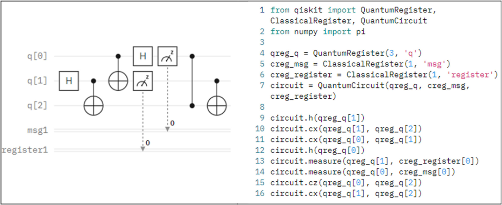

1 from qiskit import QuantumRegister, ClassicalRegister, QuantumCircuit 2 from numpy import pi 3 ql] 4 qreg_q = QuantumRegister(3, 'a') . 7 ’ 65 creg_msgcreg register= ClassicalRegister(1,= ClassicalRegister(l,'msg')'register') ql1] i 7 circuit = QuantumCircuit(qreg_q, creg_msg, :8 q[2] : creg_register) oi9 circuit.h(qreg_q[1]) msgl v 10 circuit.cx(qreg_q[1], qreg_ql2]) 0 11 circuit.cx(qreg_q[0], qreg_q[1]) registerl v 12 circuit.h(qreg_q[e1) 13 circuit.measure(qreg_q[1], creg_register[0]) 14 circuit.measure(qreg_ql[0], creg_msg[0]) 15 circuit.cz(qreg_q[0], qreg_ql2]) 16 circuit.cx(qreg_q[1], qreg_ql2]) 

**Fig. 1** Teleportation algorithm, with circuit definition to the left, and the respective quantum program in Python to the right

associated with migrations of these hybrid software systems [17].

The software modernization process integrates traditional reengineering with MDE principles, wherein each software artifact is modeled at various abstraction levels, and these models are subsequently transformed automatically [17]. The modernization process comprises three phases:

- **Reverse Engineering** : This phase involves inspecting and abstracting information at a higher level of abstraction. It aims to understand the existing system’s structure and behavior, capturing it in models that represent its essential characteristics.

- **Restructuring** : In this phase, the internal design of the software is improved, and new functionalities are added at the highest level of abstraction. The focus is on enhancing the system’s architecture and optimizing its structure to meet current requirements and standards.

- **Forward Engineering** : This phase entails generating the target source code based on the models developed in the previous phases. The models serve as blueprints for the new system, guiding the implementation process and ensuring consistency between the design and the code.

This research adopts a software modernization process aligned with existing standards such as UML and Knowledge Discovery Metamodel (KDM). These standards provide a common language and framework for representing software artifacts and facilitate interoperability and consistency across the modernization process (see Fig. 2). This approach implies that software modeling plays an important role, since it is “a paradigm to help developers build better software faster by enabling them to specify, reason and manipulate software

systemsatahigher-abstractionlevelwhileignoringirrelevant low-level technical details” [35].

## 3 Motivation and rationale

Hybrid software modernization finds application in at least three distinct scenarios [17], each fulfilling a specific objective:

- Migration of legacy classical information systems to hybrid architectures capable of supporting integration of classical-quantum software.

- Integration of existing isolated quantum algorithms into hybrid systems by migrating them.

- Introduction of new business functionalities supported by quantum software, which will then be integrated (at the restructuring phase) into the target hybrid systems.

In all those scenarios, the final phase involves code generation from abstract design models in a (semi)automatic manner. This aspect is precisely the focus of this work, as emphasized on the right-hand side of Fig. 2.

In a prior study, the Q-UML profile for designing classical-quantum software was presented [36]. This profile facilitates the systematic development of hybrid software [19, 37]. Abstract software descriptions play a pivotal role in (i) facilitating discussions among developers regarding design considerations, and (ii) modeling systems using highlevel conceptual representations while concealing low-level implementation details. Therefore, UML [23] was selected for this research due to its well-established nature and widespread use in the classical software industry. Utilizing

123

Code generation for classical-quantum software systems …

799

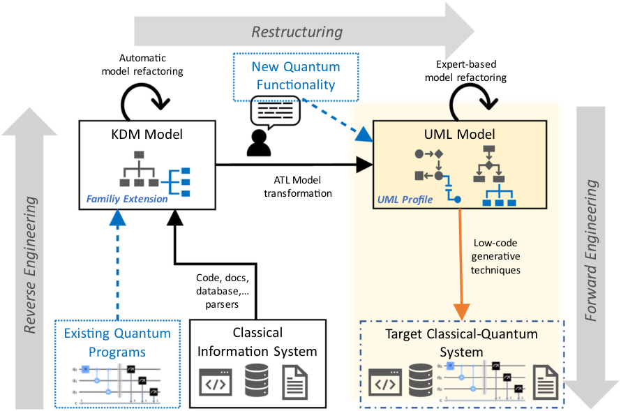

Restructuring Automa�c Automatic rrr New Quantum  rene Expert-based model refactoring model refactoring i Func�onality Functionality : “8 KDM Model - 3 oe UML Model    3 +H = [aol ATL Model -m uf= transforma�on ee =a Familiy Extension - transformation UML Profile iy [xl ' Low-code . generative genera�ve '' Code, docs,  techniques ' database,… ' parsers i Exis�ng Quantum  Existing Quantum } Classical  i Target Classical-Quantum  i H Programs i | Informa�on System Information System i System i Ee |] =] BE on|— hes * 2) Forward Engineering Reverse Engineering 

**Fig. 2** Software Modernization Process

UML ensures compatibility with existing design tools, familiarity among technical practitioners, and a demonstrated comprehensibility by non-technical stakeholders.

The Q-UML profile [36] encompasses various modeling diagrams like use case, class, sequence, activity, and deployment diagrams. This comprehensive coverage allows for the modeling of both quantum and classical elements, as well as their relationships, within an integrated design model, which is pivotal in the software modernization process.

## 4 Related work

This section presents work related to the proposal. First, Sect. 4.1 presents some UML-based and other proposals for modeling hybrids software. Second, Sect. 4.2 discusses some existing tool that support quantum code generation.

### 4.1 Hybrid software systems modeling

The proposal mentioned in previous section is not the only one utilizing UML for modeling quantum software. For instance, in [38], certain principles are outlined for designing modeling languages tailored for quantum software. This involves introducing a set of extensions to UML to accommodate the specific requirements of quantum computing. However, we consider that proposal does not cover hybrid

software system modeling at all, and code generation is not covered either. In this sense, Ali and Yue [39] discusses some ideas for deriving new metamodels for modeling quantum programsasextensionsofUML.Thisresearchalignswiththe vision outlined in that approach. Nevertheless, we advocate for the utilization of a UML profile due to several advantages in the current state of the field’s maturity. Specifically, as we mentioned, UML offers a certain level of compatibility with existing tools and familiarity among engineering practitioners, which can facilitate adoption and streamline the development process.

In contrast to UML, some authors have explored the use of Domain-Specific Modeling Languages (DSML), as discussedin[40].DSMLstypicallyoffergreaterexpressiveness. However, the primary advantage of the UML profile lies in its standardextensibilitymechanism,whichensurescompliance and interoperability with existing techniques and tools. For instance, SimuQ [41] is another DSML for users with limited knowledge of physics, which is tailored specifically for simulating quantum problems on near-term quantum devices. Similarly, Quingo [42] is a language to integrate and manage quantum–classical software and hardware to provide the programmability over heterogenous quantum–classical hardware. Unlike our approach focused on high-level software designs, Quingo’s motivation primarily revolves around ensuring interoperability and functionality of software within

123

L. Jiménez-Navajas et al.

800

heterogeneous NISQ devices. Nonetheless, all those DSMLs are not used for code generation.

Quantum Intermediate Representation (QIR) [43], developed by Microsoft, can be considered as a DSML built upon the widely used open-source LLVM intermediate language [44]. Its overarching objective is to furnish a unified and standardized interface across various quantum programming languages and quantum computing platforms. QIR can be used for generating code, despite, as an intermediate representation, is designed for bottom-up approaches, i.e., for generating QIR code from different programming languages. Moreover, regarding UML, QIR does not have modeling capabilities like abstraction and is not well-known andintuitivelyunderstoodbydifferentusers.Thus,QIRisnot appropriate for modeling abstract designs of a whole hybrid software system.

Other examples of DSMLs have been proposed for Quantum Machine Learning [45], as well as for modeling quantum circuits derived from satisfiability problems [46]. The scope of those proposals is narrow and are applied in specific contexts.

### 4.2 Quantum code generation tools

Numerous tools exist for generating quantum source code from various quantum circuit models, with many of them originating from graphical editors. For instance, the IBM Quantum Composer [47] can produce OpenQASM 2.0 and Qiskit code, while the QI Editor in Quantum Inspire [48] offers similar capabilities. Quantum Programming Studio [49] features a quantum circuit modeler supporting code generation for numerous quantum programming languages. Additionally, the QuAntiL circuit transformer [50] facilitates the translation of quantum circuits into different languages. However, none of these editors consider the integration of classical and quantum software, as proposed in this research.

finance library for estimate the payoff in pricing European call options [51].

### 5.1 Hybrid software modeling

As input, the transformation encompasses two types of UML diagrams based on the Quantum UML profile [36]: class and activity diagrams.

#### 5.1.1 UML Class diagrams

Class diagrams offer a comprehensive static view of the system, illustrating how classes and packages are structured. The class diagram of the running example can be seen in Fig. 3. The < < quantum > > stereotype can be used with both whole packages and individual classes to indicate components that support functionality and allow them to be developed as quantum circuits, algorithms, or similar artifacts.

The < < Quantum Driver > > stereotype is used to define class drivers that manage invocations to the quantum software components. These drivers are responsible for initiating quantum operations and ensuring proper communication between classical and quantum parts of the system. In the example of Fig. 3, the class ‘EuropeanCallDriver’ plays this role.

The < < Quantum Request > > stereotype is designed to model quantum calls or requests from the < < Quantum Driver > > class in the hybrid software packages (the ‘classicalquantumlogic’ package in the example) to other < < quantum > > classes. The < < Quantum Request > > stereotype can be used with an association class between the < < Quantum Driver > > class and the < < Quantum > > class (see the ‘EuropeanCallQuantumRequest’ class in Fig. 3). This provides a detailed view of the interactions (e.g., the kind of quantum hardware where the algorithm will be executed, number of shots, and other parameters).

#### 5.1.2 UML Activity diagrams

## 5 Hybrid code generation from UML models

This section presents the research proposal, a model-to-text transformation that takes extended UML models as input and generates Python source code as output. First, Sect. 5.1 explains how hybrid software systems are modeled using the UML extension previously proposed in [21]. Second, Sect. 5.2 provides the overall process of the proposed transformation. Section 5.3 and 5.4 present all the technical details for the two main steps of the code generation process.

In order to understand the proposed transformation this sectionprogressivelydisseminatesarunningexample.Inparticular, we use one of the systems included in the case study (C6), which is inspired by an example provided in the Qiskit

Activity diagram models the dynamics (algorithms or quantum circuits) of specific quantum software components. The definition of the activity diagram of the running example can be seen in Fig. 4. Quantum algorithms are encapsulated within a single compound _activity_ decorated with the < < quantum circuit > > stereotype. This activity serves as the container for the entire circuit, promoting reusability across different circuits, a common practice in quantum programming. Within the parent activity, various _activity partitions_ (depicted as horizontal _swim lanes_ ) can be delineated using the < < qubit > > stereotype, corresponding to the number of qubits employed in the algorithm. Each quantum gate applied within the circuit is represented as an _action element_ and is positioned within its respective swim lane, corresponding to

123

Code generation for classical-quantum software systems …

801

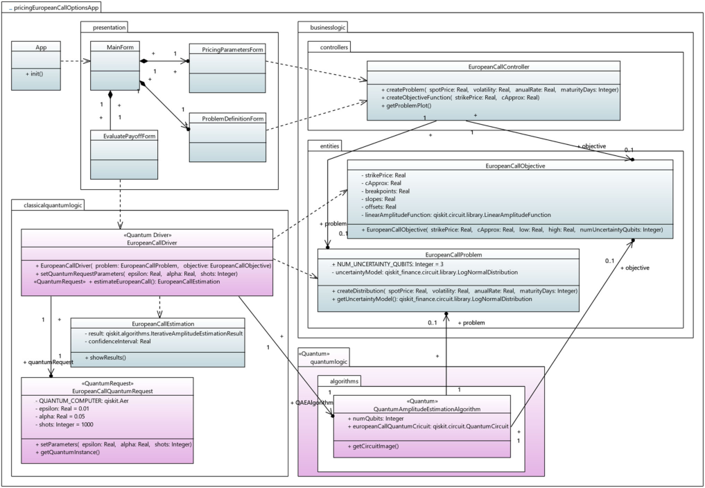

r=) Ee 0. , reer M— TT : = H: raAREfrase]slopes: Real mbna im Anphbncion 1 ee— rr 1 re A TN NCEA GOAT eg ar a cela gi foe cpt rey eghemuDiiion EE a Tete-a eanmemesoP,i rceaset Se oo, mae re] re [mio] a Bret0ano Eemciaic imi arm lo Rl es i] 

**Fig. 3** Example of a UML class diagram for a pricing European call options application

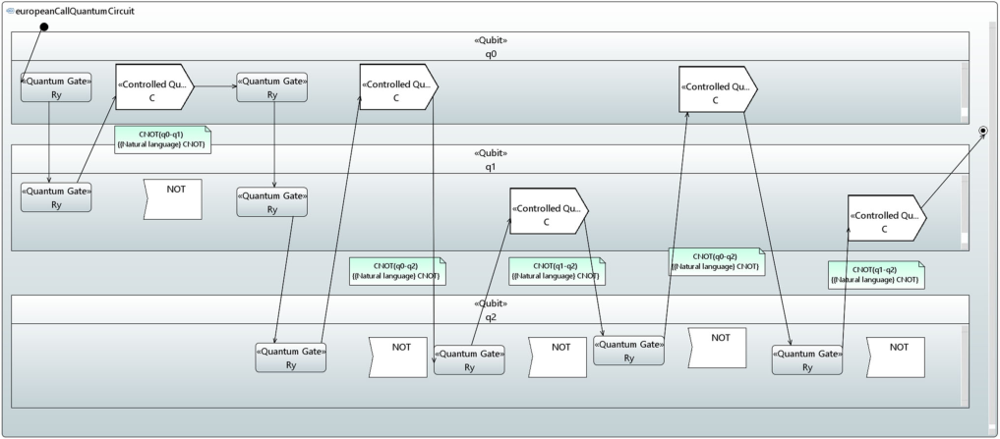

T———— wy [comotedau.¢ pssss comet¢  au concotedar [= — — [7]MoSey) [ J rr,/—— 1 J [=ce | \ J contd consotedc — = : set md) [fmm] pel me ] [arIRy 1ar - \]Ry 

**Fig. 4** UML activity diagram modeling a Quantum Amplitude Estimation algorithm

123

L. Jiménez-Navajas et al.

802

the qubit upon which the gate operates or is controlled. Ordinary quantum gates, such as H, Y, and Z are denoted as _call operation actions_ supplemented with the < < quantum gate > > stereotype. Conversely, controlled gates are modeled as multiple _action elements_ . Control qubits are represented by _sendsignalaction_ elementsdecoratedwiththe< <controlled qubit > > stereotype, while the applied gate is depicted by the counterpart element, _accept event action_ , supplemented with the < < quantum gate > > stereotype (see Fig. 4). Furthermore, to impart semantic clarity regarding the relationships between control qubits, various UML _constraint_ elements are established among the involved _action elements_ . In addition to these core elements, specialized operations, such as qubit measurement, are symbolized by _value specification action_ elements accompanied by the respective stereotype < < measure > > .

In our example (see Fig. 4) the flow of quantum gates is modeled in an explicit way. Thus, control flow elements connect quantum gates (or its controlled counterpart) to define the order of application as suggested in the source code. Of course, activity diagrams can abstract this flow through the usage of _fork_ and _join_ elements (similarly to the standard notation). Sometimes, the exact order of gates’ application is decided later, when the circuit is executed, and it depends, for example, on the hardware topology. However, an exact definition of the order of quantum gates could be useful in some scenarios for considering concerns regarding transpilation, optimization, among others.

It should be noticed that the proposed approach focuses on the code generation of circuits that are fully defined in activity diagrams with simple activity elements. This means that specific modeling abstractions for circuits that follows some design pattern, or are based on some algorithm’s families (e.g., Quantum Fourier Transform (QFT) or Variational Quantum Eigensolver (VQE)) are out of the scope of this proposal. Those special algorithms have some repeated structured which, for larger problem definitions, could result in extremely huge circuits. To prevent this, UML provides structured activity elements (for sequencing, conditionals, loops, and expansion regions) that allows represent compound/repeated structures in an abstract way. However, those elements are outside of the scope of the current proposal for code generation.

The quantum UML profile proposes the use of activity diagrams to represent quantum circuits in a similar way to the existing notations. In the context of quantum circuits’ modeling in isolation, this notation does not provide any advantage over traditional notation. However, the main benefits of UML activity diagrams lay in the context of modeling hybrid software systems, which are the followings:

- Thedesignofquantumcircuits,inanUML-compliantway, makes it possible to integrate such design with other UML

elements or even within a diagram for the whole hybrid software system.

- UML activity diagrams support the modeling of last advances in modern languages like Qiskit that, for example, allows the classical feedforward and control flow [52] (besides the integration of other classical building blocks). Thus, decision nodes in UML can be used for classical _if_ statements.

- The exact execution flow of quantum gates can be made explicit using _control flow_ elements, which is useful in some modeling contexts.

- UML is well supported for most of the existing modeling tools and have been demonstrated to be understood by technical and non-technical professionals.

### 5.2 Overall transformation process

In a general way, the proposed model-to-text transformation consider takes extended UML models as input and generates Python source code as output. The transformation is then implemented in EGL [24] (the transformation code is available in [53]). EGL is a model-to-text transformation language primarily used within the Eclipse Modeling Framework (EMF) ecosystem. It serves as a powerful tool for generating text artifacts, such as code, documentation, configuration files, or any other textual output, from models represented in EMF-based modeling languages like Ecore. Overall, EGL simplifies the process of generating textual artifacts from EMF-based models, providing a flexible and customizable solution for model-driven development and code generation.

The output for the target hybrid software comprises Python code and its quantum software extension, Qiskit [22], both of which are widely utilized in classical and quantum software development. Additionally, Qiskit supports the generation of OpenQASM quantum assembly code, serving as the foundation for many other quantum programming languages. Despite this, the transformation process could be adapted to other models and programming languages following the MDE approach.

The transformation process unfolds in two steps (see Fig. 5), which can be perceived as two independent model-totext transformations executed consecutively. Initially, quantum software is generated from the extended UML activity diagrams that depict quantum circuits (cf. Section 5.3). Subsequently, Python code (classical software) is generated from the UML class diagrams, incorporating quantum stereotypes defined in the UML profile (cf. Section 5.4). This information is crucial for defining dependencies and relationships between classical and quantum code, which is why the generation of quantum code precedes that of classical code.

123

Code generation for classical-quantum software systems …

803

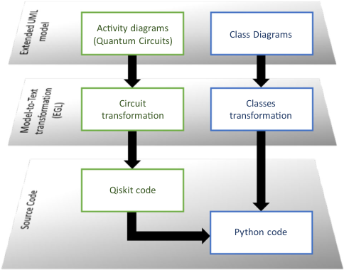

FEEH Ac�vity diagrams  Activity diagrams. Class Diagrams (Quantum Circuits) if 55 $Ez Circuit  Classes transforma�on transforma�on 228 transformation transformation ££ —— Qiskit code g3 CC] . Python code ] 

**Fig. 5** Overall process for the Model-to-Text transformation for hybrid code generation

The proposed approach generates high-level, platformindependent code from UML models, suitable for further optimization or transpilation for various quantum hardware platforms. This high-level code includes constructs for quantum algorithms and classical control flow, enabling integration and customization according to hardware requirements. Generating high-level code from UML models improves maintainability, scalability, and interoperability across quantum computing platforms. Developers can focus on algorithmic design while handling transpilations and other platform-specific optimizations separately, in a later step. This separation of concerns is crucial in the rapidly evolving quantum computing landscape.

### 5.3 UML activity diagrams to qiskit code

The first EGL transformation produces a Python (.py) file for each activity diagram representing a quantum circuit. The generated Python file begins by importing all necessary Qiskit libraries. Subsequently, it defines a _QuantumCircuit_ object to represent the quantum circuit, adding all quantum elements such as registers, gates, and measurement operations to this object.

Firstly, all needed qubits are created by defining _QuantumRegister_ objects, grouping the qubits utilized by the circuit. This is done according to the UML _Lane_ elements in the activity diagram, since in the Quantum UML profile those elements represent qubits (see Fig. 6, lines 1 to 12). Similarly, a _ClassicalRegister_ object is generated for each qubit affected by a measurement operation (i.e., a UML _Action_ element stereotyped with < < Measure > >), and it is added to the circuit (see Fig. 6, lines 14 to 21). Subsequently, the _QuantumCircuit_ object is instantiated using both the quantum and classical registers as parameters (see Fig. 6, line 24).

Secondly, quantum gates and measurement operations are added to the circuit. Quantum gates, represented as UML _Action_ elements stereotyped with < < QuantumGate > > in the UML activity diagrams, must maintain their order since quantum circuits lack explicit execution flows (see Fig. 7). Another critical consideration is controlled gates, which are represented as a pair of elements with a UML _Constraint_ element between them: a _SendSignalAction_ element (on the control qubit) and an _AcceptEventAction_ element (on the qubit to which the gate is applied). The EGL transformation must account for the relationship between these elements across the different _Lane_ elements while preserving the order of the remaining gates.

Finally, the EGL transformation generates and stores the circuit in the target Python file using an EGL template. According to the running example, Fig. 8 shows the Qiskit code generated for the UML activity diagram presented in Fig. 4.

### 5.4 UML class diagrams to python code

The second EGL transformation is responsible for generating Python code for the classical software based on the UML class diagrams. While tools for classical code generation from UML class diagrams already exist, this transformation differs by establishing relationships with previously generated Qiskit code.

Initially, the mapping considers _Package_ elements and generates a directory structure to accordingly organize Python files for each _Class_ . Figure 9 shows the whole structure of packages and classes generated for the running example introduced in Fig. 3. For every Class, attributes are generated in the code, requiring a mapping between predefined UML data types and available Python data types, which is customizable in the proposed EGL transformation. Additionally, alongside attributes, functions for the public interface such as ‘getters’ and ‘setters’ are defined.

Subsequently, operations specified in the UML _Class_ elements are translated into functions within the Python code. These functions are created within the target class, complete with parameters and return types. However, their body are initially empty, necessitating developers to fill them with appropriate functionality. This is common due to the hidden details because of the abstraction mechanism used for designing software systems in UML.

In addition to the established transformation rules, this proposal introduces the integration of previously generated quantum code with classical code. The integration process follows specific conditions:

- Identification of a UML _Class_ labeled as < < Quantum Driver > > .

123

L. Jiménez-Navajas et al.

804

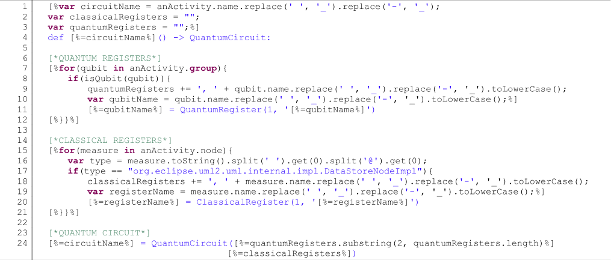

**Fig. 6** Excerpt of EGL transformation for quantum qubits and circuit definition in Qiskit

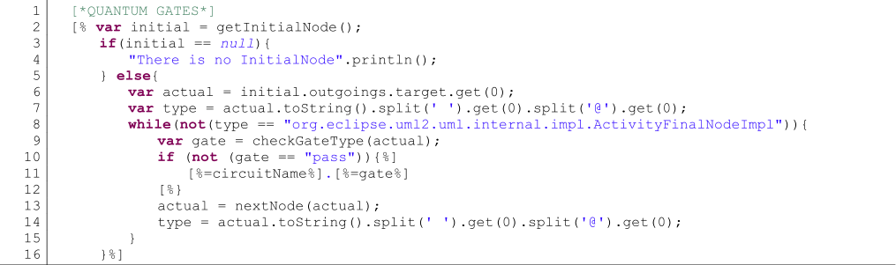

**Fig. 7** Excerpt of EGL transformation for quantum gates generation in Qiskit

- Verification of a dependency from the aforementioned _Class_ to another UML _Class_ marked as < < Quantum > > (representing the quantum circuit).

- Validation that the name of the < < Quantum > > class matches the filename previously generated from a UML activity diagram.

Upon meeting these conditions, the resulting source code for the < < Quantum Driver > > class incorporates a Qiskit _QuantumCircuit_ attribute, named after the target < < Quantum > > class. This integration ensures seamless association between quantum and classical components (see Fig. 10).

### 5.5 Supporting tool

This allows users to seamlessly apply transformations to UML diagrams within their modeling workflow.

Additionally, a JavaFX tool has been developed to extend the capabilities of EGL transformations [53]. This tool is designed to execute transformations for multiple UML diagrams, collectively representing the comprehensive design of a hybrid software system. With this JavaFX tool, users can efficiently process transformations across various UML diagrams, facilitating the generation of code or other artifacts for the hybrid software system.

In summary, while EGL transformations can be executed within Papyrus for individual UML diagrams, the JavaFX tool enhances this functionality by enabling batch processing of transformations for multiple diagrams, thereby supporting the creation of complex hybrid software systems.

Among other purposes, this tool facilitates the conduction of the case study described in the following section.

EGL transformations can be executed directly within Papyrus, an integrated modeling environment within Eclipse.

123

Code generation for classical-quantum software systems …

805

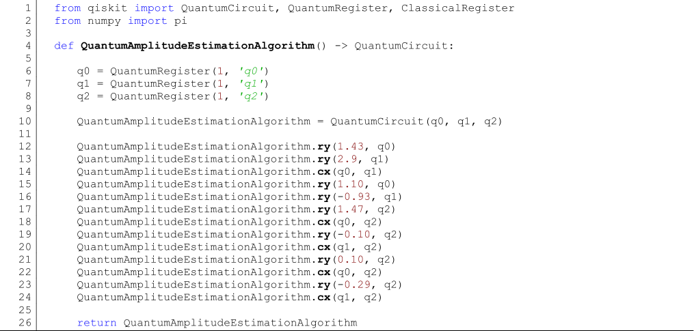

1 from giskit import QuantumCircuit, QuantumRegister, ClassicalRegister 2| from numpy import pi 3 4 def QuantumAmplitudeEstimationAlgorithm() - > QuantumCircuit: 5 6 0 = QuantumRegister 7 ql = QuantumRegister(l,(1, 'g0')’'gl’') 8 92 = QuantumRegister 9 (1, 'g2') 10 QuantumAmplitudeEstimationAlgorithm = QuantumCircuit(q0, gl, g2) 11 12 QuantumAmplitudeEstimationAlgorithm.zy 13 QuantumAmplitudeEstimationAlgorithm.zy(1.43, gO) 14 QuantumAmplitudeEstimationAlgorithm.ex(q0,(2.9, ql)ql) 15 QuantumAmplitudeEstimationAlgorithm.ry (1.10, g0) 16 QuantumAmplitudeEstimationAlgorithm.zy( -0 .93, ql) 17 QuantumAmplitudeEstimationAlgorithm.ry(1.47, g2) 18 QuantumAmplitudeEstimationAlgorithm.ex 19 QuantumAmplitudeEstimationAlgorithm.ry( (q-0 0,.10,G2) q2) 20 QuantumAmplitudeEstimationAlgorithm.ex 21 QuantumAmplitudeEstimationAlgorithm.ry(ql,(0.10,g2)2) 22 QuantumAmplitudeEstimationAlgorithm.cx(q0, g2) 23 QuantumAmplitudeEstimationAlgorithm.zy( -0 .29, q2) 24 QuantumAmplitudeEstimationAlgorithm.ex(ql, q2) 25 26 return QuantumAmplitudeEstimationAlgorithm 

**Fig. 8** Generated Qiskit code for the quantum circuit modeled in the running example

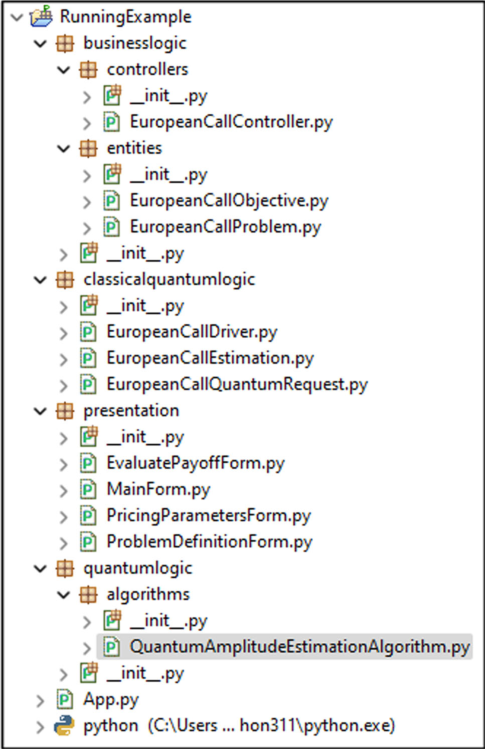

+ #8 RunningExample vf} businesslogic v #3 controllers > [B _init_py > [P) EuropeanCallController.py v 3 entities > [ _init_py > [B) EuropeanCallObjective.py > [F) EuropeanCallProblem.py > [B _init_py v 8 classicalquantumlogic > [BF _init_py > [B) EuropeanCallDriver.py > [B) EuropeanCallEstimation.py > [P) EuropeanCallQuantumRequest.py v fi presentation > [ _init_py > [B) EvaluatePayoffForm.py > [B) MainForm.py > [B) PricingParametersForm.py > [B) ProblemDefinitionForm.py © # quantumlogic v #3 algorithms > [® _init_py > [F) QuantumAmplitudeEstimationAlgorithm.py > [B _init_py > [B) App.py > @ python (C:\Users ... hon311\python.exe) 

**Fig. 9** Generated packages and classes for the class diagram of the running example

## 6 Empirical validation

This section presents a multi-case study to validate the generation of classical and quantum code from high-level designs in UML. Section 6.1 describes the design of the case study following the Runeson protocol [54]. Section 6.2 presents the analysis carried out from the case study. Finally, Sect. 6.3 shows the threats to the validity of the study.

### 6.1 Case study design

This case study has been designed and carried out in alignment with the protocol proposed by Runeson et al. [54]. Consequently, the subsequent subsections have been organized in accordance with this protocol. All the necessary for carrying out the empirical validation (input UML models, generated code, and validation script), as well as the EGL transformation script, are available at [55].

#### 6.1.1 Rationale and objectives

As explained previously, companies that could benefit from quantum computing will eventually have to evolve their information systems toward hybrid software. This evolution must imply, at some, the designing of the hybrid information system, which could be used to generate the source code of the hybrid information system. For this reason, the rationale of the study is to prove the proposed technique with which to generate both classical (Python) and Quantum (Qiskit) code in combination (Classical-Quantum code) is effective and efficient.

123

L. Jiménez-Navajas et al.

806

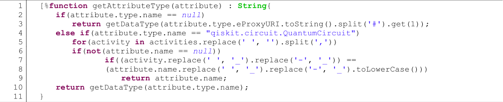

**Fig. 10** Excerpt for the EGL function for classical-quantum code integration

The research objectives of this case study are to determine whether it is possible (i) to generate the same information in classical, quantum and hybrid code as their representation in high-level UML designs, (ii) to obtain equivalent execution results in the quantum with regards to the results of the same program generated with other existing tools (IBM Quantum Circuit composer), and (iii) to generate the target hybrid software in an efficient way regarding the size of the design.

#### 6.1.2 Research questions

In the presented study three main research questions have been stablished, one for each specific objective. Firstly, RQ1 is related to the completeness of the output hybrid code with respect to the input hybrid systems representation. Secondly, RQ2 focuses on assessing whether the results from the execution of the generated quantum code are consistent with respect to the execution of the quantum circuit of which the UML model has been inspired to. Finally, RQ3 analyzes whether the forward engineering technique (for both classical and quantum code generation) is efficient and scalable, specifically assessing how the generation time increases as the size of the input hybrid software models grows.

**RQ1.** How effective is the generation of hybrid code? **RQ2.** How is the functional correctness of the generated code?

**RQ3.** How efficient is expected to be the generation of hybrid code for larger models?

It should be noticed that the research questions have been intentionally defined as open questions (starting with ‘how’) rather than define dichotomic, closed questions. This design allows to analyze the results in a more qualitative way apart from the expected quantitative analysis.

#### 6.1.3 Measures

Table 1 provides a summary of the variables selected for empirically validate the study. For each variable is indicated: (i) the concept to be measured, (ii) the research question intended to answer, (iii) the name of the variable, (iv) a short

definition (or formula) of the variable, (v) the scale type, and (vi) the range definition for all the possible values.

First, RQ1 focuses on the effectiveness of the proposed technique. To do this, it has been followed two alternative approaches,aninformationretrievalapproachbyconsidering precision, recall and F-measure [56], and a machine translation approach by using the CodeBLEU metric [57].

The information retrieval approach evaluates the accuracy of the generated code elements compared to the expected elements derived from the UML models. To establish the ground truth, we manually analyzed the UML models and determined the expected output code. Precision measures the proportion of relevant elements correctly generated, recall assesses the proportion of relevant elements that were retrieved, and F-measure provides a harmonic mean of precision and recall giving an overall effectiveness score.

- **Precision.** Evaluates the ratio of correct relevant elements regarding the total elements generated in the output code (i.e., relevant plus irrelevant elements). The irrelevant elements are the false positives and concern elements that are represented wrongly or should not be generated at all.

- **Recall.** Represents the ratio of relevant elements regarding the total of theoretical elements that should be generated (i.e., the elements effectively generated plus those expected, but missing elements).

- **F-Measure.** The F-Measure provides a way to express the precision and the recall with a single score. It consists of the harmonic mean of both metrics, which signifies that huge differences between both metrics have a penalty.

For example, consider a UML class diagram containing methods for initializing qubits and applying quantum gates. The manually judged ground truth for this model includes the corresponding Python code with Qiskit, defining a class with the same methods that correctly perform the initialization and gate operations. This manual ground truth serves as the benchmark to assess the accuracy and completeness of the automatically generated code. Precision, recall, and F-measure are calculated by comparing the elements in the

123

Code generation for classical-quantum software systems …

807

**Table 1** Summary of the variables

|Concept|Research question|Measure|Definition|Scale|Range|
|---|---|---|---|---|---|
|Effectiveness|RQ1|Precision|Precision= Relevant Elements Relevant Elements+Irrelevant Elements|Ratio|_x_ ∈[0,1]|
|||Recall|Recall= Relevant Elements Relevant Elements+Missing Elements|Ratio|_x_ ∈[0,1]|
|||F-Measure|_F_ −Measure= 2 1 Precision + 1 Recall|Ratio|_x_ ∈[0,1]|
|||CodeBLEU score|CodeBLEU= _α_∗BLEU+_β_∗BLEUweight+_γ_ ∗ Matchast+_δ_∗Matchdf|Nominal|_x_ ∈[0,1]|
|||Compilation errors|Number of errors which a provoke a program not to compile|Nominal|_x_ ∈[0, N+]|
|Functional correctness|RQ2|Kullback–Leibler divergence|_D_KL_(p_||_q)_= �∞ −∞_p(x)_ln _p(x)_ _q(x)_ dx|Nominal|_x_ ∈[0, N+]|
|Efficiency|RQ3|Size of the input UML class diagram|_Sizeclass_=#_Packages_+#_Classes_ +#_Operations_+#_Attributes_|Nominal|_x_ ∈N+|
|||Size of the input UML activity diagram|Sizeactivity =#ActivityPartitions+ #UmlQuantumgates+ #DataStoreNode|Nominal|_x_ ∈N+|
|||Lines of code|Lines of code of the output quantum code generated|Nominal|_x_ ∈N+|
|||Model loading time|Time spent loading the input model|Nominal|_x_ ∈N+|
|||Rule execution time|Time spent executing the code generation rules|Nominal|_x_ ∈N+|
|||Total time|Model loading time+Rule execution time|Nominal|_x_ ∈N+|

generated code to those expected, in our viewpoint, according to the specified elements in the UML model.

To compute precision and recall, it considers elements in the target code that should be generated from the most meaningful and representative elements in both kind of UML diagrams. Regarding class diagrams, it considers the number of packages, classes, and class operations and attributes. Regarding the activity diagrams, it considers the number of activity partitions (qubits), actions (quantum gates) and data store node elements (measures). Due to both kind of elements present in class and activity diagrams, the study can distinguish between global precision and recall metrics for thehybrid(Python)code,andthoseonlyforquantum(Qiskit) code.

This approach leverages well-established metrics from the information retrieval domain to quantify the effectiveness of our code generation approach. These metrics provide a robust framework for evaluating how well our generated code aligns with the expected outcomes, particularly in terms of relevance and completeness.

metric [57]. The proposed code generation technique is deterministic. This means that given a specific UML model, the algorithm will always produce the same version of the code. This ensures consistency and reproducibility of the results. Therefore, no different versions of the code can be generated from the same UML model.

- **CodeBLEU.** It evaluates how similar is a program with respect to another one generated by means of code synthesis. Differently from the BLEU score [58], CodeBLEU evaluates the predicted code considering not only the overlapping n-grams but also syntactic and semantic match of the two pieces of code (predicted and reference). CodeBLEU is calculated as the sum of the standard _BLEU_ [58], plus the weighted n-gram match obtained by comparing the hypothesis code and the reference code tokens with different weights (BLEUweight), plus the syntactic AST match (Matchast), and plus the semantic data-flow match, considering the semantic similarity between the hypothesis and the reference (Matchdf).

Alternatively, a machine translation approach has been also followed to answer RQ1 by considering CodeBLEU

123

L. Jiménez-Navajas et al.

808

Additionally, to provide further insights, RQ1 includes the number of compilation errors as a valuable metric to assess the effectiveness of the code generation process. Given that the code generation technique provides a draft or skeleton of the software system, some compilation errors are to be expected, especially related to elements that require further refinement or integration. This metric is included to be analyzed qualitatively, helping to identify the types of errors (e.g., missing dependencies, type mismatches) that arise in the generated code, and providing guidance for possible solutions or improvements. Although the expected result for generation tools is that the whole generated code compiles, it is important to note that many of these compilation errors can be easily addressed with automatic, predefined actions in a target tool that integrates this transformation. For example, common fixes could include automatically adding missing dependencies, adjusting data types to ensure compatibility, or marking sections of code that require further modifications. These predefined solutions would ensure that the generated code can quickly become compilable and functional, while leaving space for customization based on the specific needs of the user.

RegardingRQ2, thestudyattempts toassess thefunctional correctness of the code generated through the proposed technique. This question only focuses on the quantum code and attempts to determine if the execution result of the generated code is correct with respect to the expected one. To achieve this, the benchmark used is the code generated for the same circuit modeled in IBM Quantum Composer, which is able to generate Qiskit code. Thus, both circuits (the one generated by this proposal, and the one generated with IBM Quantum composer) are executed in the same quantum computer simulator ( _ibm_qasm_ simulator). Then, the set of frequencies obtained for each possible combination are compared. The distancebetweenthedistributionsoffrequenciesiscomputed by means of Kullback–Leibler (KL) divergence. It is important to note that the simulator in question introduces a certain level of noise to achieve more realistic results. However, to mitigate the impact of this simulated noise, the same seed is used for all scenarios within each simulation. As a result, despite the presence of noise, the outcomes remain consistent across all cases within a simulation. This consistency allows for meaningful comparisons between hypothetically equivalent circuits.

- **Kullback-Leibler (KL) divergence.** Measures how different is one probability distribution _p_ with respect a reference probability _q_ . The KL divergence is closely related to relative entropy, information divergence, and information for discrimination. Being an asymmetric metric, the probability distribution of the generated code was taken as _p_ , and the reference frequency distribution _q_ was

taken as the result of the execution of the original quantum circuit. Furthermore, only those values of the qubits that are in both distributions have been compared. This has been done to avoid the noise involved in the execution of these quantum programs. The lowest possible value with which indicates a low difference between the distributions is 0.

Finally, to assess RQ3 and to determine if the technique would be efficient, and suggest if it is scalable for larger models, it focuses on analyzing the correlation between the size of the input model and the time spent on code generation.

- **Size.** It is the total number of meaningful elements in the input UML models. This means, the elements that are involved in some of the EGL rules in the generation technique.

SizeUML = SizeClass + SizeActivity

The generation time is divided into the time spent for loading the input UML model and the time necessary to execute all the EGL rules defined. Also, both time metrics are computed for class and activity diagrams in isolation.

- **Model loading time.** Time for obtaining the input model and loading its elements.

- **Rule execution time.** Time for executing the EGL modelto-text transformation rules in the loaded model.

#### 6.1.4 Case selection

To evaluate the code generation from classical-quantum software systems designs, firstly it is necessary to define the criteria for selecting the classical-quantum software systems which are going to be modeled. These systems have been manually modeled as there are not open classical-quantum software systems designs available in the literature. However, these designs have been based on existing applications proposed in the literature. Table 2 shows the criteria chosen to select those cases.

Criterion C1 has been stablished because of the huge number of proposals concerning the use of quantum computing in the different fields of science (i.e., the use of quantum computing in machine learning). However, some proposals might not provide enough context for modeling complex hybrid systems. This is what C2 is defined. Criterion C2 has been chosen because, although certain companies have made announcements that quantum computing will be used

123

Code generation for classical-quantum software systems …

809

**Table 2** Criteria for case selection

|Id|Criterion for case selection|
|---|---|
|C1|It must be a specific case of using quantum algorithms|
|C2|It must have enough information for modeling a complete hybrid software system|
|C3|It must follow a quantum gate-based approach|
|C4|It must represent a solution to a particular problem reported bya companyor organization|

to solve certain problems, these announcements do not provide any information other than the objective of what it is intended. In the absence of information on the quantum algorithm or even what type of quantum computing paradigm will beemployed,themodelingofthesesystemswouldbeinaccurate. Criterion C3 has been selected since this work considers the generation of classical-quantum code is achieved from hybrid system designs, where the quantum code generation isperformedfromUMLactivitydiagramsrepresentingquantum circuits, which employs a gate-based approach. This is due to the scope of the proposed technique. Criterion C4 has been defined in order to model hybrid systems that attempt to support real quantum applications. The fact that there are no hybrid system designs available yet difficult the evaluation of the technique, that is why this criterion was established. By the application of this same criterion, most of the cases come from proposals by designed by the industry, since QUTAC is a consortium of leading German companies (BMW-Group, Bosch, and Siemens, among others) that have the objective of bringing quantum computing to the level of practical application.

After applying the criteria previously defined, 7 cases have been selected and modeled using the Q-UML profile. Table 3 shows the cases under study, showing: (i) the identifier of the case, (ii) the company/companies that proposed that case, (iii) the business challenge desired to be solved, and (iv) the algorithm employed. The designed systems are available in [55].

#### 6.1.5 Case study protocol and data storage

The study protocol defines how the selected cases has been analyzed and how the derived data have been collected and eventually analyzed.

Figure 11 depicts the case study protocol followed. This protocol consists in three main phases with various steps

within them. The first phase (topside of Fig. 11) compromises the designing of the input hybrid system. As mentioned previously, in the literature there are not UML designs for hybrid software systems, so in order to validate the technique, we manually modeled the UML designs based on proposals of the industry and available quantum algorithms. The steps within this phase are: (i) researching for possible hybrid software systems based on the criteria stablished in Table 2; (ii) based on the candidate hybrid software system, it was time to the researching of the possible quantum algorithms that would attempt to solve the problem for what is designed the hybrid system; once the candidate case has been selected, as well as its quantum algorithm it was time to the (iii) modeling the class diagram and (iv) the activity diagram using the open source Model-Based Engineering tool, Papyrus [59]. This phase generates the following outputs:

- The original quantum circuit from what is based on the activity diagram.

- The UML class diagram representing the hybrid software system extended by means of the Q-UML profile.

- The UML activity diagram representing the quantum circuit based on the original quantum circuit and extended using the Q-UML profile.

The second phase of the case study protocol (middle-side of Fig. 11) concerns the generation of the code from the hybrid system software designs made on the previous phase. This steps within this phase consists of: (i) adding the models from the previous phase to an automatic test environment; and, afterward, it is carried out (ii) the execution of the modelto-Python code generator (using as input the class diagram), and (iii) the execution of the activity-to-Qiskit code generator (using as input the activity diagram). The outputs of this second phase are:

- The resulting Python code of the class diagram of the hybrid software system from the execution of the modelto-Python code generator.

- The resulting Qiskit code of the activity diagram of the quantum circuit from the execution of the model-to-Qiskit code generator.

- The execution times from each of the transformations.

In the last phase of the case study protocol (bottom side of Fig. 11) it is addressed the calculation of the metrics and its integration on a dataset. The tasks of this phase are: (i) the calculation of the metrics from the generated Python code, (ii) the calculation of the metrics of the Qiskit code generated, (iii) the recollection of the execution times of the model-toPython and model-to-Qiskit for its later (iv) integration in the dataset. The output of this last phase is the dataset of

123

L. Jiménez-Navajas et al.

810

**Table 3** Cases selected

|Identifier|Company|Business challenge|Algorithm|
|---|---|---|---|
|C1|Airbus|Multidisciplinary design optimization consists in the simultaneous optimization of multiple, interdependent parameters. The challenge remains outstanding|HHL, TBD|
|C2|Airbus|Computational fluid dynamics (CFD) is used to model the performance of aircraft designs. Recently, machine learning techniques have been applied to solve PDEs: simultaneous treatment of space &time. Optimizing the NN training time with quantum is to be considered|QML|
|C3|Boehringer|Imaging techniques are an important piece of information to identify structures and distribution of molecules in tissues|QAOA|
|C4|BASF and Boehringer|Currently, exact or near-exact simulation of chemical reactivity and molecular properties is not practical with classical computers|VQE|
|C5|Munich Re and SAP|To utilize trucks in the best manner, it is required to build the pallets in such a way that the load is balanced and can utilize the complete space|QA, QAOA|
|C6|Qiskit finance library|Classical attempts to improve the performance are variance reduction or Quasi-Monte Carlo techniques. The first aims at reducing the constants while not changing the asymptotic scaling; whereas the latter improves the asymptotic behavior, but only works well for low-dimensional problems|QML|
|C7|VW and SAP|Vehicle routing problem for mobility services (autonomous driving) or production (routingof material deliverydrones at multipleproduction lines)|RQAOA / LHZ QAOA|

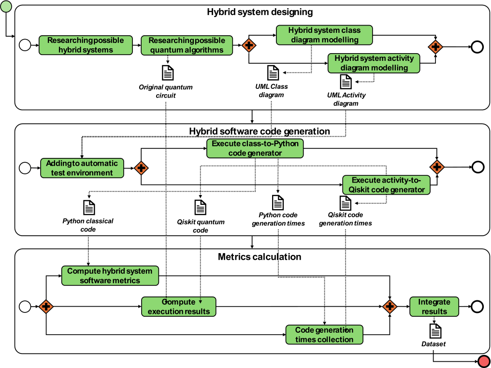

**Fig. 11** Case study protocol

123

Code generation for classical-quantum software systems …

811

the case study available in [55], as well as the transformation generators (both the Python and Qiskit) and the metrics calculator.

To complete the whole dataset, the application of the tool has been done on a laptop with an i7 10510U with 2.30 GHz, 16 GB of RAM and running on an SSD with Windows 11 × 64 bits. Table 4 shows the whole dataset completed after executing the model-to-text transformations in the 7 manually modeled cases. The first rows provide information about the input UML diagrams (both class and activity diagrams). Then, the metrics obtained for the generation of Python code and Qiskit, respectively. For each group of metrics, it is depicted to what research question the metric belong to (according to Sect. 6.1.3).

#### 6.1.6 Analysis method

The data analysis made for answering the stablished research questions concerns both a quantitative and qualitative analysis. Regarding the quantitative analysis, the following methods have been employed:

- Descriptive statistics: used to analyze the numerical data obtained.

- RQ1: Based on the measures previously defined, descriptive statistics have been used for checking that the expected results of measured values after the execution on the technique were acceptable.

- RQ3: Descriptive statistics have been used for evaluating the scalability of the technique based on variables related to size and times.

- Kullback–Leibler (KL) divergence measures the difference between two probability distributions. It is used in RQ2 for determine if execution results of the generated quantum circuits are equivalent.

- Regression model: just employed for RQ3 in order to evaluate the scalability of the technique considering the generation time measures as the dependent variable and the size measure as the independent variable. For this, the Pearson’s correlation coefficient ρ has been calculated.

Together with each of the methods of analysis (i.e., for all research questions) a qualitative study of the data obtained hasbeendone.Thistypeofanalysisaimstowardananalytical generalization, focusing instead on understanding the nature of the research problem rather than the quantity of observed characteristics [60].

### 6.2 Result analysis

This section presents the analysis of the results for each research question, together with the main insights gathered.

Each of the following subsections attempt to answer each of the previously defined research questions.

#### 6.2.1 RQ1. Completeness of the code generation

Regarding hybrid code generation, Fig. 12 shows a good effectiveness of the technique from the perspective of a retrieval information problem. The values indicate an average of 99,2% in the case of precision, 89,7% for recall, and 94,2% for F-Measure. Of all the cases, C2 case has the worst results (even though all its metrics are above 80%). This is due to the impossibility of transforming certain data types of some attributes into classical-quantum code. The objective of this case is to design a classical-quantum system that solvespartialdifferentialequationsusingtheHHLalgorithm. For this purpose, the use of vectors is used, for example, to indicate the probability distributions or the variables to be minimized. The transformation of vectors into hybrid code has not been considered in this technique, so that all attributes with a vector data type are represented as ‘Undefined’. This non-transformationandlackofdatatypespecificationimplies that the values of the precision, recall and, consequently, F-Measure decreased.

Moving on to the analysis of the effectiveness of the quantum code generation, to perform the calculation of the different metrics, Fig. 13 shows the results of the quantum code generation. As in the hybrid code generation, the results are promising, where most of the values are close to 100% for precision, recall and F-Measure metrics. Of all the cases, the C3 case stands out, which has a precision of 66,7%. In this case it is intended to use imaging techniques to identify structures and distribution of molecules in tissues. To compare the images from the structures of molecules images, in this case it is proposed the swap test [61], since it is a widely used protocol for calculating the overlap between two quantum states [62–64]. The input activity diagram is shown in Fig. 14 (A), while the inspired quantum circuit is in Fig. 14 (B). The respective quantum code generated from the activity diagram is Fig. 14 (C). One of the problems of this program lies in the CSWAP gate, which needs three qubits as parameters: one indicating the control and the other two on which the swap is to be performed. However, it can be noticed that the generated CSWAP gate is missing one of the parameter qubits (see line 17 in the right-hand side of Fig. 14). In addition, unnecessary elements are generated for this circuit, such as the imports of the _numpy_ library and the _ClassicalRegister_ function of the Qiskit library.

It should be noted that code generation, especially in complex domains, often involves iterative improvements to account for all possible scenarios and variants. Modifications aimed at eliminating irrelevant elements could, in some cases, result in lower precision, as other relevant elements might no longer be retrieved. Therefore, our approach aligns

123

L. Jiménez-Navajas et al.

812

**Table 4** Dataset obtained for the case study

|**Input UML**|**Class**|#Packages|**C1** 8|**C2** 8|**C3** 5|**C4** 8|**C5** 8|**C6** 8|**C7** 8|**Average** 7,6|
|---|---|---|---|---|---|---|---|---|---|---|
|**Model**|**Diagrams**|#Classes|13|10|9|9|9|12|10|10,3|
|||#Operations|10|21|12|11|11|13|11|12,7|
|||#Attributes|19|18|9|12|12|22|16|15,4|
||**Activity**|#ActivityPartitions|4|4|3|4|4|3|4|3,7|
||**Diagrams**|#UmlQuantumgates|33|27|5|45|16|13|41|25,7|
|||#DataStoreNode|0|0|0|1|0|0|0|0,1|
|**Python**|**Generated**|#Folders|8|8|5|8|8|8|8|7,6|
|**code gen-** |**Elements**|#Files|13|10|9|9|9|12|10|10,3|
|**eration**||#Functions|10|21|12|11|11|13|11|12,7|
|||#Variables|19|18|9|12|12|22|16|15,4|
||**RQ1. Effec-**|#Relevant elements|50|54|35|40|40|55|45|45,6|
||**tiveness**|#Irrelevant elements|0|3|0|0|0|0|0|0,4|
|||#Missing elements|4|11|4|3|4|5|7|5,4|
|||Precision|100,0%|94,7%|100,0%|100,0%|100,0%|100,0%|100,0%|99,2%|
|||Recall|92,6%|83,1%|89,7%|93,0%|90,9%|91,7%|86,5%|89,7%|
|||F-Measure|96,2%|88,5%|94,6%|96,4%|95,2%|95,7%|92,8%|94,2%|
|||Compilation errors|2|8|9|8|9|0|12|6,9|
||**RQ3.** **Efficiency**|Class model loading time (ms)|80|80|90|104|55|82|86|82,4|
|||Class rules execution time (ms)|134|107|97|90|95|184|105|116,0|
|**Qiskit code**|**Generated**|#Qubits|4|4|3|4|4|3|4|3,7|
|**genera-** **tion**|**Elements**|#QuantumGates|33|26|3|45|16|13|41|25,3|
|||#Classical Regs|0|0|0|1|0|0|0|0,1|
||**RQ1. Effec-** |#Relevant elements|36|29|4|49|20|14|44|28,0|
||**tiveness**|#Irrelevant elements|1|1|2|1|0|2|1|1,1|
|||#Missing elements|0|0|1|0|0|0|0|0,1|
|||Precision|97,3%|96,7%|66,7%|98,0%|100,0%|87,5%|97,8%|92,0%|
|||Recall|100,0%|100,0%|80,0%|100,0%|100,0%|100,0%|100,0%|97,1%|
|||F-Measure|98,6%|98,3%|72,7%|99,0%|100,0%|93,3%|98,9%|94,4%|
|||LOC|50|43|19|63|33|29|58|42,1|
|||Compilation errors|0|0|0|0|0|0|0|0,0|
|||CodeBLEU|0,21|0,21|0,34|0,16|0,22|0,22|0,16|0,2|
||**RQ2. F. Cor-**|Executes? (Y/N)|Y|Y|N|Y|Y|Y|Y|–|
||**rectness**|Kullback–Leibler|0,02|0,06|0,00|0,03|0,00|0,00|0,01|0,0|
||**RQ3.** **Efficiency**|Activity model loading time (ms)|115|90|49|72|86|100|86|85,4|
|||Activity rule execution time (ms)|58|136|23|127|55|82|105|83,7|

123

Code generation for classical-quantum software systems …

813

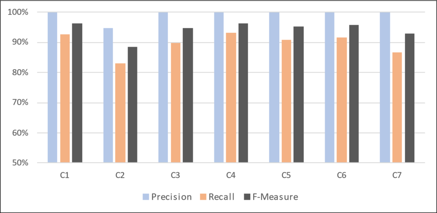

100% 90% 80% 70% 60% 50% a 2 a c4 [3 c6 c7 Precision Recall MF-Measure 

**Fig. 12** Effectiveness of the hybrid code generation

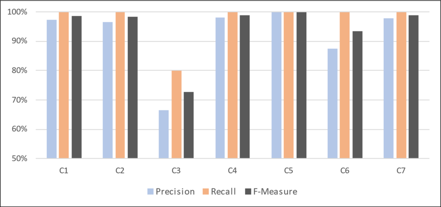

100% 90% 80% 70% 60% 50% c1 [=] c3 ca cs c6 c7 Precision Recall MF-Measure 

**Fig. 13** Effectiveness of quantum code generation

with common practice in the code generation field, striving to automate as much of the process as possible by providing a skeleton or draft of the code, while acknowledging the necessity of human intervention to refine and finalize the output. This practice is standard except for some advanced low-code tools designed for specific applications, which can generate more complete and ready-to-use code.

With respect to the CodeBLEU score of the generated quantum code, Fig. 15 shows the CodeBLEU results disaggregated together with the CodeBLEU score. While it is true that the results are relatively low for the values of _BLEU_ and _BLEU weight_ (the CodeBLEU score can be up to 1) reasonably good values are obtained for the measures of _Matchast_ and _Matchd f_ .

The two first metrics are lower than others. However, the _BLEU_ metric from the CodeBLEU equation was designed to measure how well a candidate translation matches a set of translation references. As [57] stated, “BLEU is not suitable for the evaluation of code synthesis without considering the characteristics of the programming language.” So, this value would be almost every time is used, low. Therefore, although it is part of the equation for calculating the CodeBLEU score, focusing on the BLEU score is not appropriate.

The _BLEU weight_ was introduced because, unlike natural languages, programming languages are manually designed and have only a few keywords such as “int”, “public” and so on. This measure introduces the weighted n-gram match to

123

L. Jiménez-Navajas et al.

814

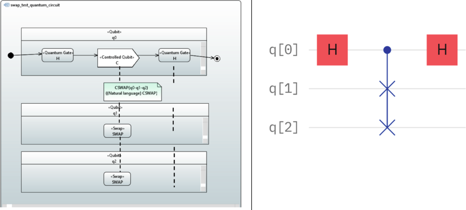

—EE o ate0 iL 1 afl :1 = 

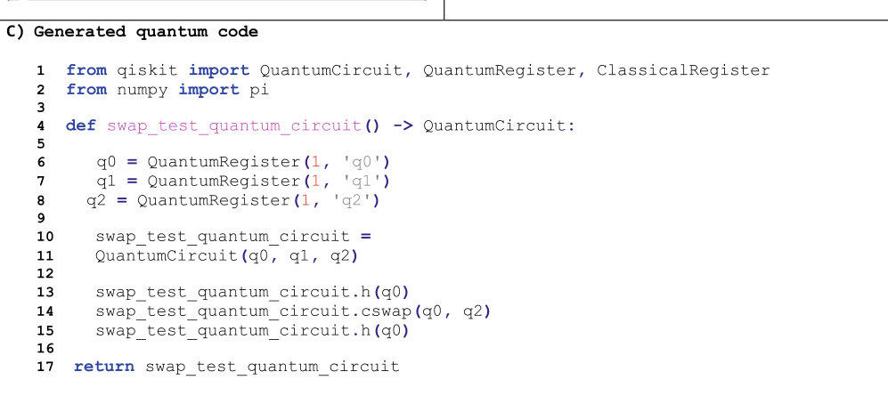

C) Generated quantum code 1 from giskit import QuantumCircuit, QuantumRegister, ClassicalRegister 2 from numpy import pi 3 4 def swap test quantum circuit() - > QuantumCircuit: 5 6 q0 = QuantumRegister(l, 'g0') 7 gl = QuantumRegister(l, 'gl') 8 g2 = QuantumRegister(l, 'q2') 9 10 swap_test_quantum circuit = 11 QuantumCircuit(q0, ql, q2) 12 13 swap_test_quantum_circuit.h(q0) 14 swap_test_quantum_circuit.cswap(q0, g2) 15 swap_test_quantum_circuit.h(g0) 16 17 return swap_test quantum circuit 

**Fig. 14** Swap test circuit and generated quantum code

assign different weights for different n-grams, so that the keywordsmayhavehigherweights.However,thecodegenerated has almost no reserved words from the Python language, while from Qiskit it does, which does not apply to contribute weights to the n-gram match.

The _Matchast_ metric calculates the accuracy of the Abstract Syntax Tree (AST) of the reference code and the candidate. While it is true that the values are high, they could be more so with a few simple changes that would not affect the functionality of the program, but that would substantially modify the result of the CodeBLEU. Figure 16 shows a comparison of the original quantum code generated by the IBM Quantum Circuit composer when implementing the C3 circuit, and the one generated by the technique from the UML model.

While the code generated from the IBM Quantum Circuit composer is a monolithic program, the code generated with the technique contains the circuit in a single method. Another difference is that the code generated by the technique generates one quantum register per qubit. However, in the code generated by IBM, a single quantum register is declared with the same size as the number of qubits in the circuit. This implies that, in order to indicate on which qubit a quantum gate is going to perform an operation, the index of the qubit in the quantum register is indicated. The latter is what most affects the metric, however it is a design decision used in this proposal. Figure 17 shows a comparison between the _Matchast_ measurements obtained from the generated Qiskit code and for the code generated from UML

123

Code generation for classical-quantum software systems …

815

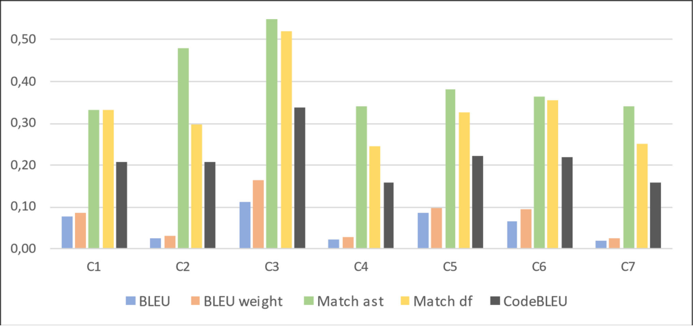

0,50 0,40 0,30 0,20- | 0,00 c1 >) c3 ca cs 6 c7 BLEU BLEU weight Match ast Match df HM CodeBLEU 

**Fig. 15** Disaggregated CodeBLEU scores of the generated quantum code

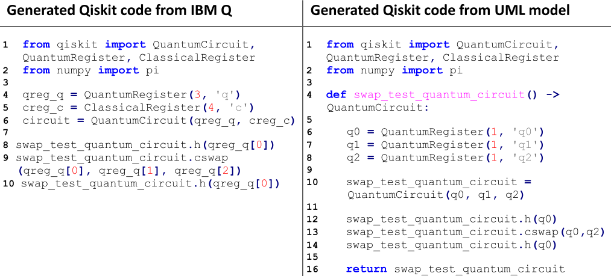

Generated Qiskit code from IBM Q Generated Qiskit code from UML model 1 from giskit import QuantumCircuit, 1 from giskit import QuantumCircuit, QuantumRegister, ClassicalRegister QuantumRegister, ClassicalRegister 2 from numpy import pi 2 from numpy import pi 33 4 qgreg_q = QuantumRegister(3, 'q') 4 def swap test quantum circuit() - > 5 creg_c = ClassicalRegister(4, 'c') QuantumCircuit: 6 circuit = QuantumCircuit(qreg_g, creg_c) [5 7 6 q0 = QuantumRegister(l, 'q0') 8 swap_test quantumcircuit.h(qreg_q[0]) 7 gl = QuantumRegister(l, 'ql') 9 swap test quantumcircuit.cswap 8 g2 = QuantumRegister(l, 'q2') 10 (gqreg_ql0],swap_test_guantumgreg _glll,circuit.h(greg_g[0])greg _ql2]) - 109 swap_test_quantumQuantumCircuit(q0,circuitql, g2)) = 11 12 swap_test_quantum_circuit.h(q0) 13 swap_test_quantum_circuit.cswap(q0,q2) 14 swap_test_quantum_circuit.h(q0) 15 16 return swap_test quantum circuit 

**Fig. 16** Comparison between the reference Qiskit and the generated code

models that was then manually modified to use a single quantum register instead of a single quantum register per qubit. Only with that change, _Matchast_ values are close to 1; this being a variation that does not affect the functionality of the program to any extent. This makes us suppose that the syntax of the generated code with respect to the code of the original circuits is similar in spite of the results of the CodeBLEU value obtained (see Table 4).

Finally, moving on to the last metric for analyzing the completeness of the code generation, it has been studied the

number of compilation errors within each case. As it can be seen in Table 4, the generated code (both Python and Qiskit) are not exempted of compilation errors. In the dataset available at [55], all the compilation errors for each case are gathered. These compilation errors mainly appear because of two reasons: (i) hyphens in the project’s name, and (ii) ‘Undefined’ type.

At the time of manually developing the class diagrams, most of the cases had a clue name for identifying them, where it consisted of the name of the company and the purpose of

123

L. Jiménez-Navajas et al.

816

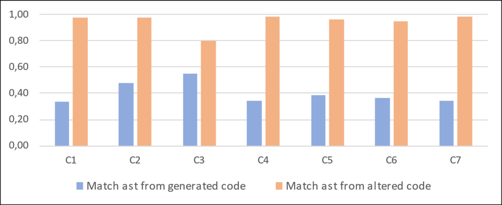

1,00 0,80 0,60 0,40 = EE EEEE 0,00 C1 C2 c3 ca [3 [£3 C7 BM Match ast from generated code BM Match ast from altered code 

**Fig. 17** Comparison between the original syntax match score and the altered syntax match score

the system, joined by hyphens (for example, the clue name of C1 was ‘AIRBUS-WINGBOX’, as it was proposed by the company Airbus and its system has the purpose of optimizing the wing-boxes of the aircrafts). These symbols are fully allowed in UML models. When transforming such class diagrams, it was not considered the fact that the associations modeled in the diagram are transformed into importations of the classes using the full route to such class. The compilation units raise because the importation instruction cannot contain hyphens in the route of the class, so for each association of the case which prototype’s name contains a hyphen, there is a compilation error. Of course, this kind of error is easy to manage and fix. For example, a model validation could be performed on the UML model to detect, and mange issues derived from naming conventions problems. These kinds of techniques should be provided according to the desired target programming language and certain conventions. Hence, this is outside of the scope of this current research.

The second reason of this compilation errors concerns the scope of the EGL Transformation. As mentioned previously, it was not considered the transformation of certain elements, like the array datatype. So, for these attributes bound to these datatypes, the transformation generates attributes with the type ‘Undefined’, which is not a reserved word of Python. So, for each attribute with this undefined type, a compilation error raises. As a design decision, the transformation use this word for the complex data types, which can be then manually completed as other part of the code structure provided.

For proving these, it can be seen the C6 is the one with the lowest number of compilation errors (see Table 4). This case is the same as the one presented in Sect. 5. This case does not contain any hyphens on the name and all the variables are

defined with its corresponding type. So, the transformation does not generate any compilation errors.

In summary, based on the results obtained, it can be concluded that the completeness of both hybrid and quantum code is adequate. Firstly, from a retrieval information problem perspective, the precision, recall and F-Measure metrics indicate that the effectiveness of the technique is optimal. Then, from a machine translation viewpoint perspective, although the CodeBLEU score is quite low, the _Matchast_ metric indicates remarkable similarities between the original quantum circuit and the generated Qiskit program through an AST comparison. Finally, even if the Python code generation is not free of compilation errors, most of them are reasonable and affordable with relatively low effort.

#### 6.2.2 RQ2. Functional correctness of the generated quantum code

As mentioned above, to evaluate the correctness of the generated code, the distances of the frequencies of the results from the execution of the original quantum circuit and the generated quantum code have been measured using the Kullback–Leibler divergence metric. When executing a quantum program, the result is a vector of the possible values represented with the measured qubits and the number of times (frequency) that such possible value has occurred.

Table 4 shows the results of the distances between the results of the execution of times of the original quantum circuit and the generated quantum code one, where the values do not exceed 0.1. This means the quantum generated code provide equivalent results to those generated with _IBM Quantum Composer_ .

123

Code generation for classical-quantum software systems …

817

**Fig. 18** Distribution of frequencies from the execution of the original quantum circuit and the generated quantum code for the case C6

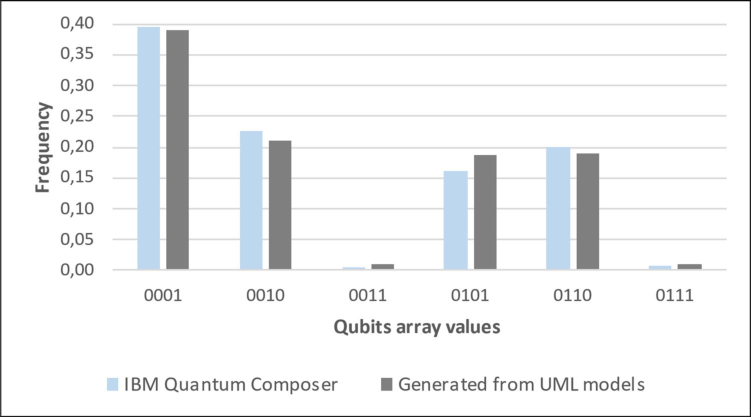

0,40 0,35 0,30 g 0,25 S$ 020 z &2 0,15 0,10 0,05 0,00 — — 0001 0010 0011 0101 0110 0111 Qubits array values IBM Quantum Composer HW Generated from UML models 

To visualize these results graphically, Fig. 18 shows the specific results for the case C6 regarding the frequency distribution of the possible values of the qubits of the circuit generated with _IBM Quantum Composer_ (gray bubbles) and of the generated code (blue bubble). The size of the bubbles indicates the frequency of the qubit values. As can be seen, both the size of the bubbles of the qubit values and the frequencies of the results are very similar between the original and the generated circuit, so the very low value of Kullback–Leibler divergence for this same case (0.0) makes sense.

It can be concluded that, based on the distances of frequencies, RQ2 can be positively answered, as the functional correctness of the technique is ensured.

model loading time has no relationship with any other parameter. However, the execution of the transformation rules does have a strong correlation with both the size of the activity diagram and the lines of code the generated quantum code. The overall correlation for quantum code generation (0.7) is higher than correlation for hybrid code generation.

Despite the small number of cases available, the results indicate that the generation time increases linearly, rather than exponentially. Although this was the hypothesized expectation, it suggests the scalability of the technique for larger UML models with a larger number of elements. It is important to note that, while the models used in this study may not be extremely large, the goal was to evaluate how the generation time scales with model size. This analysis is intended to extrapolate the results to larger models, where we anticipate similar linear growth in generation time.

#### 6.2.3 RQ3. Efficiency of the forward engineering technique

In order to evaluate the performance of the tool with larger models, first it is necessary to discover which of the variables related to the size (acting as the independent variable) affect the code generation time in a greater extent. Figure 19 shows the matrixes containing the Pearson correlations for each pair of size and timing variables.

Regarding the values obtained from the hybrid code generation (see the left-hand side of Fig. 19) it can be observed that the rule execution time has a certain correlation regarding the size of the input UML model (0.66). However, model loading time is not affected by any other parameter, so it could consider as constant time necessary to prepare the EGL engine before code generation. As a result, the overall generation time is not highly correlated with the size of the input UML models (0.57). Referring to the time data obtained in the quantum code generation (see the right-hand side of Fig. 19), it can be noticed that, as in the hybrid code generation, the

### 6.3 Threats to validity

This section discusses threats to validity in this case study, which refer to factors that may undermine the credibility, reliability, or generalizability of the findings, and explain the mitigation actions.

#### 6.3.1 Construct validity

Regarding the definition of constructs, this study considers three main measurable concepts. First, the completeness for the generated code, whose assessment is based on information retrieval metrics (precision, recall and f-measure). Those measures offer a comprehensive and balanced evaluation framework for code generation techniques, enabling researchers and practitioners to assess the completeness of the generated code relative to the desired specifications or

123

L. Jiménez-Navajas et al.

818

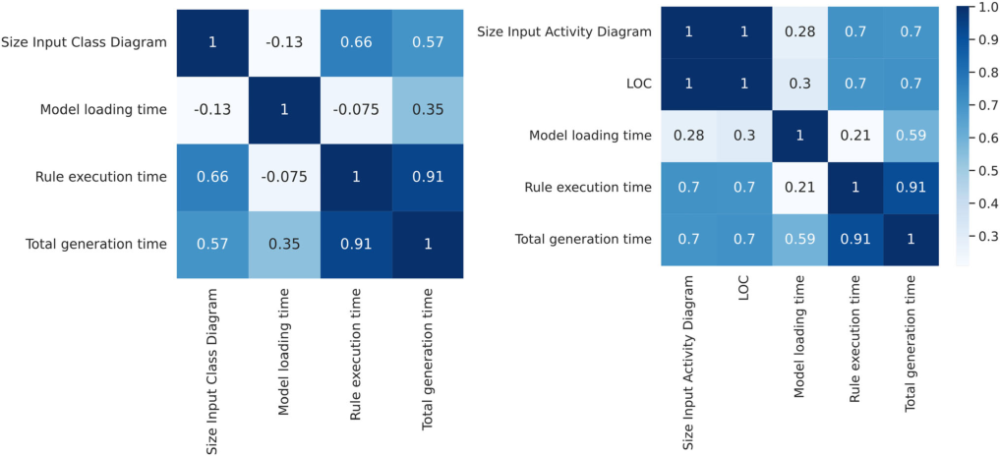

1.0 Size Input Class Diagram 1 0.13 [ENREECYN Size © I "Putit ActivityActivity DiDiagram 1 1 0.28 0.7 0.7 09 I : 1 EEN 07 07 08 Model loading time ~~ -0.13 1 20.075 | 0.35 07 Model loading time 0.28 0.3 [BI 0.59 06 Rule execution time | 0.EOES 1 0.9JER Rule execution time [MUVMSSORAN 0.21 [EEE] ~0.5 -0.4 Total generation time [SERA 0.35 0.91 1 Total generation time [UVARSNCVAN oc ERE 1 -03 c o o o E 8&8 EE EE gE5=¢ =EE=g F- ga >E As SsA a RB£ El££® 2 5 5 3 £2 gE § § d8 ° 8 |] Bg 3 8 I ks££ 32 H 2 > 5 = 2 E 5 = 22 I]g 22 © o Ld 8 a & 

**Fig. 19** Correlation matrixes

requirements. Unfortunately, precision and recall do not consider the context and semantics of the code.

To mitigate the previous threat, the study considers the CodeBLEU metric from the translation machine field. This metric provides a more flexible and tolerant evaluation criterion, accommodating variations in coding styles and conventions. The threat of CodeBLEU is that is extremely sensitive to coding style and conventions. As it can be seen in Sect. 6.2.2, just changing one variable type and how it is called, the metrics grows exponentially.

In order to limit that threat, the functional correctness construct was also included in the study, at least for the quantum code. The assessment of this construct is based on the execution results comparison of the generated code and the one generated with _IBM quantum composer_ . The outgoing statistical distributions are then compared. Although it ensures an approximate functional correctness, it possess some measurement bias. For example, the usage of the _IBM quantum composer_ as the alternative generation tool when there are others. Also, the interpretability of results could be different if the quantum circuits manually modeled differ. Despite the threats, we believe it can be used to get an orientation about the functional correctness.

Finally, assessing scalability in this study presents significant challenges due to the limited availability of larger quantum systems and the inherent complexity in simulating and validating results for systems beyond a few qubits.

were manually modeled by researchers who were involved in this study. As explained before, there is a lack of high-level UML designs, for hybrid software systems, that can be freely accessible. About causal inferences, we do not consider any relevant inference apart from the already mentioned usage of the _IBM Quantum composer_ in order to assess the functional correctness of the source code.

#### 6.3.3 External validity

It refers to the generalizability of results. In this regard, the obtained results can strictly be generalized for UML designs of hybrid software systems based on the UML profile used in this proposal. Despite that, since UML is a standard, similar quantum extensions could be considered as modeling languages in which results could be potentially generalized.

Regarding the output, the proposal is only focused on Python/Qiskit code. Hence, results can only be generalized for this programming language. Although it should be noted that Python is by far the most widely used language in quantum computing [65].

Moreover, due to the MDE principles followed in this proposal, it should be easy to extend the proposal to generate code in other programming languages.

In any case, the mitigation action for those threats should be, in the future, conduct further case studies involving other modeling languages and different programming languages.

#### 6.3.4 Reliability

#### 6.3.2 Internal validity

Regardinginternalvalidity,themainthreatisapossibleselection bias since the UML models included in the case study

There are no significant data reliability concerns. The only threat could be the subjective judgment of researchers for tagging irrelevant and missing elements in the generated code,

123

Code generation for classical-quantum software systems …

819

which is used to compute precision and recall. In order to ensure reliability and future replications, the whole dataset is freely available so that other researchers can check the data collection and the judgments made by researchers regarding that metrics [55].

#### 6.3.5 Contextual threats

Changesintheexternalenvironmentortechnologylandscape is quite possible due to the current changing rate in quantum computing and quantum software technology and practices. Because of this, there is a certain contextual threat that may limit the relevance or applicability of findings from in future case studies. The accessible dataset provided is useful and will help to compare current with future results despite the possible changes that can occur.

specificconstraintsinPython(oranothertargetprogramming language) should be considered as future work.

The main implication for researchers and practitioners is that this technique deals with the forward engineering phase within the software modernization process for hybrid software systems. As a result, this technique can globally facilitate industry adoption of quantum software across various sectors. Ultimately, this adoption can accelerate the transition to quantum computing/technology, thereby unlocking the potential benefits of numerous promising applications.

As future work, we will work in the integration of this technique in the QuantumPath® industrial framework [66].

**Acknowledgements** This work is part of the projects PID2022137944NB-I00 (SMOOTH Project) and PDC2022-33051-I00 (QUASAP Project) funded by MICIU/AEI/https://doi.org/10.13039/ 501100011033 / PRTR, EU.

**Funding** Open Access funding provided thanks to the CRUE-CSIC agreement with Springer Nature.

## 7 Conclusions and future work

Although various generative techniques exist for both classical and quantum software, they have traditionally been provided in isolation. Therefore, the main contribution of this research lies in the combined generation of classical (Python) and quantum (Qiskit) code from high-level designs for hybrid software systems, modeled with a quantum UML profile. This MDE, generative technique has been validated with 7 models representing hybrid software systems to address realistic problems that some companies have stated as potential quantum applications. The main insight of the case study is that the generation technique is effective and, therefore, suggests scalability, and the generation of quantum code is functionally correct.

Despite the claimed benefits, the proposed generative technique has certain limitations, which could be addressed in future work. A key limitation of the proposed approach is its focus on code generation for circuits fully defined in activity diagrams. It does not cover modeling abstractions for circuits following certain design patterns or algorithm families (e.g., QFT or VQE). These algorithms often have repetitive structures, leading to UML diagrams using _structured activities_ in which some UML modeling patterns can be applied, which requires a different code generation approach. The representation of this kind of quantum algorithms as UML activity diagrams will be covered in the future work. Another future improvement could involve considering additional elements in Python and Qiskit, such as predefined quantum software libraries, and exploring code generation in other programming languages. Since an MDE approach has been followed, those extensions and improvements should not be difficult. Finally, model validation in order to prevent issues in code generation due to the naming conventions and

**Open Access** This article is licensed under a Creative Commons Attribution 4.0 International License, which permits use, sharing, adaptation, distribution and reproduction in any medium or format, as long as you give appropriate credit to the original author(s) and the source, provide a link to the Creative Commons licence, and indicate if changes were made. The images or other third party material in this article are included in the article’s Creative Commons licence, unless indicated otherwise in a credit line to the material. If material is not included in the article’s Creative Commons licence and your intended use is not permitted by statutory regulation or exceeds the permitteduse,youwillneedtoobtainpermissiondirectlyfromthecopyright holder. To view a copy of this licence, visit http://creativecomm ons.org/licenses/by/4.0/.

## References

1. IBM, _The Quantum Decade. A playbook for achieving awareness, readiness, and advantage_ . 3rd ed. 2022: IBM Institute for Business Value. 127.

2. Ukpabi, D., et al., _Framework for understanding quantum computing use cases from a multidisciplinary perspective and future research directions._ arXiv, 2023. **2212.13909v2** : p. 13.

3. Bayerstadler, A., et al.: Industry quantum computing applications. EPJ Quant. Technol. **8** (1), 25 (2021)

4. Aaronson, S.: The limits of quantum computers. J. Sci. Am. **298** (3), 62–69 (2008)

5. Lenahan,B., _QuantumBoost:UsingQuantumComputingtoSupercharge Your Business_ . 2021: Library and Archives Canada.

6. Preskill, J., _Quantum Computing in the NISQ era and beyond._ Quantum, 2018. **2** (aug): p. 79.

7. Kim, Y., et al.: Evidence for the utility of quantum computing before fault tolerance. Nature **618** (7965), 500–505 (2023)

8. Gupta, S. and V. Sharma. _Effects of Quantum computing on Businesses_ . in _2023 4th International Conference on Intelligent Engineering and Management (ICIEM)_ . 2023.

9. Arute, F., et al.: Quantum supremacy using a programmable superconducting processor. Nature **574** (7779), 505–510 (2019)

10. Livemint. _Google says it will build a commercial quantum computer before 2030_ . 2021 19 May 2021 [cited 2021; Available

123

L. Jiménez-Navajas et al.

820

from: https://www.livemint.com/technology/tech-news/googlesays-it-will-build-a-commercial-quantum-computer-before-203011621363226405.html.

11. Mueck, L.: Quantum software. Nature **549** (7671), 171–171 (2017)

12. Serrano, M.A., R. Pérez-Castillo, and M. Piattini, eds. _Quantum Software Engineering_ . 2022, Springer. XXVIII, 302.

13. Zhao, J., _Quantum Software Engineering: Landscapes and Horizons._ arXiv preprint, 2020.

14. Carleton, A.D., et al.: Architecting the Future of Software Engineering: A National Agenda for Software Engineering Research andDevelopment.CarnegieMellonUniversity,SoftwareEngineering Institute (2021)

15. Barbosa, L.S., _Software engineering for ‘quantum advantage’_ , in _Proceedings of the IEEE/ACM 42nd International Conference on Software Engineering Workshops_ . 2020, Association for Computing Machinery: Seoul, Republic of Korea. p. 427–429.

16. Piattini, M., et al.: Towards a quantum software engineering. IT Professional **23** (1), 62–66 (2021)

17. Pérez-Castillo, R., Serrano, M.A., Piattini, M.: Software modernization to embrace quantum technology. Adv. Eng. Softw. **151** , 102933 (2021)

18. Khan, A.A., et al.: Software architecture for quantum computing systems — a systematic review. J. Syst. Softw. **201** , 111682 (2023)

19. Pérez-Castillo, R., et al.: Guidelines to use the incremental commitment spiral model for developing quantum-classical systems. Quantum Inf. Comput. **24** (1&2), 71–88 (2024)

20. Pérez-Castillo, R., L. Jiménez-Navajas, and M. Piattini, _QRev: migrating quantum code towards hybrid information systems._ Software Quality Journal, 2021.

21. Pérez-Castillo, R., L. Jiménez-Navajas, and M. Piattini, _Modeling Quantum Circuits with UML_ , in _43rd ACM/IEEE International Conference on Software Engineering Workshops. 2021 IEEE/ACM 2ndInternationalWorkshoponQuantumSoftwareEngineering(QSE)_ . 2021, IEEE Computer Society: Virtual (originally in Madrid, Spain). p. 7–12.

22. Qiskit, I. _Getting Started with Qiskit_ . 2022 12/12/2022]; Available from: https://qiskit.org/documentation/tutorials/circuits/1_ getting_started_with_qiskit.html.

23. OMG, _UML 2.5.1._ https://www.omg.org/spec/UML/2.5.1/PDF. 2017, Object Management Group.

24. Rose, L.M., Language, T.E.G., et al.: Berlin. Springer, Berlin Heidelberg, Heidelberg (2008)

25. Pérez-Castillo, R., et al. _Generation of Classical-Quantum Code from UML models_ . in _2023 IEEE International Conference on Quantum Computing and Engineering (QCE)_ . 2023.

26. Papineni, K., et al., _BLEU: a method for automatic evaluation of machine translation_ , in _Proceedings of the 40th Annual Meeting on Association for Computational Linguistics_ . 2002, Association for Computational Linguistics: Philadelphia, Pennsylvania. p. 311–318.

27. Maslov, D., Nam, Y., Kim, J.: An outlook for quantum computing [point of view]. Proc. IEEE **107** (1), 5–10 (2019)

28. Ezratty, O., _Understanding quantum technologies_ . Sixth ed. 2024: le lab quantique.

29. Rieffel,E.G.andW.H.Polak, _QuantumComputing:A Gentle Introduction (Scientific and Engineering Computation)_ . 2011: The MIT Press.

30. Akbar, M.A., Khan, A.A., Rafi, S.: A systematic decision-making framework for tackling quantum software engineering challenges. Autom. Softw. Eng. **30** (2), 22 (2023)

31. Haghparast, M., et al., _Quantum Software Engineering Challenges from Developers’ Perspective: Mapping Research Challenges to the Proposed Workflow Model._ 2023 IEEE International Conference on Quantum Computing and Engineering (QCE), 2023. **02** : p. 173–176.

32. Weder, B., et al.: Provenance-preserving analysis and rewrite of quantum workflows for hybrid quantum algorithms. SN Comput. Sci. **4** (3), 233 (2023)

33. Cruz-Lemus, J.A., L.A. Marcelo, and M. Piattini, _Towards a Set of Metrics for Quantum Circuits Understandability_ . 2021, Springer International Publishing. Cham. 239-249.

34. Garcia-Alonso, J., et al.: Quantum software as a service through a quantum API gateway. IEEE Internet Comput. **26** (1), 34–41 (2022)

35. Cabot, J., Vallecillo, A.: Modeling should be an independent scientific discipline. Softw. Syst. Model. **21** (6), 2101–2107 (2022)

36. Pérez-Castillo, R. and M. Piattini, _Design of classical-quantum systems with UML._ Computing, 2022.

37. Dey, N., et al. _The Quantum Development Life Cycle_ . 2020 15 Oct 2020 08/01/2021]; Available from: https://arxiv.org/abs/2010. 08053v1.

38. Perez-Delgado, C.A., Perez-Gonzalez, H.G.: Towards a Quantum Software Modeling Language. In: 2020 IEEE/ACM 42nd International Conference on Software Engineering Workshops (ICSEW), pp. 441–444. Han River, Seoul, South Korea (2020)

39. Ali, S. and T. Yue, _Modeling Quantum programs: challenges, initial results, and research directions_ , in _Proceedings of the 1st ACM SIGSOFT International Workshop on Architectures and Paradigms for Engineering Quantum Software_ . 2020, Association for Computing Machinery: Virtual, USA. p. 14–21.

40. Gemeinhardt, F., A. Garmendia, and M. Wimmer, _Towards ModelDriven Quantum Software Engineering_ , in _2021 IEEE/ACM 2nd International Workshop on Quantum Software Engineering (QSE)_ . 2021. p. 13–15.

41. Peng, Y., et al., _SimuQ: A Framework for Programming Quantum HamiltonianSimulationwithAnalogCompilation._ Proc.ACMProgram. Lang., 2024. **8** (POPL): p. Article 81.

42. Fu, X., et al., _Quingo: A Programming Framework for Heterogeneous Quantum-Classical Computing with NISQ Features._ ACM Transactions on Quantum Computing, 2021. **2** (4): p. Article 19.

43. Geller, A. _Introducing Quantum Intermediate Representation (QIR)_ . 2020 September 23rd, 2020 [cited 2021 03/22/2021]; Available from: https://devblogs.microsoft.com/qsharp/introducingquantum-intermediate-representation-qir/.

44. Lattner, C. and V. Adve. _LLVM: A compilation framework for lifelong program analysis & transformation_ . in _International symposium on code generation and optimization, 2004. CGO 2004._ 2004. IEEE.

45. Moin, A., et al., _Towards Model-Driven Engineering for Quantum AI_ , in _INFORMATIK 2022_ , D. Demmler, Krupka, D. & Federrath, H., Editor. 2022: Gesellschaft für Informatik, Bonn. p. 1121–1131.

46. Alonso, D., Sánchez, P., Sánchez-Rubio, F.: Engineering the development of quantum programs: application to the Boolean satisfiability problem. Adv. Eng. Softw. **173** , 103216 (2022)

47. IBM. _IBM Quantum Composer_ . 2023; Available from: https:// quantum-computing.ibm.com/composer.

48. Last, T., et al. _Quantum Inspire: QuTech’s platform for codevelopment and collaboration in quantum computing_ . in _Novel patterning technologies for semiconductors, MEMS/NEMS and MOEMS 2020_ . 2020. SPIE.

49. Quantastica. _Quantum Programming Studio_ . 2019 [cited 2020; Available from: https://quantum-circuit.com/.

50. Universy of Stuttgart. _Quantum Application Lifecycle Management (QuAntiL)_ . 2023; Available from: https://quantil.readthedocs. io/en/latest/user-guide/circuit-transformer/.

51. QisKit. _Pricing European Call Options_ . 2021 [cited 2022 01/02/2022]; Available from: https://qiskit.org/documentation/ finance/tutorials/03_european_call_option_pricing.html.

52. IBM Quantum. _Classical feedforward and control flow in Qiskit_ . 2024 [cited 2024 10/06/2024]; Available from: https://docs. quantum.ibm.com/build/classical-feedforward-and-control-flow.

123

Code generation for classical-quantum software systems …

821

53. Cantalejo, I. _EGL scripts for transforming Quantum UML models into Python code_ . 2023; Available from: https://github.com/ ivyncm/PythonGenerator/tree/main/EGLtemplates.

54. Runeson, P., et al., _Case study research in software engineering: Guidelines and examples_ . 2012: John Wiley & Sons.

55. Jiménez-Navajas, L., R. Pérez-Castillo, and M. Piattini. 2024. _Validation dataset for the forward engineering of UML models to Hybrid and Quantum code_ . 2024; Available from: 10.5281/zenodo.10790351.

56. Fernández, A., et al., _Learning from imbalanced data sets_ . Vol. 10. 2018: Springer.

57. Ren, S., et al., _Codebleu: a method for automatic evaluation of code synthesis._ arXiv preprint arXiv:2009.10297, 2020.

58. Papineni, K., et al. _Bleu: a method for automatic evaluation of machine translation_ . in _Proceedings of the 40th annual meeting of the Association for Computational Linguistics_ . 2002.

59. Lanusse, A., et al. _Papyrus UML: an open source toolset for MDA_ . in _Proc. of the Fifth European Conference on Model-Driven Architecture Foundations and Applications (ECMDA-FA 2009)_ . 2009. Citeseer.

60. Strauss, A. and J. Corbin, _Grounded theory methodology: An overview._ 1994.

61. Das, S., et al.: Quantum pattern recognition on real quantum processing units. Quantum Machine Intell. **5** (1), 16 (2023)

62. Gottesman, D. and I. Chuang, _Quantum digital signatures._ arXiv preprint quant-ph/0105032, 2001.

63. Buhrman, H., et al.: Quantum fingerprinting. Phys. Rev. Lett. **87** (16), 167902 (2001)

64. Kang, M.-S., et al.: Implementation of SWAP test for two unknown states in photons via cross-Kerr nonlinearities under decoherence effect. Sci. Rep. **9** (1), 6167 (2019)

65. The Quantum Insider. _Top 5 Quantum Programming Languages in 2024_ . 2022; Available from: https://thequantuminsider.com/2022/ 07/28/state-of-quantum-computing-programming-languages-in2022/.

66. Hevia, J.L., G. Peterssen, and M. Piattini, _QuantumPath: A quantum software development platform._ Software: Practice and Experience, 2021.

**Publisher’s Note** Springer Nature remains neutral with regard to jurisdictional claims in published maps and institutional affiliations.

**Luis Jiménez-Navajas** Luis Jiménez-Navajas obtained his PhD on Computer Science from the University of Castilla-La Mancha (Spain). Current member of the scientific research group aQuantum, working on the software modernization of classical-quantum information systems with specific focus on hybrid software modernization.

**Ricardo Pérez-Castillo** Ricardo Pérez-Castillo holds the PhD degree in Computer Science from the University of CastillaLa Mancha (Spain). He works at the IT & Social Sciences School of Talavera at University of Castilla-La Mancha. His research interests include architecture-driven modernization, model-driven development and business process archeology. Currently member of the aQuantum scientific research team where he works on the migration

of classical systems to quantum architectures and quantum software reengineering.

**Mario Piattini** Mario Piattini. MSc. (1989) and PhD (1994) in Computer Science from Madrid Technical University (UPM). PMP, CISA, CISM, CGEIT and CRISC. Founder-Director of the Information Systems and Technologies of the UCLM (University of Castilla-La Mancha) and of the UCLM-INDRA Research and Development Joint Center. Between the “15 Top scholars in the field of systems and software engineering (20042008)” and the “Among the 15

“Most active experienced SE researchers (2010-2017).” Full Professor of Software Engineering at UCLM, and leader of the Alarcos Research Group and scientific director of AQCLab, S.L. (first ENAC / ILAC accredited laboratory for software and data quality based on ISO 25000). Currently leader of the aQuantum scientific research team (Alarcos Group) laboratory for software and data quality based on ISO 25000). Currently leader of the aQuantum scientific research team (Alarcos Group).

123
