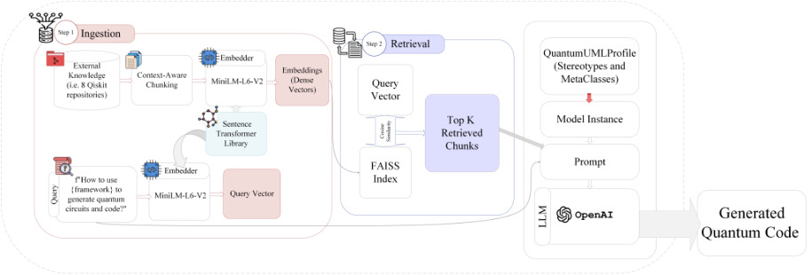
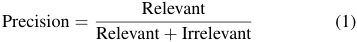
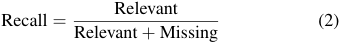
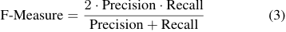
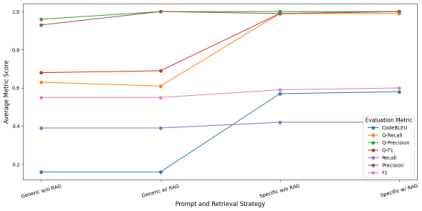
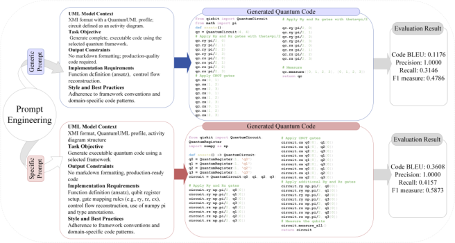

2025 ACM/IEEE 28th International Conference on Model Driven Engineering Languages and Systems (MODELS)

# Model-Driven Quantum Code Generation Using Large Language Models and Retrieval-Augmented Generation

Nazanin Siavash

_Department of Computer Science University of Colorado Colorado Springs (UCCS)_ Colorado Springs, United States nsiavash@uccs.edu

Armin Moin

_Department of Computer Science_

_University of Colorado Colorado Springs (UCCS)_ Colorado Springs, United States

amoin@uccs.edu

**_Abstract_ —This paper introduces a novel research direction for model-to-text/code transformations by leveraging Large Language Models (LLMs) that can be enhanced with RetrievalAugmented Generation (RAG) pipelines. The focus is on quantum and hybrid quantum-classical software systems, where modeldriven approaches can help reduce the costs and mitigate the risks associated with the heterogeneous platform landscape and lack of developers’ skills. We validate one of the proposed ideas regarding generating code out of UML model instances of software systems. This Python code uses a well-established library, called Qiskit, to execute on gate-based or circuit-based quantum computers. The RAG pipeline that we deploy incorporates sample Qiskit code from public GitHub repositories. Experimental results show that well-engineered prompts can improve CodeBLEU scores by up to a factor of four, yielding more accurate and consistent quantum code. However, the proposed research direction can go beyond this through further investigation in the future by conducting experiments to address our other research questions and ideas proposed here, such as deploying software system model instances as the source of information in the RAG pipelines, or deploying LLMs for codeto-code transformations, for instance, for transpilation use cases.**

**_Index Terms_ —model-driven software engineering, quantum code generation, large language models, llm, retrieval-augmented generation, rag**

## I. INTRODUCTION

Large Language Models (LLMs) have recently been deployed in various aspects of Software Engineering (SE) [1], including but not limited to the Model-Driven Software Engineering (MDSE) paradigm [2]. For instance, when it comes to bridging the divide between domain experts and MDE tools, generative AI seems to be promising [3]. Within the realm of MDSE, LLMs have been applied to various tasks, including model management, code generation, user assistance and training, automation of modeling tasks, as well as error detection and correction [4].

Moreover, MDSE has proven useful in complex vertical domains and use-case scenarios in which heterogeneous platforms and technology stacks need to be supported. Quantum Software Engineering (QSE) deals with such a landscape.

Additionally, today’s software developers typically lack technical skills in these platforms, for example, regarding their models of computation, hardware architecture, Software Development Kits (SDKs), libraries, constraints, and optimization techniques. For instance, Gemeinhardt et al. [5] proposed a novel approach to enable model-driven composition-based quantum circuit design and implementation. Also, Jim´enezNavajas et al. [6] deployed the Epsilon Generation Language to generate Python code that works with Qiskit for quantum and hybrid quantum-classical applications. We used the model instances provided by them in our experimental study.

The key contribution of this paper is proposing a new research direction defined by deploying LLMs, such as the stateof-the-art Generative Pre-trained Transformer (GPT) models provided by OpenAI (e.g., GPT-4o), as a text generation engine (e.g., to automatically generate source code and documentation) in MDSE. In this paper, we concentrate on generating software code that should execute on quantum computers. The code will be generated by the LLM out of the software model instances, modeling the behavior and structure of the respective software systems. Furthermore, rather than relying exclusively on prompt-based LLM generation, which often suffers from limited context-awareness, our approach integrates a Retrieval-Augmented Generation (RAG) pipeline. This enhancement grounds the LLM outputs in relevant domain-specific artifacts, thereby improving both the accuracy and consistency of the generated quantum code. RAG is a well-established, state-of-the-art concept to address the socalled LLM hallucination problem, which is abundant [7].

The structure of this paper is as follows. Section II provides background information. Section III reviews related work in these areas. In Section IV, we describe our proposed research direction. Moreover, Section V presents our preliminary experimental results. Finally, Section VI concludes the paper and outlines the future work.

## II. BACKGROUND

In the following, we briefly provide some background information on LLM-enabled code generation and code tran-

979-8-3315-4910-7/25/$31.00 ©2025 IEEE 260 DOI 10.1109/MODELS67397.2025.00031 Authorized licensed use limited to: Universidad Internacional de La Rioja (UNIR). Downloaded on October 14,2026 at 22:09:29 UTC from IEEE Xplore.  Restrictions apply.

spilation.

## _A. LLM-enabled Code Generation_

Classic code generation approaches in MDSE have deployed template-based and rule-based model transformation techniques. However, with recent advances in machine learning, LLM-based approaches have gained significant traction [8], [9]. These approaches have notably improved the accuracy, coherence, and fluency of code synthesis and completion [10]. A variety of LLMs are available, and the choice depends on the specific task requirements and computational resources. Common examples include GPT-4, LaMDA, Claude, and LLaMA 2.

## _B. Code Transpilation_

Transpilation refers to the process of converting source code from one programming language to another, with the goal of maintaining the original program’s intended semantics and functionality [11]. Traditionally, this transformation has been achieved through rule-based or template-driven approaches that depend on explicitly defined syntactic and semantic mappings, often requiring substantial manual effort and deep domain expertise [12]. In recent years, however, there has been a paradigm shift toward the utilization of LLMs for this purpose [13]–[15]. Trained on extensive corpora of programming data, these advanced generative machine learning models are capable of producing target-language code that adheres to established coding conventions and standards [11]. Consequently, LLM-based approaches have demonstrated considerable effectiveness in maintaining semantic fidelity during the transpilation process.

## III. RELATED WORK

Below, we briefly review the recent developments in automated source code generation and transpilation.

## _A. Rule-based Code Generation_

Traditional code generation and transpilation techniques often rely on explicitly defined transformation rules. Various domain-specific modeling tools based on scientific approaches have been proposed, for example, MontiThings [16] for the Internet of Things (IoT), MontiAnna [17] for machine learning, and ML-Quadrat [18] for machine learning-enabled IoT services. Additionally, Xue et al. [19] presented the PAR platform, a formal model-driven engineering framework incorporating languages and transformation rules to automatically derive executable programs from high-level specifications. Also, Ling et al. [20] tackled (code-to-code) transpilation with a focus on API safety.

The idea of deploying MDE for QSE [21] and code generation for various quantum AI [22], [23] has also been around over the past few years. Jim´enez-Navajas et al. [6] enabled generating quantum code from extended UML models using model-to-text transformations written in the Epsilon Generation Language. Their approach supported generating Python code that could work with the Qiskit library for hybrid

quantum-classical systems. It was validated through multiple case studies, confirming its practical applicability. We use their model instances for our preliminary evaluation.

Further, Gemeinhardt et al. [5] developed a domain-specific modeling language to facilitate quantum circuit design at a higher level of abstraction. Their toolchain enabled the specification of composite quantum operations and automated the generation of corresponding executable code, demonstrated through applications such as Quantum Counting and Quantum Approximate Optimization Algorithm (QAOA).

## _B. LLM-enabled Code Generation_

With the increasing complexity of software systems and the limitations of rule-based methods, recent work has shifted toward leveraging LLMs for code generation and transpilation. These models eliminate the need for handcrafted transformation rules by learning patterns from large code corpora. Zheng et al. [24] introduced CodeGeeX, a 13-billionparameter multilingual model trained across 23 programming languages. It demonstrated strong performance in both code synthesis and transpilation tasks, outperforming comparable models of the same scale. Furthermore, Le and Andrzejak [8] proposed a novel approach called One-shot Correction, which decomposed user queries into sub-tasks, retrieved or generated relevant code snippets using stored user feedback or a Natural Language-to-code generator, and assembled them into final code.

While LLMs have been extensively studied for classical code generation, there is a notable lack of research applying these techniques to quantum software development. Most recently, Henderson et al. [25] studied the use of LLMs for quantum programming. However, their experiments have not been with the state-of-the-art LLMs, such as GPT-4o or GPT4.1, but with the previous OpenAI LLM version, GPT-4. Furthermore, they did not investigate the deployment of RAG pipelines.

## IV. PROPOSED RESEARCH DIRECTION

The proposed research direction, which is based on our novel vision, comprises leveraging LLMs enhanced by RAG pipelines to mitigate their well-known hallucination problem and increase their reliability. Hence, we propose the following Research Questions (RQ) for various configurations that we can imagine at this time for the realization of this vision: RQ 1. Can an LLM receive a design model instance of a software system or component in a general-purpose modeling language, such as UML, as input, and generate the implementation corresponding to that model in a general-purpose programming language as output in an effective and efficient manner? RQ2. Can a RAG pipeline fed by sample code snippets in the target programming language help enhance the effectiveness and/or efficiency of the code generation in RQ1? RQ3. Can prompt engineering techniques enhance the performance of the LLM? RQ4. Can we support a domainspecific modeling language in RQ1 and RQ2, and provide the meta-model of the language as additional context in the

261

[= IngeFert P) ose I. B20)2 rere QuantumUML(Stereotypes Profleand0 repasitries) Ve Vector 3 fc, | fA— Troe i Retrieved Libeary = Chunks B, .® Enter FAISfio Prompt § mmole witey: | Quen Ver ro” Z @ operat Generated = Quantum Code 

Fig. 1. The overall architecture of our current RAG pipeline configuration

RAG pipeline? RQ5. Can we change the LLM input and the configuration of the RAG pipeline in RQ2 (or RQ4), such that the LLM input is the software requirements specification in natural language, and the corresponding model instance is deployed in the RAG pipeline providing additional context? RQ5. Can we use the RAG setup proposed in RQ4 (i.e., the model instance as the RAG-enabled context to augment the prompt/query for the purpose of code-to-code transformation, such as in transpilation (i.e., translation of the code from one variant to another one, e.g., from one programming language to another one)? Our emerging results presented in Section V pertain to a basic prototype realized with the aim of addressing RQ1, RQ2, and RQ3 among the new ideas presented above. The remaining RQs, RQ4–RQ6, are outlined as directions for future work. One of the key novelties of the proposed approach is its focus on quantum and hybrid quantum-classical software applications rather than pure classical ones.

## _A. LLM-enabled Model-Driven Quantum Code Generation_

We enable automated Python source code generation via the OpenAI’s LLMs, specifically GPT-4o. The input prompt given to the LLM entails the textual model instance that conforms to a meta-model. The output of the LLM is the generated code that can work with IBM’s Qiskit quantum software library.

## _B. Context-aware Model-Driven Quantum Code Generation via a RAG pipeline_

To overcome the LLM limitations that cause occasional hallucinations, a RAG approach is employed [26]. This method integrates a retrieval system with a generative model, enabling dynamic access to external knowledge during the generation process. Specifically, the RAG architecture includes two main parts: A retriever that identifies relevant documents from a knowledge base, and a generator that uses this retrieved information to inform the final output. The overall architecture of our RAG pipeline, in its present configuration, is illustrated in Figure 1.

## _C. Prompt Engineering_

Designing effective prompts is a key step in improving the performance of LLMs on specific tasks [27]. This process, known as _prompt engineering_ , involves crafting and refining the input provided to LLMs, such as GPT-4o deployed here, to clearly express the user’s intent [28], [29]. We examine two types of prompts. The first one is a more general prompt that simply instructs the LLM to generate quantum code based on the quantum circuit defined in the input model instance. This version provides minimal guidance and relies on the LLM’s default understanding. The second prompt variant is more specific, incorporating detailed implementation requirements, such as quantum gate mapping strategies and constraints on syntax and gate behavior. By comparing the outputs from these two prompting strategies, we aim to evaluate how varying levels of prompt-specificity influence the quality and correctness of the generated quantum code.

## V. PRELIMINARY EXPERIMENTAL RESULTS

## _A. Experimental Data_

We carry out our experimental study with the model instances presented in Jim´enez-Navajas et al. [6], which conform to a Unified Modeling Language (UML) Profile proposed by P´erez-Castillo and Piattini [30].

## _B. Evaluation Metrics_

To assess the quality of the quantum code generated from UML models, we adopt a structured evaluation approach based on Precision, Recall, and F-measure. These metrics are calculated by comparing the elements present in the UML model (expected elements) with those identified in the generated code (generated elements). The comparison methodology follows the element-wise mapping defined in the research paper by Jim´enez-Navajas et al. [6].

_1) Precision:_ Precision evaluates the ratio of correctly generated elements (relevant elements) to the total number of generated elements.

262

Relevant Precision = (1) Relevant + Irrelevant 

Where Relevant and Irrelevant denote the number of relevant and irrelevant elements, respectively. Therefore, precision measures the correctness of what was generated.

_2) Recall:_ Recall quantifies the proportion of relevant elements that were successfully generated, out of all elements that were expected based on the UML model.

Relevant Recall = (2) Relevant + Missing 

This allows us to measure how complete the code generation was in covering the intended UML semantics.

_3) F-measure:_ F-measure is the harmonic mean of Precision and Recall. It balances the trade-off between Precision (correctness) and Recall (completeness). It provides a single score to evaluate the overall effectiveness of the generated code.

F-Measure = 2  ·  Precision  ·  Recall (3) Precision + Recall 

Furthermore, to evaluate the quality of the generated code beyond surface-level similarity, this study adopts a machine translation-inspired metric, known as Bilingual Evaluation Understudy (BLEU), which is specifically tailored for programming languages, namely CodeBLEU.

_4) CodeBLEU:_ Unlike conventional BLEU [31], CodeBLEU incorporates additional dimensions to assess both syntactic and semantic correctness, providing a more comprehensive evaluation of code generation outputs. CodeBLEU is formulated as a weighted combination of four components [32]:

CodeBLEU = _α·_ BLEU+ _β·_ BLEUweight+ _γ·_ Matchast+ _δ·_ Matchdf (4)

In Equation 4, BLEU represents the standard n-gram matching score as defined by Papineni et al. [31], BLEUweight refers to a weighted n-gram matching, where tokens from the generated (hypothesis) and reference code are compared by assigning different importance levels to each token, Matchast captures syntactic similarity by analyzing the correspondence between the Abstract Syntax Trees (ASTs) of the generated and reference code, and Matchdf evaluates semantic similarity by analyzing how data flows within the generated code in comparison to the provided reference code.

## _C. Evaluation Results_

We conduct experiments on all seven model instances presented by Jim´enez-Navajas et al. [6]. However, due to space limitations, here we present detailed results only for model instance 1. This one has demonstrated the best overall performance across all evaluation metrics. To complement this, we provide a comparative summary across all of the selected model instances. The best average CodeBLEU score is observed for model instance 3 using a specific prompt without RAG, achieving 0.63. In contrast, the lowest CodeBLEU score is 0.10, reported for model instance 7 with a generic prompt

H — — + 

Fig. 2. Effect of prompt specificity and RAG on quantum code generation metrics

and RAG. For Q-Precision (average of Precision scores for quantum gates and quantum partitions), the maximum score of 1.00 is achieved by multiple configurations, including: Model instances 2 and 4 with specific prompts (both with and without RAG), model instance 7 with a specific prompt and RAG, and model instance 1 with generic and specific prompts, both with and without RAG. The lowest Q-Precision is observed in model instance 3 using a generic prompt, with and without RAG, both scoring 0.30. Regarding Q-Recall (average of Recall scores for quantum gates and quantum partitions), model instance 6 achieves the highest score of 1.00 using a specific prompt, both with and without RAG. The lowest Q-Recall, 0.28, is seen in model instance 7 using a generic prompt with RAG. For Q-F-measure (average of F-measure scores for quantum gates and quantum partitions), the highest value of 1.00 is attained by model instance 1 with a specific prompt and RAG. The lowest Q-F-measure is 0.36, recorded for model instance 7 using a generic prompt with RAG.

Detailed evaluation results for model instance 1 under four different experimental settings are provided in Tables I, II, III, and IV. Table I presents the evaluation results of the standalone LLM-based quantum code generation using a generic prompt. Table II shows the results under the same generic prompt setting but with external context provided through a RAG pipeline that incorporates eight Qiskit GitHub repositories. This external context does not significantly improve performance across most metrics, hence not validating RQ2 so far. While Q-Precision and Precision show a slight increase (by approximately 0.04–0.07), other metrics remain largely unaffected. This indicates that the selected Qiskit repositories do not offer sufficiently relevant context to enhance quantum code generation from UML model instances. This insight opens new directions for exploring more domain-specific and structured external sources, and/or focusing on the other ideas proposed in Section IV. Table III reports the evaluation results using a more specific prompt, which includes implementation constraints, such as gate mapping instructions and syntax rules. This modification leads to a notable improvement in all metrics, thus validating RQ3. Specifically, the average CodeBLEU score increases from 0.16 to 0.57, Q-Recall improves from 0.63 to 0.99, Q-Precision from 0.96 to 1.00, and Q-F-measure

263

frrr— Genie Quan Code a Fre. $3 Evaion han TR | TT ites i EE Cole BLEU: 0.175 Hoos[remapatmeny T miiFad= == Jo 1rekon:elomare: 1000004786 Sr = Prompt = GowslQummCe ERENCE | ptOrTonecoe Gum pol iy CoEat- § Ea 13 Geers executable quam cde wing 0» memes Et BE utpUR Comm ee tH——ERIE LD, =eEEE OE 1 Codecision: BLEU: Lovo0.3608 [errtorome Linaaw Sant Himes 5973 Ske aod Bo Practices i. SSIIIE 2 TERRELL 

Fig. 3. Evaluation results for generic and specific prompts on model instance 4 of Jim´enez-Navajas et al. [6]

from 0.68 to 0.99. Additionally, Recall improves from 0.39 to 0.42, Precision from 0.93 to 0.99, and F-measure from 0.55 to 0.59. These results confirm that a well-engineered, specific prompt can significantly enhance the LLM’s performance in generating the target quantum code.

Table IV combines the specific prompt from Table III with the same external context used in Table II via the RAG pipeline. The results, however, do not show a significant improvement over Table III, reinforcing the earlier observation that the current choice of external repositories and/or this specific RAG configuration provide rather minimal additional value. It is anticipated that more substantial gains may be realized through the incorporation of more relevant external context and/or the adoption of an alternative RAG configuration [26], [33]. Comparing Table I with Table III, and Table II with Table IV further highlight that prompt-engineering has a far greater impact on the LLM’s code generation performance than the provided external context through the RAG pipeline in the current setup. Figure 2 provides a visual representation of this comparative analysis.

For quantum-specific metrics, we achieve near-perfect results with Q-Precision, Q-Recall, and Q-F-measure all at or near 1.0, indicating high semantic correctness and completeness of the generated code. On the other hand, for overall Precision, Recall, and F-measure (including non-quantum elements), we achieve scores of 1.0, 0.42, and 0.60, respectively. While these fall short of the respective scores reported by Jim´enez-Navajas et al. [6] (0.973, 1.0, 0.986), this is expected since our generation focuses solely on the quantum circuit portion of the UML model, rather than the entire model.

## VI. CONCLUSION AND FUTURE WORK

In this paper, we have proposed a new research direction with a number of novel ideas and emerging experimental results concerning the first steps towards their validation. We have enabled generating quantum code from UML models

by leveraging LLMs, specifically GPT-4o. Unlike traditional methods that have relied on handcrafted transformation rules and deep domain expertise, our approach has shown that using a well-designed, specific prompt enables GPT-4o to produce more accurate results with reduced manual effort. We have also incorporated Qiskit repositories as external contextual knowledge to make the generation process contextaware. However, the results have indicated that this external context has not improved the performance, suggesting that the retrieved information may not have been sufficiently relevant or useful for this specific task. For future work, we plan to enhance the effectiveness of the RAG pipeline by incorporating more relevant external sources, particularly datasets containing aligned pairs of UML model instances and their corresponding quantum code. Additionally, we aim to improve query formulation, evaluate other LLMs, such as Claude, and extend our analysis using a broader set of evaluation metrics. Most importantly, we will investigate the other ideas proposed in the research questions outlined in Section IV.

## SOFTWARE AND DATA AVAILABILITY

The source code is available at https://github.com/qas-lab/ quantumcodegeneration. The research data adopted from [6] are available at [34].

## ACKNOWLEDGMENT

This work is funded by a grant from the Colorado Office of Economic Development and International Trade (OEDIT).

## REFERENCES

- [1] X. Hou, Y. Zhao, Y. Liu, Z. Yang, K. Wang, L. Li, X. Luo, D. Lo, J. Grundy, and H. Wang, “Large language models for software engineering: A systematic literature review,” _ACM Transactions on Software Engineering and Methodology_ , vol. 33, no. 8, pp. 1–79, 2024.

- [2] M. M. Mosthaf and A. Wasowski, “From a natural to a formal language with dsl assistant,” in _Proceedings of the ACM/IEEE 27th International Conference on Model Driven Engineering Languages and Systems_ , pp. 541–549, 2024.

264

TABLE I

PERFORMANCE METRICS ACROSS 10 RUNS FOR MODEL INSTANCE 1 OF JIMENEZ´ -NAVAJAS ET AL. [6] USING A GENERIC PROMPT WITHOUT RAG

|**RUN**|**CodeBLEU**|**Q-Recall**|**Q-Precision**|**Q-F-measure**|**Recall**|**Precision**|**F-measure**|
|---|---|---|---|---|---|---|---|
|1|0.16|0.63|0.99|0.69|0.39|0.97|0.56|
|**e 1** 2|0.15|0.63|1.00|0.70|0.39|1.00|0.56|
|**nc** 3|0.16|0.63|0.99|0.69|0.39|0.97|0.56|
|**sta** 4|0.15|0.63|0.99|0.69|0.39|0.97|0.56|
|**In** 5|0.15|0.63|0.99|0.69|0.39|0.97|0.56|
|**el ** 6|0.16|0.63|0.99|0.69|0.39|0.97|0.56|
|**od** 7|0.15|0.63|0.99|0.69|0.39|0.97|0.56|
|**M** 8|0.16|0.63|0.75|0.53|0.39|0.50|0.44|
|9|0.15|0.63|0.99|0.69|0.39|0.97|0.56|
|10|0.15|0.63|0.99|0.69|0.39|0.97|0.56|
|**Average**|0.16|0.63|0.96|0.68|0.39|0.93|0.55|

TABLE II

PERFORMANCE METRICS ACROSS 10 RUNS FOR MODEL INSTANCE 1 OF JIMENEZ´ -NAVAJAS ET AL. [6] USING A GENERIC PROMPT WITH RAG

|**RUN**|**CodBLEU**|**Q-Recall**|**Q-Precision**|**Q-F-measure**|**Recall**|**Precision**|**F-measure**|
|---|---|---|---|---|---|---|---|
|1|0.16|0.61|1.00|0.69|0.38|1.00|0.55|
|**e 1** 2|0.15|0.61|1.00|0.69|0.38|1.00|0.55|
|**nc** 3|0.15|0.61|1.00|0.69|0.38|1.00|0.55|
|**ta** 4|0.15|0.62|1.00|0.70|0.39|1.00|0.56|
|**Ins** 5|0.15|0.61|1.00|0.69|0.38|1.00|0.55|
|**el ** 6|0.15|0.61|1.00|0.69|0.38|1.00|0.55|
|**od** 7|0.15|0.61|1.00|0.69|0.38|1.00|0.55|
|**M** 8|0.16|0.61|1.00|0.69|0.38|1.00|0.55|
|9|0.15|0.62|1.00|0.70|0.39|1.00|0.56|
|10|0.15|0.61|1.00|0.69|0.38|1.00|0.55|
|**Average**|0.16|0.61|1.00|0.69|0.39|1.00|0.55|

TABLE III

PERFORMANCE METRICS ACROSS 10 RUNS FOR MODEL INSTANCE 1 OF JIMENEZ´ -NAVAJAS ET AL. [6] USING A SPECIFIC PROMPT WITHOUT RAG

|**RUN**|**CodeBLEU**|**Q-Recall**|**Q-Precision**|**Q-F-measure**|**Recall**|**Precision**|**F-measure**|
|---|---|---|---|---|---|---|---|
|1|0.59|1.00|1.00|1.00|0.43|1.00|0.60|
|**1** 2|0.52|1.00|1.00|1.00|0.43|1.00|0.60|
|**nce** 3|0.57|0.98|1.00|0.99|0.41|1.00|0.59|
|**ta** 4|0.58|1.00|1.00|1.00|0.43|1.00|0.60|
|**ns** 5|0.58|1.00|0.99|0.99|0.43|0.97|0.60|
|**el I** 6|0.58|1.00|0.99|0.99|0.43|0.97|0.59|
|**od** 7|0.52|1.00|1.00|1.00|0.43|1.00|0.60|
|**M** 8|0.58|1.00|0.99|0.99|0.43|0.97|0.59|
|9|0.58|0.97|1.00|0.98|0.40|1.00|0.57|
|10|0.58|0.97|1.00|0.98|0.40|1.00|0.57|
|**Average**|0.57|0.99|1.00|0.99|0.42|0.99|0.59|

TABLE IV

PERFORMANCE METRICS ACROSS 10 RUNS FOR MODEL INSTANCE 1 OF JIMENEZ´ -NAVAJAS ET AL. [6] USING A SPECIFIC PROMPT WITH RAG

|**RUN**|**Code BLEU**|**Q-Recall**|**Q-Precision**|**Q-F-measure**|**Recall**|**Precision**|**F-measure**|
|---|---|---|---|---|---|---|---|
|1|0.59|1.00|1.00|1.00|0.43|1.00|0.60|
|**1** 2|0.58|1.00|1.00|1.00|0.43|1.00|0.60|
|**nce** 3|0.59|1.00|1.00|1.00|0.43|1.00|0.60|
|**ta** 4|0.57|0.98|1.00|0.99|0.41|1.00|0.59|
|**ns** 5|0.57|0.98|1.00|0.99|0.41|1.00|0.59|
|**el I** 6|0.59|1.00|1.00|1.00|0.43|1.00|0.60|
|**od** 7|0.57|0.98|1.00|0.99|0.41|1.00|0.59|
|**M** 8|0.57|0.98|1.00|0.99|0.41|1.00|0.59|
|9|0.53|1.00|1.00|1.00|0.43|1.00|0.60|
|10|0.60|1.00|1.00|1.00|0.43|1.00|0.60|
|**Average**|0.58|0.99|1.00|1.00|0.42|1.00|0.60|

- [3] V. Kulkarni, S. Reddy, S. Barat, and J. Dutta, “Toward a symbiotic approach leveraging generative ai for model driven engineering,” in _2023 ACM/IEEE 26th International Conference on Model Driven Engineering Languages and Systems (MODELS)_ , pp. 184–193, 2023.

- [4] J. Di Rocco, D. Di Ruscio, C. Di Sipio, P. T. Nguyen, and R. Rubei,

“On the use of large language models in model-driven engineering,” _Software and Systems Modeling_ , pp. 1–26, 2025.

- [5] F. Gemeinhardt, A. Garmendia, M. Wimmer, and R. Wille, “A modeldriven framework for composition-based quantum circuit design,” _ACM Transactions on Quantum Computing_ , vol. 5, no. 4, pp. 1–36, 2024.

265

- [6] L. Jim´enez-Navajas, R. P´erez-Castillo, and M. Piattini, “Code generation for classical-quantum software systems modeled in uml,” _Software and Systems Modeling_ , pp. 1–27, 2025.

- [7] W. Fan, Y. Ding, L. Ning, S. Wang, H. Li, D. Yin, T.-S. Chua, and Q. Li, “A survey on rag meeting llms: Towards retrieval-augmented large language models,” in _Proceedings of the 30th ACM SIGKDD Conference on Knowledge Discovery and Data Mining_ , KDD ’24, (New York, NY, USA), p. 6491–6501, Association for Computing Machinery, 2024.

- [8] K. T. Le and A. Andrzejak, “Rethinking ai code generation: a oneshot correction approach based on user feedback,” _Automated Software Engineering_ , vol. 31, no. 2, p. 60, 2024.

- [9] A. Fan, B. Gokkaya, M. Harman, M. Lyubarskiy, S. Sengupta, S. Yoo, and J. M. Zhang, “Large language models for software engineering: Survey and open problems,” in _2023 IEEE/ACM International Conference on Software Engineering: Future of Software Engineering (ICSE-FoSE)_ , pp. 31–53, 2023.

- [10] B. Chen, M. Zhu, B. Dolan-Gavitt, M. Shafique, and S. Garg, “Model cascading for code: Reducing inference costs with model cascading for llm based code generation,” _arXiv preprint arXiv:2405.15842_ , 2024.

- [11] V. Nitin, R. Krishna, L. L. d. Valle, and B. Ray, “C2saferrust: Transforming c projects into safer rust with neurosymbolic techniques,” _arXiv preprint arXiv:2501.14257_ , 2025.

- [12] B. Roziere, M.-A. Lachaux, L. Chanussot, and G. Lample, “Unsupervised translation of programming languages,” in _Proceedings of the 34th International Conference on Neural Information Processing Systems_ , NIPS ’20, (Red Hook, NY, USA), Curran Associates Inc., 2020.

- [13] Z. Yang, F. Liu, Z. Yu, J. W. Keung, J. Li, S. Liu, Y. Hong, X. Ma, Z. Jin, and G. Li, “Exploring and unleashing the power of large language models in automated code translation,” _Proceedings of the ACM on Software Engineering_ , vol. 1, no. FSE, pp. 1585–1608, 2024.

- [14] R. Pan, A. R. Ibrahimzada, R. Krishna, D. Sankar, L. P. Wassi, M. Merler, B. Sobolev, R. Pavuluri, S. Sinha, and R. Jabbarvand, “Lost in translation: A study of bugs introduced by large language models while translating code,” in _Proceedings of the IEEE/ACM 46th International Conference on Software Engineering_ , pp. 1–13, 2024.

      - for code generation with multilingual benchmarking on humaneval-x,” in _Proceedings of the 29th ACM SIGKDD Conference on Knowledge Discovery and Data Mining_ , pp. 5673–5684, 2023.

   - [25] E. R. Henderson, J. M. Henderson, J. Ange, and M. A. Thornton, “Programming quantum computers with large language models,” 2025.

   - [26] S. J. Rani, S. Deepika, D. Devdharshini, and H. Ravindran, “Augmenting code sequencing with retrieval-augmented generation (rag) for contextaware code synthesis,” in _2024 First International Conference on Software, Systems and Information Technology (SSITCON)_ , pp. 1–7, IEEE, 2024.

   - [27] Q. Ye, M. Axmed, R. Pryzant, and F. Khani, “Prompt engineering a prompt engineer,” _arXiv preprint arXiv:2311.05661_ , 2023.

   - [28] V. Pawar, M. Gawande, A. Kollu, and A. S. Bile, “Exploring the potential of prompt engineering: A comprehensive analysis of interacting with large language models,” in _2024 8th International Conference on Computing, Communication, Control and Automation (ICCUBEA)_ , pp. 1–9, IEEE, 2024.

   - [29] R. Claris´o and J. Cabot, “Model-driven prompt engineering,” in _2023 ACM/IEEE 26th International Conference on Model Driven Engineering Languages and Systems (MODELS)_ , pp. 47–54, 2023.

   - [30] R. P´erez-Castillo and M. Piattini, “Design of classical-quantum systems with uml,” _Computing_ , vol. 104, no. 11, pp. 2375–2403, 2022.

   - [31] K. Papineni, S. Roukos, T. Ward, and W.-J. Zhu, “Bleu: a method for automatic evaluation of machine translation,” in _Proceedings of the 40th annual meeting of the Association for Computational Linguistics_ , pp. 311–318, 2002.

   - [32] S. Ren, D. Guo, S. Lu, L. Zhou, S. Liu, D. Tang, N. Sundaresan, M. Zhou, A. Blanco, and S. Ma, “Codebleu: a method for automatic evaluation of code synthesis,” _arXiv preprint arXiv:2009.10297_ , 2020.

   - [33] I. Saberi and F. Fard, “Context-augmented code generation using programming knowledge graphs,” _arXiv preprint arXiv:2410.18251_ , 2024.

   - [34] L. Jim´enez-Navajas, R. P´erez-Castillo, and M. Piattini, “Code generation for classical-quantum software systems modelled in uml - dataset and egl transformation,” Mar. 2024.

- [15] N. Siavash and A. Moin, “Llm-powered quantum code transpilation,” _arXiv preprint arXiv:2507.12480_ , 2025.

- [16] J. C. Kirchhof, B. Rumpe, D. Schmalzing, and A. Wortmann, “Montithings: Model-driven development and deployment of reliable iot applications,” _Journal of Systems and Software_ , vol. 183, p. 111087, 2022.

- [17] J. C. Kirchhof, E. Kusmenko, J. Ritz, B. Rumpe, A. Moin, A. Badii, S. G¨unnemann, and M. Challenger, “Mde for machine learning-enabled software systems: a case study and comparison of montianna & mlquadrat,” in _Proceedings of the 25th International Conference on Model Driven Engineering Languages and Systems: Companion Proceedings_ , MODELS ’22, (New York, NY, USA), p. 380–387, Association for Computing Machinery, 2022.

- [18] A. Moin, A. Mituca, M. Challenger, A. Badii, and S. G¨unnemann, “Ml-quadrat & driotdata: a model-driven engineering tool and a lowcode platform for smart iot services,” in _Proceedings of the ACM/IEEE 44th International Conference on Software Engineering: Companion Proceedings_ , ICSE ’22, (New York, NY, USA), p. 144–148, Association for Computing Machinery, 2022.

- [19] J. Xue, Z. Cheng, Q. Yang, Z. You, Q. Hu, and W. Xie, “Methodology and platform of is code generation,” in _Proceedings of the 2020 International Conference on Big Data in Management_ , pp. 49–57, 2020.

- [20] M. Ling, Y. Yu, H. Wu, Y. Wang, J. R. Cordy, and A. E. Hassan, “In rust we trust: a transpiler from unsafe c to safer rust,” in _Proceedings of the ACM/IEEE 44th international conference on software engineering: companion proceedings_ , pp. 354–355, 2022.

- [21] F. Gemeinhardt, A. Garmendia, and M. Wimmer, “Towards model-driven quantum software engineering,” in _2021 IEEE/ACM 2nd International Workshop on Quantum Software Engineering (Q-SE)_ , pp. 13–15, 2021.

- [22] A. Moin, M. Challenger, A. Badii, and S. G¨unnemann, “Towards modeldriven engineering for quantum ai,” in _INFORMATIK 2022_ (D. Demmler, D. Krupka, and H. Federrath, eds.), pp. 1121–1131, 2022.

- [23] A. Moin, A. Badii, and M. Challenger, “Model-driven quantum federated learning (qfl),” in _Companion Proceedings of the 7th International Conference on the Art, Science, and Engineering of Programming_ , Programming ’23, (New York, NY, USA), p. 111–113, Association for Computing Machinery, 2023.

- [24] Q. Zheng, X. Xia, X. Zou, Y. Dong, S. Wang, Y. Xue, L. Shen, Z. Wang, A. Wang, Y. Li, _et al._ , “Codegeex: A pre-trained model

266
