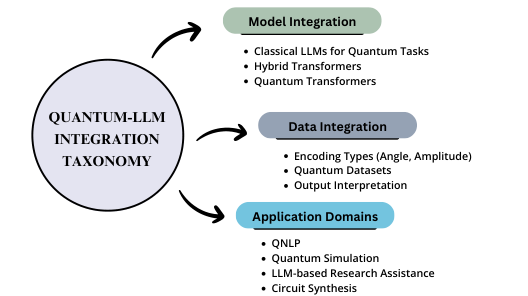

_Proc. of the 6th International Conference on Electrical, Communication and Computer Engineering (ICECCE) 27-28 August 2025, Istanbul, Turkey_

# Quantum-Aware Large Language Models: Taxonomy, Architectures, and Future Applications

1st Reyhan Dede _R&D Department T¨urk Telekom_ ˙Istanbul, T¨urkiye reyhan.dede@turktelekom.com.tr

**_Abstract_ —The convergence of quantum computing and large language models (LLMs) represents a major milestone in computational intelligence, introducing novel paradigms for information processing, complexity modeling, and scientific advancement. This survey provides a comprehensive overview of the emerging interdisciplinary field that integrates quantum mechanics with natural language processing. We begin by presenting the foundational principles of quantum computing and LLMs, then examine their integration through automated quantum code generation, hybrid transformer architectures, and quantum natural language processing (QNLP) frameworks. State-of-the-art models, such as quantum-augmented attention mechanisms and circuit embedding strategies, are evaluated across domain-specific datasets and benchmarks. We also investigate the role of LLMs as quantum research assistants, educational tools, and simulation agents, particularly in resource-constrained environments. Furthermore, the survey explores challenges related to scalability, interpretability, and quantum data encoding, and outlines future research directions—especially the vision for fully quantum-native LLMs. Our goal is to guide researchers through the current landscape and to encourage continued exploration at the intersection of quantum technologies and advanced language models.**

**_Index Terms_ —Quantum computing, Large language models, Quantum natural language processing.**

## I. INTRODUCTION

The convergence of quantum computing and large language models (LLMs) represents a profound shift in the landscape of computational intelligence. As quantum computers progress from theoretical constructs to operational systems, and LLMs redefine the boundaries of natural language understanding, their synergy holds transformative potential across disciplines ranging from physics and chemistry to cryptography and optimization.

This survey systematically maps the evolving interface between quantum computing and LLMs, with emphasis on both theoretical foundations and practical implementations. Its scope spans foundational principles, architecture-level integrations, prompt engineering for quantum code generation, and the design of quantum-enhanced transformer models. The discussion further includes domain-specific datasets, fine-tuning

This work is supported by The Scientific and Technological Research Council of T¨urkiye (T UB¨˙ ITAK) 1515 Frontier R&D Laboratories Support Program for T¨urk Telekom 6G R&D Lab under project number 5249902.

strategies, and the application of LLMs in quantum education and research. With growing interest in quantum transformers and hybrid quantum–classical models, there is a clear need to consolidate emerging methodologies and categorize them based on architectural innovations, task-specific capabilities, and performance benchmarks [1]. Moreover, the convergence of artificial intelligence and quantum reasoning raises new questions regarding computational complexity, model interpretability, and physical limitations imposed by quantum systems on language understanding [1]. This survey begins by reviewing the foundational principles of quantum computing and LLMs. We then examine how LLMs are applied to quantum tasks, how quantum components are integrated into LLM architectures, and how hybrid models are evaluated. The discussion also covers recent advances in quantum natural language processing (QNLP), the integration of quantum datasets into LLM pipelines, and the rise of domain-specific quantum LLMs. Through comparative analysis, we evaluate current architectures, their limitations, and benchmark performances. Finally, we outline emerging research directions and highlight future challenges and opportunities.

The contributions of this survey are threefold: (1) providing a unified taxonomy of quantum–LLM integration strategies; (2) offering a comparative analysis of existing approaches across tasks such as circuit generation, quantum NLP, and quantum data encoding; and (3) outlining open challenges and future directions to guide research on scalable, interpretable, and hardware-aware quantum–LLM systems.

Figure 1 illustrates a taxonomy of integration strategies between quantum computing and LLMs across model, data, and application levels.

## II. THEORETICAL FOUNDATIONS

## _A. Principles of Quantum Computing_

Quantum computing harnesses the distinctive principles of quantum mechanics—namely superposition, entanglement, and interference—to perform computations that are infeasible for classical systems. Unlike classical bits, quantum bits (qubits) can exist in superposed states, enabling a form of parallelism that scales exponentially with the number of qubits. This capacity allows quantum systems to efficiently

979-8-3315-4915-2/25/$31.00 © 2025 IEEE

Model Integration Classical LLMs for Quantum Tasks Hybrid Transformers Quantum Transformers QUANTUM-LLM Data Integration INTEGRATION TAXONOMY Encoding Types (Angle, Amplitude) Quantum Datasets Output Interpretation Application Domains QNLP Quantum Simulation LLM-based Research Assistance Circuit Synthesis 

Fig. 1. Taxonomy of quantum–LLM integration across model, data, and application levels.

solve certain classes of problems, including factoring and unstructured search, offering provable speedups over classical counterparts. Fundamental quantum gates—such as Hadamard, Pauli, and controlled-NOT (CNOT) form the foundation of quantum logic circuits. These gates manipulate qubits via unitary transformations and enable a wide range of quantum algorithms, including the quantum Fourier transform, Grover’s search, and Shor’s algorithm. Entanglement, which correlates the states of spatially separated qubits, is central to many of these algorithms and underpins phenomena like quantum teleportation and quantum communication protocols [2].

The hardware architecture of modern quantum computers comprises components such as quantum registers, control logic, and error correction subsystems. Techniques like decoherence mitigation and fault-tolerant computation are essential for stabilizing fragile quantum states and ensuring reliable execution [3]. Current platforms—spanning superconducting qubits, trapped ions, and photonic systems—are steadily improving in qubit fidelity, coherence time, and interconnectivity, thus moving closer to practical quantum advantage.

## _B. Fundamentals of Large Language Models_

Large Language Models (LLMs) are deep neural architectures trained on vast textual corpora using self-supervised objectives—primarily next-token prediction. Architectures such as the Transformer serve as the foundation of these models, enabling attention-based learning across long-range text sequences. Through extensive pretraining and large-scale parameterization, LLMs develop emergent capabilities that allow them to perform a broad range of linguistic and reasoning tasks without task-specific supervision. A core strength of LLMs lies in their ability to generalize from extensive textual patterns and generate coherent, contextually appropriate responses. Beyond text generation, LLMs support applications such as code completion, question answering, summarization, translation, and conversational modeling. They can also be tailored to domainspecific contexts through fine-tuning, instruction-tuning, or reinforcement learning with human feedback [4].

Recent studies indicate that LLMs exhibit modularity, incontext learning, and structured knowledge representations.

Foundational research has evaluated their performance across benchmarks while identifying key limitations—including hallucinations, prompt sensitivity, and bias propagation [5]. These insights are crucial for positioning LLMs as adaptable agents in quantum computing tasks and representations.

## III. APPLICATIONS OF LLMS IN QUANTUM COMPUTING

## _A. Automated Quantum Code Generation_

The integration of large language models into quantum programming has enabled automated generation of quantum circuits and algorithms from natural language prompts. Recent advancements introduced dedicated datasets and frameworks, such as Pennylang, which facilitate LLM-driven quantum code generation tailored to tools like PennyLane [6]. Additionally, LLMs have been applied to automate the design of quantum feature maps, reducing the manual overhead in encoding classical data into quantum states while improving performance on downstream quantum learning tasks [7].

## _B. Prompt Engineering for Quantum Tasks_

Prompt engineering plays a critical role in tailoring large language models to effectively generate or optimize quantum algorithms. By carefully structuring prompts, LLMs can be guided to produce quantum circuits that align with user intent, particularly in tasks requiring complex error correction or architectural constraints. Recent work has shown that incorporating multi-agent strategies and quantum error correction concepts into prompt templates significantly improves the fidelity and feasibility of the generated quantum programs [8]. Moreover, models have demonstrated the capacity to autonomously discover architectural patterns and low-level code primitives through carefully crafted instruction formats, indicating that prompt optimization directly impacts model performance in quantum domains [9].

## _C. LLMs as Quantum Research Assistants_

Large language models assist quantum research in both theory and practice. These models have shown potential in optimizing quantum circuits by decomposing and partitioning complex systems into smaller, computationally efficient components. For instance, circuit partitioning using LLMs enhances simulation and compilation efficiency in hybrid quantum-classical pipelines, making the modeling of largescale quantum systems more tractable [10]. Additionally, domain-specific LLMs such as GroverGPT have been tailored to quantum information retrieval and problem solving, enabling improved query generation and solution pathways in quantum search problems [11]. These advancements signal the emergence of LLMs as valuable collaborators in accelerating quantum algorithm design and simulation workflows.

## IV. QUANTUM-ENHANCED LLM ARCHITECTURES

## _A. Hybrid Classical–Quantum Transformers_

Hybrid classical–quantum transformers represent a significant milestone in the integration of quantum computing capabilities into the architecture of large language models.

These models combine classical neural networks with quantum circuits to improve expressivity and reduce resource usage. Recent advances demonstrate the feasibility of quantum-native transformer models, such as Quixer, which replaces key classical components like attention mechanisms with quantum equivalents to capture complex correlations in data more efficiently [12]. These models not only maintain compatibility with existing classical training workflows but also leverage quantum properties such as superposition and entanglement for richer model representations. Furthermore, fine-tuning techniques specifically adapted for quantum transformer variants, including circuit-level optimization and hybrid pre-training methods, are being developed to maximize their task-specific performance [13]. As hardware matures and quantum-classical interfacing becomes more streamlined, hybrid transformers may become the foundation for scalable and domain-adapted quantum LLMs.

## _B. Quantum Circuits Embedded in LLMs_

Recent studies have investigated the feasibility of integrating quantum circuit structures directly into large language models, aiming to leverage quantum computational advantages within deep learning pipelines. One approach utilizes tensor network disentanglers to embed quantum properties into classical LLM architectures, enabling the model to learn and represent quantum correlations more efficiently through low-entanglement approximations [14]. This embedding allows quantum states and operations to be handled natively within the transformer layers, offering a hybrid model that captures both classical linguistic context and quantum mechanical structure. This line of work builds upon hybrid architectures discussed earlier, where quantum circuits are integrated within attention mechanisms.

## V. QUANTUM NATURAL LANGUAGE PROCESSING (QNLP)

## _A. Overview and Motivation_

Quantum Natural Language Processing (QNLP) represents a convergence of quantum computing and linguistics, wherein quantum formalisms are applied to encode and process linguistic information. This approach is grounded in the observation that quantum systems naturally model contextual and compositional structures—features that are also inherent in human language [15]. The foundational motivation behind QNLP lies in leveraging quantum states and operations to capture deeper semantic relationships and contextual dependencies that classical vector space models may fail to represent effectively. As research expands in quantum artificial intelligence, QNLP is increasingly recognized as a promising domain capable of not only enhancing the semantic capabilities of natural language systems but also pushing the boundaries of how AI interprets meaning [1]. These developments signal a paradigm shift, where language models can exploit quantum properties to achieve superior interpretability, entanglement-driven associations, and potentially exponential speedups in processing. Toolkits such as lambeq provide pipelines for translating linguistic inputs into quantum circuits, enabling early-stage QNLP experimentation on current quantum hardware [16].

## _B. Representing Language with Quantum States_

Quantum Natural Language Processing (QNLP) introduces a novel paradigm in which linguistic elements are represented using quantum states rather than classical embeddings. Unlike conventional vector-based models, quantum representations enable superposition and entanglement, capturing richer semantic structures and syntactic relationships. This approach aligns particularly well with the compositional nature of language, offering a mathematically grounded method to represent meaning.

Recent work has demonstrated the feasibility of modeling grammatical and semantic compositions using quantum circuits that encode word meanings into quantum states and apply linear maps to represent sentence structures. In this context, neural network models have been developed that leverage self-supervised learning to generate meaningful quantum embeddings of textual data, which are optimized for downstream tasks like classification or inference [17]. Moreover, practical implementations of QNLP frameworks have shown how these theoretical constructs can be executed on current quantum hardware using diagrammatic reasoning and categorical models of meaning [18]. These efforts signal a shift toward quantum-native language models that may eventually surpass classical architectures in both interpretability and computational power, laying the foundation for the future of linguistically-aware quantum AI systems.

## _C. Limitations and Open Challenges_

Despite the growing interest and early successes in Quantum Natural Language Processing (QNLP), several critical limitations persist. One of the foremost challenges lies in the limited qubit counts and noise levels of current quantum hardware, which constrain the scalability and fidelity of QNLP circuits. As a result, most practical implementations remain restricted to small-scale, synthetic datasets or simulation environments [19].

Another key limitation arises from the complexity of encoding linguistic structures into quantum representations. While categorical frameworks such as DisCoCat offer a principled method for compositional meaning, the resulting quantum circuits can become resource-intensive, making optimization and simplification techniques essential yet non-trivial [19].

Furthermore, the field currently lacks large-scale, standardized QNLP datasets and benchmarks, which hinders robust model evaluation and reproducibility. This scarcity complicates comparative analysis across architectures and learning paradigms [20]. Additionally, the integration of QNLP models into domain-specific applications, such as bioinformatics or healthcare, requires further methodological advances and interdisciplinary collaboration to address domain alignment and data sensitivity issues [20].

Lastly, open questions remain regarding the interpretability and generalization capabilities of quantum linguistic models. As QNLP evolves, addressing these challenges will be crucial to transitioning from proof-of-concept demonstrations to scalable and impactful applications.

## VI. QUANTUM DATA INTEGRATION IN LLMS

## _A. Types of Quantum Data and Outputs_

Quantum data encompasses a range of representations, including quantum states, circuits, and measurement outcomes, which differ fundamentally from classical data due to their probabilistic and entangled nature. The simulation and manipulation of such data pose unique challenges in encoding, storage, and interpretability, especially when interfacing with classical models like large language models (LLMs) [21].

Recent research highlights various classical-to-quantum mapping strategies—such as angle encoding, amplitude encoding, and basis encoding—each with differing implications for fidelity, complexity, and downstream learning performance [22]. These encoding techniques play a pivotal role in transforming classical inputs into quantum-compatible forms, influencing both computational overhead and model accuracy in hybrid quantum-classical systems [22].

Moreover, outputs derived from quantum processes—such as measurement probabilities or collapsed states—often require post-processing before being usable in downstream tasks. Developing standardized formats for quantum data exchange remains an open need in advancing quantum–LLM integration [21].

## _B. Training LLMs with Quantum Features and Use Cases_

Training large language models (LLMs) with quantum features involves integrating quantum representations or computations into the training loop, either through quantum-enhanced inputs, quantum-processed intermediate states, or hybrid architectures. Fine-tuning strategies for quantum LLMs typically leverage variational quantum circuits to update model parameters using quantum gradients or simulated quantum layers [13]. These designs extend prior hybrid architectures—such as Quixer—by enabling token-level quantum processing within transformer pipelines. These layers employ unitary transformations to capture contextual relationships in a manner that aligns with quantum mechanical principles, offering a new pathway for integrating quantum representations into largescale language models [12]. Such models aim to bridge the representational gap between classical language and quantum systems, enabling semantic and syntactic structure to be embedded in quantum-compatible formats.

Emerging methods such as quantum knowledge distillation aim to transfer abstract knowledge from classical LLMs into compact quantum models. These approaches utilize classical teacher models to guide the optimization of quantum student models, thereby enabling knowledge transfer while respecting quantum constraints such as unitarity and decoherence [23]. This paradigm supports model compression and improved quantum interpretability. However, challenges remain in managing training stability, data representation compatibility, and the limited expressivity of near-term quantum hardware [13], [23]. Beyond training methodology, LLMs are increasingly being explored for tasks in quantum state simulation, where they assist in generating inputs, approximating dynamics, and

interpreting quantum outputs [21]. Their capacity to generalize from limited quantum-specific data makes them valuable tools for guiding simulation workflows in quantum chemistry and condensed matter physics. In particular, recent studies have demonstrated how LLMs can encode Hamiltonians, predict ground states, and extract physical observables in complex many-body systems [24]. These models often leverage fewshot learning and transfer learning to overcome data scarcity, offering scalability advantages over traditional computational methods.

Furthermore, their integration into quantum sensing pipelines has been proposed to facilitate adaptive measurement strategies and enhanced signal interpretation, though this remains largely at a conceptual stage [21]. While the potential is considerable, practical deployment will depend on improving model calibration, hardware integration, and domain-specific optimization.

## VII. DOMAIN-SPECIFIC QUANTUM LLMS

## _A. Fine-Tuning for Quantum Applications_

Fine-tuning large language models (LLMs) for quantum applications involves adapting pre-trained models to domainspecific tasks such as quantum code generation, physics simulations, and symbolic manipulation of quantum systems. This process typically requires integrating quantum-specific syntax, problem constraints, and logic gates into the model’s vocabulary and training objectives [25].

Studies in quantum many-body physics show that fine-tuned LLMs can successfully predict physical properties, assist in the formulation of Hamiltonians, and reason over symbolic representations of quantum states [24]. These models exhibit strong performance in structured generation tasks when exposed to high-quality quantum datasets, and are often refined using reinforcement learning or supervised fine-tuning based on curated quantum problems. Despite promising results, challenges remain in generalization, model reliability, and performance on noisy intermediate-scale quantum (NISQ) systems, requiring further calibration and evaluation.

## _B. Quantum Datasets and Benchmarking_

The development of quantum-specific datasets has been instrumental in enabling the fine-tuning and evaluation of large language models (LLMs) in quantum computing contexts. Notable examples include **QuantumLLMInstruct**, comprising over 500,000 problem-solution pairs covering topics such as circuit design, Hamiltonian construction, and error correction [26]. Its structured instruction format supports both generative and reasoning tasks across diverse quantum domains. Complementing this, Qiskit HumanEval adapts classical evaluation methodologies to the quantum setting, offering standardized problems with deterministic outputs to assess both syntactic correctness and quantum-specific functional fidelity [27]. Additionally, QHackBench expands the evaluation landscape by introducing real-world quantum challenges sourced from PennyLane hackathons, emphasizing creativity and correctness in quantum code generation tasks [28].

Together, these datasets and benchmarks provide a foundation for robust and reproducible evaluation of quantum-aware LLMs, supporting fair comparison, performance tracking, and continued model refinement across quantum code generation, reasoning, and simulation tasks.

## _C. Biases and Generalization Issues_

As quantum-aware large language models expand their scope, understanding and mitigating biases becomes critical for ensuring reliable outputs across diverse quantum tasks. Studies have shown that LLMs fine-tuned on domain-specific quantum data may inadvertently overfit to architecture-specific templates or problem styles, limiting their generalization capabilities in open-ended design or unseen quantum protocols [9].

Moreover, hybrid quantum–classical learning paradigms often struggle with optimization imbalance between classical and quantum layers, leading to performance bottlenecks and potential reinforcement of model biases during compression or pruning stages [29]. These issues highlight the need for robust debiasing strategies and diverse, representative training datasets to foster scalable and transferable quantum language models.

## VIII. FUTURE RESEARCH DIRECTIONS

## _A. Hardware Bottlenecks and Scalability_

The practical deployment of quantum-enhanced large language models is constrained by current hardware limitations, including restricted qubit counts, high noise levels, and short coherence times. These limitations hinder the scalability of quantum circuits embedded in LLMs and introduce challenges in maintaining quantum-classical interoperability. Emerging approaches such as parameter-efficient quantum model compression and modular hybrid architectures have been proposed to alleviate these bottlenecks [12]. Furthermore, rethinking quantum-classical co-training schemes and leveraging novel encoding strategies can improve scalability while maintaining performance across quantum tasks [29].

## _B. Novel Architectures and Learning Paradigms_

As the field of quantum machine learning evolves, new architectural designs and learning frameworks are being developed to better harness the computational potential of quantum systems. One such direction is the development of quantum-native transformer models that reinterpret core mechanisms—such as self-attention—using variational quantum circuits. These approaches aim to achieve scalable and expressive sequence modeling by leveraging quantum subroutines while retaining the strengths of classical LLM architectures. Beyond architecture, there is growing interest in redefining the mathematical foundations of transformers themselves. Guo et al. propose a quantum linear algebra-based reinterpretation of transformer mechanisms, replacing conventional operations with unitary matrices and tensor contractions that are more naturally suited to quantum processing [30]. These innovations not only improve model expressivity and

reduce parameter overhead but also suggest a path forward for quantum transformers that are natively designed for near-term hardware constraints. Continued exploration of such quantumcompatible architectures and training strategies will be vital in advancing practical quantum NLP systems.

## _C. Interpretability, Explainability, and Ethics_

As quantum-enhanced LLMs continue to evolve, ensuring their interpretability and explainability becomes a foundational requirement for responsible AI integration. The opacity of deep quantum models, particularly those incorporating hybrid quantum-classical layers, raises concerns around the traceability of predictions and the trust users can place in the outputs. Widdows et al. emphasize the necessity for future QNLP systems to adopt transparent design principles, advocating for modular interpretability and user-facing explanations to bridge the understanding gap between quantum mechanics and language processing [15].

Moreover, the integration of quantum models into sensitive domains—such as cryptography, healthcare, or policymaking—elevates the importance of ethical AI design. Liang et al. raise awareness that the abstraction layers in quantum architectures can obscure algorithmic biases, unintentionally amplifying them without standard interpretability techniques [9]. As such, future research must not only aim to optimize performance but also prioritize fairness, accountability, and human oversight in the development of interpretable quantum LLMs. Ethical guidelines tailored to the nuances of quantumenhanced learning systems are urgently needed to ensure the responsible deployment of this transformative technology.

## _D. Vision for Fully Quantum LLMs_

The pursuit of fully quantum large language models (LLMs) envisions architectures that are natively quantum across all layers, minimizing or entirely removing dependence on classical computation. This direction involves reimagining the fundamental operations of transformers—such as attention mechanisms, layer normalization, and feed-forward networks—through quantum-native constructs enabled by superposition, entanglement, and unitary transformations.

Recent theoretical advancements suggest that core components of LLMs can be reconstructed using quantum linear algebra primitives, potentially leading to more compact and computationally efficient models under suitable quantum hardware assumptions [30]. Building on early prototypes like Quixer, experimental frameworks have demonstrated the viability of processing tokenized language data through fully quantum pipelines using parameterized quantum circuits [12]. Despite the conceptual promise, current implementations face notable barriers due to quantum hardware limitations such as coherence time, error rates, and qubit count. Overcoming these challenges will require both algorithmic breakthroughs and scalable quantum devices capable of supporting large-scale, sequential learning tasks. Nonetheless, the long-term vision of fully quantum LLMs remains a foundational goal driving

research at the intersection of quantum computing and natural language processing.

## IX. CONCLUSION

The intersection of large language models (LLMs) and quantum computing has emerged as a fertile ground for innovation, particularly in quantum circuit synthesis, simulation, and education. This survey has reviewed key approaches that embed quantum properties—such as entanglement and superposition—into model architectures, including hybrid classical–quantum transformers and quantum-inspired self-attention mechanisms.

We have highlighted the growing role of LLMs as tools for quantum algorithm generation, state simulation, and problemsolving through domain-specific fine-tuning and prompt engineering. Furthermore, the development of quantum-specific datasets, such as QuantumLLMInstruct and Qiskit HumanEval, has enabled more rigorous training and benchmarking for quantum-aware models. Key challenges persist in generalization, interpretability, and benchmarking for quantum–LLM integration. Hardware limitations, such as qubit fidelity and coherence time, further constrain scalability and deployment.

Looking ahead, promising directions include the development of fully quantum-native LLMs, enhanced quantum circuit embeddings, and ethical frameworks for responsible deployment. Continued progress in quantum hardware, algorithm design, and interdisciplinary research will be essential for realizing the full potential of quantum-enhanced language models.

## REFERENCES

- [1] M. Klusch, J. L¨assig, D. M¨ussig, A. Macaluso, and F. K. Wilhelm, “Quantum artificial intelligence: A brief survey,” _KI-K¨unstliche Intelligenz_ , pp. 1–20, 2024.

- [2] G. Feng, D. Lu, J. Li, T. Xin, and B. Zeng, “Quantum computing: principles and applications,” in _Spin_ , vol. 13, no. 03. World Scientific, 2023, p. 2330001.

- [3] K. Balamurugan, A. Sivakami, M. Mathankumar _et al._ , “Quantum computing basics, applications and future perspectives,” _Journal of Molecular Structure_ , vol. 1308, p. 137917, 2024.

- [4] M. U. Hadi, R. Qureshi, A. Shah, M. Irfan, A. Zafar, M. B. Shaikh, N. Akhtar, J. Wu, S. Mirjalili _et al._ , “A survey on large language models: Applications, challenges, limitations, and practical usage,” _Authorea Preprints_ , 2023.

- [5] J. Li, Y. Yang, Y. Bai, X. Zhou, Y. Li, H. Sun, Y. Liu, X. Si, Y. Ye, Y. Wu _et al._ , “Fundamental capabilities of large language models and their applications in domain scenarios: A survey,” in _Proceedings of the 62nd Annual Meeting of the Association for Computational Linguistics (Volume 1: Long Papers)_ , 2024, pp. 11 116–11 141.

- [6] A. Basit, N. Innan, H. Asif, M. Shao, M. Kashif, A. Marchisio, and M. Shafique, “Pennylang: Pioneering llm-based quantum code generation with a novel pennylane-centric dataset,” _arXiv preprint arXiv:2503.02497_ , 2025.

- [7] K. Sakka, K. Mitarai, and K. Fujii, “Automating quantum feature map design via large language models,” _arXiv preprint arXiv:2504.07396_ , 2025.

- [8] C. Campbell, H. M. Chen, W. Luk, and H. Fan, “Enhancing llm-based quantum code generation with multi-agent optimization and quantum error correction,” _arXiv preprint arXiv:2504.14557_ , 2025.

   - [10] P. Sinha, S. K. Jha, and S. Raj, “Circuit partitioning using large language models for quantum compilation and simulations,” _arXiv preprint arXiv:2505.07711_ , 2025.

   - [11] H. Wang, P. Li, M. Chen, J. Cheng, J. Liu, and T. Chen, “Grovergpt: A large language model with 8 billion parameters for quantum searching,” _arXiv preprint arXiv:2501.00135_ , 2024.

   - [12] N. Khatri, G. Matos, L. Coopmans, and S. Clark, “Quixer: A quantum transformer model,” _arXiv preprint arXiv:2406.04305_ , 2024.

   - [13] S. Hyub Kim, J. Mei, C. Girotto, M. Yamada, and M. Roetteler, “Quantum large language model fine-tuning,” _arXiv e-prints_ , pp. arXiv– 2504, 2025.

   - [14] B. Aizpurua, S. S. Jahromi, S. Singh, and R. Orus, “Quantum large language models via tensor network disentanglers,” _arXiv preprint arXiv:2410.17397_ , 2024.

   - [15] D. Widdows, W. Aboumrad, D. Kim, S. Ray, and J. Mei, “Natural language, ai, and quantum computing in 2024: Research ingredients and directions in qnlp,” _arXiv e-prints_ , pp. arXiv–2403, 2024.

   - [16] D. Kartsaklis, I. Fan, R. Yeung, A. Pearson, R. Lorenz, A. Toumi, G. de Felice, K. Meichanetzidis, S. Clark, and B. Coecke, “lambeq: An efficient high-level python library for quantum nlp,” _arXiv preprint arXiv:2110.04236_ , 2021.

   - [17] B. Yao, P. Tiwari, and Q. Li, “Self-supervised pre-trained neural network for quantum natural language processing,” _Neural Networks_ , vol. 184, p. 107004, 2025.

   - [18] R. Lorenz, A. Pearson, K. Meichanetzidis, D. Kartsaklis, and B. Coecke, “Qnlp in practice: running compositional models of meaning on a quantum computer (2021),” _arXiv preprint arXiv:2102.12846_ , 2021.

   - [19] ——, “Qnlp in practice: Running compositional models of meaning on a quantum computer,” _Journal of Artificial Intelligence Research_ , vol. 76, pp. 1305–1342, 04 2023.

   - [20] G. Pallavi and R. Prasanna Kumar, “Quantum natural language processing and its applications in bioinformatics: a comprehensive review of methodologies, concepts, and future directions,” _Frontiers in Computer Science_ , vol. 7, p. 1464122, 2025.

   - [21] S. Zhou, R. Chen, Z. An, C. Zhang, and S.-Y. Hou, “Application of large language models to quantum state simulation,” _Science China Physics, Mechanics & Astronomy_ , vol. 68, no. 4, p. 240313, 2025.

   - [22] M. Rath and H. Date, “Quantum data encoding: A comparative analysis of classical-to-quantum mapping techniques and their impact on machine learning accuracy,” _EPJ Quantum Technology_ , vol. 11, no. 1, p. 72, 2024.

   - [23] L. Li, Y. Wang, J. Fan, J. Li, S. Qin, Q. Wen, and F. Gao, “Quantum knowledge distillation for large language models,” _arXiv preprint arXiv:2505.13205_ , 2025.

   - [24] H. Pan, N. Mudur, W. Taranto, M. Tikhanovskaya, S. Venugopalan, Y. Bahri, M. P. Brenner, and E.-A. Kim, “Quantum many-body physics calculations with large language models,” _Communications Physics_ , vol. 8, no. 1, p. 49, 2025.

   - [25] N. Dupuis, L. Buratti, S. Vishwakarma, A. V. Forrat, D. Kremer, I. Faro, R. Puri, and J. Cruz-Benito, “Qiskit code assistant: Training llms for generating quantum computing code,” in _2024 IEEE LLM Aided Design Workshop (LAD)_ . IEEE, 2024, pp. 1–4.

   - [26] S. Kashani, “Quantumllminstruct: A 500k llm instruction-tuning dataset with problem-solution pairs for quantum computing,” _arXiv preprint arXiv:2412.20956_ , 2024.

   - [27] S. Vishwakarma, F. Harkins, S. Golecha, V. S. Bajpe, N. Dupuis, L. Buratti, D. Kremer, I. Faro, R. Puri, and J. Cruz-Benito, “Qiskit humaneval: An evaluation benchmark for quantum code generative models,” in _2024 IEEE International Conference on Quantum Computing and Engineering (QCE)_ , vol. 1. IEEE, 2024, pp. 1169–1176.

   - [28] A. Basit, M. Shao, H. Asif, N. Innan, M. Kashif, A. Marchisio, and M. Shafique, “Qhackbench: Benchmarking large language models for quantum code generation using pennylane hackathon challenges,” _arXiv preprint arXiv:2506.20008_ , 2025.

   - [29] C.-Y. Liu, E.-J. Kuo, C.-H. A. Lin, J. G. Young, Y.-J. Chang, M.-H. Hsieh, and H.-S. Goan, “Quantum-train: Rethinking hybrid quantumclassical machine learning in the model compression perspective,” _arXiv preprint arXiv:2405.11304_ , 2024.

   - [30] N. Guo, Z. Yu, M. Choi, A. Agrawal, K. Nakaji, A. Aspuru-Guzik, and P. Rebentrost, “Quantum linear algebra is all you need for transformer architectures,” _arXiv preprint arXiv:2402.16714_ , 2024.

- [9] Z. Liang, J. Cheng, R. Yang, H. Ren, Z. Song, D. Wu, X. Qian, T. Li, and Y. Shi, “Unleashing the potential of llms for quantum computing: A study in quantum architecture design,” _arXiv preprint arXiv:2307.08191_ , 2023.
