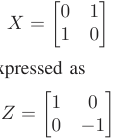
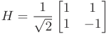
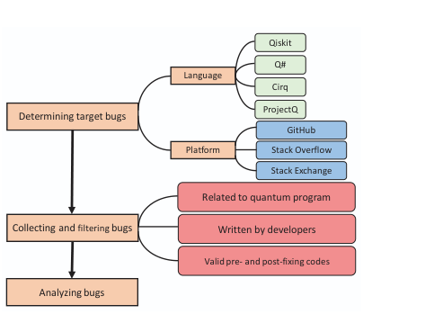
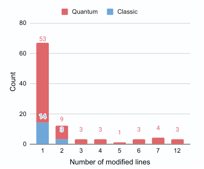
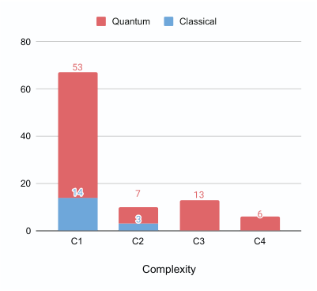
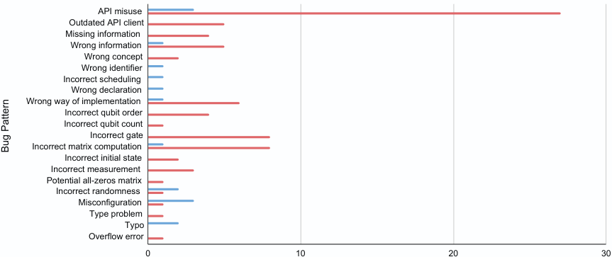

2022 IEEE International Conference on Software Analysis, Evolution and Reengineering (SANER)

# A Comprehensive Study of Bug Fixes in Quantum Programs

Junjie Luo*, Pengzhan Zhao, Zhongtao Miao, Shuhan Lan, and Jianjun Zhao

Kyushu University, Japan

Abstract—As quantum programming evolves, more and more quantum programming languages are being developed. As a result, debugging and testing quantum programs have become increasingly important. While bug xing in classical programs has come a long way, there is a lack of research in quantum programs. To this end, this paper presents a comprehensive study on bug xing in quantum programs. We collect and investigate 96 real-world bugs and their xes from four popular quantum programming languages (Qiskit, Cirq, Q#, and ProjectQ). Our study shows that a high proportion of bugs in quantum programs are quantum-specic bugs (over 80%), which requires further research in the bug xing domain. We also summarize and extend the bug patterns in quantum programs and subdivide the most critical part, math-related bugs, to make it more applicable to the study of quantum programs. Our ndings summarize the characteristics of bugs in quantum programs and provide a basis for studying testing and debugging quantum programs.

Index Terms—Bug xing, quantum software testing, quantum program debugging, empirical study

## I. INTRODUCTION

Debugging and testing are critical parts of an integrated software development method in modern software development. A software bug is regarded as the abnormal program behaviors which deviate from its specication [1], including poor performance when a threshold level of performance is included as part of the specication. Software defects signicantly impact the economy, security, and quality of life, yet relying on manual diagnosis and repair of software bugs consumes signicant time and money. To address this problem, many software engineering tasks, such as program analysis, debugging, and software testing, are devoted to developing techniques and tools for locating and xing bugs. In addition, software bugs can be handled or prevented more effectively by studying past bugs and their xes.

Quantum programming is the process of designing and constructing executable quantum programs to achieve a specic computational result. Recently, many quantum programming languages have been developed for the development of quantum software, for instance, Qiskit [2], Cirq [3], Q# [4], and ProjectQ [5]. The current research in quantum programming focuses mainly on problem analysis, language design, and implementation. However, despite their importance, program debugging and software testing have received relatively little attention in the quantum programming paradigm. The

*This work was carried out when Junjie Luo was at Kyushu University.

specic features introduced in quantum programming, such as superposition, entanglement, and no-cloning, make them different for bug xing compared to classical programs. Although several approaches have been proposed for debugging and testing quantum software [6]–[10] recently, no research work has been focused on bug xing in quantum programs [11].

This paper rst proposes ve questions that need analysis and discussion. On this basis, we collect and investigate 96 real-world bugs and their xes from four popular quantum programming languages (Qiskit, Cirq, Q#, and ProjectQ). Finally, we obtained nine ndings to answer the questions. Our main ndings can be summarized as follows:

- More than 80% of the bugs we collected is quantumspecic, which means that classical bug xing methods are insufcient, and bugs in quantum programs need further research.

- Although the current bugs in quantum programs are generally simple, the high complexity bugs are all quantumspecic bugs, which means bug xing for quantum programs is challenging.

- We summarize and expand the bug patterns in quantum programs and count the number of bugs for each bug pattern. Math-related bug patterns are the focus of our analysis, which are uncommon in classical programs.

- We believe that the results of our study can benet future

- research in two aspects:

- 1) It can provide insights into how to develop and improve the bug xing methods for existing quantum programs. For example, what knowledge is needed to repair quantum programs and whether this knowledge is included in classical program xing methods. In addition, the results also show the potential regarding the application of existing automatic xing methods in quantum programs.

- 2) It can provide a more precise direction for studying quantum programs bugs. For example, the results show some bug patterns in quantum programs and analyze the frequency of each bug pattern. Based on these bug patterns that we have summarized, our future work can propose new methods for locating quantum-specic bugs, as well as developing static analysis tools.

The rest of the paper is organized as follows. Section II briey introduces the background knowledge of quantum programming. Section III describes the research methodology of our comprehensive study. Section IV discusses some ndings

978-1-6654-3786-8/22/$31.00 ©2022 IEEE DOI 10.1109/SANER53432.2022.00147

1239

of our study. Related work is discussed in Section V, and concluding remarks are given in Section VI.

## II. BACKGROUND

This section briey introduces some basic concepts on quantum computing as well as quantum programming frameworks.

## B. Quantum Programming Frameworks

Recently, several open-source programming frameworks for supporting quantum programming have been proposed, such as Qiskit, Cirq, Q#, and ProjectQ. We can use these frameworks to develop quantum software. Here is an example of Qiskit programs1 :

## A. Basic Concepts

A quantum bit (qubit) is the analog of one classical bit but has many different properties. A classical bit, like a coin, has only two states, 0 and 1, while a qubit can be in a continuum of states between 0 and 1 in which the  notation is called Dirac notation. We can represent a qubit mathematically as ψ  α 0 +  1 where α2 + 2 1 and the numbers α and  are complex numbers. The states 0 and 1 are called computational basis states. Unlike classical bits, we cannot examine a qubit directly to get the values of α and . Instead, we measure a qubit to obtain either the result 0 with probability α2 or the result 1 with probability 2 .

Quantum gates are used to do the quantum computation, which means manipulating quantum information. Some basic quantum gates are as follows:

- Quantum NOT gate takes the state ψ  α 0 +  1 into the state ψ  α 1 +  0. We can use a matrix to represent this operation:

0 1 X  1 0 [ ] expressed as 1 0 Z  0 −1 [ ] 

- The Z gate can be expressed as

From the matrix, we know the Z gate leaves the 0 unchanged and changes the sign of 1.

- The Hadamard gate turns the 0 into (0 + 1)/ ~~√~~ 2 and turns the 1 into (0−1)/ ~~√~~ 2. The matrix form of the Hadamard gate is

1 1 1 H  √ 2 [1 −1] 

All the matrices are unitary ones. Besides these single-qubit gates, there are multiple qubit gates, such as the ControlledNOT gate (CNOT gate). This gate has two input qubits, the control qubit and the target qubit. If the control qubit is 0, then the target qubit remains unchanged. If the control qubit is 1, then the target qubit is ipped. We can express the behavior of the CNOT gate as A, B→A, B  A.

Quantum circuits are models of all kinds of quantum processes. We can build quantum circuits with quantum gates and use wires to connect the components in quantum circuits. These wires can represent the passage of time or a physical particle moving from one position to another. Another essential operation in quantum circuits is measurement. Measurement operation observes a single qubit and obtains a classic bit with a certain probability. Nielsen’s book [12] has a more detailed explanation of quantum computation.

- 1 from qiskit import QuantumCircuit

- 2 from qiskit import execute, IBMQ, BasicAer

- 3 qc = QuantumCircuit(2, 2)

- 4 qc.h(0)

- 5 qc.cx(0, 1)

- 6 qc.measure([0, 1], [0, 1])

- 7 sim = BasicAer.get_backend("qasm_simulator")

- 8 job_sim = execute(qc, sim)

- 9 result_sim = job_sim.result()

- 10 print(result_sim.get_counts(qc))

Fig. 1. A Qiskit Program.

This program aims to create a Bell state. In lines 1-2, it imports related packages. Line 3 creates a quantum circuit acting on one quantum register of two quantum bits (qubits) and one classical register of two classical bits. Line 4 adds an H gate on qubit 0, putting this qubit in superposition. Line 5 adds a CX (CNOT) gate on control qubit 0 and target qubit 1, putting the qubits in a Bell state. Line 6 measures the qubits 0 and 1 of the quantum register, respectively, and puts the values into the corresponding classical bits 0 and 1 of the classical register. Line 8 executes the circuit on the QASM simulator.

## III. METHODOLOGY

## A. Dataset

The data collection and analysis workow is divided into the following steps: determining target bugs, collecting and ltering bugs, and analyzing bugs. Figure 2 depicts our data collection and analysis process.

Qiskit Q# Language Cirq ProjectQ Determining target bugs GitHub Platform Stack Overflow Stack Exchange Related to quantum program Collecting and filtering bugs Written by developers Validpre-and post-fixing codes Analyzing bugs 

Fig. 2. The process of collecting and analyzing bugs

> 1https://github.com/Qiskit/qiskit-terra/blob/main/examples/python/ibmq/ hell <mark>o q</mark> uantum.py

1240

TABLE I

REPOSITORIES CONSIDERED IN THE STUDY WITH BUGS IN QUANTUM PROGRAMS

|Repository|Total|Fix|
|---|---|---|
|Qiskit|138|71|
|Cirq|25|16|
|Q#|21|7|
|ProjectQ|3|2|
|Total|187|96|

1) Determining target bugs: In order to collect as many bugs as possible, we collected bugs generated in the most commonly used quantum programming languages, including Qiskit, Cirq, Q#, and ProjectQ. We collected bugs raised on GitHub, Stack Overow, and Stack Exchange in terms of platforms for reporting bugs.

2) Collecting and ltering bugs: We manually collect bugs for each target language on different platforms since the number of bugs in quantum languages is not very large, and we need to lter the bugs to nd those that meet our requirements. There are three lter conditions for bugs as follows:

   - Related to quantum programs. We only collect bugs related to quantum programs. If a bug is in a program that does not involve any quantum computation or operation, then the bug will not be included in the collection. It is important to note that although we require the bug to occur in a quantum program, this does not mean the bug itself is quantum-related. Instead, it may be a bug that would also occur in classical programming languages, which we will specically discuss later.

   - Written by developers. We will only work on analyzing bugs written by developers and will not discuss bugs that occur in the quantum programming language itself. This will have little impact on the bug collection on Stack Overow and Stack Exchange since the issues on these platforms are raised by developers. However, on GitHub, only a few issues are related to developers. The vast majority of issues are specic to the quantum language itself.

   - alid pre-and post-xing codes. To facilitate analysis, we require that the collected bugs have pre-and postxing code. Also, we need to conrm that the changes are effective, depending on the feedback from the user who raised the bug.

- 3) Analyzing bugs: We analyze all the valid data collected.

- We count the distribution of bugs for different research questions, focus on representative examples, and nally give our ndings.

## B. Research Question

Our study is driven by the following research questions:

1) RQ1: Does this bug only occur in quantum programs? Most quantum languages are not completely new. for example, the major versions of Cirq and Qiskit use the Python programming language, while Q# is based on C# and F# extensions. In such cases, bugs in the xes may come from classical programming languages or come specically from

quantum languages. Studying this issue helps us to better understand to what extent the repair of quantum programs can benet from the existing knowledge of classical software repair. Our study investigates the proportion of classical bugs and quantum-specic bugs in quantum programs.

2) RQ2: Where is the location of the bug in the programs? Similar to classical programs, to x bugs in quantum programs, we rst need to investigate the distribution of bugs. Zhong and Su [13] show that bugs in a program can occur outside the source le, so knowing where the bugs are located can help us to nd the focus of bug xes. They also indicate that more than one line of code may need to be modied to x a bug. The existence of dependencies in the xed code affects the difculty of xing the code. Our study analyzes the distribution of bugs under real quantum programs. The results of the study help locate bugs in quantum programs.

3) RQ3: How complex to x bugs in quantum programs? In addition to analyzing the location of bugs, it is also essential to understand the complexity of bugs to x bugs in quantum programs automatically. When there is more than one bug in a program, dependencies between bugs will impact the difculty of xing the bug. For bugs with dependencies, breaking the dependencies during the xing process will lead to the failure of the bug xing. In our study, we analyze the dependencies of bug codes in quantum programs following [13], and describe the complexity in four levels.

4) RQ4: Are there bug patterns in the quantum program? We found that some bugs overlapped and repeated by reproducing them in the corresponding quantum programs. Intuitively, we infer that they can be distributed over some universal patterns or regularities, and this information would be helpful to guidance for xing quantum-specic bugs. Based on this, we performed a thorough investigation of these bugs and classied them by several principles.

## IV. EMPIRICAL RESULTS

## A. RQ1: Classical or Quantum-Specic Bugs

This research question investigates the proportion of classical bugs and quantum-specic bugs in quantum software. Generally, quantum-specic bugs are different from classical software bugs as repairing them requires the domain knowledge of quantum-related concepts, properties, computational formulas, and quantum programming languages. Table II shows the statistics of the number of classical and quantumspecic bugs in the data we collected. From the results of the investigation, we can derive the following ndings:

|TABLE II SICAL AND QUANT|
|---|
|Type Count|
|Classical 17|
|Quantum 79|
|Total 96|

NUMBER OF CLASSICAL AND QUANTUM SPECIFIC BUGS

Fndng 1. Clearly, the number of quantum-specic bugs is much greater than the number of classical bugs (more than

1241

80%). Since most of the existing bug xing approaches focus on classical programs, it will be a great challenge to deal with the bugs in quantum programs. It also means that researching bug xing in quantum programs is highly worthwhile.

## B. RQ2: Bug Distribution

We investigated whether les other than the source les were modied during the xing of the quantum program. The results of the investigation lead to the following ndings:

Fndng 2. In all the bugs we collected, only the source les have been modied. We believe there are two reasons for this situation: the rst is that the difculty of simulating large quantum programs by classical computers has led to the fact that quantum programs, in general, are limited to simpler functions and therefore do not need other les to constitute the project. Secondly, we can nd that programmers wrote a signicant part of the programs in our data collection exploring the quantum language. For example, some programs contain only attempts on how to add the QFT circuit to the code. This type of quantum program would have only source les.

In addition, we counted the number of lines of code that needed to be modied to x each bug in the quantum program. We dene the action of adding, deleting, and updating a line of code as a single modication. Figure 3 shows the statistics of the number of lines needed to x classical bugs and quantum-specic bugs in quantum programs, respectively. The stacked bars show the number of bugs, red for quantumspecic bugs while blue for classical bugs. Furthermore, the horizontal coordinates in the chart indicate the number of lines that need to be modied.

4XDQWXP &ODVVLF ( & $ " ! " # $ % & ' !" 1XPEHU RI PRGLILHG OLQHV &RXQW 

Fig. 3. The distribution of the number of lines that need to be modied for quantum-specic bugs and classical bugs in our collected data.

Fndng 3. Overall, more than 70% of the bugs in our collection of quantum programs can be xed by modifying only one line of code, while less than 10% of the code requires modifying more than six lines. This implies that the cost of xing bugs is generally low in existing quantum programs.

Fndng 4. From the type of bugs, we can nd that the number of lines to be modied for classical bugs appearing in quantum programs is generally low (at most, two lines of

code need to be modied). In Zhong and Su’s work [13], less than 30% of bugs in classical programs can be xed by only one repair action. We can see that it is signicantly less challenging to x classical bugs in quantum programs than in classical programs. So more attention should be focused on how to x quantum-specic bugs in quantum programs.

## C. RQ3: Bug Complexity

To explore the difculty of xing bugs in quantum programs, we need a more detailed denition of the complexity of bugs in quantum programs. As one of the well-established methods, Paltenghi and Pradel [14] determine the complexity of bug xing in terms of the number of lines of code that are in error. While such an approach can quickly determine the occurrence of bugs that some automatic xes cannot handle (e.g., bugs that require xing more than 20 lines), it is difcult to distinguish the difculty of xing bugs with fewer lines (e.g., whether there are dependencies between the data being xed). Here, we refer to the four levels of fault complexity proposed by Zhong and Su [13]: a single repair action (C1), non-data dependent repair actions (C2), data-dependent repair actions (C3), and mixture repair actions (C4). We consider the modication of a line as a repair action and thus apply this complexity classication to our work. Although this complexity classication was used in the paper for classical programs, we argue that this approach can also be applied to quantum programs in our study. Figure 4 shows the results of our analysis, where we represent the classical bugs and quantum-specic bugs in each complexity with blue and red bars, respectively.

4XDQWXP &ODVVLFDO ( & $ " &! &" &# &$ &RPSOH[LW\ 

Fig. 4. The distribution of complexity. Classic bugs and quantum-specic bugs are shown in the red and blue bar respectively.

Fndng 5. Since single line xes are directly classied into C1 complexity, the proportion of C1 complexity is much higher than the other three complexity levels in quantum programs. This reects that the complexity of bugs in current quantum programs is generally low, but there are still some bugs that are difcult to x (19 bugs of C3 and C4 complexity in total), and all the bugs in this part belong to quantum

1242

specic bugs, and thus the difculty in bug xing cannot be ignored.

Fndng 6. In our study, the cause of the errors in 5 of the 19 samples with complexity C3 and C4 is due to an incorrect implementation method. This error is usually because the programmer does not know the exact implementation of the required functionality, so more code manipulation is usually required to x it. Moreover, this type of error is difcult for bug-x automation approaches to work around because we cannot expect them to anticipate the functionality that the programmer needs to implement to make the correct x. Furthermore, this means that in the development of existing quantum programs, there are fewer cases of C3 and C4 complexity errors if the programmer is known about the exact implementation of the desired function.

## D. RQ4: Bug Patterns

Our study also analyzed and counted the bug patterns of the 96 valid samples collected. We refer to the bug pattern classication used in the work of Paltenghi and Pradel [14]. Although their work is specic to quantum computing platforms, we believe that some of the bug patterns can also be used to study quantum program bugs. In addition, we have dened some new bug patterns for quantum programs to complement and improve the shortcomings of their bug patterns when applied to quantum programs. Our study divided the bug pattern into four major categories: API-related, incorrect application logic, math-related, and others, and also detailed several subcategories under each major category. To adapt it to the analysis of bugs in quantum programs, we further subdivide incorrect numerical computation under the mathrelated category by adding bug patterns specic to quantum programs, such as an incorrect gate. Table III shows the details of each bug pattern classication in our study and lists the number of bug samples under each bug pattern. The following discussion will briey describe each bug pattern and detail our proposed additional quantum program-specic bug patterns.

1) API-related: In quantum programs, if the error is caused by an API, we classify it into API-related bug pattern. There are two main subcategories under this category, including API misuse, which refers to errors caused by using the wrong function method or introducing the wrong parameters into a function, and outdated API client, which refers to code edited with an older, deprecated version of the API. Figure 5 shows a bug belonging to the API-misuse, where the execute function got an unexpected keyword argument seed.

2) Incorrect application logic: This type of bug pattern is mainly caused by errors in the implementation of the application logic when writing a quantum program. This bug pattern consists of six subcategories: Intermediate representation is a bug caused by the corruption or loss of an intermediate variable in a quantum program. Referring to the wrong program element is an error caused by a programmer confusing two elements (e.g., two related concepts and two identiers with similar names) in a quantum program and misusing them. Incorrect scheduling is a bug caused by code running

TABLE III

BUG PATTERNS IN THE INVESTIGATED DATA

|Bug pattern|||Count|
|---|---|---|---|
|API-related|API misuse||30|
||Outdated API client||5|
|Incorrect||||
|application logic|Intermediate representation|Missing information|4|
|||Wrong information|6|
||Refer to wrong|Wrong concept|2|
||program element|Wrong identier|1|
||Incorrect scheduling||1|
||Wrong declaration||1|
||Wrong way of imple|mentation|7|
||Qubit-related|Incorrect qubit order|4|
|||Incorrect qubit count|1|
|Math-related||Incorrect gate|8|
||Incorrect numerical tti|Incorrect matrix computation|9|
||compuaon|Incorrect initial state|2|
|||Incorrect measurement|3|
|||Potential all-zeros matrix|1|
||Incorrect randomness|handling|3|
|Others|Misconguration||4|
||Type problem||1|
||Typo||2|
||Overow error||1|

at the wrong timestamp in a quantum program (e.g., a new instruction is incorrectly scheduled to execute on the hardware when it is occupied). In qubit-related, it mainly includes qubitrelated errors, such as counting the wrong number of the qubits or causing wrong ordered qubits. Figure 6 shows an example that the programmer confused the two operations in Qiskit: Gates, which can be controlled, and Instructions, which cannot be controlled, leading to the error. Besides, we dene two new bug patterns for existing quantum programs, which are discussed in detail as follows.

Wrong declaration. This bug pattern can happen mainly in Q#. Since the code is automatically wrapped in the namespace in Q# Jupyter notebooks, there is no need to re-declare the same namespace in the code. To x this bug, one needs to remove the extra namespace declaration from the code.

Wrong way of implementation. In the process of developing quantum programs, this type of bug can be caused if the programmer is not clear about the exact implementation of the function needed. This bug pattern is characterized by a large amount of code to be xed and its high complexity (5 out of 7 samples need to be xed with more than 5 lines, with a complexity of C3 or C4), which is a great challenge for the current bug x automation approaches.

3) Math-related: In developing a quantum program, the programmer usually has to manipulate the qubits through a series of mathematical operations to accomplish the desired function. In Paltenghi and Pradel’s work [14], math-related bugs are divided into two categories: incorrect numerical computations and incorrect randomness handling. If the code misuses randomness or probability, it will be classied into incorrect randomness handling patterns. Incorrect numerical computations mean that the formula is misused. In quantum programs, since the operations on qubits are more diverse than

1243

shots = 1024

- job = execute(circuits, backend = Aer.get_backend(’qasm_simulator’), shots=shots, seed=8)

- + job = execute(circuits, backend=Aer.get_backend(’qasm_simulator’), shots=shots) result = job.result()

Fig. 5. Example of the API misuse, in which the programmer used an unexpected keyword argument seed.

qc = QuantumCircuit(3)

   - outer_level = QuantumCircuit(2, name=’outer’) inner_level = QuantumCircuit(2, name=’inner’) inner_level.x(0)

- outer_level.append(inner_level, [0,1])

- + outer_level.append(inner_level.to_gate(), [0,1]) qc.append(outer_level.control(), [0,1,2])

programmer reversed the order of the qubits when measuring them, leading to an error in the measurement result.

- circuit.measure([0,1,2], [0,1,2])

- + circuit.measure([0,1,2], [2,1,0])

Fig. 9. Example of wrong measurement order leading to incorrect results.

Fig. 6. Example of the wrong concept, in which the inner_level produced from QuantumCircuit cannot be controlled.

those in classical programs, in our study, we further subdivide this bug pattern as follows.

Incorrect gate. In quantum programs, to control quantum circuits, programmers usually need to use quantum logic gates to process qubits to implement a particular quantum algorithm. In this process, if the wrong quantum logic gate is used, or if the wrong qubits are processed with the quantum logic gate, it can lead to anomalies in the quantum program. Figure 7 gives an example of an incorrect gate, in which the output does not match the expected result because the programmer used the wrong quantum logic gate.

   - circuit = QuantumCircuit(2) circuit.h(0)

- circuit.h(1)

- + circuit.x(1) circuit.cx(0,1) circuit.measure_all()

Fig. 7. Example of the incorrect gate usage resulting in an output that is not as expected.

Incorrect initial state. In quantum programs, when writing quantum algorithms, the programmer needs to set the initial state of the qubits. If the wrong initial state is used, it can lead to an error in the quantum circuit. In Figure 8, the programmer tries to create the Bell State <mark>√</mark> 2(01+ 10), however, the wrong initial state is used, leading to the wrong result <mark>√</mark> 2(11−00).

- sv = Statevector.from_label(’01’)

- + sv = Statevector.from_label(’10’) mycircuit = QuantumCircuit(2) mycircuit.h(0) mycircuit.cx(0,1)

Fig. 8. Example of the incorrect initial state resulting in a wrong expression of the Bell State.

Incorrect measurement. In quantum programs, measurement is a common operation in quantum algorithms, but it can cause errors in quantum programs if measurements are made at the wrong time or on the wrong qubits. In Figure 9, the

Potential all-zeros matrix. In general, matrix operations frequently occur in quantum programs. And in matrix operations, unintentionally generated all-zeros matrices pose a risk to the operation and cause the algorithm’s stability to deteriorate. Figure 10 shows a bug belonging to this bug pattern, where the operation .dot(unitary[randnum[0]] - id) causes the case where rho is an all-zeros matrix occurs frequently.

Incorrect matrix computation. Another common type of operation in quantum programs is matrix operations. Although the processing of qubits using quantum logic gates can also be considered a matrix operation, in our study, we distinguish between the two because, usually, quantum logic gates are pre-dened functions in quantum languages. In contrast, other matrix operations need to be implemented by the programmer in his code, and it is difcult to classify this part of the operation as some classical quantum logic gate. Figure 11 gives an example of incorrect matrix computation, in which the simulator throws an error because the U_error matrix set by the programmer is not unitary.

4) Other bug patterns: In addition to the three main types of bug patterns mentioned above, there are some other patterns included in our study, which include four types of Misconguration, Type problem, Typo, and Overow error. Figure 12 gives an example of type problem, in which the programmer misunderstands the return type of function .draw(output = ’mpl’). Since they are roughly indistinguishable from those in classical programs, we will not describe them in detail.

Based on the above analysis of bug patterns, we have the following ndings:

Fndng 7. Overall, the statistics show that in the existing quantum programs, programmers’ bugs are mainly focused on API-related bugs (35 out of 96 samples) and math-related bugs (26 out of 96 samples). This means that programmers are still not procient in quantum programming languages when developing quantum programs and have difculties with the algorithms and manipulation of qubits. Therefore, it should be one of the focuses for future work on bug xing.

Our study also counts the cases of classical and quantumspecic bugs in quantum programs separately. The detailed data are shown in Figure 13, where the vertical axis lists the bug patterns as mentioned above, and the horizontal axis shows the frequency of occurrence in the data we investigated, with

1244

state0 = np.array([[1,0],[0,0]]) state1 = np.array([[0,0],[0,1]]) + states = [state0, state1] record_rho = np.eros([4,4]) for i in range(snapshot_num): randnum = np.random.randint(0,3,sie=2) result = one_shot(randnum) + bit0, bit1 = [int(x) for x in list(result.keys())[0]] + U0, U1 = unitary[randnum[0]], unitary[randnum[1]] - if result.get(’00’) == 1: - rho = np.kron(3*np.dot(unitary[randnum[0]].conj().T,state0).dot(unitary[randnum[0]] - id), 3*np.dot(unitary[randnum[1]].conj().T,state0).dot(unitary[randnum[1]]) - id) - elif result.get(’01’) == 1: - rho = np.kron(3*np.dot(unitary[randnum[0]].conj.T,state0).dot(unitary[randnum[0]] - id), 3*np.dot(unitary[randnum[1]].conj().T,state1).dot(unitary[randnum[1]]) - id) - elif result.get(’10’) == 1: - rho = np.kron(3*np.dot(unitary[randnum[0]].conj.T,state1).dot(unitary[randnum[0]] - id), 3*np.dot(unitary[randnum[1]].conj.T,state0).dot(unitary[randnum[1]]) - id) - else: - rho = np.kron(3*np.dot(unitary[randnum[0]].conj.T,state1).dot(unitary[randnum[0]] - id), 3*np.dot(unitary[randnum[1]].conj.T,state1).dot(unitary[randnum[1]]) - id) + rho = np.kron(3* U0.conj.T @ states[bit0] @ U0 - id, 3*U1.conj.T @ states[bit1] @ U1 - id) record_rho = record_rho + rho Fig. 10. Example of a bug that may cause all-zeros matrix because of the operation .dot(unitary[randnum[0]] - id). + = 0.995004165 + 1j * 0.099833417 + = / abs() + u_error = np.array([[1, 0], [0, ]]) noise_params = {’U’: {’gate_time’: 1, ’p_depol’: 0.001, ’p_pauli’: [0, 0, 0.01], - ’U_error’: [[[1, 0], [0, 0]], [[0, 0], [0.995004165, 0.099833417]]]} + ’U_error’: u_error } }

Fig. 11. Example of an incorrect parameter of a matrix, where the matrix is non-unitary causing an error.

qr = QuantumRegister(2) cr = ClassicalRegister(2) Qc = QuantumCircuit(qr,cr) print(’This is the initial state’)

- print(Qc.draw(output = ’mpl’))

+ Qc.draw(output = ’mpl’)

Fig. 12. Example of the type problem caused by the misunderstanding of the return type of .draw(output = ’mpl’).

the classical and quantum-specic bugs shown in blue and red bars, respectively.

Fndng 8. Consistent with the above ndings, quantumspecic bugs are mainly concentrated in API-related and mathrelated bug patterns. On the other hand, classical bugs are smaller in total and evenly distributed across bug patterns, which means that in the study of bug xing in quantum programs, researchers still need to pay extensive attention to the bugs that occur in classical programs. The high percentage of quantum-specic bugs in API-related and math-related bug patterns also indicates that the current bug xing efforts are difcult to apply directly to quantum programs, and further research is needed in this area.

## V. RELATED WORK

To the best of our knowledge, this work is the rst study on the bug xing of quantum programs. Many empirical studies on bug xing have been proposed in classical software systems. Zhong and Su [13] collected more than 9000 realworld bugs from Java projects, analyzed them comparatively, and presented ndings and insights. Zhang and Khomh et al. [15] focused on the factors affecting bug xing time. Park and Kim et al. [16] discussed additional bug xes, i.e., multiple attempts to x bugs. Yin and Yuan et al. [17] researched bug xes from large operating system code bases and proposed that the process of xing bugs can also introduce bugs. However, all the studies above focus on xing the bugs of classical software systems rather than quantum software systems.

Paltenghi and Pradel [14] presented an empirical study of bugs in quantum computing platforms. They summarized 223 real-world bugs in some open-source quantum computing platforms, conducted a detailed statistical analysis of bugs, and proposed some bug patterns specic to the eld of quantum computing platforms. The difference between their work and ours is that they focused on the bugs on quantum computing platforms, while we focused on quantum programs themselves. However, the ndings distilled from both studies can benet the deep understanding of bugs related to quantum computing

1245

&ODVVLFDO 4XDQWXP

$3, PLVXVH 2XWGDWHG $3, FOLHQW 0LVVLQJ LQIRUPDWLRQ :URQJ LQIRUPDWLRQ :URQJ FRQFHSW :URQJ LGHQWLILHU ,QFRUUHFW VFKHGXOLQJ :URQJ GHFODUDWLRQ :URQJ ZD\ RI LPSOHPHQWDWLRQ ,QFRUUHFW TXELW RUGHU ,QFRUUHFW TXELW FRXQW ,QFRUUHFW JDWH ,QFRUUHFW PDWUL[ FRPSXWDWLRQ ,QFRUUHFW LQLWLDO VWDWH ,QFRUUHFW PHDVXUHPHQW 3RWHQWLDO DOO�]HURV PDWUL[ ,QFRUUHFW UDQGRPQHVV 0LVFRQILJXUDWLRQ 7\SH SUREOHP 7\SR 2YHUIORZ HUURU !  "  # %XJ 3DWWHUQ 

Fig. 13. Bug pattern statistics for classical and quantum-specic bugs.

systems.

In addition, several researches have been carried out to study the bug patterns (types) [7], [18], as well as bug benchmarks [19], [20] in quantum programs, in order to support the debugging and testing of quantum software.

## VI. CONCLUDING REMARKS

In this paper, we have presented a comprehensive study of bug xing in quantum programs. Based on the 96 bugs we collected in four popular quantum programming languages (Qiskit, Cirq, Q#, and ProjectQ), we analyzed them in terms of the bug types, complexity, the le types being xed, and their bug patterns, respectively, and distilled eight ndings. Our research shows that a high percentage of bugs are quantum-specic bugs. Also, lack of prociency in using quantum programming languages and miswritten quantum algorithms are key causal factors for bugs. We believe this study will help guide future research on automatically preventing and xing bugs in quantum programs.

## REFERENCES

- [1] E. Allen, “Bug patterns in Java,2002.

- [2] I. Research, “Qiskit, Accessed on: June, 2021. [Online]. Available: https://qiskit.org

- [3] G. A. Q. team, “Cirq,2018. [Online]. Available: https://github.com/ quantumlib/Cirq

- [4] K. Svore, A. Geller, M. Troyer, J. Azariah, C. Granade, B. Heim, V. Kliuchnikov, M. Mykhailova, A. Paz, and M. Roetteler, “Q#: enabling scalable quantum computing and development with a high-level dsl,in Proceedings of the Real World Domain Specic Languages Workshop 2018, 2018, pp. 1–10.

- [5] P. Team, “ProjectQ, Accessed on: April, 2020, 2017. [Online]. Available: https://projectq.ch/

- [6] G. Li, L. Zhou, N. Yu, Y. Ding, M. Ying, and Y. Xie, “Projectionbased runtime assertions for testing and debugging quantum programs, Proceedings of the ACM on Programming Languages, vol. 4, no. OOPSLA, pp. 1–29, 2020.

- [7] Y. Huang and M. Martonosi, “Statistical assertions for validating patterns and nding bugs in quantum programs,in Proceedings of the 46th International Symposium on Computer Architecture, 2019, pp. 541–553.

- [8] S. Honarvar, M. Mousavi, and R. Nagarajan, “Property-based testing of quantum programs in Q#,in First International Workshop on Quantum Software Engineering (Q-SE 2020), 2020.

- [9] A. Miranskyy and L. Zhang, “On testing quantum programs,in 2019 IEEE/ACM 41st International Conference on Software Engineering: New Ideas and Emerging Results (ICSE-NIER). IEEE, 2019, pp. 57–60.

- [10] S. Ali, P. Arcaini, X. Wang, and T. Yue, “Assessing the effectiveness of input and output coverage criteria for testing quantum programs, in 2021 14th IEEE Conference on Software Testing, Verication and Validation (ICST). IEEE, 2021, pp. 13–23.

- [11] J. Zhao, “Quantum software engineering: Landscapes and horizons, arXiv preprint arXiv:2007.07047, 2020.

- [12] M. A. Nielsen and I. Chuang, “Quantum computation and quantum information,2002.

- [13] H. Zhong and Z. Su, “An empirical study on real bug xes,in 2015 IEEE/ACM 37th IEEE International Conference on Software Engineering, vol. 1, 2015, pp. 913–923.

- [14] M. Paltenghi and M. Pradel, “Bugs in quantum computing platforms: An empirical study,2021.

- [15] F. Zhang, F. Khomh, Y. Zou, and A. E. Hassan, “An empirical study on factors impacting bug xing time,in 2012 19th Working conference on reverse engineering. IEEE, 2012, pp. 225–234.

- [16] J. Park, M. Kim, B. Ray, and D.-H. Bae, “An empirical study of supplementary bug xes,in 2012 9th IEEE Working Conference on Mining Software Repositories (MSR). IEEE, 2012, pp. 40–49.

- [17] Z. Yin, D. Yuan, Y. Zhou, S. Pasupathy, and L. Bairavasundaram, “How do xes become bugs?in Proceedings of the 19th ACM SIGSOFT symposium and the 13th European conference on Foundations of software engineering, 2011, pp. 26–36.

- [18] P. Zhao, J. Zhao, and L. Ma, “Identifying bug patterns in quantum programs,in Proc. 2nd International Workshop on Quantum Software Engineering (Q-SE 2021), 2021, pp. 16–21.

- [19] J. Campos and A. Souto, “QBugs: A collection of reproducible bugs in quantum algorithms and a supporting infrastructure to enable controlled quantum software testing and debugging experiments,in Proc. 2nd International Workshop on Quantum Software Engineering (Q-SE 2021), 2021.

- [20] P. Zhao, J. Zhao, Z. Miao, and S. Lan, “Bugs4Q: A benchmark of real bugs for quantum programs, arXiv preprint arXiv:2108.09744, 2021.

1246
