# Accurate BDD-based Unitary Operator Manipulation for Scalable and Robust Quantum Circuit Verification

Chun-Yu Wei† , Yuan-Hung Tsai† , Chiao-Shan Jhang‡ , and Jie-Hong R. Jiang†‡

†Graduate Institute of Electronics Engineering, National Taiwan University, Taipei, Taiwan

‡Department of Electrical Engineering, National Taiwan University, Taipei, Taiwan

## ABSTRACT

Quantum circuit verification is essential, ensuring that quantum program compilation yields a sequence of primitive unitary operators executable correctly and reliably on a quantum processor. Most prior quantum circuit equivalence checking methods rely on edge-weighted decision diagrams and suffer from scalability and verification accuracy issues. This work overcomes these issues by extending a recent BDD-based algebraic representation of state vectors to support unitary operator manipulation. Experimental results demonstrate the superiority of the new method in scalability and exactness in contrast to the inexactness of prior approaches. Also, our method is much more robust in verifying dissimilar circuits than previous work.

## 1 INTRODUCTION

The rapid progress of quantum technologies has opened the door to the noisy intermediate-scale quantum (NISQ) era. More and more applications are identified to benefit from taking advantage of quantum computation. Also, software tools, e.g., [1, 4], are actively developed making quantum computation accessible. Among them, simulation and verification tools are essential elements to assist quantum program development. In this work, we are concerned with quantum circuit verification, mainly equivalence checking.

Many solutions have also been proposed for the equivalence checking of quantum circuits, e.g, re-writing [17], Boolean satisfiability (SAT) [16], and decision diagram (DD) based methods [3, 7]. However, re-writing methods can be limited when structurally dissimilar circuits are to be verified. SAT-based methods suffer from the formula explosion problem to encode infinite-valued quantum states. DD-based methods [3, 7] provide a canonical and compact representation for quantum circuit manipulation. While this canonicity eases equivalence checking, it inevitably incurs the well-known memory blowup problem. The state-of-the-art method [3] is based on the Quantum Multiple-valued Decision Diagram (QMDD) [11, 18]. The data structure consists of decision nodes with four-valued branching for matrix representation and edges weighted with complex numbers stored in the floating point data type. It suffers from the precision loss problem, which may result in incorrect verification answers. In [7], equivalence checking of

Permission to make digital or hard copies of all or part of this work for personal or classroom use is granted without fee provided that copies are not made or distributed for profit or commercial advantage and that copies bear this notice and the full citation on the first page. Copyrights for components of this work owned by others than ACM must be honored. Abstracting with credit is permitted. To copy otherwise, or republish, to post on servers or to redistribute to lists, requires prior specific permission and/or a fee. Request permissions from permissions@acm.org. _DAC ’22, July 10–14, 2022, San Francisco, CA, USA_ © 2022 Association for Computing Machinery. ACM ISBN 978-1-4503-9142-9/22/07...$15.00 https://doi.org/10.1145/3489517.3530481

noisy quantum circuits is studied using Tensor Decision Diagram (TDD) [8], a variant of QMDD.

The main results of this work are as follows. First, we overcome the precision loss problem and alleviate the memory blowup issue by extending the recent binary decision diagram (BDD) based algebraic representation of quantum states [14] to quantum unitary operators. This representation allows exact manipulation (multiplication) of the considered universal set of unitary operators. Thereby the equivalence checking, unlike prior work, is made exact without the precision problem. Second, we generalize the decision problem of equivalence checking to a quantitative verification problem by using fidelity (with value between 0 and 1) as a metric to assess the (dis)similarity between two quantum circuits under checking. When the fidelity value equals 1, it indicates two circuits under checking are equivalent. Otherwise, it indicates the two circuits are nonequivalent. Further, the smaller the fidelity value, the larger the dissimilarity between the circuits. Third, the scalability, accuracy, and robustness of our method are demonstrated through a set of experiments compared to the state-of-the-art methods.

## 2 PRELIMINARIES

As a notational convention, we denote variables with lower-case letters, e.g., _𝑥_ , Boolean functions and their BDDs with upper-case letters, e.g., _𝐹_ . For Boolean connectives, we denote negation by overline or ¬, conjunction by ∧, and disjunction by ∨. For simplicity, we sometimes omit ∧ in a formula. We refer to a _literal_ as a Boolean variable or the negation of a variable.

## 2.1 Quantum State Representation and Evolution

The state of an _𝑛_ -qubit quantum system is represented by a 2_𝑛_ × 1 vector of complex numbers and the state evolution can be described by the transformation of a 2_𝑛_ × 2_𝑛_ unitary matrix. A matrix _𝑈_ is unitary if its inverse _𝑈_−1 equals its conjugate transpose _𝑈_† . A quantum circuit consists of a set of quantum gates, also referred to as unitary operators, say _𝑈_ 1 _, . . . ,𝑈𝑚_ in order. Let �� _𝜓_ 0� be the initial input state and �� _𝜓𝑚_ � be the final output state of the circuit. Then �� _𝜓𝑚_ � = _𝑈𝑚_ × _𝑈𝑚_ −1 × · · · × _𝑈_ 1 × �� _𝜓_ 0� _._ (1)

Note that the product of two unitary matrices remains unitary. In [19], an algebraic representation of complex numbers is proposed. Specifically, a complex number _𝛼_ ∈ C is expressed by

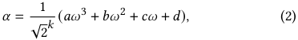

1 𝛼 = √ 2 𝑘 ( 𝑎𝜔 3 +  𝑏𝜔 2 +  𝑐𝜔 +  𝑑 ) , (2) 

where the coefficients _𝑎,𝑏,𝑐,𝑑,𝑘_ ∈ Z, and _𝜔_ = _𝑒__𝚤𝜋_/4 . By Eq. (2), a 2_𝑛_ ×1 state vector is expressed by an integer scalar _𝑘_ and four vectors _𝑎_ � = [ _𝑎_ 0 _, . . . ,𝑎_ 2 _𝑛_ −1 ]_𝑇_ _, 𝑏_� = [ _𝑏_ 0 _, . . . ,𝑏_ 2 _𝑛_ −1 ]_𝑇_ _,_ � _𝑐_ = [ _𝑐_ 0 _, . . . ,𝑐_ 2 _𝑛_ −1 ]_𝑇_ _, 𝑑_� =

523

DAC ’22, July 10–14, 2022, San Francisco, CA, USA

Chun-Yu Wei, Yuan-Hung Tsai, Chiao-Shan Jhang, and Jie-Hong R. Jiang

[ _𝑑_ 0 _, . . . ,𝑑_ 2 _𝑛_ −1 ]_𝑇_ , each with 2_𝑛_ entries of integer values. In [14], the four integer vectors are represented by BDDs in a bit-sliced manner. For integers in the _𝑟_ -bit 2’s complement form ( _𝑟_ dynamically adjustable), each of _𝑎,_ � _𝑏,_� � _𝑐, 𝑑_� is expressed with _𝑟_ BDDs of _𝑛_ variables. That is, each bit, say the _𝑖_th bit, of _𝑎_ � (similarly, _𝑏,_� � _𝑐, 𝑑_� ), i.e., the bit-vector [ _𝑎_ 0 _,𝑖, . . . ,𝑎_ 2 _𝑛_ −1 _,𝑖_ ]_𝑇_ , is treated as the truth table of an _𝑛_ -variable function and represented by an _𝑛_ -variable BDD. On the other hand, as scalar _𝑘_ is shared among all 2_𝑛_ entries of _𝑎,_ � _𝑏,_� � _𝑐, 𝑑_� , it is stored separately. Overall 4 _𝑟_ BDDs over _𝑛_ variables are used to represent an _𝑛_ -qubit state vector. In the sequel, the BDDs of the _𝑖_th bit of _𝑎_ �, _𝑏_� , � _𝑐_ , and _𝑑_� are referred to as _𝐹__𝑎𝑖_ , _𝐹__𝑏𝑖_ , _𝐹__𝑐𝑖_ , and _𝐹__𝑑𝑖_ , respectively.

Furthermore, to support state evolution computation, a state vector has to be multiplied with a unitary operator. The quantum gate set supported in [14] includes { _𝑋_ , _𝑌_ , _𝑍_ , _𝐻_ , _𝑆_ , _𝑇_ , _𝑅𝑥_ ( _𝜋_ /2), _𝑅𝑦_ ( _𝜋_ /2), CNOT, CZ, multi-control Toffoli, multi-control Fredkin}, which is a superset of a universal quantum gate set able to approximate arbitrary unitary operations. The effects of applying the unitary operators on the current state vector are characterized into Boolean formulas, which can be found in [14], Tables I and II.

In this work, we adopt the algebraic complex number representation and extend the state-vector bit-slicing technique to unitarymatrix bit-slicing. Furthermore, we derive the Boolean formulas characterizing the effects of applying the unitary operators on the current unitary matrix into Boolean formulas.

## 2.2 Quantum Circuit Equivalence Checking

Given two quantum circuits _𝑈_ and _𝑉_ described in unitary matrices, the quantum circuit equivalence checking problem asks whether _𝑈_ = _𝑒__𝚤𝛼_ _𝑉_ for some constant _𝛼_ ∈[0 _,_ 2 _𝜋_ ), i.e., _𝑈_ and _𝑉_ are equivalent up to a global phase factor _𝑒__𝚤𝛼_ , which has no effect on the functionality of a quantum circuit [10]. If so, _𝑈_ and _𝑉_ are _equivalent (EQ)_ ; otherwise, _nonequivalent (NEQ)_ .

A common approach to quantum circuit equivalence checking is to build the miter of two quantum circuits _𝑈_ = _𝑈𝑚_ −1 · · · _𝑈_ 0 and _𝑉_ = _𝑉𝑝_ −1 · · · _𝑉_ 0 as

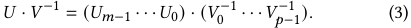

𝑈 ·  𝑉 −1 = ( 𝑈𝑚 −1 · · · 𝑈 0) · ( 𝑉 0 −1 · · · 𝑉𝑝 − − 1 1 ) . (3) 

Thereby, if the miter _𝑈_ · _𝑉_−1 equals _𝑒__𝚤𝛼_ _𝐼_ , i.e., where _𝐼_ is the identity matrix, then _𝑈_ and _𝑉_ are equivalent.

In [3], Eq. (3) is rewritten as _𝑈𝑚_ −1 · · · _𝑈_ 0 · _𝐼_ · _𝑉_ 0†· · ·_𝑉_ _𝑝_† −1. Initially, let the current matrix be the middle identity matrix _𝐼_ . At each step, the current matrix is multiplied with its left or right adjacent matrix. The process repeats until the current matrix has no more adjacent matrix to multiply. Three multiplication strategies, namely, _naive_ , _proportional_ , and _look-ahead_ , are studied in [3]. In this work, we adopt the _proportional_ strategy in our quantum circuit equivalence checking implementation. However, unlike prior work [3] using QMDD, we use bit-sliced BDD-based unitary matrix representation for the computation.

## 3 UNITARY MATRIX REPRESENTATION AND MANIPULATION

In this section, we extend the BDD-based representation and manipulation [14] for state vectors to unitary matrices.

## 3.1 Bit-Sliced Representation for Unitary Operators

By Eq. (2), we represent a 2_𝑛_ × 2_𝑛_ unitary matrix _𝑈_ algebraically with an integer scalar _𝑘_ and four 2_𝑛_ × 2_𝑛_ matrices _𝑈__𝑎_ , _𝑈__𝑏_ , _𝑈__𝑐_ , and _𝑈__𝑑_ with entries of integers. Let an integer be represented as an _𝑟_ -bit 2’s complement number. Then the _𝑖_th -bit values of the 2_𝑛_ × 2_𝑛_ integer entries of _𝑈__𝑎_ (similarly, _𝑈__𝑏_ _,𝑈__𝑐_ _,𝑈__𝑑_ ) can be represented by a BDD, denoted _𝐹__𝑎𝑖_ (similarly, _𝐹__𝑏𝑖_ _, 𝐹__𝑐𝑖_ _, 𝐹__𝑑𝑖_ ), of 2 _𝑛_ variables. Essentially, each qubit requires two variables to indicate the input-output mapping similar to a QMDD. That is, a qubit partitions a unitary matrix _𝑈_ into four submatrices

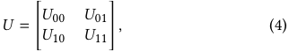

𝑈 00 𝑈 01 𝑈 = , (4) 𝑈 10 𝑈 11 � � 

where the sub-matrix _𝑈𝑖𝑗_ indicates the mapping of the qubit from the input value | _𝑗_ ⟩ to the output value | _𝑖_ ⟩ for _𝑖, 𝑗_ ∈{0 _,_ 1}. For each qubit _𝑞_ , let it be encoded by two Boolean variables _𝑞_ 0 (called the 0-variable of _𝑞_ ) and _𝑞_ 1 (the 1-variable), which correspond to the indices _𝑖_ and _𝑗_ in _𝑈𝑖𝑗_ , respectively. Hence, an _𝑛_ -qubit system requires 2 _𝑛_ variables to address the entries in a 2_𝑛_ × 2_𝑛_ matrix.

## 3.2 Formula Characterization for Matrix Multiplication

Boolean formulas are characterized for applying a unitary operator to the bit-sliced representation of unitary matrix. To take advantage of algebraic representation, we consider multiplying an (algebraically representable) current matrix _𝑀_ with a unitary operator _𝑈_ in { _𝑋_ , _𝑌_ , _𝑍_ , _𝐻_ , _𝑆_ , _𝑇_ , _𝑅𝑥_ ( _𝜋_ /2), _𝑅𝑦_ ( _𝜋_ /2), CNOT, CZ, multi-control Toffoli, multi-control Fredkin} [14]. We analyze the cases for multiplication from the left, i.e., _𝑈_ · _𝑀_ , and from the right, i.e., _𝑀_ · _𝑈_ , as follows. (Recall the matrix multiplication in Section 2.2 is done in two possible directions.)

_3.2.1 Multiplication from the Left._ Without loss of generality, consider a 2-qubit current matrix

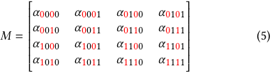

𝛼 0000 𝛼 0001 𝛼 0100 𝛼 0101 𝛼 0010 𝛼 0011 𝛼 0110 𝛼 0111 𝑀 = (5) 𝛼 1000 𝛼 1001 𝛼 1100 𝛼 1101 𝛼 1010 𝛼 1011 𝛼 1110 𝛼 1111   

where the subscript of entry _𝛼𝑝_ 0 _𝑝_ 1 _𝑞_ 0 _𝑞_ 1 corresponds to the values of 0-and 1-variables of qubit _𝑝_ and _𝑞_ . Observe that the entries in the same row have the same values of the 0-variables (colored in red); those in the same column have the same values of the 1-variables. Accordingly, replacing all qubit variables in the formulas in [14] with their 0-variables results in formulas naturally updating each column of the matrix, which is equivalent to multiplying the current matrix with a unitary operator from the left. The above discussion holds for an arbitrary qubit number. Accordingly, for multiplying _𝑈_ from the left of _𝑀_ , the formulas are the same as those in Tables I and II in [14] except that all appearances of qubit variable _𝑞𝑡_ are replaced with _𝑞𝑡_ 0.

_3.2.2 Multiplication from the Right._ Multiplying the current matrix with a unitary operator from the right is not as natural as that from the left. We analyze the considered set of unitary operators in two cases: the symmetric operators and the asymmetric operators. For

524

DAC ’22, July 10–14, 2022, San Francisco, CA, USA

Accurate BDD-based Unitary Operator Manipulation for Scalable and Robust Quantum Circuit Verification

the first case, consider symmetric operators, _𝑈_ ∈{ _𝑋_ , _𝑍_ , _𝐻_ , _𝑆_ , _𝑇_ , _𝑅𝑥_ ( _𝜋_ /2), CNOT, CZ, multi-control Toffoli, multi-control Fredkin}. For _𝑈_ symmetric, we have _𝑈_ = _𝑈__𝑇_ and thus

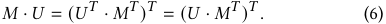

𝑀 ·  𝑈 = ( 𝑈 𝑇 ·  𝑀 𝑇 ) 𝑇 = ( 𝑈 ·  𝑀 𝑇 ) 𝑇 . (6) 

Observe that 1) _𝑀__𝑇_ switches the columns and rows of _𝑀_ , which is equivalent to permuting the corresponding 0-variables and 1-variables in the BDDs representing _𝑀_ , and 2) After _𝑈_ is applied, ( _𝑈𝑀__𝑇_ )_𝑇_ recovers the columns and rows of _𝑀_ . Hence, multiplying _𝑀_ with a symmetric operator _𝑈_ from the right corresponds to replacing all appearances of the qubit variable _𝑞𝑡_ in its respective formulas in Table I or II in [14] with the 1-variable _𝑞𝑡_ 1.

For the second case, consider the asymmetric operators _𝑈_ ∈ { _𝑌, 𝑅𝑦_ ( _𝜋_ /2)}, which are 1-qubit gates with identical diagonal entries, that is, � _𝛼𝛼_ 1000 _𝛼𝛼_ 1101 � with _𝛼_ 01 ≠ _𝛼_ 10 and _𝛼_ 00 = _𝛼_ 11. When _𝛼_ 00 = _𝛼_ 11 and _𝛼_ 01 ≠ _𝛼_ 10, inverting all qubit variables in the formulas of _𝑈_ effectively results in the formulas of operator � _𝛼𝛼_ 0111 _𝛼𝛼_ 0010 � = � _𝛼𝛼_ 0100 _𝛼𝛼_ 1110 � = _𝑈__𝑇_ . Therefore, to obtain the formulas of _𝑌_ and _𝑅𝑦_ ( _𝜋_ /2), in addition to replacing all appearances of the qubit variable _𝑞𝑡_ in their respective formulas in Tables I and II in [14] with the 1-variable _𝑞𝑡_ 1 (as done in the first case), we have to further complement every appearance of the qubit variable _𝑞𝑡_ 1 to implement _𝑈__𝑇_ .

## 4 QUANTUM CIRCUIT VERIFICATION

This section studies how the bit-sliced BDD-based method for unitary matrix manipulation presented above can be applied to equivalence checking, fidelity checking, and sparsity checking.

## 4.1 Equivalence Checking

Quantum circuit equivalence checking can be done through the miter construction as mentioned in Section 2.2. The procedure starts from building the current matrix BDDs _𝐹__𝐼_ of the identity matrix. Specifically, all BDDs are initially set to constant 0 (false) except for _𝐹__𝑑_0 . Given an _𝑛_ -qubit quantum system, the initial _𝐹__𝑑_0 is constructed by

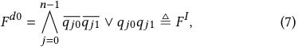

𝑛 −1 𝐹 𝑑 0 = � 𝑞 𝑗 0 𝑞 𝑗 1 ∨ 𝑞 𝑗 0 𝑞 𝑗 1 ≜ 𝐹 𝐼 , (7) 𝑗 =0 

where _𝑞 𝑗_ 0 and _𝑞 𝑗_ 1 are the 0-variable and 1-variable of the formula/BDD under construction corresponding to the _𝑗_th qubit of the quantum circuit.

The procedure then conducts a sequence of matrix multiplications using the _proportional_ strategy mentioned Section 2.2 by applying the formulas of Section 3.2 to update the BDDs of the current matrix. Two circuits _𝑈_ and _𝑉_ are equivalent if the resulting matrix _𝑈_ · _𝑉_−1 realizes _𝑒__𝚤𝛼_ _𝐼_ . In the BDD-based representation, checking if _𝑈𝑉_−1 = _𝑒__𝚤𝛼_ _𝐼_ is equivalent to checking if the final BDDs correspond to a scalar matrix, i.e., 1) all off-diagonal entries are 0, and 2) all diagonal entries are equal. Under the bit-sliced representation, it is also equivalent to checking if each BDD is either _𝐹__𝐼_ in Eq. (7) or constant 0, thus merely requiring 4 _𝑟_ BDD pointer comparisons.

## 4.2 Fidelity Checking

The decision problem of equivalence checking has a yes or no answer, which may not provide much information when the two circuits _𝑈_ and _𝑉_ under checking are nonequivalent. It is sometimes

desirable to quantitatively assess how close _𝑈_ and _𝑉_ are. Such quantitative verification can be done through the notion of _fidelity_ between two 2_𝑛_ × 2_𝑛_ unitary operators _𝑈_ and _𝑉_ defined in [2] by

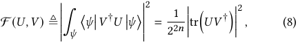

2 2 1 F ( 𝑈,𝑉 ) ≜ �����∫ 𝜓 � 𝜓 �� 𝑉 † 𝑈 �� 𝜓 ������ = 2 2 𝑛 ����tr� 𝑈𝑉 †���� � , (8) 

which has value ranging from 0 to 1. The larger the value F ( _𝑈,𝑉_ ) is, the closer the two circuits _𝑈_ and _𝑉_ are. We refer to computing F ( _𝑈,𝑉_ ) as the _fidelity checking_ .

Note that after obtaining _𝑈𝑉_† in equivalence checking, the trace of of the final matrix corresponds to F ( _𝑈,𝑉_ ). In fact, the trace can be computed efficiently when the final matrix is represented by QMDD or BDD. In the case of QMDD, the trace can be obtained by traversing only the “00-child" and “11-child" of each node recursively; in the case of our BDD structure, the trace can be obtained similarly by traversing the _combined monolithic BDD_ [14]. The “00child" (resp. “11-child") of a QMDD corresponds to assigning 0 (resp. 1) to both 0-and 1-variables in the BDD counterpart.

Besides the above traversing method, our BDD method allows an even more efficient way without constructing the monolithic BDD, by utilizing the composition operation and the minterm counting algorithm of BDD (both are available in the CUDD package [13]) as follows. Let the BDD composition procedure

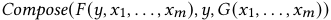

Compose ( 𝐹 ( 𝑦,𝑥 1 , . . . ,𝑥𝑚 ) ,𝑦,𝐺 ( 𝑥 1 , . . . ,𝑥𝑚 )) 

derive the BDD of function _𝐹_ ( _𝐺_ ( _𝑥_ 1 _, . . . ,𝑥𝑚_ ) _,𝑥_ 1 _, . . . ,𝑥𝑚_ ). Note that, under the bit-sliced matrix representation in Section 3.1, for each diagonal entry of the current matrix _𝑀_ , the 0-variable and 1-variable of a qubit are assigned the same value. Accordingly, we can collect the diagonal entries of _𝑀_ into a 2_𝑛_ × 1 vector by substituting every 1-variable with its corresponding 0-variable. Thus, for each _𝐹__𝑥𝑖_ , with _𝑥_ ∈{ _𝑎,𝑏,𝑐,𝑑_ } and _𝑖_ = 0 _, . . . ,𝑟_ − 1 of the 4 _𝑟_ BDDs of _𝑀_ , we compute _𝐹_ˆ_𝑥𝑖_ iteratively, starting from _𝐹_ˆ_𝑥𝑖_ = _𝐹__𝑥𝑖_ , by composing the _𝑗_th qubit variable _𝑞 𝑗_ 1 with _𝑞 𝑗_ 0 as

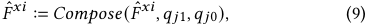

𝐹 ˆ 𝑥𝑖 :=  𝐶𝑜𝑚𝑝𝑜𝑠𝑒 ( ˆ 𝐹 𝑥𝑖 ,𝑞 𝑗 1 ,𝑞 𝑗 0) , (9) 

for _𝑗_ = 0 _, . . . ,𝑛_ − 1. The obtained 4 _𝑟_ BDDs constitute the desired vectors of _𝑎,_ � _𝑏,_� � _𝑐, 𝑑_� . The trace of _𝑀_ can be computed by summing up all the 2_𝑛_ entries for each of the vectors _𝑎,_ � _𝑏,_� � _𝑐, 𝑑_� . The summations can be done efficiently by minterm counting on each BDD, and then multiplying the result of minterm counting with the corresponding weight of the bit. Recall that the entries of _𝑎,_ � _𝑏,_� � _𝑐, 𝑑_� are 2’s complement numbers. In this way, we avoid building a monolithic BDD to allow scalable computation.

## 4.3 Sparsity Checking

As the sparsity (the portion of 0-entries among all entries) of a matrix _𝑀_ is an important factor to certain quantum algorithms, such as the HHL algorithm [6], we study how to compute the sparsity of _𝑀_ under the BDD representation. Observe that in the BDD representation, an entry of _𝑀_ is zero if and only if its corresponding 4 _𝑟_ BDD values are all zeros. In other words, any non-zero bit makes an entry non-zero. To count the number of zero entries, we can count the number of non-zero entries by first building the disjunction BDD of the 4 _𝑟_ BDDs and then counting the number of onset minterms on the disjunction BDD. Then, subtracting this number

525

DAC ’22, July 10–14, 2022, San Francisco, CA, USA

Chun-Yu Wei, Yuan-Hung Tsai, Chiao-Shan Jhang, and Jie-Hong R. Jiang

(the number of non-zero entries) from 22_𝑛_ yields the number of zero entries, and the sparsity can be further calculated.

We note that the sparsity of _𝑀_ represented by QMDD can also be efficiently computed by a single traversal on the QMDD to count the number of “minterms” (full qubit variable assignments) leading to the 0-terminal node, similar to BDD minterm counting.

## 5 EXPERIMENTAL RESULTS

Our proposed verification method, named SliQEC, was implemented in C/C++ and used CUDD [13] as the underlying BDD package. The variable reorder option in CUDD was turned on by default. The bit length of an integer was set to _𝑟_ = 32 by default, and extra bits were allocated when needed. All experiments were conducted on a server with Intel Xeon Silver 4210 CPU at 2.2 GHz and 125 GB RAM. The runtime reported in the experiments is in CPU time measured in seconds (s), while the memory usage is measured in megabytes (MB). The time-out (TO) and memory-out (MO) limits were set to 7200 seconds and 2 GB, respectively.

In the experiments, the state-of-the-art equivalence checker QCEC version v1.9.1 [3] (using a default _proportional_ strategy), which is based on QMDD and implemented in C++, was compared. Since QCEC cannot check fidelity and sparsity, we have implemented them in QCEC for comparison with SliQEC. The evaluation was performed on four benchmark sets, including Random, BernsteinVazirani (BV), Entanglement, and RevLib. The Random benchmark circuits _𝑈_ was randomly generated with Clifford+ _𝑇_ and 2-control Toffoli gates, and _𝐻_ gates are applied to all qubits initially to impose superposition. The ratio of the number of gates to the number of qubits was set to 5:1. Ten circuits were generated for each qubit size ranging from 10 to 160. To get circuits _𝑉_ as the counterparts of _𝑈_ for equivalence checking, we replaced all 2-control Toffoli gates in _𝑈_ with a functionally equivalent Clifford+ _𝑇_ realization shown in Fig. 1a. To further create circuits nonequivalent to _𝑈_ , one or three gates were randomly removed from _𝑉_ in the experiments. For the BV and Entanglement benchmarks, the _𝑈_ circuits with 60 to 10000 qubits were generated. The _𝑉_ circuits were created by replacing all CNOT gates in _𝑈_ randomly with the three functionally equivalent templates shown in Fig. 1b and 1c [12, 17]. For RevLib benchmarks [15], _𝐻_ gates are applied to all qubits initially to impose superposition as the _𝑈_ circuits. We created the _𝑉_ circuits by rewriting _𝑈_ with the template in Fig. 1a to replace one of the Toffoli gates in _𝑈_ .

## 5.1 Equivalence and Fidelity Checking

The results on Random benchmarks are shown in Table 1, where Columns 1, 2 and 3 list the number of involved qubits denoted as # _𝑄_ , the number of gates in _𝑈_ denoted as # _𝐺_ , and the average number of gates in _𝑉_ denoted as # _𝐺_′ . The remaining columns list the average results of runtime and the fidelity denoted as _𝐹_ , for the finished cases. In the table, “error” indicates the number of cases returned with a wrong answer (incorrect EQ or NEQ conclusion). The numbers _𝐹_ (resp. _𝐹_− ) indicate the fidelity averaged over the cases solved by the underlying method (resp. solved by both QCEC and SliQEC). As can be seen, SliQEC outperformed QCEC in for all the EQ and NEQ experiments. For the EQ experiments, SliQEC finished all cases without TO and MO. Also, because the fidelity computed by SliQEC is exact, the differences in the _𝐹_− value between QCEC

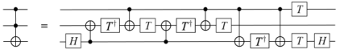

{re 

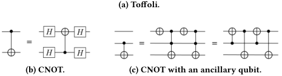

(a) Toffoli. _ 1 ® —Pe Rees (b) CNOT. (c) CNOT with an ancillary qubit. 

**Figure 1: Templates for circuit rewriting.**

and SliQEC indicate the numerical precision loss of QCEC. In fact, the precision loss of QCEC may result in a wrong answer, e.g., in the 10-qubit EQ experiment. Another trend can be seen by comparing EQ, NEQ 1-gate removal, NEQ 3-gate removal is that increasing the dissimilarities between circuits _𝑈_ and _𝑉_ under checking makes equivalence and fidelity checking harder. Nevertheless, SliQEC is more robust than QCEC in coping with dissimilar circuits.

The results on BV and Entanglement benchmarks are shown in Table 2. (We omit the results for NEQ experiments as conclusions similar to the EQ experiments can be drawn.) As seen, SliQEC outperformed QCEC on both benchmarks. For BV circuits with 200 ≤ # _𝑄_ ≤ 2000, QCEC produced global phases with large amplitudes, possibly due to numerical precision loss, making the fidelity incorrect although it returned correct EQ answers. We also noticed that turning off (indicated “w/o”) the BDD reordering option made SliQEC perform faster than turning on (“w”) for the BV circuits. In general, BDD reordering is helpful but sometimes wasteful.

The results on RevLib benchmarks are shown in Table 3, where only data of cases with more than 100 qubits are reported as small cases can be solved efficiently by both methods. As observed, SliQEC outperforms QCEC. Also, variable reordering is effective.

_5.1.1 Robustness Study._ To study the effect of circuit gate count on equivalence checking, we generated 10-qubit random _𝑈_ circuits with the gate counts ranging from 20 to 150, and created the corresponding equivalent _𝑉_ circuits using the Fig. 1a template. For each gate count, 1000 benchmarks were generated. The resultant error rate and average fidelity (y-axis) of SliQEC and QCEC with respect to the gate count of _𝑈_ (x-axis) were plotted in Fig. 2. (The error rate is the ratio of the number of wrong-answer cases to 1000.) As seen from the plot, SliQEC produces correct, exact answers regardless of the gate count increase while the reliability of QCEC degrades.

To study the effect of dissimilarity between _𝑈_ and _𝑉_ circuits on equivalence checking, we took small qubit RevLib circuits as _𝑈_ and created very different but equivalent _𝑉_ by repeatedly applying template rewriting using Fig. 1 rules. The results are shown in Table 4. Again, the robustness of SliQEC was witnessed.

## 5.2 Approximate Equivalence Checking on Noisy Quantum Circuits

Approximate equivalence checking of noisy quantum circuits was studied in [7], where TDD [8] was used as the underlying data structure. It relies on the Jamiolkowski fidelity _𝐹𝐽_ [5] to characterize equivalence. The fidelity _𝐹𝐽_ between an _𝑛_ -qubit ideal circuit _𝑈_ and

526

DAC ’22, July 10–14, 2022, San Francisco, CA, USA

Accurate BDD-based Unitary Operator Manipulation for Scalable and Robust Quantum Circuit Verification

**Table 1: Results on Random benchmarks.**

|||||EQcase|||||NE|Qcase(|1-gate re|moval)||||N|EQcase(|3-gate rem|oval)||
|---|---|---|---|---|---|---|---|---|---|---|---|---|---|---|---|---|---|---|---|---|
|#Q #G|#G’||QC|EC|SliQE|C|||QCEC|||SliQ|EC|||QCEC|||SliQ|EC|
|||Time _𝐹_,|_𝐹_−|TO/MO/erro|r Time |_𝐹_ |_𝐹_−|Time|_𝐹_,_𝐹_−|TO/MO|Time|_𝐹_|_𝐹_−|TO|Time|_𝐹_,_𝐹_−|TO/MO|Time|_𝐹_|_𝐹_− TO|
|10 50|169|0.014 0.9|56|0/0/1|0.048 |1|1|0.016|0.249|0/0|0.064|0.260|0.260|0|0.045|0.174|0/0|0.222|0.177|0.177 0|
|20 100|290.4|0.043 1||0/0/0|0.317 |1|1|0.054|0.537|0/0|0.452|0.537|0.537|0|0.106|0.040|0/0|0.732|0.040|0.040 0|
|30 150|451|0.116 1||0/0/0 |1.021 |1|1|0.310|0.396|0/0 |1.653|0.396|0.396|0|1.188|0.040|0/0 |6.429|0.040|0.040 0|
|40 200|648|1.881 1||0/0/0|2.320 |1|1|2.593|0.346|0/0|2.846|0.346|0.346|0|26.499|0.152|0/3|177.637|0.103|0.152 0|
|50 250|850.6|14.617 1||0/0/0|5.416 |1|1|19.541|0.652|0/1|8.986|0.587|0.652|0|25.952|0.182|0/3|450.337|0.149|0.182 1|
|60 300|979|37.473 1||1/1/0|15.244 |1|1|39.282|0.267|1/3|29.464|0.210|0.267|0|128.441|0.094|1/4|45.181|0.052|0.094 0|
|70 350|1101.8|704.522 1||1/2/0|17.299 |1|1|581.067|0.368|1/3|23.790|0.441|0.368|0|637.296|0.311|1/7|124.211|0.110|0.311 1|
|80 400|1273.6 |1203.984 1||3/5/0|27.383 |1|1|217.037|0.854|3/6|71.014|0.441|0.854|0|260.115|0.182|3/6|72.383|0.139|0.182 0|
|90 450|1392.2|200.992 1||5/4/0|26.191 |1|1|196.708|0.500|5/4|27.445|0.577|0.500|0|-|-|5/5|236.162|0.054|- 1|
|100 500|1655|- -||5/5/0|93.674 |1|-|-|-|5/5|104.477|0.441|-|0|-|-|5/5|236.524|0.121|- 1|
|110 550|1812.8|- -||9/1/0|72.636 |1|-|-|-|9/1|134.408|0.647|-|0|-|-|9/1|259.036|0.085|- 1|
|120 600|1909|- -||6/4/0|356.753 |1|-|-|-|6/4|125.273|0.423|-|1|-|-|6/4|1362.571|0.167|- 1|
|130 650|2045.8|- -||7/3/0|256.338 |1|-|-|-|7/3|265.333|0.516|-|0|-|-|7/3|885.882|0.080|- 0|
|140 700|2259.6|- -||9/1/0|218.389 |1|-|-|-|9/1|437.130|0.260|-|0|-|-|9/1|629.243|0.153|- 2|
|150 750|2371.2|- -||10/0/0|386.027 |1|-|-|-|10/0|408.942|0.477|-|0|-|-|10/0|542.257|0.031|- 2|
|160 800|2503.8|- -||10/0/0|598.274 |1|-|-|-|10/0|624.278|0.296|-|0|-|-|10/0|1748.694|0.121|- 2|
|**able 2:** |**Result** QCEC|**s on BV** BV |**a** Sl|**nd Entan** iQEC|**glement**  QCE|**be** Ent C|**nc** ang|**hmar** lement SliQ|**ks.** EC|||1|||||||||
|Ti|me _𝐹_|Time(w)||Time(w/o)|_𝐹_ Time||_𝐹_|Time|_𝐹_||i|0_._8|||||||||
|0.0  0.1 0 0.2|78 1 46 1 83 1|0.306 4.314 9.653||0.297 0.535 0.838|1 0.044 1 0.061 1 0.085||1 1 1|0.058 0.114 0.171|1 1 1||fidelity||||||||~~QCEC a~~|~~ve. f~~i~~delity~~|
|19|63 »1|43213||4059|1 0347||1|23123|1||. i|0_._6||||||||i|
|.||.||.|.|||.|||e i||||||||SliQEC|ave fidelit|
|0 10.|513 »1|407.063||16.403|1 3.197||1|105.148|1||Av i||||||||QCECer|. iy ror rate|
|0 30.|217 »1|1104.870||33.702|1 11.663||1|172.432|1||/  i||||||||SliQEC|error rate|
|0 72. 0 127 0 332 0|052 »1 .119 »1 .592 »1 MO|281.383 198.071 540.796 2136.25||64.551 98.161 410.757 1716.270|1 27.780 1 55.429 1 111.260 1 MO||1 1 1|78.843 50.715 131.144 522.185|1 1  1  1||Error rate   i|0_._4|||||||||
|0 0|MO MO|TO TO||4074.000 7070.100|1 MO 1 MO|||1149.52 2051.98|0 1 0 1||i|0_._2|||||||||
|00|MO|TO||TO|- MO|||3405.99|0 1|||0|||||||||
||**Table 3**|**: Results**||**on RevLib**|**benchm**|**ar**|**ks**|**.**||||0|20||40|60 Ga|80 te cou|100 nt|120|140|

**Table 2: Results on BV and Entanglement benchmarks.**

||||BV |||En |tang|lement |
|---|---|---|---|---|---|---|---|---|
|#Q|QCEC||S|liQEC||QCEC||SliQEC|
||Time|_𝐹_|Time(w)|Time(w/o)|_𝐹_|Time|_𝐹_|Time _𝐹_|
|60|0.078|1|0.306|0.297|1|0.044|1|0.058 1|
|80|0.146|1|4.314|0.535|1|0.061|1|0.114 1|
|100|0.283|1|9.653|0.838|1|0.085|1|0.171 1|
|200|1.963|»1|43.213|4.059|1|0.347|1|23.123 1|
|400|10.513|»1|407.063|16.403|1|3.197|1|105.148 1|
|600|30.217|»1|1104.870|33.702|1|11.663|1|172.432 1|
|800|72.052|»1|281.383|64.551|1|27.780|1|78.843 1|
|1000|127.119|»1|198.071|98.161|1|55.429|1|50.715 1|
|2000|332.592|»1|540.796|410.757|1|111.260|1|131.144 1|
|4000|MO||2136.25|1716.270|1|MO||522.185 1|
|6000|MO||TO|4074.000|1|MO||1149.520 1|
|8000|MO||TO|7070.100|1|MO||2051.980 1|
|10000|MO||TO|TO|-|MO||3405.990 1|

||||QCEC||Sli |QEC ||
|---|---|---|---|---|---|---|---|
|Benchmarks|#Q|||w re|order|w/o r|eorder|
|||Time|Memory|Time|Memory|Time|Memory|
|_443|261||MO|T|O|M|O|
|add64_184|193|0.132|121.340|4.197|40.985|0.640|43.725|
|apex2_289|498||MO|529.028|121.684|278.924|279.249|
|callif_32_429|130||MO|68.755|95.781|M|O|
|cps_292|923||MO|1819.730|183.558|976.371|455.827|
|cpu_control_unit_402|392||MO|197.982|59.089|M|O|
|ex5p_296|206|6.888|656.843|11.856|44.675|14.221|172.511|
|hwb9_304|170|15.432|1174.753|17.458|30.298|17.122|163.918|
|lu_326|299||MO|T|O|M|O|
|nestedif_32_445|263||MO|T|O|M|O|
|pdc_307|619||MO|695.248|84.468|383.118|378.831|
|spla_315|489||MO|217.719|84.087|111.708|267.272|
|varpos_32_447|224||MO|36.507|48.501|556.474|1202.823|

**Figure 2: Error rate and fidelity of equivalence checkers in response to gate count increase.**

**Table 4: Results on dissimilar RevLib circuits.**

|Benchmark|#Q|#G|#G’|QC |EC |Sli |QEC |
|---|---|---|---|---|---|---|---|
|||||Time|Memory|Time|Memory|
|5xp1_194|17|92|14846|M|O|16.655|39.154|
|add6_196|19|241|31874|M|O|78.870|76.489|
|alu1_198|20|44|4436|1.52674|57.004|3.195|19.726|
|c2_181|35|151|85613|M|O|315.079|149.811|
|C7552_205|21|85|11143|M|O|9.944|20.234|
|cm150a_210|22|74|547|M|O|0.282|14.483|
|cm151a_211|28|52|8528|5.34664|62.886|7.246|20.718|
|cm163a_213|29|55|2891|er|ror|1.972|23.421|
|dk27_225|18|33|5550|1.005|56.381|2.339|17.351|
|example2_231|16|167|14976|M|O|17.405|22.143|
|mlp4_245|16|139|16500|M|O|22.521|20.107|
|d5adder_306|32|102|78068|M|O|212.609|45.793|
|rd84_313|34|112|73617|M|O|206.177|80.945|
|sym9_317|27|71|52742|M|O|107.998|43.827|

its noisy implementation modeled by a superoperator in the form of a set of 2_𝑛_ × 2_𝑛_ matrices E = { _𝐸𝑖_ } is calculated by

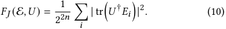

𝐹𝐽 (E ,𝑈 ) = 21 2 𝑛 ∑︁ | tr� 𝑈 † 𝐸𝑖 � | 2 . (10) 𝑖 

Based on Eq. (10), Alg. I in [7] computes tr _𝑈_† _𝐸𝑖_ for each _𝐸𝑖_ in� � dividually and the cardinality |E| of E grows exponentially in the number of noisy gates in a circuit. By rewriting _𝐹𝐽_ as _𝐹𝐽_ (E _,𝑈_ ) = 212_𝑛_ ∑︁ | tr� _𝑈_† _𝐸𝑖_ � |2 = 212_𝑛𝑡𝑟_((_𝑈_†⊗_𝑈𝑇_)_𝑀_E)_,_ (11) _𝑖_

for _𝑀_ E =� _𝑖__𝐸_ _𝑖_⊗_𝐸_ _𝑖_∗. Alg. II in [7] improves Alg. I and calculates � _𝑖_| tr � _𝑈_† _𝐸𝑖_ � |2 collectively by contracting a single tensor network. However, the matrix size in Eq. (11) becomes 22_𝑛_ × 22_𝑛_ .

527

DAC ’22, July 10–14, 2022, San Francisco, CA, USA

Chun-Yu Wei, Yuan-Hung Tsai, Chiao-Shan Jhang, and Jie-Hong R. Jiang

**Table 5: Results on noisy BV benchmarks.**

||TDD|Alg II||||S |liQEC ||||
|---|---|---|---|---|---|---|---|---|---|---|
|#Q||.|#Trial|s = 101|#Trial|s = 102|#Trials|= 103|#Trials|= 104|
||Time|_𝐹_|Time|_𝐹_|Time|_𝐹_|Time|_𝐹_|Time|_𝐹_|
|10|0.304|0.9714|0.023|0.9000|0.219|0.9800|2.190|0.9710|21.822|0.9724|
|20|0.735|0.9427|0.061|0.9000|0.574|0.9700|6.071|0.9340|60.574|0.9418|
|30|1.571|0.9149|0.135|0.9000|1.432|0.9500|15.094|0.9280|152.511|0.9169|
|40|2.309|0.8878|0.437|0.7000|2.698|0.9300|28.930|0.8850|296.599|0.8828|
|50|3.270|0.8616|0.578|0.8000|5.561|0.8400|51.812|0.8660|542.772|0.8572|
|60|7.229|0.8361|1.153|0.9000|8.719|0.9100|83.460|0.8410|684.991|0.8389|
|70|6.698|0.8114|1.319|0.7000|12.152|0.8700|125.983|0.7990|1070.360|0.8105|
|80|8.475|0.7874|1.822|0.9000|17.249|0.7800|176.257|0.7960|1454.800|0.7843|
|90|10.539|0.7641|2.482|1.0000|26.806|0.8100|288.594|0.7600|1978.120|0.7699|
|100|12.588|0.7415|3.338|0.9000|38.689|0.7400|339.547|0.7300|2474.870|0.7436|
|700|M|O|25.35|8×101|25.358|×102|25.358|×103|25.358|×104|
|800|M|O|37.47|6×101|37.476|×102|37.476|×103|37.476|×104|
|900|M|O|44.09|5×101|44.09|5×102|44.095|×103|44.095|×104|

**Table 6: Sparsity checking on Random benchmarks.**

|#Q|#G||QMDD based |||BDD based ||
|---|---|---|---|---|---|---|---|
|||Build time|Check time|TO/MO|Build time|Check time|TO/MO|
|20|60|0.181|0.003|0/0|0.502|0.004|0/0|
|25|75|13.296|0.296|0/0|2.944|0.023|0/0|
|30|90|121.793|0.579|0/0|8.952|0.042|0/0|
|35|105|585.719|2.286|3/0|22.848|0.182|0/0|
|40|120|1050.418|1.698|4/2|211.775|0.583|1/0|
|45|135|-|-|8/2|697.819|1.439|0/0|
|50|150|-|-|8/2|3282.897|2.896|7/0|
|55|165|-|-|8/2|2123.429|2.351|4/0|
|60|180|-|-|8/2|1590.066|1.244|8/0|
|65|195|-|-|8/2|2073.895|3.932|8/0|

## ACKNOWLEDGMENTS

Note that for each _𝐸𝑖_ in Eq. (10), | tr� _𝑈_† _𝐸𝑖_ � |2 is similar to Eq. (8), and thus can be calculated by our method when _𝐸𝑖_ is algebraically representable. Using Monte Carlo simulation [9], the real probability distribution given a set of noisy gates can be approximated by simulating a large number of trials with noisy gates being injected into an ideal circuit according to the error probabilities. We conducted experiments to study the applicability of our methods to equivalence checking of noisy circuits by the following setting.

We took BV benchmarks as the ideal _𝑈_ circuits. For the noisy implementation, every gate in _𝑈_ is followed by an depolarizing channel _𝑁_ ( _𝜌_ ) = _𝑝𝜌_ +1− <u>3</u>_<u>𝑝</u>_(_𝑋𝜌𝑋_+_𝑌𝜌𝑌_+_𝑍𝜌𝑍_)[10], where_𝜌_is a density matrix describing a mixed state, _𝑝_ is the error probability setting to 0.001 in the experiments. The results are shown in Table 5, where Alg. I results were not reported because it timed out on all the cases. It should be noted that because Alg. II and SliQEC were implemented in python and C++, respectively, their runtimes cannot be directly compared. From Table 5, we see that the fidelity computed by SliQEC well approximates that of Alg. II with 1000 to 10000 trials. Although Alg. II was advantageous in computing fidelity for small qubit circuits, it suffers from the memory explosion problem for circuits with more than 700 qubits. In contrast, SliQEC exhibited superior scalability (runtime extrapolated for # _𝑄_ ≥ 700) and can be parallelized for acceleration.

## 5.3 Sparsity Checking

In the experiment, the sparsity checking algorithms for QMDD and BDD discussed in Section 4.3 were implemented. The evaluation was performed on Random benchmarks, where circuits _𝑈_ are generated in the same way as in Section 5.1 except for the ratio of the number of gates to the number of qubits being set to 3:1. The results are shown in Table 6, where the DD build time and the sparsity computing time are reported. The results suggest the better scalability of the BDD-based method than the QMDD counterpart.

## 6 CONCLUSIONS

This paper has developed the bit-sliced BDD-based method for unitary matrix representation and manipulation. Its applications to equivalence checking, fidelity checking, and sparsity checking have been presented. Experiments have been conducted and demonstrated the superiority of the proposed approach to the state-of-theart methods in scalability and accuracy. For future work, we would like to support checking for more quantum circuit properties.

This work was supported in part by the Ministry of Science and Technology of Taiwan under grants MOST 110-2224-E-002-011 and MOST 111-2119-M-002-012.

## REFERENCES

- [1] Héctor Abraham et al. 2019. _Qiskit: An Open-source Framework for Quantum Computing_ . https://doi.org/10.5281/zenodo.2573505

- [2] Antonio Acín, E. Jané, and Guifré Vidal. 2001. Optimal estimation of quantum dynamics. _Physical Review A_ 64 (2001), 050302.

- [3] Lukas Burgholzer and Robert Wille. 2021. Advanced Equivalence Checking for Quantum Circuits. _IEEE Transactions on Computer-Aided Design of Integrated Circuits and Systems_ 40, 9 (2021), 1810–1824.

- [4] Cirq Developers. 2021. _Cirq_ . https://doi.org/10.5281/zenodo.5182845

- [5] Alexei Gilchrist, Nathan K. Langford, and Michael A. Nielsen. 2005. Distance measures to compare real and ideal quantum processes. _Physical Review A_ 71, 6 (2005).

- [6] Aram W. Harrow, Avinatan Hassidim, and Seth Lloyd. 2009. Quantum Algorithm for Linear Systems of Equations. _Physical Review Letters_ 103, 15 (2009).

- [7] Xin Hong, Mingsheng Ying, Yuan Feng, Xiangzhen Zhou, and Sanjiang Li. 2021. Approximate Equivalence Checking of Noisy Quantum Circuits. In _Proc. DAC_ . 637–642.

- [8] Xin Hong, Xiangzhen Zhou, Sanjiang Li, Yuan Feng, and Mingsheng Ying. 2020. A Tensor Network based Decision Diagram for Representation of Quantum Circuits. _CoRR_ abs/2009.02618 (2020).

- [9] Gushu Li, Yufei Ding, and Yuan Xie. 2019. SANQ: A Simulation Framework for Architecting Noisy Intermediate-Scale Quantum Computing System.

- [10] Michael A. Nielsen and Isaac L. Chuang. 2000. _Quantum Computation and Quantum Information_ .

- [11] Philipp Niemann, Robert Wille, David Michael Miller, Mitchell A. Thornton, and Rolf Drechsler. 2016. QMDDs: Efficient Quantum Function Representation and Manipulation. _IEEE Transactions on Computer-Aided Design of Integrated Circuits and Systems_ 35, 1 (2016), 86–99.

- [12] Aditya K. Prasad, Vivek V. Shende, Igor L. Markov, John P. Hayes, and Ketan N. Patel. 2006. Data structures and algorithms for simplifying reversible circuits. _J. Emerg. Technol. Comput. Syst._ 2, 4 (2006), 277–293.

- [13] Fabio Somenzi. 2005. CUDD: CU Decision Diagram Package (release 2.4.2). _University of Colorado at Boulder_ (2005).

- [14] Yuan-Hung Tsai, Jie-Hong R. Jiang, and Chiao-Shan Jhang. 2021. Bit-Slicing the Hilbert Space: Scaling Up Accurate Quantum Circuit Simulation. In _Proc. DAC_ . 439–444.

- [15] Robert Wille, Daniel Große, Lisa Teuber, Gerhard W. Dueck, and Rolf Drechsler. 2008. RevLib: An Online Resource for Reversible Functions and Reversible Circuits. In _Proc. ISMVL_ . 220–225.

- [16] Robert Wille, Nils Przigoda, and Rolf Drechsler. 2013. A compact and efficient SAT encoding for quantum circuits. In _Proc. Africon_ . 1–6.

- [17] Shigeru Yamashita and Igor L. Markov. 2010. Fast Equivalence-Checking For Quantum Circuits. In _Proc. NANOARCH_ . 23–28.

- [18] Alwin Zulehner, Stefan Hillmich, and Robert Wille. 2019. How to Efficiently Handle Complex Values? Implementing Decision Diagrams for Quantum Computing. In _Proc. ICCAD_ . 1–7.

- [19] Alwin Zulehner, Philipp Niemann, Rolf Drechsler, and Robert Wille. 2019. Accuracy and Compactness in Decision Diagrams for Quantum Computation. In _Proc. DATE_ . 280–283.

528
