# An Automated Deductive Verication Framework for Circuit-building Quantum Programs

Christophe Chareton1,2,  , Sébastien Bardin2 , François Bobot2 , Valentin Perrelle2 , and Benoît Valiron1

> 1 LMF, CentraleSupélec, Université Paris-Saclay, Gif-sur-Yvette, France firstname.lastname@lri.fr

> 2 CEA, LIST, Université Paris-Saclay, Palaiseau, France firstname.lastname@cea.fr

Abstract. While recent progress in quantum hardware open the door for signicant speedup in certain key areas, quantum algorithms are still hard to implement right, and the validation of such quantum programs is a challenge. In this paper we propose Qbricks, a formal verication environment for circuit-building quantum programs, featuring both parametric specications and a high degree of proof automation. We propose a logical framework based on rst-order logic, and develop the main tool we rely upon for achieving the automation of proofs of quantum specication: PPS, a parametric extension of the recently developed path sum semantics. To back-up our claims, we implement and verify parametric versions of several famous and non-trivial quantum algorithms, including the quantum parts of Shor’s integer factoring, quantum phase estimation (QPE) and Grover’s search.

Keywords: deductive verication, quantum programming, quantum circuits

## 1 Introduction

1.1 Quantum computing. Quantum programming is seen as a potential revolution for many computing applications: cryptography [61], deep learning [7], optimization [23,22], solving linear systems [33], etc. In all of these domains, current quantum algorithms beat the best known classical algorithms by either quadratic or even exponential factors. In parallel to the rise of quantum algorithms, the design of quantum hardware has moved from lab-benches [14] to programmable, 50-qubits machines designed by industrial actors [4,38] reaching the point where quantum computers beat classical computers for specic tasks [4]. This has stirred a shift from a theoretical standpoint on quantum algorithms to a more programming-oriented view with Instructions the question of their concrete coding and imClassical controller Quantum plementation [66,65,55]. memory

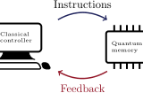

Instructions Classical controller Quantum memory Feedback 

In this context, an important problem is the adequacy between the mathematical description of an algorithm and its concrete implementation as a program.

Fig. 1: The hybrid model

> © The Author(s) 2021

> N. Yoshida (Ed.): ESOP 2021, LNCS 12648, pp. 148–177, 2021. https://doi.org/10.1007/978-3-030-72019-3_6

An Automated Deductive Verication Framework for Quantum Programs

149

1.2 The hybrid model. The vast majority of quantum algorithms are described within the quantum co-processor model [42], i.e. a hybrid model where a classical computer controls a quantum co-processor holding a quantum memory (cf. Figure 1). The co-processor is able to apply a xed set of elementary operations (buered as quantum circuits) to update and query (measure) the quantum memory. Importantly, while measurement allows one to retrieve classical (probabilistic) information from the quantum memory, it also modies it (destructive eect). The quantum memory state is represented by a linear combination of possible concrete values, generalizing the classical notion of probabilities to the complex case, and the core of a quantum algorithm consists in successfully setting the memory in a specic quantum state.

Major quantum programming languages such as Quipper [30], Liqui| [67], Q# [64], ProjectQ [63], Silq [8], and the rich ecosystem of existing quantum programming frameworks [55] follow this hybrid model. Such circuit-building quantum languages are the current consensus for high-level executable quantum programming languages.

1.3 The problem with quantum algorithms. Starting from an initial state, a quantum algorithm typically describes a series of high-level operations which, once composed, realize the desired state. Each high-level operation may itself be described in a similar way, until one reaches elementary operations (quantum gates). Describing an algorithm therefore requires both to list these elementary operations, or quantum circuit, and to specify the circuit’s behavior.

A major issue is then to verify that the quantum circuit generated by the code written as an implementation of a given algorithm is indeed a run of this algorithm, and that the circuit has indeed the specied characteristics of shape (for instance: a polynomial size).

While testing and debugging are the common verication practice in classical programming, they become extremely complicated in the quantum case: debugging and assertion checking are problematic due to the destructive aspect of quantum measurement, the probabilistic nature of quantum algorithms seriously impedes system-level quantum testing, and classical emulation of quantum algorithms is (strongly believed to be) intractable. On the other hand, nothing prevents a priori the formal verication [15] of quantum programs.

1.4 Goal and challenges. Our goal is to provide an automated formal verication framework for circuit-building quantum programs. Such a framework should satisfy the following principles: (1) Parametricity: it should allow parametric (i.e. scale-invariant) specications and proofs, so as to enable the generic specication and verication of parametrized implementations. This is crucial as quantum algorithms always describe parametrized families of circuits; (2) Proof automation: it should, as far as possible, provide automatic proof means in order to ease adoption.

Prior works on quantum formal verication do not fully reach these goals together, as they are either not parametric, or not automated. Model-checking methods [27,70] are fully automatic but not parametric – moreover they are highly scale-sensitive. Recently, Amy [1,2] developed a powerful framework for

150 C. Chareton et al.

reasoning over quantum circuits, the path-sums symbolic representation. Thanks to their good compositional properties, reasoning with path-sums is well automated and can scale up to large problem instances (up to 100 qubits). Yet, the method is not parametric and only addresses xed-size circuits. On the other side of the spectrum, several approaches deal with parametricity but sacrice automation as they generate proof obligations in higher-order logic, supported with proof assistants such as Coq or Isabelle/HOL. One can cite the approach of Boender et al. [10], Qwire [53,58], SQIR [35,34] or QHL [68,71,46,69,45]. Combined with the use of the standard matrix semantics for quantum circuits — that we show in Section 8 cumbersome for automation — only very few realistic quantum programs have been veried in a parametric way [45,35,34].

1.5 Proposal. We propose Qbricks, an automated formal verication framework for circuit-building quantum programs, featuring parametric specication together with a high degree of proof automation.

We bring two key innovations along the road: (Key 1) we propose the new parametrized path-sums (PPS) symbolic representation of families of quantum circuits, extending path-sums [1] to the parametric case while keeping good compositional properties. PPS prove extremely useful both as a specication mechanism and as an automation mechanism; (Key 2) we carefully tune together our programming language (Qbricks-DSL) and specication logic (Qbricks-Spec) so that the corresponding verication problem remains automatable in practice — rst-order proof obligations — while the framework is still expressive enough to write, specify and verify realistic quantum programs (Shor order nding — Shor-OF [61], QPE [41,16], Grover [31]).

- 1.6 Contributions. We bring the following contributions.

- A exible symbolic representation for reasoning about quantum states, building upon the recent path-sum symbolic representation [1,2]. Our representation, called parametrized path-sums (PPS), retains the compositional and closure properties of regular path-sums while allowing genericity and parametricity of both specications and proofs. Especially, rst-order logic together with PPS provide a unied and powerful way to reason about many essential quantum concepts (Section 5.2) and t well with the standard way of describing quantum algorithms. We are the rst to highlight this connection and make PPS a “rst-class” concept, where prior works are limited to standard path sums, or rely on the standard matrix semantics;

- A programming and verication framework, that is: on one hand, a core domain-specic language (Qbricks-DSL, Section 4) for describing families of quantum circuits, with enough expressive power to describe parametric circuits from non-trivial quantum algorithms; and on the other hand, a rst-order logical (domain-specic) specication language (Qbricks-Spec, Section 5), tightly integrated with PPS and Qbricks-DSL to specify properties of parametrized programs representing families of quantum circuits. The careful interplay between these two components yields rst-order proof obligations, and thus is a key aspect of proof automation;

An Automated Deductive Verication Framework for Quantum Programs

151

- A dedicated proof engine: we introduce the Hybrid Quantum Hoare Logic (HQHL) deduction system for deductive verication over circuit-building quantum programs. It is tightly coupled with PPS and produces proof obligations in the Qbricks-Spec logic (Section 6);

- This framework is embedded in the Why3 deductive verication tool [9,24] as a DSL (Section 7), and provides proof automation mechanisms dedicated to the quantum case. This material is grounded in standard mathematics theories (linear algebra, arithmetic, complex numbers, binary operations, etc.) with 450+ denitions and 1,000+ lemmas. All lemmas have been proved in Why3, and the whole framework is publicly available;

- We present in Section 8 the rst ever veried parametric implementation of the quantum part of Shor’s factoring algorithm [61] (Order Finding, including the polynomial complexity of the circuits produced by our implementation and probability requirements), as well as veried parametric implementations of other major quantum algorithms: Quantum Phase Estimation (QPE) [41,16]3 , Grover’s (search) algorithm [31] and Quantum Fourier Transform (QFT) [18]. Our method achieves a high level of proof automation (96% on Shor-OF), signicantly reducing proof eort (factor 13.6x vs. QHL on Grover, factors 7.7x and 6.4x vs. SQIR on resp. QPE and Grover).

Additional technical material can be found in the online extended versione [13]. Implementation and benchmarks are available online[54].

1.7 Discussion. The scope of this paper is limited to proving properties of circuit-building quantum programs. We do not claim to support right now the interactions between classical data and quantum data (referred to as “classical control” in the literature), nor the probabilistic side-eect resulting from the measurement. Still, we are already able to target realistic implementations of famous quantum algorithms, and thanks to equational theories for complex and real number we can automatically reason on the probabilistic outcome of a measurement. Also, we do not claim any novelty in the proofs for Shor-OF, QPE or Grover by themselves, but rather the rst highly-automated parametric correctness proofs of the circuits produced by programs implementing them, and the rst parametric correctness proofs of an implementation of Shor-OF.

## 2 Background: Quantum Algorithms and Programs

While in classical computing, the state of a bit is either 0 or 1, in quantum computing [50] the state of a quantum bit (or qubit) is described by amplitudes over the two elementary values 0 and 1 (denoted in the Dirac notation with |0 and |1), i.e. linear combinations α0|0 + α1|1 where α0 and α1 are any complex values satisfying |α0|2 + |α1|2 = 1. In a sense, amplitudes are generalization of probabilities. More generally, the state of a qubit register of n qubits

> 3 QPE is a major quantum building block, at the heart of, e.g., HHL [33] logarithmic linear system solving algorithm or quantum simulation [28].

152 C. Chareton et al.

(“qubit-vector”) is any superposition of the 2n elementary bit-vectors (“basis element”, where a bit-vector k ∈{0..2n − 1} is denoted |kn), that is any |un = 2kn =0−1αk|knsuch that 2 kn =0−1|αk|2= 1. For example, in the case of two qubits, the basis is |00, |01, |10 and |11 (also abbreviated |02, |12, |22 and |32). Such a (quantum state) vector |kn is called a ket of length n (and dimension 2n ). Technically speaking, we say that the quantum state of a register of n qubits is represented by a normalized vector in a Hilbert space of nite dimension 2n (a.k.a. nite-dimensional Hilbert space), whose basis is generated by the Kronecker product (a.k.a. tensor product, denoted ⊗) over the elementary bitvectors. For instance, for n = 2: |0⊗|0, |0⊗|1, |1⊗|0 and |1⊗|1 act as denitions for |00, |01, |10 and |11.

2.1 Quantum data manipulation. The core of a quantum algorithm consists in manipulating a qubit register through two main classes of operations. (1) Quantum gate. Local operation on a xed number of qubits, whose action consists in the application of a unitary map to the corresponding quantum state vector i.e. a linear and bijective operation preserving norm and orthogonality. The fact that unitary maps are bijective ensures that every unitary gate admits an inverse. Unitary maps over n qubits are usually represented as 2n × 2n matrices. (2) Measurement. The retrieval of classical information out of the quantum memory. This operation is probabilistic and modies the state of a quantum register: measuring the n-qubit system2 kn =0−1αk|knreturnsthebit- vector k of length n with probability |αk|2 . Quantum gates might be applied in sequence or in parallel: sequence application corresponds to map composition (or, equivalently, matrix multiplication), while parallel application corresponds to the Kronecker product, or tensor product, of the original maps — or, equivalently, the Kronecker product of their matrix representations.4

2.2 Quantum circuits. In a way similar to classical Boolean functions, the application of quantum gates can be written in a diagrammatic notation: quantum circuits. Qubits are represented with horizontal wires and gates with boxes. Circuits are built compositionally, from a given set of atomic gates and by a small set of circuit

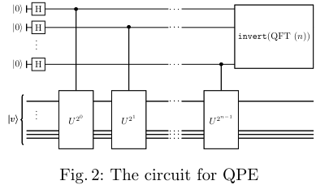

|0 H • . . . |0 H • . . . invert(QFT (n)) ... |0 H . . . • . . . . . . |v ... U 20 U 21 U 2n−1 ... ... ... Fig. 2: The circuit for QPE 

> 4 Given two matrices A (with r rows and c columns) and B, their Kronecker product

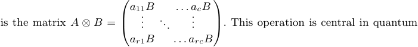

⎛a11B . . . acB ⎞ is the matrix A ⊗ B = ⎜ ⎟ ⎝ar1B . . . arcB⎠. This operation is central in quantum . . . . . . . . . 

information representation. It enjoys a number of useful algebraic properties such as associativity, bilinearity or the equality (A ⊗ B) · (C ⊗ D) = (A · C) ⊗ (B · D), where · denotes matrix multiplication.

An Automated Deductive Verication Framework for Quantum Programs

153

combinators, including: parallel and sequential compositions, circuit inverting, controlling, iteration, ancilla creation, etc. As an example of a quantum circuit, we show in Figure 2 the bird’s-eye view of the circuit for QPE, the (quantum) phase estimation algorithm, a standard primitive in many quantum algorithms. QPE is parametrized by n (a number of wires) and U (a unitary oracle) and is built as follows. First, a register of n qubits is initialized in state |0, while another one is initialized in state |vn. Then comes the circuit itself: a structured sequence of quantum gates, using the unary Hadamard gate H, the circuits U2i (realizing U to the power 2i ) and the reversed Quantum Fourier Transform inverse(QFT (n)) . Sub-circuits U2i and inverse(QFT (n)) are both dened in a similar way.

Here, one should simply note two things: (1) the circuit is made of parallel compositions of Hadamard gates and of sequential compositions of controlled U2i (the controlled operation is depicted with vertical lines and symbol •); (2) the circuit is parametrized by n and by U . This is very common: in general, a quantum algorithm constructs a circuit whose size and shape depend on the parameters of the problem. It describes a family of quantum circuits.

2.3 Reasoning on circuits and the matrix semantics. Quantum circuits essentially describe unitary operators [50] acting on Hilbert spaces. In nite dimension, unitary matrices faithfully represent unitary operators: it has been the original mathematical formalism for circuits – coined here as the matrix semantics. If this representation is well-adapted for representing simple high-level circuit combinators such as the action of control or inversion, it is not well-suited for specifying the behavior of many complex circuits coming from the literature. Because of this cumbersomeness, textbook descriptions of circuits make use of an informal representation: operators are described by their action on a basis vector (see, for example the description of Shor-OF in [50, p. 232]). This is however understood as a shortcut notation for matrices which remains the main medium for reasoning on circuits. Formal approaches to quantum computation [35,34,53,58,68,71,46,69,45] witness this prevalence of matrices as circuit representation.

2.4 Path-sum representation. Path sums [1,2] are a recent symbolic representation. Its strength is to formalize the notation used in quantum algorithm literature (eg, [50]). A unitary operator U is written as U : |x→ PS(x) where x is a bit vector and PS(x) is dened with the syntax of Fig. 3. In the Figure, addition and multiplication over real are denoted rescpectively with + and ·, and x[i] is the ith projection of bit vector x. The term n is an integer index, characterizing the range of the path-sum. Then each term k ∈ 0, 2n  in the path-sum is dened through:

1. the phase polynomial Pk(x) – a real value building complex scalar e2·π·i·Pk(x) ; 2. the basis-ket function φk(x), dening the ket-vector |φk(x) this scalar value applies to.

This representation is closed under functional composition and Kronecker product. For instance, if U is dened as in Fig. 3 and if V sends y to PS (y) dened

154 C. Chareton et al.

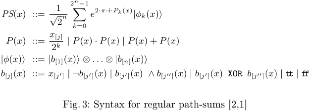

2 n −1 1 PS(x) ::= n  e 2·π·i·Pk(x) |φk(x) √ 2 k=0 P (x) ::= x[j] 2 k | P (x) · P (x) | P (x) + P (x) |φ(x) ::= |b[1](x)⊗ . . . ⊗|b[n](x) b[j](x) ::= x[j] | ¬b[j](x) | b[j](x) ∧ b[j](x) | b[j](x) XOR b[j](x) | tt | ff Fig. 3: Syntax for regular path-sums [2,1] 

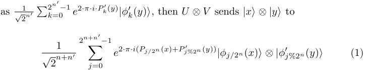

1 as n  2k n =0  −1 e 2·π·i·P  k (y) |φ  k (y), then U ⊗ V sends |x⊗|y to √ 2 2 n+n −1 1 n +n   e 2·π·i(Pj/2n (x)+P  j%2 n (y)) |φj/2n (x)⊗|φ  j%2 n (y) (1) √ 2 j=0 

which is in the form shown in Figure 3. The compositionality of this semantics is used by Amy [2] to prove the equivalence of large circuit instances. Nonetheless, its main limitation stands in the fact that path-sums only address xed-size circuits. Albeit a compositional tool, useful to automate proofs, it cannot be used for proving properties of parametrized circuit-building quantum programs.

This paper proposes an extension of path-sum semantics to address the parametric verication of quantum programs.

## 3 Introducing PPS

In this section, we introduce the main logical apparatus of our framework: parametrized path-sums. We rst present a motivating example and then discuss the construction.

3.1 Motivating example. Let us consider the n-indexed family of circuits consisting of n Hadamard gates, in sequence, as shown in Figure 4. Sequencing two Hadamard gates can easily be shown equivalent to the identity operation. In other word, when fed with |0, if n is even the circuit outputs |0. Albeit small, this circuit family together with its simple spe-

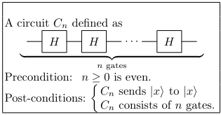

A circuit Cn dened as H H · · · H     n gates Precondition: n ≥ 0 is even. Post-conditions: Cn sends |x to |x  Cn consists of n gates. 

Fig. 4: Motivating Example

cication exemplies the typical framework we aim at in the context of certication of quantum programs.

> – The description of the circuit family is parametrized by a classical parameter (here, the non-negative integer n);

An Automated Deductive Verication Framework for Quantum Programs

155

- The pre-condition imposes both constraints (here, the evenness of n) and soundness conditions (here, the non-negativeness of n) on the parameters;

- The post-condition can both refer to the semantics of the circuit result and to its form and shape (here, its size).

The circuit family presented in Figure 4 will be used in the rest of the paper as a running, toy example for Qbricks. In particular, we show in Example 1 how to code it in our framework and how to express the specication in Example 4. Its parametrized implementation in Qbricks is three lines of code long and its specications takes six lines. It is proved by recurrence over the parameter n, the induction step requiring two calls for lemmas (depending on the evenness of parameter n).

3.2 Parametrizing path-sums. In order to formalize the semantics of the example of Fig. 4, we aim at generalizing path-sums.

Illustration. For a xed n, the circuit Cn implements either the identity <u>1</u> (when n is even), in which case the path-sum is PSId(x) = ~~<u>√</u>~~ 2 ~~0~~ k20 =0−1e2iπ·0|x or the Hadamard gate (when n is odd), in which case the path sum is PSH (x) = <u>1</u> ~~<u>√</u>~~ 2 ~~1~~ 2k1 =0−1e2iπ<u>k</u> 2·x |k A candidate parametric path-sum for the family of circuits {Cn}n from Figure 4 could then be written in factorized form as

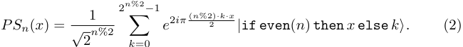

2 n%2 −1 1 PSn(x) = n %2  e 2iπ (n%2 2 )·k·x |if even(n) then x else k. (2) √ 2 k=0 

Generalization. In general, parametrized Path Sums (PPS) are dened over a language of typed terms with possibly free (typed) variables. At the very minimum the language has to be equipped with Boolean values (to handle the values of the ket-vector) and integers (for instance to handle the range). Given such a language, a PPS is a path-sum where the range, the phase polynomial and the basis-ket can in general be explicit, open terms referring to external parameters. Formally, a pps is dened as a function inputting a set of parameters <u>p</u> and outputting:

- a parametrized integer pps_width(h, <u>p</u> ~~)~~ , featuring the number of qubits the target circuit is acting on — its width;

> – another parametrized integer pps_range(h, <u>p</u> ~~)~~ , abbreviated as r(h, <u>p</u> ~~)~~ . It indicates the range of the sum (dened as the set BVr(h,p)ofbitvectorsof length r(h, <u>p</u> ~~)~~ );

> – a basis ket function pps_ket(h, <u>p</u> ~~)~~ , generalizing term φ from Table 3. For any pair (x, y), of a bit vector x of length pps_width(h, <u>p</u> ~~)~~ (standing for an input basis vector) and a bit vector of length r(h, <u>p</u> ~~)~~ , it returns a bit vector of length pps_width(h, <u>p</u> ~~)~~ (standing for an output basis vector);

> – a parametrized angle function pps_angle(h, <u>p</u> ~~)~~ (x, y), generalizing the phase polynomial P from Table 3. For any pair (x, y) such as above, it returns a real value θ.

156 C. Chareton et al.

Then, the behaviour of a parametrized quantum circuit C ~~(p)~~ is described as the i/o function inputting a basis ket |x ~~(p)~~  of length the width of C ~~(p)~~ and outputting the parametrized sum term:

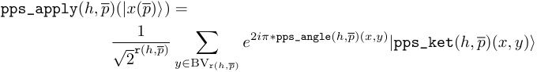

pps_apply(h, p) (|x (p) ) = 1 r (h,p)  e 2iπ∗pps_angle(h, p)(x,y)|pps_ket(h, p) (x, y) √ 2 y∈BVr(h,p) 

For sake of readability, we often ommit the explicit mention of the parameters. For instance, the PPS P induced by (2) is parametrized by the integer n. It is such that for any int n, pps_width(P, n) = 1 and pps_range(P, n) = n%2. Furthermore for any bit vectors x, y of lengths 1 and n%2, pps_ket(P, n)(x, y) is equal to x if n is even and to y otherwise, and pps_angle(P, n)(x, y) = n%2 · x[0] · y[0]. One then gets expression (2) by applying pps_apply(P, ~~p)~~ .

Hence, the term language needed for describing PPS of otherwise sophisticated families of quantum circuits can aord to be minimal: rst-order typed terms equipped with an equational theory are enough. We also nd out that rst-order, predicate logic is suitable for specifying the properties of quantum programs: there is no need for higher-order logic such as the ones of Coq or Isabelle/HOL. This is the key to automation.

## 4 Qbricks-DSL

Qbricks-DSL is the (domain-specic) language of our framework. It is designed as a rst-order, functional language aimed at circuit description. Measurement is out of the scope of the language, and all Qbricks-DSL expressions are terminating. We follow a very simple strategy for circuit building: we use a regular inductive datatype for circuits, where the data constructors are elementary gates, sequential and parallel composition, and ancilla creation. In particular, unlike Quipper [30] or Qwire [53], a quantum circuit is not a function acting on qubits: it is a simple, static object. Nonetheless, as illustrated by our experimentations (Section 8), this does impede neither expressiveness nor parametricity.

Furthermore, even if the language does not feature measurement, it is nonetheless possible to reason on probabilistic outputs of circuits, if we were to measure the result of a circuit. Indeed, this can be expressed in a regular theory of real and complex numbers (See Section 6.5).

4.1 Syntax of Qbricks-DSL. Qbricks-DSL is a small rst-order functional, call-by-value language with a special datatype circ as the medium to build and manipulate circuits. The core of Qbricks-DSL can be presented as the simply-typed calculus presented in Figure 6. The basic data constructors for circ are CNOT, SWAP, ID, the Hadamard superposition gate H, phase shift gate Ph(e) and the parametrized rotation Rz(e). The constructors for high-level circuit operations are sequential composition SEQ, parallel composition PAR and ancilla creation/termination ANC (see Figure 5 for details).

An Automated Deductive Verication Framework for Quantum Programs

157

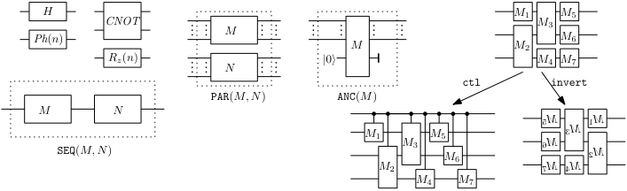

H M 5 CNOT M 1 M3 Ph(n) M M M2 M 6 Rz(n) |0 M 4 M 7 N ctl invert PAR(M, N ) ANC(M ) M N M 1 M 5 M3 SEQ(M, N ) M 6 M2 M 4 M 7 5M 1M 3M 6M 2M 7M 4M 

Fig. 5: Circuit combinators

Expression e ::= x | c | f (e1, . . . , en) | let x1, . . . , xn = e in e | if e1 then e2 else e3 | iter f e1 e2 Data Constructor c ::= <u>n</u> | tt | ff | e1, . . . , en| CNOT | SWAP | ID | H | Ph(e) | Rz(e) | ANC(e) | SEQ(e1, e2) | PAR(e1, e2) Function f ::= fd | fc Declaration d ::= let fd(x1, . . . , xn) = e Type A ::= bool | int | | A1 × · · · × An | circ. Value v ::= x | n | tt | ff | v1, . . . , vn| CNOT | SWAP | ID | H | Ph(n) | Rz(n) | ANC(v) | SEQ(v1, v2) | PAR(v1, v2) Context C[−] ::= [−] | f (v1, . . . vi−1, C[−], ei+1, . . . , en) | let x1, . . . , xn = C[−] in e | if C[−] then e2 else e3 | iter f C[−] e | iter f v C[−] | v1, . . . vi−1, C[−], ei+1, . . . , en| CNOT | ID | H | Ph(C[−]) | Rz(C[−]) | ANC(C[−]) | SEQ(C[−], e) | SEQ(v, C[−]) | PAR(C[−], e) | PAR(v, C[−])

Fig. 6: Syntax for Qbricks-DSL

On top of circ, the type system of Qbricks-DSL features the type of integers int (with constructors n, one for each integer n), the type of Booleans bool (with constructors tt and ff) and the type of n-ary products (with constructor e1, . . . , en). This type system is not meant to be exhaustive and it can be extended with usual constructs such as oats, lists and other user-dened inductive datatypes — its embedding into WhyML makes it easy to use such types. The term constructs are limited to function calls, let-style composition, test with if-then-else and simple iteration: iter f n a stands for f (f (· · · f (a) · · · )), with n calls to f . We again stress that this could easily be extended — we just do not need it.

The language is rst-order: this is reected by the types A of expressions. The type of a function is given by the types of its arguments and the type of its output. The type of a function with inputs of types Ai and output of type B is written A1 × · · · × An → B.

A function f is either a function fd dened with a declaration d or a constant function fc. The functions dened by declarations must not be mutually recursive: this small, restricted language only features iteration. Constant functions consist in integer operators (+, ∗, −, etc), Boolean operators (∧, ∨, ¬, →, etc),

158 C. Chareton et al.

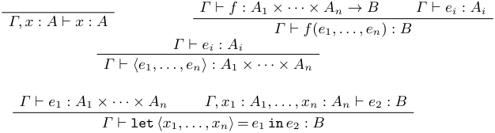

Γ  f : A1 × · · · × An → B Γ  ei : Ai Γ, x : A  x : A Γ  f (e1, . . . , en) : B Γ  ei : Ai Γ e1, . . . , en : A1 × · · · × An Γ  e1 : A1 × · · · × An Γ, x1 : A1, . . . , xn : An  e2 : B Γ  let x1, . . . , xn = e1 in e2 : B 

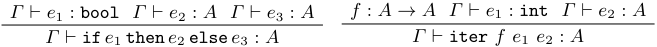

Γ  e1 : bool Γ  e2 : A Γ  e3 : A f : A → A Γ  e1 : int Γ  e2 : A Γ  if e1 then e2 else e3 : A Γ  iter f e1 e2 : A 

Fig. 7: Typing rules for Qbricks-DSL

comparison operators (<, ≤, ≥, > ,=, = : int × int → bool) and high-level circuit operators: ctl, invert : circ → circ for controlling and inverting circuits, and width, size : circ → int for counting the number of input and output wires, and the number of gates (not counting ID nor SWAP) in the circuit C. See Figure 5 for the intuitive denition of circuit combinators.

The typing rules are the usual ones, summarized for convenience in Table 7.

4.2 Operational semantics. As any other regular functional programming language, Qbricks-DSL is equipped with an operational semantics based on beta-reduction and substitution. We dene a notion of value and applicative context as in Fig. 6. We then dene a rewriting strategy as the relation dened with C[e] → C[e ] whenever e → e is one of the rule of Table 8. The table is split into the rules for the language constructs and the rules dening the behavior of the constant functions. We only give a subset of the latter rules. For instance, the arithmetic operations are dened in a canonical manner, and the Boolean and comparison operators are dened in a similar manner on values of type int and bool. The rules for the constant functions acting on circuits are also for the most part straightforward: the size of a sequence is the sum of the sizes of the compounds for instance. The rules which we do not provide are the ones for the control operation ctl: the intuition behind their denition can be found in [13]. For the elementary gates, any denition can be used (see e.g. [50]), as long as it can be written with the chosen set of gates. One just has to adjust the lemmas referring to ctl in Qbricks-Spec. Similarly, the inverse of elementary gates are not given: we can choose the usual ones from the literature —and this denition is then parametrized by the choice of gates.

4.3 Properties. The targeted low-level representation for an expression of type circ is a value made of the circuit data constructors presented in Table 6: a value v of type circ is made out of the grammar SEQ(v1, v2) | ANC(v) | PAR(v1, v2) | CNOT | SWAP | ID | H | Ph(n) | Rz(n). Since recursions are reduced to nite iterations, we can derive the following lemma through a simple inductive reasoning:

An Automated Deductive Verication Framework for Quantum Programs

159

<mark>Language constructs</mark> Assuming that there is a declaration f (x1, . . . , xn)  e. f (v1, . . . , vn) → e[x1 := v1, . . . , xn := vn] let x1, . . . , xn = v1, . . . , vn in e → e[x1 := v1, . . . , xn := vn] if tt then e1 else e2 → e1 if ff then e1 else e2 → e2 when n ≤ 0: iter f <u>n</u> a → a when n > 0: iter <u>f n</u> a → <u>f (iter f n</u> − <u>1</u> a) <mark>Constant functions (subset of the rules)</mark> <u>n</u> + m → <u>n + m</u> width(CNOT) → 2 <u>n</u> − <u>m</u> → <u>n</u> − <u>m</u> width(SWAP) → 2 <u>n</u> ∗ <u>m</u> → <u>n ∗ m</u> width(g) → 1 (g other gate) size(ID) → 0 width(SEQ(v1, v2)) → width(v1) size(SWAP) → 0 width(PAR(v1, v2)) → width(v1) + width(v2) size(g) → 1 (g other gate) width(ANC(v)) → width(v) − 1 size(SEQ(v1, v2)) → size(v1) + size(v2) invert(SEQ(v1, v2)) → SEQ(invert(v2), invert(v1)) size(PAR(v1, v2)) → size(v1) + size(v2) invert(PAR(v1, v2)) → PAR(invert(v1), invert(v2)) size(ANC(v)) → size(v) invert(ANC(v)) → ANC(invert(v)) Table 8: Operational semantics for Qbricks-DSL

Lemma 1 (Safety properties and normalization). Provided that  e : A is a closed expression, and provided that all the functions in e recursively admit (external) denitions, then either e is a value or it reduces. If Γ  e : A and e → e , then Γ  e : A. Finally, the reduction strategy (→) is normalizing: there does not exist an innite reduction sequence e1 → e2 → . . . 

Example 1. The example of Section 3.1 can be written in Qbricks-DSL as

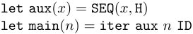

let aux(x) = SEQ(x, H) let main(n) = iter aux n ID 

The function aux inputs a circuit and appends a Hadamard gate at the end. The function main then inputs an integer parameter n and iterates the function aux to obtain n Hadamard in sequence. In particular, one can show that for instance

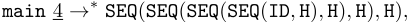

main 4 → ∗ SEQ(SEQ(SEQ(SEQ(ID, H), H), H), H), 

that is, a sequence of 4 Hadamard gates.

4.4 Universality and usability of the chosen circuit constructs. A universal (resp. pseudo-universal ) set of elementary gates is such that they can be composed thanks to sequence or parallelism so as to perform (resp. approach arbitrarily close) any unitary matrix. In Qbricks-DSL, we chose the small pseudouniversal elementary set {CNOT, SWAP, ID, H} ∪<u></u> <u>n∈N</u>{Ph(n <u>), Rz(n), }.</u> Other gates can then be dened as macros on top of them. If one aims at using Qbricks inside a verication compilation tool-chain, these macros can for instance be the gates of the targeted architecture.

160 C. Chareton et al.

- 4.5 Validity of circuits. A circuit is represented as a rigid rectangular shape with a xed number of input and output wires. In particular, there is a notion of validity: a circ object only makes sense provided two constraints:

- in SEQ(C1, C2), the two circuits C1 and C2 should have the same width. For instance, SEQ(CNOT, H) is not valid. This is a simple syntactic constraint;

- in ANC(C), the circuit C should have n + 1 wires. Moreover, if given as input a vector where the last qubit is in state |0, its output should also leave this qubit in state |0. This condition is, on the other hand, a semantic constraint.

Note that even these syntactic constraints cannot be checked by a simple typing procedure, because of the higher-order reasoning involved here: the constraints must hold for any value of the parameters. All these constraints apply on parametrized circuits. They translate into constraints for the parameters of their related PPS and are expressed in our domain-specic logical specication language, Qbricks-Spec. They are meant to be sent as proof obligations to a proof engine.

Example 2. Note how the circuit generated by main in Example 1 is not necessarily a valid circuit (although in this case it is). This is one of the constraints that can be handled by Qbricks-Spec, as shown in Example 4.

4.6 Denotational semantics. As all expressions in Qbricks-DSL are terminating, one can use regular sets as denotational semantics for the language. In order to be able to handle the denitions coming up in Section 5, we include in the denotation of each type an “error” element ⊥ We therefore dene the denotation of basic types as the set of their values: [|bool|] = {tt, ff, ⊥}, [|int|] = Z ∪{⊥} and [|circ|] = {v |  v : circ} ∪{⊥}. Product types are dened as the set-product: [|A1 × · · · × An|] = ([|A1|] × · · · × [|An|]) ∪{⊥} and [||] = {, ⊥}, the singleton set. Finally, functions are dened as set-functions from the input set to the output set. The denotation of the language constructs are the usual one in a semantics based on sets ; for the constant functions, the denitions are the canonical ones: arithmetic operations maps to arithmetic operations for instance. In Qbricks-DSL, everything is well-dened and ⊥ is only attainable from ⊥. For instance, ⊥ + x = ⊥.

Note that in the denotational semantics one can build non-valid circuits. For instance, the circuit SEQ(CNOT, H) is a member of [|circ|]. This is to be expected as we have the following property:

Lemma 2 (Soundness). Provided that  e : A, we have [|e|] ∈ [|A|] \ {⊥}. Moreover, provided that e → e then we have [|e|] = [|e |]. 

It is however possible to formalize the notion of syntactically valid circuits as a subset of [|circ|].

Denition 1. We dene the (syntactic) unary relation Vsyntax on [|circ|] as follows: Each one of the gates belongs to Vsyntax; if C1 and C2 belongs to Vsyntax then so does PAR(C1, C2); if moreover 2 ≤ [|width|](C1) then ANC(C1) belongs to Vsyntax and if [|width|](C1) = [|width|](C2) then SEQ(C1, C2) belongs to Vsyntax.

An Automated Deductive Verication Framework for Quantum Programs 161

## 5 Qbricks-Spec

The language Qbricks-DSL is only aimed at manipulating circuits. The reasoning features of Qbricks —and the PPS introduced in Section 3— are dened in the logic and the specication tools oered within Qbricks-Spec.

5.1 Syntax of Qbricks-Spec. We dene Qbricks-Spec as a rst-order, predicate logic with the following syntax.

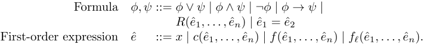

Formula φ, ψ ::= φ ∨ ψ | φ ∧ ψ | ¬φ | φ → ψ | R(ˆe1, . . . , ˆen) | eˆ1 = eˆ2 First-order expression eˆ ::= x | c(ˆe1, . . . , ˆen) | f (ˆe1, . . . , ˆen) | f(ˆe1, . . . , ˆen). 

The rst-order expressions eˆ form a subset of Qbricks-DSL: they are restricted to variables and (formal) function calls to other rst-order expressions. Unlike regular, general expressions —meant to be computational vehicles— these rstorder expressions only aim at being reasoned upon. The function names are then expanded with counterpart logical functions f. Among these new functions, we introduce one function iterf : int × A → A for each function f : A → A, standing for the equational counterpart of the iteration5 . The logic functions are dened equationally in the logic: see Section 6.4 for details. The relation R ranges over a list of constant relations over rst-order expressions. In QbricksSpec, we identify relations and functions of return type bool. A special relation is the equality: we explicitly introduce it in the syntax to emphasize the fact that Qbricks-Spec is meant to deal with equational theories.

The type system of Qbricks-Spec is extended with opaque types, equipped with constant functions and relations to reason upon them. They come with no computational content: the aim is purely to be able to express and prove specication properties of programs. This is why we do not incorporate them in Qbricks-DSL’s type system.

The opaque types we consider in Qbricks-Spec are complex, real, pps, ket and bitvector. The operators and relations for these new types are given in Table 9. Note that in the rest of the paper we will omit the cast operations i_to_r and r_to_c. We will also use a declared exponentiation function [−][−] overloaded with types complex × int → complex and real × int → real. For any integer n and boolean b, constructor bv_cst buildsthe bit vector of length n and constant value b. Other functions for types complex, real and bitvector are standard. Types pps and ket are novel and form the main reasoning vehicle in Qbricks-Spec.

5.2 The types pps and ket. In short, the type pps encodes our parametrized path sum (PPS) representation for expressions of type circ in Qbricks-DSL, while ket encodes the notion of ket-vector. As these types are pure reasoning apparatuses, we only need them in Qbricks-Spec and they are dened uniquely through an equational theory.

> 5 This is required to stay within the grammar of terms of Qbricks-Spec.

162 C. Chareton et al.

|complex and real|pps|
|---|---|
|i, π :complex i_to_r :int→real r_to_c :real→complex Re,Im,abs :complex→real e[] :complex→complex −c,+c,∗c, /c :complex×complex→complex −r,+r,∗r,/r :real×real→real|pps_width :pps→int pps_range :pps→int pps_angle :pps×bitvector×bitvector→real pps_ket :pps×bitvector×bitvector→bitvector pps_apply :pps×ket→ket pps_equiv :pps×pps→bool circ_to_pps :circ→pps|
|~~√~~ −:real→real|ket|
|bitvector|ket_length :ket→int|
|bv_length :bitvector→int bv_cst :int×bool→bitvector bv_get :bitvector×int→bool|ket_get :ket×bitvector→complex bv_to_ket :bitvector→ket +k,−k,⊗k :ket×ket→ket|
|bv_set :bitvector×int×bool→bitvector|∗k :complex×ket→ket|

Table 9: Primary operators for Qbricks-Spec

The type pps is equipped with four opaque accessors: pps_width, pps_width, pps_width, pps_ket and pps_angle acting on pps from Section 3.2 and with the function circ_apply. If path-sums compose nicely, a given linear map does not have a unique representative path-sum (partly due to the fact that phase polynomials are equal modulo 2π). To capture this equivalence, we introduce the constant relation pps_equiv. In order to relate circuits and PPS, we introduce the constant function circ_to_pps: it returns one possible PPS that represents the input circuit. The chosen PPS is built in a constructive manner on the structure of the circuit. A useful relation is (−  −) relating a circuit and a PPS: it is dened as (c h)  pps_equiv(circ_to_pps(c), h). Another useful macro is function circ_apply : circ × ket → ket, dened as

### circ_apply(C, k)  pps_apply(circ_to_pps(C), k)

The type ket is equipped with standard operations for manipulating ketvectors (Table 9). bv_to_ket turns a bit vector into a basis ket-vector ; ket_length returns the number of qubits in the ket ; ket_get returns the amplitude of the corresponding basis ket-vector. The other operations are the usual operations on vectors: addition, subtraction, tensors, scalar multiplication. 5.3 Denotational semantics of the new types. The denotational semantics of real and complex are respectively the sets R ∪{⊥} and C ∪{⊥}, and the denotation of the operators are the canonical ones. As for Section 4.6, ⊥ maps to ⊥, so for instance ⊥ +r x = ⊥. The denotation of bitvector is dened as the set of all bit-vectors, together with the “error” element ⊥. The constant functions are mapped to their natural candidate denition, using ⊥ as the default result when they should not be dened. So for instance, [|bv_cst|](−1, tt) = ⊥. An element of ket is meant to be a ket-vector: we dened [|ket|] as the set of all possible ket-vectors2 i=0nαn|bnm,forallpossiblem, n∈N,αn∈Candbit-vectorsbn of size m, together with the error element ⊥. Finally, pps is dened as the set of formal path-sums, as dened in Section 3.2, together with the error element ⊥. The denotation of the constant functions are dened as discussed in Section 5.2. As an example, [|pps_range|] returns the range of the corresponding PPS. The

An Automated Deductive Verication Framework for Quantum Programs

163

map circ_to_pps builds a valid PPS out of the input circuit, or ⊥ if the circuit is not valid.

The dened PPS follows the structure of the circuit. For instance, as shown in Eq. (1) on Page 154 the PPS circ_to_pps(SEQ(C1, C2)) is the sequential composition of the two PPS circ_to_pps(C1) and circ_to_pps(C2). This kind of compositionality is what helps with automation.

5.4 Regular sequents in Qbricks-Spec. Formulas in Qbricks-Spec are typed objects —and, as mentioned in Section 5.1 one can identify them with rstorder expressions of type bool. Due to this correspondence, we shall only say that logic judgments in Qbricks-Spec are well-formed judgments of the form Δ  φ where the well-formedness means that Δ  φ : bool is a valid typing judgment in Qbricks-DSL. That being said, a well-formed judgment Δ  φ is valid whenever it holds in the denotational semantics: for every instantiation σ sending x : A in Δ to [|A|], the denotation [|φ|]σ is valid. In particular, the (free) variables of φ can be regarded as universally quantied by the context Δ.

5.5 Parametricity of PPS. A regular path-sum is not parametric: it represents one xed functional. So why did we chose [|pps|] to be a set of path-sums? Let us consider an example.

Example 3. Consider the motivating example of Section 3.1 and its instantiation in Example 1 on page 159. The function main describes a family of circuits indexed by an integer parameter n. Now, consider the typing judgment

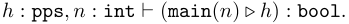

h : pps, n : int  (main(n) h) : bool. 

It can be regarded as a relation between PPS h and integers n, valid whenever h represents main(n). Technically, this relation is not quite the graph of a function (since several PPS might match the circuit main(n)).

5.6 Standard matrix semantics and correctness of PPS semantics. Similarly to the type pps, Qbricks is endowed with a (logical) type matrix to handle the matrix interpretation of circuits, together with various functions and relations to reason on it. In particular, Qbricks features a function mat_get : matrix × int × int → complex, formalizing the access to a matrix element, and a function circ_to_mat : circ → matrix realizing the matrix corresponding to a circuit. We then formally show, within our framework (proven in Why3), that for any valid circuit C and ket k of length width(C), applying circ_to_pps(C) on k is equivalent to multiplying it by circ_to_mat(C):

### Theorem 1 (Soundness of PPS wrt matrix semantics).

- C : circ, k : ket  ket_length(k) = width(C) ∧ valid(C) → apply_mat(circ_to_mat C, k) = pps_apply(circ_to_pps C, k)

164 C. Chareton et al.

## 6 Reasoning on Quantum Programs

Thanks to the logic presented in Section 5.4, it is possible to write QbricksSpec formulas and to express properties of terms of the restricted syntax of Section 5.1. Provided that the regular sequents are simple enough, these can automatically be handled with the use of SMT solvers.

In this section, we dene a specic Hoare logic, Hybrid Hoare Logic (HQHL), to express pre-and post-conditions for arbitrary Qbricks-DSL terms. We then discuss the validity of such judgments and explain how to decompose them into elementary, regular sequents (proof obligations). The claim —backed up by our experiments in Section 8— is that the obtained sequents are in practice simple enough to be dealt with automatically.

We do not present all HQHL rules here, but simply aim to give an intuition of how and why one can rely on an automated deductive system to derive QbricksSpec judgments. The complete set of HQHL rules is presented in [13].

6.1 HQHL judgments. In order to be able to express program specications with pre-and post-conditions, we introduce Hybrid Quantum Hoare Logic (HQHL) sequents of the form Δ  {φ}e{ψ} : A (we omit the type A when irrelevant or clear). The formula ψ can make use of a reserved free variable result of type A. Such a sequent is then well-formed provided that Δ  φ : bool, Δ, result : A  ψ : bool and Δ  e : A are valid typing judgments. Note how the reserved free variable result is being added to Δ for typing ψ. For convenience, as syntactic sugar we allow indexed variables resulti to stand for the ith projection of a tuple.

The validity of an HQHL sequent can be dened semantically, similarly to what was done in Section 5.4: Δ  {φ}e{ψ} : A is valid whenever it is both well-formed and when for every instantiation σ sending x : A in Δ to [|A|] and sending result to [|e|], the denotation [|φ → ψ|]σ is valid.

In the following sections, we describe the deduction rules that we rely on in Qbricks. They are designed to be used in a bottom-up strategy to break down judgments into pieces reasoning on smaller terms. Along the way, there is the need for introducing invariants and assertions. As usual, some of these assertions can be derived by computing the weakest-preconditions: we do not necessarily have to introduce every single one. When attaining a term of the restricted grammar of Qbricks-Spec that cannot be further decomposed, one can rely on the rule

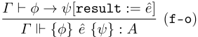

Γ  φ → ψ[result := eˆ] (f-o) Γ  {φ} eˆ {ψ} : A 

to generate a proof obligation as a regular sequent in Qbricks-Spec.

6.2 Deduction rules for term constructs. Figure 10 presents the deduction rules for the term constructs of Qbricks-DSL carrying a computational content: iteration, tests, function evaluation, etc. We also present a standard weakening rule (weaken) and an example of rule for rewriting: The deduction rule (eq) states that whenever two expressions are equal one can substitute one

An Automated Deductive Verication Framework for Quantum Programs 165

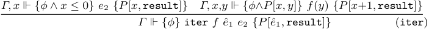

Γ, x  {φ ∧ x ≤ 0} e2 {P [x, result]} Γ, x,y  {φ∧P [x, y]} f (y) {P [x+1, result]} Γ  {φ} iter f eˆ1 e2 {P [ˆe1, result]} (iter) 

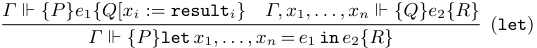

Γ  {P }e1{Q[xi := resulti} Γ, x1, . . . , xn  {Q}e2{R} (let) Γ  {P }let x1, . . . , xn = e1 in e2{R} 

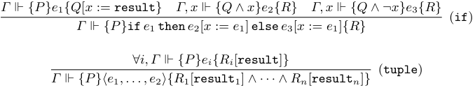

Γ  {P }e1{Q[x := result} Γ, x  {Q ∧ x}e2{R} Γ, x  {Q ∧¬x}e3{R} (if) Γ  {P }if e1 then e2[x := e1] else e3[x := e1]{R} ∀i, Γ  {P }ei{Ri[result]} Γ  {P }e1, . . . , e2{R1[result1] ∧· · · ∧ Rn[resultn]} (tuple) 

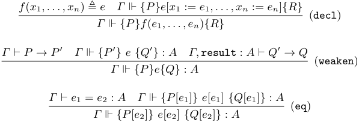

f (x1, . . . , xn)  e Γ  {P }e[x1 := e1, . . . , xn := en]{R} (decl) Γ  {P }f (e1, . . . , en){R} Γ  P → P  Γ  {P  } e {Q  } : A Γ, result : A  Q  → Q (weaken) Γ  {P }e{Q} : A Γ  e1 = e2 : A Γ  {P [e1]} e[e1] {Q[e1]} : A (eq) Γ  {P [e2]} e[e2] {Q[e2]} : A 

Fig. 10: Deduction rules for Qbricks: HQHL rules for term constructs

for the other inside a HQHL judgment. Finally, we can derive from the semantics the usual substitution rules. For instance, provided that Γ, x : A  ψ and Γ  eˆ : A then Γ  ψ[x := eˆ]. Note that in the rules, the rst-order expressions of the form eˆ are from the restricted grammar of terms of Qbricks-Spec.

6.3 Deduction rules for pps. The main tools to relate circuits and PPS are the constant function circ_to_pps, its relational counterpart (−  −), and the declared function circ_apply. They can be specied inductively on the structure of the input circuit. The complete set of rules for circ_to_pps and (−  −) can be found in [13].

Compositionality of SEQ. For instance, one can derive the deduction rules for circ_apply applied to SEQ from Table 11. These rules can be used in a bottom-up manner to derive composable, elementary properties of circuits out of sub-circuits. In the table, we abbreviate pps_acc(circ_to_pps(−)) with Cacc, for acc ∈{width, range, ket,angle} and, given two bit vectors x and y, x · y denotes their concatenation.

Example of deduction rule for HAD. Using the notations from above, we dene the following axiom for function circ_to_pps applied to the gate HAD:

166 C. Chareton et al.

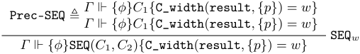

Prec-SEQ  Γ  {φ}C1{C_width(result, {p}) = w} Γ  {φ}C1{C_width(result, {p}) = w} SEQw Γ  {φ}SEQ(C1, C2){C_width(result, {p}) = w} 

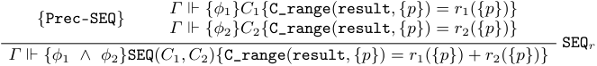

Γ  {φ1}C1{C_range(result, {p}) = r1({p})} {Prec-SEQ} Γ  {φ2}C2{C_range(result, {p}) = r2({p})} SEQr Γ  {φ1 ∧ φ2}SEQ(C1, C2){C_range(result, {p}) = r1({p}) + r2({p})} 

Γ  {φ1}C1{C_angle(result, {p})(x, y1) = a1({p}, x, y1)} Γ  {φ1}C1{C_ket(result, {p})(x, y1) = k1({p}, x, y1)} {Prec-SEQ} Γ  {φ2}C2{C_angle(result, {p})(k1({p}, x, y1), y2) = a2({p}, x, y1, y2)}

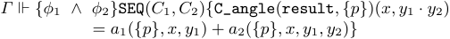

Γ  {φ1 ∧ φ2}SEQ(C1, C2){C_angle(result, {p})(x, y1 · y2) = a1({p}, x, y1) + a2({p}, x, y1, y2)} 

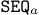

SEQa 

Γ  {φ1}C1{C_ket(result, {p})(x, y1) = k1({p}, x, y1)} {Prec-SEQ} Γ  {φ2}C2{C_ket(result, {p})(k1({p}, x, y1), y2) = k2({p}, x, y1 · y2)}

Γ  {φ1 ∧ φ2}SEQ(C1, C2){C_ket(result, {p})(x, y1 · y2) = k2({p}, x, y1 · y2)

SEQk

Fig. 11: Deduction rules for circ_apply on sequence of circuits

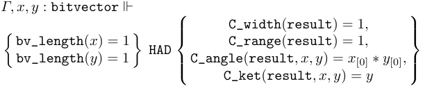

Γ, x, y : bitvector  bv_length(x) = 1 ⎧⎪⎪ C_rangeC_width((resultresult) = 1) = 1,, ⎫⎪⎪ HAD  bv_length(y) = 1  ⎨⎪⎪⎩ C_angleC_ket(result(result, x, y, x, y) =) = x[0] y ∗ y[0], ⎬⎪⎪⎭ 

Example 4. Consider the motivating example of Section 3.1 and its instantiation in Example 1. We can now give a specication to the function main, as follows:

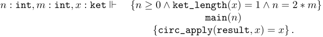

n : int, m : int, x : ket  {n ≥ 0 ∧ ket_length(x) = 1 ∧ n = 2 ∗ m} main(n) {circ_apply(result, x) = x} . 

The fact that circ_apply is well-dened implies that C is valid.

6.4 Equational reasoning. The SMT solvers we aim at using to discharge proof obligations require equational theories describing how to reason on the constant functions that were introduced. Some of these equational theories, such as bit-vectors and algebraic elds, are standard and well-known in verication. Together with a few properties on square-root, exponentiation, real and imaginary parts, the latter is all we need for real and complex: in quantum computation,

An Automated Deductive Verication Framework for Quantum Programs 167

the manipulations of real and complex numbers turn out to be quite limited – we do not need anything related to real or complex analysis.

The main diculty in the design of Qbricks has been to lay out equational theories and lemmas for circ, pps and ket that can eciently help in automatically discharging proof obligations. Many of these equations and lemmas are quite straightforward. For instance, we turn the rewriting rules of Table 8 into equations, such as (x, y : circ)  width(PAR(x, y)) = width(x) + width(y), or a : A, n : int  iterf (a, n + 1) = f (iterf (a, n)). These equations maps the (syntactic) computational behavior of expressions into the logic.

Other equations express purely semantic properties. For instance,

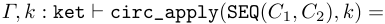

Γ, k : ket  circ_apply(SEQ(C1, C2), k) = 

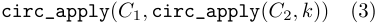

circ_apply(C1, circ_apply(C2, k)) (3) 

(together with a few hypotheses ensuring correct widths) can be derived from Table 11 and is part of the equational theory.

6.5 Additional deductive rules. Qbricks provides additional reasoning rules, that we do not have space enough to detail here. Upon them are:

Circuit complexity. Certifying the complexity of quantum implementations (e.g., polynomial number of gates in the size of the input) is of primary importance as in mid-term, implementations will have to deal with limited hardware capacities, hence the need for tight circuit constructions. We stress that, while raised by several programming [30] or compilation works [48], this aspect of certication is not addressed by existing formal verication approaches [35,45,1].

Probabilities. The probability of obtaining a result by a measurement is correlated with the amplitudes of the corresponding ket-basis vectors in the quantum state of the memory. In Qbricks-Spec we dene proba_partial_measure : circ × ket × bitvector → real meaning that when the input circuit is applied to the input ket, if we were to measure the result the probability of obtaining the given vector would be the result of the function.

Wire identication. In some situation, to add a gate in a circuit it is easier to give the number (identier) of the wire on which the gate applies (such as “apply HAD on wire n”) instead of sequencing the circuit with Id⊗n−1 ⊗ HAD. This is for instance the design chosen in QASM or SQIR [35].

In Qbricks it is possible to dene such a macro with the use of a derived constructor PLACE(C, k, n). For any circuit C and any integers k, n, if 0 ≤ k ≤ n−width(C), PLACE(C, k, n) applies C on wires k to k+width(C)−1. It is dened as ID⊗k ⊗ C ⊗ ID⊗n−k−C_width(C) , where for any 0 < i, IDi  iter par-ID (i − 1) ID and par-ID(C)  PAR(C, ID). Similarly, Qbricks also provides constructor CONT(C, c, k, n) with additional index c in 0, n and not in k, k + width(c). Using adequate qubit permutation, through combinations of PLACE and SWAP, it applies PLACE(C, k, n) with control c.

168 C. Chareton et al.

## 7 Implementation

The framework described so far is implemented as a DSL embedded inside the Why3 deductive verication platform [9,25], written in the WhyML programming language. This allows us to benet from several strengths of Why3, such as ecient code extraction toward Ocaml, generation of proof obligations (to implement the HQHL mechanism) and access to several proof means: SMT solvers, interactive proof commands or export to proof assistants (Coq, Isabelle/HOL) —although we do not use this latter option in our case-studies.

The development itself counts 17,000+ lines of code, including 400+ denitions and 1700+ lemmas, all proved within Why3. Most of the development concerns the (veried) mathematical libraries. They cover the mathematical structures at stake in quantum computing (complex numbers, Kronecker product, bit-vectors, etc.), together with a formally veried collection of mathematical results. Only two theorems are assumed (for any real x: if 0 ≤ x ≤ 1 then sin(πx) ≤ πx, and x ≤ sin(π<u>x</u> 2)).Provingthemrequiresfunctionderivation material, not available in Why3 so far. Hence we chose to assume these standard results.

## 8 Case studies and experimental evaluation

We develop and prove parametric implementations of Grover’s search, the Quantum Fourier Transform (QFT), the Quantum Phase Estimation (QPE) and the rst ever veried implementation of the quantum part of Shor’s algorithm (ShorOF). We also implemented Deutsch-Jozsa (DJ) for comparison.

8.1 Examples of formal specications. Let us rst introduce some of the formal specications we proved. The specication for QPE [41,16] is shown in Figure 12(a). The procedure inputs a unitary operator U and an eigenvector |v of U and nds the ghost ([26]) eigenvalue e2πiΦv associated with |v. The specication for Shor-OF [61] is shown in Figure 12(b). We developed a certied concrete implementation following the implementation proposed in [5] —a reference in term of complexity.6 The specication for Grover [31] is shown in Figure 12(c). Given a predicate with k true value in 0, 2n , Grover’s algorithm outputs one of these true values with good probability.

Each of these specications makes use of specic functions that we do not have the space to detail here (see [13] for details). We however want to note two things. First, these specications describe results of measurement (with the dedicated functions proba_partial_measure_x). As discussed in Section 6.5, if Qbricks-DSL is not able to handle measurement we are still able with Qbricks-Spec to reason on the result of a measurement, as this is a simple function over complex amplitudes. Another thing to note is that, for Shor-OF and Grover, our specication discuss the polynomial size of the produced circuit.

> 6 A further renement is possible [5], using a hybrid version of the Quantum Fourier Transform, but it would require adding eective measure operation and classical control to Qbricks.

An Automated Deductive Verication Framework for Quantum Programs

169

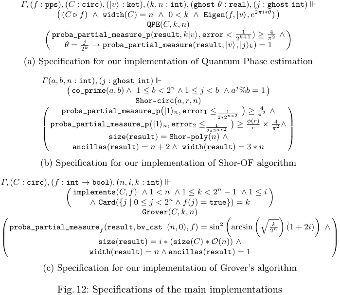

Γ, (f : pps), (C : circ), (|v : ket), (k, n : int), (ghost θ : real), (j : ghost int)   (C f ) ∧ width(C) = n ∧ 0 < k ∧ Eigen(f, |v, e 2πi∗θ )  QPE(C, k, n) 2 k 1 +1 ) ≥ π4 2 ∧  proba_partial_measure_pθ = 2j k → proba_partial_measure (result, k|v (  result , error ,  <  |v, |jk) = 1  (a) Specication for our implementation of Quantum Phase estimation Γ (a, b, n : int), (j : ghost int)   co_prime(a, b) ∧ 1 ≤ b < 2 n ∧ 1 ≤ j < b ∧ a j %b = 1  Shor-circ(a, r, n) 4 proba_partial_measure_p|1n, error1 ≤ 2∗21 n∗2  ≥ π 2 ∧ ⎛⎜⎜ proba_partial_measure_p|1n, error2 ≤ 2∗21 n∗2  ≥ φ( r r) × π4 2 ∧ ⎞⎟⎟ ⎜ size(result) = Shor-poly(n) ∧ ⎟ ⎝ ancillas(result) = n + 2 ∧ width(result) = 3 ∗ n ⎠ (b) Specication for our implementation of Shor-OF algorithm Γ, (C : circ), (f : int → bool), (n, i, k : int)   implements∧ Card(({C, fj | 0)  ≤∧ 1j < n< 2 n ∧∧ 1f ≤(j) =k < true 2n −}) =1 ∧ k1 ≤ i  Grover(C, k, n) ⎛ proba_partial_measuref (result, bv_cst (n, 0), f ) = sin 2 arcsin 2k n ˙(1 + 2i) ∧ ⎞ ⎜      ⎟ ⎜ size(result) = i ∗ (size(C) ∗O(n)) ∧ ⎟ ⎝ width(result) = n ∧ ancillas(result) = 1 ⎠ (c) Specication for our implementation of Grover’s algorithm Fig. 12: Specications of the main implementations 

8.2 Experimental evaluation. Dierent metrics about our formal developments are reported in Table 137 : lines of decorated code, number of lemmas, proof obligations (PO), automatically proven PO (within time limit 5 seconds) and their percentage among POs, interactive commands we entered to discharge them and time required for the automatic verication of these proofs.

Note that metrics for each implementation strictly concern the code that is proper to it (eg., QPE contains calls to QFT but QPE line in Table 13 does not include the QFT implementation. The whole Shor-OF development is reported in the “Shor-OF full”.

Result. Qbricks did allow us to implement and verify in a parametric manner the Shor-OF, QPE and Grover algorithms, at a rather smooth cost and with high proof automation (95% on average, 95% for full Shor-OF).

- 8.3 Prior verication eorts. Before comparing our approach to prior attempts (Table 14), we rst introduce these cases.

> 7 Experiments were run on Linux, on a PC equipped with an Intel(R) Core(TM) i7-7820HQ 2.90GHz and 15 GB RAM. We used Why3 version 1.2.0 with solvers Alt-Ergo-2.2.0, CVC 3-2.4.1, CVC4-1.0, Z3-4.4.1.

170 C. Chareton et al.

||#LoC +|#Extr.|#Def.|#Lem.|#POs|Autom|ation|#Cmd|Verif.|
|---|---|---|---|---|---|---|---|---|---|
||Spec|||||# Aut.|% Aut.||time|
|DJ|57|11|2|1|72|61|>84%|39|1m19s|
|Grover|193|39|6|8|505|479|>94%|125|4m43s|
|QFT|65|18|3|0|62|53|>85%|37|1m11s|
|QPE|175|24|3|8|282|262|>92%|94|4m35s|
|Shor-OF|923|132|28|14|2473|2386|>96%|421|<18m|
|Shor-OF (full)|1163|174|34|22|2817|2701|>95%|552|<23m|
|Total|1423|224|42|31|3394|3241|>95%|716|<29m|

#LoC + Spec.: lines of decorated code — # Extr.: lines of extracted code (OCaml)

#Aut.: automatically proven POs — #Cmd: interactive commands #Verif. time: automated proof verication time

Table 13: Implementation & verication for case studies with Qbricks

Regular path-sums. [2,1] uses path sums for the verication of several circuits of complexity similar to that of QFT (QFT, Hidden shift, generalized Tooli, etc). Yet, these experiments consider xed circuits (up to 100 qubits) and the technique cannot be applied to parametric families of circuits or circuit-building languages.

QHL. Liu et al. [45] report about the parametric verication of Grover search algorithm, on a restricted case8 and in the high-level algorithm description formalism of QHL – especially QHL has no notion of circuit. So for instance one cannot reason upon the size of a circuit within QHL.

SQIR. Finally, Hietala et al. [35] have presented a parametric (circuit-building) implementation of the Deutsch-Jozsa algorithm in Coq, with two independent full correctness proofs. Recently (Oct. 2020), the authors also presented parametrized versions of QFT, QPE and Grover algorithms [34].

8.4 Evaluation: benets of PPS and Qbricks. So as to evaluate the proof eort gain of using pps instead of matrices, Table 14 shows some comparison between our case studies implementations and equivalent proved implementations from the literature: the Grover algorithm implementation from [45] in Isabelle/HOL and the implementations [35,34] using SQIR and Coq. As supplementary comparison terms, we implemented Qbricks versions of both QFT and Deutsch-Jozsa using exclusively matrices.

For example the Qbricks implementation of QFT with pps is 18 lines long, with 47 lines of specications and intermediary lemmas, and its proof required 37 additional interactive commands, hence Spec + Cmd = 84. In comparison, the corresponding SQIR development uses 287 interactive commands (7.7x more).

Conclusion. Relying on PPS semantics and rst-order logic instead of matrices and higher-order logics strongly eases the proof eort. In term of command

> 8 The case in [45, p. 232] concerns cases where the number k of seeked values is equal to 2j for a given integer j.

171

An Automated Deductive Verication Framework for Quantum Programs

||||Qbricks p|ps|||Qbricks Ma|trix|
|---|---|---|---|---|---|---|---|---|
||LoC|Spec|Cmd|Spec+Cmd|LoC|Spec|Cmd|Spec+Cmd|
|DJ|11|46|39|85|11|129|131(>3.3x)|260(>3x)|
|QFT|18|47|37|84|18|172|106(>2.8x)|278 (>3.3x)|
|Grover|39|154|125|279|||||
|QPE|23|152|94|246|||||
||LoC|Spec|SQIR Cmd|Spec+Cmd|LoC|Spec|QHL Cmd|Spec+Cmd|
|DJ|10|39|222(>5.6x)|261(>3x)|||||
|QFT|10|44|287(>7.7x)|331(>3.9x)|||||
|Grover|15|121|805(>6.4x)|926(>3.3x)|90|1263|1712(>13.6x)|2975 (>10.6x)|
|QPE|40|86|726(>7.7x)|812(>3.3x)|||||

#LoC.: lines of code – # Spec.: lines of spec. and lemmas – #Cmd: proof commands

Table 14: Compared implementations of case studies, using matrices and pps

lines, proofs are consistently at least 5.6x shorter than non Qbricks examples, up to 13.6x for the case of Grover in QHL and 7.7x for QPE and QFT in SQIR.9

## 9 Related works

Formal verication of quantum circuits. Prior eorts regarding quantum circuit verication [27,45,70,53,56,1,2,35,34] have been described throughout the paper, especially in Sections 1, 3.1 and 8. Our technique is more automated than those based on interactive proving [35,34,45], borrows and extends the path sum representation [2] to the parametric case, and do consider a circuit-building language rather than a high-level algorithm description language [45].

Quantum Languages and Deductive Verication. Liu et al. [45] introduce Quantum Hoare Logic for high-level description of quantum algorithms. QHL and our own HQHL are dierent, as the underlying formalisms have dierent focus. While QHL deals with measurement and classical control, it does not allow reasoning on the structure of the circuit. On the other hand, Qbricks does not handle classical control, but it brings better proof automation and deduction rules for reasoning on circuits. Combining the two approaches is an exciting research direction.

Veried Circuit Optimizations. Formal methods and other program analysis techniques are also used in quantum compilation for verifying circuit optimization techniques [52,6,32,3,62,57,35]. Epecially, the ZX-calculus [17] represents

> 9 The dierence with SQIR in the column “Spec+Cmd” is less stringent. By the way, it turns out that SQIR syntax for specications is often more succint, as eg, Qbricks writes each precondition in a separated line, where Coq writes the same as a singleline conjunction.

172 C. Chareton et al.

quantum circuits by diagrams amenable to automatic simplication through dedicated rewriting rules. This framework leads to a graphical proof assistant [40] geared at certifying the semantic equivalence between circuit diagrams, with application to circuit equivalence checking and certied circuit compilation and optimization [21,20,39]. Yet, formal tools based on ZX-calculus are restricted to xed circuits, and parametrized approaches are so far limited to pen-and-paper proofs [12].

Other quantum applications of formal methods. Huang et al. [36,37] proposes a “runtime-monitoring like” verication method for quantum circuits, with an annotation language restricted to structural properties of interest (e.g., superposition or entanglement). Similarly, [44] describes a projection based assertion language for quantum programs. Verication of these assertions is led by statistical testing instead of formal proofs. The recent Silq language [8] also represents an advance in the way toward automation in quantum programming. It automatizes uncomputation operations, enabling the programmer to abstract from low level implementation details. Also specialized type systems for quantum programming languages, based on linear logic [60,59,43] and dependent types [51,53], have been developed to tackle the non-duplicability of qubits and structural circuit constraints. Finally, formal methods are also at stake for the verication of quantum cryptography protocols [49,29,11,47,19].

## 10 Conclusion

We address the problem of automating correctness proofs of quantum programs. While relying on the general framework of deductive verication, we nely tune our domain-specic circuit-building language Qbricks-DSL together with its new logical specication language Qbricks-Spec in order to keep correctness reasoning over relevant quantum programs within rst-order theory. Also, we introduce and intensively build upon parametrized path sums (PPS), a symbolic representation for quantum circuits represented as functions transforming quantum data registers. We develop veried parametric implementations of the Shor-OF algorithm (rst veried implementation) and other famous non-trivial quantum algorithms (including QPE and Grover search), showing signicant improvement over prior attempts – when available.

Acknowledgments. This work was supported in part by the French National Research Agency (ANR) under the research project SoftQPRO ANR17-CE250009-02, and by the DGE of the French Ministry of Industry under the research project PIA-GDN/QuantEx P163746-484124.

An Automated Deductive Verication Framework for Quantum Programs

173

## References

1. M. Amy. Formal Methods in Quantum Circuit Design. PhD thesis, University of Waterloo, Ontario, Canada, 2019.

2. M. Amy. Towards large-scale functional verication of universal quantum circuits. In P. Selinger and G. Chiribella, editors, Proceedings 15th International Conference on Quantum Physics and Logic, QPL 2018, volume 287 of Electronic Proceedings in Theoretical Computer Science, pages 1–21, Halifax, Canada, 2019. EPTCS.

3. M. Amy, M. Roetteler, and K. M. Svore. Veried compilation of space-ecient reversible circuits. In R. Majumdar and V. Kuncak, editors, Proceedings of the 29th International Conference on Computer Aided Verication (CAV 2017), Part II, volume 10427 of Lecture Notes in Computer Science, pages 3–21, Heidelberg, Germany, 2017. Springer.

4. F. Arute, K. Arya, R. Babbush, D. Bacon, J. C. Bardin, R. Barends, R. Biswas, S. Boixo, F. G. S. L. Brandao, D. A. Buell, et al. Quantum supremacy using a programmable superconducting processor. Nature, 574(7779):505–510, 2019.

5. S. Beauregard. Circuit for shor’s algorithm using 2n+ 3 qubits. arXiv preprint quant-ph/0205095, 2002.

6. D. Bhattacharjee, M. Soeken, S. Dutta, A. Chattopadhyay, and G. D. Micheli. Reversible pebble games for reducing qubits in hierarchical quantum circuit synthesis. In Proceedings of the 49th IEEE International Symposium on Multiple-Valued Logic (ISMVL 2019), pages 102–107, Fredericton, NB, Canada, 2019. IEEE.

7. J. Biamonte, P. Wittek, N. Pancotti, P. Rebentrost, N. Wiebe, and S. Lloyd. Quantum machine learning. Nature, 549(7671):195, 2017.

8. B. Bichsel, M. Baader, T. Gehr, and M. T. Vechev. Silq: a high-level quantum language with safe uncomputation and intuitive semantics. In A. F. Donaldson and E. Torlak, editors, Proceedings of the 41st ACM SIGPLAN International Conference on Programming Language Design and Implementation, PLDI 2020, London, UK, June 15-20, 2020, pages 286–300. ACM, 2020.

9. F. Bobot, J.-C. Filliâtre, C. Marché, and A. Paskevich. Why3: Shepherd Your Herd of Provers. In Proceedings of Boogie 2011: First International Workshop on Intermediate Verication Languages, Wroclaw, Poland, 53–64, 2011. Available online as hal-00790310.

10. J. Boender, F. Kammüller, and R. Nagarajan. Formalization of quantum protocols using coq. In C. Heunen, P. Selinger, and J. Vicary, editors, Proceedings of the 12th International Workshop on Quantum Physics and Logic (QPL 2015), volume 195 of Electronic Proceedings in Theoretical Computer Science, pages 71–83, Oxford, UK, 2015. EPTCS.

11. A. Broadbent. How to verify a quantum computation. Theory of Computing, 14(1):1–37, 2018.

12. T. Carette, D. Horsman, and S. Perdrix. SZX-calculus: Scalable graphical quantum reasoning. In P. Rossmanith, P. Heggernes, and J. Katoen, editors, 44th International Symposium on Mathematical Foundations of Computer Science, MFCS 2019, August 26-30, 2019, Aachen, Germany, volume 138 of LIPIcs, pages 55:1–55:15. Schloss Dagstuhl - Leibniz-Zentrum für Informatik, 2019.

13. C. Chareton, S. Bardin, F. Bobot, V. Perrelle, and B. Valiron. Toward certied quantum programming. arXiv preprint arXiv:2003.05841, 2020.

14. I. L. Chuang, N. Gershenfeld, and M. Kubinec. Experimental implementation of fast quantum searching. Physical review letters, 80(15):3408, 1998.

174 C. Chareton et al.

15. E. M. Clarke and J. M. Wing. Formal methods: State of the art and future directions. ACM Computing Surveys (CSUR), 28(4):626–643, 1996.

16. R. Cleve, A. Ekert, C. Macchiavello, and M. Mosca. Quantum algorithms revisited. Proceedings of the Royal Society of London. Series A: Mathematical, Physical and Engineering Sciences, 454(1969):339–354, 1998.

17. B. Coecke and A. Kissinger. Picturing quantum processes. Cambridge University Press, Cambridge, United Kingdom, 2017.

18. D. Coppersmith. An approximate fourier transform useful in quantum factoring. arXiv preprint quant-ph/0201067, 1994.

19. T. A. Davidson. Formal verication techniques using quantum process calculus. PhD thesis, University of Warwick, 2012.

20. N. de Beaudrap, R. Duncan, D. Horsman, and S. Perdrix. Pauli fusion: a computational model to realise quantum transformations from ZX terms. Available online as arXiv:1904.12817, 2019.

21. A. Fagan and R. Duncan. Optimising Cliord circuits with Quantomatic. In P. Selinger and G. Chiribella, editors, Proceedings of the 15th International Conference on Quantum Physics and Logic (QPL 2018), volume 287 of Electronic Notes In Theoretical Computer Science, pages 85–105, Halifax, Canada, 2018. EPTCS.

22. E. Farhi, J. Goldstone, and S. Gutmann. A quantum approximate optimization algorithm. Available online as arXiv:1411.4028, 2014.

23. E. Farhi, J. Goldstone, S. Gutmann, J. Lapan, A. Lundgren, and D. Preda. A quantum adiabatic evolution algorithm applied to random instances of an npcomplete problem. Science, 292(5516):472–475, 2001.

24. J. Filliâtre and C. Marché. The Why/Krakatoa/Caduceus platform for deductive program verication. In W. Damm and H. Hermanns, editors, Proceedings of the 19th International Conference on Computer Aided Verication (CAV 2007), volume 4590 of Lecture Notes in Computer Science, pages 173–177, Berlin, Germany, 2007. Springer.

25. J. Filliâtre and A. Paskevich. Why3 - where programs meet provers. In M. Felleisen and P. Gardner, editors, Proceedings of the 22nd European Symposium on Programming Languages and Systems (ESOP 2013), Held as Part of the European Joint Conferences on Theory and Practice of Software (ETAPS 2013), volume 7792 of Lecture Notes in Computer Science, pages 125–128, Rome, Italy, 2013. Springer.

26. J.-C. Filliâtre, L. Gondelman, and A. Paskevich. The spirit of ghost code. Formal Methods in System Design, 48(3):152–174, 2016.

27. S. J. Gay, R. Nagarajan, and N. Papanikolaou. QMC: a model checker for quantum systems. In A. Gupta and S. Malik, editors, Proceeding of the 20th International Conference on Computer Aided Verication (CAV 2008), volume 5123 of Lecture Notes in Computer Science, pages 543–547, Princeton, NJ, USA, 2008. Springer.

28. I. M. Georgescu, S. Ashhab, and F. Nori. Quantum simulation. Reviews of Modern Physics, 86(1):153, 2014.

29. A. Gheorghiu, T. Kapourniotis, and E. Kashe. Verication of quantum computation: An overview of existing approaches. Theory of Computing Systems, 63(4):715– 808, 2019.

30. A. S. Green, P. L. Lumsdaine, N. J. Ross, P. Selinger, and B. Valiron. Quipper: A scalable quantum programming language. In H.-J. Boehm and C. Flanagan, editors, Proceedings of the ACM SIGPLAN Conference on Programming Language Design and Implementation, (PLDI’13), pages 333–342, Seattle, WA, USA, 2013. ACM.

An Automated Deductive Verication Framework for Quantum Programs 175

31. L. K. Grover. A fast quantum mechanical algorithm for database search. In G. L. Miller, editor, Proceedings of the Twenty-Eighth Annual ACM Symposium on the Theory of Computing (STOC), pages 212–219, Philadelphia, Pennsylvania, USA, 1996. ACM.

32. W. Haaswijk, M. Soeken, A. Mishchenko, and G. De Micheli. SAT-based exact synthesis: Encodings, topology families, and parallelism. To apprear in IEEE Transactions on Computer-Aided Design of Integrated Circuits and Systems, https://doi,org/10.1109/TCAD.2019.2897703, 2019.

33. A. W. Harrow, A. Hassidim, and S. Lloyd. Quantum algorithm for linear systems of equations. Physical Review Letters, 103:150502, Oct 2009.

34. K. Hietala, R. Rand, S.-H. Hung, L. Li, and M. Hicks. Proving quantum programs correct. arXiv preprint arXiv:2010.01240, 2020.

35. K. Hietala, R. Rand, S.-H. Hung, X. Wu, and M. Hicks. A veried optimizer for quantum circuits. Proceedings of the ACM on Programming Languages, 5(POPL):1–29, 2021.

36. Y. Huang and M. Martonosi. QDB: from quantum algorithms towards correct quantum programs. In T. Barik, J. Sunshine, and S. Chasins, editors, Proceedings of the 9th Workshop on Evaluation and Usability of Programming Languages and Tools (PLATEAU@SPLASH 2018), volume 67 of OpenAccess Series in Informatics (OASIcs), pages 4:1–4:14, Boston, Massachusetts, USA, 2018. Schloss Dagstuhl - Leibniz-Zentrum fuer Informatik.

37. Y. Huang and M. Martonosi. Statistical assertions for validating patterns and nding bugs in quantum programs. In S. B. Manne, H. C. Hunter, and E. R. Altman, editors, Proceedings of the 46th International Symposium on Computer Architecture (ISCA 2019), pages 541–553, Phoenix, AZ, USA, 2019. ACM.

38. IBM Blog. On quantum supremacy. Blog Article10 , 2019.

39. A. Kissinger and J. van de Wetering. Reducing t-count with the ZX-calculus. Available online as arXiv:1903.10477, 2019.

40. A. Kissinger and V. Zamdzhiev. Quantomatic: A proof assistant for diagrammatic reasoning. In A. P. Felty and A. Middeldorp, editors, Proceedings for the 25th International Conference on Automated Deduction (CADE-25), volume 9195 of Lecture Notes in Computer Science, pages 326–336, Berlin, Germany, 2015. Springer.

41. A. Y. Kitaev. Quantum measurements and the abelian stabilizer problem. Available online as arXiv:quant-ph/9511026, 1995.

42. E. Knill. Conventions for quantum pseudocode. Technical report, Los Alamos National Lab., NM (United States), 1996.

43. U. D. Lago, A. Masini, and M. Zorzi. Quantum implicit computational complexity. Theoretical Computer Science, 411(2):377–409, 2010.

44. G. Li, L. Zhou, N. Yu, Y. Ding, M. Ying, and Y. Xie. Projection-based runtime assertions for testing and debugging quantum programs. Proc. ACM Program. Lang., 4(OOPSLA):150:1–150:29, 2020.

45. J. Liu, B. Zhan, S. Wang, S. Ying, T. Liu, Y. Li, M. Ying, and N. Zhan. Formal verication of quantum algorithms using quantum hoare logic. In I. Dillig and S. Tasiran, editors, Computer Aided Verication, pages 187–207, Cham, 2019. Springer International Publishing.

46. T. Liu, Y. Li, S. Wang, M. Ying, and N. Zhan. A theorem prover for quantum hoare logic and its applications. Available as arXiv:1601.03835, 2016.

> 10 https://www.ibm.com/blogs/research/2019/10/on-quantum-supremacy/

C. Chareton et al.

176

47. U. Mahadev. Classical verication of quantum computations. In M. Thorup, editor, Proceedings of the 59th IEEE Annual Symposium on Foundations of Computer Science (FOCS 2018), pages 259–267, Paris, France, 2018. IEEE Computer Society.

48. G. Meuli, M. Soeken, M. Roetteler, and T. Häner. Enabling accuracy-aware quantum compilers using symbolic resource estimation. Proc. ACM Program. Lang., 4(OOPSLA), 2020.

49. R. Nagarajan and S. Gay. Formal verication of quantum protocols. Available online as arXiv:quant-ph/0203086, 2002.

50. M. A. Nielsen and I. Chuang. Quantum computation and quantum information. Cambridge University Press, Cambridge, United Kingdom, 2002.

51. L. Paolini, M. Piccolo, and M. Zorzi. qPCF: Higher-order languages and quantum circuits. Journal of Automated Reasoning, 63(4):941–966, Dec 2019.

52. A. Parent, M. Roetteler, and K. M. Svore. REVS: a tool for space-optimized reversible circuit synthesis. In I. Phillips and H. Rahaman, editors, Proceedings of the 9th International Conference on Reversible Computation (RC 2017), volume 10301 of Lecture Notes in Computer Science, pages 90–101, Kolkata, India, 2017. Springer.

53. J. Paykin, R. Rand, and S. Zdancewic. QWIRE: a core language for quantum circuits. In G. Castagna and A. D. Gordon, editors, Proceedings of the 44th ACM SIGPLAN Symposium on Principles of Programming Languages (POPL’17), pages 846–858, Paris, France, 2017. ACM.

54. Qbricks repository. https://cchareton.github.io/Qbricks.

55. Quantum Computing Report. List of tools. Available online11 , 2019.

56. R. Rand. Formally Veried Quantum Programming. PhD thesis, University of Pennsylvania, 2018.

57. R. Rand, J. Paykin, D. Lee, and S. Zdancewic. ReQWIRE: Reasoning about reversible quantum circuits. In P. Selinger and G. Chiribella, editors, Proceedings 15th International Conference on Quantum Physics and Logic (QPL 2018), volume 287 of Electronic Proceedings in Theoretical Computer Science, pages 299–312, Halifax, Canada, 2018. EPTCS.

58. R. Rand, J. Paykin, and S. Zdancewic. QWIRE practice: Formal verication of quantum circuits in coq. In B. Coecke and A. Kissinger, editors, Proceedings 14th International Conference on Quantum Physics and Logic (QPL 2017), volume 266 of Electronic Proceedings in Theoretical Computer Science, pages 119–132, Nijmegen, The Netherlands, 2017. EPTCS.

59. N. J. Ross. Algebraic and Logical Methods in Quantum Computation. PhD thesis, Dalhousie University, 2015.

60. P. Selinger and B. Valiron. A lambda calculus for quantum computation with classical control. Mathematical Structures in Computer Science, 16:527–552, 2006.

61. P. W. Shor. Algorithms for quantum computation: Discrete log and factoring. In Proceedings of the 35th Annual Symposium on Foundations of Computer Science (FOCS’94), pages 124–134, Santa Fe, New Mexico, US., 1994. IEEE, IEEE Computer Society Press.

62. M. Soeken, T. Häner, and M. Roetteler. Programming quantum computers using design automation. Available online as arXiv:1803.01022, 2018.

63. D. S. Steiger, T. Häner, and M. Troyer. ProjectQ: an open source software framework for quantum computing. Quantum, 2:49, Jan. 2018.

> 11 https://quantumcomputingreport.com/resources/tools/

An Automated Deductive Verication Framework for Quantum Programs 177

64. K. M. Svore, A. Geller, M. Troyer, J. Azariah, C. Granade, B. Heim, V. Kliuchnikov, M. Mykhailova, A. Paz, and M. Roetteler. Q#: Enabling scalable quantum computing and development with a high-level domain-specic language. Available online as arXiv:1803.00652, 2018.

65. K. M. Svore and M. Troyer. The quantum future of computation. IEEE Computer, 49(9):21–030, 2016.

66. B. Valiron, N. J. Ross, P. Selinger, D. S. Alexander, and J. M. Smith. Programming the quantum future. Communications of the ACM, 58(8):52–61, 2015.

67. D. Wecker and K. M. Svore. LIQUi|: A software design architecture and domainspecic language for quantum computing. Available online as arXiv:1402.4467, 2014.

68. M. Ying. Floyd-hoare logic for quantum programs. ACM Transactions on Programming Languages and Systems (TOPLAS), 33(6):19:1–19:49, 2011.

69. M. Ying. Toward automatic verication of quantum programs. Formal Aspects of Computing, 31(1):3–25, 2019.

70. M. Ying, Y. Li, N. Yu, and Y. Feng. Model-checking linear-time properties of quantum systems. ACM Transactions on Computational Logic, 15(3):22:1–22:31, 2014.

71. M. Ying, S. Ying, and X. Wu. Invariants of quantum programs: characterisations and generation. In Proceedings of the 44th ACM SIGPLAN Symposium on Principles of Programming Languages (POPL 2017), pages 818–832, Paris, France, 2017. ACM.

Open Access This chapter is licensed under the terms of the Creative Commons Attribution 4.0 International License (http://creativecommons.org/licenses/by/ 4.0/), which permits use, sharing, adaptation, distribution and reproduction in any medium or format, as long as you give appropriate credit to the original author(s) and the source, provide a link to the Creative Commons license and indicate if changes were made.

The images or other third party material in this chapter are included in the chapter’s Creative Commons license, unless indicated otherwise in a credit line to the material. If material is not included in the chapter’s Creative Commons license and your intended use is not permitted by statutory regulation or exceeds the permitted use, you will need to obtain permission directly from the copyright holder.
