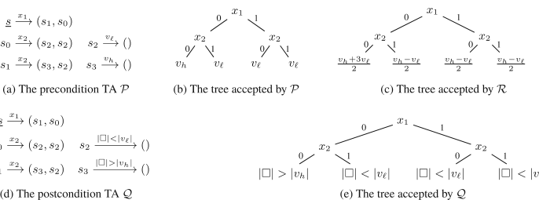
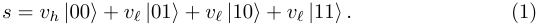
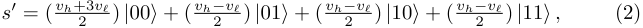
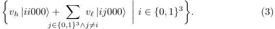
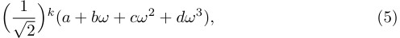
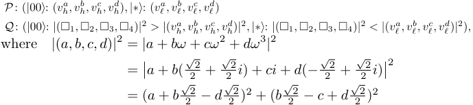
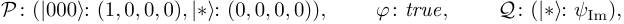
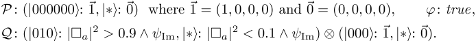
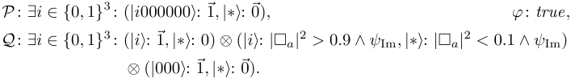
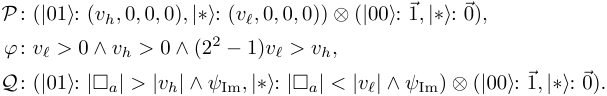

# AutoQ: An Automata-Based Quantum Circuit Verier

Yu-Fang Chen1(B) , Kai-Min Chung1 , Ondřej Lengál2(B) , Jyun-Ao Lin1 , and Wei-Lun Tsai1(B)

> 1 Institute of Information Science, Academia Sinica, Taipei, Taiwan

yfc@iis.sinica.edu.tw, alan23273850@gmail.com

> 2 Faculty of Information Technology, Brno University of Technology, Brno, Czech Republic

lengal@fit.vutbr.cz

Abstract. We present a specication language and a fully automated tool named AutoQ for verifying quantum circuits symbolically. The tool implements the automata-based algorithm from [14] and extends it with the capabilities for symbolic reasoning. The extension allows to specify relational properties, i.e., relationships between states before and after executing a circuit. We present a number of use cases where we used AutoQ to fully automatically verify crucial properties of several quantum circuits, which have, to the best of our knowledge, so far been proved only with human help.

## 1 Introduction

Recently, quantum computing has received much attention, driven by several technological breakthroughs [7] and increasing investments. Prototype quantum computers are already available. The opportunities for the general public— particularly students, researchers, and technology enthusiasts—to access quantum computing devices are rapidly increasing, e.g., through cloud services such as Amazon Braket [1] or IBM Quantum [2]. Due to the complexity and probabilistic nature of quantum computing, the chance of errors in quantum programs is much higher than that of traditional programs, and conventional means for correctness assurance, such as testing, are much less applicable in the quantum world. Quantum programmers need better tools to help them write correct programs. Therefore, researchers anticipate that formal verication will play a crucial role in quantum software quality assurance and have, in recent years, invested significant eort in this direction [5, 11, 21, 41–43, 45, 46]. Nevertheless, practical tools for automated quantum program/circuit verication are still missing.

This paper introduces AutoQ1 , a fully automated tool for quantum circuit verication based on the approach proposed in [14]. In particular, AutoQ checks the validity of a Hoare-style specication {Pre} C {Post}, where C is a quantum circuit (a sequence of quantum gates) in the OpenQASM format [17] and the

> 1 Available at https://github.com/alan23273850/AutoQ.

> c The Author(s) 2023

> C. Enea and A. Lal (Eds.): CAV 2023, LNCS 13966, pp. 139–153, 2023. https://doi.org/10.1007/978-3-031-37709-9_7

140 Y.-F. Chen et al.

precondition Pre and postcondition Post represent sets of (pure) quantum states. The check is done by executing the circuit with all quantum states satisfying Pre (using a symbolic representation) and testing that all resulting quantum states are in the set denoted by Post.

AutoQ combines two main techniques to eciently and eectively represent and reason about (potentially innite) sets of quantum states:

1. As in [14], we use tree automata (TAs), nite-state automata accepting languages of trees, to eciently represent sets of quantum states: Each quantum state over n qubits can be seen as a binary decision tree over n variables such that, e.g., in a 3-qubit circuit with qubits |x1x2x3, if the computational basis state |010 in a quantum state has the probability amplitude<u>1</u> 4, then there will be a branch x1 −→0 x2 −→1 x3 −→0 <u>14</u>inthecorrespondingtree.TheuseofTA- based representation of a set of quantum states has several advantages: (a) It is concise: e.g., in order to represent the set of all 2n basis states of an n-qubit quantum circuit, we suce with a TA with O(n) states and transitions. (b) It allows to eciently perform quantum gate operations on the whole set of quantum states represented by a TA at once [14].

2. In this work, we further consider symbolic quantum states, represented by assigning symbolic values to computational basis states (and having an additional formula to relate these symbolic values). For instance, we can represent the set of all n-qubit quantum states where the computational basis |0 . . . 0 has a strictly larger probability of measurement than all other basis states by a symbolic quantum state assigning |0 . . . 0→ vh and |y1 . . . yn→ v for all y1 . . . yn = 0 . . . 0, together with the formula |vh|2 > |v|2 ∧|vh|2 +(2n −1)|v|2 = 1, where vh and v are symbolic variables ranging over complex numbers

By combining these two techniques, i.e., using TAs with symbolic variables in leaves, we can have a representation of all n-qubit quantum states where an arbitrary basis has a strictly larger amplitude than other basis states using O(n) states and transitions.

Using such a symbolic encoding is essential to allow us to describe relational specications, e.g., it allows us to express properties like “the probability amplitude of the basis state |000 is increased after executing the circuit C” (for this, in the postcondition, we use TAs accepting trees with predicates in leaves, a subclass of symbolic tree automata of [36]). Such a property can then be veried by executing the quantum circuit symbolically in the spirit of symbolic execution [27] (i.e., such that the values of amplitudes are not complex numbers but, instead, symbolic terms) and checking whether all trees in the language of the resulting TA satisfy the desired property (using a modied antichain-based algorithm for testing TA language inclusion [4, 10]). Combining TAs and symbolic variables as the language for quantum predicates allows full automation and can be used to express many crucial properties of quantum circuits, as we will demonstrate later. AutoQ is the rst tool implementing this approach.

Related Work. Our work belongs to the line of Hoare-style verication of quantum programs, which has been widely discussed in the past [22, 29, 35, 40, 44]. This

AutoQ: An Automata-Based Quantum Circuit Verier

141

family of approaches follows D’Hondt and Panangaden’s suggestion of using various Hermitian operators as quantum predicates, resulting in a very powerful yet complete proof system [20]. However, specifying properties using Hermitian operators is often not intuitive and is inconvenient for automation due to their enormous matrix sizes. Therefore, often these approaches are implemented on top of proof assistants such as Coq [9] and Isabelle [37] and require signicant manual work in proof search. The Qbricks [12] approach alleviates the diculty of the proof search by combining state-of-the-art theorem provers with decision procedures building on top of the Why3 platform [24]. The approach, however, still requires a signicant amount of human intervention.

Regarding other quantum program/circuit/protocol verication tools, circuit equivalence checkers [5, 11, 15, 26, 39] are often quite ecient but less exible in specifying the desired property (only equivalence). They are particularly useful in compiler validation; notable tools include Qcec [11], and Feynman [5]. Quantum model checking supports a rich specication language (avors of temporal logic [23, 30, 38]) and is more suitable for verifying high-level protocols due to the quite limited scalability [6]. One notable tool in this category is QPMC [23]. Quantum abstract interpretation [32, 43] is particularly ecient in processing large-scale circuits, but it grossly over-approximates the state space (it cannot verify basic properties of, e.g., Grover’s algorithm) and cannot conclude anything when verication fails. In contrast, AutoQ can be conveniently used for quantum program development and debugging since it automatically computes the exact set of reachable states2 . The mentioned tools are fully automated but have dierent goals or address dierent parts of the software development cycle than AutoQ.

Contributions. AutoQ evolved from a simple prototype used for performance evaluation in [14] into a robust tool. In addition, we added the following major extensions:

1. We combined the TA specication with symbolic variables, allowing users to specify advanced relational properties of quantum circuits.

2. We developed a new entailment-checking algorithm for the symbolic TA specication based on the antichain algorithm for automata language inclusion testing.

3. We introduced a high-level language to simplify writing TA specications.

These improvements are pushing the capabilities of AutoQ, and also of practical quantum circuit verication itself, much further.

Outline. In Sect. 2, we describe our approach to TA-based specication and verication of quantum circuits. In Sect. 3, we discuss the new entailment-checking algorithm for the symbolic TA representation. We discuss the architecture of AutoQ in Sect. 4 and demonstrate the use of the specication language and AutoQ for automated verication of several case studies in Sect. 5.

> 2 A predecessor of the presented version of AutoQ has already caught a bug in Qcec, cf. [3].

142 Y.-F. Chen et al.

Fig. 1. Verication of a circuit C amplifying the amplitude of |00 w.r.t. the specication {P, ϕ} C {Q} with ϕ : |vh + 3v| > |2vh|. R is the TA obtained by executing P on C.

## 2 Tree Automata-Based Verication of Quantum Circuits

We will begin with minimal formal denitions of the TA-based specication and demonstrate how to use them to verify quantum circuits in AutoQ with examples. We assume a basic knowledge of quantum computation (see, e.g., the classical textbook [31]).

Let us x a nite set of quantum variables X = {x1, . . . , xn} with a linear ordering (we assume x1 < . . . < xn) and a disjoint non-empty leaf alphabet Σ. We will, in particular, work with Σ = Σt  Σp where Σt is the alphabet of terms and Σp is the alphabet of predicates in a suitable rst-order theory (discussed later). We use {0, 1}≤n to denote⋃ 0≤i≤n{0, 1}i.A(symbolicbinarydecision)tree over X and Σ is a function τ : {0, 1}≤n → (X ∪ Σ) such that for all positions p ∈ {0, 1}i with i < n, we have τ (p) = xi+1 and for all positions p ∈{0, 1}n , we have τ (p) ∈ Σ. An example of a tree τ can be found in Fig. 1b, where Σ = {vh, v}, τ () = x1, τ (0) = τ (1) = x2, τ (00) = vh, and τ (p) = v for p ∈{0, 1}2 \ {00}. A (symbolic) tree automaton (TA) is a tuple A = (S, Δ, F ) where S is a nite set of states, Δ ⊆ (S × X × S × S) ∪ (S × Σ) is a transition relation, and F ⊆ S is the set of root (nal) states. We denote transitions from Δ as s −→xi (s0, s1) and s −→a () respectively. An example of a TA with the set of root states {s} can be found in Fig. 1a.

A run of A on τ is a function ρ : {0, 1}≤n → S s.t. for all positions p ∈{0, 1}i τ (p) with i < n, it holds that ρ(p) −−−→ (ρ(p.0), ρ(p.1)) ∈ Δ and for all positions τ (p) p ∈{0, 1}n , it holds that ρ(p) −−−→ () ∈ Δ. The run ρ is accepting i ρ() ∈ F and the language of A is L(A) = {τ | A has an accepting run on τ }. Observe that the tree in Fig. 1b is in the language of the TA P in Fig. 1a with the run ρ such that ρ() = s, ρ(0) = s1, ρ(1) = s0, ρ(00) = s3, and ρ(p) = s2 for p ∈{0, 1}2 \ {00}.

Now we are ready to demonstrate how to write specications of quantum circuits with TAs using a running example. We assume that C is a 2-qubit circuit that amplies the amplitude of the basis state |00 (under some constraint ϕ over input

AutoQ: An Automata-Based Quantum Circuit Verier

143

states) and reduces the amplitudes of other basis states. We rst prepare the precondition of C, which consists of a pair (P, ϕ), where P is a TA with the root state s, a set of terms Σt as the leaf alphabet, and the set of transitions from Fig. 1a, and ϕ is a rst-order constraint over the variables used in Σt. In Σt, we use two variables over complex numbers, v and vh, to denote the corresponding amplitude (low and high). The constraint ϕ states that |vh + 3v| > |2vh| (required by this circuit C, cf. Sect. 5.4). Recall that the TA P from Fig. 1a accepts the tree from Fig. 1b, which in turn represents the quantum state

s = vh |00 + v |01 + v |10 + v |11 . (1) 

AutoQ will execute the gates in C to transform the TA P to another TA R capturing the eect of executing C over all quantum states encoded in P. The algorithm for gate operations is almost the same as the one in [14], except that now the update of leaf symbols works symbolically (similarly to symbolic execution [27]: each leaf symbol is a term over vh and v and quantum gates change the terms by accumulating the operations that would be performed on them, potentially simplifying them). In this example, the TA R will accept only one tree representing the quantum state

s  = ( vh+3 2 v ) |00 + ( vh− 2 v ) |01 + ( vh− 2 v ) |10 + ( vh− 2 v ) |11 , (2) 

Observe that under the precondition ϕ = |vh + 3v| > |2vh|, the probability of |00 is indeed increased (|<u>vh+3</u> 2<u>v</u> |2 > |vh|2 ). The tree representation of s can be found in Fig. 1c. The TA Q of the postcondition can be found in Fig. 1a. The leaf alphabet of Q is the set of predicates Σp = {|| > |vh|, || < |v|} where  denotes a free variable. Observe that Q accepts the tree from Fig. 1e.

### 2.1 High-Level Specication Language

In AutoQ, we provide a simple specication language that can be automatically translated to TAs. The language allows users to focus on the properties they want to express without the need to specify details of the TA structure. Our language is particularly suitable for describing sets of states with one high probability branch and other branches with uniformly low or zero probability, a very common pattern of quantum circuit’s correctness properties. For example, in the language, we can use (|00: vh, |∗: v), where “|∗” denotes “other basis states,” to dene the tree language of the TA in Fig. 1a, which accepts a single tree representing the quantum state vh |00 + v |01 + v |10 + v |11 from Fig. 1b. Similarly, we can use (|00: || > |vh|, |∗: || < |v|) to represent the language of the TA in Fig. 1d. The set of all 2-qubit basis states {|i| i ∈{0, 1}2 } is expressed as ∃i ∈{0, 1}2 : (|i: 1, |∗: 0) (we can see it as a predicate that is satised by the described quantum states). We also allow the tensor product ⊗ operator, which multiplies the amplitude of the product basis states. For example, (|00: 1, |∗: 0) ⊗ (|00: vh, |∗: v) ⊗ (|00: 1, |∗: 0) represents the (singleton) set of states compactly {vh |000000 + j∈{01,11,10}v|00j00}.

144 Y.-F. Chen et al.

A more challenging example is to represent the set of states

vh |ii000 + ∑ v |ij000 . (3) { ∣∣∣∣ i ∈{0, 1}3} j∈{0,1} 3 ∧j=i 

Such a set can be described with the help of the ⊗ and ∃ operators as follows:

∃i ∈{0, 1}3 : (|i: 1, |∗: 0) ⊗ (|i: vh, |∗: v) ⊗ (|000: 1, |∗: 0). (4)

Below is the grammar of specication spec:

spec ::= state ∣∣ ∃i ∈{0, 1}n : state ∣∣ spec, state state ::= (|c1: t, . . . , |ck: t, |∗: t) ∣∣ (|i: t, |∗: t) ∣∣ state ⊗ state t ∈ Σ, n ∈ N, and c1, . . . , ck ∈{0, 1}n

A spec is ill-formed when a free variable i appears in state, if some basis is repeated in the rule (|c1: t, . . . , |ck: t, |∗: t), or if the previous rule contains two bases of dierent lengths. If all basis states of the given length are specied in (|c1: t, . . . , |ck: t, |∗: t), the |∗: t part is not required any more. The specication is then converted into a TA using a straightforward algorithm; in the following we often confuse a TA and its specication.

### 2.2 Complex Number Representation

In a (pure) quantum state, the amplitude of a basis computational state is a complex number, and the corresponding probability is the square of the absolute value of the amplitude. For verication, we need an exact representation of complex numbers that can be used in computers. In AutoQ, we use a subset of complex numbers that can be expressed by the following algebraic encoding (cf. [14, 34, 46]):

k(a + bω + cω2 + dω3), (5)  √ 12  

<u>iπ</u> ~~<u>√</u>~~ <u>2</u> ~~<u>√</u>~~ <u>2</u> where a, b, c, d ∈ Z, k ∈ N, and ω = e 4 = cos 45◦ +i sin 45◦ = 2+i 2, the unit vector that makes an angle of 45◦ with the positive real axis in the complex plane. A complex number is then represented by a quadruple (a, b, c, d) of integers and a normalization factor k. Although the considered set of complex numbers is only a small subset of all complex numbers (it is countable, while the set of all complex numbers is uncountable), the subset is sucient to describe various standard quantum gates. Currently, AutoQ supports the set of quantum gates X, H, Y, Z, S, T, Rx(<u>π</u> 2),Ry(<u>π</u> 2),CNOT,CZ,Tooli(cf.thelistin[14]),whichalready includes a set of universal quantum gates. From the Solovay-Kitaev theorem [18], gates performing rotations of 2πn, used, e.g., in Shor’s algorithm [33] and quantum Fourier transform (QFT) [16], can be approximated with an error rate  by O(log3.97 (<u>1</u> ))-many H, CNOT, and T gates. The algebraic representation is also sucient to represent all reachable states in OpenQASM circuits with the set of supported gates, where the initial basis state is |0 . . . 0.

AutoQ: An Automata-Based Quantum Circuit Verier

145

AutoQ operates on the introduced representation of complex numbers. More precisely, for a specication {P, ϕ} C {Q}, the leaf symbols of P are quadruples of integer terms (a, b, c, d). We assume that all leaf symbols of P share a common normalization factor k, so we do not store the value of k explicitly since it can be inferred from the fact that the probability sum over all basis states is one. Instead, we remember a constant natural number value kc, the dierence of the k value between P and R, and use it to normalize the amplitudes. Recall that R is the TA accepting all states after executing C from some states accepted by P. The initial value of kc is zero, and each application of H, Rx(<u>π</u> 2),orRy(<u>π</u> 2) gates will increase it by one (cf. [14]). We normalize all quadruple leaf symbols (a, b, c, d) of R by multiplying them with ( ~~<u>√</u>~~ <u>12</u> )kc once R is computed.

Next, we show how to compose a specication of our running example from Fig. 1 using the algebraic representation. The specication can now be written as

P : (|00: (vh a, v h b , v h c , v h d), |∗: (v  a, v  b, v  c, v  d) Q : (|00: |(1, 2, 3, 4)| 2 > |(vh a, v h b , v h c , v h d)|2, |∗: |(1, 2, 3, 4)|2 < |(v  a, v  b, v  c, v  d)|2), where |(a, b, c, d)| 2 = |a + bω + cω 2 + dω 3 | 2 = ∣∣a + b( √ 22 + √ 22 i) + ci + d(− √ 22 + √ 22 i) ∣∣2 = (a + b √ 22 − d √ 22 )2 + (b √ 22 − c + d √ 22 )2 

### 2.3 Precise Semantics of the Specication

As mentioned above, for verifying {P, ϕ} C {Q}, we start with a TA P representing the set of all quantum states satisfying the precondition and compute a TA R representing the set of states reachable after executing the circuit C. Then, we test whether R entails Q (w.r.t. ϕ), i.e., whether all reachable states satisfy the postcondition.

Formally, we say that a tree τ1 is entailed by a tree τ2 w.r.t. a rst-order formula ϕ, denoted as τ1 |=ϕ τ2, if for all positions p ∈{0, 1}n it holds that either (i) τ1(p) = τ2(p) or (ii) τ1(p) = (t1, . . . , tk) ∈ Σt, τ2(p) = ψ ∈ Σp, and ϕ ⇒ ψ[t1/1] . . . [tk/k]. We lift the entailment to TAs: A1 |=ϕ A2 ifor all trees τ1 ∈L(A1) there exists a tree τ2 ∈L(A2) s.t. τ1 |=ϕ τ2.3

## 3 Entailment Checking

We will now describe how we perform the entailment check R |=ϕ Q. Since we operate with trees and tree automata over symbolic values, we cannot establish entailment by running a classical TA language inclusion test based on complementing the automaton Q rst. Instead, our algorithm for testing the entailment R |=ϕ Q is based on an on-the-y TA inclusion checking algorithm [4, 10],

> 3 We never have a predicate from Σp on the left-hand side of the entailment test, so we do not need to test implication between predicates, which would be needed for a complete procedure.

146 Y.-F. Chen et al.

### Algorithm 1: Checking R |=ϕ Q

||Input: A TA R= (Sr, Δr, Fr), a TA Q= (Sq, Δq, Fq), a formula ϕ|
|---|---|
|1|Output: true if R |=ϕ Q, false otherwise  Processed ←∅;|
|2|Worklist ←Min{(sr, Uq)|sr tr −→()∈Δr, |
|3 |Uq ={uq ∈Qq |uq tr −→()∨∃uq pq −→()∈Δq: ϕ⇒pq[tr/]}}; |
|4|while Worklist =∅do|
|5|(sr, Uq)←Worklist.pop(); |
|6|if sr ∈Fr ∧Uq ∩Fq =∅then return false ; |
|7|Processed ←Min(Processed ∪{(sr, Uq)}); |
|8|tmp ←({(sr, Uq)} ×Processed)∪(Processed × {(sr, Uq)});        |
|9|foreach ((s1 r, U 1 q ), (s2 r, U 2 q )) ∈tmp, α ∈X do    |
|10|Hr ←{s′ r ∈Qr | s′ r α−→(s1 r, s2 r) ∈Δr};|
|11|U ′ q ←{sq ∈Qq | ∃s1 q ∈U 1 q , ∃s2 q ∈U 2 q : sq α−→(s1 q, s2 q) ∈Δq};     |
|12|foreach s′ r ∈Hr s.t. (s′ r, U ′ q) /∈Processed ∪Worklistdo    |
|13 14|Worklist ←Min(Worklist ∪{(s′ r, U ′ q)});  return true;|

which avoids complementation. The on-the-y inclusion-checking algorithm can be seen as an optimization of the classical construction, which would establish L(R)∩L(Q) =? ∅ by rst computing the complement Q of Q (using a bottom-up TA determinization), followed by computing the intersection A∩ of Q and R, and, nally, checking language emptiness of A∩. In particular, the on-the-y inclusion checking algorithm can be seen as doing all the operations at once. Furthermore, the algorithms in [4, 10] also make use of the so-called antichains and TA simulation to prune the explored state space.

Our modication of the inclusion algorithm to test TA entailment, given in Algorithm 1, mainly diers from [4, 10] in the way initial sets of state pairs are computed on Line 3. In particular, we match a state sr that can perform a leaf transition over tr in R with the set Uq of all states in Q that can perform a leaf transition either over tr or over a predicate pq such that ϕ ⇒ pq[tr/] (we use pq[tr/] for a tuple tr to denote the substitution of the tuple’s components into the corresponding free variables of pq).

After that, the algorithms perform a simultaneous bottom-up traversal through R (represented by states sr) and the determinized version of Q (represented by sets of states Uq). For each such pair (sr, Uq), the algorithm rst checks whether sr is a root state and Uq does not contain any root state (cf. Line 6; this would mean that R accepts some tree that is not accepted by Q). If this does not hold, then the algorithm tries to nd all already processed pairs that can make a transition with (sr, Uq) (cf. Line 8) and continue from all such pairs. Each bottom-up successor (s r, U  q)isthenaddedtoWorklistinthecase it has not been seen previously (cf. Line 13).

The algorithm uses the function Min (cf. Lines 3, 7, and 13) to minimize the sets Worklist and Processed w.r.t. a subsumption relation, and the downward

AutoQ: An Automata-Based Quantum Circuit Verier

147

closure for Processed ∪ Worklist on Line 12 to prune the explored state space. Due to lack of space, we refer to the works [4, 10] for more details about these optimizations.

## 4 Architecture

We illustrate the architecture of AutoQ in Fig. 2. The tool is written in C++ and uses the following external tools: the TA library Vata [28] for ecient testing of TA inclusion (when the postcondition uses only the term alphabet Σt) and the SMT Fig. 2. The architecture of AutoQ. The input verisolver Z3 for entailment cation problem is {P, ϕ} C {Q}. checking of leaf symbols in Algorithm 1. We allow any theory solver supported by Z3. In our experiment, we use QF_NIRA. AutoQ takes as an input a quantum circuit in the OpenQASM format accompanied with the specication written as tree automata (.aut les) or the high-level specication language (.hsl les) introduced in Sect. 2.1.

Preprocessor reads the input les (.aut, .smt, .qasm, and .hsl les), translates specications in the .hsl les into tree automata, and stores them using AutoQ’s internal data structures. Circuit Executor then reads the circuit C and the TA P and generates another TA R obtained as the result after executing C from states in P, using the approach of [14] with the symbolic extension discussed in Sect. 2. AutoQ can also output the TA R for further analysis. Finally, Entailment Checker checks whether R |=ϕ Q and reports “veried” when the entailment holds and “bug found” otherwise.

## 5 Use Cases

In this section, we describe several use cases of quantum algorithms and their important properties that we were able to verify using AutoQ fully automatically. We focus on the use of symbolic TA in this set of experiments and refer the readers to [14] for other experimental results. A selection of the obtained results is given in Table 1. An artifact that allows reproduction of the results is available as [13].

### 5.1 Hadamard Square is Identity

Our rst use case shows that the single qubit gate C that runs two consecutive H gates has the same eect as an identity matrix. We use the specication

148 Y.-F. Chen et al.

{P, ϕ} C {Q} with P : (|0: (va, vb, vc, vd), |1: (va, v b, v c, v d)), ϕ : true, Q : (|0: (a, b, c, d) = (va, vb, vc, vd), |1: (a, b, c, d) = (va, v b, v c, v d)).

In this simple example, the precondition P encodes an innite number of quantum states, which is not expressible using the technique in [14]. We also included a buggy version by altering one of the H gates, and AutoQ managed to detect the injected bug. The results can be found in rows H2 in Table 1.

### 5.2 Zero Imaginary Part of Amplitudes

One property, which is shared by multiple algorithms, e.g., BernsteinVazirani’s [8] and Grover’s algorithm [25], is that the imaginary part of all amplitudes of the result is zero.

Let us focus on Bernstein-Vazirani’s algorithm [8], which nds a secret bitstring s from an oracle using a single query. The algorithm begins with the quantum state |0n , where n is the length of s, and ends with the quantum state |s. The amplitudes of all basis states are either zero or one, the imaginary part of the amplitudes is, therefore, always zero. For a three-qubit circuit C implementing the algorithm, we can therefore use the specication: {P, ϕ} C {Q} with

P : (|000: (1, 0, 0, 0), |∗: (0, 0, 0, 0)), ϕ : true, Q : (|∗: ψIm), 

where ψIm ≡ (b = −d ∧ c = 0) (it will also be used later). In the denition of P, recall that we use the integer-quadruple representation of complex numbers (cf. Eq. (5)). In the postcondition Q, the free variables a, b, c, d are to be substituted by the corresponding terms in the obtained integer term quadruple (a, b, c, d) in the entailment check. Note that (a, b, c, d) represents the complex number (a + b ~~<u>√</u>~~ 22−d ~~<u>√</u>~~ 22) + i(b ~~<u>√</u>~~ 22−c + d ~~<u>√</u>~~ 22)(obtainedfromEq.(5)).Because a, b, c, d are all integers, for the imaginary part to be zero, it must hold that c = 0 and b = −d.

When we run C from P, we obtain a TA R encoding (|010: (1, 0, 0, 0), |∗: (0, 0, 0, 0)) and the entailment R |=ϕ Q holds. See the rows BV(n) in Table 1 for the results of verifying the algorithm for circuits with secrets of size n. As in the previous example, we also included a buggy version to demonstrate AutoQ’s bugnding capability. We can see that AutoQ could verify the algorithm for secrets of a quite large size.

### 5.3 Probability of Measuring the Correct Answer

Grover’s algorithm [25] assumes a Boolean function f over n bits with only one satisfying assignment s and an oracle that evaluates f for a given input. The algorithm nds s with a high probability, say > 0.9, using only O( ~~√~~ 2n ) oracle queries. The algorithm works iteratively, where each Grover iteration queries the oracle once and amplies the amplitude of |s. First, let C be a 6-qubit circuit

AutoQ: An Automata-Based Quantum Circuit Verier

149

Table 1. Results of verifying our use cases with AutoQ. The maximum peak memory consumption was 52 MiB for GroverAll(9). In most cases, the time of entailment was negligible, with the exception of GroverAll circuits. For instance, GroverAll(8) takes 2 m18 s for entailment checking (70% of the total time) and GroverAll(9) takes 21 m36 s for entailment checking (85% of the total time).

|circuit|qubits|gates|property|result|time|circuit|qubits|gates|property|result|time|
|---|---|---|---|---|---|---|---|---|---|---|---|
|H2|1|2|H2 = I|OK|0.22s|GroverSingle(3)|6|54|P(Correct) > 0.9|OK|0.34s|
|H2 (bug)|1|2|H2 = I|Bug|0.17s|GroverSingle(16)|32|28,159|P(Correct) > 0.9|OK|2m21s|
|BV(2)|2|6|ψIm|OK|0.11s|GroverSingle(18)|36|63,537|P(Correct) > 0.9|OK|6m37s|
|BV(2) (bug)|2|6|ψIm|Bug|0.15s|GroverSingle(20)|40|141,527|P(Correct) > 0.9|OK|19m57s|
|BV(100)|100|251|ψIm|OK|10.90s|GroverIter(2)|3|13|P(Correct) Increased|OK|0.40s|
|BV(1,000)|1,000|2,500|ψIm|OK|198m28s|GroverIter(18)|36|157|P(Correct) Increased|OK|1.95s|
|GroverAll(3)|9|64|P(Correct) > 0.9|OK|0.40s|GroverIter(50)|100|445|P(Correct) Increased|OK|47.76s|
|GroverAll(8)|24|939|P(Correct) > 0.9|OK|3m18s|GroverIter(75)|150|671|P(Correct) Increased|OK|3m29s|
|GroverAll(9)|27|1,492|P(Correct) > 0.9|OK|25m16s|GroverIter(100)|200|895|P(Correct) Increased|OK|10m53s|

implementing Grover’s search with the satisfying assignment s = 010, where the rst three qubits of C are the work tape, and the following three are the ancillae. We use the following specication:

P : (|000000:  1, |∗:  0) where  1 = (1, 0, 0, 0) and  0 = (0, 0, 0, 0), ϕ : true, Q : (|010: |a| 2 > 0.9 ∧ ψIm, |∗: |a| 2 < 0.1 ∧ ψIm) ⊗ (|000:  1, |∗:  0). 

Note that the postcondition Q also checks that all amplitudes in the result of the algorithm have a zero imaginary part (using ψIm). See rows GroverSingle(n) in Table 1 for the results on circuits for n-bit functions f and a single oracle.

Next, we also show the correctness of Grover’s algorithm w.r.t. all possible 3-qubit oracles. Let C be a 9-qubit circuit implementing the algorithm, where the rst three qubits are used for oracle generation, and the following six are the work tape and ancillae, similarly to GroverSingle. Our specication is now

P : ∃i ∈{0, 1} 3 : (|i000000:  1, |∗:  0), ϕ : true, Q : ∃i ∈{0, 1} 3 : (|i:  1, |∗: 0) ⊗ (|i: |a| 2 > 0.9 ∧ ψIm, |∗: |a| 2 < 0.1 ∧ ψIm) ⊗ (|000:  1, |∗:  0). 

Note that in the postcondition, we use i to relate the oracle value and the value on the work tape. The results are in rows GroverAll(n) in Table 1.

### 5.4 Increasing Amplitude of the Correct Answer

Above, we show that we are able to automatically verify moderate-sized circuits for Grover’s algorithm for the values of n up to 9 (for GroverAll) and 20 (for GroverSingle), which is quite large, but have diculties going beyond that. The size of the circuit is O( ~~√~~ 2n ), which is quite large. Therefore, we also verify the algorithm w.r.t. a weaker property, which is, that in one iteration, the amplitude of the correct answer will increase.

Consider a function f over 2 bits with 01 being the only satisfying assignment and let C be a 4-qubit circuit encoding one Grover iteration, with two qubits as

150 Y.-F. Chen et al.

the work tape and two ancilla qubits. From Grover’s correctness proof [25], we can derive that when v > 0 ∧ vh > 0 ∧ (2n − 1)v > vh, a correct implementation will increase the probability of |01 and reduce others. We specify the verication problem as follows:

P : (|01: (vh, 0, 0, 0), |∗: (v, 0, 0, 0)) ⊗ (|00:  1, |∗:  0), ϕ : v > 0 ∧ vh > 0 ∧ (2 2 − 1)v > vh, Q : (|01: |a| > |vh| ∧ ψIm, |∗: |a| < |v| ∧ ψIm) ⊗ (|00:  1, |∗:  0). 

The results can be found in rows GroverIter(n) in Table 1. We can see that verication of one Grover iteration w.r.t. the weaker (but still quite useful) property scales much better than verication of full Grover’s circuits, scaling to sizes of n ≥ 100.

## 6 Conclusion

We presented a specication language for specifying useful properties of quantum circuits and a tool AutoQ that can establish the correctness of the specication using an approach combining the technique from [14] with symbolic execution. Using the tool, we were able to fully automatically verify several important properties of a selection of quantum circuits. To the best of our knowledge, for some of the properties, we are the rst ones that could verify them fully automatically.

Acknowledgements. We thank the reviewers for their useful remarks that helped us improve the quality of the paper. This work was supported by the Czech Ministry of Education, Youth and Sports project LL1908 of the ERC.CZ programme, the Czech Science Foundation project GA23-07565S, the FIT BUT internal project FIT-S-238151, and the NSTC QC project under Grant no. NSTC 111-2119-M-001-004-and 112-2119-M-001-006-.

## References

1. Aws braket. https://aws.amazon.com/braket/

2. IBM quantum. https://quantum-computing.ibm.com

3. The Qcec repository: Issue #200 (ZX-Checker produces invalid result) (2022). https://github.com/cda-tum/qcec/issues/200

4. Abdulla, P.A., Chen, Y.-F., Holík, L., Mayr, R., Vojnar, T.: When simulation meets antichains. In: Esparza, J., Majumdar, R. (eds.) TACAS 2010. LNCS, vol. 6015, pp. 158–174. Springer, Heidelberg (2010). https://doi.org/10.1007/978-3-642-120022_14

5. Amy, M.: Towards large-scale functional verication of universal quantum circuits. In: Quantum Physics and Logic (2018)

6. Anticoli, L., Piazza, C., Taglialegne, L., Zuliani, P.: Towards quantum programs verication: from quipper circuits to QPMC. In: Devitt, S., Lanese, I. (eds.) RC 2016. LNCS, vol. 9720, pp. 213–219. Springer, Cham (2016). https://doi.org/10. 1007/978-3-319-40578-0_16

AutoQ: An Automata-Based Quantum Circuit Verier

151

7. Arute, F., et al.: Quantum supremacy using a programmable superconducting processor. Nature 574(7779), 505–510 (2019). https://doi.org/10.1038/s41586-0191666-5, number: 7779 Publisher: Nature Publishing Group

8. Bernstein, E., Vazirani, U.V.: Quantum complexity theory. In: Kosaraju, S.R., Johnson, D.S., Aggarwal, A. (eds.) Proceedings of the Twenty-Fifth Annual ACM Symposium on Theory of Computing, May 16–18, 1993, San Diego, CA, USA, pp. 11–20. ACM (1993). https://doi.org/10.1145/167088.167097

9. Bertot, Y., Castéran, P.: Interactive theorem proving and program development: Coq’Art: the calculus of inductive constructions. Springer Science & Business Media (2013)

10. Bouajjani, A., Habermehl, P., Holík, L., Touili, T., Vojnar, T.: Antichain-based universality and inclusion testing over nondeterministic nite tree automata. In: Ibarra, O.H., Ravikumar, B. (eds.) CIAA 2008. LNCS, vol. 5148, pp. 57–67. Springer, Heidelberg (2008). https://doi.org/10.1007/978-3-540-70844-5_7

11. Burgholzer, L., Wille, R.: Advanced equivalence checking for quantum circuits. IEEE Trans. Comput. Aided Des. Integr. Circuits Syst. 40(9), 1810–1824 (2020)

12. Chareton, C., Bardin, S., Bobot, F., Perrelle, V., Valiron, B.: An automated deductive verication framework for circuit-building quantum programs. In: ESOP 2021. LNCS, vol. 12648, pp. 148–177. Springer, Cham (2021). https://doi.org/10.1007/ 978-3-030-72019-3_6

13. Chen, Y., Chung, K., Lengál, O., Lin, J., Tsai, W.: AutoQ: an automata-based quantum circuit verier (May 2023). https://doi.org/10.5281/zenodo.7966542

14. Chen, Y., Chung, K., Lengál, O., Lin, J., Tsai, W., Yen, D.: An automata-based framework for verication and bug hunting in quantum circuits. In: 44th ACM SIGPLAN Conference on Programming Language Design and Implementation– PLDI’23. ACM (2023)

15. Coecke, B., Duncan, R.: Interacting quantum observables: categorical algebra and diagrammatics. New J. Phys. 13(4), 043016 (2011). https://doi.org/10.1088/13672630/13/4/043016

16. Coppersmith, D.: An approximate Fourier transform useful in quantum factoring (2002). https://doi.org/10.48550/arxiv.quant-ph/0201067

17. Cross, A.W., Bishop, L.S., Smolin, J.A., Gambetta, J.M.: Open quantum assembly language. arXiv preprint arXiv:1707.03429 (2017)

18. Dawson, C.M., Nielsen, M.A.: The Solovay-Kitaev algorithm. arXiv preprint quantph/0505030 (2005)

19. de Moura, L., Bjørner, N.: Z3: an ecient SMT solver. In: Ramakrishnan, C.R., Rehof, J. (eds.) TACAS 2008. LNCS, vol. 4963, pp. 337–340. Springer, Heidelberg (2008). https://doi.org/10.1007/978-3-540-78800-3_24

20. D’Hondt, E., Panangaden, P.: Quantum weakest preconditions. Math. Struct. Comput. Sci. 16(3), 429–451 (2006)

21. Feng, Y., Hahn, E.M., Turrini, A., Zhang, L.: QPMC: a model checker for quantum programs and protocols. In: Bjørner, N., de Boer, F. (eds.) FM 2015. LNCS, vol. 9109, pp. 265–272. Springer, Cham (2015). https://doi.org/10.1007/978-3-31919249-9_17

22. Feng, Y., Ying, M.: Quantum Hoare logic with classical variables. ACM Trans. Quantum Comput. 2(4), 1–43 (2021)

23. Feng, Y., Yu, N., Ying, M.: Model checking quantum Markov chains. J. Comput. Syst. Sci. 79(7), 1181–1198 (2013). https://doi.org/10.1016/j.jcss.2013.04.002

24. Filliâtre, J.-C., Paskevich, A.: Why3 — where programs meet provers. In: Felleisen, M., Gardner, P. (eds.) ESOP 2013. LNCS, vol. 7792, pp. 125–128. Springer, Heidelberg (2013). https://doi.org/10.1007/978-3-642-37036-6_8

152 Y.-F. Chen et al.

25. Grover, L.K.: A fast quantum mechanical algorithm for database search. In: Miller, G.L. (ed.) Proceedings of the Twenty-Eighth Annual ACM Symposium on the Theory of Computing, Philadelphia, Pennsylvania, USA, May 22–24, 1996, pp. 212–219. ACM (1996). https://doi.org/10.1145/237814.237866

26. Hietala, K., Rand, R., Hung, S.H., Wu, X., Hicks, M.: Veried optimization in a quantum intermediate representation. arXiv preprint arXiv:1904.06319 (2019)

27. King, J.C.: Symbolic execution and program testing. Commun. ACM 19(7), 385– 394 (1976). https://doi.org/10.1145/360248.360252

28. Lengál, O., Šimáček, J., Vojnar, T.: VATA: a library for ecient manipulation of non-deterministic tree automata. In: Flanagan, C., König, B. (eds.) TACAS 2012. LNCS, vol. 7214, pp. 79–94. Springer, Heidelberg (2012). https://doi.org/10.1007/ 978-3-642-28756-5_7

29. Liu, J., Zhan, B., Wang, S., Ying, S., Liu, T., Li, Y., Ying, M., Zhan, N.: Formal verication of quantum algorithms using quantum hoare logic. In: Dillig, I., Tasiran, S. (eds.) CAV 2019. LNCS, vol. 11562, pp. 187–207. Springer, Cham (2019). https:// doi.org/10.1007/978-3-030-25543-5_12

30. Mateus, P., Ramos, J., Sernadas, A., Sernadas, C.: Temporal Logics for Reasoning about Quantum Systems, pp. 389–413. Cambridge University Press (2009). https://doi.org/10.1017/CBO9781139193313.011

31. Nielsen, M.A., Chuang, I.L.: Quantum Computation and Quantum Information: 10th Anniversary Edition, 10th edn. Cambridge University Press, USA (2011)

32. Perdrix, S.: Quantum entanglement analysis based on abstract interpretation. In: International Static Analysis Symposium, pp. 270–282. Springer (2008)

33. Shor, P.W.: Algorithms for quantum computation: Discrete logarithms and factoring. In: 35th Annual Symposium on Foundations of Computer Science, Santa Fe, New Mexico, USA, 20–22 November 1994. pp. 124–134. IEEE Computer Society (1994). https://doi.org/10.1109/SFCS.1994.365700

34. Tsai, Y., Jiang, J.R., Jhang, C.: Bit-slicing the Hilbert space: Scaling up accurate quantum circuit simulation. In: 58th ACM/IEEE Design Automation Conference, DAC 2021, San Francisco, CA, USA, December 5–9, 2021, pp. 439–444. IEEE (2021). https://doi.org/10.1109/DAC18074.2021.9586191

35. Unruh, D.: Quantum Hoare logic with ghost variables. In: 2019 34th Annual ACM/IEEE Symposium on Logic in Computer Science (LICS), pp. 1–13. IEEE (2019)

36. Veanes, M., Bjørner, N.S.: Symbolic tree automata. Inf. Process. Lett. 115(3), 418–424 (2015). https://doi.org/10.1016/j.ipl.2014.11.005

37. Wenzel, M., Paulson, L.C., Nipkow, T.: The isabelle framework. In: Mohamed, O.A., Muñoz, C., Tahar, S. (eds.) TPHOLs 2008. LNCS, vol. 5170, pp. 33–38. Springer, Heidelberg (2008). https://doi.org/10.1007/978-3-540-71067-7_7

38. Xu, M., Fu, J., Mei, J., Deng, Y.: Model checking QCTL plus on quantum Markov chains. Theor. Comput. Sci. 913, 43–72 (2022). https://doi.org/10.1016/j.tcs.2022. 01.044

39. Xu, M., et al.: Quartz: superoptimization of quantum circuits. In: Proceedings of the 43rd ACM SIGPLAN International Conference on Programming Language Design and Implementation, pp. 625–640 (2022)

40. Ying, M.: Floyd-Hoare logic for quantum programs. ACM Trans. Programm. Lang. Syst. (TOPLAS) 33(6), 1–49 (2012)

41. Ying, M.: Model checking for verication of quantum circuits. In: International Symposium on Formal Methods, pp. 23–39. Springer (2021)

42. Ying, M., Feng, Y.: Model Checking Quantum Systems: Principles and Algorithms. Cambridge University Press (2021)

AutoQ: An Automata-Based Quantum Circuit Verier

153

43. Yu, N., Palsberg, J.: Quantum abstract interpretation. In: Proceedings of the 42nd ACM SIGPLAN International Conference on Programming Language Design and Implementation, pp. 542–558 (2021)

44. Zhou, L., Yu, N., Ying, M.: An applied quantum Hoare logic. In: Proceedings of the 40th ACM SIGPLAN Conference on Programming Language Design and Implementation, pp. 1149–1162 (2019)

45. Zulehner, A., Hillmich, S., Wille, R.: How to eciently handle complex values? implementing decision diagrams for quantum computing. In: Pan, D.Z. (ed.) Proceedings of the International Conference on Computer-Aided Design, ICCAD 2019, Westminster, CO, USA, November 4–7, 2019. pp. 1–7. ACM (2019). https://doi. org/10.1109/ICCAD45719.2019.8942057

46. Zulehner, A., Wille, R.: Advanced simulation of quantum computations. IEEE Trans. Comput. Aided Des. Integr. Circuits Syst. 38(5), 848–859 (2019). https:// doi.org/10.1109/TCAD.2018.2834427

Open Access This chapter is licensed under the terms of the Creative Commons Attribution 4.0 International License (http://creativecommons.org/licenses/by/4.0/), which permits use, sharing, adaptation, distribution and reproduction in any medium or format, as long as you give appropriate credit to the original author(s) and the source, provide a link to the Creative Commons license and indicate if changes were made.

The images or other third party material in this chapter are included in the chapter’s Creative Commons license, unless indicated otherwise in a credit line to the material. If material is not included in the chapter’s Creative Commons license and your intended use is not permitted by statutory regulation or exceeds the permitted use, you will need to obtain permission directly from the copyright holder.
