CONTENTS

## Editorial Information

### <mark>JOINT ERCIM ACTIONS</mark>

- **4 Second JST-ERCIM Symposium** by Peter Kunz (ERCIM Office)

_ERCIM News is the magazine of ERCIM. Published quarterly, it reports on joint actions of the ERCIM partners, and aims to reflect the contribution made by ERCIM to the European Community in Information Technology and Applied Mathematics. Through short articles and news items, it provides a forum for the exchange of information between the institutes and also with the wider scientific community. This issue has a circulation of about 6,000 printed copies and is also available online ,at https://ercim-news@ercim.eu._

_ERCIM News is published by ERCIM EEIG BP 93, F-06902 Sophia Antipolis Cedex, France +33 4 9238 5010, contact@ercim.eu Director: Philipp Hoschka, ISSN 0926-4981_

##### _Contributions_

_Contributions should be submitted to the local editor of your country_

- **5 ERCIM “Alain Bensoussan” Fellowship Programme**

- **5 ERCIM Fellowship Community Event**

### <mark>SPECIAL THEME</mark>

The special theme “Quantum Computing” has been coordinated by the guest editors Shaukat Ali (SIMULA) and Sølve Selstø (Oslo Metropolitan University)

- Introduction to the Special Theme

- **6 Quantum Computing** by Shaukat Ali (SIMULA) and Sølve Selstø (Oslo Metropolitan University)

#### Quantum software

##### _Copyright notice_

_All authors, as identified in each article, retain copyright of their work. ERCIM News is licensed under a Creative Commons Attribution 4.0 International License (CC-BY)._

##### _Advertising_

_For current advertising rates and conditions, see https://ercim-news.ercim.eu/ or contact peter.kunz@ercim.eu_

**_ERCIM News online edition:_** _https://ercim-news.ercim.eu/_

##### _Next issue:_

- **8 Towards a Standardised Quantum Software Stack** by Sebastian Bock, Raphael Seidel, Colin Kai-Uwe Becker (Fraunhofer FOKUS)

- **9 The Next Bottleneck after Quantum Hardware Will be Quantum Software** by Jukka K. Nurminen, Arianne Meijer, Ilmo Salmenperä and Leo Becker (University of Helsinki)

- **11 Programming the Interaction with Quantum Coprocessors**

   - by Ferruccio Damiani, Luca Paolini and Luca Roversi (Università di Torino)

_April 2022: Fighting Cyber Crime_

##### _Subscription_

_Subscribe to ERCIM News by sending an email to en-subscriptions@ercim.eu_

##### _Editorial Board:_

_Central editor:_

_Peter Kunz, ERCIM office (peter.kunz@ercim.eu)_

##### _Local Editors:_

   - **12 AlphaZero: Playing Chess and Controlling Quantum Systems**

      - by Mogens Dalgaard (Aarhus University), Felix Motzoi (Forschungszentrum Jülich) and Jacob Sherson (Aarhus University)

   - **13 Quantum Software Testing: Challenges, Early Achievements, and Opportunities** by Tao Yue (Simula Research Laboratory), Paolo Arcaini (National Institute of Informatics, Japan) and Shaukat Ali (Simula Research Laboratory)

- _Christine Azevedo Coste, Inria, France (christine.azevedo@inria.fr)_

- _Andras Benczur, SZTAKI, Hungary (benczur@info.ilab.sztaki.hu)_

- _José Borbinha, Univ. of Technology Lisboa, Portugal (jlb@ist.utl.pt)_

- _Are Magnus Bruaset, SIMULA, Norway (arem@simula.no)_

- _Monica Divitini, NTNU, Norway (divitini@ntnu.no)_

- _Marie-Claire Forgue, ERCIM/W3C (mcf@w3.org)_

- _Lida Harami, FORTH-ICT , Greece (lida@ics.forth.gr)_

- _Athanasios Kalogeras, ISI, Greece (kalogeras@isi.gr)_

- _Georgia Kapitsaki, Univ. of Cyprus, Cyprus (gkapi@cs.ucy.ac.cy)_

- _Annette Kik, CWI, The Netherlands (Annette.Kik@cwi.nl)_

   - **15 Software for Emulations of Digital Quantum Algorithms: To Build or not to Build?** by Sergiy Denysov (OsloMet), Sølve Selstø (OsloMet) and Are Magnus Bruaset (Simula Research Laboratory)

   - **17 Simulation of Photonic Quantum Computers Enhanced by Data-Flow Engines** by Peter Rakyta (ELTE), Ágoston Kaposi, Zoltán Kolarovszki, Tamás Kozsik (ELTE), and Zoltán Zimborás (Wigner)

- _Hung Son Nguyen, Unviv. of Warsaw, Poland (son@mimuw.edu.pl)_

- _Alexander Nouak, Fraunhofer-Gesellschaft, Germany (alexander.nouak@iuk.fraunhofer.de)_

- _Maria Rudenschöld, RISE, Sweden (maria.rudenschold@ri.se)_

- _Harry Rudin, Switzerland (hrudin@smile.ch)_

- _Erwin Schoitsch, AIT, Austria (erwin.schoitsch@ait.ac.at)_

- _Thomas Tamisier,LIST, Luxembourg (thomas.tamisier@list.lu)_

- _Maurice ter Beek, ISTI-CNR, Italy (maurice.terbeek@isti.cnr.it)_

_Cover photo: Optical system for laser cooling and control of ultra-cold sodium atoms in the laboratory at the Kirchhoff-Institute for Physics._

#### Quantum algorithms

- **18 Some Complexity Results Involving Quantum Computing** by Gábor Ivanyos, Attila Pereszlényi and Lajos Rónyai (ELKH SZTAKI, BME)

- **19 Quantum Algorithms for Quantum and Classical TimeDependent Partial Differential Equations** by François Fillion-Gourdeau (Institute for Quantum Computing and Infinite Potential Laboratories)

ERCIM NEWS 128 January 2022

Security and safety of quantum computing

- **21 Prospects for Practical Verified and Blind Delegated Quantum Computations** by Maxime Garnier and Harold Ollivier (Inria)

- **22 Confidential Quantum Computing: Towards a Secure Computation on Untrusted Quantum Servers**

by Barbora Hrdá (Fraunhofer AISEC)

#### Quantum computing benchmarking

#### Quantum computing hardware

- **41 Entanglement Dynamics and Control at the Nanoscale** by Ioannis Thanopulos, Dionisis Stefanatos, Nikos Iliopoulos and Emmanuel Paspalakis (University of Patras)

- **43 Spin Quantum Computing with Molecular-Encaged Atomic Hydrogen**

by George Mitrikas (Institute of Nanoscience and Nanotechnology, National Centre for Scientific Research “Demokritos”)

- **24 Benchmarking Quantum Computers: A Challenging but Necessary Step towards Future**

by Ilias K. Savvas and Ilias Galanis, (University of Thessaly)

#### Quantum computing applications

- **25 Quantum Walk Model for Autonomous Driving and Traffic Control**

by Ioannis G. Karafyllidis (Democritus University of Thrace)

- **27 Energy Economics Fundamental Modelling with Quantum Algorithms**

by Pascal Halffmann (Fraunhofer ITWM), Niklas Hegemann (JoS QUANTUM GmbH), Fred Jendrzejewski (KIP University of Heidelberg) and Steve Lenk (Fraunhofer IOSB-AST)

- **28 Quantum Fourier Transformation in Industrial Applications**

by Valeria Bartsch, Matthias Kabel and Anita Schöbel (Fraunhofer ITWM)

#### Joint ventures and initiatives

- **30 Quantum Computing – The Path Towards Industrial Applications** by Christian Tutschku and Chiara Stephan (Fraunhofer IAO)

- **31 The Quest for a Nordic Quantum Computing Ecosystem** by Mikael Johansson (CSC – IT Center for Science) and Göran Wendin (Chalmers University of Technology)

#### 33 Software of the Future

### <mark>RESARCH AND INNOVATION</mark>

- **45 DORNELL: A Multimodal, Shapeable Haptic Handle for Mobility Assistance of People with Disabilities** by Marie Babel and Claudio Pacchierotti (Univ Rennes, CNRS, Inria, IRISA)

- **47 Culture Aware Deception Detection from Text** by Katerina Papantoniou, Panagiotis Papadakos and Dimitris Plexousakis (ICS-FORTH)

- **48 NWO Team Science Award for ‘Hugo de Groot’s bookchest Team’**

   - by Francien G. Bossema (CWI), Marta Domínguez-Delmás (UvA) and Jan Dorscheid (Rijksmuseum)

#### Sponsored articles

- **50 Cybersecurity for Electrical Power and Energy Systems**

   - by Dave Raggett (W3C/ERCIM) and Theodoros Rokkas, (inCITES)

- **52 RDF-star: Paving the Way to the Next generation of Linked Data**

by Pierre-Antoine Champin (ERCIM/W3C)

### <mark>EVENTS</mark>

- **53 Privacy, Data Quality & More in Data Spaces** by Peter Kunz (ERCIM Office)

by Lise Steen Nielsen (University of Copenhagen)

- **34 Introducing QSpain: Quantum Computing Spanish Association in Informatics**

by Enrique Arias (University of Castilla-La Mancha), José Ranilla and Elías F. Combarro (University of Oviedo)

### <mark>ANNONCEMENTS</mark>

- **44 3rd Int. Workshop on Quantum Software Engineering (Q-SE)**

#### Quantum networks

#### 36 Teaching the Qubits to Fly

by Claudio Cicconetti, Marco Conti and Andrea Passarella (IIT-CNR, Italy)

- **54 Dagstuhl Seminars and Perspectives Workshops**

- **54 FMICS 2022: 27th International Conference on Formal Methods for Industrial Critical Systems**

#### 37 Fraunhofer Puts Quantum Computing into Practice

by Kim Behlau and Hannah Venzl (Fraunhofer Competence Network Quantum Computing)

### <mark>IN RIE</mark>

#### Quantum computing education

#### 39 Quantum Experts Wanted!

- **55 Dutch Quantum Application Lab**

by Vivija Simić and Barbora Hrdá (Fraunhofer AISEC)

- **40 Quantum Computing vs. Physics: What do Quantum Computing Students Need to Know about Quantum Mechanics?**

- **55 Restoring Prehension in People with Tetraplegia - A fruitful Collaboration between Research and Industry**

by Berit Bungum (NTNU) and Sølve Selstø (OsloMet – Oslo Metropolitan University)

3

ERCIM NEWS 128 January 2022

Joint ERCIM Actions

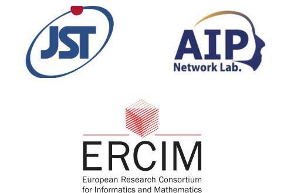

# Second JST-ERCIM Symposium

by Peter Kunz (ERCIM Office)

_ERCIM and the Japan Science and Technology Agency (JST) held their second joint symposium on 8 and 9 December 2021. The symposium aimed to present future visions and recent research results conducted in the frame of Japanese Advanced Integrated Intelligence Platform the (JST AIP) project as well as from European institutions. Some 50 scientists participated in this event to share their recent research and identify collaboration opportunities in the context of the European Horizon Europe framework program or relevant initiatives from JST._

The joint workshop focused on the theme “Accelerating digital transformation with trust for a post-COVID-19 society”. It presented recent results, emerging design frameworks and technical solutions for dealing with the coming social changes in the era of digital transformation. In a remote and contactless environment, sophisticated trust concepts and technologies are strongly demanding in every social and technology domain. Furthermore, it also provided an opportunity to share the different situations in Japan and Europe concerning the use of big data for analysis, the protection and preservation of privacy, the adherence to principles of human centric artificial intelligence (AI), and several standardisation efforts. Of particular interest were results from applications of AI in areas such as medical diagnosis, bioinformatics and drug discovery. In addition, the symposium covered a wide range of topics of common interest within the broader AI, Internet of Things (IoT) and big data areas.

The symposium was structured in four themes: (i) Trustworthy AI: theory and systems, (ii) Mathematical approaches to privacy and security, (iii) The future of IoT and AI, and (iv) Digital governance, ethical, legal and societal impacts, and AI.

functions that can efficiently achieve a consensus, reasonably integrate ideas, and discourage flaming.

Two parallel sessions then investigated the topics “Trustworthy AI: theory and systems” and “Mathematical approaches to privacy and security” In the Trustworthy AI session, Prof. Isao Echizen (National Institute of Informatics) presented “Real or fake? From biometric data protection to fake media detection”, and Tim Baarslag (CWI) spoke about “Coordination of intelligent and autonomous systems through negotiation”. In the parallel session “Mathematical approach to privacy and security” Jun Sakuma (Tsukuba University) gave a presentation “Towards the realisation of AI trusted by humans” followed by Michele Sebag (CNRS – French National Centre for Scientific Research) who spoke about “Extremely private supervised learning”.

Then, all participants came together in a panel session with the speakers to discuss questions about the relationship between their work and trust, the problems to be solved byAI and how can they be solved.

Prof. Fabio Martinelli (CNR IIT) opened the second day with a keynote on “Data usage control for data sovereignty”. He introduced the notions of data centric policies, policy refinement and policy enforcement in several scenarios, including cyber-threat intelligence management.

The symposium continued with two parallel sessions. “The future of IoT and AI” was the title of session C, where Prof. Takayuki Nishio (Tokyo Institute of Technology) gave a presentation on “Distributed machine learning in IoT networks” followed by Helmut Leopold (AIT – Austrian Institute of Technology) who spoke about “IoT and AI for a sustainable digital future”. In the parallel session entitled “Digital governance, ELSI, and AI”, Prof. Minao Kukita (Nagoya University) gave a presentation “AI is the message: How AI can affect our view of the humans” and Prof. Alexander Schatten (SBA Research) discussed the question “Is the extended mind embracing artificial intelligence? Ethical and social consequences and responsibilities.”

In the following panel session, the speakers of the parallel sessions summarised the role of the researchers in the development of autonomous algorithms and the impact of AI on the society. The speakers and the organisers ended the symposium with the desire to strengthen the research network and to establish further cooperation between groups.

#### More information:

https://sites.google.com/view/jstercim2021

#### Please contact:

Dimitris Plexousakis, ICS-FORTH, Greece dp@ics.forth.gr

The first day started with a keynote talk by Prof. Takayuki Ito (Kyoto University) entitled “An agent that facilitates crowd discussion”. He presented a large-scale online discussion platform called D-Agree. Such platforms require support

4

ERCIM NEWS 128 January 2022

## ERCIM “Alain ensoussan” ellowship Programme

_The ERCIM PhD Fellowship Programme has been established as one of the premier activities of ERCIM. The programme is open to young researchers from all over the world. It focuses on a broad range of fields in Computer Science and Applied Mathematics._

The programme offers the opportunity to ERCIM fellows:

- to work with internationally recognized experts;

- to improve knowledge about European research structures and networks;

- to become familiarized with working conditions in European research centres;

- to promote cross-fertilization and cooperation, through the fellowships, between research groups working in similar areas in different laboratories.

#### Conditions

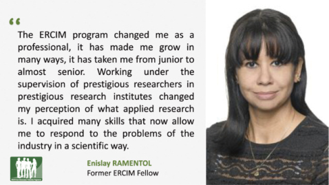

“« The ERCIM program changed me as a professional, it has made me grow in almostmany ways, it has taken me from juniorto » senior. Working under the | supervision of prestigious researchers in prestigious research institutes changed ~=7 my perception of what applied research is. I acquired many skills that now allow me to respond to the problems of the industry in a scientific way. Enislay RAMENTOL Former ERCIM Fellow 

Candidates must:

- have obtained a PhD degree during the last eight years (prior to the year of the application deadline) or be in the last year of the thesis work;

- be fluent in English;

- have completed their PhD before starting the grant.

The fellows are appointed either by a stipend (an agreement for a research training programme) or a working contract. The type of contract and the monthly allowance/salary depends on the hosting institute.

The fellowship scheme also helps young scientists to improve their knowledge of European research structures and networks and to gain more insight into the working conditions of leading European research institutions. The fellowships are of 12 months duration (with a possible extension), spent in one of the ERCIM member institutes. Fellows can apply for second year in a different institute.

Why to apply for an ERCIM Fellowship?

The Fellowship Programme enables bright young scientists to work on a challenging problem as fellows of leading European research centers. ERCIM fellowship helps widen and intensify the network of personal relations among scientists.

#### Application deadlines

Deadlines for applications are currently 30 April and 30 September each year.

Since its inception in 1991, over 750 fellows have passed through the programme. In 2021, 26 young scientists commenced an ERCIM PhD fellowship and 54 fellows have been hosted during the year. Since 2005, the Fellowship Programme is named in honour of Alain Bensoussan, former president of Inria, one of the three ERCIM founding institutes.

http://fellowship.ercim.eu

ERCIM ellowship ered a keynote address on “Data, Privacy, Ethics: Context for Research”, Community Event and two former fellows shared their personal experiences with the program and _ERCIM organized an online_ their future careers.

_ERCIM organized an online community event for its fellows and invited guests on November 9, 2021. 52 participants gathered online to present their work, exchange ideas and get to know each other._

The event was organized on an innovative online platform called “Gather Town”, which allowed participants to freely move and interact with an avatar in a virtual space.

After a long period of difficult working conditions due to the pandemic, the main goal of this virtual event was to encourage interaction and sharing among fellows and reassure them that they are part of the same community. The centerpiece of the event was a poster session. It illustrated the outstanding scientific work of the fellows and helped to identify common research challenges even in different fields. In addition, Gabriel David (INESC) deliv-

The event received overwhelmingly positive feedback from the participants. Most of them found the event helpful and would like to participate in more events of this kind.

The event was organized by Emma Lière, ERCIM Fellowship Program Coordinator, and moderated by Monica Divitini, NTNU, Chair of the ERCIM Human Capital Working Group.

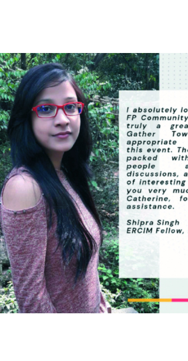

a 5 fh her rey ive xo |: 5 SSJ PETRRR 1FP absC o lutelymmunitylov MR Gather Town ) ®% appropriate RASAL ¢his event. The BREW packed with people Lan 8 discussions, ~ ofyouinterestingvery much, 8 Catherine, for ha BQ ocsistance. = Shipra Singh B88 ERCIM Follow, 1§y5 pRTF oymes a a 

5

ERCIM NEWS NEWS 128 January 2022

Special Theme

Introduction to the special theme

# Quantum Computing

by Shaukat Ali (SIMULA) and Sølve Selstø (Oslo Metropolitan University)

The development of quantum theory, which started early last century, has had an impact that can hardly be overestimated. Within the fields of physics and chemistry, it has been a true game changer; but its impact is broader than this. Our new knowledge about the nature of matter has had vast implications for our understanding of nature itself. And quantum theory has brought about new technology – such as microscopy and metrology with unprecedented resolution, lasers, spectroscopy, nuclear magnetic resonance imaging, and semiconductor-based technology, to name a few.

Moreover, a few decades ago, the idea of using quantum physics to process information was born. In theory, the potential was enormous, due to the ability to process vast amounts of information very efficiently. The problem is, of course, that quantum systems tend to be delicate; running elaborate quantum programs on physical implementations while preserving the quantum nature of the system is a challenge. Making actual hardware that could harness the quantum advantage, at the time, seemed like a pipe dream.

However, recent technological breakthroughs provide reasons for optimism. The field of quantum information technology, including quantum computing (QC), is now flourishing. There is bona fide hope that QC may be able to solve important real-life problems that are beyond the capacity of traditional information technology.

The advancement of quantum technology and quantum computing requires research and development work from a wide range of fields. We still need new theorems and algorithms, and we need to consider various physical implementations of quantum bits, qubits – both the-

oretically and experimentally, in addition to finding novel technical implementations of those being tested. On the software side, we need to develop novel ways of coding, testing, simulating and optimising quantum algorithms. We need to investigate the potential for solving real-life problems with the quantum resources available both now and in the future. And we need to find best practices in educating the next generation of quantum programmers. The advancement of quantum information technology engages mathematicians, logicians, physicists, chemists, engineers, informaticians, software developers, consultants, teachers and others. It is a pleasure to see this diversity reflected in the contributions to this issue of ERCIM News.

Interest in QC is growing globally and Europe is no exception, with several major initiatives underway. For a start, the EU Quantum Flagship FET program [L1] is pledging at least one billion Euros in quantum technologies. In addition, several European quantum computers are being developed, such as by IQM and VTT in Finland [L2], OpenSuperQ [L3], and AQTION [L4]. Moreover, ATOS [L5] is selling specialised quantum learning machines to facilitate rapid development, research, and education in quantum computing. Furthermore, high-performance computing facilities, such as eX3 [L6] in Norway, provide access to quantum computer simulators. Last, but not least, Fraunhofer installed an IBM quantum computer to accelerate the development of quantum technologies in Germany. In addition, alliances are being built: NordIQuEst is a Nordic–Estonian consortium to pool quantum computers and related resources. These computing resources will be accessible to the participating countries for research, teaching, and

developing business development plans.

This ERCIM News’s special issue about quantum computing features 25 articles that cover this topic from nine perspectives, as summarised below:

#### Quantum software

Quantum software is at the forefront of programming quantum computers to build practical applications. Cost-effective development of quantum software is often supported by a complete software stack starting from high-level languages to execution on quantum computers/emulators. However, standardisation is key for a broader impact, as discussed in Bock et al (page 8). Moreover, as highlighted in the article by Nurminen et al (page 9), quantum software presents a significant bottleneck for the success of QC after quantum hardware. Thus, the University of Helsinki, Finland, is pushing the boundaries of quantum software in many dimensions. A novel proposal also comes from the University of Torino in Italy, where programming languages for near-future quantum computers are studied, with emphasis on interactions between classical computers and quantum co-processor (Damiani et al, page 11) Finally, researchers at Aarhus University, Denmark, are investigating the control of quantum systems with Alpha-Go, which is essential to build many envisioned quantum technologies (Dalgaard and Sherson, page 12). Finally, to ensure the correctness of quantum software-based applications, Simula Research Laboratory, Norway, is developing novel automated testing and debugging solutions for quantum software (Yue and Ali, page 13). At the same institution, the eX3 infrastructure is used for quantum emulation (Denysov et al., page 15), while researchers affiliated with the Quantum

6

ERCIM NEWS 128 January 2022

Information National Laboratory of Hungary report the development of an efficient simulator of photonic quantum computing (Rakyta et al., page 17).

Quantum algorithms Quantum software implements quantum algorithms that realise quantum applications. For example, researchers at the Institute for Computer Science and Control, Hungary, are investigating new algorithms for computational algebra and machine learning (Ivanyos et al., page 18). Similarly, at the Institute for Quantum Computing and Infinite Potential Labs in Canada, algorithms for solving different types of differential equations are being studied (Fillion-Gourdeau, page 19).

#### Security and safety of quantum computing

Quantum computations will soon be accessible through on-demand services; therefore, security and privacy requirements will need to be ensured. Researchers from Inria, France, report their results on embedding security as part of quantum hardware, in addition to quantum networks ensuring the security requirements (Garnier and Olivier, page 21). The need to perform computation on untrusted servers is also highlighted in the article by Hrdá (page 22). To this end, the Fraunhofer AISEC, Germany, is investigating the development of secure and safe quantum computers to enable trustworthy QC.

Quantum computing benchmarking Researchers from the University of Thessaly in Greece are working on benchmark quantum computing devices. Such benchmarking is essential to enable us to evaluate and compare quantum devices to assess their performance in solving problems (Savvas, and Galanis, page 24).

Quantum computing applications With the hope that novel quantum solutions will soon find their way into practical applications, several interesting ideas for quantum applications have been proposed. A novel approach involving quantum walks for modelling

autonomous driving is presented in the article by Karafyllidis (page 25), while Halffmann et al. (page 27) outline plans to apply quantum computing to improve energy market modelling. As described in the article by Bartsch et al. (page 28), the quantum version of the muchapplied Fourier transforms bears promise of finding several industrial applications.

#### Joint ventures and initiatives

To advance quantum computing and promote the quantum cause, researchers and research groups have been establishing joint projects, centres and other initiatives. Several of these are introduced in this issue, including the SEQUOIA project (Tutschku and Stephan, page 30), the Nordic-Estonian Quantum Computing e-Infrastructure Quest (Johansson and Wendin, page 31), the Quantum for Life research centre (Nielsen, page 33), and the QSpain think tank (Arias et al., page 34).

#### Quantum networks

Quantum computing will eventually need to be enabled on the internet to support, e.g., distributed quantum computing. However, the classical internet is not sufficient to transport quantum states. Thus, researchers from Institute for Informatics and Telematics, Italy, are researching quantum networks with the long-term goal of establishing a quantum internet; the security of such networks is their core agenda (Cicconetti et al., page 36). The Fraunhofer Competence Network Quantum Computing is also investing in network German quantum computing resources intending to support realworld applications of QC (Behlau and Venzl, page 37). Fraunhofer took the major step of installing a quantum computer by IBM in its premises in Ehningen, Germany, with the objective of providing access to this technology to relevant partners who wish to develop QC applications through the competence network.

Quantum computing education With quantum computers becoming available, there is a need for profes-

sionals who can program them. As pointed out by researchers from Fraunhofer AISEC (Simić and Hrdá, page 39), this need must be identified and recognised by those who educate the next generation of computer engineers and scientists. A relevant question in this regard, as addressed in the article by Bungum and Selstø (page 40), is whether students should be familiar with quantum physics in order to learn quantum computing.

#### Quantum computing hardware

If existing prototypes are anything to go by, superconducting Josephson junctions seem to be the most promising implementation of quantum bits. However, promising alternatives are still on the table, such as implementations involving photonics, as in the article by Thanopulos et al. (page 41), or spin (Mitrikas, page 43).

The wide range of articles from different perspectives in this special issue highlights the promising future of quantum computing in Europe. Furthermore, the contributions of researchers from various fields, including physicists, mathematicians, software engineers, computer scientists, and educational researchers, show that experts from many domains are aware of quantum computing’s importance in the future. This awareness will enable quantum computing to deliver applications in many fields.

#### Links:

- [L1] https://kwz.me/h99 [L2] https://kwz.me/h9f

- [L3] https://opensuperq.eu/

- [L4] https://www.aqtion.eu/

- [L5] https://kwz.me/h9y

[L6] https://www.ex3.simula.no/

#### Please contact:

Shaukat Ali, SIMULA, Norway shaukat@simula.no

Sølve Selstø, Oslo Metropolitan University solvese@oslomet.no

7

ERCIM NEWS 128 January 2022

Special Theme

# Towards a Standardised Quantum Software Stack

by Sebastian Bock, Raphael Seidel, Colin Kai-Uwe Becker (Fraunhofer FOKUS)

_Quantum computers have the potential to solve problems that are currently not tractable. In order to leverage this potential, the article presents concepts of a high-level quantum programming language and corresponding software layers to pave a way for an efficient and interoperable programming of quantum computers._

The development of quantum algorithms with potentially exponential speedup compared to classical algorithms has generated broad interest in both research and industry. Advances in hardware development, with better gate fidelities and increasing qubit numbers, indicate that this potential may be accessible in a few years [1]. In preparation for this quantum advantage, many initiatives are already developing and testing software frameworks that make it possible to build quantum programs and execute them either on a simulator or on currently available quantum devices.

There is, however, a huge gap between the user-friendly and well-known classical programming and development of quantum programs, which is typically hardware-close, and relies on an assembler-like circuit structure based on quantum gates. To really use the potential of quantum computers, it is necessary to be able to build quantum programs in an efficient and user-friendly way with low entry barriers. Ideally, known paradigms from classical programming should be supported as well. These requirements point directly to the need for a high-level quantum programming language. Alongside this language, a compiler is needed to translate the programs to a series of quantum gates which, via a firmware, can then be executed on a quantum computer.

Research and development challenges exist at every layer of this simplified model of a quantum software stack. This is particularly the case in Europe, where work is needed to pave the way for a user-friendly, commercially available quantum technology that can guarantee technological sovereignty for Europe. To address these challenges, the Qompiler partnership project is aiming to develop a hybrid high-level quantum programming language based on a categorical layer with a corresponding compiler, a firmware for an ion trap quantum com-

puter and a standardisable interface between firmware and higher-level compilers to achieve interoperability. The most important features of the Qompiler software layers, highlighted in Figure 1, are:

piler to guarantee type safety. For the Qompiler Project, the CAP package with the according compiler, developed largely at the University Siegen [L1], will be used and expanded by the ZXCalculus, which is a monoidal categorical description of quantum mechanics and thereby easily integrable in the existing framework.

#### High-level quantum programming language

The envisioned programming language includes known classical paradigms such as if/else conditions and loops, but also automates important quantum subroutines such as Uncomputation, and is able to act on a logical level, meaning that quantum error correction routines can be integrated and the translation from the logical to the physical level is automated. Furthermore, the language will be constructed in a hybrid manner, meaning it will support imperative and functional programming, which appears to be natural for quantum computers, since every quantum gate can be understood as a function.

#### Standardisable interface

The output of this categorical layer will then be compiled to a low-level quantum code (e.g. OpenQASM), which can then, through an interface, be passed to the firmware of a quantum computer. The goal is to define an interface that can connect software frameworks with different hardware approaches to create an interoperable, open environment and prevent vendor lock-in effects. To promote this development a DIN-SPEC shall be initiated at the end of the project.

#### Firmware for an ion trap quantum computer

Categorical layer with compiler A functional programming language also has the advantage of an easy integration with a categorical layer/com-

For a full quantum software stack the aforementioned layers must be tested on a real quantum computer. To address

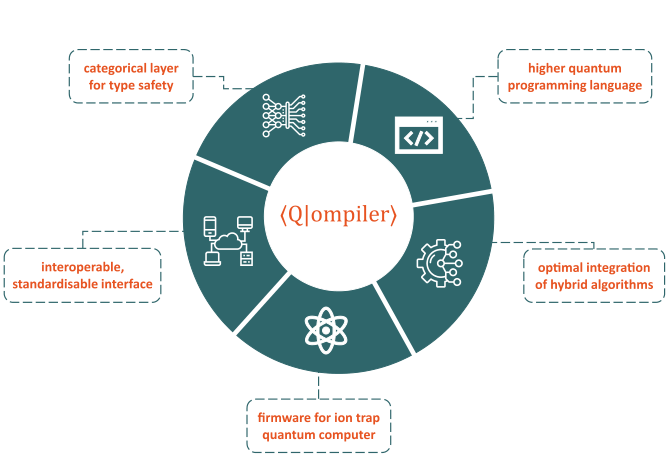

**_Figure 1: Software layers and elements to be developed in the Qompiler partnership project._**

8

ERCIM NEWS 128 January 2022

this, a firmware for an ion trap quantum computer will be developed in a partnership with eleQtron GmbH towards executing quantum programs on real hardware. Features of this firmware will be a software that will both control single registers and connect these registers to further increase the Qubit count.

Integration of hybrid algorithms Hybrid algorithms will play an important role in quantum computing, especially in the NISQ regime [2]. To have an ideal implementation in the Qompiler software framework and achieve quantum advantages as early as possible, measures and benchmarks will be performed to define the optimal classical-quantum resource sharing and get the most out of the quantum hardware.

#### Summary

With the high-level quantum programming language, the categorical layer (both intended as open-source projects) and the planned standardisation activities for the interface between hardware

backends and software frameworks, the Open Communication Systems Qompiler partnership project lays the (FOKUS), eleQtron GmbH, University foundation for an open, vendor indeof Siegen, Technical University of pendent and thriving ecosystem, which Berlin and the German standardization – mainly through the standardisable body DIN. inter-face – helps to reduce the risk of vendor lock-in. Furthermore, the **Link:** firmware for the ion trap quantum com[L1] https://github.com/homalgputer developed by eleQtron GmbH is project/CAP_project an important step towards a European quantum computer, thereby gaining **References** technological independence from other [1] L. Egan, D.M. Debroy, C. Noel, et geopolitical players. Finally, the softal.: “Fault-tolerant control of an ware framework to be developed in the error-corrected qubit”, Nature 598, Qompiler project and the connection to 281–286 (2021). a European quantum computer ensures [2] Bharti, Kishor, et al.: “Noisy easier and safer access to quantum comintermediate-scale quantum (NISQ) puting resources, especially for small algorithms” arXiv preprint and medium sized enterprises. arXiv:2101.08448 (2021).

- [2] Bharti, Kishor, et al.: “Noisy intermediate-scale quantum (NISQ) algorithms” arXiv preprint arXiv:2101.08448 (2021).

The Qompiler project was selected for funding by the Federal Ministry for Economic Affairs and Energy (German: Bundesministerium für Wirtschaft und Energie, abbreviated BMWi) and will start at the beginning of 2022. Key partners are the Fraunhofer Institute for

#### Please contact:

Sebastian Bock Fraunhofer Institute for Open Communication Systems FOKUS, Germany

sebastian.bock@fokus.fraunhofer.de

# The Next ottleneck after Quantum Hardware Will be Quantum Software

by Jukka K. Nurminen, Arianne Meijer, Ilmo Salmenperä and Leo Becker (University of Helsinki)

_As quantum computers are developing, the need for quantum software is becoming increasingly important. To take advantage of the new hardware, software developers are faced with new questions: Can quantum computing be useful for my problem? How do I formulate my problem to a quantum computer and interpret its answer? How do I integrate, test, monitor, and maintain quantum software? Our research at the Department of Computer Science at the University of Helsinki is investigating these questions._

One of the challenges with developing quantum software is to find the right abstraction. A gap exists between the mathematical formalism used by physicists and the approach taken by software developers. In one experiment we tried to hide quantum computing completely from the software developer and use an automated quantum offloading system to detect code to run on quantum hardware [1]. While detecting and compiling code for parallel execution on GPU hardware is rather easy, the problem of automatically detecting code that benefits from quantum hardware is much more difficult. It would also need highly reliable and powerful quantum computers to be useful.

For shorter-term gains, the NISQ algorithms are an obvious target. To get the maximum benefit of the present limited quantum hardware we are both improving the existing algorithms so that they use fewer resources and optimising the quantum programs to make better use of the existing resources on a quantum computer.

In terms of improving algorithms, we are looking at variational quantum eigensolvers (VQE) as an example NISQ algorithm that has the potential to be a useful application of quantum computers. The VQE algorithm is used for simulating molecules on the quantum level of interatomic interactions. It

works by running a small quantum program on a quantum computer and then using machine learning to optimise the parameters of the program until it finds the right solution. This is a very popular research field and many variations of the VQE algorithm have been proposed. Right now, it is difficult to compare VQE algorithms and find the best for a given task, let alone figure out why it is doing better than the others. For that reason, we are building a benchmarking system for VQE algorithms: QuantMark [L1]. From the differences that can be found between algorithms on QuantMark, we might be able to design new algorithms based on those new insights.

9

ERCIM NEWS 128 January 2022

Special Theme

**_Figure 1: Quantum Annealers can be useful as a part of the pretraining process of Deep Belief Networks (DBN), where quantum annealing is used to estimate the model distribution of the singular RBMs, which are used to form the initial parameters of the DBN. Afterwards the model can be trained using classical methods, resulting in a machine learning model compatible with classical computers._**

**_Figure 2: We use a variant of the Unit Dropout method, where Smax units are “dropped” stochastically for the duration of a single batch. This allows for larger layer sizes to be embedded to quantum annealing devices than would be conventionally possible._**

Then, when we have the quantum program to run on the quantum computer, the task is to make that program run efficiently on the quantum computer. To this end, we are researching new compilation methods specific to quantum computers. Some compiling methods for classical computing can be adjusted to work for quantum computers, such as gate scheduling (i.e. determining the order in which operations are performed). However, some are specific to quantum computers, such as the inability to copy a qubit because of the no-cloning theory. Combining the inability to copy with the fact that limited connectivity in quantum computers only allows operation between a few specific qubits (rather than between arbitrary qubits) means that preparing qubits in particular registers needs to be done carefully. This cannot always be done so that all needed operations are allowed, in which case the quantum program needs to be adjusted to make it work. For example, it is possible to add operations to the program that move the qubits to a different register. However, this needs to be done optimally to avoid

introducing more error by each operation to the outcome or running out of calculation time and losing the qubit altogether (decoherence). These are new and difficult problems that we did not have with classical computing. Therefore, we can still make a lot of progress in research on quantum compilation methods.

Machine learning with its large computational needs is an interesting application domain. Quantum Annealing devices have been shown to have potential benefits over classical algorithms when training Restricted Boltzmann Machines [2]. We have been studying if a common weight regularisation method, called the unit dropout method, can be used to deal with the challenges of limited device sizes. The built-in randomness of quantum computing seems to have a positive influence on the operation of the algorithm making the dropout method work better.

#### Link:

[L1] QuantMark benchmarking environment for VQE algorithms: https://kwz.me/h9j

#### References:

- [1] J. Speer, J.K. Nurminen: “Program Equivalence Checking for the Facilitation of Quantum Offloading, 2021 IEEE 11th Annual Computing and Communication Workshop and Conference https://researchportal.helsinki.fi/file s/159680541/Jon_Speer_Quantum_ Offloading.pdf

- [2] I. Salmenperä: “Training Quantum Restricted Boltzmann Machines Using Dropout Method”, Helsingin yliopisto, 2021 https://helda.helsinki.fi/handle/101 38/329796

#### Please contact:

Jukka K Nurminen University of Helsinki jukka.k.nurminen@helsinki.fi

10

ERCIM NEWS 128 January 2022

# Programming the Interaction with Quantum Coprocessors

by Ferruccio Damiani, Luca Paolini and Luca Roversi (Università di Torino)

_We point out the relevant features of the incoming quantum devices in a programming perspective. Then, we outline some issues that programming languages should face and some solution attempts. We conclude arguing how quantum programming language will ease the quantum spreading in the information and communications technology world._

Quantum computing, performed on devices that rely on quantum phenomena, will enable us to achieve computations that are intractable by means of classical computers. Quantum computers will speed up computational solutions in areas including chemistry (for example, materials science, pharmaceuticals), artificial intelligence (for instance, machine learning), biology, finance and more.

It is commonly accepted that such physical quantum devices must fulfil five criteria as identified by DiVincenzo [L1]. First, they must provide a set of wellbehaving qubits that form the quantum memory. Second, they must be able to initialise the state of the quantum memory. Third, since quantum states lose information quickly (because of environmental interference), the decoherence time of quantum memory must be suitably long. Fourth, they must incorporate a set of quantum universal gates, i.e., a set that can approximate the result of any given quantum computation with arbitrary accuracy. Fifth, they must provide a suitable quantum measurement support. These constraints are the key hurdles that engineers must overcome, but there are others too. For example, additional issues are the satisfaction of adjacency/neighbouring constraints on the physical realisation of qubits and the reliability of quantum communication between different quantum computers or nodes.

The state of the art of quantum computers based on universal quantum gates is represented by Noisy IntermediateScale Quantum architectures (NISQ), which can supply some hundreds of noisy qubits, i.e., qubits with a limited capacity to preserve quantum coherence. The reason is that the current technology is not able to perfectly isolate qubits from the external environment.

In the context of quantum programming languages, the expected implementation

Moreover, associating a type to a program can improve the efficiency, both in terms of memory allocation and reusability of software components.

of NISQ is typically idealised by means of quantum coprocessors. In this idealised situation, the programming activity evolves in a interacting dialogue between quantum coprocessors and classical computer: from the classical side, the programmer can invoke a sub-program that runs on the quantum coprocessor and waits it to terminate in order to measure the result. It is worth noticing that quantum algorithms are usually represented by means of classical information (quantum circuits) that are predisposed (i.e. meta-programmed) in the classical computer and, when ready, offloaded to a

So, a programming language for hardware that embodies both classical processors and quantum coprocessors is expected to ensure properties analogous to the ones listed here, but this introduces a relatively unexplored landscape due to fundamental differences between classical and quantum programs. Concretely, the interaction between the two programming paradigms becomes possible once the operational semantics

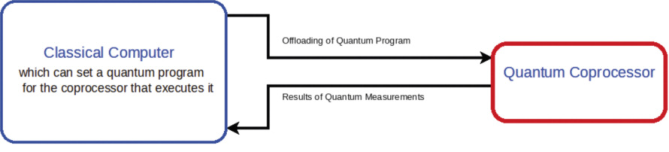

‘omoaang Classical Computer of Quam Progam Which can set a quantum program Quantum Coprocessor for the coprocessor that executes Fr T—— 

**_Figure 1: Quantum coprocessor interaction with a classical computer._**

of the two parts smoothly integrates the dialogue between the specific constructs that drive classical and quantum hardware. The standard example that exemplifies the problems to cope with is the no-cloning constraint that governs the quantum computations: no-cloning prescribes that quantum states stored in a quantum memory cannot be duplicated, while classical programming languages do not provide any support for non-clonable data.

quantum coprocessor which executes it. Furthermore, quantum measurement outcomes are classical data. Figure 1 summarises the idea.

We recall that the purpose of programming languages is to syntactically and semantically abstract away from the overwhelming details typically required to govern the behaviour of hardware; the neat goal is a proactive support to software development, maintenance and its reliability. It is now widely accepted that embodying a typing discipline into a programming language simultaneously assures good computational properties of the language, and enhances readability, reliability and maintenance of software. Remarkably, strong typing disciplines allow us early detection, i.e., before program execution, of a possibly wide range of programming errors, the width depending on the expressiveness of the language of types available.

Many proposals to overcome the issue are being considered in the literature. They span from the extension of classical type systems with linear typing features, to quantum stateless approaches that limit the freedom to express quantum algorithms, passing through the explicit management of quantum registers with very specific purpose and use. Our group, in collaboration with colleagues from the

11

ERCIM NEWS 128 January 2022

Special Theme

University of Verona, explored a stateless approach in [2] and an explicit management of quantum registers in [1].

The goal of developing programming languages with a smooth coexistence of the control over both classical processors and quantum coprocessors, supporting the quantum programming peculiarity, is shared by the main stakeholders that are developing quantum technologies. The reason is that such languages will positively impact on the discovery, the design, and the implementation of quantum algorithms thanks to the abstraction over the quantum hardware that they can assure. Last, they will be crucial at least for

|devising computational complexity|[2] L. Paolini, M. Piccolo, M. Zorzi:|
|---|---|
|models for quantum computations and|“QPCF: Higher-Order Languages|
|for teaching quantum computing to|and Quantum Circuits Journal of|
|newcomers and expert classical pro- grammers.|Automated Reasoning”, 2019, 63(4), pp. 941–966. https://doi.org/10.1007/s10817-|
|A technical and recent survey on quan-|019-09518-y|
|tum programming language is in [3].|[3] B. Heim, M. Soeken, S. Marshall, et al.: „Quantum programming|
|**Link:**|languages”, Nat Rev Phys 2,|
|[L1] https://kwz.me/h8W|709–722 (2020). https://doi.org/10.1038/s42254-|
|**References:**|020-00245-7|
|[1] L. Paolini, L. Roversi, M. Zorzi: “Quantum programming made easy”, Linearity-TLLA@FLoC|**Please contact:** Luca Paolini|
|2018: 133-147. https://doi.org/10.4204/EPTCS.292.8|Università di Torino, Torino, Italia luca.paolini@unito.it|

# AlphaZero: Playing Chess and Controlling Quantum Systems

by Mogens Dalgaard (Aarhus University), Felix Motzoi (Forschungszentrum Jülich) and Jacob Sherson (Aarhus University)

_Achieving high-performing control of quantum systems is a formidable challenge that is being addressed by physicists around the world. Pushing beyond the current frontier could help realise quantum technologies within communication, sensing, drug design, machine learning, optimisation, and computation. Our work demonstrates that the state-of-the-art machine-learning algorithm, AlphaZero, initially designed for playing board games such as chess, can also control a quantum system._

What do playing chess and controlling a quantum system have in common? “Absolutely nothing” would probably be the immediate answer from most physicists engaged in quantum control. However, there are several common traits between the two. For instance, both are generally very complicated problems, where “expert solutions” are not generalisable across the various situations that may be encountered. In addition, both typically require a global search strategy to reach the best solutions. In chess, this global search strategy naturally presents itself as a long-term planning task, i.e., a skilled player needs to foresee several steps ahead in the game to make their next move. Similarly, quantum physicists have developed methods to gradually improve the “score” of their control solutions. Unfortunately, quantum control problems often contain many suboptimal solutions that impede local optimisation algorithms specifically designed to optimise quantum control. This problem is what inspired us to look outside quantum physics for help.

The help we found came from a reinforcement-learning algorithm developed by a private company Google Deepmind [1]. In 2017, Deepmind developed AlphaGo, which was the first algorithm to successfully beat human players in the ancient Chinese board game Go. However, AlphaGo required training a deep neural network on previous gameplays, which was not ideal in the context of quantum control optimisation, since we may not have reasonable solutions at hand a priori. AlphaZero [1], a more powerful successor, developed in 2018, on the other hand, was self-taught by only playing against itself, starting from having no expert knowledge of the game. It performed amazingly within the complicated board games Chess, Go, and Shogi, beating both the best human players and the best game-specific designed playing software.

The key to AlphaZero’s success was the combination of two very powerful ideas: a Monte Carlo tree search and a deep

neural network. A tree search is a tool to foresee future outcomes starting from one’s current state. However, an exhaustive search would be too expensive for complicated board games such as chess. In contrast, a shallow search would be too constrained in information about the game’s future development. To avoid this problem, the tree search in AlphaZero is guided by a deep neural network that allows it to explore the most promising branches and avoid those that are more likely to lead to defeat.

In our work [2], we applied AlphaZero to control a superconducting circuit consisting of two coupled quantum bits or qubits, which is an architecture that is potentially applicable in a quantum computer. However, a major problem in real-life experiments is that the circuit has unwanted interactions with its nearby environment, which are only negligible in the regime of shorter durations. For this reason, we need to find control solutions that work in as short a time as possible.

12

ERCIM NEWS 128 January 2022

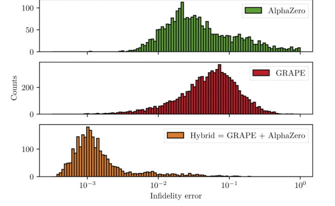

100 EE AlphaZero "0 ill £ 200 S 0 EEE Hybrid = GRAPE + AlphaZero 100 0 10° 10-2 10°" 10° Infidelity error 

**_Figure 1: The infidelity error (lower is better) for making a quantum computational gate that could potentially be used in a quantum computer. The figures show the results of three different methods: A deep learning algorithm, AlphaZero, a local gradient-based optimisation algorithm, GRAPE, and a hybrid algorithm that combines the two. Results are taken from [2]._**

being a very efficient local optimisation algorithm, it would always find the nearest optimum in the space of solutions. However, the existence of many suboptimal solutions would ultimately impede its performance. For this reason, we designed a hybrid algorithm where AlphaZero’s solution would subsequently be optimised by GRAPE. With this hybrid algorithm, we obtained around 200 times as many high-performing solutions compared to when using GRAPE or AlphaZero on their own. Based on our results, we believe deep learning combined with quantumspecific designed tools could potentially help realise certain quantum technologies.

We applied AlphaZero to this control problem and benchmarked it against a local gradient-based quantum control algorithm, GRAPE, which was set to optimise randomly drawn controls. The GRAPE algorithm has, in particular, benefited from a couple of decades of fine tuning, incorporating expert knowledge from quantum physics and computer science. Both methods did comparably well in an equal computationalresource comparison, but for quite different reasons. AlphaZero learned the overall structure of the solution space, in particular, identified promising regions, but had limited ability to finetune its solutions.. In contrast, GRAPE had no learning incorporated into it, but

In our subsequent work [3], we have also encoded the entire many-body dynamics into a deep neural network. This could help avoid the curse of dimensionality that prohibits numerically solving sufficiently big quantum systems. In doing so, we obtained up to several orders of magnitude speed-up in evaluation time.

To summarise our experience: deep learning constitutes a powerful set of tools that allows us to tackle problems of increasing complexity. We are looking forward to seeing how the field develops in the years to come.

#### References:

- [1] D. Silver, et al.: “A general reinforcement learning algorithm that masters chess, shogi, and Go through self-play”, Science, 362(6419), 1140-1144, 2018.

- [2] Dalgaard, et al.: “Global optimization of quantum dynamics with AlphaZero deep exploration. npj Quantum Information, 6(1), 1-9, 2020.

- [3] M. Dalgaard, F. Motzoi, J. Sherson: “Predicting quantum dynamical cost landscapes with deep learning”, arXiv preprint arXiv:2107.00008, 2021.

#### Please contact:

Mogens Dalgaard Department of Physics and Astronomy, Aarhus University dalgaard@phys.au.dk

# Quantum Software Testing: Challenges, Early Achievements, and Opportunities

by Tao Yue (Simula Research Laboratory), Paolo Arcaini (National Institute of Informatics, Japan) and Shaukat Ali (Simula Research Laboratory)

_Quantum software testing provides systematic and automated ways to test quantum programs to guarantee their correctness and dependability. Such a guarantee is critical to delivering the pledged revolutionary quantum computing applications to the world._

Quantum computing (QC) is a radically new computation paradigm, which lays its foundation on quantum mechanics. QC promises to deliver a revolutionary leap in computation by solving complex problems that classical computers, including powerful supercomputers, cannot handle. QC is pledging leading-

edge applications, such as rapidly developing vaccines and drugs, and better understanding and predictions for cancer and other types of diseases. Developing such applications requires quantum programming. Nowadays, quantum programmers have access to a range of quantum programming lan-

guages, platforms, and simulators. However, the big challenge is to costeffectively develop high-quality quantum software that delivers the promised revolutionary applications.

Like classical software engineering, quantum software engineering (QSE)

13

ERCIM NEWS 128 January 2022

Special Theme

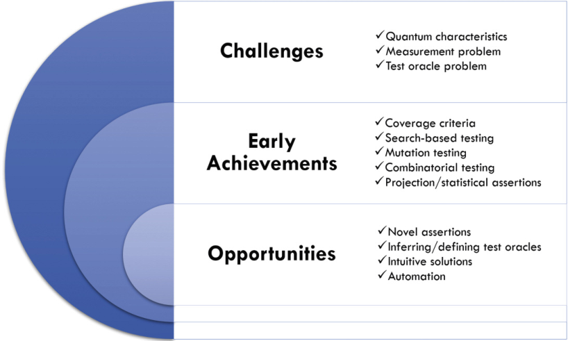

¥ Measurement problem Challenges ¥ Quantum characteristics Test oracle problem v Coverage criteria Early vSearch-based testing . v Mutation testing Achievements Combinatorial testing ¥ Projection/statistical assertions Novel assertions fm) Opportunitiesoe VVIntuitive Inferringsolutions/defining test oracles ¥ Automation 

**_Figure 1: Quantum software testing: Current status and way forward._**

will provide principles, processes, methods, and tools to support the design, development, maintenance, and testing of quantum software, i.e., the typical phases of a software development cycle. Since QSE is relatively new, there is currently no such life cycle for systematically developing quantum software. However, due to the availability of quantum programming languages and platforms, developing and executing quantum programs (on simulators and, to a limited extent, on quantum computers) has become possible. Furthermore, with the increasing volume of quantum software now available, the research community has started considering testing quantum programs to be an important phase.

Testing classical software has been an active research area for decades, thus there is a considerable body of knowledge in this area, which could potentially help with devising quantum software testing methods. However, quantum software adheres to quantum mechanics principles and has novel features, such as qubits, superposition, and entanglement, which introduce a new dimension of complexity, thereby, raising novel challenges on quantum software testing (see Figure 1). First, it is impossible to directly read and check quantum software states in superposition because measuring qubits results in the destruction of the superposition property of the program. In comparison, for classical software,

we can instrument the program to read its states at any location whenever it is needed. Second, when testing a quantum program, it is difficult to precisely define the test oracle, i.e., a mechanism for determining whether the output is expected for a given input. For simple quantum programs, one could define probabilistic test oracles (indicating whether a test case passes/fails with a given statistical confidence), introducing further challenges such as selecting proper statistical tests and defining a suitable number of measurements/observations. Test oracles might not even exist for complex applications (e.g., weather forecasting, molecular design). Last, but not least, for classical software testing, there exist methodologies for eliciting (formally and informally), specifying, and modelling test oracles, or even generating test oracles with requirements as the basis. For quantum software testing, such methodologies do not exist.

We see these issues as opportunities as much as challenges! The research community has already started taking on such challenges and obtained early achievements, as evidenced by the increasing number of works published in major software engineering venues (see Figure 1). One such achievement is Quito [1] [L1, L2], which tailors input and output coverage criteria from classical computing for testing quantum programs. Quito provides

initial test suites that can give certain confidence in the correctness of the quantum program under test. However, the Quito approach faces scalability problems when testing quantum programs with high numbers of qubits; thus, requiring the development of test optimisation methods. To this end, QuSBT [2] [L3] was proposed, which employs a Genetic Algorithm (GA) to search for test suites with a maximum number of failing test cases. QuSBT has shown promising results when compared to a simple baseline (random search). Note that both Quito and QuSBT perform black-box testing, i.e., test cases are executed without reading the internal states of the quantum program.

Apart from test case generation, another important aspect of testing is the definition of the possible faults that could occur in reality. To this end, Muskit [3] [L4-L5] has been proposed as a mutation analysis approach for quantum programs. Based on various mutation operators defined specifically for quantum gates in quantum programs, Muskit can generate many mutated programs. Such programs can serve two purposes: (i) providing faulty programs for assessing the quality of test cases generated by various testing strategies; and (ii) guiding the generation of test cases. Finally, a recent effort was made to investigate the application of a classical combinatorial testing technique to quantum programs [L6].

14

ERCIM NEWS 128 January 2022

Despite these early achievements, some challenges remain unaddressed or are insufficiently addressed in quantum software testing (see Figure 1). First, we need sophisticated solutions to measure the internal states of quantum programs to define white-box testing methods. Recent advances in projections and statistical assertions are a good start along this research line. Second, we need to develop mechanisms to define or infer test oracles for quantum programs. Metamorphic testing might be the right direction to pursue learning from classical software, which has shown promising results for testing programs for which test oracles do not exist. Third, we need intuitive testing solutions readily usable by test engineers. Currently, the development and testing of quantum programs are at the low-level quantum circuits. Last, testing techniques are currently developed for noiseless simulators, but the generated tests must be ulti-

- mately executed on physical hardware [2] X. Wang, et al.: “Generating Failing subject to noise, which is still unavoidTest Suites for Quantum Programs able in the current and near-future With Search”, in: O’Reilly UM., quantum computers. However, signifiDevroey X. (eds) Search-Based cant effort is being made to eliminate the Software Engineering, SSBSE noise from QC hardware. 2021, LNCS, vol 12914, Springer, https://doi.org/10.1007/978-3-030-

- **Links:** 88106-1_2

   - [3] E. Mendiluze, et al.: “Muskit: A mutation analysis tool for quantum software testing”, in The 36th IEEE/ACM Int. Conf. on Automated Software Engineering, Tool Demonstration, IEEE/ACM, 2021.

- [L1] https://kwz.me/h8J

- [L2] https://kwz.me/h8M

- [L3] https://kwz.me/h8Q

- [L4] https://kwz.me/h8R

- [L5] https://kwz.me/h8U

- [L6] https://kwz.me/h8V

#### References:

- [1] S. Ali, et al.: “Assessing the Effectiveness of Input and Output Coverage Criteria for Testing Quantum Programs”, 2021 14th IEEE Conf. on Software Testing, Verification and Validation (ICST), 2021, pp. 13-23, doi:

#### Please contact:

Tao Yue Simula Research Laboratory, Norway tao@simula.no

- 10.1109/ICST49551.2021.00014.

# Software for Emulations of Digital Quantum Algorithms: To uild or not to uild?

by Sergiy Denysov (OsloMet), Sølve Selstø (OsloMet) and Are Magnus Bruaset (Simula Research Laboratory)

_Emulations of quantum algorithms on classical computers remain the key part of the benchmarking of the present-day quantum computers. The continuous growth of the number of qubits in these prototypes makes the corresponding simulations very resource intensive. When preparing to perform them on a cluster, we must make good use of classical high performance computing techniques, like multithreading and GPU acceleration, as well as take into account the particular architecture of the cluster. In this situation, the question posed in the title becomes highly relevant._

Currently, Quantum Computing (QC) experiences a period of unprecedentedly fast growth but, as a technology, it is still in its infancy. According to the most optimistic estimates, it will take another five-seven years for QC to fully mature. Further development of QC is still conditioned on the ability to successfully emulate quantum circuits and algorithms on classical computers, and most currently existing benchmarking protocols are based on comparisons between the performance of ‘ideal’ emulated circuits and those ran on the QC prototypes. The notion of Quantum Volume [1] promoted by the IBM and Honeywell as a measure of QC performance as well as the setup of Google’s Quantum Supremacy experiment [2] are both based on such comparisons.

The Curse of Dimensionality limits the horizon of QC emulations in a very strict manner.Addition of every new qubit to a circuit means doubling of the memory space and a reasonably large current-day supercomputer is not able to simulate circuits with more than 49 qubits (although further increase is possible at the price of imposing restrictions on the accessible states) [3]. At the same time, the QC technology has already progressed beyond this limit and recently IBM announced its new QC processor Eagle with 127 qubits [L1].

As we demonstrate below, the memory size needed to store the description of the wave function, i.e. to specify its complex amplitudes, of a system of N qubits can be trivially estimated. The additional memory size, needed to

install the software, describe the circuit/algorithm, and finally to implement sequence of gates, does not scale exponentially with N (at worst polynomially) and is therefore negligible.

In this situation the performance becomes an important characteristic and the choice of software starts to really matter. Now the question we posed in the title can be made more specific: When planning to perform emulations of complex multi-qubit quantum circuits/algorithms on a specific computer cluster or supercomputer, what is the better option – to use one of the existing QC emulation packages or to build our own tailored software?

A good cluster-oriented QC emulation software should allow for paralleliza-

15

ERCIM NEWS 128 January 2022

Special Theme

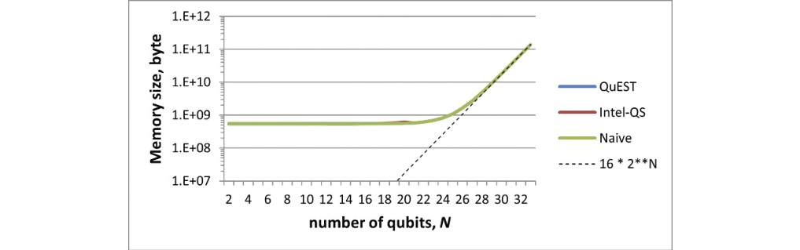

1B 9q £1E411 2! 2g1E+10 | —— QuEsT Z 16009 | za —— Intel-as 2$ res |i oa Bs ees 16%Naive2%*N LEH? Imre errr 2 4 6 8 1012 14 16 18 20 22 24 26 28 30 32 number of qubits, N 

**_Figure 1: Total memory size needed to emulate a random Hadamard-cNOt circuit on the ENDEAVOR cluster, as a function of N._**

tion (both on local and distributed memory) and for efficient control of the resource consumption during every stage of the emulations. Most of the existing open-source QC packages [L2] do not fulfil these conditions. In fact, we have found only two which do, QuEST [L3] and Intel-QS [L4]. We have analysed their performance on two supercomputers, the ENDEAVOR Intel cluster [L5] and eX3 [L6], which is the Norwegian national infrastructure for experimental exploration of exascale computing (on the latter we used an NVIDIA DGX-2 system). In both cases, we emulated circuits of N qubits with N Hadamard (single-qubit) gates and N cNOT (two-qubit) gates for N ranging from 2 to 32. The arrangement of the gates was purely random. For every value of N, the results were averaged over 50 random circuit realizations.

Additionally, we created a very basic software which does not use vectorization, cash optimization, and or other similar tricks that are usually taken into account when optimizing the performance. We named this software Naïve; its sole purpose was to create a background for comparing the performance of QuEST and Intel-QS.

Figure 1 shows the total memory size needed to emulate a random Hadamard-cNOt circuit on the ENDEAVOR cluster, as a function of N. It highlights two things: First, there is no difference between the three software implementations. Second, with the increase of N all three curves align the universal scaling which simply follows from the fact that every complex amplitude demands two real numbers (8B each) to be specified. As we noted

above, other memory resources, which go on top, are negligible for N > 28.

When run on the ENDEAVOR cluster, QuEST demonstrated a high degree of parallelization (near 90%), while it was found to be very low (≈15%) for the other two. In case of Naïve, this is obviously due to the lack of optimization. In the case of Intel-QS, it is because a single-threaded implementation of the operation updating the amplitude data array.

Only QuEST has been tested on the GPU-based DGX-2 system in the eX3 infrastructure since only this software package supports the use of graphics accelerators. Unfortunately, it is, however, able to use only one such accelerator. We designed a GPGPU version of Naïve to compare its performance with the performance of QuEST. The outcome is that Naïve performed better than QuEST by all the indicators, including the computation time.

To summarize, two observations can be made. First of all, the ability to simulate digital quantum circuits and algorithms are limited only by the available memory which has to be larger than 16*2N bytes. In this respect, the dedicated ATOS Quantum Learning Machine [L7] , which is able to emulate “up to 42 qubits”, mainly constitutes a stack of memory modules summing up to no less than 36 TB capacity. Second, as demonstrated by Naïve, the software component can be on-purpose designed and optimized when the choice of the cluster has been made. So, if you are up to the task, the answer to the question is: Build.

However, this answer also demonstrates that there is need for general-purpose QC emulators that do a better job of optimizing their performance for the specific problems you want to solve. When emulations are a part of large international project involving several computing centres and clusters, there will be a need for a unified cloud-accessible platform operating under a joint software environment.

#### Links:

- [L1] https://kwz.me/h9B

- [L2] https://kwz.me/h9b

- [L3] https://kwz.me/h9t

- [L4] https://kwz.me/h9d

- [L5] https://kwz.me/h9c

- [L6] https://www.ex3.simula.no/

- [L7] https://kwz.me/h9y

#### References:

- [1] A. Cross et al.: “Validating quantum computers using randomized model circuit”, Phys. Rev. A. 100, 032328 (2019)

- [2] F. Arute et al.: “Quantum supremacy using a programmable superconducting processor”, Nature 574, 505 (2019).

- [3] D. Willsch et al.: “Benchmarking supercomputers with the Julich universal Quantum Computer Simulator”, NIC Symposium 2020, Publication Series of the John von Neumann Institute for Computing NIC Series 50, 255 - 264 (2020).

#### Please contact:

Sergiy Denysov Oslo Metropolitan University, Norway sergiyde@oslomet.no

16

ERCIM NEWS 128 January 2022

# Simulation of Photonic Quantum Computers Enhanced by Data-low Engines

by Peter Rakyta (ELTE), Ágoston Kaposi, Zoltán Kolarovszki, Tamás Kozsik (ELTE), and Zoltán Zimborás (Wigner)

_We are at the start of an exciting era for quantum computing, in which we are learning to manipulate many quantum degrees of freedom in a controlled way. At this point, it is vital for us to develop classical simulators of quantum computers to enable the study of new quantum protocols and algorithms. As the experiments move closer to realising quantum computers of sufficient complexity, their work must be guided by an understanding of what tasks we can hope to perform. Within the framework of the Quantum Information National Laboratory of Hungary [L1], we have developed a highly efficient photonic quantum computer simulator system, which is composed of Piquasso [L2], a flexible user-friendly general simulator of photonic quantum computers and of Piquasso Boost [L3], a high-performance simulator software stack. We report about this software system’s performance for simulating the Boson Sampling protocol focusing on Piquasso Boost and on its enhancement by a data-flow engine based permanent calculator device developed in a collaboration with Maxeler Technologies [L4]._

through an interferometer network), which could already provide a demonstration of a scalable quantum advantage over classical computers already with near-term photonic quantum devices. When scaling up the number of the photons passing through the interferometer at the same time, it becomes difficult to calculate the distribution of the output photons using conventional computers. The central mathematical problem to determine the probability of finding a given number of particles in the individual output modes of the interferometer is to evaluate the permanent function of the unitary matrix U describing the physics working behind the n-port interferometer:

Experimental setups successfully demonstrating boson-sampling (BS) provide an important milestone in the race to build universal quantum computers. Since BS experiments rely on multiphoton interference in linear optical interferometers, they do not have all the problem-solving ability of a universal quantum computer, but are suitable to solve some specific problems faster than today’s machines. There is currently a quest to find a set of practically important problems that could be mapped to this family of sampling schemes. This is partially motivated by the reasoning of Scott Aaronson showing the equivalence between searching and sampling problems [1].

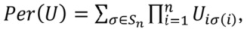

The idea of BSBoson sSampling was introduced in the seminal work of Aaronson and Arkhipov [12]. They formulated the well-defined computational problem (sampling from the output distributions n indistinguishable photons that interfere during the evolution

where Sn labels the set of all permutations constructed from 1,2,...n. In fact, the permanent function is inherently encoded in the nature of the quantum world via fully symmetric wavefunc-

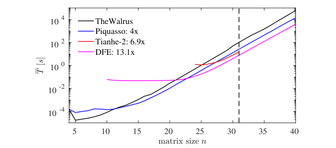

10 4 TheWalrus Piquasso: 4x 10 2 Tianhe-2: 6.9x DFE: 13.1x 10 0 10 -2 10 -4 5 10 15 20 25 30 35 40 

**_Figure 1: Benchmark comparison of individual implementations to calculate the permanent of an n x n unitary matrix. For better illustration, the discrete points corresponding to the individual matrices are connected by solid lines. The numbers associated with the individual implementations describe the speedup compared to TheWalrus package at matrix size indicated by the vertical dashed line._**

tions used to describe indistinguishable bosonic particles. Thus, the ability to efficiently calculate the permanent is the key ingredient to simulate BS, which is crucial to explore possible applications of BS.

Currently the most efficient scalable approach to calculate the permanent of an n × n matrix A has a computational complexity of O(n2 .2n ), which can be further reduced to O(n.2n ) if data recycling of intermediate results is implemented via Gray code ordering. The Ryser’s and the BB/FG formulas (named after Balasubramanian-BaxFranklin-Glynn) follow quite different approaches to evaluate the permanent, also resulting in quite different numerical properties [3].

In our work we designed a novel scalable recursive implementation to calculate the permanent via the BB/FG formula following the idea of [4]. Our permanent algorithm has a computational complexity of O(n.2n ) similarly to the Gray-code ordered algorithm of [3], without the overhead of processing the logic associated with the generation of auxiliary data needed for the Gray-code ordering. Instead, our algorithm relies on a recursive spawning of parallel tasks maximising the amount of computational data being recycled during the evaluation process. We compared the performance of our implementation provided in the Piquasso Boost library to the implementation of TheWalrus [L5] package also having implemented parallelised C++ engines to evaluate the permanent function. Our results (see Figure 1) show the logarithm of the average execution time needed to calculate the

17

ERCIM NEWS 128 January 2022

Special Theme

permanent of n×n random unitary matrices as the function of the matrix size n.

Our implementation is four times faster than TheWalrus code executed on 24 threads of Intel Xeon Gold 6130 CPU processor. We also compared the numerical performance of the Piquasso Boost simulation framework to the benchmark of Ref. [3]. In this case our benchmark comes very close to the execution time achieved on a single node of the Tianhe2 supercomputer consisting of an Intel Xeon E5 processor with 48 threads and three Xeon Phi 31S1P cards with 684 threads in total. Our results indicate that the Piquasso package provides a high performance simulation framework even on smaller hardware. Our recursive implementation scales well on shared memory architectures, however, its scalability over distributed computational resources is limited [L6].

To efficiently perform permanent calculations on large scale computing resources we need to come up with an alternative approach. Here we report on a data-flow engine (DFE) based permanent calculator device. We developed a full-fledged permanent calculator implementation on Xilinx Alveo U250 FPGA cards using high-level data-flow programming tools developed by Maxeler Technologies. The data-flow engines are driven by the CPU of the host machines providing a high scalability of our implementation over MPI communication protocol: it is possible to divide the overall computational problem into chunks and distribute them over the nodes of a super-

computer cluster just like in the case of the CPU implementation of [3].

Our FPGA-based DFEs have several advantages over CPU and GPU technologies. Probably the most important aspect of FPGA is the possibility to have hardware support for arithmetic operations exceeding the precision of 64-bit arithmetic units of CPU and GPU hardware. In practical situations the permanents of unitary matrices describing the photonic interferometers would be much smaller than the individual elements of the input matrix. In this situation one needs to increase the numerical precision in the calculations to obtain a result that can be trusted. In fact, the implementations of the walrus package and the Piquasso Boost library already use extended precision for floating point operations on the CPU side to calculate the permanent. On the DFE side we used 128-bit fixed point number representation to perform the calculations, providing the most accurate result among the benchmarked implementations.

Figure 1 also shows the performance of our DFE permanent calculator compared to the previously discussed CPU implementations. We observe that on DFE we can calculate the permanents of larger matrices much faster than by CPU based implementations with a numerical precision exceeding them. Note that at smaller matrices the execution time is dominated by the data transfer through the PCI slot.

In our future work we aim to use our highly optimized Piquasso simulations framework to address computational

problems related to BS and examine the possibility of using BS quantum devices to solve real world computational problems. Our efficient method to evaluate the permanent would be valuable in other research works as well, making the evaluation of the amplitudes of many-body bosonic states faster and more reliable.

This project has received funding from the Ministry of Innovation and Technology and the National Research, Development and Innovation Office within the Quantum Information National Laboratory of Hungary.

#### Links:

- [L1] https://qi.nemzetilabor.hu/

- [L2] https://kwz.me/h9H

- [L3] https://kwz.me/h9E

- [L4] https://www.maxeler.com/

- [L5] https://kwz.me/h9K

- [L6] https://arxiv.org/abs/2109.04528

#### References:

- [1] S. Aaronson, A. Arkhipov: “The computational complexity of linear optics”, in Proc. of STOC’11 https://dl.acm.org/doi/10.1145/1993 636.1993682

- [2] J. Wu, et al.: “A benchmark test of boson sampling on Tianhe-2 supercomputer”, National Science Review, Volume 5, Issue 5, September 2018, Pages 715–720, https://doi.org/10.1093/nsr/nwy079

#### Please contact:

Peter Rakyta Eötvös Loránd University, Hungary peter.rakyta@ttk.elte.hu

# Some Complexity Results Involving Quantum Computing

by Gábor Ivanyos, Attila Pereszlényi and Lajos Rónyai (ELKH SZTAKI, BME)

_The Theory of Computing Research Group of the Informatics Laboratory at ELKH SZTAKI has studied quantum algorithms for various computational problems. We outline two projects in this area: one in computational algebra and one in machine learning._

Computing with black box groups We are investigating possible applications of quantum computing to algorithmic problems from algebra and arithmetic. Examples of algorithms of this kind include Shor’s famous quantum algorithms for factoring integers and

computing discrete logarithms. The method for the discrete logarithm actually works in black box groups with unique encoding of elements.

The notion of black box groups was introduced by Babai and Szemerédi to

study the complexity of problems related to the structure of matrix groups. The elements of a black box group are encoded (represented) by binary strings and the group operations are given by oracles (also called black boxes). In order to capture factor groups, they

18

ERCIM NEWS 128 January 2022

allowed the same element to be represented by more than one string and they added a further oracle for testing equality with the identity element. In a recent manuscript [1], with our colleagues from France and Singapore, we studied the complexity of the discrete logarithm problem in an Abelian black box group with non-unique encoding of elements. We assumed encoding of the group elements by a covering group in a natural way. It turns out that in this setting the quantum query complexity becomes exponential.

The same holds for the closely related, possibly easier, computational DiffieHellman problem, which is the following: we are given three elements of the group: g, ga and gb , where the exponents a and b are hidden, compute gab . In the decision version, four group elements are given: g, ga , gb , and gc and the task is to decide if gc =gab . We showed that if the elements of a cyclic group of order p are encoded by the elements of a covering group of rank two, then, while the computational Diffie-Hellman problem is hard even for a quantum computer, the decisional version can be solved in polynomial time with a classical algorithm. Curiously, this difference disappears in higher ranks: even with encoding by a group of rank three both the decisional and computational problems have exponential quantum query complexity.

Quantum-and classical machine learning

Recent results in quantum machine learning show that many proposed quantum algorithms do not have much benefit over classical algorithms. We investigated the quantum classifier of Schuld and Petruccione [2] that selects a weak learner according to a distribution based on how good they are. It can be interpreted as a stochastic boosting algorithm on a finite set of learners where the learners are determined in advance. We simplified their algorithm to the point where it is intuitively easy to give an equivalent classical algorithm. We showed that a simple classical randomised method achieves the same result without changing the time complexity. We also gave an even simpler, constant time classical algorithm. We showed that this quantum ensemble method has no advantage over classical algorithms.

Independently from our work, Abbas, Schuld, and Petruccione also showed that the ensemble method can be turned into a classical algorithm. Our construction, however, is arguably simpler and more direct, especially the constant time algorithm.

We further developed the idea and, as the main contribution of our paper [3], we proposed classical methods that are inspired by combining the quantum

ensemble method with adaptive boosting. We compute two types of weights in an alternating way: one on the samples, representing how difficult they are to learn and one on the learners, representing how well they perform on the chosen samples. We considered only the case of binary classification, but the methods can be extended. In our experiments we had different implementations of the above idea. We tested the algorithms on publicly available datasets and we found them comparable to the AdaBoost algorithm, which is one of the most efficient meta machine learning algorithms.

#### References:

- [1] G. Ivanyos, A. Joux and M. Santha: “Discrete Logarithm and DiffieHellman Problems in Identity Black-box Groups”, arXiv:1911.01662.

- [2] M. Schuld, F. Petruccione: “Quantum ensembles of quantum classifiers”, Sci Rep. 2018 Feb 9;8(1):2772. doi: 10.1038/s41598018-20403-3.

- [3] B. Daróczy, et al.: “Quantum Inspired Adaptive Boosting”, arXiv:2102.00949

#### Please contact:

Gábor Ivanyos and Lajos Rónyai ELKH SZTAKI, Hungary gabor.ivanyos@sztaki.hu, lajos.ronyai@sztaki.hu

# Quantum Algorithms for Quantum and Classical Time-Dependent Partial Differential Equations

by François Fillion-Gourdeau (Institute for Quantum Computing and Infinite Potential Laboratories)

_Quantum algorithms have been developed to solve two important classes of partial differential equations: the Dirac equation and linear symmetric hyperbolic systems of equations. These algorithms can be much more efficient than their classical counterparts._

Quantum computing is at the heart of a new revolution in information science where quantum effects and quantum states are leveraged to perform calculations. In recent decades, significant scientific resources have been devoted to this subject. A functional quantum computer could solve computational problems that are unsolvable on a classical computer, owing to quantum algorithms being much more efficient for a large class of problems, and giving a polyno-

mial or an exponential speedup over classical ones.

Since the seminal works of R. Feynman in the 1980s, there has been growing evidence for the efficiency of quantum algorithms to simulate the time-evolution of quantum systems. However, this quantum advantage is not as clear for classical systems modelled by timedependent partial differential equations (PDE). In 2015, we started to work on

this topic to determine if some PDEs could be solved on existing quantum computer prototypes, even though the latter have limited resources.

Simulating the time-evolution of a physical system on a quantum computer requires two main ingredients: i) a mapping of the solution on the quantum register and ii) a mapping of the time-evolution operator on a set of quantum logic gates. The quantum register is

19

ERCIM NEWS 128 January 2022

Special Theme

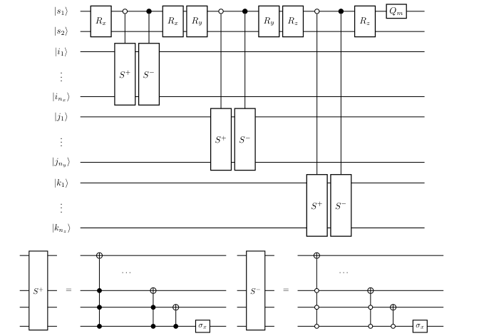

|s1〉 Q m Rx Rx Ry Ry Rz Rz |s2〉 |i1〉 ... S + S − |inx 〉 |j1〉 ... S + S − |jny 〉 |k1〉 ... S + S − |knz 〉 · · · · · · S + = S − = σ x σ x 

**_Figure 1: Quantum circuit for one time step of the free Dirac equation algorithm. The shit operator are denoted by S and the rotation operator by R. Adapted from Ref. [1]._**

scale with the number of grid points. In contrast, the streaming operation necessitates a quantum conditional shift operator, which is much more intricate and which requires more quantum gates as the number of grid points is increased. Nevertheless, we have found that this algorithm, reminiscent of quantum walks [3] and displayed in Figure 1, has an exponential speedup compared to its classical counterpart for a large number of grid points. Therefore, our algorithm is efficient, as confirmed by obtaining explicit quantum gate decompositions using the quantum compiler Quipper.

usually a set of many entangled twolevel quantum systems (or qubits). The quantum gates are fundamental unitary operations that transform the quantum state of the register. A sequence of quantum gates forms a quantum circuit that actually performs a calculation and such calculations are efficient when asymptotically, the number of quantum gates is lower than the number of operations required on a classical computer. In our work, we applied these principles to develop quantum algorithms that solve the Dirac equation [1] and symmetric linear hyperbolic systems of equations [2] more efficiently than on a classical computer.

A similar approach can be used to solve linear symmetric hyperbolic system of equations. These equations, characterised by symmetric coefficient matrices with real eigenvalues, are important because they describe many classical systems. Typical examples include the advection, the 1-D Maxwell, the telegraph and the linearised Euler equations. To solve these equations numerically, we used the reservoir method along with operator splitting. This combination of methods allowed us to map them onto a quantum walk algorithm, analogous to the one for the Dirac equation, with a diagonalisation and a shift operator (see Figure 1). However, the main challenge was the determination of the time steps, especially when the eigenvalues of the hyperbolic systems are not commensurate. We demonstrated that the time steps can actually be pre-computed efficiently using a simple classical algorithm. Then we performed a complexity analysis that demonstrated

The Dirac equation is one of the most important partial differential equations in theoretical physics because it describes relativistic fermions, like electrons or quarks, and some exotic systems in condensed matter physics called Dirac materials. To obtain a quantum algorithm, our approach was to adapt a known classical numerical scheme that solves the Dirac equation on a discrete spatial grid. For this purpose, we used amplitude encoding where the discrete wave function is stored in the quantum register probability amplitudes. The evolution operator was then approximated by a succession of streaming and spin rotation unitary steps. We have demonstrated that these steps can be decomposed as a sequence of quantum gates because they are unitary. The number of quantum gates to perform the spin rotation operation is small and does not

an exponential speedup of our algorithm, under some conditions, over the same algorithm implemented on a classical computer.

Although our results look promising for time-dependent problems, there are some other factors that limit the performance. First, the initialisation of the quantum register can be costly. There are some efficient alternatives for some classes of functions, but generally the quantum version is not more efficient than the classical version. Second, the reading of the solution requires the reconstruction of all probability amplitudes of the quantum register, a process called quantum tomography. This cannot be performed efficiently. How to manage these issues is still an open problem for many quantum simulation algorithms.

In the future, we would like to run these algorithms on actual quantum computers. Although we do not expect to reach quantum supremacy in the short term, this would be an important proofof-principle experiment. Also, we would like to investigate if these algorithms can be generalised to non-linear partial differential equations like the NavierStokes equation. These equations of paramount importance in the development of new technologies and for our understanding of many physical systems. We hope, in the long term, that the quantum approach could improve our knowledge of these complex systems.

#### References:

- [1] F. Fillion-Gourdeau, S. MacLean, R. Laflamme: “Algorithm for the solution of the Dirac equation on digital quantum computers”, Physical Review A 95.4 (2017): 042343.

- [2] F. Fillion-Gourdeau, E. Lorin: “Simple digital quantum algorithm for symmetric first-order linear hyperbolic systems”, Numerical Algorithms 82.3 (2019): 1009-1045.

- [3] S. Succi, F. Fillion-Gourdeau, and S. Palpacelli: “Quantum lattice Boltzmann is a quantum walk”, EPJ Quantum Technology 2.1 (2015): 1-17.

#### Please contact:

François Fillion-Gourdeau Institute for Quantum Computing and Infinite Potential Labs, Canada francois.fillion@inrs.ca

20

ERCIM NEWS 128 January 2022

# Prospects for Practical Verified and lind Delegated Quantum Computations

by Maxime Garnier and Harold Ollivier (Inria)

_Delegation, privacy and integrity of quantum computations are prerequisites for quantum computing to have a real-world economic impact. Companies will not buy machines but rather access services on demand through service providers. In doing so, they need to be confident that the computations are executed correctly while not putting their data and intellectual property at risk. The recently introduced protocol of [1] is the first practical solution towards achieving this goal as it provides security through disentangled single qubit quantum communications without hardware overhead on the provider’s side while also being robust to noise. As a result, it is considered a blueprint use case for quantum networks and can provide design guidelines for security for quantum computers._

Remotely accessible quantum computing platforms alleviate the burden of maintaining complex physical devices in house. Yet, when delegating computations to quantum servers, clients want guarantees on the privacy of their data and algorithms, and on the faithfulness of the computations’ executions.

Existing protocols to achieve this can be assigned to two broad categories: those that do not require quantum capabilities on the client side, and those that require modest ones. While at first sight the former [2] seems the most appealing option, it requires so much overhead on the server side that it will remain out of reach for several decades – the overhead is estimated to be several hundred times. The latter (e.g. [3]) is indeed more realistic. In this setting, computations are performed using the measurementbased quantum computation (MBQC) model, which is particularly well-suited for delegated, blind and verifiable computations. There, the client only needs to perform single qubit transformations and to send these qubits to the server in order to get all three properties.

Nonetheless, before [1], prospects for practical protocols were grim. First, all existing options were overly sensitive to noise, turning insecure noisy machines into secure but use-less ones. Indeed, these protocols were designed to detect any deviation and abort quickly, hence mistaking plain hardware noise for a malicious behaviour. Second, they verify that computations are performed according to the instructions sent by the client by blindly inserting traps – small computations with known results. These are then checked to determine whether to accept or abort. Unfortunately, these traps have finite detection capability and their sensitivity needs to be boosted by a

efficiently. First, instead of inserting traps alongside the computation itself, they are inserted on specific rounds – called test rounds – that share the same underlying structure as the computation itself. Second, because BQP computations have classical input and out-put, computation rounds and test rounds can be repeated before a final decision is made using majority voting. Together with blindness, this makes it possible to boost trap sensitivity and protect computation from noise. This is because repetition and majority vote act as an error correction scheme and protect computation from noise. Yet at the same

layer of fault-tolerant encoding to allow for the detection of malicious behaviour with overwhelming probability. Because of the large overhead imposed by such encoding, clients with a fixed number of good qubits need to decide whether to devote them to computing or securing the computations themselves.

In [1], the necessity for this trade-off was removed because the authors found that trap sensitivity could be boosted much more efficiently for bounded quantum polynomial (BQP) time computations – i.e. the kind of computations that quantum computers can perform

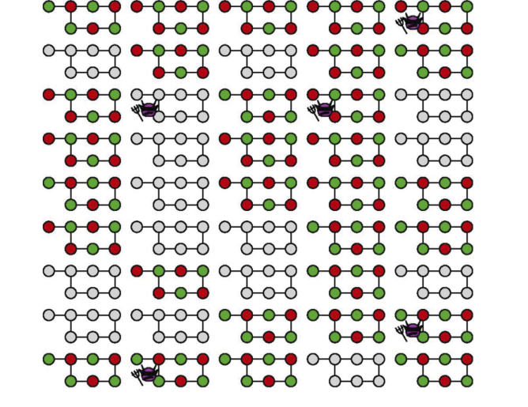

**_Figure 1: Each connected graph represents a given measurement-based pattern that is executed by the server, where each node in the graph represents a qubit. When a grey pattern is executed, it corresponds to the computation delegated by the client, while green and red ones represent delegated test rounds. Because the delegation is executed blindly, the malicious server (purple demon) does not know where to attack the computation, it inevitably gets detected by some test rounds. The advantage of the scheme is to ensure that each executed pattern has the same requirement as the computation itself while giving cryptographic guarantees with exponentially low correctness and soundness errors at the expense of a polynomial number of delegated rounds._**

21

ERCIM NEWS 128 January 2022

Special Theme

time, the malicious server needs to deviate beyond the error correction capabilities of the scheme to have an effect on the computation, hence making its deviations easier to detect. Together, these two properties ensure that verification and blindness can be achieved without hardware overhead, except repetition, since the computation and test rounds have the same structure and thus the same requirements. In addition, the security of the protocol is achieved in the demanding composable framework of abstract cryptography ensuring the validity of the results even when the protocol is used as part of a bigger protocol, or repeated several times in parallel or in series.

Thanks to these properties – and a few more technical ones – this protocol is considered a potential blueprint for quantum network applications within the Quantum Internet Alli-ance project of the Quantum Flagship. Yet, its interest goes beyond that of an experimental realisation.

First, it is economically relevant for the development of quantum computing. As noted earlier, quantum computers will only be accessible through the cloud. The current situation where data and

algorithms are shared with the service providers is acceptable only because companies are still learning about quantum algorithms and trying to discover applications. This will change drastically when production applications develop to the point where the security of quantum computations will be a prerequisite. Hence, the described protocol is clearing the path for realworld use of quantum computers.

Second, it uncovered new techniques for trap design and insertion that can find broader applications. One of them, currently being investigated, allows the service provider to recover a noise map that would be useful to reduce downtime for recalibration of its machines.

Third, the overhead for secure multiparty BQP computations can likely be drastically reduced using similar techniques. This would allow several clients to collectively obtain the result of a global computation without putting the privacy of their data at risk – typical use cases include AI model training for financial institutions or healthcare where manipulated data is highly regulated.

Finally, because it shows that security does not reduce the ability to perform

complex quantum computations, there is no reason to not include security as a requirement for the design of future quantum hardware. This means that quantum computers should be able to receive quantum states as inputs from the clients, and that quantum networks should be developed to match these needs.

#### References:

- [1] D. Leichtle et al.: “Verifying BQP Computations on Noisy Devices with Minimal Over-head”, PRX Quantum 2, 040302, 2021. DOI:10.1103/PRXQuantum.2.0403 02

- [2] U. Mahadev: “Classical Verification of Quantum Computations”, 59th IEEE Annual Symposium on Foundations of Computer Science (FOCS) 2018, Paris, pp 259-267.

- [3] E. Kashefi and P Wallden: “Optimised resource construction for verifiable quantum computation”, Journal of Physics A: Mathematical and Theoretical, 50, 145306, 2017.

#### Please contact:

Harold Ollivier, Inria, France harold.ollivier@inria.fr

# Confidential Quantum Computing: Towards a Secure Computation on ntrusted Quantum Servers

by Barbora Hrdá (Fraunhofer AISEC)

_Quantum technologies are seen as a great opportunity for a wide variety of fields: from optimization problems to machine learning and encryption, many use cases are always cited to produce revolutionary things. In order to make quantum computing widely applicable, more and more quantum platforms are easily accessible for everyone via cloud interfaces. The data and algorithms running on these systems are important assets that need to be protected. But who ensures the confidentiality and integrity of data running on quantum computers?_

Today’s quantum computers are roomfilling machines requiring a lot of effort to keep qubits in a lowenergy state. Access to quantum computers is mainly gained via online platforms providing, for example, a programming environment for the corresponding hardware. Algorithms and data that are processed on these platforms are valuable assets. In order to make quantum computing widely applicable, foundations must be laid for not only an easy, but also trustworthy use. To achieve this, the project “Secure Quantum Computing Platforms”

led by Fraunhofer AISEC is researching methods to ensure the confidentiality and integrity of users’ data processing on quantum hardware and quantum computing (QC) platforms. The project’s goal is to run confidential data and its processing securely on third-party quantum computing hardware without allowing an attacker, e.g., a malicious operator, to gain unauthorized access.

Imagine a pharma company developing a new drug. To that end a quantum algorithm is implemented for the simulation

of a molecule representing the critical part of the drug. The structure of the molecule, which is the company´s intellectual property, might be transferred directly to the QC platform or encoded in the algorithm. The damage to the company if, during the processing, this intellectual property was stolen, would be immense.

The most common access method to a quantum computer is usually through a QC platform. Typically, a programming environment for the user’s input and

22

ERCIM NEWS 128 January 2022

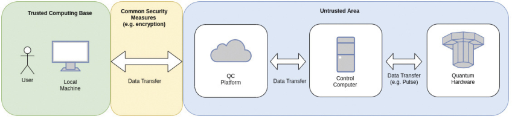

sss coopngaun | Comper tcny ned Ava apy A a oc - Outs | quam - ua Tr JS pe privy wn 

**_Figure 1: High-level Data Flow. This illustration shows an abstract view on data transmission from a local machine to the Quantum Computer and back. The areas are subdivided according to different levels of trust in the data flow. © Fraunhofer AISEC._**

quantum circuits is provided, sometimes an SDK can be downloaded, and the programming environment can be run locally. After submitting code to the platform, various pre-processing steps (e.g., compiling and optimisation) are carried out before the processed data and instructions are scheduled for the quantum hardware. They are forwarded to a control computer and finally, depending on the architecture, converted from bits to, for example, pulse instructions and sent to the actual quantum hardware. The results of the computation are then returned to the user via the QC platform. But how is data in this process protected from unauthorized access and falsification?

The transmission of data from a local machine to the QC platform is a first possible point of attack. Today, communication between the local machine and the QC platform takes place using common encrypted protocols. In addition, authentication codes can be used to detect manipulations in the transmission and ensure the integrity of the transmitted data. But what about the processing of data, the so-called datain-use?

Since protecting data-in-use on quantum computers is an unsolved problem, we are investigating different approaches similar to security measures that are being researched and applied today in the area of cloud computing. In cloud computing, data is also transferred to an untrusted server for storage and processing, and the operator of cloud servers is not trusted. Instead, sensitive data is isolated as far as possible from the operator’s access during processing. To this end, attempts are being made to achieve security using protected enclaves that allow only authorized programming code to process and access the data to be processed. This is what we commonly call Confidential Computing.

On the road to Confidential Quantum Computing, we are investigating different security approaches, which isolate data from the operator’s access in a similar way to confidential computing, but also take quantum server specific properties in consideration.

One approach on this road is Blind Quantum Computing (BQC) [1]. BQC considers securely delegating quantum computation and data to one, or several, untrusted quantum servers, while maintaining the integrity and confidentiality of the data. The goal is to keep the client’s input, computation, circuits, and output hidden from the quantum server during processing. When using several untrusted quantum servers, the data is split in several subtasks and these subtasks are delegated to different servers. Thus, in the event of a confidentiality breach on one of the quantum servers, the attacker receives only a fraction of the information. Many protocols also integrate some form of verification, i.e., they ensure the correctness of the returned result.

Another approach is to use Homomorphic Encryption, in which specific calculations can be performed on an encrypted cipher text corresponding to mathematical operations on the decrypted plaintext. This allows encrypted data to be processed without having to decrypt it [2]. First applications of Homomorphic Encryption for quantum circuits have already been investigated [3].

These are only two approaches addressing the lack of confidentiality and integrity for computations on untrusted quantum servers and finding a solution to this problem is essential for the acceptance of quantum computing. Building on these approaches, we want to examine which existing protocols can be applied out of the box, as well as which combination possibilities arise

from different approaches and where there is still a need for further development in order to address the security requirements for QC platforms in the best way possible.

The goal of the project “Secure Quantum Computing Platforms” is to create the basis for a trustworthy and secure use of quantum computers so users can take advantage of quantum computing without worrying about the security of their data and algorithms.

This project is part of the Bavarian Competence Center Quantum Security and Data Science (BayQS) [L1] and is only one of several addressing security in quantum computing. If you want to learn more about our work, feel free to get in touch with us.

#### Link:

- [L1] Website BayQS (in German): https://kwz.me/h9S

#### References:

- [1] J. F. Fitzsimons: “Private quantum computation: an introduction to blind quantum computing and related protocols”, npj Quantum Information, 3(1), 1-11, 2017. https://kwz.me/h94

- [2] C. Fontaine, F. Galand: “A survey of homomorphic encryption for nonspecialists”, EURASIP Journal on Information Security, 2007, 1-10. https://kwz.me/h90

- [3] U. Mahadev: “Classical homomorphic encryption for quantum circuits”, IEEE 59th Annual Symposium on Foundations of Computer Science, 2018. https://kwz.me/h91

#### Please contact:

#### Barbora Hrdá

Fraunhofer Institute for Applied and Integrated Security AISEC, Germany barbora.hrda@aisec.fraunhofer.de

23

ERCIM NEWS 128 January 2022

Special Theme

# enchmarking Quantum Computers: A Challenging but Necessary Step towards uture

by Ilias K. Savvas and Ilias Galanis, (University of Thessaly)

_Our world will be shaken if and when quantum computing becomes reliable and accessible to the majority of researchers. Almost all branches of science will be affected by this new technology. From Chemistry and Pharmacology to the prediction of climate change and Geology, quantum computing promises fast-paced and instantaneous solutions to problems that are still considered unsolvable. But has this promising technology arrived? Are today’s quantum computers ready and above all reliable?_

oping new drugs. Thus, the next step to make us feel confident about real progress that has been done is benchmarking these devices and this is a significant step in order to reach quantum supremacy (a quantum computer will solve a problem that is considered practically unsolved for a classical computer).

No matter what we buy, from a simple charger to an expensive laptop, we tend to compare our available options and choose the one that we think is the best. When a new device becomes available to the public one of the first things that determine its performance is the benchmarking tests, scores that indicate its ability to perform certain tasks based on time and accuracy. The same things more or less apply to quantum computers. Of course, none of us will be able to buy a quantum computer anytime soon.

Benchmarking QCDs is a new challenging and promising task taking into consideration the many different physical realizations/approaches to the construction of QCDs. Trapped ions and superconducting quantum computers to name a few. We cannot be quite sure yet what is the best approach or which one of them will dominate in the forthcoming years. In addition, QCDs of the same realization can have different architectures (the way each qubit is directly connected with the other) as it

Quantum Computing Devices (QCDs) as of now are expensive, bulky machines, that can operate under-protected closed environment conditions and most importantly still under development. One thing that indicates how early we are in the era of quantum computing is how programming one feels

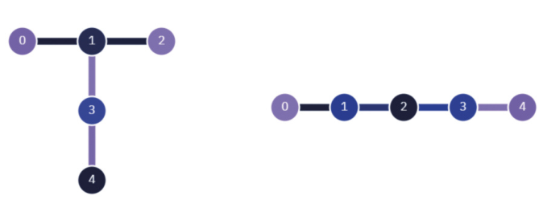

**_Figure 1: IBMs QCD ibmq_Quito (left) and QCD ibmq_Bogota (right). The quantum Devices have the same number of qubits but different architectures resulting in different performance._**

seems in Figure 1. Finally, an extra layer of difficulty is that quantum systems are not deterministic. That makes it quite difficult to tell what is right and what is wrong. So, in the near future many measurements will be necessary to predict accurately the QCDs’ behaviour. And there is more. How one can tell what is the best evaluation unit used to compare QCDs? Is it the number of available qubits? Unfortunately, that is

like. Over the years many high-level programming languages have been developed for classical computers when programming a QCD we need to think of gates and registers. A quantum program – as of now – is mostly a quantum circuit. Keeping all that in mind, we cannot tell when the first quantum computer becomes the main device for searching in a big database or used by a big pharmaceutical company in devel-

not the case. Many qubits do not imply the effectiveness of QCDs. A phenomenon called Quantum Decoherence causes qubits to change their state over time thus reliability is – as of now – the main issue concern that keeps QCDs as a future computational device.

Manipulating a qubit is a challenging procedure that needs precision and most importantly ideal conditions. Benchmarking techniques such as Randomized Benchmarking (a method for assessing the capabilities of quantum computing hardware platforms through estimating the average error rates that are measured under the implementation of long sequences of random quantum gate operations) [1] and Quantum State Tomography (information about the state of the qubit which is gained by performing multiple tomographic measurements to the system) are useful to evaluate a single QCD but cannot compare devices of different architectures and realizations. In 2018 a single value metric called Quantum Volume (QV) [2] was introduced by IBM [L1] modifying its definition one year later. For QV two issues are taken under consideration: the number of qubits (N) and the depth of the quantum circuit (d) a QCD can successfully run with meaningful results. It is desirable to exclude extreme cases such as the smallest error rates and therefore the largest circuit depth will result from very few qubits; also, the other extreme, where a device has many qubits but little coherence, i.e. d ≈1, resulting in uninteresting information of the device. So, to be more accurate and give a more complete view of the device, QV expresses the maximum size of square quantum circuits that can be implemented successfully by the computer.

The form of the circuits is independent of the quantum computer architecture,

24

ERCIM NEWS 128 January 2022

but the compiler can transform and optimize it in order to take advantage of the computer’s features. Thus, quantum volumes for different architectures can be compared making the Quantum Volume metric seem like a very promising technique to evaluate QCDs but still it is an ongoing procedure. The early era of quantum computing is keeping us back on implementing real applications while theory is far ahead. Today, no one knows the circuit size their classical computer or smartphone can implement, and probably when quantum computing becomes a mature technology, different things will be taken into consideration to evaluate them.

After all, one of the main topics that in the Department of Digital Systems, University of Thessaly, Gr, we focus our research efforts is to explore and evaluate the existing benchmarking approaches and beyond them to discover more accurate techniques according to the reliability of QCDs. It is very important to ensure the enthusiastic researchers in the field of Quantum Computing that their efforts will not remain in theory but the well-proven reliability of QCDs will drive the World soon to this new promising era.

#### References:

- [1] J. Eisert et al.: “Quantum certification and benchmarking,” Nat. Rev. Phys., vol. 2, no. 7, pp. 382-390-382–390, 2020, doi: 10.1038/s42254-020-0186-4.

- [2] N. Moll et al.: “Quantum optimization using variational algorithms on near-term quantum devices,” Quantum Sci. Technol., vol. 3, no. 3, pp. 030503–030503, Jun. 2018, doi: 10.1088/20589565/aab822.

#### Please contact:

ΙIlias K. Savvas, University of **Link:** Thessaly, Greece [L1] https://quantum-computing.ibm.com/ isavvas@uth.gr

# Quantum Walk Model for Autonomous Driving and Traffic Control

by Ioannis G. Karafyllidis (Democritus University of Thrace)

_The quantum walk model of quantum computation can be used to conceive and develop new quantum algorithms for real-life practical applications._

The dominant quantum computation model is the quantum circuit or quantum gate model, in which quantum algorithms are expressed as quantum circuits, but is difficult to conceive new quantum algorithms for real-life practical applications using this model. Quantum walks is a universal quantum computation model and its concept can be directly applied for solving practical problems and studying many physical systems and processes.

Quantum walks represent quantum evolution in continuous spaces, discrete lat-

tices and graphs. In this model, the motion of a quantum walker is guided by the action of unitary operators derived from Hamiltonians that describe the specific problem at hand. Quantum walks have been proven to be a universal model for quantum computation. Continuous quantum walks on graphs can encode any quantum computation with quantum gates implemented by scattering processes [1]. Discrete quantum walks have been proven to implement the same universal quantum gate set and thus are able to implement any quantum algorithm [2]. Quantum

walks can also be encoded as quantum circuits, which is also a universal model for quantum computation. Furthermore, quantum walks on the graphene lattice with quantum gates as coins may prove to be an effective implementation of quantum computing [3].

In the Department of Electrical and Computer Engineering of the Democritus University of Thrace, Greece, we used quantum walks to develop quantum algorithms as a part of a hybrid classical/quantum computing system for autonomous driving and

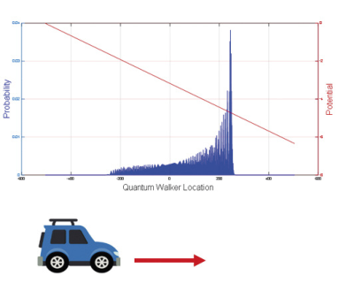

a 

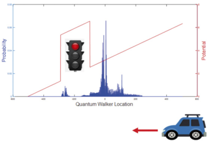

b 

**_Figure 1: (a) vehicle accelerating to the right. (b) A vehicle decelerating in the presence of a red traffic light modelled as a potential barrier._**

25

ERCIM NEWS 128 January 2022

Special Theme

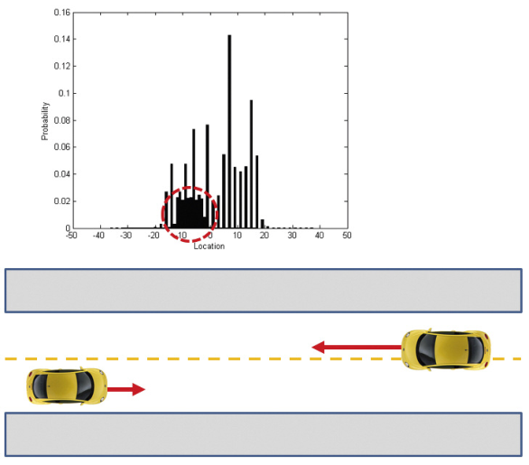

o HD * om on oeEh Baa) «bp— 

**_Figure 2: Probability and location of possible collision between two vehicles (interference between two quantum walkers)._**

the interference indicates the probability and location of the collision.

Figure 3 shows how urban areas are introduced using potential barriers. Immovable objects such as sidewalks and buildings are represented by constant potential barriers with near-zero transmission coefficients. Traffic lights are represented by time-varying potential barriers as explained above. Vehicles, i.e., quantum walkers move in this potential space.

Future work includes vehicle routing in urban areas. In this case, the driver enters their current location and destination in a GPS navigation system, which, via 5G networks, communicates the information to the control centre. A quantum computer may hold in superposition many vehicle positions and destinations and optimise traffic flow by proposing a route to each driver.

#### References:

traffic control. In this approach each vehicle is modelled as a quantum walker moving in an urban area. Potential barriers are introduced to represent moving obstacles, such as other vehicles, immovable obstacles, such as sidewalks and buildings, and timevarying obstacles, such as traffic lights.

Figure 1(a) shows a vehicle accelerating to the right. The acceleration is introduced as a linear potential (red line) and the blue bars indicate the probability of the vehicle’s location in the near future. Figure 1 (b) shows a vehicle decelerating in the presence of a red traffic light introduced as a potential barrier. Traffic lights are modelled as time-varying potential barriers. Red light corresponds to a high potential barrier with near-zero

transmission coefficient and green light to no potential barrier. Yellow light corresponds to a potential barrier with varying height. The moment the yellow light is on, the height of the potential barrier is zero and increases with time until its height becomes equal to the red light barrier height, the moment at which the yellow light goes off and the red is on.

Probable collisions between vehicles can be detected prior to their occurrence from the interference between the probability amplitudes associated with each moving vehicle, modeled as a quantum walker. Figure 2 shows such a case. Two vehicles moving in opposite directions with different velocities disperse a probability amplitude “cloud” in front of them and

- [1] A. M. Childs: “Universal computation by quantum walk”, Physical Review Letters 102, 180501 (2009).

- [2] N. B. Lovett, et al.: “Universal quantum computation using the discrete-time quantum walk”, Physical Review Letters 81, 042330 (2010).

- [3] I. G. Karafyllidis: “Quantum Walks on Graphene Nanoribbons using Quantum Gates as Coins”, Journal of Computational Science, vol. 11, pp. 326-330, 2015.

#### Please contact:

Ioannis G. Karafyllidis Democritus University of Thrace, Greece ykar@ee.duth.gr +30 25410 79548

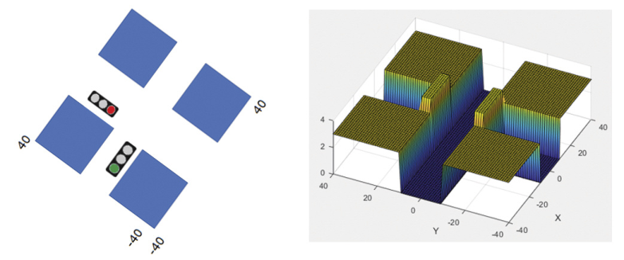

XD ® 5 "a0 : 7 2 [] 5 2 5 2 = ©a » i “0 “0 

**_Figure 3: Urban areas are modeled by constant potential barriers (sidewalks and buildings) and time-varying potential barriers (traffic lights)._**

26

ERCIM NEWS 128 January 2022

# Energy Economics undamental Modelling with Quantum Algorithms

by Pascal Halffmann (Fraunhofer ITWM), Niklas Hegemann (JoS QUANTUM GmbH), Fred Jendrzejewski (KIP University of Heidelberg) and Steve Lenk (Fraunhofer IOSB-AST)

_Today’s energy economy is a highly cost-sensitive and fast-moving market comprising a complex system of power units and grids. The complexity of the system presents challenges when it comes to planning energy generation – a task that is further exacerbated by weather-induced uncertainties with the increasing reliance on renewable energy. With quantum computing on the rise, a team of researchers at Fraunhofer, the University of Heidelberg, and the startup JoS QUANTUM is investigating whether and how quantum computing can improve problem solving in the energy industry, both in quality and computation time._

With the recent substantial increases in energy market prices, energy generation is a highly cost-sensitive field and trade prices fluctuate rapidly. Therefore, there is a real incentive to calculate the optimal economic dispatch for conventional as well as renewable energies via a realistic fundamental energy model in a short period of time. However, solvers on classical computers often cannot accomplish this task for this so-called unit commitment problem (UCP), especially when uncertainties from renewable energy supply are considered. This also applies to another notable application in the energy industry: electromobility is an additional big energy consumer. Hence, the electric vehicle charging scheduling problem (EVCSP) is a cost-sensitive problem and uncer-

An energy supply that is both stable and environmentally sustainable is vital for sustainable economic growth and social welfare. But the inherent variability of weather means that renewable energy from wind and solar comes with an increased volatility, which necessitates energy storage and flexible loads. This variability must be considered in energy generation planning, which is an intricate problem even without uncertain renewable energy supply; aside from the challenge of ensuring that energy supply matches demand, energy generation is constrained by several properties of the power grid and connected power units. Minimal and maximal power output, run-, and downtime, as well as a grid-wide spinning reserve are prime examples of such parameters.

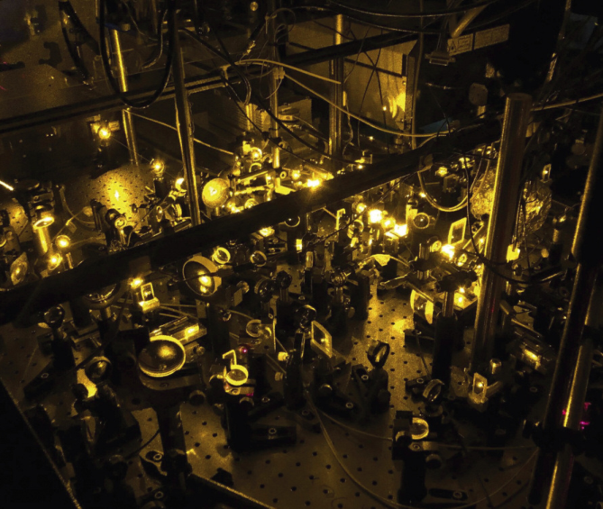

**_Figure 1: Optical system for laser cooling and control of ultra-cold sodium atoms in the laboratory at the Kirchhoff-Institute for Physics._**

tainties also occur with renewable energy supply. Namely, EVCSP is pursued as a real-world application for service EVs at Erfurt-Weimar Airport including electricity generation of a photovoltaics system [L1].

In contrast, quantum computers provide a new computational paradigm based on counterintuitive phenomena in quantum mechanics, such as considering all possible solutions at once in a state of superposition. This enables rapid solving of optimisation and simulation business problems. Admittedly, only few quantum computers of limited size are currently available, but quantum computing is a promising technology of the near-term future. Based on the fundamental principle of uncertainty in quantum mechanics, quantum computers are well suited to cope with stochastic variables. Consequently, we have identified quantum computing as a possible game-changer for modelling and solving fundamental energy models such as UCP and EVCSP, which are studied in the Enerquant project (Energy Economics Fundamental Modelling with Quantum Algorithms) [L2, L3].

This project, which started in September 2020 and is funded by the German Federal Ministry for Economic Affairs and Energy (BMWi) as part of its initiative on quantum computing, explores the potential of state-of-the-art quantum computing technologies for energy economy modelling. The interdisciplinary team behind Enerquant combines the expertise in stochastic energy-economy modelling and highperformance computing at the Fraunhofer institutes ITWM and IOSBAST with the knowledge in translating problems to quantum-mechanical formulations at both JoS QUANTUM

27

ERCIM NEWS 128 January 2022

Special Theme

GmbH and Fraunhofer, and the experience in the development of quantum simulators at the Kirchhoff-Institute for Physics (University of Heidelberg). Researchers at the University of Trento and the Institute of Photonic Sciences in Barcelona are also contributing their expertise.

Within the project, we are transforming both UCP and EVCSP models to capitalise on the advantages of quantum computing, thus making a long-term contribution to the development of energy-system modelling. Classically, problems like UCP are modelled as an optimisation problem consisting of a cost function that has to be subject to constraints stemming from the realworld problem (e.g., properties of power units) [1]. For quantum computers however, a reformulation as a quadratic unconstrained optimisation problem is necessary, which is equivalent to the well-known Ising model in physics. Due to current limitations of quantum-computing hardware, it is essential to minimise the problem dimensions (i.e., the number of necessary qubits, the base units of computation). Thus far, two promising models of the UCP have been developed, obtaining a compact formulation via quadratic terms or encoding constraints as a satisfiability problem, a prominent problem in computer science. Similarly, a qubit-oriented formulation for EVCSP exists.

Algorithms for various quantum computing systems are also being developed and adapted for optimisation problems with stochastic variables. Chiefly, the emphasis is on coping with uncertainties and including these in both the model and solution process. Here, adapting methods from robust optimisation as well as scenario generation, and MonteCarlo methods [2] is a suitable approach.

Notably, both models and algorithms are realised on a state-of-the-art quantumsimulator prototype made of ultra-cold atoms [3] (Figure 1). Instead of qubits with states 0 and 1, this simulator utilises qudits with states 0 through N. This allows for a tighter model formulation without binarisation of integer-or real-valued variables of classical models. The simulator is tested for its performance against various quantum computers (e.g., IBM’s Quantum System One) and classical hardware to successively enhance models and quantum simulator. Subsequently, a benchmarking framework is established containing test instances and analysis tools and allowing the preparation of different models for various systems. Hence, requirements regarding size and quality of quantum computers can be stated to give a direction for attaining quantum supremacy.

At the end of this three-year project, the results will be incorporated into a soft-

ware platform available for industrial customers. Not only is it our intent to portray the capabilities of quantum computing and broaden its applicability to real-world problems, but we also expect our results to lead to a more efficient, sustainable, and environmentally friendly energy supply and generation management and to advance electromobility.

#### Links:

- [L1] https://kwz.me/h8X

- [L2] https://www.enerquant.de

- [L3] https://kwz.me/h8Z

#### References:

- [1] B. Knueven et al.: “On mixedinteger programming formulations for the unit commitment problem”, INFORMS Journal on Computing, Vol. 32, No. 4, pp. 857-876, 2020.

- [2] M. C. Braun et al. “A Quantum Algorithm for the Sensitivity Analysis of Business Risks”, 2021, https://arxiv.org/abs/2103.05475.

- [3] V. Kasper et al. “Universal quantum computation and quantum error correction with ultracold atomic mixtures”, Quantum Science and Technology, 2021.

#### Please contact:

Pascal Halffmann Fraunhofer Institute for Industrial Mathematics (ITWM), Germany +49 631 31600-4110 Pascal.Halffmann@itwm.fraunhofer.de

# Quantum ourier Transformation in Industrial Applications

by Valeria Bartsch, Matthias Kabel and Anita Schöbel (Fraunhofer ITWM)

_The Fraunhofer-Gesellschaft, in cooperation with IBM, has established a national competence network in the research field of quantum computing as described in [L1].The aim is to develop quantum-based computing strategies for the next generation of quantum computers. A competence centre on quantum computing has been established at Fraunhofer ITWM [L2] which aims to develop and optimise quantum algorithms for realistic industrial challenges. In this article, we describe our work on testing, evaluating, and optimising the quantum Fourier transform (QFT) in three industrial application scenarios._

A Fourier transform decompose functions depending on space or time into functions depending on spatial or temporal frequency. Fourier transforms are needed in vastly different contexts. Application-related examples from industrial projects at Fraunhofer ITWM include:

- the non-destructive examination of Scenario A: non-destructive materials, examination of materials

- the evaluation of the homogeneity of structures and detection of deviations based on image data,

In the mathematical formulations of all the aforementioned problems, Fourier transforms play an important role in their solutions. The Fourier transform is also often a bottleneck for solving large systems, or a real-time solution. For

- the analysis of mechanical and thermal properties of materials, such as elasticity.

28

ERCIM NEWS 128 January 2022

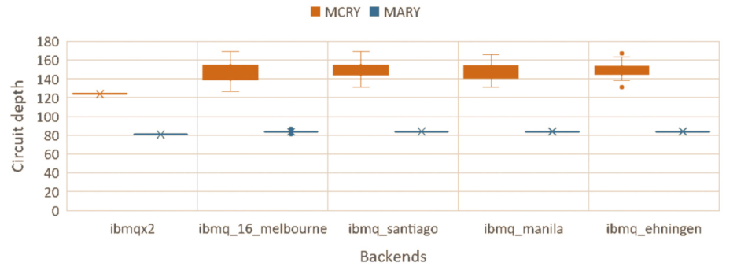

HW MCRY M MARY 180 = 160140 |__| LJ |__| —i: g 120 =F © 100 £ 80 ——— —_—— —_—— —_— ———— £60 © a0 20 0 ibmax2 ibmq_16_melbourne  ibmq_santiago ibma_manila ibma_ehningen Backends 

**_Figure 1: Comparison of the circuit depth for a 2x2 pixel encoding on several IBMQ quantum computers. The upper plot shows the number of 2-qubit gates, the lower plot the circuit depth. The plot is taken from [2]._**

example, the data involved in the nondestructive examination of materials can currently not be examined in real time. The quantum formulation of the Fourier transform QFT is very memory efficient compared to the classical formulation, and scales much better. However, the price for the superiority of the QFT is the encoding and readout complexity. In our work, the quality of the results and the scalability of the QFT on real systems have been investigated and novel methods for encoding on a quantum computer and readout have been developed and implemented.

In our setup for non-destructive examination of materials, we use approximately 100 transmitters, receivers with a frequency of 100 Hz and 100 frequency points. To reconstruct a 100x100x100 voxel volume, one tera computational operations are required. This is not feasible in real time even for a modern GPU. However, a 128x128x128 matrix can be represented on 21 qubits. Two-dimensional QFT calculations show that for calculations beyond 4 qubits, the results are randomly distributed. This means that current quantum computers are not yet qualitatively capable of solving realworld problems, but the underlying algorithms work, and we are prepared to take advantage of quantum computing once it is realised in improved systems.

#### Scenario B: Homogeneity of structures and detection of deviations in image data

When filtering image data, QFT has been tested on small test images. Here, too, only very small data sets (in this case 2x2 pixel grey images) can be evaluated. The focus in this part of the work is on the coding of image data for the

quantum computer. Efficient encoding is important, as already described in Scenario A, because the QFT algorithm offers an advantage over the classical Fourier transform algorithm but reading in and out the results can negate this speed advantage. In this case, an encoding algorithm called FRQI (Flexible Representation of Quantum Images) has been used for which there are several implementations.

To encode a classical image via FRQI, Qiskit’s MCRY gates can be used. However, these require a comparatively large number of gates, especially 2-qubit CNOT gates. This means we need either a physical connection between the qubits or additional SWAP gates until one reaches a qubit with a connection to a second gate. Since the number of connections between the qubits is low, many SWAP gates are thus required, which in turn affects the depth of the circuits and hence the time required. This is critical if the required time exceeds the coherence time, because then the computer is no longer in the quantum regime and thus the results are unusable.

A high number of multi-qubit-gates also means that the errors from the individual gates add up. In self-implemented MARY implementation, significantly fewer gates are required overall and, in particular, significantly fewer 2-qubit gates as shown in Figure 1. Nevertheless, the circuit depth increases exponentially for larger images. The maximum executable image size on a real system with the MARY implementation is 32x32 pixels, which is 4 times higher than in the standard implementation.

Scenario C: Analysis of mechanical and thermal properties of materials In the context of material characterisation in the investigation of mechanical and thermal properties of materials, the physical description of material samples leads to partial differential equations, which are usually discretised with finite elements. If a regular mesh is used for discretisation – which is the case, for example, when working directly on a CT image of the material sample – the discretised differential equation can be solved memory-efficiently and quickly by using the fast Fourier transform. Replacing the Fourier transform with a QFT requires reading out the complex Fourier coefficients on the quantum computer. However, only amplitudes can be measured on the quantum computer, i.e., a direct measurement only allows to determine the magnitude of the Fourier coefficients. This problem was solved in two steps:

- 1.By using uniform displacement and stress boundary conditions instead of the usual periodic boundary conditions for the partial differential equation, the phase of the Fourier coefficients is known a priori. Interestingly, the uniform boundary conditions (as described in [1]) can be applied by simply mirroring the material sample.

- 2.Subsequently, only the sign of the Fourier coefficients was unclear. This could additionally be determined with another amplitude measurement.

Since each measurement destroys the quantum states of the qubits, the QFT must be executed for each Fourier coefficient to be read out. Hence it turned out that the complexity of the resulting QFT-based material characterisation corresponds to the complexity of a

29

ERCIM NEWS 128 January 2022

Special Theme

naively implemented Fourier transform. However, the results of the material characterisation on the quantum computer already agree with the predictions of the classical computer, except for stochastic errors. Our next step is to add gate error mitigation techniques to decrease the errors of the QFT.

Acknowledgements: This work was supported by the project AnQuC-2 of the Competence Center Quantum Computing Rhineland-Palatinate (Germany). The authors are deeply indebted to Fabian Friederich ,

|Alexander Geng, Felix Givois, Andreas|[2] A. Geng, A. Moghiseh, C.|
|---|---|
|Keil and Ali Moghiseh. for providing|Redenbach, K. Schladitz:|
|the use cases and results.|“Improved FRQI on superconducting processors and its|
|**Links:**|restrictions in the NISQ era”, in|
|[L1] https://kwz.me/h9C|Proc. of “Quantum Information|
|[L2] https://kwz.me/h9h|Processing”. https://arxiv.org/abs/2110.15672|
|**References:**||
|[1] H. Grimm-Strele, M. Kabel: “Fast|**Please contact:**|
|Fourier transform based homoge-|Valeria Bartsch|
|nization with mixed uniform bound-|Fraunhofer Institute for Industrial|
|ary conditions”, Int. J. for|Mathematics (ITWM), Germany|
|Numerical Methods in Engineering, DOI: 10.1002/nme.6830|valeria.bartsch@itwm.fraunhofer.de|

# Quantum Computing – The Path Towards Industrial Applications

by Christian Tutschku and Chiara Stephan (Fraunhofer IAO)

_Quantum computing (QC) has attracted great interest in recent years. The long-term potential of quantum computing in industrial applications is well-known, but contemporary quantum solutions need to incorporate all the characteristic hardware restrictions that define the computers of today’s noisy intermediate scale quantum (NISQ) era. The main goal of the applied research project SEQUOIA [L1] is to develop near-term, hybrid quantum solutions for industrial use cases in close collaboration with companies of its enterprise network. As such, the SEQUOIA project directly elaborates on the path from the quantum computing theory towards near-term industrial applications._

The “Competence Centre Quantum Computing Baden-Württemberg” [L2], led by the Fraunhofer Institutes for Industrial Engineering IAO and Applied Solid State Physics IAF, conducts application-oriented quantum research towards the next generation computing (NGC). It is part of the cooperation between Fraunhofer and IBM, which together provide exclusive access to IBM’s first European quantum computer, located in Ehningen, BadenWürttemberg. The Fraunhofer corporation in particular offers access opportunities for external partners, such as universities or companies. The contractual regulations for operating the quantum computer are subject to German law, and European and German data protection regulations are complied with.

Within this competence centre, the SEQUOIA project is funded by the state Ministry of Economics, Labour and Tourism of Baden-Württemberg. Coordinated and guided be the Fraunhofer IAO, the SEQUOIA project was launched in the beginning of 2021 and pools, as a joint research project, competences from the Fraunhofer IAF,

the Fraunhofer Institute for Manufacturing Engineering and Automation IPA, the FZI Research Centre for Information Technology, the Chair of Embedded Systems at the Eberhard Karl University of Tübingen, as well as the University of Stuttgart with both, the High Performance Computing Centre HLRS and the Institute of Architecture of Application Systems IAAS.

To unlock the enormous potential of quantum computers, new software engineering methods and processes are required. Thus, the SEQUOIA project is investigating, developing, and testing new methods, tools, and approaches for QC, to improve and accelerate industrial quantum applications. These solutions are being developed in close collaboration with SEQUOIA’s industrial partners, tested on local or cloud-based QC simulators, and finally are executed on real quantum hardware – the IBM Q System One in Ehningen close to Stuttgart. With this approach, the joint research project SEQUOIA elaborates on new and more efficient quantum solutions in different application areas

with a special focus on manufacturing, engineering, logistics, and energy economics. It is further conceivable that quantum technology in general can be used for the exact prediction of scenarios in which multi-layered and complex data play a key role, such as portfolio predictions and weather forecasts, traffic flows, and disease patterns. In summary, within the SEQUOIA project, we are developing a variety of (hybrid) quantum algorithms, contributing to the following main outcomes (Figure 1):

- The SEQUOIA application centre for quantum computing

- The SEQUOIA tool kit, containing use case inspired quantum software components for industrial applications and algorithms

- The SEQUOIA model for quantum software engineering

The input of the SEQUOIA enterprise network is crucial to achieving these outcomes. In particular, the project’s outcomes are elaborated by studying several industrial use cases, focusing on six representative cases for industry in Baden-Württemberg. These include combinatorial optimisation problems

30

ERCIM NEWS 128 January 2022

related to the e-mobility and manufacturing industry; solving (coupled) differential equations to support computational fluid dynamic (CFD) calculations; or solving varieties of the travelling salesperson problem (TSP) in the area of logistics, sustainably optimising routing-problems.All this is achieved by involving right from the beginning several key players from different industrial areas. Moreover, these use cases directly allow for an application-related validation of the developed quantum solutions, which are eventually integrated in a high-level API for hybrid quantum applications – the (open-access) components of the SEQUOIA tool kit. From a software engineering perspective, the reliability of the provided quantum solutions is crucial. To this end, the project also addresses the questioning of how to improve the correctness and the quality of its developed quantum applications in the scope of error mitigation techniques.

All these results are directly transferred into the enterprise network and the entire (industrial) community through workshops, presentations, and training programs. For instance, in the coming year, the Fraunhofer IAO will run a comprehensive QC training program, consisting of several QC lectures, hands-on workshops and (open) net-

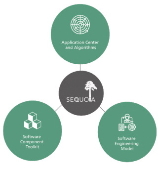

@ ie 

**_Figure 1: Key outcomes of the SEQUOIA Project. (Icons made by Freepik and Eucalyp from www.flaticon.com)._**

working events [L3]. These will be held within the “Competence Centre Quantum Computing BadenWürttemberg”, together with the Fraunhofer IAF. Registrations for this program are now open for anyone interested in application-based QC algorithm design, whether from software or computer science research or development, or from business consultancy. Depending on the level of knowledge required, we offer access to the IBM Q System One, in particular addressing the peculiarities of gate-based QC on real (IBM) quantum architectures. The

Fraunhofer IAO also run regular hourlong QC webinars, “DigitalDialoge”, which provide an easy introduction to quantum computing.

The findings of the SEQUOIA project will soon be published as a part of the application-oriented SEQUOIA QC user study, which provides insights into all the above-mentioned topics. We are also pleased to be part of the upcoming OOP-software meets business conference on 3 February with a night school session on QC Applications - State of the Art and Future Roadmap [L4].

#### Links:

- [L1] SEQUOIA (https://kwz.me/h8G)

- [L2] Competence Center Quantum Computing Baden-Württemberg: Fraunhofer Institute for Industrial Engineering IAO (https://kwz.me/h8D) and Applied Solid State Physics IAF (https://kwz.me/h8F)

- [L3] https://kwz.me/h8z

- [L4] https://kwz.me/h9w

#### Please contact:

Christian Tutschku Fraunhofer Institute for Industrial Engineering IAO, Germany christian.tutschku@iao.fraunhofer.de

# The Quest for a Nordic Quantum Computing Ecosystem

by Mikael Johansson (CSC – IT Center for Science) and Göran Wendin (Chalmers University of Technology)

_The Nordics shift into high quantum gear, as the Nordic-Estonian Quantum Computing e-Infrastructure Quest, NordIQuEst, begins in early 2022. The three-year project will connect worldleading traditional high-performance computing resources and quantum computers across national borders, establishing a quantum computing platform customised to the needs of the region._

A useful computational infrastructure requires three main components: hardware, software, and end-users. Funded by the Nordic e-Infrastructure Collaboration (NeIC) [L1], NordIQuEst brings together a consortium of seven partners from five countries, each with complementary expertise and resources required for laying the foundations for a cross-border quantum-computing infrastructure. Chalmers University of Technology in Sweden and VTT Technical Research Centre of Finland

will connect their quantum computers to the NordIQuEst effort (see Figure 1). CSC – IT Center for Science, Finland, hosts a high-end quantum computer emulator and the leadership-class LUMI EuroHPC supercomputer [L2], both of which will be interfaced to the ecosystem. Simula Research Laboratory, Norway, hosts the eX3 high-performance computing research infrastructure, which will be made available for experiments with various quantum simulators. Together with the

University of Tartu, Estonia, SINTEF, Norway, and the Danish Technical University, the required user and computer interfaces as well as program libraries will be set up. Special emphasis is put on end-user engagement, training and education.

Quantum computing promises to accelerate high-performance computing, with speed-ups expected for most, if not all, workflows that involve computational modelling. For this to happen,

31

ERCIM NEWS 128 January 2022

Special Theme

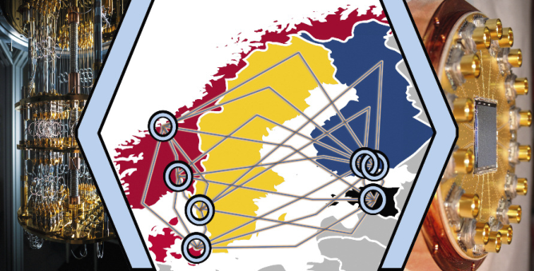

**_Figure 1: The NordIQuEst consortium bra-keted by components for the QAL9000 quantum computer of the Wallenberg Centre for Quantum Technology (WACQT) at Chalmers. QAL9000 and the Finnish Quantum Computer constructed by VTT Technical Research Centre together with IQM Quantum Computers are the first physical quantum computers that will be connected to the NordIQuEst platform. Photos by Johan Bodell/Chalmers (dilution fridge, left) and Hangxi Li/Chalmers (quantum processing unit, QPU, right)._**

determinism of classical computers. This means that existing computer programs cannot simply be “recompiled” to run on quantum computers. Instead, fundamental rethinking, reformulation, and rewriting of algorithms is required; problems have to be recast in a format that is amenable to computation on quantum hardware. This is no trivial task, and requires support and dedication. NordIQuEst aims to provide exactly this.

both quantum hardware and software need further development. On the hardware side, giant technological strides have been taken in recent years, and several demonstrations where quantum computers have outperformed classical supercomputers have already been reported. These proof-of-concept calculations have shown that quantum acceleration is actually possible, and allowed by physical law. The next step is to reach quantum advantage for real-world modelling problems.

The Nordic region, including Estonia, boasts a solid and established competence in traditional software development. To support the extension of this tradition towards quantum software development, access to a mature quantum computing infrastructure is crucial. The end-user should be provided with the best tools possible for their purposes, and the user should not have to learn a completely new field of science to be able to use the tools. The educational aspect of the infrastructure is equally important, and will help to increase quantum-literacy, educating a future quantum workforce. For this, NordIQuEst provides low-barrier access to the technology, reaching students at various levels as well as professionals that could either utilise or further develop quantum computing.

Now, it is important to note that quantum computers are not supercharged versions of classical computers. They solve problems in a fundamentally different way compared to the binary computers we are used to. For some computational tasks, quantum computers provide little to no advantage. For others, the speed-ups can be exponential: what would take the age of the universe on classical supercomputers could be done in hours on upcoming quantum computers [1]. Thus, the supercomputers of the future will seamlessly merge classical and quantum resources [2].

To achieve the promised leaps in performance, the programs, or quantum algorithms, have to take advantage of quantum mechanical phenomena that are missing in classical computer programming [L3]. These include superposition, entanglement, and wave-function interference. In addition, quantum computers are probabilistic by nature, in stark contrast to the clock-work

Only when both hardware and software are in place, can ground-breaking science be conducted on quantum computers. Striking a balance between hardware and software design is especially important now, when the technology is

still emerging and fast-developing. Continuous cross-talk is key. Hardware developers need feedback from algorithm developers in order to improve their technology. Software developers, on the other hand, need access to the actual quantum hardware that their algorithms will run on. Environmental noise affects the calculations on quantum computers, and therefore the behaviour and accuracy of any given quantum algorithm is difficult to predict a priori. The real-world performance of quantum algorithms can only be established and improved by experimenting and testing. Through NordIQuEst, both hardware and software development in the Nordic region can shift into higher gear.

The project showcases the power of collaboration: collaboration across countries, across scientific disciplines, across different levels of education, and across different modes of research activity. The NordIQuEst infrastructure is laying the foundations for a thriving, collaborative quantum technology ecosystem in the Nordic region. The groundwork performed within this three-year project will result in a fully operational, modular, and extendable quantum e-infrastructure. Quantum computing is a technology of the future, for the future; the quest for reaching its potential begins today.

#### Links:

- [L1] https://kwz.me/h9O

- [L2] https://www.lumi-supercomputer.eu/

- [L3] https://youtu.be/whoTr3zM3jU

#### References:

- [1] C. Gidney and M. Ekerå: “How to factor 2048 bit RSA integers in 8 hours using 20 million noisy qubits”, Quantum 5 (2021) 433. https://kwz.me/h9k

- [2] M.P. Johansson et al.: “Quantum Computing – A European Perspective”, PRACE Technical Report (2021). https://kwz.me/h9n

#### Please contact:

Mikael Johansson CSC – IT Center for Science, Finland mikael.johansson@csc.fi

#### Göran Wendin

Chalmers University of Technology, Sweden goran.wendin@chalmers.se

32

ERCIM NEWS 128 January 2022

# Software of the uture

by Lise Steen Nielsen (University of Copenhagen)

_In the years to come, quantum computing will find applications in different industries - from IT and finance to transportation. Within the medical industry, quantum technology has the potential to reduce the time it takes to develop new drugs as well as speed up the computationally demanding tasks of analysing and interpreting large amounts of biological data. The new Novo Nordisk Foundation Center Quantum for Life based at the University of Copenhagen has taken up this challenge. But new quantum hardware alone will not get us there. It will require the development of an entirely new type of software – quantum software._

One hundred years ago, scientists discovered that particles did not behave as they expected. The physical laws describing the world that human beings can see or touch cannot explain the behaviour of atoms and subatomic particles. This discovery led to the development of quantum mechanics, which allows us to describe the strange behaviour of the particles very accurately.

This is often referred to as the first quantum revolution. We began to understand materials such as silicon and this allowed us to build transistors, thereby creating the modern computer.

Strange consequences of quantum theory, such as new forms of correlation (also known as Einstein’s spooky action at a distance) were noted, but the full potential of quantum theory had not been realised.

In the 1990s, researchers envisioned how to use quantum effects to compute in novel ways. At the same time, huge progress in high precision manipulation of single atoms was made in labs around the world. This started what is now known as the second quantum revolution.

The second quantum revolution Today, we are in the midst of the second quantum revolution and the race to build the quantum computer. Professor in quantum software at the University of Copenhagen, Matthias Christandl explains: “The scientific community has reached an engineering mindset. We no longer just use materials with quantum properties to build things like computers, cell phones or laser technology. We are now building, controlling and manipulating our own quantum systems. Instead of building bits, we are building quantum bits or qubits that cannot only be 0 or 1 but 0 and 1 at the same time – they are in superposition, as we quantum researchers like to say. And we are

asking ourselves how to put the future quantum computer to use.”

Using the extraordinary properties of quantum systems, researchers have discovered a completely new way of processing information and it opens up a

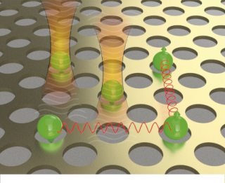

**_Figure 1: Atoms trapped in grid simulating the correlations in a molecule._**

world of new algorithms – quantum algorithms. These include faster algorithms for search and optimisation and even a new type of machine learning.

Possibility of quantum leap in life science

Using quantum algorithms, researchers at the Quantum for Life Center want to develop quantum software with huge potential for the medical industry. With a grant of approximately 8 million USD from the Novo Nordisk Foundation, the researchers have set out to demonstrate how a combination of quantum hardware and quantum software can help in two essential ways:

First, enable us to speed up computationally demanding tasks in bioinformatics and second, enable faster simulation of biomolecules for drug discovery.

Computing muscle in high demand Modern life science depends on computing muscle. One way computers are used is to analyse the huge amounts of

data that the can be found in, for example, DNA. Anders Krogh, who is professor at the University of Copenhagen and a principal investigator at the Quantum for Life Center, was among the first to introduce machine learning into the analysis of proteins and DNA. He will identify computationally demanding tasks in bioinformatics which could profit from quantum algorithms and develop new forms of quantum machine learning for faster handling of big data.

Computer aided drug development Another life science area in which computers are essential is drug development. As a supplement to the time-consuming experiments in the laboratory, computers are used for calculating characteristics of the molecules researchers want to create.

The movement and bonds of the electrons govern how molecules react with each other and therefore what characteristics they have. Some bonds can be modelled relatively accurately with standard computers, but this cannot be achieved for more complex bonds.

Matthias Christandl explains: “If you take on the task to write down all the potential quantum states of such a molecule, you will find it to be impossible. You would need more paper than exists in the world. Remember, the electrons in a molecule can be at two places at the same time. Simulating their properties accurately is only possible using a quantum computer which can have bits that are 0 and 1 at the same time.

Markus Reiher, a world expert in computational chemistry based at ETH Zurich, will identify the computational bottlenecks in the classical simulation of large molecules, one of the challenges in drug design. Together with Matthias Christandl and their teams, he

33

ERCIM NEWS 128 January 2022

Special Theme

will develop novel quantum software that will circumvent the bottlenecks.

#### Building the hardware

Building the hardware of a universal quantum computer, the quantum analogue of a Turing machine, remains a daunting challenge. However, it is expected that more specialised quantum hardware, “quantum simulators”, could run useful quantum algorithms in the near future.

Eugene Polzik, professor at the Niels Bohr Institute known for his early work on quantum teleportation, will contribute to this part of the project by building the quantum hardware. More precisely, a novel platform for quantum simulation, where single atoms will be held by individual tweezers made out of light. They will be configured to mimic

#### THE NOVO NORDISONDATION QANTM OR LIE CENTER

Professor Matthias Christandl, Principal Investigator and Center Leader Professor Markus Reiher, Principal Investigator Professor Eugene Simon Polzik, Principal Investigator Professor Anders Krogh, Principal Investigator … and their teams.

Acknowledgements: We thank the Novo Nordisk Foundation for financial support and Daniel Stilck França for valuable input to the article.

the shape of atoms in a molecule, thereby running the quantum software developed by his fellow Quantum for Life researchers.

Matthias Christandl states: “With the exciting research we carry out in the center we have the ambition to create the nucleus for a Danish Quantum Life Science Industry benefitting not only research and education, but also society as a whole.

**Link:** https://quantumforlife.ku.dk/

**Please contact:**

Matthias Christandl, Center Leader University of Copenhagen, Denmark christandl@math.ku.dk

# Introducing QSpain: Quantum Computing Spanish Association in Informatics

by Enrique Arias (University of Castilla-La Mancha), José Ranilla and Elías F. Combarro (University of Oviedo)

_Qspain is a new think tank that was created to foster and promote the development of quantum computing and its applications from Spain. It acts as a bridge between quantum computing research groups and companies, with the goal of bringing together critical masses to form multidisciplinary teams to solve the challenges of companies and society._

Quantum computing is a new computing paradigm that uses the unique properties of quantum physics (such as superposition, entanglement, and interference) to efficiently perform certain types of computations that would be intractable with conventional computers. This includes tasks in physical and chemical simulation, in combinatorial optimisation problems, in the field of artificial intelligence, especially in machine learning, and in cryptography [1], among others.

As a result of the efforts made by scientists, leading technology multinationals and governmental bodies, quantum computers are now a reality. Moreover, several countries are in the race to build the first quantum computer to outperform the capabilities of conventional computers.

However, there is still a considerable lack of knowledge from a business point of view. Companies do not yet know

how the technology will work for or transform their businesses. Also, this technology is seen as complex and distant. Nevertheless, quantum computing is a technology that will completely revolutionise industry [2]. In fact, “Chief Information Officers (CIOs) should look for potential opportunities from quantum computing and be ready to help the business leverage them” [2]. CIOs should be prepared not only to understand this disruptive technology, but also to develop products that will add value to their company.

Given the potential of this new computational paradigm, a group of quantum computing researchers from Spain started the initiative “Quantum computing SPanish Association in Informatics” (QSpain) (see Figure 1).

QSpain [L1] is a think tank that exists to foster and promote quantum computing and its areas of application, given the

current state of the technology, from Spain. QSpain brings together experts from academia and industry, acting as a bridge between quantum computing research groups and companies interested in this technology and channelling the needs of each company to the most appropriate expert group. QSpain also identifies critical masses to form multidisciplinary teams to address the challenges faced by companies and society. An important part of QSpain’s work is education: articulating the most appropriate mechanisms and contents to train different user profiles in quantum computing.

To this end, QSpain is organised around four areas of action that correspond to a vice-presidency for business, responsible for relationships with companies; a vice-presidency for education, in charge of the development of educational initiatives for companies, universities and research centres; a vice-presi-

34

ERCIM NEWS 128 January 2022

**_Figure 1: QSpain logo._**

dency for outreach, responsible for relationships with public institutions and a vice-presidency for research, that focuses on extending the scientific knowledge on quantum technologies.

More specifically, QSpain offers services such as exploring and identifying the applicability of quantum computing to current real-world problems, planning the strategic adoption of quantum computing in the medium and long term, advising on the best quantum solutions for each type of application, and organising customised orientation and training courses (technical, management, etc.). QSpain also helps in identifying and establishing collaborations with specialised research groups and keeps public institutions informed about the progress, challenges, and opportunities in this field. Last but not least, the think tank focuses on expanding the applications of quantum technologies within informatics, on promoting interdisciplinary training and research on quantum computing, and on organising and participating in outreach, educational and research activities on quantum computing.

Since QSpain was established officially in mid-2021, the group has carried out several actions at the national and international level including: a) participating in the Quantum Computing course at the University of Castilla-La Mancha [L2], b) organising a workshop devoted to “Inspiring a new generation to pursue quantum computing” in collaboration with SheQuantum, a quantum computing eLearning platform that connects more women to Quantum and simplifies quantum education for the global masses [L3], c) presenting at the Madrid Industrial Engineering Council (see

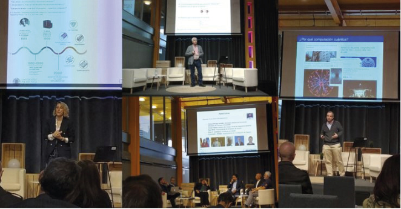

**_Figure 2: QSpain presentation at the Madrid Engineering Council - 8th October, 2021._**

Figure 2) [L4] , and d) organising and participating in the QBronze68 event with QWorld [L5] and other groups.

#### Links:

- [L1] https://qspain.org/

- [L2] https://kwz.me/h9s

- [L3] https://shequantum.org/

In the immediate future, QSpain plans to draw up a competence map to facilitate the establishment of synergies between research groups and to improve the progress of quantum computing in Spain, with QSpain acting as a facilitator, and to run training in quantum computing for company managers and middle management to raise awareness of this technology and the added value it can bring to business. QSpain will also be running a quantum computing course at the universitylevel for both students and instructors of undergraduate and graduate courses (extending the existing basic week-long course with an extra week of advanced training). Other programmed activities include preparing information sheets about quantum computing that target pre-university level students, mainly in secondary education, intensifying institutional contacts both at a ministerial level and with national and international scientific-technological associations (such as AMETIC in Spain, or CERN in Europe), collaborating with other national and international associations such as SheQuantum and QWorld, and expanding QSpain with new members and collaborations with national and international research groups.

- [L4] https://kwz.me/h9a

- [L5] https://qworld.net/qbronze68-qspain/

#### References:

- [1] S. Buchholz, D. Golden and C. Brown: “A business leader’s guide to quantum technology. Understanding potential quantum use cases to move forward with confidence”, April 2021. https://kwz.me/h9q

- [2] K. Panetta: “The CIO’s Guide to Quantum Computing”, 2019. https://kwz.me/h9v

#### Please contact:

Elías Fernández-Combarro Álvarez Universidad de Oviedo, Spain efernandezca@uniovi.es +34 985103177

QSpain foresees a brilliant future for quantum computing and its applications – a future that we can start building now.

35

ERCIM NEWS 128 January 2022

Special Theme

# Teaching the Qubits to ly

by Claudio Cicconetti, Marco Conti and Andrea Passarella (IIT-CNR, Italy)

_A new quantum era is dawning, full of exciting possibilities and new applications. At IIT-CNR we are working on quantum networks, which extend to geographical distance interactions between quantum systems. We are aiming to develop secure identification and communication, distributed computation, and tighter integration with classical computing systems. The long-term vision we are working towards is a quantum internet, where quantum components co-exist with legacy-Internet components, or the entire network may be exclusively built out of quantum devices._

way are milestones that provide useful results with a practical impact [1].

Quantum technologies exploit fundamental properties of matter at exceedingly small scales to perform tasks that would be too complicated or simply not possible with conventional paradigms. Examples include unconditionally securing communications, solving problems of practical prohibitive computational complexity in a matter of seconds (the “quantum advantage”), and deepening our understanding of complex physical systems.

In the Ubiquitous Internet Research Group at the Institute of Informatics and Telematics (IIT) of the National Research Council (CNR), in Pisa (Italy), we are climbing the first steps of the quantum internet ladder by investigating the integration of quantum key distribution (QKD) solutions and classical internet devices and protocols, within the national project QUANCOM (2021-2023) funded by the Italian Ministry of University and Research. QKD exploits the no-cloning property of qubits, carried by photons, to provide communication between parties, e.g., Alice and Bob in Figure 1, that cannot be overheard by unintended recipients: extracting the information from a qubit requires a measurement to be performed, which, however, destroys the quantum state. Based on this principle, we can define protocols that allow sym-

The evolution of quantum computing can be accelerated by interconnecting them so they can perform non-local computations on shared quantum states via the upcoming quantum internet, which in its final form (illustrated in Figure 1) will allow quantum systems all over the world to exchange flying qubits much like today’s computers exchange classical information (in bits) via the internet. The road to this outcome is long and paved with obstacles, but along the

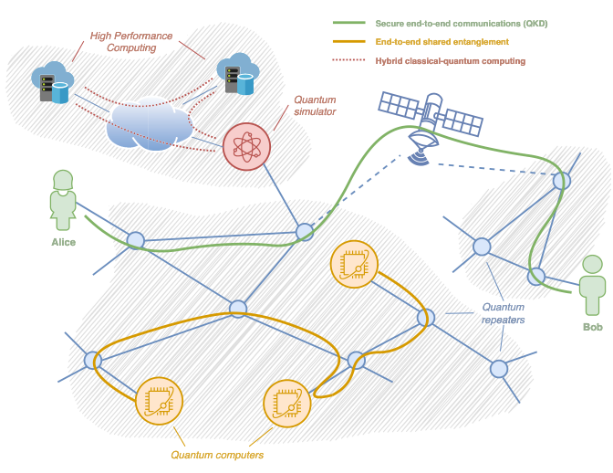

6HFXUH HQG�WR�HQG FRPPXQLFDWLRQV 4.' +LJK&RPSXWLQJ3HUIRUPDQFH (QG�WR�HQG VKDUHG HQWDQJOHPHQW +\EULG FODVVLFDO�TXDQWXP FRPSXWLQJ 4XDQWXP VLPXODWRU $OLFH 4XDQWXP UHSHDWHUV %RE 4XDQWXP FRPSXWHUV 

**_Figure 1: The quantum internet will interconnect quantum systems all over the globe via an integrated terrestrial fibre optic and satellite infrastructure and a network of quantum repeaters. It will allow unconditionally secure traditional communications, as well as distributed computing patterns for quantum computers and simulators._**

metric keys to be exchanged with forward secrecy. This is a quality that nonquantum cryptographic protocols lack, and it means that it will never, not even in the distant future, be possible to decipher data exchanged today through QKD. Of course, this is desirable for sensitive data, such as government and military data, but also for our personal medical and biometric data. Recent technology development trends suggest that mass deployment may be possible within the next few years [2]. Indeed, the European Commission and European Space Agency have recently signed a joint declaration for the construction of a European Quantum Communication Infrastructure within the framework of the EuroQCI initiative [L1].

Meanwhile, we are also pursuing a longer term research direction. With QKD, even though quantum communications are used to exchange keys, we are fundamentally interested in exchanging classical information, which can encode data such as bank account numbers and fingerprints. A more advanced exploitation can be obtained by enabling remote quantum systems to cooperate with one another. Let us consider quantum computers, for instance. We are now in the noisy intermediate-scale quantum (NISQ) phase, which means that the compute power of quantum computers, that is the number of qubits they can manipulate, is expected to remain quite low in the next 5 to 10 years and insufficient to exhibit a computational advantage over classical computers for most applications. However, multiple quantum computers around the globe may join forces to carry out more complex computations, which are unattainable by any of them individually. For this purpose, shared entanglement of qubits is crucial, as it allows remote entities to operate on quantum states composed of qubits that are not physically located all in one single computer but spread over mul-

36

ERCIM NEWS 128 January 2022

tiple parties through the quantum internet (see Figure 1). Our research group is investigating the novel architectures and protocols required to achieve shared entanglement via the “quantum repeaters”, which are intermediate boxes that extend the physical range of quantum links through teleportation [3]. The latter has nothing to do with sci-fi tractor beams; it merely refers to a technique for moving the state of a qubit from one place to another, albeit destroying the original version every time due to the nocloning theorem.

In any case, it is unrealistic to assume that there will ever be a switchover from classical to quantum computing, as it seems far more advantageous to use them in a cooperative way. Even today, despite the disproportion level of matu-

rity between classical and quantum **References:** computers, there are use cases where [1] S. Wehner, D. Elkouss, and R. their combination is beneficial. We will Hanson, “Quantum internet: A investigate such opportunities in the vision for the road ahead,” Science, project HPCQS (2021-2025), funded by vol. 362, no. 6412, Oct. 2018, doi: the EuroHPC Joint Undertaking and 10.1126/science.aam9288. coordinated by the Jülich Research [2] Y.-A. Chen et al., “An integrated Centre in Germany, which aims to space-to-ground quantum develop a European hybrid infrastruccommunication network over 4,600 ture that can operate smoothly both trakilometres,” Nature, vol. 589, no. ditional high performance computing 7841, Jan. 2021, doi: (HPC) resources and two quantum sim10.1038/s41586-020-03093-8. ulators with 100+ qubits, which repro[3] C. Cicconetti, M. Conti, and A. duce the behaviour of materials at very Passarella, “Request Scheduling in low temperatures, for which several use Quantum Networks”, IEEE Trans. cases of scientific, societal, and busion Quantum Eng., vol. 2, 2021, ness interest have been identified, doi: 10.1109/TQE.2021.3090532. including physics simulations and quantum machine learning. **Please contact:**

- [1] S. Wehner, D. Elkouss, and R. Hanson, “Quantum internet: A vision for the road ahead,” Science, vol. 362, no. 6412, Oct. 2018, doi: 10.1126/science.aam9288.

- [2] Y.-A. Chen et al., “An integrated space-to-ground quantum communication network over 4,600 kilometres,” Nature, vol. 589, no. 7841, Jan. 2021, doi: 10.1038/s41586-020-03093-8.

Claudio Cicconetti, IIT-CNR, Italy c.cicconetti@iit.cnr.it +39 348 288 8602

#### Link:

[L1] https://kwz.me/h8I

# raunhofer Puts Quantum Computing into Practice

by Kim Behlau and Hannah Venzl (Fraunhofer Competence Network Quantum Computing)

_The Fraunhofer-Gesellschaft is embracing the challenge of using quantum computing in real-life industrial applications. The Fraunhofer Competence Network Quantum Computing was founded for this purpose; it provides a means for experts from various Fraunhofer Institutes to collaborate and network with partners from research and industry. Within this framework, the FraunhoferGesellschaft provides access to the first quantum computer installed in Germany, the IBM Q System One in Ehningen._

Quantum computing has the potential to analyse complex systems in business and industry, unravel the complexity of molecular and chemical interactions, solve complex optimisation problems, and enhance the performance of artificial intelligence. The FraunhoferGesellschaft has set itself the task of researching the multi-faceted potential offered by quantum computing for industrial and scientific applications and to this end has established a national network based on competence centres: The Fraunhofer Competence Network Quantum Computing [L1]. Each of the seven regional competence centres (comprising multiple Fraunhofer Institutes) has its own research focus within the area of quantum computing; the competence network pools this expertise to cover a wide range of topical issues and questions related to quantum computing (see Figure 1). The Competence Centre Quantum

Computing Baden-Wuerttemberg, for example, addresses optimisation, quantum hardware, and hybrid computing systems; the Competence Centre in Rhineland-Palatinate focuses on quantum high-performance computing [L2]; the Bavarian on security and robustness in addition to platform development.

The network cooperates closely with partners and customers from research and industry and addresses a broad range of application fields, including logistics, the chemical and pharmaceutical industries, the finance and energy sectors, materials science, IT security technology and much more.

In addition to the intensive networking of the German quantum computing ecosystem, the Fraunhofer Competence Network Quantum Computing has been seeking access to a quantum computing

platform. Since January 2021, the Fraunhofer-Gesellschaft has had exclusive access to a quantum computer operated by IBM in Ehningen (BadenWuerttemberg) and the network is the primary point of contact for anyone wishing to use the quantum computer IBM Q System One. This is of enormous importance to actively shape the rapid developments in quantum computing – an achievement that is only possible if expertise is built up. In this context, the Fraunhofer-Gesellschaft acts as an enabler, as Fraunhofer not only provides its employees with access to the IBM Q System One but also provides access for partners from industry and research.

The IBM Quantum System One, a circuit-based quantum computer based on superconducting qubits (experimental system), has been optimised for stability and self-calibration to provide a

37

ERCIM NEWS 128 January 2022

Special Theme

Fraunhofer, in which all details are regulated. After that, the corresponding partners can access the quantum computer (and the associated cloud systems) within a personal ticket system on monthly billing. The system is open to all research institutions and companies that have their headquarters in Germany and for European partners within in EUfunded projects (More details on “How do I use the quantum computer?”: L1). This is particularly interesting for anyone who wants to know whether quantum computing is suitable for their needs – in principle, this includes all industries from logistics to industrial manufacturing, energy and finance to the pharmaceutical industry. Currently, various top-class institutions from different fields are already using the IBM Q System One: Universities, non-university research institutions and industrial companies.

reliable, high-quality quantum computer.

Technical data of the Ehningen system:

- 27 superconducting qubits

- Quantum volume of 32

- Coherence time ≈100 μs

- Single-qubit gate error ≈0.05%

- Two-qubit gate error ≈1%

- Time required for operating twoqubit gate ≈500 ns for CNOT

With a power of 27 superconducting qubits and a quantum volume of 32, it is one of the most powerful quantum gate systems currently available. The IBM Q System One in Ehningen is operated on German soil, completely under German law and European data protection regulations. Both personal user data and project data remain in Germany at all times. The system in Ehningen is completely self-sufficient – there is no connection to the cloud systems operated in the US (users do, however, have access to these via a separate interface).

Within the framework of the Fraunhofer competence network Quantum Computing, many projects have already been started and more are constantly being added [L1]. Various projects want to test the limits and ascertain which problems can be addressed by real existing quantum computers. One of the projects funded in BadenWuerttemberg, “QuESt” [L3], is concerned with using and testing the IBM quantum computer for material simula-

For industry and R&D organisations, the quantum computer can be used in joint projects. It can be used in funded collaborative projects with Fraunhofer, as well as in contract research within an industrial project. But partners can also access the infrastructure independently. For this purpose, an access and licence agreement is concluded with

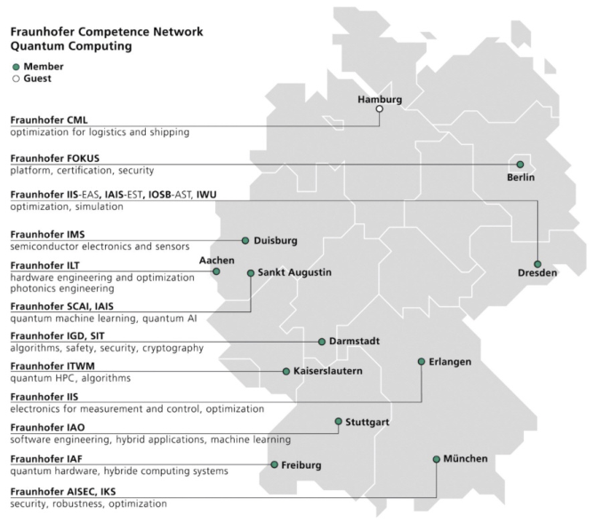

Fraunhofer Competence Network Quantum Computing © Member © Guest Hamburg FraunhoferoptimizationCMLfor logistics and SHIPPING = Platform,Fraunhofer certification,FOKUS secory = TT ee Fraunhofer IIS-EAS, IAIS ET, I0SB-AST, IWU optimization, smulation FraunhofersemiconductorIMSelectronics and sensors © CUsburd Fraunhofer IT Aachen hardwarephotonics engineeringengineering and optimization ©. Saokt Albguistia Ee Fraunhofer SCAI, AIS Quantum machine learning, quantum AT algorithms,FraunhoferFraunhofer safety,TWMIGD, SITsecurity, cyptography ©2 Darmstadt Erlangen FraunhoferquantumWMHPC, algorithms g Kabersijutersyaisers Fraunhofer lis electronics for measurement and control, optimization Fraunhofer 1AO SEE Software engineering, hybrid SppIcaTIons, machine Ieaining Fraunhofer IAF Minchen Quantum hardware, Fybride computing systems lit) Fraunhofer AISEC, IKS security, robustness, optimization 

tions for electrochemical energy systems. This is thus an established field in which the research frontiers are to be extended by the quantum computer. Another practical project, “EFFEKTIF” [L3], deals with rapid and efficient error correction in the operation of systemrelevant public infrastructure, such as for water and power supply or communications. While these structures can already be modelled, real-time simulation and problem solving is almost impossible to achieve due to the many factors involved. Therefore, these network structures are to represent and model quantum networks. The Fraunhofer ITWM is working on Quantum Algorithms in Material Simulation: Using acceleration and looking at the accuracy and errors of quantum Fourier transformations and their applicability to real problems [L2]. You can read more about this project in this issue (“Quantum Fourier Transformation in Industrial Applications”, page 28 ).

#### Links:

- [L1] https://kwz.me/h9C

- [L2] https://kwz.me/h9h

- [L3] https://kwz.me/h9i

#### Please contact:

Hannah Venzl Central Office of the Fraunhofer Competence Network Quantum Computing, Germany geschaeftsstelle-qc@fraunhofer.de

**_Figure 1: The Fraunhofer Competence Network Quantum Computing (comprised of multiple Fraunhofer Institutes) pools expertise to cover a wide range of topical issues and questions related to quantum computing._**

38

ERCIM NEWS 128 January 2022

# Quantum Experts Wanted!

by Vivija Simić and Barbora Hrdá (Fraunhofer AISEC)

_The demand for qualified professionals with knowledge in quantum computing is increasing as the technology matures. New courses of study and continuing education offerings are more important than ever. To quickly meet this demand, Fraunhofer is working on a high-quality continuing education program in consultation with industry with the first successfully implemented training courses already in place._

Entering the world of quantum computing is complex. Unless you are studying physics, you generally have just a few points of contact with this branch of research. But the demand for specialists in scientific and industrial sectors is growing as challenges await us that we cannot yet solve [1].

One of the main challenge that quantum computing brings with it is that powerful enough quantum computers are expected to break many of today’s standard IT security procedures, mainly asymmetric cryptographic methods such as asymmetric encryption or digital signatures. Just imagine that all underlying security measures of our IT systems are undermined from one day to the next: Hackers have access to virtually every networked information system and can manipulate data at their own discretion. The consequences of such a scenario, such as the access to and use of valuable data, are dramatic and must be prevented in the future by quantum computing experts.

Most encryption algorithms used today are based on problems which, without the information deliberately kept secret, cannot be solved by a classical computer, or only with a disproportionately large amount of effort. This principle forms the basis of the modern communication society. If, however, a large quantum computer can be constructed, many of these processes will be vulnerable and the security countermeasures we are using today would not be sufficient anymore.

#### Quantum resistance: be prepared already today

The solution to this problem is to evaluate the hazard situation and introduce quantum resistant methods already today by assessing the threat situation and introducing quantum resistant processes. Particularly in areas with a long deployment period, such as critical infrastructures, high security areas or

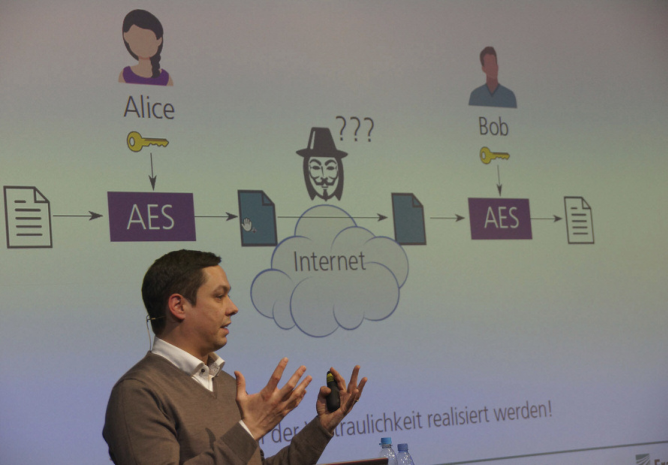

**_Prof. Dr. Daniel Loebenberger is specialised in Post-Quantum Security (© Fraunhofer)._**

training offers, such as the PostQuantum Security course by Prof. Dr. Daniel Loebenberger.

official deployment scenarios, it is important to be aware of the possible threat situation in the future, in order to be able to take proactive measures today.

This course addresses in the first section the functionality of quantum computers. It then explains and evaluates new types of algorithms for the post-quantum era. This training is part of the planned curriculum on quantum computing and quantum technologies at Fraunhofer.

In order to adequately analyze the threat situation, experts in this field are needed transferring the knowledge into industrial applications by networking and exchanging information with each other.

Fraunhofer formed the Quantum Computing Education Team

But where can we find these experts? How can we build up the required expertise in a timely manner?

In order to ensure the quality of trainings offered, as well as covering a wide variety of topics, a consortium of various Fraunhofer Institutes, called Quantum Computing Education Team, has been formed, bringing together experts from different domains such as (financial) mathematics, machine learning, IT security, but also didactics and media.

Although numerous study programs in the field of Quantum Technologies on Bachelor’s and Master’s level have been launched in Germany and Europe, the need for continuing education programs is still high to react quickly to the demand arising: on the one hand to ensure further training for junior staff, on the other hand transferring knowledge to professionals who are already firmly established in their careers. At Fraunhofer there are already initial efforts in this direction and concrete

This group of applied researchers work together with experts from different industry domains to create a demandoriented continuing education offering combining both scientific standards and

39

ERCIM NEWS 128 January 2022

Special Theme

industrial needs. The goal of this initiative is to successfully shape a crucial future technology with quantum computing. An important prerequisite for this is the early development of specialist skills.

What distinguishes this working group from already available offers is on the one hand the concentrated expertise from different research areas and industrial domains and on the other hand the access to exclusive resources. The availability of quantum computers for research and education is often a bottleneck. But here Fraunhofer, together with IBM, has exclusive access to IBM System One, which is not only available for research, but also for training.

Fraunhofer has set itself the goal of creating a broad, comprehensive and practical training program in various domains influenced by quantum computing, similar to the well-established Cybersecurity Training Lab, in order to actively counteract the future shortage of specialists in quantum technologies at an early stage.

#### Links:

- [L1] Course Post Quantum Security: https://kwz.me/h92

- [L2] Quantencomputing Education im Überblick: https://kwz.me/h95 (only in German)

- [L3] Lernlabor Cybersicherheit am Fraunhofer AISEC: https://kwz.me/h96 (only in German)

#### Reference:

- [1] Quantum technologies – from basic research to market - A Federal Government Framework Programme, https://kwz.me/h97, accessed: November 5th, 2021)

#### Please contact:

Vivija Simić Project Manager Cybersecurity Training Lab Fraunhofer Institute for Applied and Integrated Security AISEC, Germany vivija.simic@aisec.fraunhofer.de

Barbora Hrdá Scientific Researcher Fraunhofer Institute for Applied and Integrated Security AISEC, Germany Barbora.hrda@aisec.fraunhofer.de

# Quantum Computing vs. Physics: What do Quantum Computing Students Need to now about Quantum Mechanics?

by Berit Bungum (NTNU) and Sølve Selstø (OsloMet – Oslo Metropolitan University)

_The fast-developing field of quantum computing has consequences for higher education in computer science, and initiates a new field for physics education research: What do future computer scientists need to know about quantum mechanics? The project Quantum Computing vs. Physics uses perspectives and methods from educational research and the philosophy of technology to identify a basis of knowledge and skills in quantum mechanics to be included in engineering study programs for computer science students without a background in physics._

With quantum computing being a fastdeveloping field, quantum mechanics is finding its way into computer science engineering education. While the more traditional areas of physics, such as mechanics, electromagnetism and thermodynamics, have an established role in engineering education, quantum mechanics does not. It has so far only been taught with a theoretical profile for physics students with a strong background in mathematics and classical physics in higher education. Quantum Computing vs. Physics aims to identify how, and to what extent, quantum mechanics should be represented in the education of computer scientists. This involves finding a balance between theoretical knowledge and applicable skills, in ways that contribute to productive technological development in quantum computing.

Technological knowledge is characterised as a pragmatic use of scientific knowledge, but also has its own basis of knowledge. In philosophy of technology, technological knowledge is described as spanning from knowledge of scientific concepts and principles via engineering theory to purely technical skills [1]. Engineering theory is a specific form of knowledge that may be based on scientific knowledge but reconstructed for practical use – the knowledge is generic but contains concepts more applicable in specific practical problems. It is of interest to identify the knowledge that constitutes engineering theory in the field of quantum mechanics for computer science students.

The research is an interdisciplinary collaboration between computer scientists and physicists at OsloMet – Oslo Metropolitan University, Department of

Computer Science, and a physics education expert at the Norwegian University of Science and Technology (NTNU), Department of Physics. The master’s program entitled Applied Computer and Information Technology (ACIT) [L1] is used as a case in the research. The program features a specialisation within Mathematical Modelling and Scientific Computing, which, in turn, involves a course on quantum information technology.

Most students who enter this course do so with a background related to computer science. In general, their familiarity with physics is somewhat limited – in particular, when it comes to quantum physics. The course introduces students without any prior knowledge to quantum computing. The first few weeks are dedicated to introducing general concepts from quantum physics,

40

ERCIM NEWS 128 January 2022

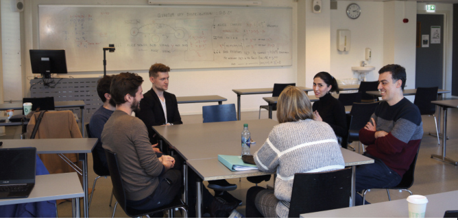

**_Figure 1: Interviewing students about quantum physics as part of a course in quantum computing._**

aim of practical use. For example, one student expressed that “learning more about the physics behind makes it easier to swallow all these ideas that quantum computing is using to do calculations and all the algorithms we are looking at”. In summary, the interview data indicate that students appreciate the scientific content of the course and acknowledge its relevance. Future work will investigate how the quantum computing students benefit from the course content in quantum mechanics in their further studies.

#### Link:

such as the wave function, tunnelling, quantisation, spin and measurement. This is done predominantly by performing numerical implementations and discussing the observed results rather than through extensive lectures on theory. The part dedicated specifically to quantum computation and quantum programming, which constitutes the bulk of the course, also takes a practical approach.

The research is undertaken with educational reconstruction [2] as an analytical frame. This involves an analysis of the fundamental ideas and structures of the subject content, the significance of it for the learner, and identification of particular cases and phenomena that make the content relevant, interesting and accessible for the learner. In order to gain

insights into how lecturers and students view the role of quantum mechanics in the course at OsloMet, a first round of data collection is being undertaken by means of group interviews with the lecturers and students in the course (see Figure 1).

Preliminary results reveal ambiguous opinions among the lecturers in terms of how much quantum mechanics their students need to know. Students, on the other hand, express a fascination for the theoretical physics content of the course, but find the course challenging – some even describe it as being “scary” at the outset. Even if they agree on the relevance of the physics content, the students’orientation seems to vary from “just follow the rules” to a deep motivation to understand the content with the

[L1] https://kwz.me/h98

#### References:

- [1] J. M. Staudenmaier: “Technology’s storytellers. Reweaving the human fabric”, Cambridge, Mass. and London: Society for the History of Technology and the M.I.T. Press, 1985

- [2] R. Duit, et al.: “Teaching physics”, in N. G. Lederman & S. K. Abell (Eds.), Handbook of Research on Science Edu cation, Volume II (pp. 434-456), Routledge, 2014.

#### Please contact:

Berit Bungum Department of Physics, The Norwegian University of Science and Technology, Norway berit.bungum@ntnu.no

# Entanglement Dynamics and Control at the Nanoscale

by Ioannis Thanopulos, Dionisis Stefanatos, Nikos Iliopoulos and Emmanuel Paspalakis (University of Patras)

_Entanglement, one of the most intriguing features of quantum mechanics, has many applications in quantum information technologies. An area of ongoing research is to understand and control the dynamics of entanglement between two qubits at the nanoscale by tuning their interaction with photonic nanostructures. Similarly, further work is needed on the fast and robust generation of entanglement in various quantum systems frequently encountered in quantum technologies using state of the art quantum control methods._

Quantum entanglement [1], the quantum correlation between two or more quantum systems linked in a way that their states remain linked independently their separation, is one of the most important and characteristic elements of quantum mechanics and has played a central role in the discussions of the fun-

damentals of quantum theory. Entanglement is also an essential ingredient in the areas of quantum communication, quantum information and quantum computing. For practical purposes, an important issue is to create entangled states between two materialoriented qubits and to understand the

dynamics of entangled states, especially at nanoscale distances, since the entanglement dynamics provide useful information on how a composite quantum system, for example two qubits, exchange information, as well as on how this information is preserved over time. This is a crucial problem since

41

ERCIM NEWS 128 January 2022

Special Theme

entanglement is a fragile quantum resource in the presence of undesirable interactions with the environment, like decoherence and dissipation.

In some cases, however, dissipation can act as the mediator for creating entanglement between two qubits, especially when the qubits are placed in a modified microphotonic or nanophotonic environment. An example of such situation is when the qubits are placed at nanoscale distances from plasmonic (metallic or metal-dielectric) nanostructures. Part of our recent research work is devoted to exploring the creation of high degrees of dissipation-driven entanglement between two quantum emitters (qubits) that may occur via coupling of the qubits and the localised resonances of photonic nanostructures [2].

Specifically, in collaboration with Vassilios Yannopapas of the National Technical University of Athens, we have analysed the strongly nonMarkovian entanglement dynamics, as well as the dynamics of more general quantum correlations, like quantum discord, of two initially entangled qubits in various initial quantum states that interact independently with a metallic nanoparticle [2]. We have found that the dynamics of both quantum entanglement and quantum discord depends strongly on the material of the qubit, on the distance of each qubit from the corresponding metal nanoparticle, as well as on the purity of the initial entangled state. Interesting phenomena are identified by varying the initial state or the distance of each qubit to the corresponding nanoparticle, including entanglement sudden death, periodic entanglement revival, entanglement oscillations and entanglement trapping.

Another significant part of our research effort is devoted to the efficient, i.e., fast and robust, generation of entanglement in quantum systems. In order to find the electromagnetic fields that can efficiently generate entanglement between the qubits of a quantum system, we use state-of-the-art quantum control methods, like shortcuts to adiabaticity and optimal control.

Shortcuts to adiabaticity were developed over the last decade to accelerate quantum adiabatic evolution, where the parameters of a quantum system are slowly varied so the system moves

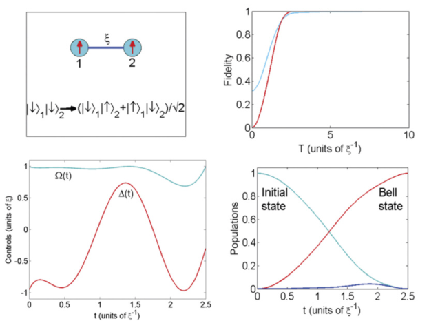

1 a 0 3 T 08 1 2$2086 { i04 Dz (0, IH,# 1, 1hN2 02} | % 5 10 T (units of £™) 1 1 Qt) 1 205 A) 0.) Initial Bell : 2 state state £ 2 ost Ea 5 ££ 2 04f 5 & Sos oa p! [5 1 15 2 25 % os 1 is 2 25 tunis of) t(units of 2”) 

**_Figure 1: Fast generation of the maximally entangled Bell state in a system of two coupled qubits using quantum control methods._**

The research is implemented through the Operational Program “Human Resources Development, Education and Lifelong Learning” and is co-financed by the European Union (European Social Fund) and Greek national funds (Project No. ΕΔΒΜ34, code MIS 5005825).

along one of its eigenstates, which initially coincides with the starting state while at the final time has been transformed to the target state. On the other hand, optimal control was developed during the Cold War in the context of space race to answer questions like: what is the minimum-time or minimumfuel trajectory to the moon? In the framework of quantum mechanics, it is exploited to find the electromagnetic fields which can drive a quantum system to a desired target state in minimum time or with maximum fidelity.

#### References:

- [1] R. Horodecki, P. Horodecki, M. Horodecki, and K. Horodecki: “Quantum entanglement”, Rev. Mod. Phys., vol. 81, pp. 865-942, (2009).

As an example, we consider a quantum system composed of two coupled qubits, which are initially unentangled, both being in the same spin-down state. The goal is to find the optimal controls, for example the components of the magnetic field, which quickly drive the system to the maximally entangled Bell state shown in Figure 1, by maximising its fidelity for a specified duration [3]. The Bell state fidelity, which is achieved with shortcuts to adiabaticity (light blue) and optimal control (red) is also displayed versus the duration of the operation. While the simple adiabatic passage evolution requires about 30 units of time to prepare a fidelity close to one, shortcuts to adiabaticity and optimal control need about 10 and 2.5 units, respectively [3]. The optimal components of the applied field corresponding to the minimum necessary duration (2.5 units), as well as the corresponding time evolution of populations for the initial and target states are also presented in Figure 1.

- [2] N. Iliopoulos, I. Thanopulos, V. Yannopapas, and E. Paspalakis: “Quantum correlations in quantum emitters strongly coupled with metallic nanoparticles”, Quant. Inform. Process., vol. 18, art. no. 110 (2019).

- [3] D. Stefanatos and E. Paspalakis: “Efficient generation of the triplet Bell state between coupled spins using transitionless quantum driving and optimal control”, Phys. Rev. A, vol. 99, art. no. 022327 (2019).

#### Please contact:

Ioannis Thanopulos, Dionisis Stefanatos, Nikos Iliopoulos, Emmanuel Paspalakis University of Patras, Greece ithano@upatras.gr, dionisis@post.harvard.edu, n.iliopoulos@windowslive.com, paspalak@upatras.gr

42

ERCIM NEWS 128 January 2022

# Spin Quantum Computing with Molecular-Encaged Atomic Hydrogen

by George Mitrikas (Institute of Nanoscience and Nanotechnology, National Centre for Scientific Research “Demokritos”)

_Atomic hydrogen is useful in quantum computing applications, owing to its simple atomic structure and the lack of complex magnetic interactions – a characteristic that is crucial for preserving the fragile electron spin coherence. Trapped in proper molecular nanocages, the otherwise highly reactive hydrogen atom becomes stable even at room temperature. This article discusses the aims of the active INN research project, “Spin-Based Quantum Computing”, along with the recent developments in the design and characterisation of encaged atomic hydrogen as spin qubit._

Over the last two decades, the field of quantum computation has seen spectacular progress not only at the theoretical level but also within experimental physics, chemistry and materials science. Researchers have made huge headway into developing quantum algorithms that demonstrate a remarkable ability to solve computational tasks, and there is increasing interest in finding appropriate physical systems to implement key concepts of quantum computation, such as entanglement and superpo-

sition. To this end, electron and nuclear spins are considered promising quantum information elements (qubits), because they are natural two- (or higher) state systems with relatively long coherence times that can be controlled using well-established magnetic resonance techniques.

The implementation of quantum algorithms requires qubits with long-lived coherent superposition states. The robustness of spin qubits against deco-

herence depends critically on the two characteristic electron spin relaxation times, namely the spin-lattice relaxation time ( _T_ 1) and the phase memory time ( _T_ M), which must be much longer than the time required for the quantum operation. _T_ 1 is determined by spin-phonon interactions, which involve energy exchange between the spin system and its surrounding matrix. On the other hand, _T_ M originates from pure dephasing mechanisms induced by dynamic interactions between the electron spin and

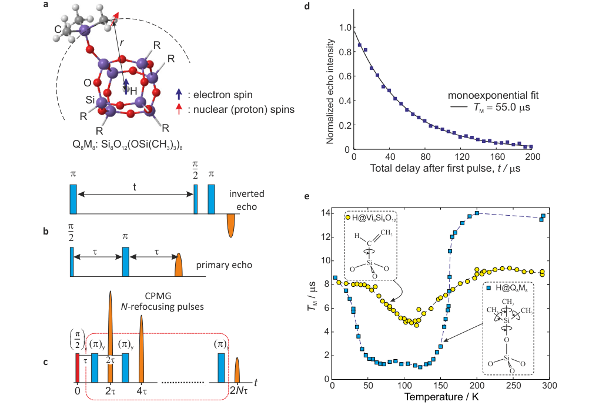

a d C ~ ARR 1.0 > r R AN 0.8 R 0.6 O H ! Si + : electron spin 0.4 monoexponential fit : nuclear (proton) spins TM = 55.0 ms \ R og _ R R 0.2 Q M : Si O8 8 8 12(OSi(CH ) )3 3 8 0 0 40 80 120 160 200 p p2 p Total delay after first pulse, t / ms t inverted e echo 14 H@Vi Si O8 8 12 b p2 p 12 H CH2 C t t primary echo 10 P O Si a O ! 00000 F111 P P O H 8 . 8  § o 000 8 H@Q M8 8 CPMG =, 3 .Po : CH3 N‐refocusing pulses 6 CH3 CH3 Si VON ! a Ê π ˆ 4 ÁË 2 ˜¯x (p)y (p)y (p)y O c t 2t 2 O Si O O t 00 50 100 150 200 250 300 0 2t 4t 2Nt Temperature / K Normalized echo intensity s m  /TM 

**_Figure 1: a) Encapsulated atomic hydrogen in a POSS cage with R=OSi(CH3)3, H@Q8M8. Only one of the eight groups R is displayed. b) Pulse sequences for measuring T1 (upper) and TM (lower). c) Carr-Purcell-Meiboom-Gill (CPMG) pulse train. d) Dynamical decoupling with the CPMG microwave pulse sequence showing the electron spin echo decay measured at T=200 K with N = 30 refocusing π–pulses as a function of the time delay between the first π/2–pulse and the occurring echoes, t = 2τ, 4τ,.., 2Nτ. e) Temperature dependence of phase memory times TM for two H@POSS species with different organic substituents, R._**

43

ERCIM NEWS 128 January 2022

Special Theme

surrounding magnetic nuclei or by flipflop processes associated with intermolecular dipolar coupling.

Among the proposed physical systems that possess electron and nuclear spins, endohedral fullerenes like N@C60 and their chemical derivatives have received the most attention because they combine the benefits of molecular materials and isolated spins: they can be precisely assembled into large arrays by chemical engineering and, under favourable conditions, they exhibit long _T_ M values that reach the record of 160 μs at a temperature of 200 K. The hydrogen atom, nature’s most essential element, is the simplest radical with the electron occupying the 1s orbital and being hyperfine-coupled to the proton nuclear spin with a large coupling constant of 1420 MHz that corresponds to the transition frequency of the famous 21 cm line. Owing to its simple electronic structure and the absence of spinorbit coupling interactions, the electron spin coherence times of atomic hydrogen are expected to be significantly larger than any other molecular spin system. The aim of this project is to investigate whether atomic hydrogen can rival N@C60 in terms of electron spin relaxation times.

Whilst C60 cannot stably host atomic hydrogen, it has been found that polyhedral octa-silsesquioxanes (POSS) (Figure 1a) are ideal traps for this purpose. These hybrid organic-inorganic species contain novel nanocages of the Si8O12 core that can be easily prepared using sol-gel chemistry methods. Upon γ-irradiation, these nanocages can stably host hydrogen atoms both in solution and solid state with remarkably long half-life times of 40 years at 273 K.

Crucial properties for quantum computing, such as electron spin relaxation times _T_ 1 and _T_ M, are probed by electron paramagnetic resonance (EPR) methods that typically employ microwave pulses (Figure 1b). Such pulses are also used to manipulate the electron spins and perform the necessary operations that are the building blocks of quantum algorithms.

Although the trapped hydrogen atom is isolated from the environment, its electronic spin still interacts with all surrounding magnetic nuclei through the dipolar hyperfine coupling. This affects the electron spin coherence in two ways: first, two neighbouring proton nuclear spins can undergo mutual spin flips, which in turn modulate the dipolar interaction. Second, thermally activated processes like methyl group rotation add another time-dependence to the hyperfine interaction. Both dynamic effects act as magnetic field noise that favours decoherence.

The suppression of such effects in solid state systems is challenging and includes the application of dynamical decoupling methods (Figure 1c) or the chemical modification of the environment (e.g. substitution of protons by deuterons that have about 6.5 times smaller nuclear magnetic moments). Previously, we were able to isolate such mechanisms and extent the coherence time _T_ M up to 55.0 μs at _T_ = 200 K (Figure 1d) [1], whereas, recently, we showed that deuteration of the cage resulted in the same _T_ M value [2]. Moreover, using different POSS derivatives, we described the key role of the rotational degrees of freedom of the cage substituents R in the determination of _T_ M (Figure 1e) [3].

These studies revealed the extremely long _T_ 1 value of 120 s (at 5 K) that can be harnessed to design new spin-based quantum memories. They also proved that _T_ M can be extended to about 100 μs (at 190 K) which allows for high fidelity quantum gate operations to be performed. Future efforts include proper design of POSS cages to overcome methyl rotations and demonstration of one-qubit NOT gates by means of Rabi oscillations. Other encapsulation methods that provide higher loading of cages will also be investigated.

**Link:** https://kwz.me/h9m

#### References:

- [1] G. Mitrikas et al.: “Extending the electron spin coherence time of atomic hydrogen by dynamical decoupling”, Phys. Chem. Chem. Phys. 16, 2378−2383 (2014). DOI: 10.1039/c3cp53423e

- [2] G. Mitrikas and R. Carmieli: “Electron Spin Relaxation Mechanisms of Atomic Hydrogen Trapped in Silsesquioxane Cages: the Role of Isotope Substitution”, J. Phys. Chem. C 125, 9899−9907 (2021).

   - DOI: 10.1021/acs.jpcc.1c01582

- [3] G. Mitrikas and S. Menenakou: “Electron spin relaxation properties of atomic hydrogen encapsulated in octavinyl POSS cages”, Phys. Chem. Chem. Phys. 22, 15751−15758 (2020). DOI: 10.1039/d0cp02479a

#### Please contact:

George Mitrikas INN NCSR Demokritos, Greece g.mitrikas@inn.demokritos.gr

Call for papers

#### Deadlines

## 3rd Int. Workshop on Quantum Software Engineering (Q-SE)

- Paper Submissions: 14 Jan 2022

- Acceptance notification: 25 Feb 2022

- Camera ready paper due: 18 Mar 2022

in conjunction with the 44th International Conference on Software Engineering (ICSE 2022), Pittsburgh, PA, USA, 21-29 May 2022

#### Organising Committee

- Jianjun Zhao, Kyushu University, Japan

- Jose Campos, University of Lisbon, Portugal

Q-SE welcomes submissions addressing topics across the full spectrum of Quantum Software Engineering, being inclusive of quantitative, qualitative, and mixed-methods research.

#### More information

https://conf.researchr.org/home/q-se-2022

44

ERCIM NEWS 128 January 2022

Research and Innovation

# DORNELL: A Multimodal, Shapeable Haptic Handle for Mobility Assistance of People with Disabilities

by Marie Babel and Claudio Pacchierotti (Univ Rennes, CNRS, Inria, IRISA)

_While technology helps people to compensate for a broad set of mobility impairments, visual perception and/or cognitive deficiencies still significantly affect their ability to move safely and easily. DORNELL proposes an innovative multisensory, multimodal, smart haptic handle that can be easily plugged onto a wide range of mobility aids. Specifically fabricated to fit the needs of a person, it provides a wide set of ungrounded tactile sensations in a portable and plug-and-play format – delivering haptics in assistive technologies. DORNELL is co-designed with users and therapists, ensuring that it meets their expectations and needs._

According to the World Health Organization, at least 110 to 190 million adults experience significant mobility difficulties, often resulting from visual, orthopaedic or neurological disabilities. Mobility aids such as white canes, precanes, wheelchairs, or walkers are widely used to overcome these mobility limitations. But owing to visual or cognitive impairments, many people are unable to safely use such aids. Navigation assistance can help in these situations, enabling a larger set of people with disabilities to move autonomously. While navigation assistance can sometimes be enforced by directly controlling the mobility aid (e.g. wheelchair) in assist-as-needed (shared control) or autonomous ways, research has shown that it is more empowering for individuals to be able to do a task autonomously rather than having a machine do it for you.

To achieve effective navigation while leaving users in control of their motion, we wish to implement a solution based on multimodal ungrounded (tactile) haptic feedback. Unlike standard kinesthetic haptics, ungrounded haptic feedback can provide rich and diverse information while leaving users free to move as they wish [1]. Coupled with proper sensing and understanding of the environment, this solution provides a new and promising approach to enhance the mobility of many users. In other words, DORNELL will enrich the perception and understanding of the user in order to compensate for one or more deficiencies.

To cater for users’ goals and needs, our aim is to enhance the mobility capacity of people with disabilities by defining a generic haptic interface in the form of a shapeable, multimodal haptic handle that can be adapted to both user needs and the mobility aid (Figure 1). Our objective is to provide a truly useful and effective device to improve the self-esteem and autonomy of people with disabilities, making a positive change in their lives. To foster the acceptance of the proposed solution and prevent any mismatch between the users’ expectations and the final design, we follow a pragmatic and

45

ERCIM NEWS 128 January 2022

Research and Innovation

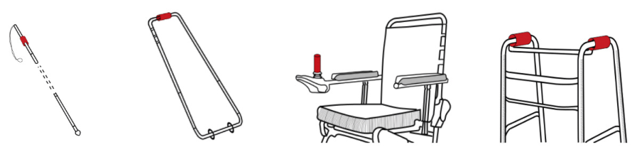

**_Figure 1: Four envisaged applications for the proposed handle (shown in red): white cane, precane, power wheelchair, and walker. DORNELL will provide multiple haptic sensations to convey feedback about the surrounding environment, e.g., path to follow, presence of obstacles, retrieving information from internal and external sensors, e.g., ultrasonic sensors mounted on a power wheelchair. Its functions will be easy to customize for each person and diverse mobility aid solutions._**

iterative process that includes clinicians and users at each stage. Regular clinical trials allow us to validate any successive development of the proposed device, leading to the continuous integration of the different hardware and software components. We envisage different and progressive evaluation scenarios of assisted indoor navigation, ranging from collision avoidance to long-term navigation, in clinical structures and in public spaces such as metro and train stations, with various inclusion criteria in terms of participants’ specific challenges, ages, and genders.

test our device with users with different types and levels of disability, evaluating both objective metrics, such as the performance in navigating in an unknown environment and avoiding obstacles, and subjective metrics, such as user’s comfort, acceptance, and ease of use.

- to disseminate the results of the project to the public and stakeholders and to consider business opportunities and technology transfer. We plan to take next-generation mobility aids to the market to improve the lives of millions of people affected by disabilities.

DORNELL revolves around six grand objectives:

- to define a series of guidelines and requirements for the design and acceptance of haptic-enabled devices, directly interacting with people with disabilities and healthcare professionals through subjective questionnaires and human subject studies;

- to design and fabricate a multimodal, multisensory, ergonomic, soft, compact, portable, customisable handle that provides multiple haptic sensations as well as sensing how the user interacts with it. We make use of innovative shapeable materials, 3D/4D printing techniques [2], multimodal actuation technologies, and perceptual illusions to deliver complex yet intuitive haptic sensations. Sensors embedded in the handle register inputs and intentions of the user which are used to control the assistive device. Our design is planned to be parametric and customisable, so that it can be adapted to a user’s individual needs before fabrication, as well as to the target mobility device;

- to develop versatile and modular APIs and interaction techniques to achieve compelling interactions with the device, from simple information delivery through to complex exploration and navigation tasks. We employ performant, standard, and template-based programming solutions to guarantee high control loop rates as well as to ease the use and customisation of the developed interactions to different user wishes, capabilities, and mobility aids [3]. We will study how to best interact with the handle in a way that the provided information is perceived as intuitive and requires little training to understand;

- to define methodologies for evaluating the performance of the system and the medical condition of the users in clinical trials, evaluating the proposed interaction techniques, human-machine interactions, as well as social acceptance;

DORNELL is a collaborative effort between research teams at Inria Rennes Bretagne Atlantique (coordinator), Inria Nancy, Inria Bordeaux, LGCGM laboratory (Rennes), Institut des Systèmes Intelligents et de Robotique (ISIR, Paris), Institut des jeunes aveugles – Les Charmettes (Yzeure), and rehabilitation center Pôle Saint Hélier (Rennes).

#### Link:

[L1]: https://project.inria.fr/dornell/

#### References:

- [1] L. Devigne, et al.: “Power wheelchair navigation assistance using wearable vibrotactile haptics”, IEEE Transactions on Haptics (ToH), 13.1 (2020): 52-58.

- [2] J. Etienne, et al.: “Slightly curved slicing for 3-axis printers”; ACM Trans. Graph. (TOG) 38.4 (2019): 1-11.

- [3] X. de Tinguy, et al.: “WeATaViX: WEarable Actuated TAngibles forVIrtual reality eXperiences”, International Conference on Human Haptic Sensing and Touch Enabled Computer Applications (pp. 262-270), 2020.

#### Please contact:

Marie Babel

Univ Rennes, INSA Rennes, CNRS, INRIA, IRISAUMR6074, France. marie.babel@irisa.fr

#### Claudio Pacchierotti

Univ Rennes, CNRS, INRIA, IRISA-UMR6074, France. claudio.pacchierotti@irisa.fr

- to improve the performance of complex tasks when using the proposed haptic handle coupled with white canes, precanes, power wheelchairs, and walkers with respect to using other commercially available solutions. We want to

46

ERCIM NEWS 128 January 2022

# Culture Aware Deception Detection from Text

by Katerina Papantoniou, Panagiotis Papadakos and Dimitris Plexousakis (ICS-FORTH)

_Automatic deception detection is a crucial and challenging task that has many critical applications both in direct physical and in computer-mediated human communication. The necessity of automatic detection is imperative, since humans are notorious for their poor performance in spotting deception. This is further hindered when cultural differences are involved, in which case differences in social norms may lead to misjudgments, and consequently impede fair treatment and justice. Here, we describe our findings on the exploitation of natural language processing (NLP) techniques and tools for the task of automated textbased deception detection, and focus on the relevant cultural and language factors [1]._

The vast majority of works in automatic deception detection take an “one-size-fits-all” approach, failing to adapt the techniques based on the cultural factor. Our aim is to add a larger scale computational approach in a series of recent interdisciplinary works that examine the connection between culture and deceptive language. Culture and language are tightly interconnected, since language is a means of expression, embodiment, and symbolization of cultural reality, and as such, differences among cultures are reflected in language usage. This also applies to the expression of deception among people belonging to different cultures.

Towards the above aim, our research questions and goals are:

- 1.Can we verify through experiments the prior body of work, which states that some linguistic cues of deception are expressed differently, for example, are milder or stronger, across cultures due to different cultural norms? More specifically, we want to explore how the individualism/collectivism divide defines the usage of specific linguistic cues. Individualism and collectivism constitute a well-known division of cultures, and concern the degree in which members of a culture value more individual over group goals and vice versa. Since cultural boundaries are difficult to define precisely when collecting data, we use datasets from different countries assuming that they reflect at an aggregate level the dominant cultural aspects that relate to deception in each country. In other words, we use countries as proxies for cultures, following Hofstede in that respect [2].

- 2.Explore which language indicators and cues are more effective to detect deception given a piece of text, and identify whether a universal feature set that we could rely on for detection deception tasks exists. On top of that, we investigate the volatility of cues across different domains by keeping the individualism/collectivism and language factors fixed, whenever we have appropriate datasets at our disposal.

3. Create a wide range of binary classifiers for predicting the truthfulness and deceptiveness of text, and evaluate their performance.

To answer our first and second research goals, we performed statistical tests on a set of linguistic cues of deception already proposed in bibliography, placing emphasis on those reported to differentiate across the individualism/collectivism divide. We conducted our analysis on datasets originating from six countries, namely United States of America, Belgium, India, Russia, Romania, and Mexico, which are seen as proxies of cultural features at an aggregate level. Regarding the third research goal, we created culture/language-aware classifiers by experimenting with a wide range of n-gram features from several levels of linguistic analysis,

Ji IL, 

**_Incorporation of cultural aspects in the research of deception_**

**_detection._**

namely phonology, morphology and syntax, other linguistic cues like word and phoneme counts, pronouns use, etc., and token embeddings. We applied two classification methods, namely logistic regression and fine-tuned BERT models. Regarding BERT, we have experimented with both monolingual, as well as with a cross-lingual model (mBERT [L1]).

The results showed that the undertaken task is fairly complex and demanding. In accordance with prior work, our analysis showed that people from individualistic cultures employ more third person and less first person pronouns to distance themselves from the deceit when they are deceptive, whereas in the collectivism group this trend is milder. Regarding the expression of sentiment in deceptive language across cultures, we observe an increased usage of positive language in deceptive texts for individualistic cultures (mostly in the US datasets), which is not observed in more collectivist cultures.

With respect to our second goal, our analysis showed the absence of a universal feature set. On top of this, our experiments inside the same culture (US) and over different genres, revealed how volatile and sensitive the deception cues are.

The experimentation with the logistic regression classifiers demonstrated the superiority of word and phoneme n-grams over all the other n-gram variations (character, POS, and syntactic). The linguistic cues surpass the baselines but lag behind the n-grams settings with the difference being milder

47

ERCIM NEWS 128 January 2022

Research and Innovation

in cross-domain experiments. The fine-tuning of the BERT models, although costly in terms of tuning the hyperparameters, performed rather well, whereas the experimentation with mBERT as a case of zero-shot transfer learning, showed promising results that can possibly be improved by incorporating culture-specific knowledge, or by taking advantage of cultural and language similarities for the least resourced languages.

In a follow-up work [3], we added in our analysis one more language, namely Greek, and a new genre, by introducing a new dataset in the context of April Fools’ Day articles. Similarly to the above results and in comparison with an English April Fools’Day Dataset, the analysis showcased the use of emotional language, especially of positive sentiment, for deceptive articles, which is even more prevalent in the individualistic English dataset. Further, the less concrete language in deceptive texts is fairly evident both in Greek and English datasets.

#### Link:

# NWO Team Science Award for ‘Hugo de Groot’s bookchest Team’

by Francien G. Bossema (CWI), Marta DomínguezDelmás (UvA) and Jan Dorscheid (Rijksmuseum)

_A team of researchers from Centrum Wiskunde & Informatica (CWI), Universiteit van Amsterdam (UvA), Rijksmuseum and Universiteit Leiden (UL) have been awarded the NWO Team Science Award 2021 for their research on the Hugo de Groot book chest, which was instigated by a Dutch TV programme in 2020. Using advanced imaging techniques and algorithms, the Computational Imaging group at CWI conceived a tailored X-ray imaging technique to provide X-ray CT images at CWI of the transverse section of the wooden planks for analysis of the tree rings._

[L1] https://github.com/google-research/bert

#### References:

- [1] K. Papantoniou, et al.: “Deception detection in text and its relation to the cultural dimension of individualism/collectivism”, Natural Language Engineering, 1-62, 2021. doi:10.1017/S1351324921000152

- [2] G.H. Hofstede: “Culture’s Consequences: Comparing Values, Behaviors, Institutions, and Organizations Across Nations”, 2nd and enlarged edition. Thousand Oaks, CA: Sage 2001.

- [3] K. Papantoniou, et al.: “Linguistic Cues of Deception in a Multilingual April Fools’ Day Context”, in Proc. of the Eighth Italian Conference on Computational Linguistics (CLIC-it 2021), January 26-28, 2022, online http://ceur-ws.org/Vol-3033/paper77.pdf

#### Please contact:

Katerina Papantoniou, ICS-FORTH, Greece papanton@ics.forth.gr

Panagiotis Papadakos, ICS-FORTH, Greece papadako@ics.forth.gr

In 2020, the producers of TV series Historisch Bewijs placed the authenticity of iconic historical objects from the Rijksmuseum collection in Amsterdam under investigation. One of the objects was a large bookchest, on permanent loan from the Koninklijk Oudheidkundig Genootschap, which supposedly served to hide Dutch jurist and humanist Hugo de Groot (1583-1645) during his escape from imprisonment at Castle Loevestein in 1621. His escape is a well-known historical event that all Dutch children learn about at school.

The Rijksmuseum exhibits one of the bookchests thought to be the one used by Hugo de Groot. Another likely candidate is in possession of Museum Prinsenhof in Delft and a third is owned by Slot Loevestein. The question was: Is it possible to determine which of these chests, if any, is the original one in which Hugo de Groot escaped Castle Loevestein? One way to approach this was by exclusion. If the trees used to make the chests, were cut after the escape year of 1621, that chest could be discarded. Dendrochronology (tree-ring science) could therefore be used to date the wood and possibly provide the answer.

The chests posed a challenge for dendrochronological research, as the transverse section of the wood, on which tree-ring widths are preferably measured, was inaccessible in most pine boards: it was covered either by other boards, by leather, or by metal fittings used for structural reinforcement. Therefore, the researchers decided to resort to X-ray imaging techniques to retrieve the tree-ring patterns through noninvasive methods and date them subsequently following standard dendrochronological procedures. The large size of the chests limited the possibilities of implementing computed tomography (CT) scanning, which prompted the investigation of alternative scanning trajectories.

The team efforts that followed led to the development of a new scanning method for large wooden objects. Due to the particular shape of tree rings (they appear as lines in a crosssection), the researchers discovered that they can be perfectly captured in X-ray images taken along a line trajectory, whereby the object is moved only sideways during scanning

48

ERCIM NEWS 128 January 2022

(as opposed to fully rotated in conventional CT). In this way, an X-ray series of 1000 to 2000 images is taken of a single plank, each X-ray image showing the tree rings from a slightly different angle. Those X-ray images were then processed through tailor-made reconstruction algorithms to produce tomographic images of the cross-section of the wood, in which ring widths could be measured for dendrochronological purposes. This procedure yielded enough information to obtain sharp images of the tree rings (neatly capturing rings as narrow as 0.34 mm in test planks) which could then be used for dendrochronological measurements.

The technique represents a breakthrough for non-invasive dendrochronological research of large wooden objects from cultural heritage, and could only be achieved by combining the expertise of mathematicians, computer scientists, a dendrochronologist, furniture conservators and a technical art historian. This research led to a variety of output, including the episode of Historisch Bewijs, a blog post, and a peer-reviewed article in Scientific Reports [1]. This manuscript features the bookchest as case study and discusses the newly developed scanning method with simulations and wooden test objects.

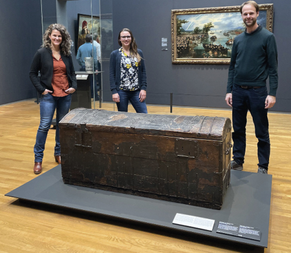

**_Team members with the Hugo de Groot Bookchest. From left to right: dendrochronologist Marta Domínguez Delmás (UvA), mathematician Francien Bossema (CWI) and furniture conservator Jan Dorscheid (Rijksmuseum)._**

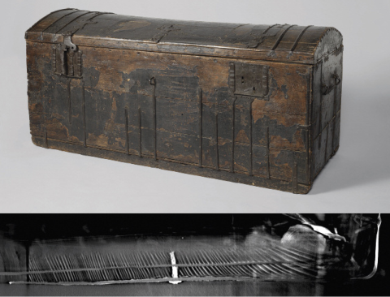

Although the technique made it possible to visualise the tree rings in the planks, no candidate was eliminated based on dendrochronological results. Nevertheless, other evidence was put forward, about the size of the chest. As it was reported that Hugo de Groot sat very tightly in the chest, the Rijksmuseum chest was concluded to be too large.

#### NWO Team Science Award

The NWO Team ScienceAward is a recognition ‘for the most inspiring, diverse and successful team of researchers’. The committee praised “the team’s talent development by giving chances to the junior researchers” and stated: “The disciplines that the team brings together are surprising and complement each other. The team needs its members to work together to answer their research questions and all the team members have added value”.

“This is phenomenal, no one was able to do this thus far”, said Dr. Robert van Langh, head of Conservation and Science at the Rijksmuseum in in the TV progamme in 2020, referring to the X-ray line-trajectory tomography imaging method that the team developed.

The research team consisted of experts from a variety of disciplines within the humanities (archaeometry, technical art history, conservation and restoration) and the physical sciences (mathematics, computer sciences). The team members were Francien Bossema (CWI, Rijksmuseum), Marta Domínguez-Delmás (UvA, Rijksmuseum) and Jan Dorscheid (Rijksmuseum), Sophia Coban (CWI), Alexander Kostenko (CWI), Willem-Jan Palenstijn (CWI), Paul van Duin (Rijksmuseum), Erma Hermens (UvA, Rijksmuseum) and Joost Batenburg (CWI/Leiden University).

#### Links:

- [L1] Dutch TV items: https://kwz.me/h9N and https://kwz.me/h9e

- [L2] Computational Imaging group at CWI: https://www.cwi.nl/research/groups/computationalimaging

- [L3] YouTube video about the FleX-ray Lab at CWI: https://youtu.be/6Zjm_L-cXEc

#### References:

- [1] F. G. Bossema et al.: “A novel method for dendrochronology of large historical wooden objects using line trajectory X-ray tomography”, 2021, https://doi.org/10.1038/s41598-021-90135-4

#### Please contact:

Marta Domínguez Delmás University of Amsterdam, The Netherlands m.dominguezdelmas@uva.nl

Francien Bossema, CWI, The Netherlands Francien.Bossema@cwi.nl

Jan Dorscheid, Rijksmuseum, The Netherlands. j.dorscheid@rijksmuseum.nl

**_Hugo de Groot Bookchest (Rijksmuseum) and a detail of the image obtained using the line trajectory X-ray tomography technique, showing the tree rings._**

49

ERCIM NEWS 128 January 2022

Research and Innovation

#### Sponsored article

# Cybersecurity for Electrical Power and Energy Systems

by Dave Raggett (W3C/ERCIM) and Theodoros Rokkas, (inCITES)

_The electrical power and energy system (EPES) is a critical infrastructure for society, and as such, an attractive target for cyber attackers. The SDN-microSENSE project has demonstrated robust, resilient, distributed cyber-defence capabilities, including the use of software defined networks (SDN) for self-healing, isolation and integration of honeypots to minimise disruptions. Many of the techniques are applicable to other sectors._

SDN-microSENSE [L1] aims to provide and demonstrate a secure, resilient to cyber-attacks, privacy-enabled, and protected against data breaches solution for decentralised EPES. The project partners have built a complete framework for the detection and mitigation of cyber-attacks using various communication pathways that interconnect all commonly used tools in EPES infrastructures with new detection and analysis tools. A web-based desktop environment is integrated to provide easy-to-use overview and management. The architecture focuses on the power-grid (electrical infrastructure) and the data network that is associated with the infrastructure.

The project’s objectives are as follows:

- 1.To design and provide a new resilient, multi-layered and SDN-enabled microgrid architecture, which will leverage the global system visibility for preventing and addressing disruptions to the underlying supervisory control and data

acquisition (SCADA) and industrial control systems (ICS) infrastructure.

- 2.To design and develop a risk assessment and management framework.

- 3.To develop and implement applications which exploit direct networking controllability and programmability offered by SDN to investigate multiple security applications, including self-healing attack-resilient phasor measurement units (PMU) and remote terminal units (RTU), for going toward achieving resilient and secure operations in the face of various cyberthreats and failures.

- 4.Deliver an energy trading platform for secure and flexible trading management.

- 5.To provide a robust, distributed and effective IT cyberdefence system for large-scale EPES ecosystem.

- 6.To design and deploy an anonymous channel of EPES which will allow secure and privacy-preserving information sharing among energy operators and actors.

- 7.To deliver a privacy-preserving framework for enhancing EPES against data breaches.

- 8.To design and develop and a policy recommendation framework based on the SDN-microSENSE results, lessons learnt and best practices for formulating recommendations for standardisation and certification.

- 9.To design and demonstrate large-scale pilots across Europe.

These objectives have been pursued through the following pilots:

- Pilot 1 addresses attacks relating to communication between the SCADA servers and applications, attacks related to substation bus communication, and attacks related to process bus communication.

- Pilot 2 addresses false data injection attacks against Phasor Measurement Units (PMU) and Phasor Data Concentrators (PDC), and man in the middle attacks on smart meters and inverters for photovoltaic arrays.

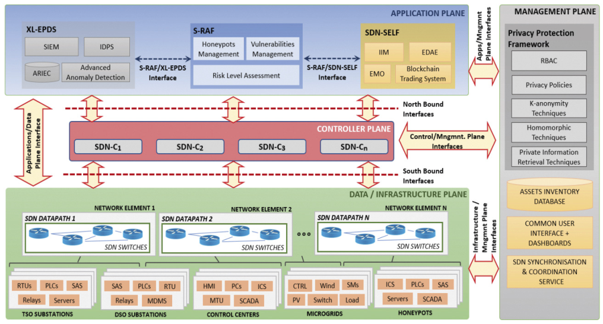

APPLICATION PLANE &E i MANAGEMENT PLANE = | oes Honeypots | Vulnerabilities $e Framework beeen] Comm Management | Management | _______o. WM EDA 8: = Advanced SRAF/XLEPDS ‘S-RAF/SDN-SELF Blockchain | = ARIEC | anomaly Detection [Hr Risk Level Assessment ea 0 le ote nem cn cm cm cmcnmm om mm am em oo oo em mm = mm. North Bound K-anonymity 2 Interfaces Techniques. S § ‘CONTROLLER PLANE Homomorphic HHH £ EE SDN-Cs ETE red Techniques 54 Retrieval Techniques < —— fo mma SouthInterfacesBound DATA ee / INFRASTRUCTURE PLANE beediloiolif SONgl DATAPATH 1 SON SWITCHESellegSON DATAPATH2 hePeSON SWITCHESa vegeSON DATAPATHN J———SON SWITCHES fit£5,HTCOMMONDASHBOARDS USER Se —— SON SYNCHRONISATION & COORDINATION RlUs PLCs SAS sas PGs RU HMI PCs ICS. CTRL Wind SMs. Ics Pcs sas Sac Relays Servers Relays MOMS MIU SCADA PV Switch Load Servers SCADA TSO SUBSTATIONS 050 SUBSTATIONS ‘CONTROL cenTeRS MICROGRIOS HONETFOTS 

**_SDN-microSENSE architecture with functional blocks and interfaces._**

50

ERCIM NEWS 128 January 2022

- Pilot 3 addresses mitigation actions including islanding and grid restoration. Islanding is a means to isolate part of the EPES infrastructure from the rest of the grid.

- Pilot 4 addresses identity fraud, denial of service and command attacks, validation of islanding mechanisms, attacks on photovoltaic plant inverters, and mitigation through reconfiguration.

- Pilot 5 addresses detection and mitigation of denial-ofservice attacks on Modbus and man in the middle attacks, e.g., ARP poisoning, along with photovoltaic park isolation and energy balancing against distributed denial of service attacks.

- Pilot 6 addresses data privacy breaches against smart metering infrastructure, along with handling attacks on a Blockchain based framework for energy trading transactions.

Attackers will try to find weaknesses at all layers in the EPES infrastructure. Strong security needs to be based on thorough threat modelling [L2], including threats to popular EPES protocols [L3], real-time monitoring of anomalous behaviour, threat assessment and speedy decisions on counter measures for mitigation. This involves security information and event management (SIEM) [L4] in conjunction with the security and risk assessment framework (SRAF). Intelligence gained from attacks needs to be reported, and used to further strengthen security throughout the EPES.

The SDN-microSENSE architecture [L5] is composed of three main layers: (a) Intrusion Detection and Correlation, (b) Dynamic Risk assessment, and (c) Self-Healing. The first tier is responsible for evaluating dynamically the risk level of each Smart Grid asset. The first layer is responsible for detecting and correlating security events. Next, the second layer undertakes to re-evaluate the severity of each smart grid asset in a dynamic manner. Finally, the last layer executes mitigation actions, ensuring the normal operation of electrical and power energy systems. All the layers of the SDN-microSENSE architecture communicate with the SDN controller either for detecting or mitigating potential threats.

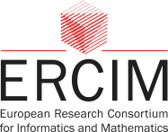

## HORIZON Europe Project Management

A machine learning-based tool (L-ADS) is used for monitoring network traffic to detect anomalous behaviour. High speed event logging is used to feed the S-RAF. SDN is used to isolate malicious network traffic, and to direct it to honeypots as a means to gather further information about the attacker. Mitigation decisions are made using a rule-based framework managed through the SDN dashboard that allows the restoration of critical parts of both the power grid and data network infrastructure.

SDN-microSENSE has demonstrated the potential for applying a variety of techniques to improve the resilience of EPES against cyberattacks. Many of these techniques are applicable to other sectors, as a basis for system and security administrators to identify security gaps as well as to detect and prevent possible cyber threats.

This project has received funding from the European Union’s Horizon 2020 research and innovation programme under grant agreement No 833955.

#### Links:

- [L1] The public website for SDN-microSENSE: https://www.sdnmicrosense.eu/

- [L2] SDN-microSENSE deliverable D3.5 Risk assessment framework: https://kwz.me/h9P

- [L3] SDN-microSENSE deliverable D5.2 SS-IDPS System: https://kwz.me/h9u

- [L4] SDN-microSENSE deliverable D5.1 XL-SIEM System: https://kwz.me/h9L

- [L5] SDN-based resilient smart grid: the SDN-

   - microSENSE architecture:

   - https://www.mdpi.com/2673-6470/1/4/13

- [L6] SDN-microSENSE deliverable D3.3 EPES Honeypots: https://kwz.me/h9l

#### Please contact:

Dave Raggett, W3C/ERCIM, France, dsr@w3.org Theodoros Rokkas, inCITES, trokkas@incites.eu

HorizonEurope:How can you get involved? The ERCIM Office has recognized expertise in a full range of services,including:

- Identification of funding opportunities

- Recruitment of project partners (within ERCIM and through ournetworks)

- Proposal writing and project negotiation

- Contractual and consortium management

A European project can be a richly rewarding tool for pushing your research or innovation activities to the stateof-the-art and beyond. Through ERCIM, our member institutes have participated in more than 90 projects funded by the European Commission in the ICT domain, by carrying out joint research activities while the ERCIM Office successfully manages the complexity of the project administration, finances and outreach.

- Communications and systems support

- Organization of attractive events, from team meetings to large-scale workshops and conferences

- Support for the dissemination of results. .

#### Please contact:

Peter Kunz, ERCIM Office peter.kunz@ercim.eu

51

ERCIM NEWS 128 January 2022

Sponsored article

# RD-star: Paving the Way to the Next generation of Linked Data

by Pierre-Antoine Champin (ERCIM/W3C)

_RDF-star, an extension to the Resource Description Framework (RDF) is the next big thing in the field of linked data and knowledge graphs. The European H2020 project MOSAICrOWN was instrumental in its development towards a W3C standard._

Linked data [L1] is a set of W3C standards for exchanging raw data on the web, in a syntactically and semantically interoperable way. While this notion emerged several years before the current trend of knowledge graphs, linked data can be viewed (and is often presented) as a foundation for a webscale distributed knowledge graph. However, the power of linked data can be leveraged in other contexts beyond the open world-wide web.

In the MOSAICrOWN project (Multi-Owner Data Sharing for Analytics and Integration Respecting Confidentiality and Owner Control), datasets uploaded to a data market are described by a wealth of meta-data. Among these meta-data are the policies, which describe how, by whom, and for what purposes, the data owner authorises the dataset to be used. There are advantages to using linked data to describe the policies and the rest of the meta-data. First, the flexible structure and explicit semantics of linked data allow it to efficiently integrate heterogeneous metadata from multiple providers and provide a natural way to link that metadata to its data. Second, policies are expressed using an existing linked data format, also recommended by W3C: the Open Digital Rights Language (ODRL) [L2]. Finally, with linked data being rooted in standard technologies, a number of robust open-source implementations are available, which we were able to deploy and adapt for the needs of the MOSAICrOWN use-cases.

Recently, the linked data ecosystem has been challenged by the emergence of property graphs, a family of graph databases. Property graphs share with linked data the graph structure that makes them flexible and expressive. Property graphs, however, are not a standard technology since each system vendor has its own “flavour” of property graph. This causes interoperability problems and vendor lock-in, but it also hampers the emergence of a consolidated stack of tools for data querying, data validation, etc.

Clearly, linked data needs to evolve. This has been discussed within the linked data community from as far back as 2012 during the Dagstuhl seminar on semantic Data Management [L3]. But it really gained traction during the 2019 W3C workshop on Web Standardisation for Graph Data [L4] where Olaf Hartig presented his and Bryan Thompson’s extension to linked data, called RDF* (read “RDF star”). In October 2020, eleven commercial and open-source products were known to implement RDF*. However, these implementations were based on different versions and different interpretations of Hartig and Thompson’s work and were not fully interoperable.

The partners in the MOSAICrOWN project were no strangers to the limitations of linked data that RDF* was aiming to solve. It was quite clear that MOSAICrOWN use cases could benefit from the additional expressiveness. The group decided that some time must be dedicated to building consensus around RDF*, so that, in the long term, it can be integrated into the linked data ecosystem as a proper W3C standard.

Under the umbrella of the RDF-DEV W3C Community Group [L5], a group of RDF* implementers and enthusiasts gathered in October 2020 to produce a common specification for RDF* (and its query language SPARQL*). In the process, the effort was renamed RDF-star, in part to avoid confusion with previous versions. In December 2021, the resulting specification [L6] is considered as nearly finished by the group, which is now focusing on moving this work to the W3C standard track.

In the meantime, interest in RDF-star continued to grow, with invited talks given at Lotico [L7] (~200 attendees) and the Knowledge Graph conference [L8]. MOSAICrOWN partners also organised a workshop [L9] in conjunction with the SEMANTiCS conference. The workshop received nine submissions and attracted around 40 participants.

RDF-star is attractive to linked data users who want to benefit from the added expressiveness inspired by the property graphs world. It is attractive to property graph users, as it bridges the gap between a popular data model and the standard and interoperable tools that linked data provides. Through cross-fertilisation, we expect that a future RDF-star W3C Recommendation will make linked data an even more powerful set of standards.

#### Links:

- [L1] https://www.w3.org/standards/semanticweb/data

- [L2] https://www.w3.org/TR/odrl-model/

- [L3] https://kwz.me/h9p

- [L4] https://www.w3.org/Data/events/data-ws-2019/

The strength of property graphs, however, lies elsewhere. Their graph data model is rich and intuitive, and has gained much popularity among software developers. It is also perceived by many as easier to use than linked data. Furthermore, many design patterns that are frequently used in property graphs do not directly translate straightforwardly to linked data. This is unexpected, as both are based on a graph model, and this raises questions about the ability of linked data to continue serving as an interoperability layer in the age of property graphs.

- [L5] https://www.w3.org/community/rdf-dev/

- [L6] https://w3c.github.io/rdf-star/cg-spec/editors_draft.html

- [L7] https://kwz.me/h9g

- [L8] https://kwz.me/h9r

- [L9] https://mosaicrown.github.io/scg2021/

#### Please contact:

Pierre-Antoine Champin ERCIM/W3C, France pierre-antoine@w3.org

52

ERCIM NEWS 128 January 2022

Events

# Privacy, Data Quality & More in Data Spaces

by Peter Kunz

_The European H2020 projects MOSAICrOWN and TRAPEZE organised a workshop entitled “Privacy, Data Quality & More in Data Spaces” during the European Big Data Value Forum 2021 held on 1 December 2021. The workshop attracted 72 participants._

Rigo Wenning from ERCIM/W3C introduced the speakers and the objectives of the workshop, which reported on leading edge research on data markets, data spaces and privacy related issues. In the European Union, data processing is subject to rules like GDPR and also to constraints from business imperatives. The workshop presented solutions for issues that arise when data is shared or monetized and presents a possible architecture for interoperability and data management for data markets and data spaces. As an example for the research advances in this area, a use cases of intelligent connected vehicles was presented. This workshop also included a presentation on advances in policy management, on protection techniques, and also in standardisation of linked data to overcome interoperability issues.

Pierangela Samarati from Università degli Studi di Milano, coordinator of the MOSAICrOWN project (Multi-Owner data Sharing for Analytics and Integration respecting Confidentiality and OWNer control) gave an overview on the architecture developed by the MOSAICrOWN project. An important issue is data wrapping & security. She explained how data wrapping provides protection by disabling the visibility of data for storage and collaborative computations and how this achieved through intelligent indexing and authorisation model.

Data sanitization & anonymization is another important part of the MOSAICrOWN architecture, presented by Stefano Paraboschi from University of Bergamo. He explained that privacy metrics can be based on different privacy definitions and outlined the prob-

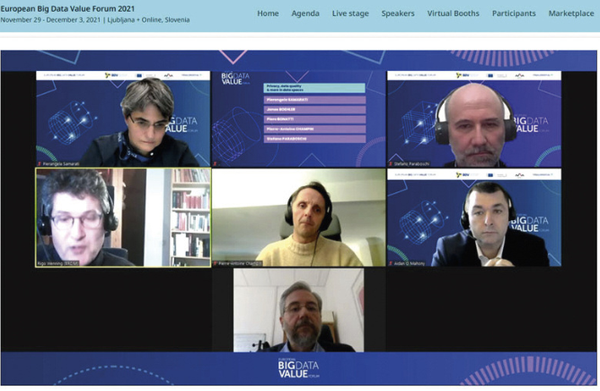

**_The speakers of the workshop “Privacy, Data Quality & More in Data Spaces”. Screenshot from the online meeting. From top left to bottom right: Pierangela Samarati (Università degli Studi di Milano), Stefano Paraboschi (Università degli Studi di Bergamo), Rigo Wenning (ERCIM/W3C), Pierre-Antoine Champin (W3C ERCIM), Aidan O’Mahony (Dell) and Piero Bonatti (Università degli studi di Napoli Federico II)._**

mantics and how privacy policies can currently be assessed.

lematic when data needs to be anonymised. The presented solution is based on applying an algorithm called Mondrian, a multidimensional anonymization method within the Apache Spark framework, an engine for large-scale data analytics.

Pierre-Antoine Champin from ERCIM/W3C presented how the RDFstar draft standard is bridging the gap between linked data and property graphs in the frame of the MOSAICrOWN project. He introduced the concept of Linked Data and Property Graphs and demonstrated with examples how RDF-star reduces the impedance mismatch between Linked Data and Property Graphs.

Piero Bonatti, from CINI, and University of Naples Federico II gave a presentation on data usage policies, developed in the frame of the TRAPEZE project (Transparency, Privacy and Security for European Citizens). He first explained what data usage policies are and how are they used, for instance the European General Data Protection Regulation (GDPR). He presented use cases related to policies and compliance, such as validation, audit/monitoring, actors, access control, etc. The solution applied in the TRAPEZE project is one simple language to express all policies in a uniform way. He demonstrated this in two examples: One showing how privacy policy is expressed in the JSON format and the second how the objective part of the GDPR is modelled. He then explained why TRAPEZE’s policy language is vocabulary-neutral. The property names and classes used in the policies are not hardwired in the policy language. They are defined in an ontology and TRAPEZE is adopting the vocabularies developed by W3C DPVCG (Data Privacy Vocabularies and Control Community Group). Piero concluded by explaining the advantages of applying formal se-

Aidan O Mahony from the OCTO Research Office at Dell Technologies concluded the workshop with a presentation of the use case “Intelligent Connected Vehicles” developed in MOSAICrOWN. He gave insight in the architecture for an automotive scenario involving data owners (drivers) ingesting their data into the data market, consumers accessing data in the data market, and the data market provider offering storage and computation services to data owners and consumers. In this scenario, RDF-star is applied to intelligently connect vehicles.

At the end of the workshop, the presenters had the opportunity to answer questions raised during the online sessions.

**More information:** https://mosaicrown.eu/ https://trapeze-project.eu/ https://kwz.me/h9o

53

ERCIM NEWS NEWS 128 January 2022

Announcements

Call for Proposals

## Dagstuhl Seminars and Perspectives Workshops

_Schloss Dagstuhl – Leibniz-Zentrum für Informatik is accepting proposals for scientific seminars/workshops in all areas of computer science, in particular also in connection with other fields._

If accepted the event will be hosted in the seclusion of Dagstuhl’s well known, own, dedicated facilities in Wadern on the western fringe of Germany. Moreover, the Dagstuhl office will assume most of the organisational/ administrative work, and the Dagstuhl scientific staff will support the organizers in preparing, running, and documenting the event. Thanks to subsidies the costs are very low for participants.

Dagstuhl events are typically proposed by a group of three to four outstanding researchers of different affiliations. This organizer team should represent a range of research communities and reflect Dagstuhl’s international orientation. More information, in particular, details about event form and setup as well as the proposal form and the proposing process can be found on

#### https://www.dagstuhl.de/dsproposal

Schloss Dagstuhl – Leibniz-Zentrum für Informatik is funded by the German federal and state government. It pursues a mission of furthering world class research in computer science by facilitating communication and interaction between researchers.

includes case studies and experience reports; methods and tools to support a.o. analysis, debugging, and transformation of industrial critical software; verification and validation techniques using for instance model checking, SAT/SMT and constraint solving; reports on the impact of using formal techniques. New this year! Special track on Formal Methods for Responsible AI. We invite submissions in topics related to the use of formal methods for responsible AI. How can formal verification make AI more trustworthy? Which FM techniques are powerful enough to provide the necessary guarantees?

CALL for PAPERS

MICS 2022:

## 27th International

Conference on ormal Methods for Industrial

## Critical Systems

Warsaw, 14-16 September 2022

FMICS is the yearly conference organised by the homonymous ERCIM working group. The aim of the conference series is to provide a forum for researchers who are interested in the development and application of formal methods in industry. FMICS brings together scientists and engineers who are active in the area of formal methods and are interested in exchanging their experiences of the industrial usage of these methods. The FMICS conference series also strives to promote research and development for the improvement of formal methods and tools for industrial applications. FMICS will be held as part of CONFEST 2022, comprising also CONCUR, FORMATS, QEST and workshops, during 12-17 September 2022.

#### Deadlines

The paper submission deadline is 12 May 2022, with an abstract due one week earlier. Accepted papers will be included in the Conference Proceedings published in Springer's Lecture Notes in Computer Science series.

#### IInvited Speaker

Sven Schewe (Liverpool University, UK)

#### PC Chairs

- Jan Friso Groote (Eindhoven University of Technology, NL)

- Marieke Huisman (University of Twente, NL)

#### Topics

The conference is about the application of formal techniques in industry. This

#### More information:

https://fmics2022.fsa.win.tue.nl/

Throughout the year, Inria welcomes new employees to its research teams and departments, whether through competitions, mobility within the public service, contractual agreements or internship proposals

#### Important Dates

- _Next submission period:_ April 1 to April 15, 2022 Seminar dates: In 2023/2024.

https://jobs.inria.fr/public/classic/en/offres

54

ERCIM NEWS 128 January 2022

In rief

## Dutch Quantum Application Lab

In October 2021 six Dutch academic and research organizations signed a memorandum of understanding to establish the Quantum Application Lab (QAL): University of Amsterdam (UvA), the Netherlands Organization for applied scientific research (TNO), the national research institute for mathematics and computer science (CWI), the Dutch collaborative ICT organization for Dutch higher education and research (SURF), TU Delft (on behalf of QuTech and Quantum Inspire) and the Netherlands eScience Center.

QAL will fulfill the much-needed connection between scientific developments of quantum hardware and software and demand-driven solutions for e.g. optimization, simulation, and machine learning. Embedded in the Quantum Delta NL (QDNL) ecosystem, QAL will accelerate the construction of a social and economic innovation infrastructure for quantum computing and the knowledge, capabilities, and competencies required for this. QAL will do this by identifying promising domains for quantum computing applications and executing projects together with scientific, industrial, and/or private sector partners.

The QAL partners are developing a public-private partnership (PPP) that will bridge the gap between academic research and industrial applications of quantum computing to solve some of our most pressing societal challenges in the area of health care, energy, technology and security.

As a national, open innovation and trans-disciplinary collaboration between public and private organizations, QAL will provide for all necessary conditions and infrastructure that lead to quantum computing application development. QAL covers the whole chain from problem identification and dissection into different (mathematical) parts, to implementation of existing classical solutions and development of novel quantum algorithms, benchmarking and optimization based on multiple quantum computing architectures, and intimate knowledge of the needs of potential users.

## Restoring Prehension in People with Tetraplegia - A fruitful Collaboration between

## Research and Industry

Founded in 2018 by Inria and University of Montpellier researchers, Neurinnov, a neurostimulation implants manufacturer, announces that it has completed a €3 million seed round led by IRDI Capital Investissement, UI Investissement and SOFILARO.

Neurinnov aims to revolutionize the neural stimulation sector by offering a selective nerve stimulation technology. This technology has been validated through several clinical studies carried out with the Camin team at Inria and clinical partners, the last of which was completed in 2020 and was funded by EIT Health. The developed solution allows selective stimula-

tion of nerve fibers through epineural electrodes to obtain the desired functional movement while minimizing unwanted induced movements.

Neurinnov will focus on the industrialization of its medical device, with the launch of the pivotal clinical study in Europe planned for 2024 in col- **_Neurinnov SAFE chip at the heart of the innovation to_** laboration with the Camin **_generate multipolar stimulation. Image: © Inria / L. Jacq._** team at Inria and clinical partners (Clinique Saint Jean, St Jean de Védas and USSAP Perpignan). Industrial partners have already been identified and an interim study will be conducted as early as next year.

The latest round of fundraising will allow Neurinnov to strengthen its team, finalize the development of its product and carry out the clinical study in preparation for obtaining the CE mark. “Neurinnov’s ambition is to become the leading player in the field of disability compensation technologies through neurostimulation. This unique project is also a social project, and in this first phase, it will allow us to offer a solution to people who are at a therapeutic dead end. Later on, we will be able to apply our technology to other clinical indications”, says Serge Renaux, President of Neurinnov.

David Guiraud, Neurinnov Chief Scientific Officer, adds: “Evaluated as part of a project to restore prehension in eligible people with tetraplegia, but more broadly, this technology allows the stimulation of a sub-set of axons within a nerve in order to obtain the desired therapeutic effect while minimizing undesired side effects. In particular, it offers important fields of investigation in the stimulation of the vagus nerve for the treatment of arrhythmias, obesity or asthma”.

The field of possibilities offered by this technology is wide and unique in the world. It has been patented and licensed to Neurinnov by the University of Montpellier and Inria and four new patents around the product have been filed since the spin-off was created. This success story is the result of research work carried out for many years by David Guiraud, Christine Azevedo and David Andreu at Inria and the University of Montpellier in collaboration with Dr. Charles Fattal (USSAP Perpignan) and Dr. Jacques Teissier (Clinique St Jean).

#### More information:

https://neurinnov.com/ https://team.inria.fr/camin https://eithealth.eu/project/agilis/

55

ERCIM NEWS NEWS 128 January 2022

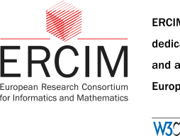

ERCIM – the European Research Consortium for Informatics and Mathematics is an organisation dedicated to the advancement of European research and development in information technology and applied mathematics. Its member institutions aim to foster collaborative work within the European research community and to increase co-operation with European industry.

ERCIM is the European Host of the World Wide Web Consortium.

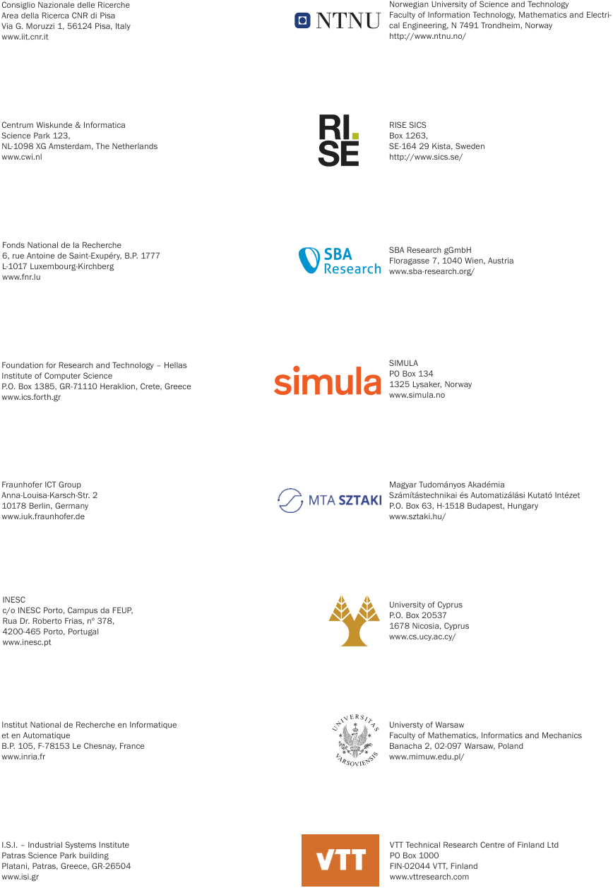

Consiglio Nazionale delle Ricerche Norwegian University of Science and Technology Area della Ricerca CNR di Pisa Faculty of Information Technology, Mathematics and Electri- Via G. Moruzzi 1, 56124 Pisa, Italy cal Engineering, N 7491 Trondheim, Norway www.iit.cnr.it http://www.ntnu.no/ Centrum Wiskunde & Informatica RISE SICS Science Park 123, Box 1263, NL-1098 XG Amsterdam, The Netherlands SE-164 29 Kista, Sweden www.cwi.nl http://www.sics.se/ Fonds National de la Recherche SBA Research gGmbH 6, rue Antoine de Saint-Exupéry, B.P. 1777 Floragasse 7, 1040 Wien, Austria L-1017 Luxembourg-Kirchberg www.fnr.lu www.sba-research.org/ Foundation for Research and Technology – Hellas SIMULA Institute of Computer Science PO Box 134 P.O. Box 1385, GR-71110 Heraklion, Crete, Greece 1325 Lysaker, Norway www.ics.forth.gr www.simula.no Fraunhofer ICT Group Magyar Tudományos Akadémia Anna-Louisa-Karsch-Str. 2 Számítástechnikai és Automatizálási Kutató Intézet 10178 Berlin, Germany P.O. Box 63, H-1518 Budapest, Hungary www.iuk.fraunhofer.de www.sztaki.hu/ INESC University of Cyprus c/o INESC Porto, Campus da FEUP, P.O. Box 20537 Rua Dr. Roberto Frias, nº 378, 1678 Nicosia, Cyprus 4200-465 Porto, Portugal www.cs.ucy.ac.cy/ www.inesc.pt Institut National de Recherche en Informatique Universty of Warsaw et en Automatique Faculty of Mathematics, Informatics and Mechanics B.P. 105, F-78153 Le Chesnay, France Banacha 2, 02-097 Warsaw, Poland www.inria.fr www.mimuw.edu.pl/ I.S.I. – Industrial Systems Institute VTT Technical Research Centre of Finland Ltd Patras Science Park building PO Box 1000 Platani, Patras, Greece, GR-26504 FIN-02044 VTT, Finland www.isi.gr www.vttresearch.com 

Subscribe to ERCIM News and order back copies at https://ercim-news.ercim.eu/
