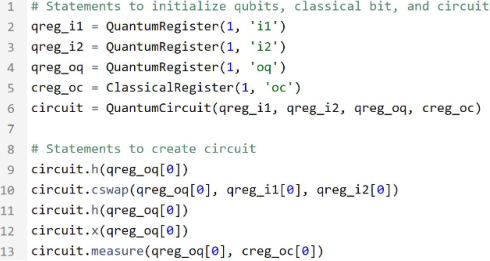
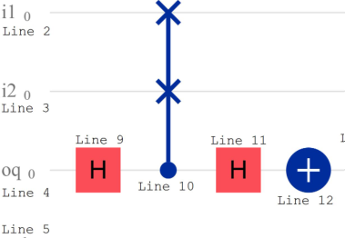
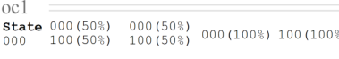
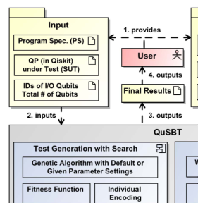
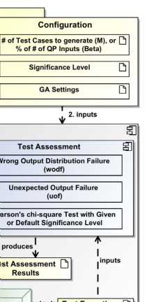
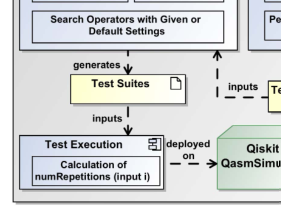
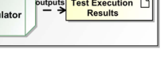

2022 IEEE/ACM 44th International Conference on Software Engineering: Companion Proceedings (ICSE-Companion)

# QSBT: Search-Based Testing of Qantum Programs

## Xinyi Wang

wangxinyi125@nuaa.edu.cn

Nanjing University of Aeronautics and Astronautics Nanjing, China

Tao Yue

taoyue@ieee.org Nanjing University of Aeronautics and Astronautics Simula Research Laboratory, Norway Nanjing, China

### ABSTRACT

Generating a test suite for a quantum program such that it has the maximum number of failing tests is an optimization problem. For such optimization, search-based testing has shown promising results in the context of classical programs. To this end, we present a test generation tool for quantum programs based on a genetic algorithm, called QuSBT (Search-based Testing of Quantum Programs). QuSBT automates the testing of quantum programs, with the aim of nding a test suite having the maximum number of failing test cases. QuSBT utilizes IBM’s Qiskit as the simulation framework for quantum programs. We present the tool architecture in addition to the implemented methodology (i.e., the encoding of the search individual, the denition of the tness function expressing the search problem, and the test assessment w.r.t. two types of failures). Finally, we report results of the experiments in which we tested a set of faulty quantum programs with QuSBT to assess its eectiveness. Repository (code and experimental results): https://github.com/ Simula-COMPLEX/qusbt-tool Video: https://youtu.be/3apRCtluAn4

### CCS CONCEPTS

• Theory of computation → Quantum computation theory; • Software and its engineering → Software testing and debugging; Search-based software engineering.

### KEYWORDS

Quantum Programs, Search-Based Testing, Genetic Algorithms

ACM Reference Format:

Xinyi Wang, Paolo Arcaini, Tao Yue, and Shaukat Ali. 2022. QuSBT: SearchBased Testing of Quantum Programs. In 44th International Conference on Software Engineering Companion (ICSE ’22 Companion), May 21–29, 2022, Pittsburgh, PA, USA. ACM, New York, NY, USA, 5 pages. https://doi.org/10. 1145/3510454.3516839

Permission to make digital or hard copies of all or part of this work for personal or classroom use is granted without fee provided that copies are not made or distributed for prot or commercial advantage and that copies bear this notice and the full citation on the rst page. Copyrights for components of this work owned by others than ACM must be honored. Abstracting with credit is permitted. To copy otherwise, or republish, to post on servers or to redistribute to lists, requires prior specic permission and/or a fee. Request permissions from permissions@acm.org. ICSE ’22 Companion, May 21–29, 2022, Pittsburgh, PA, USA © 2022 Association for Computing Machinery. ACM ISBN 978-1-4503-9223-5/22/05...$15.00 https://doi.org/10.1145/3510454.3516839

Paolo Arcaini

arcaini@nii.ac.jp National Institute of Informatics Tokyo, Japan

## Shaukat Ali

shaukat@simula.no Simula Research Laboratory Oslo, Norway

### 1 INTRODUCTION

Quantum Computing (QC) promises to bring several advantages by solving intrinsically complex problems. As for classical programs, testing of quantum programs is essential to guarantee their correctness. However, the probabilistic nature and the specic features of QC, such as superposition and entanglement, make testing quantum programs very challenging.

By realizing the importance of quantum software testing [8, 14, 15], several research works have been proposed. Notable examples include property-based testing [4], fuzz testing [9], mutation analysis [7], search-based testing [11], combinatorial testing [10], input/output coverage [2] along with the Quito tool [12], and specialized projection-based assertions [6] for quantum programs.

However, in order for these techniques to be adopted in the development practice, the automation and tool support of the testing process are essential. Towards these goals, we present the QuSBT (Search-based Testing of Quantum Programs) testing tool for quantum programs, which employs a Genetic Algorithm (GA) to automatically generate a test suite with the maximum possible number of failing test cases. Note that the approach used by QuSBT to generate such test suites was published in our previous work [11], but no tool usable by users was provided there. Therefore, in this paper, we present the QuSBT tool, which is implemented for quantum programs coded using IBM’s Qiskit [13] framework in Python. QuSBT also relies on the jMetalPy [3] framework for the implementation of the GA. QuSBT provides the encoding of the search individual, the denition of the tness function that species the search problem, and the test assessment w.r.t. two types of failures for quantum programs [2]; one test assessment relies on statistical tests to deal with the probabilistic nature of quantum programs.

We have validated QuSBT by testing ten faulty versions of ve quantum programs. Overall, on average, QuSBT managed to almost always generate test suites in which at least 50% of the test cases failed.

The rest of the paper is organized as follows. Sect. 2 presents background, Sect. 3 explains preliminaries, and Sect. 4 describes QuSBT’s architecture and methodology. We present validation results in Sect. 5, and conclude the paper in Sect. 6.

### 2 BACKGROUND

A quantum bit (or a qubit in short) is the basic unit of information in Quantum Computing (QC) in contrast to a bit in classical computing.

173

Xinyi Wang, Paolo Arcaini, Tao Yue, and ShaukaAli

ICSE ’22 Companion, May 21–29, 2022, Pitsburgh, PA, USA

1 # Statements to initialize qubits, classical bit, and circuit 2 qreg_il = QuantumRegister(1, 'i1') 3 greg_i2 = QuantumRegister(1, 'i2') 4 qreg_oq = QuantumRegister(1, oq’) 5 creg_oc = ClassicalRegister(1, oc’) 6 circuit = QuantumCircuit(qreg_il, qreg_i2, greg oq, creg_oc) 7 8 # Statements to create circuit 9 circuit.h(qreg_oq[0]) 10 circuit.cswap(areg_oa[0], areg_il[e], areg_i2[0]) 11 circuit.h(qreg_oa[0]) 12 circuit.x(qreg_oa[0]) 13 circuit.neasure(areg_oa[e], creg_oc[0]) 

Figure 1: Swap Test – Qiskit Code

il o Line 2 2.9 Line 3 Line 9 Line 11 oeLine 4 Ho Line 10 Ho Line[+]12 Line 5 

Line 13 1! 

ocl State 000(50%) 000 (50%) . a 000 100(50%) 100(50%) 000(100%) 100(100%) 

Figure 2: Swap Test – Circuit Diagram

A qubit, like a bit, can take value 0 or 1. However, in superposition (a special QC characteristic), a qubit can be in both 0 and 1 states at the same time. In contrast, a classical bit will be either in 0 or 1. A qubit in superposition has amplitudes () corresponding to its 0 and 1 states. An amplitude () is captured as a complex number consisting of a magnitude and a phase. The former shows the probability of a quantum program being in a specic state, whereas the latter represents the angle of the amplitude in the polar form, ranging from 0 to 2 in radians. We can represent the state of a one-qubit program in the Dirac notation as:

#### 0 |0+ 1 |1

0, 1 are the amplitudes associated to 0 and 1. The square of the absolute value of amplitude of a state indicates the probability of the program to be in that state. For example, |0’s magnitude is |0|2 . The sum of all the magnitudes is 1, i.e.,Õ 1 =0||2= 1.

In Fig. 1, we show an example of quantum program, called Swap Test, encoded in Qiskit (taken from [5]), alongside with its circuit in Fig. 2. The program compares two input qubits, i.e., i1 and i2 (initialized in Lines 2-3 in their respective quantum registers qreg_i1 and qreg_i2). If i1 and i2 are equal, then output qubit (i.e., oq, initialized in Line 4 in its register qreg_oq) will output the value 1 with 100% probability when measured in the classical bit (i.e., oc, initialized in its register creg_oc at Line 5). If i1 and i2 are dierent, then the

probability decreases with the increased dierence between the two inputs.

Lines 2-5 perform the necessary initialization of the two qubits and the classical bit, whereas Line 6 creates a quantum circuit for the initialized qubits and bit. By default, all the three qubits and the classical bit are initialized to 0, i.e., the program is in state 000.

Line 9 puts oq in superposition with the Hadamard (H ) gate. As a result, the quantum program’s state will be 000 and 100 with amplitudes of 0.707, i.e., 50% of magnitude associated with each state. Note that the magnitude is calculated by taking the square of the absolute value of the amplitude. Since we put only oq is superposition, it is the only qubit in both 0 and 1 states.

We apply the cswap gate in Line 10 to swap the two inputs (i.e., the states of i1 and i2) conditioned by the value of oq. This means that if the value of oq is 1, the states of i1 and i2 will be swapped. For the code shown in Fig. 2, considering that oq is initialized as 0, as a result, the program’s state will remain the same after the swap. Line 11 applies the H gate to oq and, as a result, the program’s state will be same as the initial: 000. We apply the not gate (i.e., the x operation) on Line 12, which will transit the state of the program to 100. Finally, we measure oq in the classical bit oc in Line 13, which is 1, showing that i1 and i2 are equal.

### 3 PRELIMINARIES

We here provide the minimal denitions regarding quantum programs and their testing.

Denition 1 (Quantum program). We identify with  the qubits of the quantum program QP.  ⊆  denes the input of the program, and  ⊆  the output. The input and output domains are dened as  = B|| and  = B|| , respectively. A quantum program QP is then described by the function QP:  → 2 .

Note that the denition shows that a quantum program can return dierent output values for the same input value.

We assume that the expected behavior of the program is specied by a program specication.

Denition 2 (Program specication). Given a quantum program QP:  → 2 , PS is its program specication. For a given input  and possible output ℎ, the program specication species the expected probability of occurrence of output ℎ for input  (i.e., PS(,ℎ) = ℎ).

As for classical programs, testing a quantum program consists in executing it with some inputs. However, due to the non-deterministic nature of quantum programs, each input must be executed multiple times to observe the distribution of its outputs. Precise denitions are as follows.

Denition 3 (Test input and test result). A test input is dened as ,, where  is an assignment to input qubits  , and  is the number of times that QP must be run with . The test result is then dened as [QP(), . . . , QP()] = [1, . . . , ], where   is the output returned by the program at the th execution.

The assessment of a test result requires to check the distribution of its output values. Given the result [1, . . . , ] returned for an input , these two types of failures can occur:

174

QSBT: Search-Based Tesing of Qanum Programs

ICSE ’22 Companion, May 21–29, 2022, Pitsburgh, PA, USA

—1 = 7” = ~ | eer QusBT Test Generation with Search Given Parameter Settings Encoding 

—  [#of Test Cases to generate(M), or [3 Ei Test Assessment. (wodf) (uof) [len O17 | 

1 inputs. TostExscution _ Elfeplored Qiskit Calculation of = = > QasmSimulator —. 

outputs| Test Execution [J a Results 

Figure 3: Overview of the QuSBT Tool

- Unexpected Output Failure (uof ): it occurs when an output

-  is not expected according to the program specication PS,

- i.e., PS(,  ) = 0;

- Wrong Output Distribution Failure (wodf ): it occurs when the returned output values follow a probability distribution signicantly dierent from the one specied by the program specication. A goodness of t test with the Pearson’s chisquare test [1] is employed to check for the presence of this type of failure.

### 4 QUSBT TOOL ARCHITECTURE AND METHODOLOGY

As for classical programs, also for quantum programs the generation of (possibly) failing tests is a relevant problem. To this aim, in [11], we proposed a search-based approach called QuSBT, based on a genetic algorithm (GA). Given a quantum program QP, it generates a test suite consisting of  test cases.  is a parameter of the approach that can be set by the user.

In this paper, we describe how we have engineered that work in a tool that is usable by developers of quantum programs. We describe the input and conguration of QuSBT, followed by the process of test generation, execution, and assessment.

### 4.1 Input and Conguration

To use QuSBT (see Fig. 3), a user must provide Input Information, which contains the quantum program under test (SUT), along with the list of the input and output qubits that it contains, the total number of qubits, and its program specication (PS) (see Def. 2).

Additionally, QuSBT requires users to select the number of tests  to be added in each searched test suite. Users can specify , e.g.,

based on available budgets. However, selecting a value  without considering the program under test might not be a good practice. So, QuSBT implements another way, i.e., selecting  as the percentage  of the number of possible inputs  of the quantum program, i.e.,  =  · | |. In this way, users have the option to select the percentage , rather than the absolute number .

Moreover, a user can also congure the GA or rely on the default GA settings in jMetalPy. These default settings are the binary tournament selection of parents, the integer SBX crossover (the crossover rate = 0.9), and the polynomial mutation operation being equal to the reciprocal of the number of variables. The population size is set as 10, and the termination condition is the maximum number of generations which is set as 50. These default settings are provided in a template, starting from which a user can make their own Input Information le by changing the default settings, if needed. As discussed in Sect. 3, we employ the Pearson’s chisquare test for checking failures of type wodf . A user can specify the signicance level to be used with the test; we set the default signicance level at 0.01.

### 4.2 Process of Test Generation, Execution, and Assessment

We here describe how the search-based test generation is conducted in QuSBT.

An individual of the search is represented using integer variables <u></u> = [1, . . . ,  ]; each  represents a test case and it is dened over the input domain of the program  .

The goal of the search is to nd an assignment <u></u> = [1, . . . ,  ] that maximizes the number of failing tests. Specically, the tness computation is as follows.

- For each assignment   of the th test:

- it computes the number of required repetitions (see Def. 3) as   = |{ℎ ∈  | PS(  ,ℎ) ≠ 0}| × 100; the idea is that the number of required repetitions is proportional to the number of outputs that, according to the program specication, are expected to occur for input   ;

- it executes QP   times with input   ; the obtained text execution results are [1, . . . ,   ];

- it assesses the correctness of the test execution result with respect to the two failure types (see Sect. 3):

- ∗ it checks if a failure of type uof occurred, i.e., if an output that, according to the program specication PS, should not occur has been produced; if this is the case, it sets ag fail to true, and the assessment for wodf is not performed; otherwise,

- ∗ it assesses wodf by checking whether the frequency distribution of the measured output values (contained in the test execution results [1, . . . ,   ]) follows the expected distribution specied in the program specication PS. This is done by performing a goodness of t test with the Pearson’s chi-square test, using the given or the default signicance level. If the statistical test shows a signicant dierence, it sets ag fail to true, otherwise to false.

175

Xinyi Wang, Paolo Arcaini, Tao Yue, and ShaukaAli

ICSE ’22 Companion, May 21–29, 2022, Pitsburgh, PA, USA

Table 1: Experimental Results for Testing 10 Faulty QPs with QuSBT (M: number of tests of the generated test suite; %ft: percentage of failing tests in the test suite; st: simulation time; et: execution time of the search (excluding simulation))

a quantum program could be much lower than M. Nonetheless, we can conclude that QuSBT managed to nd more than 50% of failing test cases for most of the faulty QPs.

### 6 CONCLUSION AND FUTURE WORK

|QP|||FQP1 |||FQP2 ||
|---|---|---|---|---|---|---|---|
||M|%ft|st (sec) et (sec)|M|%ft|st (sec)|et (sec)|
|BV|52|75.0%|3201 7|52|76.9%|3151|7|
|QR|26|57.7%|272 18|26|88.5%|238|5|
|IQ|52|71.2%|9839 1504|52|82.7%|9837|1271|
|AS|52|46.2%|732 28|52|50.0%|744|26|
|CE|52|67.3%|968 22|52|73.1%|1003|20|

- Given the assessments res = [fail1, . . . , fail ] of all the generated tests, the tness function to be maximized is computed as follows:

tness() = |{fail ∈ res | fail = true}|

The underlying GA runs till the specied number of generations. As output, the tool provides the test suite that maximizes the tness function in two formats:

- as a list of input values, together with information of the returned output, and information on whether the test passed or failed;

- as unit tests written in the unittest framework1 ; such format is useful for the user, who can re-run the tests, in particular the failing ones, while debugging the quantum program.

### 5 VALIDATION

For this paper, we conducted experiments to evaluate QuSBT with the following ve quantum programs: (i) BV, the Bernstein-Vazirani cryptographic algorithm; (ii) QR, an algorithm to access and manipulate quantum random access memory; (iii) IQ, inverse quantum Fourier transform; (iv) AS, a mathematical operation in superposition; (v) CE, a conditional execution in superposition. The total number of qubits of the programs ranges from 10 to 20, the number of gates from 15 to 60, and the circuit depth from 3 to 56. To assess whether QuSBT can nd faults in the quantum programs, we created two faulty versions of each program, named as FQP1 and FQP2.

Regarding the GA settings, we set the population size as 10, and we xed 50 generations as the termination condition for the search. QuSBT requires to specify the number of tests  to generate, and this can be done as percentage  of the size of the input domain (see Sect. 4.1); for these experiments, we used  = 5%.

Table 1 summarizes the results for the faulty QPs in terms of the size of each test suite (M), percentage of failing tests (%ft), simulation time (st), i.e., the time to execute all the test cases with Qiskit QasmSimulator, and execution time of the search (et). We can see that, while the search time is minimal, QuSBT spent most of the time executing test cases on the QPs using the simulator. Moreover, with the exception of FQP1 for AS, QuSBT managed to nd at least 50% of failing test cases in the generated test suite. It is not always possible to achieve a higher number of failing test cases, because, for instance, the total number of possible failing inputs of

> 1https://docs.python.org/3/library/unittest.html

We presented a test generation tool (QuSBT) for quantum programs that uses a genetic algorithm to automatically nd a test suite in which the number of failing test cases is maximized. QuSBT implements the encoding of the search individual, the tness function describing the search problem, and the checking of passing and failing of tests w.r.t. two types of failures using a statistical test to deal with the probabilistic nature of quantum programs; moreover, it integrates with the IBM’s Qiskit QasmSimulator. We presented the tool architecture and the detailed methodology, and conducted experiments with ten faulty versions of ve quantum programs to validate the tool. In the future, we plan to integrate other search algorithms in QuSBT, and provide a methodology to guide users to congure and apply QuSBT.

### ACKNOWLEDGMENTS

This work is supported by the National Natural Science Foundation of China under Grant No. 61872182 and Qu-Test (Project#299827) funded by Research Council of Norway. P. Arcaini is supported by ERATO HASUO Metamathematics for Systems Design Project (No. JPMJER1603), JST; Funding Reference number: 10.13039/501100009024 ERATO.

### REFERENCES

- [1] Alan Agresti. 2019. An introduction to categorical data analysis (3 ed.). WileyBlackwell.

- [2] Shaukat Ali, Paolo Arcaini, Xinyi Wang, and Tao Yue. 2021. Assessing the Eectiveness of Input and Output Coverage Criteria for Testing Quantum Programs. In 2021 14th IEEE Conference on Software Testing, Verication and Validation (ICST). 13–23. https://doi.org/10.1109/ICST49551.2021.00014

- [3] Antonio Benítez-Hidalgo, Antonio J. Nebro, José García-Nieto, Izaskun Oregi, and Javier Del Ser. 2019. jMetalPy: A Python framework for multi-objective optimization with metaheuristics. Swarm and Evolutionary Computation 51 (2019), 100598. https://doi.org/10.1016/j.swevo.2019.100598

- [4] Shahin Honarvar, Mohammad Reza Mousavi, and Rajagopal Nagarajan. 2020. Property-Based Testing of Quantum Programs in Q#. In Proceedings of the IEEE/ACM 42nd International Conference on Software Engineering Workshops (Seoul, Republic of Korea) (ICSEW’20). Association for Computing Machinery, New York, NY, USA, 430–435. https://doi.org/10.1145/3387940.3391459

- [5] Eric R. Johnston, Nic Harrigan, and Mercedes Gimeno-Segovia. 2019. Programming Quantum Computers: Essential Algorithms and Code Samples. O’Reilly Media, Incorporated.

- [6] Gushu Li, Li Zhou, Nengkun Yu, Yufei Ding, Mingsheng Ying, and Yuan Xie. 2020. Projection-Based Runtime Assertions for Testing and Debugging Quantum Programs. Proc. ACM Program. Lang. 4, OOPSLA, Article 150 (Nov. 2020), 29 pages. https://doi.org/10.1145/3428218

- [7] Eñaut Mendiluze, Shaukat Ali, Paolo Arcaini, and Tao Yue. 2021. Muskit: A Mutation Analysis Tool for Quantum Software Testing. In 2021 36th IEEE/ACM International Conference on Automated Software Engineering (ASE). 1266–1270. https://doi.org/10.1109/ASE51524.2021.9678563

- [8] Andriy Miranskyy and Lei Zhang. 2019. On Testing Quantum Programs. In Proceedings of the 41st International Conference on Software Engineering: New Ideas and Emerging Results (Montreal, Quebec, Canada) (ICSE-NIER ’19). IEEE Press, 57–60. https://doi.org/10.1109/ICSE-NIER.2019.00023

- [9] Jiyuan Wang, Fucheng Ma, and Yu Jiang. 2021. Poster: Fuzz Testing of Quantum Program. In 2021 14th IEEE Conference on Software Testing, Verication and Validation (ICST). 466–469. https://doi.org/10.1109/ICST49551.2021.00061

- [10] Xinyi Wang, Paolo Arcaini, Tao Yue, and Shaukat Ali. 2021. Application of Combinatorial Testing to Quantum Programs. In 2021 IEEE 21st International Conference on Software Quality, Reliability and Security (QRS).

- [11] Xinyi Wang, Paolo Arcaini, Tao Yue, and Shaukat Ali. 2021. Generating Failing Test Suites for Quantum Programs With Search. In Search-Based Software Engineering. Springer International Publishing, Cham, 9–25. https://doi.org/10.1007/

176

ICSE ’22 Companion, May 21–29, 2022, Pitsburgh, PA, USA

QSBT: Search-Based Tesing of Qanum Programs

##### 978-3-030-88106-1_2

- [12] Xinyi Wang, Paolo Arcaini, Tao Yue, and Shaukat Ali. 2021. Quito: a CoverageGuided Test Generator for Quantum Programs. In 2021 36th IEEE/ACM International Conference on Automated Software Engineering (ASE). 1237–1241. https://doi.org/10.1109/ASE51524.2021.9678798

- [13] Robert Wille, Rod Van Meter, and Yehuda Naveh. 2019. IBM’s Qiskit Tool Chain: Working with and Developing for Real Quantum Computers. In 2019 Design, Automation Test in Europe Conference Exhibition (DATE). 1234–1240. https:

//doi.org/10.23919/DATE.2019.8715261

- [14] Tao Yue, Paolo Arcaini, and Shaukat Ali. 2022. Quantum Software Testing: Challenges, Early Achievements, and Opportunities. ERCIM News 2022, 128 (2022). https://ercim-news.ercim.eu/en128/special/quantum-software-testingchallenges-early-achievements-and-opportunities

- [15] Jianjun Zhao. 2020. Quantum Software Engineering: Landscapes and Horizons. CoRR abs/2007.07047 (2020). arXiv:2007.07047

177
