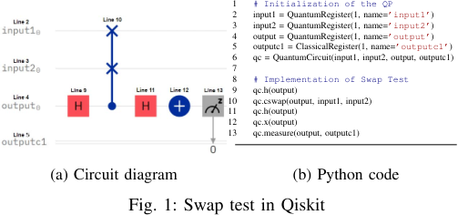
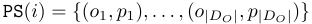
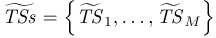
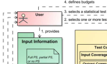
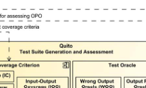
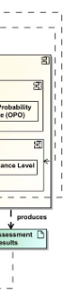
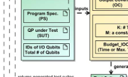
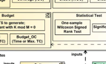
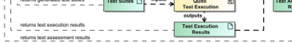
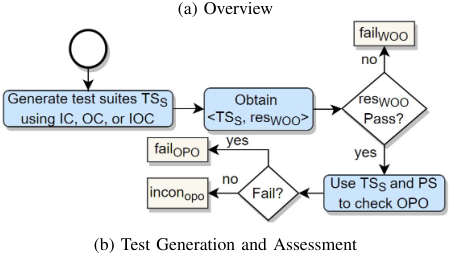

2021 36th IEEE/ACM International Conference on Automated Software Engineering (ASE)

# Quito: a Coverage-Guided Test Generator for Quantum Programs

Xinyi Wang

Nanjing University of Aeronautics and Astronautics

Nanjing, China wangxinyi125@nuaa.edu.cn

Paolo Arcaini National Institute of Informatics Tokyo, Japan arcaini@nii.ac.jp

Tao Yue

Nanjing University of Aeronautics and Astronautics, China

Simula Research Laboratory, Norway

taoyue@ieee.org

Shaukat Ali

Simula Research Laboratory Fornebu, Norway shaukat@simula.no

Abstract—Automation in quantum software testing is essential to support systematic and cost-effective testing. Towards this direction, we present a quantum software testing tool called Quito that can automatically generate test suites covering three coverage criteria dened on inputs and outputs of a quantum program coded in Qiskit, i.e., input coverage, output coverage, and input-output coverage. Quito also implements two types of test oracles based on program specications, i.e., checking whether a quantum program produced a wrong output or checking a probabilistic test oracle with statistical test. We describe the architecture and methodology of the tool. We also validated the tool with one quantum program and one faulty version of it. Results indicate that Quito can generate test suites and perform test assessments that detect faults, and produce test results with a good time performance. Quito’s code: https://github.com/Simula-COMPLEX/quito Quito’s video: https://youtu.be/kuI9QaCo8A8 Artifact Available: https://doi.org/10.5281/zenodo.5288665

Index Terms—quantum programs, software testing, coverage criteria, test generation, test assessment

## I. INTRODUCTION

Quantum programs are necessary to implement innovative applications promised by Quantum Computing (QC). Thus, it is important that developed quantum programs are correct. However, testing quantum programs is challenging because of their probabilistic nature and unique features (e.g., superposition and entanglement). There exist some preliminary works in quantum software testing such as property-based testing [1], fuzz testing [2], search-based testing [3], mutation testing [4], and runtime assertions [5]. In contrast to these works, in [6], we dened coverage criteria tailored for quantum programs: input, output, and input-output coverage criteria. Moreover, we have also proposed three test generation algorithms for generating test suites achieving these criteria. Thus, the key of novelties of our work [6] as compared to [1], [2], [5]

This work is supported by the National Natural Science Foundation of China under Grant No. 61872182 and the Qu-Test project (Project#299827) funded by Research Council of Norway. Paolo Arcaini is supported by ERATO HASUO Metamathematics for Systems Design Project (No. JPMJER1603), JST; Funding Reference number: 10.13039/501100009024 ERATO.

are the denition of coverage criteria, their corresponding test generation algorithms, and empirical evaluation.

In order for a testing technique to be accepted and adopted, automation is mandatory. However, the approach we proposed in [6] was experimented using an online quantum framework, but no implementation usable by users was provided. Therefore, we here present a tool, called Quito (QUantum InpuT Output testing) that implements and automatizes the approach we proposed in [6]. Quito targets quantum programs developed in Qiskit [7], a framework developed by IBM for writing quantum programs. In short, given a quantum program and optionally its specication, Quito can generate and execute test cases satisfying the three coverage criteria.

If the program specication is provided, Quito can also check the correctness of the quantum program over the generated tests, with two test assessment techniques (i.e., test oracles). First, it can check whether a quantum program produced a wrong output. Second, it can check a probabilistic test oracle which assesses, with appropriate statistical tests, whether the occurrence probabilities of the observed outputs of a quantum program deviate signicantly from the ones specied in the program specication.

The tool is intended for both researchers and quantum software engineers. Researchers can extend the tool with new functionalities or compare their new testing techniques with Quito. Quantum software engineers can use the tool to test their quantum programs to gain condence on the correctness of their programs.

The rest of the paper is organized as follows: We start with background in Sect. II followed by a presentation of Quito and its methodology in Sect. III. Validation of the approach is presented in Sect. IV, while Sect. V concludes the paper and discusses possible future work.

## II. PRELIMINARIES

We here recall some basic denitions on quantum programming and on the test generation approaches we proposed in [6], that are necessary for describing the tool.

978-1-6654-0337-5/21/$31.00 ©2021 IEEE DOI 10.1109/ASE51524.2021.00144

1237

1 # Initialization of the QP 2 input1 = QuantumRegister(1, name=’input1’) 3 input2 = QuantumRegister(1, name=’input2’) 4 output = QuantumRegister(1, name=’output’) 5 outputc1 = ClassicalRegister(1, name=’outputc1’) 6 qc = QuantumCircuit(input1, input2, output, outputc1) 7 8 # Implementation of Swap Test 9 qc.h(output) 10 qc.cswap(output, input1, input2) 11 qc.h(output) 12 qc.x(output) 13 qc.measure(output, outputc1) (a) Circuit diagram (b) Python code Fig. 1: Swap test in Qiskit 

Denition 1 (Quantum program). A quantum program QP takes a set Q = {q1, . . . , qn} of qubits as input. I ⊆ Q are the input qubits, and O ⊆ Q the output qubits. So, DI = B|I| and DO = B|O| are the input and output values. The quantum program QP can be seen as a function QP : DI → 2DO .

The denition shows that a quantum program has a stochastic behavior, i.e., given an input value, different output values can be returned.

The state of a quantum program is given by the values of the qubits (as in classical programs) and by an amplitude (α). The amplitude is a complex number which can be characterized by its magnitude and phase. |αs|2 is the probability of the program being in state s, in case the output qubits are read. During execution (i.e., before reading) a program can be in superposition of different states s1, . . . , sn with different probabilities, such that∑n i=1|αi|2= 1.

Frameworks are available for developing quantum programs, such as the Qiskit framework [7]. In Qiskit, a quantum program can be specied in the circuit notation, or in Python.

Example 1. Fig. 1a shows the circuit diagram of the swap test program, and Fig. 1b shows the corresponding Python code. The program allows to test whether two qubits input1 and input2 are in the same state, without the need of applying a read operation to them (that would destroy superposition). input1 and input2 are declared at Lines 2 and 3. Qubit output is the condition qubit that controls the swap gate and it is declared at Line 4. In this example, no value is written in the qubits, and so they are initialized by default to 0. The state of the program is given by these three qubits and, at the beginning (at Line 5), it is 000; since no qubit is in superposition, the amplitude is 1 (i.e., probability of 100%). A classical register outputc1 is initialized at Line 5, and it will be used to store the result of the comparison. The whole quantum circuit is created at Line 6. The program logic starts at Line 9. First, the output qubit is put in superposition (i.e., it can be both 0 and 1 with equal probability) with the Hadamard gate H [8]. As a result, the state of the program is in states 000 and 100 with 50% probability each. The two input qubits input1 and input2 are swapped at Line 10 using the CSWAP gate. The swap only happens if the control qubit output has value 1. Another Hadamard gate H is applied on the output qubit at Line 11. In the current example, this results in bringing the

program to the original state 000. At Line 12, the NOT gate (method x in Python) is applied to the output qubit, that, in this way, becomes 1. Finally, at Line 13, the output qubit is read and stored in the classical register outputc1, which represents the output of the program (1 in this case, because the two input qubits had the same value).

If the expected behavior of the quantum program is known, a user can dene a program specication as follows.

Denition 2 (Program specication). Given a quantum program QP : DI → 2DO , the program specication PS species the expected behavior. PS identies the valid input values VDI ⊆ DI for which the program can be run1 . For each valid input assignment i ∈ VDI , PS states the expected probability of occurrence of all the output values o ∈ DO:

PS(i) = {(o1, p1), . . . , (o|DO|, p|DO|)} 

where (oh, ph) means that value oh can be returned with probability ph by input value i (ph ∈ [0, 1]); it holds∑ h|D =1O|ph= 1.

Denition 3 (Test input, test outcome, and test suite). A test input t is a valid assignment to the qubits (i.e., t ∈ VDI ). A test outcome is the pair t, res, being res = QP(t). A test suite TS is a set of test outcomes.

In [6], we proposed three black-box coverage criteria for quantum programs of increasing strength:

- Input Coverage (IC): each valid input value i ∈ VDI must be covered, i.e., there must exist a test t = i;

- Output Coverage (OC): each valid output value o ∈ VDO must be covered, i.e., there must exist a test t whose result is QP(t) = o;

- Input-Output Coverage (IOC): each possible inputoutput pair is covered, i.e., for each i, o such that PS(i, o) = 0, there must exist a test t = i whose result is QP(t) = o.

Interested readers may consult our previous work [6] for further details on the coverage criteria. In [6], we have also proposed three test generation algorithms for generating test suites achieving the three criteria. In order to account for the stochastic behavior of the quantum program, the test generation produces M different test suites, as follows2 :

TSs˜ = {TS  1, . . . , TS   M } 

If the program specication is available, the generated test suites are assessed using two test oracles:

- Wrong Output Oracle (WOO): during generation, the algorithm checks whether each output value res = QP(i) returned for test input i is valid, i.e., the probability of occurrence according to the program specication PS(i, res) is not 0. In case it is 0, it reports that a failure occurred, and the test generation terminates. In this case,

> 1Invalid input values should not be used as they are meaningless.

> 2The approach actually generates K (with K mod M = 0) that are merged in M test suites. Refer to [6] for more details.

1238

i EE pe sects ane or mre et YE HHi iH 3 — 

J  average cern | Test Suite Generationand Assessment Tecoma] Teoma out 

IH a ['1 at h!  EEE 

Th generates. 

' 

im EL | 

(a) Overview O = Generateusing IC, testOC, suitesor IOC 15g <TSs, reswoo: eawoo? : no Use TSg and PS to check OPO (b) Test Generation and Assessment 

Fig. 2: Quito (QUantum InpuT Output testing)

the program is for sure faulty, as the test input i should never give the observed output res.

- Output Probability Oracle (OPO): it checks whether the generated test inputs produce outputs according to the probability distribution specied by the program specication. To do this, for each input-output pair, it performs the one-sample Wilcoxon signed rank test across the test suites TSs˜ ; if the null hypothesis is rejected, the approach reports a likely failure; otherwise, the test assessment is inconclusive.

## III. QUITO – TOOL DESCRIPTION AND METHODOLOGY

In this section, we describe how we have engineered the approach proposed in [6] (i.e., coverage criteria, test generation algorithms, and test assessment) in the tool Quito. The overview of Quito is reported in Fig. 2a.

## A. Input and Conguration

A user provides as input a quantum program (SUT), the list of input and output qubits of the program, and also the total number of qubits of the program. In case it is available, the user can also (optionally) provide a program specication (PS). The specication is complete if the user knows the list of valid inputs, and for all these they can specify their expected output probabilities; on the other hand, the specication is partial if output probabilities of only a subset set of input-output pairs are given.

The user must also select one or more coverage criteria of Quito (i.e., IC, OC, or IOC), as described in Sect. II, for each of which they want to generate a test suite. For each coverage criterion, the user must specify values K and M , such that K mod M = 0; K identies how many test suites achieving each criterion are generated, while M identies the number of bigger test suites obtained by merging the K test suites (see Sect. II).

The generation for coverage criteria OC and IOC may take too long time (especially when Quito must cover outputs not occurring frequently), or not even terminate for faulty programs. Therefore, for OC and IOC, the user must also specify generation budgets BudgetOC and BudgetIOC (in terms of time or the maximum number of generated test cases), which specify when the generation of a test suite for a given criterion must terminate, even if the criterion is not fully achieved.

The user can also specify a statistical test to use for assessing test oracle OPO. Currently, to the best of our knowledge, we recommend the one-sample Wilcoxon Signed Rank test. The user can select a different signicance level through the conguration le.

In summary, as shown in Fig. 2a, the user needs to (i) provide a list of input information, (ii) select one or more test coverage criteria, (iii) select the signicance level of the statistical test for assessing OPO, and (iv) dene budgets for test generation. Except for the input information, which is mandatory to provide, Quito denes a set of default conguration settings: selecting all the test coverage criteria, using the one-sample Wilcoxon Signed Rank test with the signicance level of 0.01, and a budget computed on the basis of the number of input values. Specically, if the user provides a complete program specication (i.e., all the valid inputs are known), the budgets BudgetOC and BudgetIOC are set to 10 × |VDI |, otherwise (in case of partial or no specication) they are set to 10 × |DI |.

## B. Process of Test Generation, Execution, and Assessment

After nishing the above-mentioned congurations, Quito, for each selected coverage criterion, follows the steps below (and shown in Fig. 2b) to automatically generate test suites, and produce test assessment results:

- it runs Quito’s test generation algorithm.

- if the user provided the (complete or partial) PS as input, during generation it checks test oracle WOO. If a failure for WOO occurs during the generation, it stops the generation and returns violation failWOO. Note that, as explained in Sect. II, this kind of failure indicates that the program is surely faulty, as an unexpected output has been returned. If no WOO violation occurs, the test generation is executed till the criterion is achieved or the budget expires.

- if the user provided the (complete or partial) PS as input, it assesses oracle OPO with the statistical test based on the obtained test execution results3 , and produces test as-

> 3Quito invokes R to perform statistical tests.

1239

TABLE I: Benchmark programs

|QP id|# qubits|# input qubits|# output qubits|# gates|
|---|---|---|---|---|
|QRAM|7|4|2|9|
|QRAMmut|7|4|2|10|

- sessment results (either failOPO or inconOPO). Otherwise, if no PS is provided, Quito will not perform the test assessment.

- it returns all the generated test suites, test execution results, and assessment results (if any) to the user.

For each selected coverage criterion, the above-mentioned process generates M test suites (where a test suite is a set of test outcomes as dened in Def. 3), each fully achieving the criterion (if the budget did not expire and no WOO failure occurred). The test execution results contain information about input and output pairs and the test execution time of all repetitions, while produced test assessment results are WOO and/or OPO results for each input and output pair.

## C. Usage of Quito

From a technical point of view, a user is required to provide the input information and conguration settings (Sect. III-A) as a conguration le (in a .ini le). Quito provides a template for preparing this. The template lists all the required items and indicates which ones are optional and which ones are mandatory.

When a conguration le is provided via command line, Quito rst checks the le to ensure that all the mandatory items (e.g., the SUT) are provided and conguration settings are valid. Then, Quito proceeds with automated test generation and assessment. When this is done, Quito returns generated test suites, test execution results, and test assessment, as text les.

Regarding installation, a user can checkout the code from GitHub and execute Quito via command line. In the future, we will implement other ways to ease the installation.

## IV. VALIDATION

To validate Quito, we use the program QRAM as the SUT, which implements an algorithm to access and manipulate quantum random access memory. In order to validate Quito also over faulty programs, we produce a faulty version of QRAM (called QRAMmut), which has a controlled phase shift gate seeded, i.e., the phase of one of the input qubits is rotated ofπ /2 degrees. The characteristics of QRAM and its faulty version QRAMmut are provided in Table I.

Results of the experiments for the two benchmarks are presented in Table II. For each benchmark program, its corresponding sub-table reports, for each coverage criterion, the number of generated tests, the percentage of tests failing with the two oracles WOO and OPO, and the execution time (in seconds). For the execution time, the tables report the total time (test generation plus test simulation), and the time spent in simulation only.

TABLE II: Experimental results

|||(a) Q|RAM|||
|---|---|---|---|---|---|
|Criterion|# tests|fail  WOO|(%) OPO|time  simulation|(s) total|
|IC|48000|0|0|239|242|
|OC|15324|0|0|78|81|
|IOC|203366|0|0|1009|1013|
|||(b) QRA|Mmut|||
|Criterion|# tests|fail  WOO|(%) OPO|time  simulation|(s) total|
|IC|48000|0|50|275|279|
|OC|14515|0|25|84|85|
|IOC|316238|0|50|1779|1795|

Regarding the correct program QRAM, we observe that no failure has been found. Note that, while it is guaranteed that, for correct programs, no WOO failure occurs, this is not guaranteed for OPO for which false positive results (i.e., claiming a failure when there is none) can occur if not enough repetitions of the test have been executed to get trustworthy results.

Regarding the faulty program QRAMmut, we observe that all the three coverage criteria are able to generate test suites showing a failure. We notice that only OPO failures occur. This is due to the fact that this type of mutants (by varying the phase) just perturb the occurrence probabilities of some outputs, but do not introduce any unexpected output.

We observe that, for both programs, the time spent in simulating the generated inputs with the Qiskit simulator, takes almost all of the execution time. Note that the cost of simulation will also increase for more complex quantum programs. However, this simulation cost is not specic to Quito, but it is related to the simulation of quantum programs, in general.

## V. CONCLUSION

We presented Quito – a quantum software test generation, execution, and assessment tool based on coverage criteria dened on inputs and outputs of a quantum program. Given a quantum program and its specication, Quito can automatically generate and execute test suites satisfying three coverage criteria, and also automatically check the correctness of the quantum program over generated tests, with two types of test oracles. We presented the technical implementation details of Quito and also provided its validation with two quantum programs.

Quito currently supports testing quantum programs coded in Qiskit only. We plan to develop adapters for supporting other quantum programming languages in the future. Quito also only supports test assessment with OPO with the Onesample Wilcoxon Signed Rank Test. There might be other statistical tests suitable for OPO. We will extend Quito accordingly for integrating such statistical tests in the future, if needed.

1240

## REFERENCES

- [1] S. Honarvar, M. R. Mousavi, and R. Nagarajan, “Property-based testing of quantum programs in Q#,” in Proceedings of the IEEE/ACM 42nd International Conference on Software Engineering Workshops, ser. ICSEW’20. New York, NY, USA: Association for Computing Machinery, 2020, pp. 430–435.

- [2] J. Wang, F. Ma, and Y. Jiang, “Poster: Fuzz testing of quantum program,” in 2021 14th IEEE Conference on Software Testing, Verication and Validation (ICST), 2021, pp. 466–469.

- [3] X. Wang, P. Arcaini, T. Yue, and S. Ali, “Generating failing test suites for quantum programs with search,” in Search-Based Software Engineering. Cham: Springer International Publishing, 2021.

- [4] E. Mendiluze, S. Ali, P. Arcaini, and T. Yue, “Muskit: A mutation analysis tool for quantum software testing,” in The 36th IEEE/ACM International Conference on Automated Software Engineering, Tool Demonstration. IEEE/ACM, 2021.

- [5] G. Li, L. Zhou, N. Yu, Y. Ding, M. Ying, and Y. Xie, “Projection-based runtime assertions for testing and debugging quantum programs,” Proc. ACM Program. Lang., vol. 4, no. OOPSLA, Nov. 2020.

- [6] S. Ali, P. Arcaini, X. Wang, and T. Yue, “Assessing the effectiveness of input and output coverage criteria for testing quantum programs,” in 2021 IEEE 14th International Conference on Software Testing, Validation and Verication (ICST), 2021, pp. 13–23.

- [7] R. Wille, R. Van Meter, and Y. Naveh, “IBM’s Qiskit tool chain: Working with and developing for real quantum computers,” in 2019 Design, Automation Test in Europe Conference Exhibition (DATE), 2019, pp. 1234–1240.

- [8] M. Gimeno-Segovia, N. Harrigan, and E. Johnston, Programming Quantum Computers: Essential Algorithms and Code Samples. O’Reilly Media, Incorporated, 2019.

1241
