2023 38th IEEE/ACM International Conference on Automated Software Engineering (ASE)

# QuraTest: Integrating Quantum Specic Features in Quantum Program Testing

Jiaming Ye1 , Shangzhou Xia1 , Fuyuan Zhang1 , Paolo Arcaini2 , Lei Ma34 , Jianjun Zhao1 , Fuyuki Ishikawa2

1Kyushu University 2National Institute of Informatics

3The University of Tokyo 4University of Alberta

Abstract—The recent fast development of quantum computers breaks several computation limitations that are difcult for conventional computers. Up to the present, although many approaches and tools have been proposed to test quantum programs, the fundamental features of quantum programs, i.e., magnitude, phase, and entanglement, have been largely overlooked, leading to limited fault detection capability and reduced testing effectiveness. To address this problem, we propose an automated testing framework named QURATEST, equipped with three test case generators (including two newly proposed techniques, UCNOT and IQFT in this paper, as well as one based on Random techniques) to test quantum programs.

Overall, the proposed generators enable the generation of diverse test inputs by considering the quantum features of quantum programs. In the experiments, we perform an in-depth evaluation of QURATEST from three aspects: generated test case diversity, output coverage of the program under test, and fault detection capability. The results demonstrate the potential of our newly proposed techniques in that IQFT can generate the most diverse test cases regarding magnitude, phase, and entanglement, with 66% cell coverage. Comparatively, the Random approach only has 10% cell coverage. Regarding the evaluations of the output coverage, IQFT can achieve the highest output coverage in 70.2% (33 out of 47) of all quantum programs. In terms of fault detection, UCNOT outperforms the other two techniques. Specically, the test cases generated by UCNOT have the best mutation score in 88.4% (23 out of 26) quantum programs. Index Terms—Quantum program, test case generation, magnitude, phase, entanglement

## I. INTRODUCTION

In the past decade, signicant advancements in quantum computers have been made, with the potential to overcome several computational limitations that are challenging for conventional computers. Quantum programming languages, such as Cirq [1] and Qiskit [2], greatly facilitate the solving of complex problems, which empower researchers to move forward on cutting-edge interdisciplinary areas such as articial intelligence, computational chemistry, and drug design [3].

This work is supported in part by JSPS KAKENHI Grant No.JP21H04877, No.JP21K11841, No.JP23H03372, and No.JP23K11049, JST-Mirai Program Grant No.JPMJMI20B8, as well as Canada CIFAR AI Chairs Program, the Natural Sciences and Engineering Research Council of Canada. Jiaming Ye is supported by JST, the establishment of university fellowships towards the creation of science and technology innovation under Grant Number JPMJFS2132. Paolo Arcaini and Fuyuki Ishikawa are supported by ERATO HASUO Metamathematics for Systems Design Project (No. JPMJER1603), JST, Funding Reference number: 10.13039/501100009024 ERATO; and also by Engineerable AI Techniques for Practical Applications of High-Quality Machine Learning-based Systems Project (Grant Number JPMJMI20B8), JSTMirai.

With the increasing development of quantum programs, which is a relatively new type of software designed for quantum computers, concerns have arisen regarding bugs in quantum programs. This is particularly worrisome given the growing trend of adopting quantum software to solve specic and critical problems in the future. For example, [4] reports the existence of bugs in quantum programs written using mainstream quantum programming languages such as Qiskit [2], Q# [5], and Cirq [1]. These bugs cause quantum programs to output unexpected results. Furthermore, [6] notes that the bugs in quantum programs do not always lead to program crashes and typically produce incorrect results that are difcult to detect without additional toolchain support. Therefore, recent research has begun to explore and emphasize the importance of testing for quantum programs to ensure their quality and reliability [7], [8], [9].

Over the past few years, some early attempts have been made to test quantum programs. Ali et al. [10] and Wang et al. [11] have proposed the very rst coverage criterion in quantum programs. Their criterion takes a special focus on the inputs and outputs of quantum programs. They also report that the lack of test oracles is a crucial problem in testing quantum programs. Wang et al. [12], [13] have further proposed a search-based test case generation for quantum programs; in their approach, they attempt to generate binary test cases so that they can detect faults in quantum programs. Long and Zhao [14], [15] have presented a systematic testing framework for multi-subroutine quantum programs that includes both unit and integration testing. The framework incorporates three novel test coverage criteria designed for the equivalent class partitioning of quantum variables, providing effective guidance for testing quantum programs. Existing works on quantum program testing also cover the scope of testing simulators in quantum languages [16], combinatorial testing for quantum programs [17], metamorphic testing [6], [18], and mutation testing [19], [20], [21], [22], [23].

While existing work has contributed to remarkable progress in quantum program testing at an early stage, the fundamental features of quantum programs, namely magnitude and phase, as well as entanglement, have been largely overlooked. It is still unclear how these features can be useful for enhancing the testing of quantum programs. In general, the magnitude and phase describe the state of a single quantum bit (qubit). The entanglement describes the connections between qubits in a quantum program. They are these unique features that make

2643-1572/23/$31.00 ©2023 IEEE 1149 DOI 10.1109/ASE56229.2023.00196 Authorized licensed use limited to: VISVESVARAYA NATIONAL INSTITUTE OF TECHNOLOGY. Downloaded on August 29,2026 at 14:28:07 UTC from IEEE Xplore. Restrictions apply.

quantum programs essentially different from conventional programs. However, to the best of our knowledge, existing test case generation techniques do not consider these important features of quantum programs. Indeed, these tools are still at an early stage in generating test cases with qubits set to either one of their basis states (i.e., |0 or |1). Consequently, the generated test cases may not be able to sufciently cover the input space, leading to limited fault detection and reduced testing effectiveness.

However, generating diverse test cases by considering the quantum features can be challenging. First, unlike the test inputs of conventional computer programs with the binary bit as the basis, the test cases for quantum programs are based on qubits that are quite different from conventional bit in terms of mathematical representation and operations. Second, a test case cannot be provided/generated directly to the quantum program (as we can sample test inputs in conventional programs if the given input space or the way to construct the space is known). In fact, a test case of a quantum program needs to be generated by quantum circuits, even if we know the intended input we would like to generate. Third, considering the potentially large input space of the test cases to quantum programs, how to generate diverse test cases is challenging. So far, most existing work [11], [24], [10], [6], [19], [14], mainly consider a simple form, i.e., the Boolean form, of test cases for quantum programs, without considering the specic quantum features and mostly covering a small subset of all test cases.

With the recent rapid development of quantum techniques across research communities, we believe proposing advanced and effective automated testing for quantum programs could be one of the important contributions that could be made by the software engineering community.

Therefore, to ll the gap in test case generation and quantum features for quantum programs, in this paper, we propose an automated testing framework specially designed for quantum programs, named QURATEST, which includes and provides three test case generation techniques as its core components. Specically, QURATEST includes two newly proposed test case generation methods (UCNOT and IQFT) and a Random based test generator.

Differently from test generation for conventional programs that are often based on top-down sampling (e.g., the range of a number or string is known) or bottom-up construction by rules (e.g., for the case of data structures) to generate a specic input for quantum program, the input itself also needs to be synthesized by another circuit (instead of directly sampling), so that such synthesized data can be used as input to test quantum programs. In particular, all three test generation techniques of QURATEST share the commonality of generating a circuit and then using the output qubits of the generated circuit as the input to test the quantum program (under test). The three techniques are different by design in the way to generate test inputs. UCNOT leverages a combination of U-gate and CNOT-gate to generate test cases. The IQFT generator is built upon the inverse Quantum Fourier Transform [25], while the

Random method generates test cases by randomly combining quantum gate operations.

To better understand the potential usefulness of QURATEST, as well as the effectiveness of different test generation techniques, we designed and conducted experiments to answer the following research questions:

- RQ1: Can the test generation techniques of QURATEST generate a diverse set of test cases?

- RQ2: What is the output coverage achieved by executing the generated test cases?

- RQ3: What is the fault detection capability of the test cases generated by our test generation techniques?

RQ1 evaluates whether the three methods can generate diverse test cases and how diverse the generated test cases can be in terms of magnitude, phase, and entanglement. In RQ2, we use quantum programs from a representative and publicly available quantum program benchmark [26] as subject programs under test. We then use the generated test cases from different techniques as inputs to the programs and collect the running results. We use output coverage as a metric to evaluate these three generation techniques. In RQ3, we further evaluate the generated test cases in terms of their capability to detect faults. We leverage mutation operators to generate quantum program mutants and then run the mutants to calculate the mutation score of different test generation techniques.

Overall, the obtained results from our evaluation demonstrate the potential of QURATEST as well as our newly proposed test generation techniques in terms of test case diversity, output coverage, and mutation score. Regarding test case diversity (RQ1), the UCNOT and IQFT outperform the Random generator with cell coverage of 62%, 66%, and 10%, respectively. Regarding the output coverage (RQ2), we generate and run inputs with the 47 programs under test. The results show that IQFT has better output coverage than UCNOT, and both outperform inputs generated by the Random generator. As for the estimation of defect detection capability (RQ3), we ran the generated inputs with program mutants to see how many mutants could be killed; as a result, test suites generated by UCNOT achieved the highest mutation score in 23 out of 26 quantum programs. IQFT also achieved relatively high mutation scores, which are very close to those of UCNOT. The mutation scores of test suites generated by the Random generator are much lower than those of the other two generators.

The contributions of this paper are summarized as follows:

- We make an early attempt to consider quantum features when designing test case generation techniques for quantum programs.

- We design and develop an automated testing framework QURATEST for quantum programs, with two newly proposed UCNOT and IQFT, as well as one Random based testing generation technique.

- We conduct in-depth experiments to evaluate and make comparative studies to demonstrate the potential usefulness and effectiveness of proposed testing techniques.

1150

To the best of our knowledge, this paper is the rst to consider the unique and important quantum features in testing generation technique design. Our early-stage study conrms that including quantum features in the design could be a promising direction to achieve more effective test generation techniques of quantum programs. Since quantum programs could be a signicant future trend for solving challenges and problems in particular domains, we believe that more systematic research on testing techniques to provide a quality assurance foundation of quantum software could be one of the essential contributions that could be made by the software engineering community. To facilitate further research in this direction, we make our testing framework QURATEST publicly available at

https://sites.google.com/view/quratest

Paper structure. Section II reports the minimal background. Sections III and IV motivate and present the proposed test case generators. Then, Section V reports the experiments we conducted to assess the generators, and Section VI discusses threats that may affect the validity of the approach. Finally, Section VII reviews related work, and Section VIII concludes the paper.

## II. BACKGROUND

In this section, we introduce background and concepts related to quantum programs.

## A. Qubit, Gates, Circuit, and Quantum Program

A quantum bit (or qubit) is the most basic unit in quantum computation. The qubit is the quantum version of the classical bit in classic computers but with quantum features. Each qubit must be initialized before being used. In quantum programs, the operations are represented by quantum logic gates. The gates provide various functions, including rotating a qubit into an arbitrary angle, assigning superposition to qubits, creating controlled connections between qubits, etc. Some gates apply to only one qubit, while others apply to multiple qubits.

The quantum circuit is the most basic unit in grouping and managing qubits and quantum gates. A quantum circuit is a model for quantum computation [25], in which the qubits, gates, and measurements are organized in a sequence. In previous publications [16], [4], quantum programs are considered as combinations of quantum circuits and classic programs. Though the denition of quantum programs may vary, in this work, the quantum programs we consider are quantum circuits or combinations of quantum circuits.

## B. Quantum State, Phase, and Magnitude

In classic programs, the state is represented by a sequence of bits, each with a denite value of either 0 or 1. The most signicant difference between quantum bits and classical bits is that quantum bits have superposition. The superposition empowers a qubit with two orthonormal states at the same

time. For example, for a single qubit program, the state can be written as:

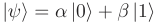

|ψ = α |0 + β |1 

The |0 and |1 are the basis states of a qubit. These two orthonormal states exist simultaneously, and we cannot tell whether the qubit is denitely in state |0 or in state |1. α and β are the amplitudes of the qubit. After the measurement, the state of a qubit collapses to either 0 or 1, with a certain probability determined by the amplitudes of the superposition. In fact, the measurement probabilities are |α|2 and |β|2 .

Mathematically, α and β are both complex numbers. If we use the polar representation of a complex number [25], we have the following equivalent representation:

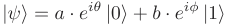

|ψ = a · e iθ |0 + b · e iφ |1 

In the more general case of an n-qubit quantum program, assuming B = {|0 , |1 , . . . , |2n − 1} to be the set of all basis states, the state of the quantum program can be written as:

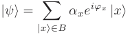

|ψ =  αxe iϕx |x |x∈B 

where x is the measurement value of the basis state |x. In this presentation, αx and ϕx are the magnitude and phase of |x, respectively.

The magnitude and phase are quantum features of qubits. The magnitude is a property that can be observed. It is used in quantum computing to measure the probability of observing each state. In quantum programs, the sum of the squares of all magnitude of a state equals 1. The square of the magnitude for each state corresponds to the probability of observing that state, e.g., in a single-qubit program, a2 for |0 and b2 for |1. Therefore, the information of magnitude can be directly reected in the distribution of measurements.

The phase is a property that cannot be directly measured. To generate a test case with various phase states, we use Qiskit quantum simulator to simulate the phase of a particular quantum program. In quantum programs, there are two kinds of phase: the global phase and the relative phase. However, only the relative phase can indicate useful information [25]. So the phase we discussed in this work only refers to the relative phase, and the global phase will not be discussed.

## C. Entanglement

In quantum programming, entanglement refers to the correlation between two or more qubits. Entanglement is established by applying a controlled-NOT gate (CNOT gate) to two qubits, with one qubit as the control point and the other as the target point. The measurement value of the target point is subject to the measurement value of the control point. Considering a large quantum program, the entanglement offers rather complex correlations between qubits. In fact, entanglement is a primary feature of quantum programs that distinguishes them from classical programs. Therefore, the entanglement between qubits needs to be included to generate a diverse set of test cases for quantum programs.

1151

## D. Measuring the Output of a Quantum Program

To read out the value of a qubit, a measurement operation can be added to the qubit at the end of the program. The measurement operation causes the collapse of the quantum state. As previously explained, a qubit state |ψ exists in a superposition of two orthogonal basis states |0 and |1. After measurement, the state collapses to a denite value of either 0 or 1, with probabilities determined by the amplitude of the superposition.

In the general case of an n-qubit program, we typically add n measurement operations, one for each qubit, at the end of the program. After measurement, the results are read out as an n-bit binary number. Due to the probabilistic nature of output values, a single measurement is usually insufcient to draw meaningful conclusions. To address this issue, a solution is to repeat the measurement process, which is commonly referred to as repeated m measurements (or samplings). According to the law of large numbers, with an increasing number of samplings, the frequency of observed values is likely to converge to the actual probability distribution. For a quantum program, if the number of samplings is sufciently large, the distribution of output values should be close to the actual distribution. However, determining the minimum number of samplings required by a quantum program is challenging due to the infeasibility of predicting the result distributions of quantum programs. To alleviate this problem, we use a conservative number of samplings in practice, such as 10,000 for programs with 4 or 5 qubits and 100,000 for programs with 6 or 7 qubits.

Furthermore, it should be noted that all the quantum programs we analyzed are executed on quantum simulators rather than on real quantum machines, which are subject to certain limitations in terms of efciency. For instance, we could not receive any response from the simulator after waiting for one hour when attempting to run a 15-qubits program. As a result, we do not discuss large-scale quantum programs in this work.

## III. OVERVIEW

## A. Input Space of a Quantum Program

Based on the notions introduced in the background section, the input space of a quantum program from which test cases can be sampled can be roughly divided into four areas, depicted in Figure 1. Generally, a test case for a quantum program must have magnitude information. A test case can also have phase information and be in entanglement states. The area in the black box means that the test case has magnitude information. The area in red lines (area 1 ) represents test cases with both magnitude and phase information. The area in the green lines (area 2 ) denotes test cases with magnitude, phase, and entanglement. Area 3 denotes test cases with magnitude and entanglement but without phase. The area 4 represents test cases with only magnitude.

In previous test case generation approaches, only inputs in binary form are considered. These test cases have magnitude information but without phase information and entanglement

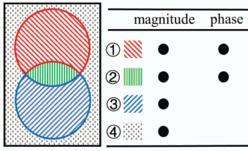

[a we a 

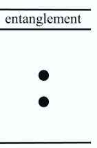

== 

Fig. 1: The input space of a quantum program (from which test cases can be sampled)

states. In Figure 1, these test cases are in area 4 . In fact, area 4 is far smaller than what is shown in Figure 1. In a general case, regarding an n-qubits program, if we use previous test case generators, the number of explored inputs is 2n , which is a tiny number compared with the innite number of inputs given by the combination of magnitude, phase, and entanglement.

## B. Workow of our approach

To generate test cases in area 1 , area 2 , and area 3 in Figure 1, we propose an automated testing framework QURATEST, the workow of which is depicted in Figure 2.

Our technique is motivated by the fact that the test case generators proposed in previous works (e.g., [10], [12], [24], [11]) generate test cases that do not support quantum specic features, i.e., phase, and entanglement. We employ three test case generators, namely UCNOT, IQFT, and Random, to generate diverse sets of test cases. After generation, we use the generated test cases as input to the quantum programs under test. We also compare the two types of test case generators (i.e., our generators that are aware of quantum features and previous generators that are not) by inputting the tests generated by them to the quantum programs under test and evaluating the output states measured in the end, as illustrated in Figure 2. The measurement outcomes of the execution of two test cases are presented in the right part of the gure. The results indicate that in terms of output state diversity and output value coverage, the test cases generated by our generators are better than those generated by previous generators. Overall, the inputs of quantum programs primarily affect the correctness of outputs. Especially in quantum programs, test cases without quantum-specic features are usually challenging to detect program faults.

## IV. TEST CASE GENERATORS

As the essential component of QURATEST, this section presents an overview of the three test generators: UCNOT, IQFT, and Random. Each generator is described in terms of its mechanism and implementation. We also provide background information for the mentioned quantum gates.

Referring back to our denition of test cases for quantum programs in Section I, we dene test cases as qubits used as input to quantum programs. However, directly generating

1152

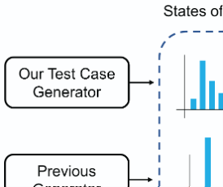

States of 17 Our Test Case | Generator | J \ Previous :i Generator 1 

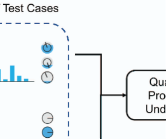

 Test Cases oN ® ] Q ©! 1 ° | Under © \ 

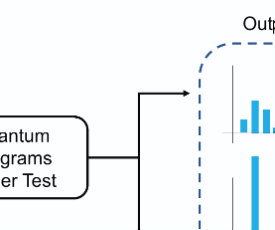

Output ' CTT i | di Quantum d Programs |  Test ] ! 

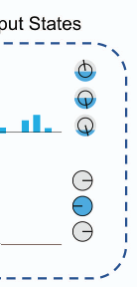

 States Te @ \ 1 1 lo | | ® ! [ J ! [CIE = 

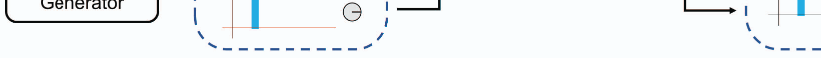

1 L i >! Vy) G | pal 

Fig. 2: The workow of using generated test cases to input quantum programs under test

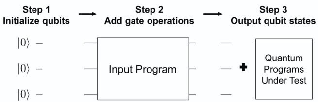

Step 1 — Step 2 Step 3 Initialize qubits Add gate operations Output qubit states 0) — - Quantum 0) — Input Program — * | Programs Under Test 0) — — 

Fig. 3: QURATEST – The three steps of generating a test case

qubits with specied states is impossible, and therefore, we must add quantum gates to manipulate the qubits to achieve changes in magnitude, phase, and entanglement. In QURATEST, we generate a circuit as input program and append the program under test to the input program. The general workow of our three generators is depicted in Figure 3.

The test case generation process consists of three steps. Firstly, we initialize the qubits, where the number of qubits initialized is equal to the number of qubits in the tested program. In the second step, we add gate operations to the initialized qubits, and the specic types of gates depend on the chosen generator. For instance, the UCNOT and IQFT generators use U gates, CNOT gates, and inverse-qft gates, whereas the Random generator allows a combination of gates listed in Table I to be randomly selected. Finally, in step three, we concatenate the input program with the program being tested to run a test.

## A. UCNOT Generator

The UCNOT generator adopts two quantum gates: U gate and CNOT gate. Specically, the U gate is also known as “the general single-qubit gate.” This gate can be used to implement an arbitrary single-qubit operation. U gate supports three parameters, i.e., θ, φ, and λ, to specify an arbitrary rotation operation to the qubit [27]. Therefore, we can generate test cases with various magnitude and phase states using the U gate. CNOT gate is the abbreviation of the Controlled NOT gate, which is the most basic unit to create an entanglement operation. CNOT gate is added to two qubits. In the CNOT

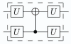

= = |mope) 

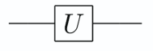

—Ut— 

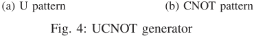

(a) U pattern (b) CNOT pattern Fig. 4: UCNOT generator 

gate, one qubit acts as the control point, and the other is the target point. The NOT gate at the target point works only when the control point reads |1. If |0 is read, the NOT gate at the target point is ignored. Using the CNOT gate, the UCNOT generator can support entanglement operations on qubits.

The UCNOT generator produces new circuits using the U and CNOT patterns, illustrated in Figure 4. The U pattern involves a single U gate, which can be applied to a single qubit. The θ, φ, and λ parameters of the U gate in this pattern are assigned random values to ensure the generation of diverse quantum states. On the other hand, the CNOT pattern is designed for two qubits, and it can create an entanglement state. For each U gate in the CNOT pattern, the parameters are randomly assigned values to create different quantum states. We randomly select and combine the two patterns when generating the input program for more than one qubit.

## B. IQFT Generator

The IQFT generator generates test cases using the U gate and IQFT module. The test case generation pattern of IQFT is

1153

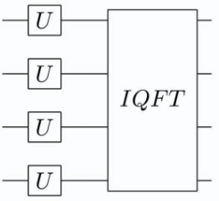

IQFT 

Fig. 5: The IQFT Generator

shown in Figure 5. Literally, IQFT stands for Inverse Quantum Fourier Transform, which is the inverse of the Quantum Fourier Transform (QFT). The QFT is a quantum version of the classical discrete Fourier transform and is widely used in quantum algorithms, such as quantum phase estimation and Shor’s algorithm. The QFT transforms a sequence of quantum states with periodic phases into discrete quantum states. As the inverse of QFT, the IQFT encodes a sequence of arbitrary quantum states, transforms them into another sequence of quantum states, and ensures that the new state has Fourier coefcients with the original state. The input of QFT is the output of IQFT and vice versa [25].

In implementing the IQFT generator, we add U gates to every qubit at the beginning of the circuit. The parameters of each U gate are different and randomly assigned. This ensures the IQFT module can receive various inputs and produce diverse states. The IQFT module comprises Hadmard gate, CNOT gate, and many other gates [28]. The IQFT implementation is based on the libraries from Qiskit [29].

## C. Random Generator

The Random generator is built upon random methods and is deemed a baseline generator. The Random generator generates input programs by employing a diverse selection of quantum gates, which are chosen randomly. This can generate a list of distinct test cases. Compared with the UCNOT and IQFT generators, the Random generator is not limited to particular patterns. Table I enumerates the quantum gates utilized in the Random generator. Columns labeled “Support Entanglement” and “Has Parameter” tell whether the respective gate supports entanglement operations or can be specied with parameters. Some gates are deliberately excluded for the reasons as follows: 1) Part of the gates are redundant to the existing gates (e.g., CNOT gate, RC3X gate, and RCCX gate); 2) Part of the gates cannot pose rotation to the qubits (e.g., barrier gate, identity gate).

In our implementation, during the input program generation phase, we select gates from Table I and incorporate them into the input program. Regarding the gate being selected, we use different combination strategies. For the gates supporting entanglement, such as the H gate and NOT gate, we have a r% probability of adding entanglement with other qubits. In contrast, we have a (1 − r)% probability of keeping the

TABLE I: The gates used in the Random generator

|Gate Name|Support Entanglement|Has Parameter|
|---|---|---|
|H Gate||#|
|Not Gate||#|
|Z Gate||#|
|P Gate|||
|RX Gate|||
|RY Gate|||
|RZ Gate|||
|T Gate|#|#|
|TDG Gate|#|#|
|S Gate|#|#|

gate without entanglement. The value of r% is manually congured, and in our current implementation, it is set at 50%. For the gates that support parameters, we assign random values for each parameter. The generating process terminates when the length of the circuit, i.e., the number of appended gates, has satised the specied length threshold. In practice, we set this threshold to the number of qubits of the quantum program under test.

## V. EVALUATION

To evaluate the effectiveness of our proposed techniques as well as different testing generators, we implement our testing framework QURATEST in Python based on the Qiskit Library [2]. We performed experiments with QURATEST and intend to answer the following research questions:

- RQ1. (Test Generation Diversity) Are the test generation

   - techniques of QURATEST able to generate a diverse set of test cases?

- RQ2. (Output Coverage) What is the output coverage achieved by executing the generated test cases?

- RQ3. (Fault Detection Capability) What is the fault detection capability of the test cases generated by our test generation techniques?

Our rst research question (RQ1) compares the diversity of test cases generated by the three approaches. We assess test case diversity through three distinct aspects: magnitude, phase, and entanglement.

In RQ2, we utilize test cases produced by the three approaches as inputs for 47 quantum programs. We gather the execution results and evaluate the output coverage of each method.

For RQ3, we aim to evaluate whether the generated test cases can effectively detect faults of quantum programs. By employing the state-of-the-art mutation testing techniques proposed in QmutPy [21], we create mutants originating from 26 quantum programs. We generate three groups of test suites using the three generation techniques and compare their mutation scores in identifying and killing mutants.

All experiments were run on a computer with Ubuntu 22.04 LTS and equipped with Intel Xeon E5-2620v4, 32GB

1154

memories, and a 2TB HDD disk. Due to the page limit, the rest of this section mostly discusses the summarized results of our experiment, and please refer to our project website for more detailed experimental congurations and results at https://sites.google.com/view/quratest.

## A. RQ1: Test Generation Diversity

We evaluate the diversity of test cases generated by our techniques. We use each of the three test case generators to generate 100 test cases in our experiments. Note that although we can use generators to generate test cases with an arbitrary number of qubits, we congure 5 qubits for each test case in our experiments. That is, for each generator, 500 qubits are obtained in total. Each generated test case is measured 10,000 times. We intend to compare test cases in three aspects: magnitude, phase, and entanglement. In particular, we use the following metrics to measure the diversity: magnitude score, phase score, and entanglement score, which characterize the quantum features of a qubit.

Magnitude Score: In an n-qubit program, we use x to represent our measurement result, e.g., x = 010 means that for a 3-qubit program, the result of q0, q1 and q2 are 0, 1, and 0, respectively in our measurement.

Denition 1 (Magnitude Score): Let S = [x1, x2, ..., xm] be a list of m measurement results of a test case. For a measurement result xj, we write xj(i) to mean the value of the ith qubit in xj. We dene two predicates isOne and isZero to specify the value of xj(i):

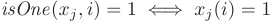

isOne(xj, i) = 1 ⇐⇒ xj(i) = 1 

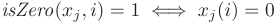

isZero(xj, i) = 1 ⇐⇒ xj(i) = 0 

The magnitude score of the ith qubit is calculated by:

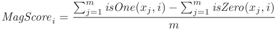

∑mj=1 isOne(xj, i) − ∑m j=1 isZero(xj, i) MagScore i = m 

Phase Score: Recall from our introduction of quantum phase in Section II-B that in an n-qubit program, the quantum state |ψ can be written as |ψ =∑ |x∈Baxeiϕx |xwhere |x is a basis state, and ϕx is the phase of the basis state |x. Let Bi0bethesetofbasisstate|xforwhichtheithqubitof measured value x(i) equals to 0.

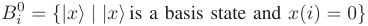

Bi 0 = {|x| |x is a basis state and x(i) = 0} 

We dene ϕx[i→1] as the phase of basis state |x that the ith qubit equals to 1.

Denition 2 (Phase Score): The Phase Score of ith qubit PS i is calculated by:

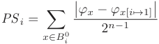

∣∣ϕx − ϕx[i→1]∣ PS i =  2 n−1 x∈Bi 0 

After normalizing the magnitude score and phase score of each qubit into the range [0, 1], we depict the distribution of all qubits in Figure 6, Figure 7, and Figure 8. We divide the magnitude and the phase scores into 10 equal segments, resulting in 100 distinct cells. We count the qubits in each cell

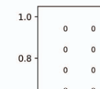

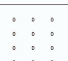

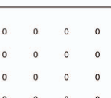

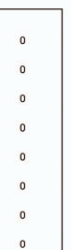

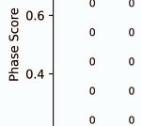

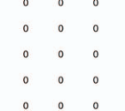

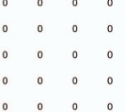

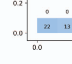

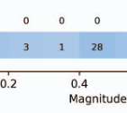

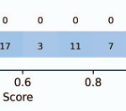

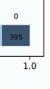

Fig. 6: RQ1 – The numbers mean the number of qubits generated by the Random method in each cell. The cell coverage of the Random method is 10%

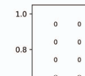

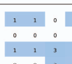

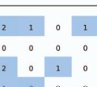

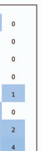

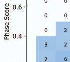

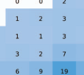

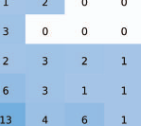

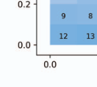

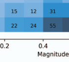

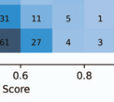

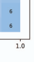

Fig. 7: RQ1 – The numbers mean the number of qubits generated by the IQFT method in each cell. The cell coverage of the IQFT method is 66%

and evaluate the cell coverage of the three approaches. The cell coverage is calculated by dividing the number of covered cells by the number of all cells. The more cells being covered, the more diverse states we have. To ease the reading, we use a heatmap, where different colors distinguish how the qubits are distributed; the darker the color, the larger the number of qubits in that particular interval. We aim to compare the diversity of generated qubits of the three generation techniques based on the cell coverage metric.

Based on Figure 6, Figure 7, and Figure 8, we summarize the cell coverage of the qubits generated by the three methods. The cell coverage of the Random method is 10%, the cell coverage of the IQFT method is 66%, and the cell coverage of the UCNOT method is 62%. Generally, the IQFT and UCNOT

1155

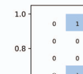

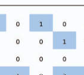

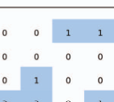

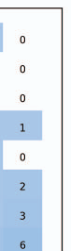

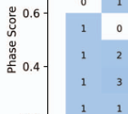

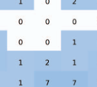

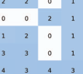

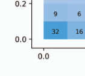

Fig. 8: RQ1 – The numbers mean the number of qubits generated by the UCNOT method in each cell. The cell coverage of the UCNOT method is 62%

methods outperform the Random method, as they can cover more cells. Additionally, the state distributions between qubits of IQFT and UCNOT are different. Overall, the test cases generated by IQFT centralize in the magnitude score between [0.4, 0.6]. In contrast, the test case states generated by UCNOT are biased towards higher values. The test cases generated by IQFT generator is more centralized in phase scores of [0.1, 0.3] than UCNOT generator. The Figure 6 also demonstrates that the Random method is unable to generate test cases that cover more phase scores. In practice, none of the generated test cases has a phase score larger than 0.1.

Entanglement Score: Recall that in an n-qubit program, we use x to represent our measurement result.

Denition 3 (Entanglement Score): Let S = [x1, x2, . . . , xm] be a list of m measurement results of a test case. For a measurement result xj, xj(i) means the value of the ith qubit in xj. We divide S into two lists Si0andS i1,whereS i0 contains all xj in S such that xj(i) = 0, and Si1containsall xj in S such that xj(i) = 1.

For an n-qubit system, there are in total 2n = N basis states. Recall that B = {b0, b1, ..., bN −1} is the set of all basis states, we dene a predicate isEqual as follows:

isEqual (x, b) = 1 ⇐⇒ b = |x

The entanglement score of the ith qubit is calculated by:

EngScore i = N −1 ∑x∈Si 0 isEqual (x, bj) − ∑x∈Si 1 isEqual (x, bj)  j=0 ∣∣∣∣∣ |Si 0| |Si 1| ∣∣∣∣∣ 

The distributions of entanglement scores of qubits of the generated test cases are shown in Figure 9. In this gure, the x-axis represents the entanglement scores ranging from 0.0 to 1.0. We evenly split the range into 10 cells and counted how many qubits lie in the cells. The darker cell means the qubits

Fig. 9: RQ1 – The distribution of entanglement scores of the three methods. The cell coverage of the Random method is 60%, the cell coverage of UCNOT and the cell coverage of IQFT are 100%

are centralized into this interval. For comparison, we draw the distributions of the three methods in three lines. Based on this gure, we compute the cell coverage to indicate how many cells are covered by each method and further compare the three methods on test case diversity.

From Figure 9, we can nd that the Random method tends to generate qubits that are centralized close to the entanglement score 0.0 but unable to generate many qubits that are in the entanglement range from 0.1 to 1.0. The cell coverage of the Random method is 60%. The UCNOT and IQFT outperform the Random method, with cell coverage of 100%. However, the qubits generated by IQFT are more diverse than those generated by UCNOT because 65.6% (328/500) qubits generated by UCNOT lie in the entanglement range from 0.0 to 0.1; instead, the entanglement scores of qubits generated by IQFT are almost uniformly distributed between 0.0 and 0.8. Based on the Figure 9, the results show that the UCNOT and IQFT methods can generate qubits with more diverse entanglement than the Random method. IQFT is the best generator to generate diverse entangled qubits.

Answer to RQ1: In terms of generation diversity, UCNOT and IQFT outperform Random in generating qubits with diverse magnitude scores and phase scores on our evaluated congurations. We also found that the IQFT is the best in generating qubits with diverse entanglement scores.

## B. RQ2: Output Coverage

We adopt the quantum programs proposed by [26] as the programs under test. Since these quantum programs accept different numbers of qubits as inputs, the generators adapt to t the benchmark quantum programs. We adopt programs with less than 11 qubits in [26] and collect 47 programs for our experiments. Specically, the programs include Adder programs ranging from 4 to 7 qubits, BV programs ranging from 4 to 10 qubits, DPC PE programs ranging from 3 to 9 qubits, DPC QFT programs ranging from 4 to 10 qubits, Grover programs ranging from 5 to 9 qubits, PE programs

1156

Fig. 10: RQ2 – The output coverage of test cases generated by the three generators

ranging from 3 to 9 qubits, QFT programs ranging from 4 to 10 qubits and Rand Cliff programs ranging from 4 to 10 qubits. For each generator, we generate test suites of 100 test cases for each program. We measure 100,000 times for each test to collect the running results.

We use the output coverage to evaluate the test effectiveness of the three generators. Assume that S∗ is the list of all measurement results of the program under test. The calculation of output coverage is based on the measurement results S∗ . We use a predicate Output(x ) to specify whether a value x is observed in S∗ :

Output(x) = 1 ⇐⇒ x ∈ S ∗ 

Recall that we use B to represent the set of all basis states of an n-qubit quantum program. The output coverage OC is calculated as follows.

∑|x∈B Output(x) OC = |B| 

The output coverage represents how many possible output values are covered. The higher output coverage generally denotes the better test case.

The experiment results can be found in Figure 10. The green, blue, and red lines represent the Random, IQFT, and UCNOT generators, respectively. The x-axis reports the programs under test, and the y-axis is the output coverage rate. Overall, the test cases generated by the Random generator have a much lower output coverage rate than those generated by the IQFT and UCNOT generators on all programs under test. The test cases generated by IQFT have the best output coverage rate in Adder, BV, DPC PE, Grover, and PE programs. Considering DPC QFT and QFT programs, test cases generated by UCNOT have higher output coverage than IQFT. When testing the Rand Cliff program, UCNOT and IQFT have very close performance in output coverage rate.

Additionally, it is worth noting that with the increasing number of qubits, the output coverage rates in one program decrease. For some programs, such as BV, DPC PE, and DPC QFT, the output coverage rates decrease signicantly. There are two reasons for this occurrence: 1) We use the same size of the test suite for every program. As the number of qubits increase, the input state space becomes larger. Therefore, the output coverage decreases. 2) The measurements for the programs may not be sufcient. As the number of qubits increases, the output state space also grows exponentially, which requires more measurement iterations to ensure sufcient samplings. However, it is a challenge to tell exactly how many measurement iterations are necessary for an arbitrary quantum program. Therefore, the output coverage rates decrease because we keep the same measurement iterations 100,000 times in every program.

The results presented in Figure 10 also support the ndings in RQ1 in two ways. Firstly, the ndings in RQ1 indicate that the Random generator generates qubits with less diversity in magnitude scores and phase scores, which result in a less diverse set of qubits. As a result, the output coverage rates of test cases generated by the Random generator are far lower than those of the test cases generated by UCNOT and IQFT. Secondly, in RQ1, we nd that test cases generated by IQFT have more diverse magnitude scores, phase scores, and entanglement scores. In the experiment results of this RQ, the test cases generated by IQFT show better output coverage rates than UCNOT in the Adder, BV, DPC PE, Grover, and PE programs.

Answer to RQ2: In terms of output coverage, the IQFT and UCNOT generators outperform the Random generator. The IQFT generator also has better performance than UCNOT in 70.2% (33 out of 47) programs. We also nd that by using the same size of test suites and the same

1157

TABLE II: RQ3 – The mutation experiment results of the four methods. The #K, #S, and #I represent the number of killed mutants, the number of survived mutants, and the number of incompetent mutants. The MS denotes the mutation score

|Proram|#ofmutants||Ran|dom|||IQ|FT|||UC|NOT||
|---|---|---|---|---|---|---|---|---|---|---|---|---|---|
|g||#K|#S|#I|MS|#K|#S|#I|MS|#K|#S|#I|MS|
|Adder-04|49|28|19|2|57.1%|45|2|2|91.8%|45|2|2|91.8%|
|Adder-07|97|52|41|4|53.6%|89|4|4|91.7%|89|4|4|91.7%|
|BV-04|150|96|51|3|64.0%|103|44|3|68.6%|118|29|3|78.6%|
|BV-05|185|117|64|4|63.2%|124|57|4|67.0%|154|27|4|83.2%|
|BV-06|220|105|110|5|47.7%|172|43|5|78.1%|179|36|5|81.3%|
|BV-07|255|162|87|6|63.5%|206|43|6|80.7%|231|18|6|90.5%|
|Grover-05|265|123|142|0|46.4%|145|120|0|54.7%|159|106|0|60.0%|
|Grover-07|364|228|136|0|62.3%|176|188|0|48.3%|253|111|0|69.5%|
|PE-04|144|69|75|0|47.9%|73|71|0|50.6%|81|63|0|56.2%|
|PE-05|210|76|134|0|36.1%|84|126|0|40.0%|105|104|0|50.0%|
|PE-06|287|65|222|0|22.6%|94|193|0|32.7%|137|150|0|47.7%|
|PE-07|375|69|306|0|18.4%|140|235|0|37.3%|153|222|0|40.8%|
|QFT-04|111|77|34|0|69.3%|88|23|0|79.2%|90|21|0|81.1%|
|QFT-05|166|109|57|0|65.6%|115|51|0|69.2%|117|49|0|70.4%|
|QFT-06|232|136|96|0|58.6%|152|80|0|65.5%|147|85|0|63.3%|
|QFT-07|309|158|151|0|51.1%|189|120|0|61.1%|192|117|0|62.1%|
|Rand Cliff-04|281|197|76|8|70.1%|234|39|8|83.2%|235|38|8|83.6%|
|Rand Cliff-05|425|383|28|14|90.1%|386|36|14|90.8%|388|34|14|91.2%|
|DPC PE-04|581|346|196|39|59.5%|334|208|39|57.4%|374|168|39|64.3%|
|DPC PE-05|1083|657|348|78|60.6%|664|341|78|61.3%|679|326|78|62.6%|
|DPC PE-06|1741|1086|525|130|62.3%|1068|543|130|61.3%|1117|494|130|64.1%|
|DPC PE-07|2555|1600|760|195|62.6%|1591|769|195|62.2%|1616|744|195|63.2%|
|DPC QFT-04|995|792|125|78|79.5%|813|104|78|81.7%|800|117|78|80.4%|
|DPC QFT-05|1631|1268|233|130|77.7%|1202|299|130|73.6%|1232|269|130|75.5%|
|DPC QFT-06|2423|1591|637|195|65.6%|1578|650|195|65.1%|1617|611|195|66.7%|
|DPC QFT-07|3371|2235|863|273|66.3%|2215|883|273|65.7%|2235|863|273|66.3%|

measurement times for every program, as the number of qubits of programs under test increases, the output coverage rates decrease.

## C. RQ3: Fault Detection Capability

To answer RQ3, we conduct mutation testing to evaluate the capability of the test cases generated by three generators in terms of detecting faults of quantum programs. Our experiments are based on QMutPy [21], which provides operators to generate a large number of mutants of quantum programs and execute the programs. We reuse the programs adopted in RQ2 ranging from 4 to 7 qubits to generate mutants. For each test program, we use the three generators to generate test suites for the programs. Each test suite includes 10 test cases.

The experiment results can be found in Table II. In this table, #K means the number of killed mutants, #S means the number of survived mutants, and #I means the number of incompetent mutants. The incompetent mutants are program crashes due to the bad modications to programs. The MS denotes the mutation score [21]. The mutation scores are calculated in Denition 4. We highlight the highest mutation

score for each program among the three methods by shading their cell backgrounds.

Denition 4 (Mutation Score): In mutation testing, given the number of killed mutants K, the number of survived mutants S, and the number of incompetent mutants I. The mutation scores MS can be calculated as:

K MS = (K + S + I) ∗ 100% 

Based on the experiment results, we can nd that UCNOT and IQFT outperform the Random method. Specically, the UCNOT has the highest mutation scores on most programs except for QFT-06, DPC QFT-04, and DPC QFT-05. And IQFT has the same mutation scores as UCNOT in Adder programs. IQFT also has the highest mutation scores in QFT06 and DPC QFT-04 programs. Compared with UCNOT and IQFT generators, the mutation scores of the Random method are far lower in Adder, BV, PE, QFT, and Rand Cliff programs. Regarding DPC PE and DPC QFT programs, the mutation scores of the Random method are very close to those of UCNOT and IQFT. Notably, in DPC QFT-05 and DPC QFT07 programs, the Random method has the highest mutation

1158

scores. Overall, the UCNOT is the best approach to detecting quantum program faults by obtaining the highest mutation scores in most programs. The mutation scores of IQFT are comparable to those of UCNOT, with the scores being very close to each other across the quantum programs. On the other hand, the Random generator has the lowest mutation scores in most of the tested programs.

Answer to RQ3: We evaluated the capability of the test cases generated by three generators in terms of detecting faults in quantum programs. The experiment results show that the UCNOT is the best approach in detecting quantum program faults by holding the highest mutation scores in 88.4% (23 out of 26) programs. The mutation scores of IQFT are very close to those of UCNOT. Random has the lowest mutation scores in most of the programs.

## VI. THREATS TO VALIDITY

We note that randomness is always an inevitable factor during the test generation and execution. To alleviate this problem, we repeat each experiment conguration ten times and report the average results in the paper. The selection of subject quantum programs could be another threat. To counteract this, we tried our best in our experiments and selected as many as 47 programs with qubits ranging from 3 to 10 from benchmark in [26].

The metrics proposed in our experiments are potential threats. In fact, the quantum features of magnitude, phase, and entanglement are unobservable, making it challenging to characterize them fully. Therefore, the proposed metrics, namely the magnitude, phase, and entanglement scores, are one way to quantify the above three quantum features.

In the experiment of RQ3, the assertions of each test case to verify the execution result are manually written by us, which may introduce bias to the results of mutation scores. To mitigate this threat, for one quantum program under test, we use the same assertions for every generator.

## VII. RELATED WORK

Test case generation techniques are widely adopted in program testing, which mutates the inputs to achieve the guidance metric. This technique has shown effectiveness in detecting program bugs in many testing scenarios. The bugs include correctness bugs [30], [31], [32], security vulnerabilities [33], [34], and performance bugs [35], [36]. AFL [37] is one of the most famous applications of fuzz testing that mutates inputs to cover program branches. The powerful fuzz testing also empowers studies that adopt the testing technique in new areas, for example, in fuzzing smart contracts [38], [39] and in testing deep neural networks [40], [41].

The development of quantum programs has been active in recent years. Firstly, the big companies propose quantum programming languages, e.g., Cirq [1] of Google, Qiskit [2] of IBM, etc. The development of quantum technology has shown exciting achievements and can potentially disrupt traditional

industries in many elds, such as computational chemistry and drug design [3]. Secondly, the development of quantum technology has also attracted the attention of many academic researchers. Yu et al. [42] propose abstract interpretation for quantum languages; Tao et al. [43] propose verication for quantum program compilers; Wang et al. [16] propose differential testing to nd bugs in quantum compilers. In short, the future of quantum software is coming towards us.

For quantum programs, previous studies report an impressive list of works to adapt program testing in quantum programs. Zhao et al. [4] report a dataset of 36 bugs obtained from Qiskit quantum programs. The authors also further summarize eight bug patterns in [44]. Based on their studies, the authors of [45] report that quantum program bugs usually lead to unexpected obtained output values, highlighting the importance of testing quantum programs.

Several approaches have been proposed to assist with quantum program testing to reduce the occurrence of bugs and improve software quality. These include bug detection techniques proposed by [44], [46], quantum program testing methods proposed by [24], [5], [47], and quantum program analysis techniques proposed by [48]. However, the core quantum features, i.e., magnitude, phase, and entanglement, are overlooked by existing approaches. They all use test cases in binary forms to test quantum programs, leading to low test effectiveness.

## VIII. CONCLUSION

In this work, we propose an automated testing framework QURATEST for diverse test case generation of quantum programs. We make the rst attempt to address the challenges in generating a diverse set of test cases for quantum programs by integrating quantum-specic features (i.e., magnitude, phase, and entanglement) into testing technique design. We evaluate the test case diversity, test coverage, and fault detection of our three generation methods: QURATEST contains 3 test case generators (UCNOT, IQFT, and Random) as its core, two of which are newly proposed. Our in-depth evaluation demonstrates that our proposed testing techniques can provide a diverse set of test cases, and the UCNOT and IQFT methods outperform the Random method on test quality. We believe that our work provides a valuable contribution to quantum software testing and can be potentially helpful for improving the quality and reliability of quantum programs.

## REFERENCES

- [1] Google, “Cirq,” https://quantumai.google/cirq, 2022.

[2] IBM, “Qiskit,” https://qiskit.org/, 2022.

[3] S. Das, “Top applications of quantum computing everyone should know about,” https://analyticsindiamag.com/ top-applications-of-quantum-computing-everyone-should-know-about/, 2022.

[4] P. Zhao, J. Zhao, Z. Miao, and S. Lan, “Bugs4Q: A benchmark of real bugs for quantum programs,” in 2021 36th IEEE/ACM International Conference on Automated Software Engineering (ASE). IEEE, 2021, pp. 1373–1376.

1159

- [5] S. Honarvar, M. R. Mousavi, and R. Nagarajan, “Property-based testing of quantum programs in Q#,” in Proceedings of the IEEE/ACM 42nd International Conference on Software Engineering Workshops, ser. ICSEW’20. New York, NY, USA: Association for Computing Machinery, 2020, pp. 430–435. [Online]. Available: https://doi.org/10.1145/3387940.3391459

- [6] M. Paltenghi and M. Pradel, “MorphQ: Metamorphic testing of the Qiskit quantum computing platform,” in Proceedings of the 45th International Conference on Software Engineering, ser. ICSE ’23. IEEE Press, 2023, pp. 2413–2424. [Online]. Available: https://doi.org/10.1109/ICSE48619.2023.00202

- [7] A. Miranskyy, L. Zhang, and J. Doliskani, “Is your quantum program bug-free?” in Proceedings of the ACM/IEEE 42nd International Conference on Software Engineering: New Ideas and Emerging Results, ser. ICSE-NIER ’20. New York, NY, USA: Association for Computing Machinery, 2020, pp. 29–32. [Online]. Available: https://doi.org/10.1145/3377816.3381731

- [8] A. Miranskyy and L. Zhang, “On testing quantum programs,” in Proceedings of the 41st International Conference on Software Engineering: New Ideas and Emerging Results, ser. ICSE-NIER ’19. IEEE Press, 2019, pp. 57–60. [Online]. Available: https: //doi.org/10.1109/ICSE-NIER.2019.00023

- [9] J. Zhao, “Quantum software engineering: Landscapes and horizons,” CoRR, vol. abs/2007.07047, 2020. [Online]. Available: https://arxiv.org/ abs/2007.07047

- [10] S. Ali, P. Arcaini, X. Wang, and T. Yue, “Assessing the effectiveness of input and output coverage criteria for testing quantum programs,” in 2021 IEEE 14th International Conference on Software Testing, Validation and Verication (ICST), 2021, pp. 13–23.

- [11] X. Wang, P. Arcaini, T. Yue, and S. Ali, “Quito: a coverage-guided test generator for quantum programs,” in 2021 36th IEEE/ACM International Conference on Automated Software Engineering (ASE), 2021, pp. 1237– 1241.

- [12] ——, “Generating failing test suites for quantum programs with search,” in Search-Based Software Engineering, U.-M. O’Reilly and X. Devroey, Eds. Cham: Springer International Publishing, 2021, pp. 9–25.

- [13] ——, “QuSBT: Search-based testing of quantum programs,” in Proceedings of the ACM/IEEE 44th International Conference on Software Engineering: Companion Proceedings, ser. ICSE ’22. New York, NY, USA: Association for Computing Machinery, 2022, pp. 173–177. [Online]. Available: https://doi.org/10.1145/3510454.3516839

- [14] P. Long and J. Zhao, “Testing quantum programs with multiple subroutines,” arXiv preprint arXiv:2208.09206, 2022.

- [15] ——, “Testing multi-subroutine quantum programs: From unit testing to integration testing,” arXiv preprint arXiv:2306.17407, 2023.

- [16] J. Wang, Q. Zhang, G. H. Xu, and M. Kim, “QDiff: Differential testing of quantum software stacks,” in 2021 36th IEEE/ACM International Conference on Automated Software Engineering (ASE). IEEE, 2021, pp. 692–704.

- [17] X. Wang, P. Arcaini, T. Yue, and S. Ali, “Application of combinatorial testing to quantum programs,” in 2021 IEEE 21st International Conference on Software Quality, Reliability and Security (QRS), 2021, pp. 179–188.

- [18] R. Abreu, J. a. P. Fernandes, L. Llana, and G. Tavares, “Metamorphic testing of oracle quantum programs,” in Proceedings of the 3rd International Workshop on Quantum Software Engineering, ser. Q-SE

   - ’22. New York, NY, USA: Association for Computing Machinery, 2023, pp. 16–23. [Online]. Available: https://doi.org/10.1145/3528230. 3529189

- [19] X. Wang, T. Yu, P. Arcaini, T. Yue, and S. Ali, “Mutationbased test generation for quantum programs with multi-objective search,” in Proceedings of the Genetic and Evolutionary Computation Conference, ser. GECCO ’22. New York, NY, USA: Association for Computing Machinery, 2022, pp. 1345–1353. [Online]. Available: https://doi.org/10.1145/3512290.3528869

- [20] D. Fortunato, J. Campos, and R. Abreu, “Mutation testing of quantum programs: A case study with Qiskit,” IEEE Transactions on Quantum Engineering, vol. 3, pp. 1–17, 2022.

- [21] ——, “QMutPy: A mutation testing tool for quantum algorithms and applications in Qiskit,” in Proceedings of the 31st ACM SIGSOFT International Symposium on Software Testing and Analysis, 2022, pp. 797–800.

- [22] E. Mendiluze, S. Ali, P. Arcaini, and T. Yue, “Muskit: A mutation analysis tool for quantum software testing,” in 2021 36th IEEE/ACM

International Conference on Automated Software Engineering (ASE), 2021, pp. 1266–1270.

- [23] D. Fortunato, J. Campos, and R. Abreu, “Mutation testing of quantum programs written in QISKit,” in Proceedings of the ACM/IEEE 44th International Conference on Software Engineering: Companion Proceedings, ser. ICSE ’22. New York, NY, USA: Association for Computing Machinery, 2022, p. 358–359. [Online]. Available: https://doi.org/10.1145/3510454.3528649

- [24] J. Wang, M. Gao, Y. Jiang, J. Lou, Y. Gao, D. Zhang, and J. Sun, “QuanFuzz: Fuzz testing of quantum program,” arXiv preprint arXiv:1810.10310, 2018.

- [25] E. R. Johnston, N. Harrigan, and M. Gimeno-Segovia, Programming Quantum Computers: essential algorithms and code samples. O’Reilly Media, 2019.

- [26] K. Chen, W. Fang, J. Guan, X. Hong, M. Huang, J. Liu, Q. Wang, and M. Ying, “VeriQBench: A benchmark for multiple types of quantum circuits,” arXiv preprint arXiv:2206.10880, 2022.

- [27] D. P. DiVincenzo, “The physical implementation of quantum computation,” Fortschritte der Physik: Progress of Physics, vol. 48, no. 9-11, pp. 771–783, 2000.

- [28] S. Zhou, T. Loke, J. A. Izaac, and J. Wang, “Quantum fourier transform in computational basis,” Quantum Information Processing, vol. 16, pp. 1–19, 2017.

- [29] Qiskit, “Quantum fourier transform,” https://qiskit.org/textbook/ ch-algorithms/quantum-fourier-transform.html, 2022.

- [30] D. Babi´c, S. Bucur, Y. Chen, F. Ivanˇci´c, T. King, M. Kusano, C. Lemieux, L. Szekeres, and W. Wang, “FUDGE: Fuzz driver generation at scale,” in Proceedings of the 2019 27th ACM Joint Meeting on European Software Engineering Conference and Symposium on the Foundations of Software Engineering, ser. ESEC/FSE 2019. New York, NY, USA: Association for Computing Machinery, 2019, pp. 975–985. [Online]. Available: https://doi.org/10.1145/3338906.3340456

- [31] M. Tufano, C. Watson, G. Bavota, M. D. Penta, M. White, and D. Poshyvanyk, “An empirical study on learning bug-xing patches in the wild via neural machine translation,” ACM Transactions on Software Engineering and Methodology (TOSEM), vol. 28, no. 4, pp. 1–29, 2019.

- [32] Q. Zhang, J. Wang, and M. Kim, “HeteroFuzz: Fuzz testing to detect platform dependent divergence for heterogeneous applications,” in Proceedings of the 29th ACM Joint Meeting on European Software Engineering Conference and Symposium on the Foundations of Software Engineering, ser. ESEC/FSE 2021. New York, NY, USA: Association for Computing Machinery, 2021, pp. 242–254. [Online]. Available: https://doi.org/10.1145/3468264.3468610

- [33] T. Brennan, S. Saha, and T. Bultan, “Jvm fuzzing for jit-induced sidechannel detection,” in Proceedings of the ACM/IEEE 42nd International Conference on Software Engineering, 2020, pp. 1011–1023.

- [34] S. Gan, C. Zhang, X. Qin, X. Tu, K. Li, Z. Pei, and Z. Chen, “Path sensitive fuzzing for native applications,” IEEE Transactions on Dependable and Secure Computing, vol. 19, no. 3, pp. 1544–1561, 2020.

- [35] C. Wen, H. Wang, Y. Li, S. Qin, Y. Liu, Z. Xu, H. Chen, X. Xie, G. Pu, and T. Liu, “MemLock: Memory usage guided fuzzing,” in Proceedings of the ACM/IEEE 42nd International Conference on Software Engineering, ser. ICSE ’20. New York, NY, USA: Association for Computing Machinery, 2020, pp. 765–777. [Online]. Available: https://doi.org/10.1145/3377811.3380396

- [36] C. Lemieux, R. Padhye, K. Sen, and D. Song, “PerfFuzz: Automatically generating pathological inputs,” in Proceedings of the 27th ACM SIGSOFT International Symposium on Software Testing and Analysis, ser. ISSTA 2018. New York, NY, USA: Association for Computing Machinery, 2018, pp. 254–265. [Online]. Available: https://doi.org/10. 1145/3213846.3213874

- [37] A. fuzz loop, “American fuzz loop,” http://lcamtuf.coredump.cx/a/, 2020.

- [38] T. D. Nguyen, L. H. Pham, J. Sun, Y. Lin, and Q. T. Minh, “SFuzz: An efcient adaptive fuzzer for solidity smart contracts,” in Proceedings of the ACM/IEEE 42nd International Conference on Software Engineering, ser. ICSE ’20. New York, NY, USA: Association for Computing Machinery, 2020, pp. 778–788. [Online]. Available: https://doi.org/10.1145/3377811.3380334

- [39] Y. Xue, J. Ye, W. Zhang, J. Sun, L. Ma, H. Wang, and J. Zhao, “xFuzz: Machine learning guided cross-contract fuzzing,” IEEE Transactions on Dependable and Secure Computing, 2022.

- [40] L. Ma, F. Juefei-Xu, F. Zhang, J. Sun, M. Xue, B. Li, C. Chen, T. Su, L. Li, Y. Liu, J. Zhao, and Y. Wang, “Deepgauge: Multi-granularity

1160

testing criteria for deep learning systems,” in Proceedings of the 33rd ACM/IEEE International Conference on Automated Software Engineering, ser. ASE ’18. New York, NY, USA: Association for Computing Machinery, 2018, pp. 120–131. [Online]. Available: https://doi.org/10.1145/3238147.3238202

- [41] X. Xie, L. Ma, F. Juefei-Xu, M. Xue, H. Chen, Y. Liu, J. Zhao, B. Li, J. Yin, and S. See, “DeepHunter: A coverage-guided fuzz testing framework for deep neural networks,” in Proceedings of the 28th ACM SIGSOFT International Symposium on Software Testing and Analysis, ser. ISSTA 2019. New York, NY, USA: Association for Computing Machinery, 2019, pp. 146–157. [Online]. Available: https://doi.org/10.1145/3293882.3330579

- [42] N. Yu and J. Palsberg, “Quantum abstract interpretation,” in Proceedings of the 42nd ACM SIGPLAN International Conference on Programming Language Design and Implementation, ser. PLDI 2021. New York, NY, USA: Association for Computing Machinery, 2021, pp. 542–558. [Online]. Available: https://doi.org/10.1145/3453483.3454061

- [43] R. Tao, Y. Shi, J. Yao, X. Li, A. Javadi-Abhari, A. W. Cross, F. T. Chong, and R. Gu, “Giallar: Push-button verication for the Qiskit quantum compiler,” in Proceedings of the 43rd ACM SIGPLAN International Conference on Programming Language Design and

   - Implementation, ser. PLDI 2022. New York, NY, USA: Association for Computing Machinery, 2022, pp. 641–656. [Online]. Available: https://doi.org/10.1145/3519939.3523431

- [44] P. Zhao, J. Zhao, and L. Ma, “Identifying bug patterns in quantum programs,” in 2021 IEEE/ACM 2nd International Workshop on Quantum Software Engineering (Q-SE). IEEE, 2021, pp. 16–21.

- [45] M. Paltenghi and M. Pradel, “Bugs in quantum computing platforms: an empirical study,” Proceedings of the ACM on Programming Languages, vol. 6, no. OOPSLA1, pp. 1–27, 2022.

- [46] Y. Huang and M. Martonosi, “Statistical assertions for validating patterns and nding bugs in quantum programs,” in Proceedings of the 46th International Symposium on Computer Architecture, ser. ISCA ’19. New York, NY, USA: Association for Computing Machinery, 2019, pp. 541–553. [Online]. Available: https://doi.org/10.1145/3307650.3322213

- [47] P. Long and J. Zhao, “Equivalence, identity, and unitarity checking in black-box testing of quantum programs,” arXiv preprint arXiv:2307.01481, 2023.

- [48] S.-H. Hung, K. Hietala, S. Zhu, M. Ying, M. Hicks, and X. Wu, “Quantitative robustness analysis of quantum programs,” Proceedings of the ACM on Programming Languages, vol. 3, no. POPL, pp. 1–29, 2019.

1161
