https://doi.org/10.1038/s41586-023-06924-6

# Accelerated Article Preview

**Mathematical discoveries from program search with large language models** Received: 12 August 2023 **Bernardino R om er a-Pa re de s, M oh am ma damin Barekatain, Alexander Novikov, Matej Balog, M. Pawan Kumar, Emilien Dupont, Francisco J. R. Ruiz, Jordan S. Ellenberg, Pengming Wang,** Accepted: 30 November 2023 **Omar Fawzi, Pushmeet Kohli & Alhussein Fawzi** Accelerated Article Preview Published online xx xx xxxx This is a PDF file of a peer-reviewed paper that has been accepted for publication. Cite this article as: Romera-Paredes, B. et al. Mathematical discoveries from program Although unedited, the content has been subjected to preliminary formatting. Nature search with large language models. _Nature_ is providing this early version of the typeset paper as a service to our authors and https://doi.org/10.1038/s41586-023-06924-6 readers. The text and figures will undergo copyediting and a proof review before the (2023) paper is published in its final form. Please note that during the production process errors may be discovered which could affect the content, and all legal disclaimers apply.

Nature | www.nature.com

1 Mathematical discoveries from program search with large 2 language models 3 Bernardino Romera-Paredes1∗ Mohammadamin Barekatain1∗ 4 Alexander Novikov1∗ Matej Balog1∗ M. Pawan Kumar1∗ 5 Emilien Dupont1∗ Francisco J. R. Ruiz1∗ Jordan S. Ellenberg2 6 Pengming Wang1 Omar Fawzi3 Pushmeet Kohli1 Alhussein Fawzi1∗ 7 1Google DeepMind, London, UK 8 2University of Wisconsin-Madison, Madison, Wisconsin, USA 9 3Universit´e de Lyon (Inria, ENS Lyon, UCBL, LIP), Lyon, France 10 **Abstract** 11 Large Language Models (LLMs) have demonstrated tremendous capabilities in solving com12 plex tasks, from quantitative reasoning to understanding natural language. However, LLMs 13 sometimes suffer from confabulations (or hallucinations) which can result in them making plau14 sible but incorrect statements (Bang et al., 2023; Borji, 2023). This hinders the use of current 15 large models in scientific discovery. Here we introduce _FunSearch_ (short for _search_ ing in the 16 _fun_ ction space), an evolutionary procedure based on pairing a pre-trained LLM with a system17 atic evaluator. We demonstrate the effectiveness of this approach to surpass the best known re18 sults in important problems, pushing the boundary of existing LLM-based approaches (Lehman 19 et al., 2022). Applying _FunSearch_ to a central problem in extremal combinatorics — the cap 20 set problem — we discover new constructions of large cap sets going beyond the best known 21 ones, both in finite dimensional and asymptotic cases. This represents the first discoveries made 22 for established open problems using LLMs. We showcase the generality of _FunSearch_ by apply23 ing it to an algorithmic problem, online bin packing, finding new heuristics that improve upon 24 widely used baselines. In contrast to most computer search approaches, _FunSearch_ searches for 25 programs that describe _how_ to solve a problem, rather than _what_ the solution is. Beyond being 26 an effective and scalable strategy, discovered programs tend to be more interpretable than raw 27 solutions, enabling feedback loops between domain experts and _FunSearch_ , and the deployment 28 of such programs in real-world applications. 29 Many problems in mathematical sciences are “easy to evaluate,” despite being typically “hard to 30 solve.” For example, in computer science, NP-complete optimization problems admit a polynomial31 time evaluation procedure (measuring the quality of the solution), despite the widespread belief that 32 no polynomial-time algorithms to _solve_ such problems exist. We focus in this paper on problems 33 admitting an efficient `evaluate` function, which measures the quality of a candidate solution. Promi34 nent examples include the maximum independent set problem and maximum constraint satisfaction 35 problems (such as finding the ground state energy of a Hamiltonian). Our goal is to generate a 36 `solve` program, such that its outputs receive high scores from `evaluate` (when executed on inputs 37 of interest), and ultimately improve over the best known solutions. ∗Equal contributors. 1

- 38 While Large Language Models (LLMs) have recently seen dramatic improvements in their coding 39 capabilities [5–9], with applications including debugging [10, 11], solving code competitions [12, 13] 40 and improving code performance [14], synthesizing `solve` programs for _open_ problems requires find41 ing _new_ ideas that are verifiably correct. This is very hard for LLMs, as they tend to confabulate or 42 ultimately fall short of going beyond existing results. To surpass the “nominal” capabilities of LLMs, 43 recent works [3] have combined them with evolutionary algorithms [15, 16], leading to important 44 improvements on diverse synthetic problems [17], searching for neural network architectures [18–20], 45 and solving puzzles [21]. Our proposed method, _FunSearch_ , pushes the boundary of LLM-guided 46 evolutionary procedures to a new level: the discovery of new scientific results for established open 47 problems, and the discovery of new algorithms. Surpassing state-of-the-art results on established 48 open problems provides a clear indication that the discoveries are truly new, as opposed to being 49 retrieved from the LLM’s training data. 50 _FunSearch_ (short for _search_ ing in the _fun_ ction space) combines a pre-trained (frozen) Large Lan51 guage Model, whose goal is to provide creative solutions, with an evaluator, which guards against 52 confabulations and incorrect ideas. _FunSearch_ iterates over these two components, evolving initial 53 low-scoring programs into high-scoring ones discovering new knowledge. Key to the success of this 54 simple procedure is a combination of multiple essential ingredients. First, we sample best performing 55 programs and feed them back into prompts for the LLM to improve on; we refer to this as best-shot 56 prompting. Second, we start with a program in the form of a _skeleton_ (containing boilerplate code 57 and potentially prior structure about the problem), and only evolve the part governing the critical 58 program logic. For example, by setting a greedy program skeleton, we evolve a _priority_ function 59 used to make decisions at every step. Third, we maintain a large pool of diverse programs by using 60 an island-based evolutionary method that encourages exploration and avoids local optima. Finally, 61 leveraging the highly parallel nature of _FunSearch_ , we scale it asynchronously, considerably broad62 ening the scope of this approach to find new results, while keeping the overall cost of experiments 63 low. 64 We show the surprising effectiveness of _FunSearch_ on several use-cases. We consider a fundamen65 tal problem in extremal combinatorics, namely, the cap set problem [22, 23]. _FunSearch_ demonstrates 66 the existence of hitherto unknown constructions that go beyond existing ones, including the largest 67 improvement in 20 years to the asymptotic lower bound. To the best of our knowledge, this shows 68 the first scientific discovery — a new piece of verifiable knowledge about a notorious scientific prob69 lem — using an LLM. Using _FunSearch_ , we also find new algorithms for the online bin packing 70 problem that improve upon traditional ones on well-studied distributions of interest [24, 25], with 71 potential applications to improving job scheduling algorithms. 72 While most computer search techniques output directly what the solution is (e.g., a list of vectors 73 forming a cap set), _FunSearch_ produces programs generating the solution. For structured problems, 74 such programs tend to be more interpretable — facilitating interactions with domain experts — 75 and concise — making it possible to scale to large instances — compared to a mere enumeration 76 of the solution. In addition, decision procedures (such as for bin packing) described by code in a 77 standard programming language are crucially easier to deploy compared to other types of descriptions 78 (e.g., neural networks), which typically require specialized hardware and for which verifying design 79 specifications is notoriously hard. 80 **1** **_FunSearch_** 81 An overview of _FunSearch_ is shown in Figure 1, and its components are described in more detail 82 below. For more details and ablations showing the importance of each component, see Methods and

2

- 83 Appendix A in Supplementary Information. 84 **Specification.** The input to _FunSearch_ is a specification of the problem in the form of an `evaluate` 85 function, which scores candidate solutions. In addition, we provide an initial program (which can 86 be trivial) to evolve. While in principle these are the minimum requirements, we found that perfor87 mance tends to improve significantly if we write the initial `solve` program in the form of a skeleton 88 (containing boilerplate code and prior knowledge of the problem in the form of a program struc89 ture), and only use _FunSearch_ to evolve the critical part that governs its logic. Figure 2 (a) shows 90 an example where the skeleton takes the form of a simple greedy algorithm, and the crucial part to 91 evolve by _FunSearch_ is the `priority` function that is used to make the greedy decision at every step. 92 This delegates to _FunSearch_ precisely the part that is usually the hardest to come up with. While 93 a fixed skeleton may constrain the space of programs that can be discovered, we find it improves 94 overall results because it focuses the LLM resources on evolving the critical part only, instead of also 95 using the LLM to recreate already known program structures (with more opportunities for mistakes 96 that would render the entire program incorrect). If available, the user can optionally provide addi97 tional known information about the problem at hand, in the form of docstrings, relevant primitive 98 functions, or import packages, which _FunSearch_ may use. 99 **Pre-trained LLM.** The LLM is the creative core of _FunSearch_ , in charge of coming up with

- 100 improvements to the functions presented in the prompt and sending these for evaluation. Perhaps 101 surprisingly, we obtain our results with a pre-trained model, i.e., without any fine-tuning on our 102 problems. We use Codey, an LLM built on top of the PaLM2 model family [26], which has been 103 finetuned on a large corpus of code and is publicly accessible through its API [27]. Because _FunSearch_ 104 relies on sampling from an LLM extensively, an important performance-defining tradeoff is between 105 the quality of the samples and the inference speed of the LLM. In practice, we have chosen to work 106 with a fast-inference model (rather than slower-inference, higher-quality), and the results in the 107 paper are obtained using a total number of samples on the order of 106 . Beyond this tradeoff, we 108 have empirically observed that the results obtained in this paper are not too sensitive to the exact 109 choice of LLM, as long as it has been trained on a large enough corpus of code. See Appendix A in 110 Supplementary Information for a comparison to StarCoder [7], a state-of-the-art open-source LLM 111 for code. 112 **Evaluation.** Programs generated by the LLM are evaluated and scored on a set of inputs. For 113 example, in the cap set problem (Section 2.1) the inputs are the values of the dimensionality _n_ 114 that we are interested in, and in combinatorial optimization (Section 2.2), the inputs correspond 115 to different bin packing instances. The scores across different inputs are then combined into an 116 overall score of the program using an aggregation function, such as the mean. The scored programs 117 are then sent to the programs database. Programs that were incorrect (did not execute within the 118 imposed time and memory limits, or produced invalid outputs) are discarded, and the remaining 119 scored programs are then sent to the programs database. 120 **Programs database.** The programs database keeps a population of correct programs, which are 121 then sampled to create prompts. Preserving and encouraging diversity of programs in the database is 122 crucial to enable exploration and avoid being stuck in local optima. To encourage diversity we adopt 123 an islands model, also known as multiple population and multiple-deme model [28, 29], a genetic 124 algorithm approach. A number of islands, or subpopulations, are created and evolved independently. 125 To sample from the program database, we first sample an island and then sample a program within 3

- 126 that island, favoring higher-scoring and shorter programs (see Methods for the exact mechanism). 127 Crucially, we let information flow between the islands by periodically discarding the programs in the 128 worst half of the islands (corresponding to the ones whose best individuals have the lowest scores). 129 We replace the programs in those islands with a new population, initialized by cloning one of the 130 best individuals from the surviving islands. 131 **Prompt.** New prompts are created by “best-shot prompting” from the programs database, and 132 are then fed to the LLM to generate a new program. We first sample _k_ programs from a single island 133 in the programs database, according to the procedure described above. Sampled programs are then 134 sorted according to their score, and a version is assigned to each ( `v0` for the lowest scoring program, 135 `v1` for the second lowest scoring, etc.). These programs are then combined into a single prompt — 136 with the version appended as a suffix to the function name; e.g., in the case of Figure 2 (a), this 137 would be `priority` ~~`v`~~ `0, priority` ~~`v`~~ `1, ...` — and the header of the function we wish to generate 138 (e.g., `priority` ~~`v`~~ `k` ) is added to the end of the prompt. In practice, we set _k_ = 2, as two functions 139 lead to better results compared to just one, with diminishing returns beyond that. Constructing a 140 prompt by combining _several_ programs (as opposed to only one) enables the LLM to spot patterns 141 across the different programs and generalize those. Related approaches to prompt building have 142 been recently considered; e.g., [17], and were shown to perform well on different domains. 143 **Distributed approach.** We implement _FunSearch_ as a distributed system that has three types 144 of workers: a _programs database_ , _samplers_ , and _evaluators_ , which communicate _asynchronously_ . The 145 programs database stores and serves programs, samplers generate new functions using the pre-trained 146 LLM, while evaluators assess programs, as shown in Figure F.26 in Supplementary Information. In 147 the example of Figure 2 (a), the programs database stores `priority` functions, samplers generate 148 new implementations of `priority` , while evaluators score the proposals by executing the `main` func149 tion on user-specified inputs. Our distributed system offers several advantages: first, it naturally 150 leverages parallelism across different tasks, e.g., LLM sampling and evaluation are performed con151 currently. Second, it enables scaling to more than one sampler and evaluator, which would be a 152 very limiting setup, considering that evaluation can take minutes for many problems of interest. 153 Running evaluators in parallel considerably broadens the scope of this approach to such problems. 154 The distributed setting enables running many evaluator nodes on inexpensive CPU hardware, while 155 few samplers run on machines with accelerators for fast LLM inference; this keeps the overall cost 156 and energy usage of experiments low. In our experiments, we typically use 15 samplers and 150 CPU 157 evaluators (can be served on 5 CPU servers each running 32 evaluators in parallel). See Appendix 158 A in Supplementary Information for more details. Also, due to the randomness of LLM sampling 159 and of the evolutionary procedure, for some problems we run several experiments to get the best 160 reported results. See Methods and Appendix A.3 in Supplementary Information for a full statistical 161 analysis. 162 **2 Results** 163 We now describe some of the new discoveries made by _FunSearch_ in two different fields: pure math164 ematics and applied computer science. Additional discoveries on other problems (namely, corners 165 problem and Shannon capacity of cycle graphs) are presented in Appendix B in Supplementary 166 Information. Full discovered programs are available in Appendix C in Supplementary Information.

166

4

- 167 **2.1 Extremal combinatorics** 168 We apply _FunSearch_ to two related problems in extremal combinatorics — a branch of mathematics 169 that studies the maximal (or minimal) possible sizes of sets satisfying certain properties. 170 **Cap sets.** The cap set problem [22], once described by Terence Tao as “perhaps my favourite open 171 question” [30], refers to the task of finding the largest possible set of vectors in Z_n_ 3(knownasacap 172 set) such that no three vectors sum to zero. Geometrically, no three points of a cap set lie on a line 173 (see Figure 3 for an example with _n_ = 2). 174 The problem has drawn much interest for a variety of reasons. For one, it is an analogue of 175 the classical number theory problem of finding large subsets of primes in which no three are in 176 arithmetic progression. For another, it differs from many problems in combinatorics in that there 177 is no consensus among mathematicians regarding what the right answer should be. Finally, the 178 problem serves as a model for the many other problems involving “three-way interactions.” For 179 instance, progress towards improved upper bounds for the cap set problem [31, 32] immediately led 180 to a series of other combinatorial results, e.g., on the Erd¨os-Radio sunflower problem [33]. 181 The exact size of the largest possible cap set in _n_ dimensions is known only for _n ≤_ 6. A 182 brute force approach is not practical as the search space quickly becomes enormous with growing 183 _n_ , e.g., around 31600 for _n_ = 8. Previous methods impose potentially suboptimal restrictions on the 184 search space [34, 35]. In contrast, we search the full space via an algorithm skeleton that utilises a 185 function `priority` : Z_n_ 3_→_R.Intuitively,thisfunctionprovidesaprioritywithwhicheach_x∈_Z_n_ 3 186 should be included in the cap set. Our algorithm starts with an empty set and iteratively adds the 187 vector _x ∈_ Z_n_ 3withthehighestprioritythatdoesnotviolatethecapsetconstraint;seeFigure2 188 (a). Starting from a trivial constant function, we evolve the crucial `priority` component of our 189 approach to result in large cap sets. 190 Using this approach we discovered cap sets of sizes shown in Figure 4 (a). Notably, in dimension 191 _n_ = 8, _FunSearch_ found a larger cap set than what was previously known, thus illustrating the 192 power of _FunSearch_ to discover novel constructions. This also shows the scalability of _FunSearch_ to 193 larger dimensions, where the previously best known construction relied on a complex combination 194 of cap sets in lower dimensions [34, 35]. In contrast, _FunSearch_ discovered a larger cap set from 195 scratch, without having to be explicitly taught any way of combining cap sets. Moreover, we do not 196 just discover the set of 512 8-dimensional vectors in itself, but a program that generates it: we show 197 this program in Figure 4 (b). Through inspecting the code, we obtain a degree of _understanding_ 198 of what this set is: specifically, manual simplification of Figure 4 (b) provides the construction in 199 Figure 4 (c). Some properties of this construction are strikingly similar to the construction of the 200 Hill cap [36, 37], which results in the optimal 112-cap in Z6 3. 201 **Admissible sets.** Beyond finding the size of the largest cap set _cn_ in dimension _n_ , a fundamental 202 problem in additive combinatorics [23] is determining the capacity _C_ = sup _n cn_1_/n_ . The breakthrough 203 result of [32] established an upper bound of _C ≤_ 2 _._ 756. In this work, we are interested in lower 204 bounds on _C_ . To this end, we use the framework of _constant weight admissible sets_ (or admissible 205 sets for short) [35], which has established the current state-of-the-art. 206 Formally, admissible sets _A_ ( _n, w_ ) are collections of vectors in _{_ 0 _,_ 1 _,_ 2 _}__n_ satisfying two properties: 207 i) each vector has the same number _w_ of non-zero elements but a unique support (thereby implying 208 _|A| ≤_ � _wn_ �); ii) for any three distinct vectors there is a coordinate in which their three respective 209 values are _{_ 0 _,_ 1 _,_ 2 _}_ , _{_ 0 _,_ 0 _,_ 1 _}_ , or _{_ 0 _,_ 0 _,_ 2 _}_ . Informally, an admissible set describes how to combine 210 cap sets in smaller dimensions into large cap sets in higher dimensions [35]. We denote the set of 5

   - 211 full-size admissible sets (with _|A|_ = � _wn_ �) as _I_ ( _n, w_ ). The current state-of-the-art [39] has relied on 212 SAT solvers to construct large admissible sets.

- 212 SAT solvers to construct large admissible sets. 213 As before, we evolve a function `priority` : _{_ 0 _,_ 1 _,_ 2 _}__n_ _→_ R, which is used to iteratively grow 214 admissible sets. Starting from a trivial constant function, we discover one that provides us with 215 an _I_ (12 _,_ 7) admissible set; the discovered program is shown in Figure 5 (b). This discovery alone 216 already improves the lower bound on the cap set capacity from 2 _._ 2180 [39] to 2 _._ 2184. Yet, interpreting 217 the program found by _FunSearch_ (Figure 5 b) helps us significantly push the boundaries of what 218 admissible sets we can construct. Specifically, we notice that the discovered `priority` function 219 treats the _n_ coordinates in a highly symmetric way, and indeed it turns out that the admissible set 220 it constructs is preserved under independent cyclic permutations of coordinates within four disjoint 221 groups of coordinate triples. Hereinafter we call such admissible sets _symmetric_ (see Appendix D in 222 Supplementary Information for a formal definition). 223 We now use _FunSearch_ to directly search for symmetric admissible sets. Note that this is a more 224 restricted but also much smaller search space, which allows for significantly higher dimensions and 225 weights than were previously possible. This led us to discovering a full-size _I_ (15 _,_ 10) admissible set 226 (implying _C ≥_ 2 _._ 219486) and a partial admissible set in _A_ (24 _,_ 17) of size 237 984, which implies 227 a new lower bound on the cap set capacity of 2 _._ 2202 (see Figure 5 a). While this is the largest 228 improvement to the lower bound in the last 20 years, we note it is still far from the upper bound, 229 and we hope our results inspire future work on this problem. 230 Not only does _FunSearch_ scale to much larger instances than traditional combinatorial solvers 231 (see Appendix A.4 in Supplementary Information), it is a unique feature of searching in function 232 space that we were able to inspect the code discovered by _FunSearch_ and infer a new insight into 233 the problem, in the form of a new symmetry. The procedure we followed in this section is a concrete 234 example of how LLM-based approaches can be used in mathematical sciences: _FunSearch_ suggests 235 a solution, which is examined by researchers, who may note features of interest. These features are 236 used to refine the search, leading to better solutions. This process can be iterated, with both human 237 and search consistently in the loop. 238 **2.2 Bin packing** 239 Combinatorial optimization is a subfield of mathematics which plays an important role across a wide 240 range of areas, from theoretical computer science to practical problems in logistics and scheduling. 241 While many combinatorial optimization problems are provably hard to solve for large instances, it 242 is typically possible to achieve strong performance using _heuristics_ to guide the search algorithm. 243 The choice of a heuristic is crucial for obtaining strong performance, but designing a good heuristic 244 is difficult in practice. In this section, we show that _FunSearch_ can be used to discover effective 245 heuristics for one of the central problems in combinatorial optimization: bin packing [4]. 246 The goal of bin packing is to pack a set of items of various sizes into the smallest number of 247 fixed-sized bins. Bin packing finds applications in many areas, from cutting materials to scheduling 248 jobs on compute clusters. We focus on the _online_ setting where we pack an item as soon as it is 249 received (as opposed to the offline setting where we have access to all items in advance). Solving 250 online bin packing problems then requires designing a heuristic for deciding which bin to assign an 251 incoming item to. 252 Heuristics for online bin packing are well studied and several variants exist with strong worst 253 case performance [40–45]. However, they often exhibit poor performance in practice [4]. Instead, the 254 most commonly used heuristics for bin packing are _first fit_ and _best fit_ . First fit places the incoming 255 item in the first bin with enough available space, while best fit places the item in the bin with least 256 available space where the item still fits. Here, we show that _FunSearch_ discovers better heuristics

6

||OR1 OR2 OR3 OR4 Weibull 5k Weibull 10k Weibull 100k |
|---|---|
||First Fit 6.42% 6.45% 5.74% 5.23% 4.23% 4.20% 4.00% |
||Best Fit 5.81% 6.06% 5.37% 4.94% 3.98% 3.90% 3.79% |
||_FunSearch_ **5.30%** **4.19%** **3.11%** **2.47%** **0.68%** **0.32%** **0.03%** |
|257 258 259 260 261 262 263 264 265 266 267 268 269 270 271 272 273 274 275 276 277 278 279 280 281 282 283 284 285 286 287 288 289 290 291 ACC|**Table 1: Online bin packing results.** Fraction of excess bins (lower is better) for various bin packing heuristics on the OR and Weibull datasets. _FunSearch_ outperforms first fit and best fit across problems and instance sizes. than first fit and best fit on simulated data. To achieve this, we define a heuristic as a program that takes as input an item and an array of bins (containing the remaining capacity of each bin) and returns a priority score for each bin. The `solve` function picks the bin with the highest score according to the heuristic (see Figure 2 b). _FunSearch_ is then used to evolve this heuristic, starting from best fit. We first evaluate _FunSearch_ on the well-known OR-Library bin packing benchmarks [24], con- sisting of four datasets, OR1 to OR4, containing bin packing instances with an increasing number of items (see Appendix E.4 in Supplementary Information for details). We evolve our heuristic on a training set of generated bin packing instances with the same number of items as those in OR1 and, after the evolutionary process is concluded, test it on the OR1 to OR4 datasets. We measure performance as the fraction of excess bins used over the _L_2 lower bound [46] of the optimal offline packing solution (which is generally not achievable in the online setting). As can be seen in Table 1, _FunSearch_ outperforms both first fit and best fit across all datasets. Further, the learned heuristic generalizes: even though it has only seen instances of the same size as OR1 during training, it generalizes across problem sizes, performing even better on large instances and widening the gap to best fit. In addition to the OR benchmarks, we also use_FunSearch_ to evolve heuristics on bin packing instances sampled from a Weibull distribution, as these closely follow many real-world scheduling problems [25,47] (see Appendix E.4 in Supplementary Information for details). As shown in Table 1, the performance of _FunSearch_ is very strong on this dataset, significantly outperforming first fit and best fit across instances, as well as scaling gracefully to large instances (being only 0_._03% off the lower bound on the optimum for 100 000 items). In addition,_FunSearch_ is robust and consistently outperforms these baselines as shown in the statistical analysis in Appendix A.3 in Supplementary Information. We observed that several heuristics discovered by _FunSearch_ use the same general strategy for bin packing (see Figure 6 for an example). Instead of packing items into bins with the least capacity (like best fit), the_FunSearch_ heuristics assign items to least capacity bins only if the fit is very tight after placing the item. Otherwise, the item is typically placed in another bin which would leave more space after the item is placed. This strategy avoids leaving small gaps in bins that are unlikely to ever be filled (see Appendix E.5 in Supplementary Information for example visualizations of such packings). As this example demonstrates, the benefits of _FunSearch_ extend beyond theoretical and mathe- matical results to practical problems like bin packing. Indeed, bin packing, and related combinatorial optimization problems, are ubiquitous and find applications across a range of industries. We are optimistic that _FunSearch_ could be applied to several such use-cases with potential for real-world impact. 7 ELERATED ARTICLE PREVIE|

- 292 **3 Discussion** 293 The effectiveness of _FunSearch_ in discovering new knowledge for hard problems might seem intrigu294 ing. We believe that the LLM used within _FunSearch_ does not use much context about the problem; 295 the LLM should instead be seen as a source of diverse (syntactically correct) programs with occa296 sionally interesting ideas. When further constrained to operate on the crucial part of the algorithm 297 with a program skeleton, the LLM provides suggestions that marginally improve over existing ones 298 in the population, which ultimately results in discovering new knowledge on open problems when 299 combined with the evolutionary algorithm. Another crucial component of the effectiveness of _Fun-_ 300 _Search_ is that it operates in the space of programs: rather than directly searching for constructions 301 (which is typically an enormous list of numbers), _FunSearch_ searches for _programs_ generating those 302 constructions. Because most problems we care about are structured (highly non-random), we hy303 pothesize that solutions are described more concisely with a computer program, compared to other 304 representations. For example, the trivial representation of the admissible set _A_ (24 _,_ 17) consists of 305 more than 200 000 vectors, but the program generating this set consists only of a few lines of code. 306 Because _FunSearch_ implicitly encourages _concise_ programs, it scales to much larger instances com307 pared to traditional search approaches in structured problems. In a loose sense, _FunSearch_ attempts 308 to find solutions that have low Kolmogorov complexity [48–50] (which is the length of the short309 est computer program that produces a given object as output), while traditional search procedures 310 have a very different inductive bias. We believe that such Kolmogorov-compressed inductive bias 311 is key to _FunSearch_ scaling up to the large instances in our use-cases. In addition to scale, we 312 have empirically observed that _FunSearch_ outputs programs that tend to be interpretable — that 313 is, they are clearly easier to read and understand compared to a list of numbers. For example, by 314 scrutinizing _FunSearch_ ’s output for the admissible set problem, we found a new symmetry, which 315 was then subsequently used to improve the results even further. Despite the rarity of symmetric 316 solutions, we observe that _FunSearch_ preferred symmetric ones, as these are more parsimonious 317 (that is, they require less information to specify), in addition to the natural bias of LLMs (trained 318 on human-produced code) in outputting code with similar traits to human code. This is in contrast 319 to traditional genetic programming which do not have this bias (and in addition require hand-tuning 320 the mutation operators [51]). 321 We note that _FunSearch_ currently works best for problems having the following characteristics: 322 a) availability of an efficient evaluator; b) a “rich” scoring feedback quantifying the improvements 323 (as opposed to a binary signal); c) ability to provide a skeleton with an isolated part to be evolved. 324 For example, the problem of generating proofs for theorems [52–54] falls outside this scope, since 325 it is unclear how to provide a rich enough scoring signal. In contrast, for MAX-SAT, the number 326 of satisfied clauses can be used as a scoring signal. In this paper, we have explicitly striven for 327 simplicity and we are confident that _FunSearch_ can be further extended to improve its performance 328 and be applicable to more classes of problems. In addition, the rapid development of LLMs is 329 likely to result in samples of far superior quality at a fraction of the cost, making _FunSearch_ more 330 effective at tackling a broad range of problems. As a result, we envision that automatically-tailored 331 algorithms will soon become common practice and deployed in real-world applications. 332 **References** 333 [1] Y. Bang, S. Cahyawijaya, N. Lee, W. Dai, D. Su, B. Wilie, H. Lovenia, Z. Ji, T. Yu, W. Chung, 334 et al., A multitask, multilingual, multimodal evaluation of ChatGPT on reasoning, hallucina335 tion, and interactivity, arXiv preprint arXiv:2302.04023 (2023). 8

- 336 [2] A. Borji, A categorical archive of ChatGPT failures, arXiv preprint arXiv:2302.03494 (2023). 337 [3] J. Lehman, J. Gordon, S. Jain, K. Ndousse, C. Yeh, K. O. Stanley, Evolution through large 338 models, arXiv preprint arXiv:2206.08896 (2022). 339 [4] E. G. Coffman, M. R. Garey, D. S. Johnson, Approximation algorithms for bin-packing—an 340 updated survey, Algorithm design for computer system design (1984) 49–106. 341 [5] M. Chen, J. Tworek, H. Jun, Q. Yuan, H. P. d. O. Pinto, J. Kaplan, H. Edwards, Y. Burda, 342 N. Joseph, G. Brockman, et al., Evaluating large language models trained on code, arXiv 343 preprint arXiv:2107.03374 (2021). 344 [6] J. Austin, A. Odena, M. Nye, M. Bosma, H. Michalewski, D. Dohan, E. Jiang, C. Cai, M. Terry, 345 Q. Le, et al., Program synthesis with large language models, arXiv preprint arXiv:2108.07732 346 (2021). 347 [7] R. Li, L. B. Allal, Y. Zi, N. Muennighoff, D. Kocetkov, C. Mou, M. Marone, C. Akiki, J. Li, 348 J. Chim, et al., StarCoder: may the source be with you!, arXiv preprint arXiv:2305.06161 349 (2023). 350 [8] D. Fried, A. Aghajanyan, J. Lin, S. Wang, E. Wallace, F. Shi, R. Zhong, W.-t. Yih, L. Zettle351 moyer, M. Lewis, Incoder: A generative model for code infilling and synthesis, in: International 352 Conference on Learning Representations, 2022. 353 [9] E. Nijkamp, B. Pang, H. Hayashi, L. Tu, H. Wang, Y. Zhou, S. Savarese, C. Xiong, CodeGen: 354 An open large language model for code with multi-turn program synthesis, in: International 355 Conference on Learning Representations, 2022. 356 [10] X. Chen, M. Lin, N. Sch¨arli, D. Zhou, Teaching large language models to self-debug, arXiv 357 preprint arXiv:2304.05128 (2023). 358 [11] V. Liventsev, A. Grishina, A. H¨arm¨a, L. Moonen, Fully autonomous programming with large 359 language models, arXiv preprint arXiv:2304.10423 (2023). 360 [12] Y. Li, D. Choi, J. Chung, N. Kushman, J. Schrittwieser, R. Leblond, T. Eccles, J. Keeling, 361 F. Gimeno, A. Dal Lago, et al., Competition-level code generation with alphacode, Science 378 362 (2022) 1092–1097. 363 [13] E. Zelikman, Q. Huang, G. Poesia, N. D. Goodman, N. Haber, Parsel: A (de-) compositional 364 framework for algorithmic reasoning with language models, arXiv preprint arXiv:2212.10561 365 (2023). 366 [14] A. Madaan, A. Shypula, U. Alon, M. Hashemi, P. Ranganathan, Y. Yang, G. Neubig, A. Yazdan367 bakhsh, Learning performance-improving code edits, arXiv preprint arXiv:2302.07867 (2023). 368 [15] D. E. Goldberg, Optimization and machine learning, 1989. 369 [16] J. R. Koza, Genetic programming as a means for programming computers by natural selection, 370 Statistics and computing 4 (1994) 87–112. 371 [17] E. Meyerson, M. J. Nelson, H. Bradley, A. Moradi, A. K. Hoover, J. Lehman, Language model 372 crossover: Variation through few-shot prompting, arXiv preprint arXiv:2302.12170 (2023).

9

- 373 [18] A. Chen, D. M. Dohan, D. R. So, EvoPrompting: Language models for code-level neural 374 architecture search, arXiv preprint arXiv:2302.14838 (2023). 375 [19] M. Zheng, X. Su, S. You, F. Wang, C. Qian, C. Xu, S. Albanie, Can GPT-4 perform neural 376 architecture search?, arXiv preprint arXiv:2304.10970 (2023). 377 [20] M. U. Nasir, S. Earle, J. Togelius, S. James, C. Cleghorn, LLMatic: Neural architecture search 378 via large language models and quality-diversity optimization, arXiv preprint arXiv:2306.01102 379 (2023). 380 [21] P. Haluptzok, M. Bowers, A. T. Kalai, Language models can teach themselves to program 381 better (2022). 382 [22] J. Grochow, New applications of the polynomial method: the cap set conjecture and beyond, 383 Bulletin of the American Mathematical Society 56 (2019) 29–64. 384 [23] T. Tao, V. H. Vu, Additive combinatorics, volume 105, Cambridge University Press, 2006. 385 [24] J. E. Beasley, Or-library: distributing test problems by electronic mail, Journal of the opera386 tional research society 41 (1990) 1069–1072. 387 [25] I. Casti˜neiras, M. De Cauwer, B. O’Sullivan, Weibull-based benchmarks for bin packing, in: 388 International Conference on Principles and Practice of Constraint Programming, Springer, 2012, 389 pp. 207–222. 390 [26] R. Anil, A. M. Dai, O. Firat, M. Johnson, D. Lepikhin, A. Passos, S. Shakeri, E. Taropa, 391 P. Bailey, Z. Chen, et al., Palm 2 technical report, arXiv preprint arXiv:2305.10403 (2023). 392 [27] Code models overview, `https://cloud.google.com/vertex-ai/docs/generative-ai/code/` 393 `code-models-overview` , 2023. [Online; accessed July-2023]. 394 [28] R. Tanese, Distributed genetic algorithms for function optimization, University of Michigan, 395 1989. 396 [29] E. Cant´u-Paz, A survey of parallel genetic algorithms, Calculateurs paralleles, reseaux et 397 systems repartis 10 (1998) 141–171. 398 [30] T. Tao, Open question: best bounds for cap sets, `https://terrytao.wordpress.com/2007/` 399 `02/23/open-question-best-bounds-for-cap-sets/` , 2009. 400 [31] E. Croot, V. F. Lev, P. P. Pach, Progression-free sets in are exponentially small, Annals of 401 Mathematics (2017) 331–337. 402 [32] J. S. Ellenberg, D. Gijswijt, On large subsets of _Fq__n_withnothree-termarithmeticprogression, 403 Annals of Mathematics (2017) 339–343. 404 [33] E. Naslund, W. Sawin, Upper bounds for sunflower-free sets, in: Forum of Mathematics, Sigma, 405 volume 5, Cambridge University Press, 2017, p. e15. 406 [34] Y. Edel, J. Bierbrauer, Large caps in small spaces, Designs, Codes and Cryptography 23 (2001) 407 197–212. 408 [35] Y. Edel, Extensions of generalized product caps, Designs, Codes and Cryptography 31 (2004) 409 5–14. 10

- 410 [36] R. Hill, On the largest size of cap in _S_ 5 _,_ 3, Atti della Accademia Nazionale dei Lincei. Classe di 411 Scienze Fisiche, Matematiche e Naturali. Rendiconti 54 (1973) 378–384. 412 [37] P. J. Cameron, J. H. Van Lint, Designs, graphs, codes and their links, volume 3, Cambridge 413 University Press Cambridge, 1991. 414 [38] A. R. Calderbank, P. C. Fishburn, Maximal three-independent subsets of _{_ 0, 1, 2 _}_ n, Designs, 415 Codes and Cryptography 4 (1994) 203–211. 416 [39] F. Tyrrell, New lower bounds for cap sets, arXiv preprint arXiv:2209.10045 (2022). 417 [40] C. C. Lee, D. T. Lee, A simple on-line bin-packing algorithm, Journal of the ACM (JACM) 32 418 (1985) 562–572. 419 [41] P. Ramanan, D. J. Brown, C.-C. Lee, D.-T. Lee, On-line bin packing in linear time, Journal of 420 Algorithms 10 (1989) 305–326. 421 [42] S. S. Seiden, On the online bin packing problem, Journal of the ACM (JACM) 49 (2002) 422 640–671. 423 [43] J. Balogh, J. B´ek´esi, G. D´osa, J. Sgall, R. v. Stee, The optimal absolute ratio for online 424 bin packing, in: Proceedings of the twenty-sixth annual ACM-SIAM symposium on discrete 425 algorithms, SIAM, 2014, pp. 1425–1438. 426 [44] J. Balogh, J. B´ek´esi, G. D´osa, L. Epstein, A. Levin, A new and improved algorithm for 427 online bin packing, in: 26th Annual European Symposium on Algorithms (ESA 2018), Schloss 428 Dagstuhl–Leibniz-Zentrum fuer Informatik, 2018, pp. 5:1–5:14. 429 [45] E. G. Coffman, J. Csirik, G. Galambos, S. Martello, D. Vigo, Bin packing approximation 430 algorithms: survey and classification, Handbook of combinatorial optimization (2013) 455–531. 431 [46] S. Martello, P. Toth, Lower bounds and reduction procedures for the bin packing problem, 432 Discrete applied mathematics 28 (1990) 59–70. 433 [47] S. Angelopoulos, S. Kamali, K. Shadkami, Online bin packing with predictions 36 (2022) 434 4574–4580. 435 [48] G. J. Chaitin, On the length of programs for computing finite binary sequences, Journal of the 436 ACM (JACM) 13 (1966) 547–569. 437 [49] M. Li, P. Vit´anyi, et al., An introduction to Kolmogorov complexity and its applications, 438 volume 3, Springer, 2008. 439 [50] R. J. Solomonoff, A formal theory of inductive inference. part i, Information and control 7 440 (1964) 1–22. 441 [51] M. O’Neill, L. Vanneschi, S. Gustafson, W. Banzhaf, Open issues in genetic programming, 442 Genetic Programming and Evolvable Machines 11 (2010) 339–363. 443 [52] S. Polu, I. Sutskever, Generative language modeling for automated theorem proving, arXiv 444 preprint arXiv:2009.03393 (2020). 445 [53] S. Polu, J. M. Han, K. Zheng, M. Baksys, I. Babuschkin, I. Sutskever, Formal mathematics 446 statement curriculum learning, arXiv preprint arXiv:2202.01344 (2022). 11

- 447 [54] A. Q. Jiang, W. Li, S. Tworkowski, K. Czechowski, T. Odrzyg´o´zd´z, P. Mi�lo´s, Y. Wu, M. Jam448 nik, Thor: Wielding hammers to integrate language models and automated theorem provers, 449 Advances in Neural Information Processing Systems 35 (2022) 8360–8373. 12

**Figure 1: Overview of** **_FunSearch_ .** The input to _FunSearch_ is a specification of the problem in the form of an `evaluate` function, an initial implementation of the function to evolve, which can be trivial, and potentially a skeleton. At each iteration, _FunSearch_ builds a prompt by combining several programs sampled from the programs database (favouring high-scoring ones). The prompt is then fed to the pre-trained LLM, and new programs are created. Newly created programs are then scored and stored in the programs database (if correct), thus closing the loop. The user can at any point retrieve the highest-scoring programs discovered so far.

in the form of an `evaluate` function, an initial implementation of the function to evolve, which can be trivial, and potentially a skeleton. At each iteration, _FunSearch_ builds a prompt by combining several programs sampled from the programs database (favouring high-scoring ones). The prompt is then fed to the pre-trained LLM, and new programs are created. Newly created programs are then scored and stored in the programs database (if correct), thus closing the loop. The user can at any point retrieve the highest-scoring programs discovered so far. **Figure 2: Examples of** **_FunSearch_ specifications for two problems.** The `evaluate` function takes as input a candidate solution to the problem, and returns a score assessing it. The `solve` function contains the algorithm skeleton, which calls the function to evolve that contains the crucial logic. For (a), the function to evolve is called `priority` , and for (b) it is called `heuristic` . The `main` function implements the evaluation procedure by connecting the pieces together. Specifically, it uses the `solve` function to solve the problem, and then scores the resulting solutions using `evaluate` . In simplest cases, `main` just executes `solve` once and uses `evaluate` to score the output, e.g., see (a). In specific settings such as online algorithms, the `main` function implements some additional logic, e.g., see (b). **Figure 3: Diagram of a cap set of size 4 in** Z2 3**.**ThecirclesaretheelementsofZ2 3withthe ones belonging to the cap set shown in blue. The possible lines in Z2 3arealsoshown(withcolors indicating lines that wrap around in arithmetic modulo 3). No three elements of the cap set are in a line. **Figure 4: Result of applying** **_FunSearch_ to the cap set problem. (a)** Size of the largest cap set in Z_n_ 3fordifferentdimensions_n_. **(b)** The function `priority` : Z_n_ 3_→_Rdiscoveredby _FunSearch_ that results in a cap set of size 512 in _n_ = 8 dimensions. One feature to note is that the priority is affected by whether the same entry appears in positions `i` and `-i` ( `-i` denotes the `i` -th position counting from the end). This motivates the notion of `reflections` , used in (c). **(c)** An explicit construction of this new 512-cap, which we were able to manually construct thanks to having discovered the cap set by searching in function space. See Appendix E.2 in Supplementary Information for more details and for relation to Hill cap. **Figure 5: Results on the cap set problem via admissible sets. (a)** Summary of lower bounds on the cap set capacity _C_ . **(b)** The priority function _{_ 0 _,_ 1 _,_ 2 _}__n_ _→_ R discovered by _FunSearch_ that results in an _I_ (12 _,_ 7) admissible set. The source code reveals that when _n_ = 12, the function treats the four triples of coordinates _{_ 0 _,_ 4 _,_ 8 _}_ , _{_ 1 _,_ 5 _,_ 9 _}_ , _{_ 2 _,_ 6 _,_ 10 _}_ , and _{_ 3 _,_ 7 _,_ 11 _}_ together. We then checked that the admissible set is in fact symmetric under independent cyclic permutations of coordinates within each of these four triples. See Appendix D and Appendix E.3 in Supplementary Information for more details. 13

**Figure 6: Example of a short online bin packing heuristic discovered by** **_FunSearch_ for the OR dataset.** This example illustrates frequently observed behavior: instead of always packing items into the best fit bin, the heuristic encourages packing the item only if the fit is tight (line 11). Comments in the code were manually added. See Appendix C in Supplementary Information for more discovered heuristics. 14

- 450 **A Methods** 451 **A.1 Implementation details of** **_FunSearch_** 452 **Distributed system.** We implement _FunSearch_ as a distributed system that has three types of 453 workers: a _programs database_ , _samplers_ , and _evaluators_ . The programs database stores the initial 454 user-provided program, as well as all programs received from the evaluators. The samplers are in 455 charge of performing the LLM inference step; to do so they repeatedly query the programs database 456 for prompts. To achieve higher sampling throughput, samplers generate multiple samples from each 457 prompt. The samples from the LLM (i.e., the generated programs) are sent to the evaluators, 458 which score programs by executing them on inputs of interest and assessing the outputs using 459 `evaluate` . Programs that are correct are sent to the programs database to be stored. Each of 460 the three _FunSearch_ components is provided as both Python code and pseudocode (Appendix F in 461 Supplementary Information). 462 **Prompt building.** When queried for a prompt, the programs database samples _k_ programs to 463 encourage the LLM to merge ideas from them (we typically set _k_ = 2; see Appendix E.1 in Sup464 plementary Information). Programs are sorted according to their score in increasing order, starting 465 from “version 0” ( `v0` ). Using these _k_ programs, the prompt is built as explained next. 466 For the sake of clarity, we use here the problem specification from Figure 2 (a) to precisely 467 describe the prompting mechanism. The overall structure of the prompt mimics the structure of 468 the program skeleton, with the following differences: (i) The `priority` function is stripped out, and 469 replaced with the _k_ = 2 programs sampled, first `priority` ~~`v`~~ `0` and then `priority` ~~`v`~~ `1` . (ii) After 470 that, a `priority` ~~`v`~~ `2` function with no body is appended — the LLM will be in charge of completing 471 the body of that function. (iii) All other functions that appear before `priority` ~~`v`~~ `0` are removed. 472 See Extended Data Figure 1 for an example of the structure of a prompt. 473 **Evolutionary method and program selection.** Another key feature of _FunSearch_ is the method 474 used for evolution of the population of programs from the programs database, as well as for program 475 selection, i.e., how the programs database samples programs when queried for a prompt. For this, 476 we use the islands model, a parallel genetic algorithm [28, 29]. Specifically, we split the population 477 into _m_ separate groups, or islands. Each island is initialized with a copy of the user-provided initial 478 program and is evolved separately. That is, whenever a prompt is required, we first uniformly sample 479 an island and then sample _k_ = 2 programs from that island to build the prompt. The programs 480 generated from the LLM based on that prompt will later be stored in the same island. Every four 481 hours, we discard all the programs from the _m/_ 2 islands whose best instances have the lowest score. 482 Each of these islands is then seeded with a single program, obtained by first choosing one of the 483 surviving _m/_ 2 islands uniformly at random, and then retrieving the highest-scoring program from 484 that island (breaking ties in favour of older programs). The evolutionary process is then restarted 485 from this state, in which the reset islands contain one high-performing program each (see Extended 486 Data Figure 2). 487 This method has several advantages. First, drawing the analogy where an island corresponds 488 to an experiment, this approach effectively allows us to run several smaller experiments in parallel, 489 instead of a single large experiment. This is beneficial because single experiments can get stuck in 490 local minima, where the majority of programs in the population are not easily mutated and combined 491 into stronger programs. The multiple island approach allows us to bypass this and effectively kill 492 off such experiments to make space for new ones starting from more promising programs. Second,

15

- 493 promising experiments are run for longer, since the islands that survive a reset are the ones with 494 higher scores. 495 Within each island, we further cluster programs according to their _signature_ . We define the 496 signature of a program as the tuple containing the program’s scores on each of the inputs (e.g., the 497 cap set size for each input _n_ ). Programs with the same signature are clustered together. When 498 sampling a program within an island, we first sample an island’s cluster, and then a program within 499 that cluster (see Extended Data Figure 3). This approach, which aims at preserving diversity 500 [55, 56], is related to Lexicase [57] in that both approaches consider a set of test cases for scoring an 501 individual, and it is related to fitness uniform optimization [58], which also clusters individuals based 502 on their fitness value, however we sample the clusters based on their score instead of uniformly, as 503 detailed next. 504 When sampling a cluster, we favor those with larger score values. Specifically, let _si_ denote the 505 score of the _i_ -th cluster, defined as an aggregation (e.g., mean) of all the scores in the signature that 506 characterizes that cluster. The probability _pi_ of choosing cluster _i_ is _pi_ = exp <u>(</u> _si/T_ cluster) _T_ cluster = _T_ 0 _·_ 1 _−__n_mod_N_ _,_ (1) <u>�</u> _i__′_exp (_si′/T_cluster)_,_ � _N_ �

- 507 where _T_ cluster is the temperature parameter, _n_ is the current number of programs in the island, 508 and _T_ 0 and _N_ are hyperparameters (given in Appendix E.1 in Supplementary Information). This 509 approach is sometimes referred to as the Boltzmann selection procedure [59]. 510 When sampling a program within a cluster, we favor shorter programs. In particular, let _ℓi_ 511 denote the negative length of the _i_ -th program within the chosen cluster (measured as the number _ℓi−_ min _<u>i′</u> ℓi′_

- 512 of characters), and let _ℓ_� _i_ = max _i′ ℓi′_ +10_−_6.Wesettheprobabilityofeachprogramproportionalto 513 exp( _ℓ_� _i/T_ program), where _T_ program is a temperature hyperparameter. 514 **Robustness.** Due to randomness in LLM sampling and in the evolutionary procedure, repeating 515 an experiment can lead to different results. For some problems (e.g. cap set through the admissible 516 set problem, and online bin packing) every single run of _FunSearch_ surpasses the baseline, with only 517 some variation in the magnitude of the difference. For example, all experiments on admissible sets 518 improve upon the previous best capacity lower bound, with 60% of experiments on _I_ (12 _,_ 7) finding 519 a full-size admissible set. For other problems, multiple independent repetitions of an experiment 520 may be necessary to improve upon prior best results. In particular, the case of cap set by direct 521 construction in _n_ = 8 dimensions is particularly challenging, with only 4 out of 140 experiments 522 discovering a cap set of size 512. See Appendix A.3 in Supplementary Information for more details. 523 **A.2 Related work** 524 **Large Language Models.** The rise of powerful LLMs such as [60] has been followed by systems 525 in which an LLM core is enveloped by a “programmatic scaffold” [61], and multiple LLM calls are 526 connected together in some way to accomplish larger and more intricate tasks beyond what would be 527 possible using a single prompt and the raw LLM, possibly using external tools or external memory 528 streams [62–66]. LLMs have also been paired with evaluators; for example, [21, 67] fine-tune an 529 LLM on data that has been previously generated by the LLM itself (respectively on puzzle problems 530 and solutions, and on justifications/explanations for answers to questions), and use an evaluator 531 to assess the correctness of this data, ensuring that the fine-tuning dataset contains correct solu532 tions/explanations only. More related to our approach is the use of LLMs as a mutation operator 533 on code. [3] was the first work to show that coupling an LLM with a programatic way of scoring a 16

- 534 solution can lead to a self-improvement loop. In [17–20], the LLM is used as a crossover operator 535 rather than a mutation one, i.e., the LLM prompts are composed of several functions, similarly to 536 _FunSearch_ . In [3, 17], the task is to improve code that generates bidimensional virtual robots that 537 can move as far as possible in a given simulated terrain ([17] additionally considers the tasks of 538 symbolic regression, natural language sentences, and image generation), in [18–20] the task is to 539 find neural network architectures (described with Python code), and in [68] the task is continuous 540 exploration in the game of Minecraft. In contrast, in this paper we tackle open problems in math541 ematics and algorithm design, and we surpass human-designed constructions. We achieve that by 542 combining multiple ingredients together: a distributed system with multiple samplers and evaluators 543 that communicate asynchronously, a user-provided program specification and skeleton, as well as 544 an evolutionary mechanism based on islands that preserves the diversity of programs. _FunSearch_ 545 achieves that using an off-the-shelf LLM without fine-tuning. 546 More broadly, LLMs have been used for program synthesis as one of its main applications [5–9]. 547 There are many use cases being explored, such as automatically editing code to improve performance 548 [14], automatically debugging code [10, 11], generating code from natural language descriptions [69– 549 71], and doing so to solve problems in code competitions [12, 13]. Unlike the above approaches 550 which provide tools to increase the productivity of software engineers, we combine in this paper 551 the creativity of LLMs with the power of evolutionary procedures to push the boundaries of human 552 knowledge through solving open hard problems. Another line of research uses LLMs to guide the 553 search for formal proofs for automatic theorem proving [52–54]. While this approach has the potential 554 of eventually finding new knowledge, the achievements of these methods still lag behind the frontier 555 of human knowledge. 556 **Genetic programming.** Genetic programming (GP) is a subfield of computer science concerned 557 with automatically generating or discovering computer programs using evolutionary methods [16, 558 72, 73] and is employed for symbolic regression applications [74, 75] and discovery of optimization 559 algorithms [76] among others. In this broad sense, combining LLMs with evolution can be seen 560 as an instance of GP with the LLM acting as a mutation and crossover operator. However, using 561 an LLM mitigates several issues in traditional GP [51], as shown in Appendix A in Supplementary 562 Information and discussed in [3]. Indeed, GP methods require defining a number of parameters, 563 chief among them the set of allowed mutation operations (or primitives) [16]. Designing such a set 564 of operations is non-trivial and problem-specific, requiring domain knowledge about the problem at 565 hand or its plausible solution [51]. While research has been done to mitigate this limitation, through 566 for example the reuse of subprograms [77] or modeling the distribution of high-performing programs 567 [78], designing effective and general code mutation operators remains difficult. In contrast, LLMs 568 have been trained on vast amounts of code and as such have learned about common patterns and 569 routines from human-designed code. The LLM can leverage this, as well as the context given in the 570 prompt, to generate more effective suggestions than the random ones typically used in GP. 571 Related to GP, the field of hyper-heuristics [79, 80] seeks to design learning methods for gen572 erating heuristics applied to combinatorial optimization problems. In practice, these heuristics are 573 often programs discovered through GP, typically by evolving a heuristic on a set of instances of a 574 given combinatorial optimization problem, such as bin packing [81]. Indeed, like _FunSearch_ , hyper575 heuristics have also been applied to online bin packing, with the learned heuristics able to match the 576 performance of first fit [82] and best fit [83] on a set of generated bin packing instances. Augmenting 577 the heuristics with memory of previously seen items can even lead to heuristics outperforming best 578 fit [84]. In addition, these evolved heuristics can sometimes generalize to larger instances than the 579 ones they were trained on [85], similar to the learned _FunSearch_ heuristics. However, as is the case 580 with GP, one of the fundamental limitations of hyper-heuristics is that the components of the evolved 17

   - heuristic must be manually defined by the user and often need to be tailored to a specific problem

- 581 heuristic must be manually defined by the user and often need to be tailored to a specific problem 582 to be effective. The LLM in _FunSearch_ allows us to bypass this limitation and learn heuristics for 583 bin packing and job scheduling as well as discovering novel mathematical constructions, all within 584 a single pipeline without problem specific tuning. 585 **Program superoptimization and software engineering.** Searching for the best way of mod586 ifying source code is a task that appears in multiple branches of computer science and software 587 development. These occurrences can be broadly classified into two groups: first, where the goal is to 588 find semantic-preserving modifications (this arises in _program optimization_ and _superoptimization_ , 589 where the aim is to modify the program so that it executes faster while maintaining its input-output 590 behaviour), and second, where the goal is to find programs with different semantics (this arises, e.g., 591 in _automatic program repair_ and _mutation testing_ ). With some exceptions discussed below, most 592 of these areas use relatively simple and hard-coded mutation operators on either the source code 593 directly (such as deleting or swapping lines) or on the abstract syntax tree (AST). 594 Machine learning approaches have been used for program superoptimization. For example, [86] 595 used reinforcement learning to learn the sampling probabilities used within a hierarchical prob596 abilistic model of simple program edits introduced by STOKE [87]. Neural networks have also 597 been proposed as a mutation operator for program optimization in [88]. These works operated on 598 code written in Assembly (perhaps because designing meaningful and rich edit distributions on pro599 grams in higher-level languages is challenging). More recently, [14] used LLMs to find performance600 improving edits to code written in C++ or Python. We also note that reinforcement learning has 601 recently been applied to discover new faster algorithms for fundamental operations such as matrix 602 multiplication [89] and sorting [90]. 603 In this paper, we have not explicitly explored semantic-preserving applications such as discovering 604 performance-improving code edits, but we believe that _FunSearch_ could be an effective method for 605 that setting too. In both use cases presented in Section 2, the goal is to evolve programs with new 606 semantics, but the application is different from program repair or mutation testing: in Section 2.1 we 607 used _FunSearch_ to discover a program that constructs a previously unknown mathematical object, 608 and in Section 2.2 we used _FunSearch_ to discover a program that corresponds to a more efficient 609 heuristic for online bin packing. 610 **Data availability.** The experiments carried out in this paper do not require any data corpus other 611 than the publicly available OR-Library bin packing benchmarks [24]. The output functions of interest 612 produced by _FunSearch_ are shown across the main paper and in text files in the Supplementary 613 Information. 614 **Code availability.** The discovered functions as well as the evolutionary algorithm, code manipula615 tion routines, and a single-threaded implementation of the _FunSearch_ pipeline are available as Python 616 code in the Supplementary information and at `https://github.com/google-deepmind/funsearch` . 617 Additionally, the software library launchpad [91], and a sandbox for safely executing generated code 618 on our internal distributed system were used. No training or fine-tuning of a large language model 619 is required; API access for inference is sufficient. We used Codey [27], which is available through its 620 API, and StarCoder [7], which is open source. 18

- 621 **References** 622 [55] J.-B. Mouret, S. Doncieux, Overcoming the bootstrap problem in evolutionary robotics using 623 behavioral diversity, in: 2009 IEEE Congress on Evolutionary Computation, 2009, pp. 1161– 624 1168. 625 [56] J. K. Pugh, L. B. Soros, K. O. Stanley, Quality diversity: A new frontier for evolutionary 626 computation, Frontiers in Robotics and AI 3 (2016) 40. 627 [57] T. Helmuth, L. Spector, J. Matheson, Solving uncompromising problems with lexicase selection, 628 IEEE Transactions on Evolutionary Computation 19 (2015) 630–643. 629 [58] M. Hutter, S. Legg, Fitness uniform optimization, IEEE Transactions on Evolutionary Com630 putation 10 (2006) 568–589. 631 [59] M. de la Maza, An analysis of selection procedures with particular attention paid to propor632 tional and boltzmann selection, in: Proceedings of the fifth international conference on genetic 633 algorithms, 1993, Morgan Kaufmann, 1993. 634 [60] OpenAI, GPT-4 technical report, 2023. `arXiv:2303.08774` . 635 [61] B. Millidge, Scaffolded LLMs as natural language computers, `https://www.beren.io/` 636 `2023-04-11-Scaffolded-LLMs-natural-language-computers` , 2023. [Online; accessed July637 2023]. 638 [62] T. Schick, J. Dwivedi-Yu, R. Dess`ı, R. Raileanu, M. Lomeli, L. Zettlemoyer, N. Cancedda, 639 T. Scialom, Toolformer: Language models can teach themselves to use tools, arXiv preprint 640 arXiv:2302.04761 (2023). 641 [63] J. S. Park, J. C. O’Brien, C. J. Cai, M. R. Morris, P. Liang, M. S. Bernstein, Generative agents: 642 Interactive simulacra of human behavior, arXiv preprint arXiv:2304.03442 (2023). 643 [64] J. Wu, L. Ouyang, D. M. Ziegler, N. Stiennon, R. Lowe, J. Leike, P. Christiano, Recursively 644 summarizing books with human feedback, arXiv preprint arXiv:2109.10862 (2021). 645 [65] M. Nye, A. J. Andreassen, G. Gur-Ari, H. Michalewski, J. Austin, D. Bieber, D. Dohan, 646 A. Lewkowycz, M. Bosma, D. Luan, C. Sutton, A. Odena, Show your work: Scratchpads 647 for intermediate computation with language models, arXiv preprint arXiv:2112.00114 (2021). 648 [66] S. Yao, J. Zhao, D. Yu, N. Du, I. Shafran, K. R. Narasimhan, Y. Cao, ReAct: Synergizing 649 reasoning and acting in language models, in: International Conference on Learning Represen650 tations, 2023. 651 [67] E. Zelikman, Y. Wu, J. Mu, N. Goodman, Star: Bootstrapping reasoning with reasoning, 652 Advances in Neural Information Processing Systems 35 (2022) 15476–15488. 653 [68] G. Wang, Y. Xie, Y. Jiang, A. Mandlekar, C. Xiao, Y. Zhu, L. Fan, A. Anandkumar, Voyager: 654 An open-ended embodied agent with large language models, arXiv preprint arXiv:2305.16291 655 (2023). 656 [69] P. Yin, W.-D. Li, K. Xiao, A. Rao, Y. Wen, K. Shi, J. Howland, P. Bailey, M. Catasta, 657 H. Michalewski, et al., Natural language to code generation in interactive data science note658 books, arXiv preprint arXiv:2212.09248 (2022). 19

- 659 [70] A. Ni, S. Iyer, D. Radev, V. Stoyanov, W.-t. Yih, S. Wang, X. V. Lin, Lever: Learning to 660 verify language-to-code generation with execution, in: International Conference on Machine 661 Learning, PMLR, 2023, pp. 26106–26128. 662 [71] S. Zhou, U. Alon, F. F. Xu, Z. Jiang, G. Neubig, Docprompting: Generating code by retrieving 663 the docs, in: International Conference on Learning Representations, 2022. 664 [72] W. Banzhaf, P. Nordin, R. E. Keller, F. D. Francone, Genetic programming: an introduction: 665 on the automatic evolution of computer programs and its applications, Morgan Kaufmann 666 Publishers Inc., 1998. 667 [73] W. B. Langdon, R. Poli, Foundations of genetic programming, Springer Science & Business 668 Media, 2013. 669 [74] H. Ma, A. Narayanaswamy, P. Riley, L. Li, Evolving symbolic density functionals, Science 670 Advances 8 (2022). 671 [75] M. Schmidt, H. Lipson, Distilling free-form natural laws from experimental data, science 324 672 (2009) 81–85. 673 [76] X. Chen, C. Liang, D. Huang, E. Real, K. Wang, Y. Liu, H. Pham, X. Dong, T. Luong, C.-J. 674 Hsieh, et al., Symbolic discovery of optimization algorithms, arXiv preprint arXiv:2302.06675 675 (2023). 676 [77] J. R. Koza, Genetic programming II: automatic discovery of reusable programs, MIT press, 677 1994. 678 [78] R. Salustowicz, J. Schmidhuber, Probabilistic incremental program evolution, Evolutionary 679 computation 5 (1997) 123–141. 680 [79] E. Burke, G. Kendall, J. Newall, E. Hart, P. Ross, S. Schulenburg, Hyper-heuristics: An 681 emerging direction in modern search technology, Handbook of metaheuristics (2003) 457–474. 682 [80] P. Ross, Hyper-heuristics, Search methodologies: introductory tutorials in optimization and 683 decision support techniques (2005) 529–556. 684 [81] E. K. Burke, M. Gendreau, M. Hyde, G. Kendall, G. Ochoa, E. Ozcan, R. Qu,¨ Hyper-heuristics: 685 A survey of the state of the art, Journal of the Operational Research Society 64 (2013) 1695– 686 1724. 687 [82] E. K. Burke, M. R. Hyde, G. Kendall, Evolving bin packing heuristics with genetic program688 ming, in: International Conference on Parallel Problem Solving from Nature, Springer, 2006, 689 pp. 860–869. 690 [83] E. K. Burke, M. R. Hyde, G. Kendall, J. Woodward, Automatic heuristic generation with 691 genetic programming: evolving a jack-of-all-trades or a master of one, in: Proceedings of the 692 9th annual conference on Genetic and evolutionary computation, 2007, pp. 1559–1565. 693 [84] E. K. Burke, M. R. Hyde, G. Kendall, Providing a memory mechanism to enhance the evo694 lutionary design of heuristics, in: IEEE Congress on Evolutionary Computation, IEEE, 2010, 695 pp. 1–8.

20

- 696 [85] E. K. Burke, M. Hyde, G. Kendall, J. R. Woodward, The scalability of evolved on line bin 697 packing heuristics, in: 2007 IEEE Congress on Evolutionary Computation, IEEE, 2007, pp. 698 2530–2537. 699 [86] R. Bunel, A. Desmaison, P. Kohli, P. H. Torr, M. P. Kumar, Learning to superoptimize 700 programs, in: International Conference on Learning Representations, 2017. 701 [87] E. Schkufza, R. Sharma, A. Aiken, Stochastic superoptimization, ACM SIGARCH Computer 702 Architecture News 41 (2013) 305–316. 703 [88] A. Shypula, P. Yin, J. Lacomis, C. L. Goues, E. Schwartz, G. Neubig, Learning to superoptimize 704 real-world programs, in: Deep Learning for Code Workshop (ICLR 2022 Workshop), 2022. 705 [89] A. Fawzi, M. Balog, A. Huang, T. Hubert, B. Romera-Paredes, M. Barekatain, A. Novikov, 706 F. J. R Ruiz, J. Schrittwieser, G. Swirszcz, et al., Discovering faster matrix multiplication 707 algorithms with reinforcement learning, Nature 610 (2022) 47–53. 708 [90] D. J. Mankowitz, A. Michi, A. Zhernov, M. Gelmi, M. Selvi, C. Paduraru, E. Leurent, S. Iqbal, 709 J.-B. Lespiau, A. Ahern, et al., Faster sorting algorithms discovered using deep reinforcement 710 learning, Nature 618 (2023) 257–263. 711 [91] F. Yang, G. Barth-Maron, P. Sta´nczyk, M. Hoffman, S. Liu, M. Kroiss, A. Pope, A. Rrustemi, 712 Launchpad: a programming model for distributed machine learning research, arXiv preprint 713 arXiv:2106.04516 (2021).

713 arXiv:2106.04516 (2021). 21

- 714 **Acknowledgments.** We would like to thank Rohan Anil, Vlad Feinberg, Emanuel Taropa, Thomas 715 Hubert, Julian Schrittwieser, Sebastian Nowozin for their LLM support; Tom Schaul, Chrisantha 716 Fernando, Andre Barreto, Prateek Gupta for discussions on evolutionary algorithms; Michael Fig717 urnov and Taylan Cemgil for reviewing the paper; Federico Piccinini, Sultan Kenjeyev for their 718 support on job scheduling, Sam Blackwell for technical support; Olaf Ronneberger, Felix Gimeno, 719 Blanca Huergo, Abbas Mehrabian and Ankit Anand for useful advice; George Holland for program 720 management support.

- 720 management support. 721 **Author Contributions.** BRP conceived the project with help from AF and PK. AF scoped 722 problems and developed project vision. BRP and AN developed the initial FunSearch codebase. 723 AN, BRP, M. Balog, FR, M. Barekatain, ED, AF implemented and refined the different components 724 of the system. M. Barekatain, AN imported and experimented with LLMs. M. Barekatain, AN, M. 725 Balog worked on evaluating, debugging, and improving the efficiency of experiments. M. Balog, 726 M. Barekatain, BRP, AN, AF, OF, JE contributed to the cap set problem. MPK, M. Balog, 727 JE researched and analyzed results about the admissible sets problem. ED, M. Barekatain, PW 728 contributed to the online bin packing problem. FR, OF researched and did experiments on other 729 problems (Shannon capacity and corners problem), PK contributed technical advice and ideas. AF, 730 BRP, ED, FR, MPK, M. Balog, AN, JE, M. Barekatain wrote the paper. These authors contributed 731 equally: BRP, M. Barekatain, AN, M. Balog, MPK, ED, FR, AF. 732 **Corresponding authors.** Correspondence to Bernardino Romera-Paredes (brp@google.com), Push733 meet Kohli (pushmeet@google.com) or Alhussein Fawzi (afawzi@google.com). 734 **Competing interests.** The authors of the paper are planning to file a patent application relating 735 to subject matter contained in this paper in the name of Google DeepMind. 736 **Additional information.** Supplementary Information is available for this paper.

22

**Extended Data Figure 1: Example of best-shot prompting, based on the skeleton from Figure 2 (a).** The prompt includes _k_ = 2 implementations sampled from the programs database, with higher-scoring implementations being more likely to be included.

**Figure 2 (a).** The prompt includes _k_ = 2 implementations sampled from the programs database, with higher-scoring implementations being more likely to be included. **Extended Data Figure 2: Evolutionary method.** The initial programs are separated into islands and each of them are evolved separately. After a number of iterations, the islands with the worst score are wiped and the best program from the islands with the best score are placed in the empty islands. Evolution then proceeds separately again until the next reset. This process is repeated until termination. **Extended Data Figure 3: Program clusters within islands.** Within each island, programs are grouped into clusters based on their signature (i.e., their scores on several inputs). We first sample clusters, favoring the ones with higher score. Within the chosen clusters, we sample a program, favoring shorter programs. The sampled programs are used to prompt the LLM which generates a new program. If the new program is correct, it is added to the island, either in an existing cluster or a new one if its signature was not yet present. 23

Specification ? ? 

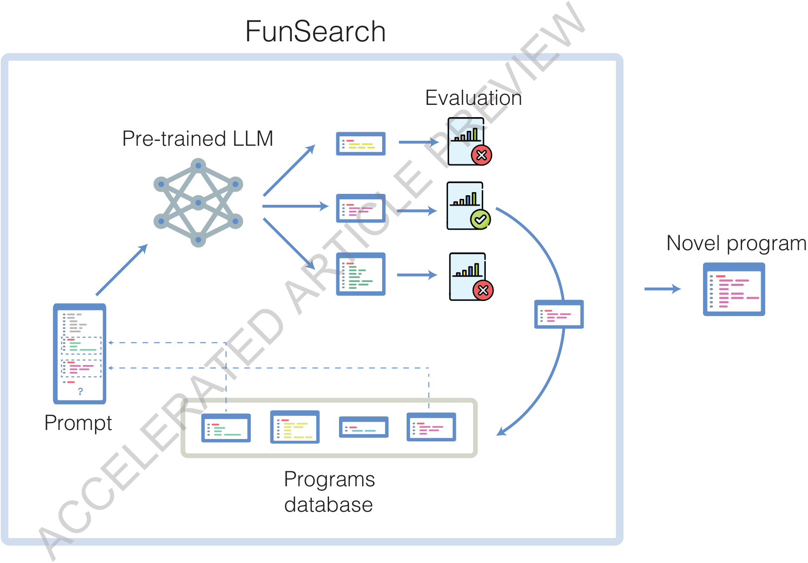

FunSearch Evaluation Pre-trained LLM Novel program ? ? Prompt Programs database ACCELERATED ARTICLE PREVIEW 

"""Finds large cap sets.""" import numpy as np import utils_capset 

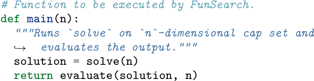

# Function to be executed by FunSearch. def main(n): """Runs `solve` on `n`-dimensional cap set and → evaluates the output.""" solution = solve(n) return evaluate(solution, n) 

def evaluate(candidate_set,(candidate_set, n): 

"""Returns size of candidate_set if it is a cap 

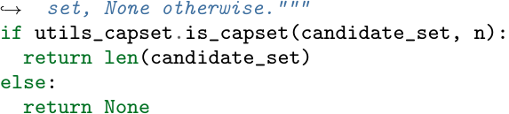

→ set, None otherwise.""" if utils_capset.is_capset(candidate_set,.is_capset(candidate_set,is_capset(candidate_set, n): return len(candidate_set)(candidate_set) else: return None 

def solve(n): 

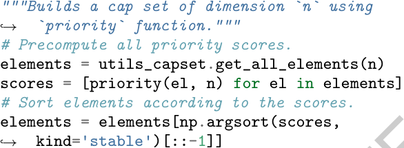

"""Builds a cap set of dimension `n` using → `priority` function.""" # Precompute all priority scores. elements = utils_capset.get_all_elements(n).get_all_elements(n)get_all_elements(n) scores = [priority(el, n) for el in elements] # Sort elements according to the scores. elements = elements[np.argsort(scores,.argsort(scores,argsort(scores, → kind='stable')[::-1]]='stable')[::-1]]'stable')[::-1]])[::-1]]-1]]1]]]] 

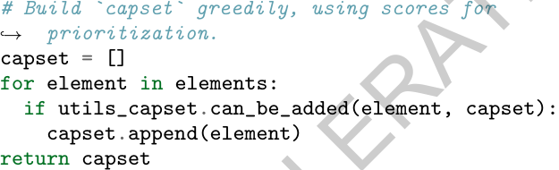

# Build `capset` greedily, using scores for → prioritization. capset = [] for element in elements: if utils_capset.can_be_added(element,.can_be_added(element,can_be_added(element, capset): capset.append(element).append(element)append(element) return capset 

"""Finds good assignment for online 1d bin → packing.""" import numpy as np import utils_packing 

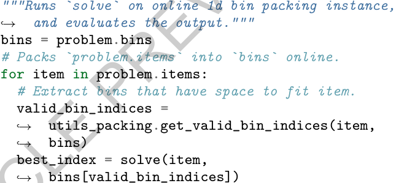

"""Runs `solve` on online 1d bin packing instance, → and evaluates the output.""" bins = problem.bins.binsbins # Packs `problem.items` into `bins` online. for item in problem.items:.items:items: # Extract bins that have space to fit item. valid_bin_indices = → utils_packing.get_valid_bin_indices(item,.get_valid_bin_indices(item,get_valid_bin_indices(item, → bins) best_index = solve(item, → bins[valid_bin_indices]) 

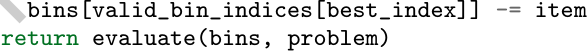

bins[valid_bin_indices[best_index]] -= item return evaluate(bins, problem) 

"""Returns the negative of the number of bins → required to pack items in `problem`.""" 

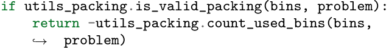

if utils_packing.is_valid_packing(bins,.is_valid_packing(bins,is_valid_packing(bins, problem): return -utils_packing.count_used_bins(bins,utils_packing.count_used_bins(bins,.count_used_bins(bins,count_used_bins(bins, → problem) 

"""Selects the bin with the highest value according 

# Function to be evolved by FunSearch. def priority(element,(element, n): 

"""Returns the priority with which we want to add → `element` to the cap set.""" return 0.0 

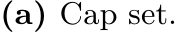

(a) Cap set. 

"""Returns priority with which we want to add 

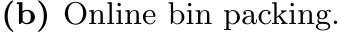

(b) Online bin packing. 

cap sets.""" """Finds good assignment for online 1d bin as np → packing.""" utils_capset import numpy as np import utils_packing to be executed by FunSearch. # Function to be executed by FunSearch. `solve` on `n`-dimensional cap set and def main(problem): the output.""" """Runs `solve` on online 1d bin packing = solve(n) → and evaluates the output.""" evaluate(solution, n) bins = problem.bins.binsbins # Packs `problem.items` into `bins` online. evaluate(candidate_set,(candidate_set, n): for item in problem.items:.items:items: size of candidate_set if it is a cap # Extract bins that have space to fit None otherwise.""" valid_bin_indices = utils_capset.is_capset(candidate_set,.is_capset(candidate_set,is_capset(candidate_set, n): → utils_packing.get_valid_bin_indices(item,.get_valid_bin_indices(item,get_valid_bin_indices(item, len(candidate_set)(candidate_set) → bins) best_index = solve(item, None → bins[valid_bin_indices]) # Add item to the selected bin. (n): bins[valid_bin_indices[best_index]] -= a cap set of dimension `n` using return evaluate(bins, problem) `priority` function.""" all priority scores. def evaluate(bins, problem): = utils_capset.get_all_elements(n).get_all_elements(n)get_all_elements(n) """Returns the negative of the number of [priority(el, n) for el in elements] → required to pack items in `problem`.""" elements according to the scores. if utils_packing.is_valid_packing(bins,.is_valid_packing(bins,is_valid_packing(bins, = elements[np.argsort(scores,.argsort(scores,argsort(scores, return -utils_packing.count_used_bins(bins,utils_packing.count_used_bins(bins,.count_used_bins(bins,count_used_bins(bins, kind='stable')[::-1]]='stable')[::-1]]'stable')[::-1]])[::-1]]-1]]1]]]] → problem) else: `capset` greedily, using scores for return None prioritization. [] def solve(item, bins): in elements: """Selects the bin with the highest value utils_capset.can_be_added(element,.can_be_added(element,can_be_added(element, capset): → to `heuristic`.""" capset.append(element).append(element)append(element) scores = heuristic(item, bins) capset return np.argmax(scores) to be evolved by FunSearch. # Function to be evolved by FunSearch. priority(element,(element, n): def heuristic(item, bins): the priority with which we want to add """Returns priority with which we want to to the cap set.""" → `item` to each bin.""" return -(bins - item)

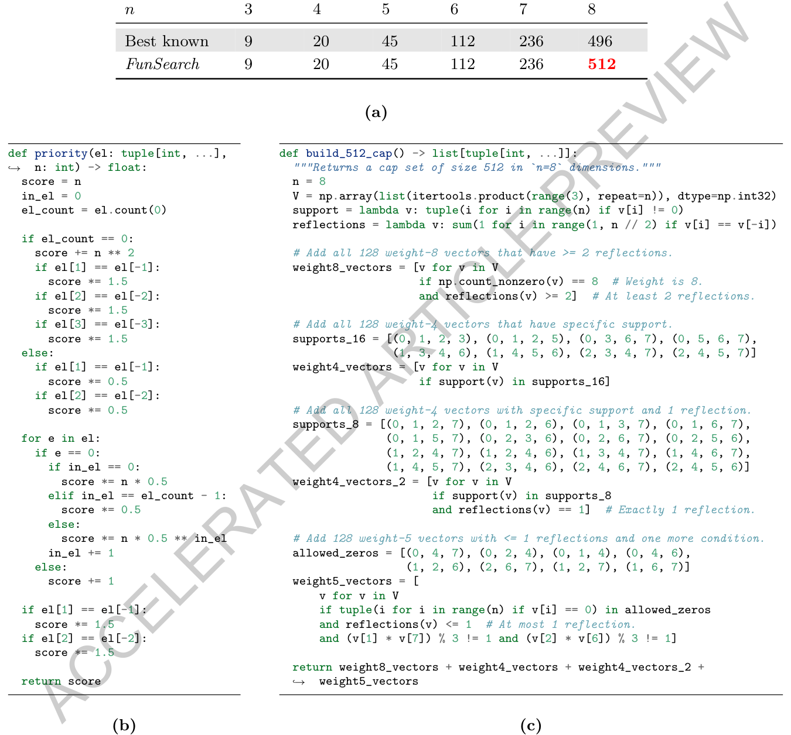

(a) def priority(el: tuple[int, ...], def build_512_cap() -> list[tuple[int, ...]]: → n: int) -> float: """Returns a cap set of size 512 in `n=8` dimensions.""" score = n n = 8 in_el = 0 V = np.array(list(itertools.product(range(3), repeat=n)), dtype=np.int32) el_count = el.count(0) support = lambda v: tuple(i for i in range(n) if v[i] != 0) reflections = lambda v: sum(1 for i in range(1, n // 2) if v[i] == v[-i]) if el_count == 0: score += n ** 2 # Add all 128 weight-8 vectors that have >= 2 reflections. if el[1] == el[-1]: weight8_vectors = [v for v in V score *= 1.5 if np.count_nonzero(v) == 8 # Weight is 8. if el[2] == el[-2]: and reflections(v) >= 2] # At least 2 reflections. score *= 1.5 if el[3] == el[-3]: # Add all 128 weight-4 vectors that have specific support. score *= 1.5 supports_16 = [(0, 1, 2, 3), (0, 1, 2, 5), (0, 3, 6, 7), (0, 5, 6, 7), else: (1, 3, 4, 6), (1, 4, 5, 6), (2, 3, 4, 7), (2, 4, 5, 7)] if el[1] == el[-1]: weight4_vectors = [v for v in V score *= 0.5 if support(v) in supports_16] if el[2] == el[-2]: score *= 0.5 # Add all 128 weight-4 vectors with specific support and 1 reflection. supports_8 = [(0, 1, 2, 7), (0, 1, 2, 6), (0, 1, 3, 7), (0, 1, 6, 7), for e in el: (0, 1, 5, 7), (0, 2, 3, 6), (0, 2, 6, 7), (0, 2, 5, 6), if e == 0: (1, 2, 4, 7), (1, 2, 4, 6), (1, 3, 4, 7), (1, 4, 6, 7), if in_el == 0: (1, 4, 5, 7), (2, 3, 4, 6), (2, 4, 6, 7), (2, 4, 5, 6)] score *= n * 0.5 weight4_vectors_2 = [v for v in V elif in_el == el_count - 1: if support(v) in supports_8 score *= 0.5 and reflections(v) == 1] # Exactly 1 reflection. else: score *= n * 0.5 ** in_el # Add 128 weight-5 vectors with <= 1 reflections and one more condition. in_el += 1 allowed_zeros = [(0, 4, 7), (0, 2, 4), (0, 1, 4), (0, 4, 6), else: (1, 2, 6), (2, 6, 7), (1, 2, 7), (1, 6, 7)] score += 1 weight5_vectors = [ v for v in V if el[1] == el[-1]: if tuple(i for i in range(n) if v[i] == 0) in allowed_zeros score *= 1.5 and reflections(v) <= 1 # At most 1 reflection. if el[2] == el[-2]: and (v[1] * v[7]) % 3 != 1 and (v[2] * v[6]) % 3 != 1] score *= 1.5 return weight8_vectors + weight4_vectors + weight4_vectors_2 + return score → weight5_vectors (b) (c) ACCELERATED ARTICLE PREVIEW 

|`n` |3 |4 |5 |6 |7 |8 |
|---|---|---|---|---|---|---|
|Best known |9 |20 |45 |112 |236 |496 |
|FunSearch |9 |20 |45 |112 |236 |512 |

|Bound on C|Admissible set ingredient Source def priority(el: tuple[int, ...], n: int, w score = 0.0 for i in range(n): if el[i] == 1: score -= 0.9 ** ( i % 4 ) if el[i] == 2: score -= 0.98 ** (30 - ( i % 4 )) if el[i] == 1 and el[i - 4] == 1: score -= 0.98 ** (30 - ( i % 4 )) CLE PREVIEW|
|---|---|
|2.2101|I(90,89) (Calderbank and Fishburn, 1994) if el[i] == 2 and el[i - 4] != 0: I|
|2.2173|I(10,5) (Edel, 2004) score -= 0.98 ** (30 - ( i % 4 )) if el[i] ==2and el[i-4] ==1a T|
|2.2180|I(11,7) (Tyrrell, 2022)            score -= 0.98 ** (30 - ( i % 4 )) score -= 6.3 AR|
|2.2184|I(12,7) FunSearch if el[i] == 2 and el[i - 4] == 2 an -=098**(30-( i%4)) D|
|2.2194|I(15,10) FunSearch score  .         if el[i] == 2 and el[i - 4] == 1 an E|
|2.2202|A(24,17) FunSearch score -= 6.3 if el[i] ==2and el[i-4] ==0a T|
||(a)            score -= 6.3 if el[i] == 1 and el[i - 4] == 1 an score -= 2.2 return score (b) ACCELERA|

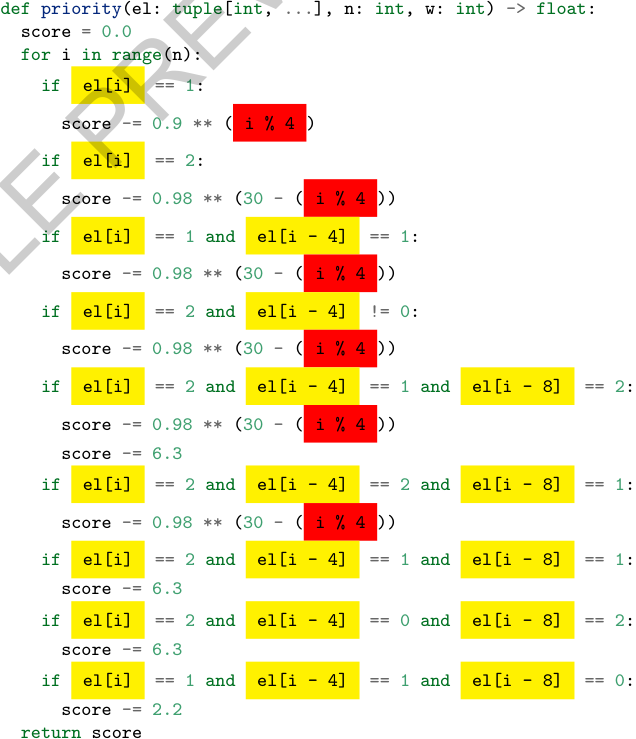

def priority(el: tuple[int, ...], n: int, w: int) -> float: score = 0.0 for i in range(n): if el[i] == 1: score -= 0.9 ** ( i % 4 ) if el[i] == 2: score -= 0.98 ** (30 - ( i % 4 )) if el[i] == 1 and el[i - 4] == 1: score -= 0.98 ** (30 - ( i % 4 )) if el[i] == 2 and el[i - 4] != 0: score -= 0.98 ** (30 - ( i % 4 )) if el[i] == 2 and el[i - 4] == 1 and el[i - 8] == 2: score -= 0.98 ** (30 - ( i % 4 )) score -= 6.3 if el[i] == 2 and el[i - 4] == 2 and el[i - 8] == 1: score -= 0.98 ** (30 - ( i % 4 )) if el[i] == 2 and el[i - 4] == 1 and el[i - 8] == 1: score -= 6.3 if el[i] == 2 and el[i - 4] == 0 and el[i - 8] == 2: score -= 6.3 if el[i] == 1 and el[i - 4] == 1 and el[i - 8] == 0: score -= 2.2 return score 

def heuristic(item: float, bins: np.ndarray) -> np.ndarray: """Online bin packing heuristic discovered with FunSearch.""" score = 1000 * np.ones(bins.shape) # Penalize bins with large capacities. score -= bins * (bins - item) # Extract index of bin with best fit. index = np.argmin(bins) # Scale score of best fit bin by item size. score[index] *= item # Penalize best fit bin if fit is not tight. score[index] -= (bins[index] - item)**4 return score

"""Finds large cap sets.""" import numpy as np import utils_capset def priority_v0(element, n): """Returns the priority with which we want to add `element` to the cap set.""" ####### # Code from lowest-scoring sampled program. return ... ####### def priority_v1(element, n): """Improved version of `priority_v0`.""" ####### # Code from highest-scoring sampled program. return ... ####### def priority_v2(element, n): """Improved version of `priority_v1`.""" Extended Data Fig. 1 ACCELERATED ARTICLE PREVIEW 

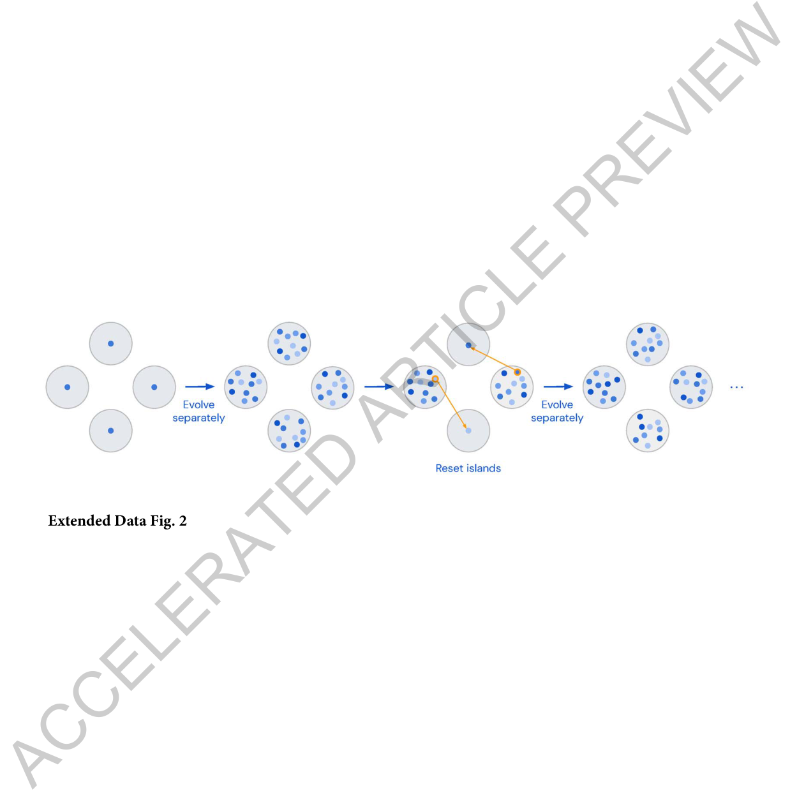

o 00 Oo * ONY) ~ °° . Op CN 3) ° ° ° — (Se — (3°60 —» [%ee® isle so Evolve °e ° oo eo D \ 3 . o’e ° *%e separately ee \ < separatEvolv e ly ° . 0 \ . Xx! ° eo Reset islands Extended Data Fig. 2 ACCELERATED ARTICLE PREVIEW 

x° — [oo ° - {= 0) ° —— mam — 2 _— = is —fe Oot Sample ® Sample Generate program Add new >% oe Sltistars programs with LLM based on program to eo © from clusters input programs cluster Extended Data Fig. 3 ACCELERATED ARTICLE PREVIEW 
