https://doi.org/10.1007/s00165-018-0465-3 BCS © 2018 Formal Aspects of Computing

**Formal Aspects of Computing**

# Toward automatic verification of quantum programs

Mingsheng Ying 1 _,_ 2 _,_ 3

1Centre for Quantum Software and Information, University of Technology Sydney, Sydney NSW 2007, Australia

2State Key Laboratory of Computer Science, Institute of Software, Chinese Academy of Sciences, Beijing, China.

3Department of Computer Science and Technology, Tsinghua University, Beijing, China

**Abstract.** This paper summarises the results obtained by the author and his collaborators in a program logic approach to the verification of quantum programs, including quantum Hoare logic, invariant generation and termination analysis for quantum programs. It also introduces the notion of proof outline and several auxiliary rules for more conveniently reasoning about quantum programs. Some problems for future research are proposed at the end of the paper.

**Keywords:** Quantum programming; Hoare logic; Proof outline; Auxiliary rules; Invariant generation; Termination analysis

## 1. Introduction

Programming is error-prone. Programming a quantum computer and designing quantum communication protocols are even worse due to the weird nature of quantum systems [Yin16]. Therefore, verification techniques and automatic tools for quantum programs and quantum protocols will be indispensable whence commercial quantum computers and quantum communication systems are available. In the last 10 years, various verification techniques for classical programs have been extended to deal with quantum programs; in particular, several quantum program logics have been proposed:

- Brunet and Jorrand [BJ04] proposed to apply Birkhoff-von Neumann quantum logic in reasoning about quantum programs. In the Birkhoff-von Neumann logic, closed subspaces of the state Hilbert space of a quantum system are used to represent the properties of the system, and logical connectives ¬ (negation), ∧ (and), ∨ (or) are interpreted as the operations: ortho-complement, meet and join, respectively, in the orthomodular lattice of all closed subspaces of the Hilbert space. The idea of [BJ04] is to add quantum operations (e.g. unitary transformations and quantum measurements) into the language of quantum logic so that it can be employed to describe and reason about the dynamics (evolution) of a quantum system (e.g. a quantum program).

- Chadha, Mateus and Sernadas [CMS06] presented one of the first attempts to develop a Hoare-like logic for quantum programs. The quantum programs considered in [CMS06] can have both classical and quantum

_Correspondence and offprint requests to_ : M. Ying, E-mail: Mingsheng.Ying@uts.edu.au

M. Ying

variables (memories). But only bounded iterations are allowed in these quantum programs. The logic given in [CMS06] is an extension of exogenous quantum logic [MS06], which has terms representing _amplitudes_ of quantum states, obtained by introducing the axioms for unitary transformations and quantum measurements. Roughly speaking, the assertions (preconditions and postconditions) in this logic are properties of the real and imaginary components of the amplitudes.

- Baltag and Smets [BS06] chose to develop a quantum generalisation of Propositional Dynamic Logic (PDL), which is an extension of Hoare logic for verification of classical programs. The approach of [BS06] is different from [BJ04, CMS06], and it can be essentially seen as a reinterpretation of the language of PDL where a quantum action is interpreted as a (classical) relation between quantum states and models the input–output relation of a quantum program. In particular, by introducing some axioms to handle separation and locality, their proof system can be used to reason about the behaviours (e.g. entanglement) of compound quantum systems.

- Kakutani [Ka09] proposed a quantum extension of Den Hartog and De Vink’s probabilistic Hoare logic [KV02]. The quantum programming language used in [Ka09] is Selinger’s QPL [Sel04] without recursive calls but with while loops. The assertions in this logic are probabilistic predicates (or assertions) used in [KV02] but, of course, re-interpreted in the setting of quantum computation (e.g. the probability that qubit variable _q_ returns to 0 upon the measurement in the computational basis is 4<u>1</u>).

- Some useful proof rules for reasoning about quantum programs were introduced by Feng et al. [FDJY07]. The programming language employed in [FDJY07] is a natural quantum extension of the **while** -language. For simplicity of presentation, only purely quantum programs without classical variables were considered there. The assertions in these proof rules are physical observables (mathematically modelled by Hermitian operators), or quantum predicates as called in [DP06]. Furthermore, a Hoare-like logic for both partial and total correctness of quantum programs with (relative) completeness was established in [Yin11].

The mathematic foundations, the programming languages and the expressivity of the assertions of the quantum program logics presented in [CMS06, Ka09, Yin11] are carefully compared in a recent survey [Rand17].

Except program logics, model-checking techniques have also been developed for verification of quantum communication protocols and quantum programs. For example, Gay, Papanikolaou and Nagarajan [GPN08] developed a model-checker for verifying properties of the quantum systems that can be modelled in the stabiliser formalism. Feng et al. [FYY13] presented an algorithm for model-checking quantum systems described as superoperator valued Markov chains, and the algorithm was implemented by Feng et al. in [FHTZ15]. The problem of checking linear-time properties of quantum systems was studied in [YLYF14], where linear-time properties are defined to be infinite sequences of sets of atomic propositions modelled as closed subspaces of the state Hilbert spaces, as in the Birkhoff-von Neumann quantum logic.

The main purpose of this paper is to summarise the results obtained by the author and his collaborators in a program logic approach to the verification of quantum programs. The paper is an extension of an invited talk at SETTA’2016 [Yin16a], but the results presented in Sects. 4 and 5 as well as the examples given in Sect. 3 are new and have not been published elsewhere.

The paper is organised as follows: The syntax and semantics of a quantum extension of the **while** -language is defined and a logic of Hoare-style for reasoning about quantum programs is presented in Sect. 2. As is wellknown, correctness specification of classical programs can be very tricky. Indeed, correctness specification of quantum programs can be even much trickier. In Sect. 3, we present several simple examples through which the reader can better understand the difference between classical and quantum correctness specifications. The notion of proof outline is introduced and a strong soundness theorem is proved for quantum programs in Sect. 4. Several auxiliary axioms and inference rules are given in Sect. 5, which can help to simplify verifications of quantum programs. Some basic ideas for mechanising quantum program verification based on the quantum Hoare logic are described in Sect. 6. The algorithms for generating invariants and termination analysis of quantum programs are summarised in Sects. 7 and 8, respectively. Some topics for future studies are pointed out in the concluding section. For convenience of the reader, several basic properties of operators in Hilbert spaces needed in this paper are listed in Appendix A. Several simple quantum relations (i.e. quantum predicates in a tensor product of state Hilbert spaces) were employed in Sect. 3, a brief discussion on composition of quantum relations that can be used to generate more sophisticated quantum relations from these simple ones is given in Appendix B. For readability, the proofs of the results in Sects. 4 and 5 are deferred to Appendix C.

Toward automatic verification of quantum programs

## 2. Hoare logic for quantum programs

Hoare logic is a cornerstone in verification of classical programs. As mentioned in Sect. 1, several attempts [BJ04, CMS06, BS06, FDJY07, Ka09, Yin11] have been made to build a Hoare-like logic for quantum programs. In this section, we focus on the one presented in [Yin11] because it is the only quantum Hoare logic with (relative) completeness in the existing literature.

### 2.1. Syntax and semantics

Let us first briefly recall the syntax of a quantum extension of the **while** -language. It is assumed that the reader is familiar with the basic notions of quantum computing. (A reader not familiar with them can have a quick look at Section 2 of [Yin11] or Section 1.1 of [YYW17]; for more details, we refer to [NC00] or [Yin16].) We assume a countably infinite set _Var_ of quantum variables. For each _q_ ∈ _Var_ , we write _Hq_ for its state Hilbert space.

**Definition 1 (** _Syntax_ **[Yin11, Yin16])** The quantum **while** -programs are defined by the grammar:

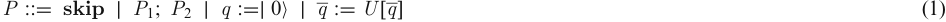

P ::� skip | P 1; P 2 | q :�| 0⟩| q :� U [ q ] (1) 

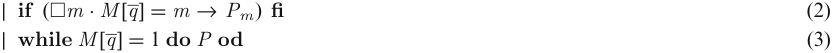

| if (□ m  ·  M [ q ]  � m → Pm ) fi (2) | while  M [ q ]  � 1  do  P od (3) 

The command “ _q_ :�| 0⟩” is an initialisation that sets quantum variable _q_ to a basis state | 0⟩. The statement ~~“~~ _<u>q</u>_ :� _U_ ~~[~~ _<u>q</u>_ ~~]~~ ” means that unitary transformation _U_ is performed on quantum register _<u>q</u>_ ~~,~~ leaving the states of the variables not in _<u>q</u>_ unchanged. The construct “ **if** · · · **fi** ” is a quantum generalisation of case or switch statement. In executing it, measurement _M_ �{ _Mm_ } is performed on _<u>q</u>_ ~~,~~ and then a subprogram _Pm_ is selected to be executed next according to the outcomes _m_ of measurement. The statement “ **while** · · · **od** ” is a quantum generalisation of **while** -loop. The measurement in it has only two possible outcomes 0, 1. If the outcome 0 is observed, then the program terminates, and if the outcome 1 occurs, the program executes the loop body _P_ and continues the loop.

To further illustrate these program constructs, let us see two simple examples, both of which are quantum generalisations of certain probabilistic programs. The first is taken from [YYW17], and it is the quantum version of the example of three dials in [KMMM10].

**Example 1 (Three Quantum Dials)** Consider a slot machine that has three dials _d_ 1 _, d_ 2 _, d_ 3 and two suits ♥ and ♦. It spins the dials independently so that they come to rest on each of the suits with equal probability. This machine can be modelled as a probabilistic program:

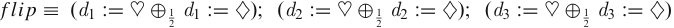

f lip ≡ ( d 1 :�♥⊕ 21 d 1 :�♦); ( d 2 :�♥⊕ 2 1 d 2 :�♦); ( d 3 :�♥⊕ 2 1 d 3 :�♦) 

where _P_ 1 ⊕ _p P_ 2 stands for a probabilistic choice which chooses to execute _P_ with probability _p_ and to execute _Q_ with probability 1 − _p_ .

We can define a quantum variant of _f lip_ as follows:

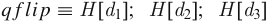

q f lip ≡ H  [ d 1]; H  [ d 2]; H  [ d 3] 

where _H_ is the Hadamard gate in the 2-dimensional Hilbert space _H_ 2 with {| ♥⟩ _,_ | ♦⟩} as an orthonormal basis. The program _q f lip_ also spins the dials, but does it in a quantum way modelled by the Hadamard “coin-tossing” operator _H_ .

It is worth pointing out an interesting difference between the probabilistic and quantum setting: spinning the dials with equal probability can be implemented in many different ways in the quantum world; e.g. a quantum gate different from the Hadamard gate.

The second example is a quantum generalisation of random walk that every one working on probabilistic algorithms or programming must be familiar with. Here is a simplified version (taken from [YYFD13]) of the one-dimensional quantum walks defined in [ABNVW01].

**Example 2 (Quantum Walk)** Let _Hc_ be the 2-dimensional Hilbert space with orthonormal basis states | _L_ ⟩ and | _R_ ⟩, indicating directions Left and Right, respectively. It is the state space of a quantum coin. Let _Hp_ be the _n_ -dimensional Hilbert space with orthonormal basis states | 0⟩ _,_ | 1⟩ _, . . . ,_ | _n_ − 1⟩, where vector | _i_ ⟩ denotes position _i_ for each 0 ≤ _i < n_ . The state space of the walk is _H_ � _Hc_ ⊗ _Hp_ . The initial state is | _L_ ⟩| 0⟩. Each step of the walk consists of:

M. Ying

1. Measure the position of the system to see whether it is 1. If the outcome is “yes”, then the walk terminates, otherwise, it continues. The measurement is mathematically modelled by _M_ �{ _Myes, Mno_ }, where

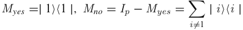

Myes �| 1⟩⟨1 | , Mno � Ip − Myes � � |  i ⟩⟨ i | i ̸�1 

and _Ip_ is the identity operator in the position space _Hp_ ;

2. The Hadamard “coin-tossing” operator _H_ is applied in the coin space _Hc_ ;

3. The shift operator _S_ defined by

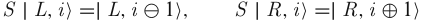

S |  L, i ⟩�|  L, i ⊖ 1⟩ , S |  R, i ⟩�|  R, i ⊕ 1⟩ 

for _i_ � 0 _,_ 1 _, . . . , n_ − 1 is performed on the space _H_ . Intuitively, the system walks one step left or right according to the direction state. Here, ⊕ and ⊖ stand for addition and subtraction modulo _n_ , respectively. The operator _S_ can be equivalently written as

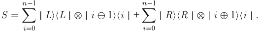

n −1 n −1 S � � |  L ⟩⟨ L  | ⊗|  i ⊖ 1⟩⟨ i | + � |  R ⟩⟨ R | ⊗|  i ⊕ 1⟩⟨ i |  . i �0 i �0 

This walk can be written as the quantum **while** -loop:

_QW_ ≡ _c_ :�| _L_ ⟩; _p_ :�| 0⟩; **while** _M_ [ _p_ ] � _no_ **do** _c_ :� _H_ [ _c_ ]; _c, p_ :� _S_ [ _c, p_ ] **od**

It is worth noticing an essential difference between the quantum walk and a classical random walk: the coin (or direction) variable _c_ can be in a superposition of | _L_ ⟩ and | _R_ ⟩ like | +⟩� ~~√~~ <u>12</u>(|_L_⟩+ |_R_⟩), and thus the walker is moving left and right “simultaneously”; for example,

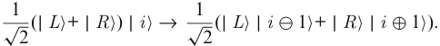

1 1 (|  L ⟩+ |  R ⟩) |  i ⟩→ (|  L ⟩|  i ⊖ 1⟩+ |  R ⟩|  i ⊕ 1⟩) . √ 2 √ 2 

This means that if the walker is currently at position _i_ , then after one step she/he will be at both position _i_ ⊖ 1 and _i_ ⊕ 1.

Similar to the case of classical **while** -programs, the operational semantics of quantum programs can be defined as a transition relation between configurations. For each quantum program _P_ , we write _var_ ( _P_ ) for the set of quantum variables occurring in _P_ . Let

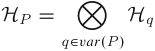

HP � � Hq q ∈ var ( P ) 

be the state Hilbert space of _P_ . A partial density operator is defined as a positive operator _ρ_ with trace _tr_ ( _ρ_ ) ≤ 1. We write _D_ ( _HP_ ) for the set of partial density operators in _HP_ . A configuration is a pair ⟨ _P , ρ_ ⟩ _,_ where _P_ is a program or the termination symbol ↓, and _ρ_ ∈ _D_ ( _HP_ ) denotes the state of quantum variables.

**Definition 2 (** _Operational Semantics_ **[Yin11, Yin16])** The operational semantics of quantum programs is defined by the transition rules in Fig. 1.

It is worth pointing out that the transition rules (In), (UT), (IF), (L0) and (L1) are decreed by the basic postulates of quantum mechanics. A major difference between the operational semantics of classical and quantum programs should be noticed. During the execution of a classical case statement or a **while** -loop, checking its guard does not change the state of program variables. In contrast, checking the guard of a quantum case statement or a quantum loop requires to perform a measurement on (the system denoted by) the program variables, which, again decreed by a basic postulate of quantum mechanics, changes the state of these variables. From the operational semantics, we see that the control flow of a quantum program is determined by the outcomes of the quantum measurements occurring in the case statements or loops. Note that the outcomes of quantum measurements are classical information, so the control flows of quantum programs considered in this paper are classical. Quantum programs with quantum control flows were studied in [AG05] and Chapters 6 and 7 of [Yin16].

Toward automatic verification of quantum programs

(Sk) _⟨_ **skip** _, ρ⟩→⟨↓, ρ⟩_ (In) _⟨q_ := _|_ 0 _⟩, ρ⟩→⟨↓, ρ_ 0_q⟩_ (UT) _⟨_ _~~q~~_ := _U_ ~~[~~ _~~q~~_ ~~]~~ _, ρ⟩→⟨↓, UρU__†_ _⟩_ _<u>⟨P</u>_ 1 _<u>, ρ⟩</u> →_ _<u>⟨P</u>_ 1_′,__<u>ρ′⟩</u>_ (SC) _⟨P_ 1; _P_ 2 _, ρ⟩→⟨P_ 1_′_;_P_2_, ρ′⟩_ (IF) _⟨_ **if** (□ _m · M_ ~~[~~ _~~q~~_ ~~]~~ = _m → Pm_ ) **fi** _, ρ⟩→⟨Pm, M mρMm__†⟩_ (L0) _⟨_ **while** _M_ ~~[~~ _~~q~~_ ~~]~~ = 1 **do** _P_ **od** _, ρ⟩→⟨↓, M_ 0 _ρM_ 0_†⟩_ (L1) _⟨_ **while** _M_ ~~[~~ _~~q~~_ ~~]~~ = 1 **do** _P_ **od** _, ρ⟩→⟨P_ ; **while** _M_ ~~[~~ _~~q~~_ ~~]~~ = 1 **do** _P_ **od** _, M_ 1 _ρM_ 1_†⟩_

**Fig. 1.** Transition Rules for Quantum **while** -Programs. In (IN), _ρ_ 0_q_�|0⟩_q_⟨0|_ρ_|0⟩_q_⟨0|+|0⟩_q_⟨1|_ρ_|1⟩_q_⟨0|if_type_(_q_)�**Bool**and _ρ_ 0_q_�� _n_∞ �−∞|0⟩_q_⟨_n_|_ρ_|_n_⟩_q_⟨0| if_type_(_q_)�**Int**_._In (SC), we make the convention ↓;_P_2�_P_2_._In (IF),_m_ranges over every possible outcome of measurement _M_ �{ _Mm_ }

**Definition 3 (** _Denotational Semantics_ **[Yin11, Yin16])** For any program _P_ , its semantic function is the mapping:

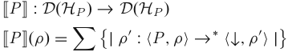

� P � :  D ( HP ) → D ( HP ) � P �( ρ ) � ��|  ρ ′ : ⟨ P , ρ ⟩→ ∗ ⟨↓ , ρ ′ ⟩|� 

for every _ρ_ ∈ _D_ ( _HP_ ), where →∗ is the reflexive and transitive closure of →, and {| · |} denotes a multi-set.

The defining equation of � _P_ �( _ρ_ ) deserves an explanation. It is clear from rules (IF), (L0) and (L1) that transition relation → is usually not deterministic; that is, {| _ρ_′ : ⟨ _P , ρ_ ⟩→∗ ⟨↓ _, ρ_′ ⟩|} may have more than one element. This is different from the case of classical **while** -programs. The summation in the right-hand side of the equation comes from the essential linearity of quantum mechanics. It is proved that � _P_ �(·) is a quantum operation (or a super-operator) (for the definition of quantum operation, see [NC00], Chapter 8 or [Yin16], Chapter 2). To illustrate the above two definitions, let reconsider the three quantum dials in Example 1.

**Example 3 (Semantics of Three Quantum Dials - A Continuation of Example 1)** A state of probabilistic program _f lip_ is a configuration of the slot machine, i.e. a mapping from dials to suits. The semantics of _f lip_ is a function that maps each initial state to a uniform distribution of states in which every configurations has probability<u>1</u> 8. In contrast, the state Hilbert space of quantum program _q f lip_ is then _H_ 2⊗3. For instance, if we write:

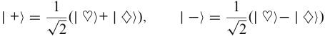

1 1 | +⟩� (| ♥⟩+ | ♦⟩) , | −⟩� (| ♥⟩−| ♦⟩) √ 2 √ 2 

for the equal superpositions of | ♥⟩ and | ♦⟩, then:

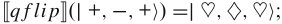

� q f lip �(| + ,  − ,  +⟩) �| ♥ ,  ♦ ,  ♥⟩; 

if we write:

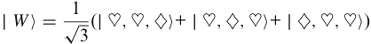

1 | W ⟩� (| ♥ ,  ♥ ,  ♦⟩+ | ♥ ,  ♦ ,  ♥⟩+ | ♦ ,  ♥ ,  ♥⟩) √ 3 

for the Werner state, a typical entangled state of three qubits, then

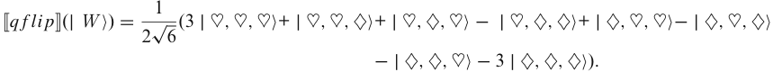

1 � q f lip �(|  W  ⟩) � (3 | ♥ ,  ♥ ,  ♥⟩+ | ♥ ,  ♥ ,  ♦⟩+ | ♥ ,  ♦ ,  ♥⟩−| ♥ ,  ♦ ,  ♦⟩+ | ♦ ,  ♥ ,  ♥⟩−| ♦ ,  ♥ ,  ♦⟩ 2 √ 6 −| ♦ ,  ♦ ,  ♥⟩− 3 | ♦ ,  ♦ ,  ♦⟩) . 

(Note that Definitions 2 and 3 are given in a more general way; i.e. in terms of density operators. Here, for simplicity, a pure state | _ψ_ ⟩ is identified with the corresponding density operator _ρ_ �| _ψ_ ⟩⟨ _ψ_ |.)

The L¨owner order between operators in the state Hilbert space _HP_ of a quantum program is defined as follows:

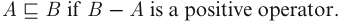

A  ⊑ B if B − A  is a positive operator . 

This order can be naturally lifted to an order between quantum operations (or super-operators). It can be shown that the set _D_ ( _HP_ ) of partial density operators in _HP_ with the L¨owner order ⊑ is a complete partial

M. Ying

order (CPO), and all quantum operations in _HP_ form a CPO too. Then a fixed point characterisation for the denotational semantics of quantum **while** -loops can be derived (see Proposition 5.1(6) and Corollary 5.1 in [Yin11], or Proposition 3.3.2 and Corollary 3.3.1 in [Yin16]).

### 2.2. Partial correctness and total correctness

Now we review the notions of partial and total correctness for quantum programs. Recall from [MM05] that probabilistic predicates (or assertions, e.g. preconditions and postconditions) are defined to be bounded realvalued functions interpreted as the expectations of random variables. As introduced in [DP06], a quantum predicate in a Hilbert space _H_ is an observable (a Hermitian operator) _A_ in _H_ with 0 ⊑ _A_ ⊑ _I_ , where 0 and _I_ are the zero operator and the identity operator in _H_ , respectively, and ⊑ stands for the L¨owner order. In the quantum foundations literature, a quantum predicate is called an _effect_ .

**Definition 4 (** _Correctness Formula, Hoare Triple_ **[Yin11, Yin16])** A correctness formula (or a Hoare triple) is a statement of the form

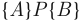

{ A } P { B } 

where _P_ is a quantum program, and both _A, B_ are quantum predicates in _HP_ , called the precondition and postcondition, respectively.

The appearance of a quantum Hoare triple is exactly the same as that of its classical counterpart. But in a classical Hoare triple, precondition _A_ and postcondition _B_ stands for (first-order) logical formulas, and in a quantum Hoare triple, _A_ and _B_ are two operators that are interpreted as observables in physics.

**Definition 5 (** _Partial and Total Correctness_ **[Yin11, Yin16])** 1. The correctness formula { _A_ } _P_ { _B_ } is true in the sense of total correctness, written |� _tot_ { _A_ } _P_ { _B_ } _,_ if for all input states _ρ_ ∈ _D_ ( _HP_ ) we have:

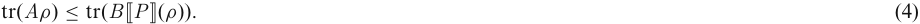

tr( Aρ ) ≤ tr( B � P �( ρ )) . (4) 

2. The correctness formula { _A_ } _P_ { _B_ } is true in the sense of partial correctness, written |� _par_ { _A_ } _P_ { _B_ } _,_ if for all input states _ρ_ ∈ _D_ ( _HP_ ) we have:

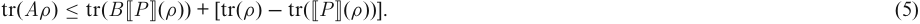

tr( Aρ ) ≤ tr( B � P �( ρ )) + [tr( ρ ) − tr(� P �( ρ ))] . (5) 

A key to understanding the above definition is the observation that _tr_ ( _Aρ_ ) is the expected (average) value of observable _A_ when the system is in state _ρ_ . The following lemma shows that the defining inequalities (4) and (5) for total and partial correctness can be restated in a form of L¨owner order, which is often easier to manipulate because the universal quantifier over density operator _ρ_ is eliminated.

Let us consider the three quantum dials in Examples 1 and 3 once again to illustrate the notion of correctness introduced in the above definition.

**Example 4 (Correctness of Three Quantum Dials)** We write:

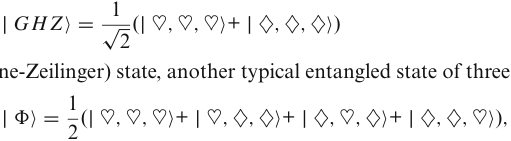

1 |  GH Z ⟩� (| ♥ ,  ♥ ,  ♥⟩+ | ♦ ,  ♦ ,  ♦⟩) √ 2 for the GHZ (Greenberger-Horne-Zeilinger) state, another typical entangled state of three qubits, |  � ⟩� 1 2 (| ♥ ,  ♥ ,  ♥⟩+ | ♥ ,  ♦ ,  ♦⟩+ | ♦ ,  ♥ ,  ♦⟩+ | ♦ ,  ♦ ,  ♥⟩) , 

for the GHZ (Greenberger-Horne-Zeilinger) state, another typical entangled state of three qubits,

and | _�_ ⟩�| ♥ _,_ ♥ _,_ ♥⟩. Then _A_ �| _�_ ⟩⟨ _�_ |, _B_ �| _�_ ⟩⟨ _�_ | and _C_ �| _GH Z_ ⟩⟨ _GH Z_ | are all quantum predicates. It is easy to check that

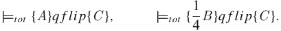

|� tot { A } q f lip { C } , |� tot { 4 1 B } q f lip { C } . 

This means that if the input is state | _�_ ⟩, then program _q f lip_ will certainly output the GHZ state; and if the input is state | _�_ ⟩, it will output a state | _�_ ⟩ that is similar to the GHZ state in the sense:

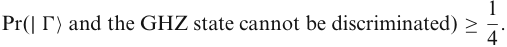

Pr(|  � ⟩ and the GHZ state cannot be discriminated) ≥ 1 4 . 

Note that partial and total correctness are the same for _q f lip_ because it does not contain any loop.

Toward automatic verification of quantum programs

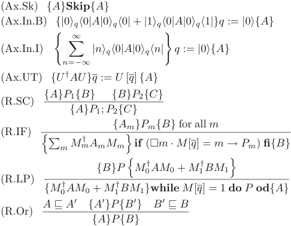

(Ax . Sk) {A} Skip {A} (Ax . In . B) {| 0 ⟩q⟨ 0 |A| 0 ⟩q⟨ 0 |  +  | 1 ⟩q⟨ 0 |A| 0 ⟩q⟨ 1 |}q :=  | 0 ⟩{A} ∞ (Ax . In . I) � |n⟩q⟨ 0 |A| 0 ⟩q⟨n| q :=  | 0 ⟩{A} � n = −∞ � (Ax . UT) {U † AU }q :=  U [ q ]  {A} {A}P 1 {B} {B}P 2 {C} (R . SC) {A}P 1;  P 2 {C} {Am}Pm{B}  for all  m (R . IF) �� m M † m A m M m � if (□ m · M [ q ]  =  m → Pm )  fi {B} {B}P � M 0 †AM 0 +  M † 1 BM 1 � (R . LP) {M 0 †AM 0 +  M † 1 BM 1 } while  M [ q ]  = 1  do  P od {A} A ⊑ A ′ {A ′ }P {B ′ } B ′ ⊑ B (R . Or) {A}P {B} 

**Fig. 2.** Proof System qPD for Quantum **while** -Programs. In (Ax.In.B), _type_ ( _q_ ) � **Boolean** . In (Ax.In.I), _type_ ( _q_ ) � **Int**

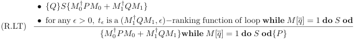

• {Q}S{M 0 †PM 0 +  M † 1 QM 1 } • for any  ϵ >  0 , tϵ is a ( M 1 †QM 1 , ϵ ) − ranking function of loop  while  M [ q ]  = 1  do  S od (R . LT) {M 0 †PM 0 +  M † 1 QM 1 } while  M [ q ]  = 1  do  S od {P } 

**Fig. 3.** Proof System qTD for Quantum **while** -Programs

The quantum predicates _A, B , C_ in the above example are very simple and defined by a particular input/output state. More examples of correctness specifications will be given in Sect. 3.

**Lemma 1** 1. |� _tot_ { _A_ } _P_ { _B_ } if and only if _A_ ⊑ � _P_ �∗ ( _B_ ).

2. |� _par_ { _A_ } _P_ { _B_ } if and only if:

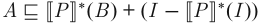

A  ⊑ � P � ∗ ( B ) + ( I − � P � ∗ ( I  )) 

where _I_ is the identity operator in _HP_ , and � _P_ �∗ stands for the dual of super-operator � _P_ � (see Definition 13 in Appendix A).

_Proof_ Immediate from Lemma 4.1.2 in [Yin16] and Lemma 3 in Appendix A.

2 

The above lemma will be extensively used in the proofs of the results in Sect. 5.

### 2.3. Quantum Hoare logic

A Hoare-like logic for quantum programs is established in [Yin11]. It consists of:

- A proof system qPD for partial correctness: The axioms and inference rules of qPD are presented in Fig. 2.

- A proof system qTD for total correctness: qTD is obtained from qPD by replacing rule (R.LP) with the rule (R.LT) given in Fig. 3. The notion of ranking function used in rule (R.LT) is defined in the following:

**Definition 6 ([Yin11, Yin16])** Let _A_ be a quantum predicate in _Hvar_ ( _P_ ) ~~∪~~ _<u>q</u>_and real number_ϵ>_0. A function

_t_ : _D_ ( _Hvar_ ( _P_ ) ~~∪~~ _<u>q</u>_) →N (nonnegative integers)

is called a ( _A, ϵ_ )-ranking function of quantum loop “ **while** _M_ ~~[~~ _<u>q</u>_ ~~]~~ � 1 **do** _P_ **od** ” if it satisfies the following two conditions: for all _ρ_ ∈ _D_ ( _Hvar_ ( _P_ ) ~~∪~~ _<u>q</u>_),

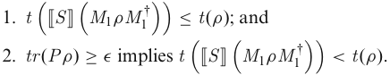

1. t � S � M 1 ρM 1 † ≤ t ( ρ ); and � � �� 2. tr ( P ρ ) ≥ ϵ implies  t � S � M 1 ρM 1 † < t ( ρ ) . � � �� 

M. Ying

It is interesting to carefully compare the Hoare rule for partial correctness of classical loops:

#### { _<u>ϕ</u>_ ∧ _b_ } _P_ { _<u>ϕ</u>_ }

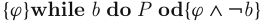

{ ϕ } while  b do  P od { ϕ  ∧¬ b } 

and its variant for total correctness with the corresponding rules (R.LP) and (R.LT) for quantum loops, respectively. At the first glance, the rules for classical loops and those for quantum loops are very different. But actually there is a certain similarity between them: in the rules for classical loops, _ϕ_ ∧ _b_ (resp. _ϕ_ ∧¬ _b_ ) can be thought of as the restriction of _ϕ_ under _b_ (resp. ¬ _b_ ). If we set:

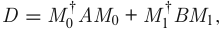

D � M 0 † AM 0 +  M  † 1 BM 1 , 

then _B_ can be seen as the restriction of _D_ under _M_ 1 and _A_ the restriction of _D_ under _M_ 0, and _M_ 0 can be considered as the negation of _M_ 1. Furthermore, as we will see at the end of Sect. 7, rules (R.LP) and (R.LT) can also be understood in the context of inductive assertion.

The soundness and (relative) completeness of both proof system qPD and qTD were proved in [Yin11, Yin16].

**Theorem 1 (** Soundness and Completeness **[Yin11, Yin16])** For any quantum **while** -program _P_ , and for any quantum predicates _A, B_ ,

|� _par_ { _A_ } _P_ { _B_ } ⇔⊢ _q P D_ { _A_ } _P_ { _B_ } _,_

|� _tot_ { _A_ } _P_ { _B_ } ⇔⊢ _qT D_ { _A_ } _P_ { _B_ } _._

## 3. Examples of quantum correctness specification

In this section, let us see several simple examples, which shows some interesting and tricky differences between specifying correctness of classical programs and that of quantum programs.

### 3.1. Unary quantum predicates

A quantum predicate about a single quantum system _q_ ; i.e. an observable (between the zero and identity operators) in state Hilbert space _Hq_ can be understood as a unary quantum predicate.

**Example 5** An equality like _x_ � _c_ with _x_ being a variable and _c_ a constant often appears in precondition or postcondition of a classical program correctness formula, e.g.

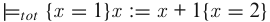

|� tot { x � 1} x :� x + 1{ x � 2} 

Let _q_ be a quantum variable and | _ψ_ ⟩ a given (constant) state in _Hq_ . Then equality “ _q_ �| _ψ_ ⟩” can be expressed as quantum predicate _A_ �| _ψ_ ⟩⟨ _ψ_ | in _Hq_ , and we have:

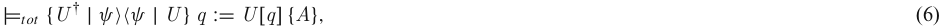

|� tot { U † |  ψ ⟩⟨ ψ |  U  }  q :� U  [ q ] { A } , (6) 

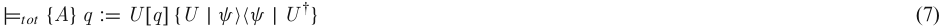

|� tot { A }  q :� U  [ q ] { U |  ψ ⟩⟨ ψ |  U † } (7) 

for any unitary operator _U_ in _Hq_ . The precondition in (6) and the postcondition in (7) express equalities “ _q_ � _U_† | _ψ_ ⟩”, “ _q_ � _U_ | _ψ_ ⟩”, respectively. More generally, for any closed subspace _X_ of _Hq_ , Membership “ _q_ ∈ _X_ ” can be expressed as quantum predicate _PX_ (the projection onto _X_ ) and we have:

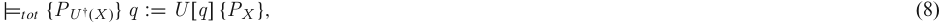

|� tot { PU  †( X  )}  q :� U  [ q ] { PX  } , (8) 

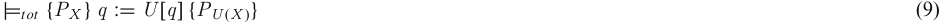

|� tot { PX  }  q :� U  [ q ] { PU ( X  )} (9) 

The precondition in (8) and the postcondition in (9) express memberships “ _q_ ∈ _U_† ( _X_ )”, “ _q_ ∈ _U_ ( _X_ )”, respectively.

Toward automatic verification of quantum programs

### 3.2. Quantum relations

A quantum predicate about multiple quantum systems _q_ 1 _, . . . , qn_ ; i.e. an observable (between the zero and identity operators) in the tensor product:

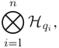

n � Hqi , i �1 

can be understood as a quantum relation among _q_ 1 _, . . . , qn_ . In particular, a quantum predicate _A_ in _H_ 1 ⊗ _H_ 2 can be seen as a quantum (binary) relation between _H_ 1 and _H_ 2. The following are two examples showing some quantum relations used in preconditions and postconditions. A further discussion about quantum relation is given in Appendix B.

**Example 6** An equality like _x_ � _y_ between two variables _x , y_ also often appears in precondition or postcondition of a classical program correctness formula, e.g.

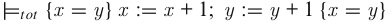

|� tot { x � y }  x :� x + 1; y :� y + 1 { x � y } 

Let _p, q_ be two quantum variables with the same state Hilbert space _H_ . Then equality “ _p_ � _q_ ” can be expressed as the symmetrisation operator:

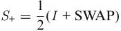

S + � 1 2 ( I + SWAP) 

where _I_ is the identity operator in _H_ ⊗ _H_ , and operator SWAP in _H_ ⊗ _H_ is defined by

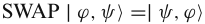

SWAP |  ϕ, ψ ⟩�|  ψ, ϕ ⟩ 

for all | _ϕ_ ⟩ _,_ | _ψ_ ⟩∈ _H_ , together with linearity. It is easy to see that SWAP · _S_ + � _S_ + · SWAP � SWAP · _S_ + · SWAP � _S_ + _._ Furthermore, for any unitary operator _U_ in _H_ , it holds that:

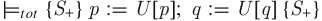

|� tot { S +}  p :� U  [ p ]; q :� U  [ q ] { S +} 

It is interesting to note that a similar conclusion holds for the anti-symmetrisation operator:

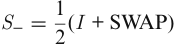

S − � 1 2 ( I + SWAP) 

that is, we have SWAP · _S_ − � _S_ − · SWAP �− _S_ − _,_ SWAP · _S_ − · SWAP � _S_ − and

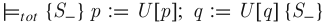

|� tot { S −}  p :� U  [ p ]; q :� U  [ q ] { S −} 

**Example 7** Consider the following correctness formula for classical programs:

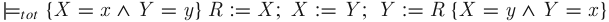

|� tot { X � x ∧ Y � y }  R :� X  ; X :� Y  ; Y :� R  { X � y ∧ Y � x } 

It means that after executing the program, the values of variables _X_ and _Y_ are exchanged. To properly specify the precondition and postcondition, auxiliary (ghost) variables _x , y_ are introduced. In quantum computing, statements _R_ :� _X , X_ :� _Y_ and _Y_ :� _R_ cannot be directly realised as prohibited by the no-cloning theorem. But we can consider the following modification: let _X , Y , R_ be three quantum variables with the same state Hilbert space _H_ . Then we have:

|� _tot_ { _A_ } _R, X_ :� SWAP[ _R, X_ ]; _Y , Y_ :� SWAP[ _X , Y_ ]; _Y , R_ :� SWAP[ _Y , R_ ] {(SWAP ⊗ _I_ ) _A_ (SWAP ⊗ _I_ )} (10)

for any quantum predicate _A_ in _H_ ⊗ _H_ ⊗ _H_ , where the first, second and third _H_ are the state Hilbert spaces of _X , Y , R_ respectively, and _I_ is the identity operator in _H_ . Note that we do not use any auxiliary (ghost) variable in correctness formula (10). In particular, if

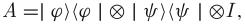

A  �|  ϕ ⟩⟨ ϕ | ⊗|  ψ ⟩⟨ ψ | ⊗ I , 

where | _ϕ_ ⟩ _,_ | _ψ_ ⟩∈ _H_ , and _I_ is the identity operator in _H_ , then it holds that

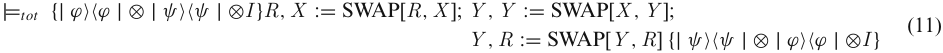

|� tot {|  ϕ ⟩⟨ ϕ | ⊗|  ψ ⟩⟨ ψ | ⊗ I  } R, X :� SWAP[ R, X  ];  Y , Y :� SWAP[ X , Y  ]; (11) Y , R :� SWAP[ Y , R ] {|  ψ ⟩⟨ ψ | ⊗|  ϕ ⟩⟨ ϕ | ⊗ I  } 

Intuitively, the precondition and postcondition of (11) means “ _X_ �| _ϕ_ ⟩ and _Y_ �| _ψ_ ⟩”, “ _X_ �| _ψ_ ⟩ and _Y_ �| _ϕ_ ⟩”, respectively. Here, auxiliary variables | _ϕ_ ⟩ _,_ | _ψ_ ⟩ are employed.

All of the examples given in the previous subsection and this subsection can be proved using axiom (Ax.UT) and rule (R.SC) in Fig. 2. A more interesting example using rule (R.IF) will be presented in Sect. 4.

M. Ying

### 3.3. Logical connectives

Logical connectives are widely used in specifying (the preconditions and postconditions of) classical programs. Here, we show that several quantum counterparts of them can be used in specifying correctness of quantum programs. However, it is not the case that every logical connective has an appropriate quantum counterpart.

**Example 8** The predicate “True” and “False” are described by the identity and zero operators _I_ and 0, respectively, in the state Hilbert space _HP_ of the program _P_ under consideration.

- |� _par_ { _I_ } _P_ { _B_ } means that for any density operator _ρ_ ,

#### _tr_ ( _B_ � _P_ �( _ρ_ )) � _tr_ (� _P_ �( _ρ_ ));

that is, the probability that postcondition _B_ is satisfied by the output is equal to the probability that the program terminates.

- |� _par_ { _A_ } _P_ { _I_ } always holds, because _A_ ⊑ _I_ implies that for any partial density operator _ρ_ ,

_tr_ ( _Aρ_ ) ≤ _tr_ ( _ρ_ ) � _tr_ (� _P_ �( _ρ_ )) + [ _tr_ ( _ρ_ ) − _tr_ (� _P_ �( _ρ_ ))] _._

- |� _tot_ { _I_ } _P_ { _B_ } means that for any density operator _ρ_ ,

_tr_ ( _B_ � _P_ �( _ρ_ )) � 1 _._

Since _B_ ⊑ _I_ ,wehave _tr_ ( _B_ � _P_ �( _ρ_ )) ≤ _tr_ (� _P_ �( _ρ_ ))andthus _tr_ (� _P_ �( _ρ_ )) � 1;thatis,program _P_ alwaysterminates, and output � _P_ �( _ρ_ ) satisfies postcondition _B_ .

- |� _tot_ { _A_ } _P_ { _I_ } means that for any density operator, _tr_ ( _Aρ_ ) ≤ _tr_ (� _P_ �( _ρ_ )); intuitively, if precondition _A_ is satisfied by input _ρ_ to _P_ , then _P_ terminates.

- **Example 9** 1. Negation in classical logic has a quantum counterpart: for each quantum predicate in Hilbert space _H_ , _I_ − _A_ can be used as the negation of _A_ . In fact, for any density operator _ρ_ in _H_ ,

_tr_ [( _I_ − _A_ ) _ρ_ ] � 1 − _tr_ ( _Aρ_ ) _._

2. Conjunction in classical logic does not always have an appropriate quantum counterpart; some difficulties caused by this fact in reasoning about quantum programs were discussed in [YCFD07]. But if _A_ 1 and _A_ 2 are quantum predicates in _H_ 1, _H_ 2, respectively, then _A_ 1 ⊗ _A_ 2 can be used as the conjunction (in _H_ 1 ⊗ _H_ 2) of _A_ 1 and _A_ 2 because for any density operator _ρ_ 1 in _H_ 1 and _ρ_ 2 in _H_ 2, it holds that

_tr_ (( _A_ 1 ⊗ _A_ 2)( _ρ_ 1 ⊗ _ρ_ 2)) � _tr_ ( _A_ 1 _ρ_ 1) · _tr_ ( _A_ 2 _ρ_ 2);

for example, see Eq. (11).

3. For a family { _Ai_ }of quantum predicates in the same Hilbert space _H_ , and a probability distribution { _pi_ }, we often use the convex combination� _i__piAi_as a connective; for example, see rules (R.CC) and (R.Inv) in Fig. 7.

4. In a sense, quantum predicate� _m__M_† _m__AmMm_in rule (R.IF) in Fig. 2 can be understood as the disjunction of (the conjunction of) “the outcome of measurement _M_ is _m_ ” and quantum predicate _Am_ .

## 4. Proof outlines

The notion of proof outline can be introduced to structure a correctness proof of a classical **while** -program, according to the structure of the program itself, so that the proof is easier to follow (see [ABO09], Section 3.4). It is also a basis for defining non-interference in reasoning about parallel programs with shared variables. In this section, we generalise this notion to the quantum case.

**Definition 7** Let _S_ be a quantum **while** -programs.

1. A proof outline for partial correctness of _S_ is a formula { _A_ } _P_∗ { _B_ } formed by the formation axioms and rules in Fig. 4, where _P_∗ results from _P_ by interspersing quantum predicates.

2. A proof outline for total correctness of _S_ is defined by introducing ranking function into rule (R.LP’) (see Definition 6 and rule (R.LT)).

Let us consider a simple example to illustrate the above definition.

Toward automatic verification of quantum programs

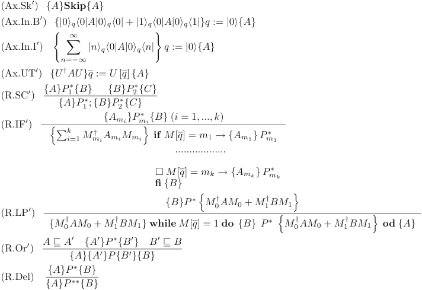

(Ax . Sk ′ ) {A} Skip {A} (Ax . In . B ′ ) {| 0 ⟩q⟨ 0 |A| 0 ⟩q⟨ 0 |  +  | 1 ⟩q⟨ 0 |A| 0 ⟩q⟨ 1 |}q :=  | 0 ⟩{A} ∞ (Ax . In . I ′ ) � |n⟩q⟨ 0 |A| 0 ⟩q⟨n| q :=  | 0 ⟩{A} � n = −∞ � (Ax . UT ′ ) {U † AU }q :=  U [ q ]  {A} {A}P 1 ∗{B} {B}P 2 ∗{C} (R . SC ′ ) {A}P 1 ∗ ;  {B}P 2  ∗{C} {Ami}Pm ∗ i {B} ( i  = 1 , ..., k ) (R . IF ′ ) �� ik =1 M † mi Am i Mm i � if M [ q ]  =  m 1 →{Am 1 } Pm ∗ 1 .................. □ M [ q ]  =  mk →{Amk } Pm ∗ k fi  {B} {B}P ∗ � M 0 †AM 0 +  M † 1 BM 1 � (R . LP ′ ) {M 0 †AM 0 +  M † 1 BM 1 }  while  M [ q ]  = 1  do {B} P ∗ � M 0 †AM 0 +  M † 1 BM 1 � od  {A} A ⊑ A ′ {A ′ }P ∗ {B ′ } B ′ ⊑ B (R . Or ′ ) {A}{A ′ }P {B ′ }{B} {A}P ∗ {B} (R . Del) {A}P ∗∗ {B} 

**Fig. 4.** Formation Axioms and Rules for Partial Correctness of Quantum **while** -Programs. In (R.IF’), { _m_ 1 _, . . . , mk_ } is the set of all possible outcomes of measurement _M_ . In (R.Del), _S_∗∗ is obtained by deleting some quantum predicates from _S_∗

**Example 10 (Teleportation)** Quantum teleportation is a protocol that can send quantum states only using a classical communication channel. Suppose that Alice possesses two qubits _p, q_ and Bob possesses qubit _r_ , and there is entanglement, i.e. the EPR (Einstein–Podolsky–Rosen) pair:

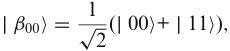

1 |  β 00⟩� (| 00⟩+ | 11⟩) , √ 2 

between _q_ and _r_ . Then Alice can send a quantum state | _ψ_ ⟩� _α_ | 0⟩ + _β_ | 1⟩ to Bob, i.e. from _p_ to _r_ , by two-bit classical communication (for detailed description, see [NC00], Section 1.3.7). This protocol can be written as quantum program QTEL in Fig. 5. The correctness of QTEL can be described as the Hoare triple:

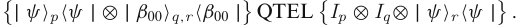

�|  ψ ⟩ p ⟨ ψ | ⊗|  β 00⟩ q,r ⟨ β 00 |� QTEL � Ip ⊗ Iq ⊗|  ψ ⟩ r ⟨ ψ |� . 

A proof outline for the correctness of QTEL is also presented in Fig. 5.

We can define the notion of subprogram of a quantum program in a familiar way; namely by induction on the length of the program. Then a special form of proof outline is defined in the following:

**Definition 8** A proof outline { _A_ } _P_∗ { _B_ } of _P_ is called standard if every subprogram _Q_ of _P_ is proceeded by exactly one quantum predicate, denoted _pre_ ( _Q_ ), in _P_∗ .

The next proposition shows that standard proof outlines are indeed sufficient for reasoning about correctness of quantum programs.

- **Proposition 1** 1. If { _A_ } _P_∗ { _B_ } is a proof outline for partial correctness (respectively, total correctness), then ⊢ _q P D_ { _A_ } _P_ { _B_ } (respectively, ⊢ _qT D_ { _A_ } _P_ { _B_ }).

2. If ⊢ _q P D_ { _A_ } _P_ { _B_ } (respectively, ⊢ _qT D_ { _A_ } _P_ { _B_ }), then there is a standard proof outline { _A_ } _P_∗ { _B_ } for partial correctness (respectively, total correctness).

M. Ying

_{|ψ⟩p⟨ψ| ⊗|β_ 00 _⟩q,r⟨β_ 00 _|} ⊑{|β_ 00 _⟩p,q⟨β_ 00 _| ⊗|ψ⟩r⟨ψ|_ + _|β_ 10 _⟩p,q⟨β_ 10 _| ⊗|ψ_ 1 _⟩r⟨ψ_ 1 _|_ + _|β_ 01 _⟩p,q⟨β_ 01 _| ⊗|ψ_ 2 _⟩r⟨ψ_ 2 _|_ + _|β_ 11 _⟩p,q⟨β_ 11 _| ⊗|ψ_ 3 _⟩r⟨ψ_ 3 _|}_ QTEL _≡ p, q_ := CNOT[ _p, q_ ]; _{|_ + _⟩p⟨_ + _| ⊗|_ 0 _⟩q⟨_ 0 _| ⊗|ψ⟩r⟨ψ|_ + _|−⟩p⟨−| ⊗|_ 0 _⟩q⟨_ 0 _| ⊗|ψ_ 1 _⟩r⟨ψ_ 1 _|_ + _|_ + _⟩p⟨_ + _| ⊗|_ 1 _⟩q⟨_ 1 _| ⊗|ψ_ 2 _⟩r⟨ψ_ 2 _|_ + _|−⟩p⟨−| ⊗|_ 1 _⟩q⟨_ 1 _| ⊗|ψ_ 3 _⟩r⟨ψ_ 3 _|} p_ := _H_ [ _p_ ]; _{|_ 0 _⟩p⟨_ 0 _| ⊗|_ 0 _⟩q⟨_ 0 _| ⊗|ψ⟩r⟨ψ|_ + _|_ 1 _⟩p⟨_ 1 _| ⊗|_ 0 _⟩q⟨_ 0 _| ⊗|ψ_ 1 _⟩r⟨ψ_ 1 _|_ + _|_ 0 _⟩p⟨_ 0 _| ⊗|_ 1 _⟩q⟨_ 1 _| ⊗|ψ_ 2 _⟩r⟨ψ_ 2 _|_ + _|_ 1 _⟩p⟨_ 1 _| ⊗|_ 1 _⟩q⟨_ 1 _| ⊗|ψ_ 3 _⟩r⟨ψ_ 3 _|}_ **if** _M_ [ _q_ ] = 0 _→{|_ 0 _⟩p⟨_ 0 _| ⊗ Iq ⊗|ψ⟩r⟨ψ|_ + _|_ 1 _⟩p⟨_ 1 _| ⊗ Iq ⊗|ψ_ 1 _⟩r⟨ψ_ 1 _|}_ **skip** □ 1 _→{|_ 0 _⟩p⟨_ 0 _| ⊗ Iq ⊗|ψ_ 2 _⟩r⟨ψ_ 2 _|_ + _|_ 1 _⟩p⟨_ 1 _| ⊗ Iq ⊗|ψ_ 3 _⟩r⟨ψ_ 3 _|} r_ := _X_ [ _r_ ] **fi** ; _{|_ 0 _⟩p⟨_ 0 _| ⊗ Iq ⊗|ψ⟩r⟨ψ|_ + _|_ 1 _⟩p⟨_ 1 _| ⊗ Iq ⊗|ψ_ 1 _⟩r⟨ψ_ 1 _|}_ **if** _M_ [ _p_ ] = 0 _→{Ip ⊗ Iq ⊗|ψ⟩r⟨ψ|}_ **skip** □ 1 _→{Ip ⊗ Iq ⊗|ψ_ 1 _⟩r⟨ψ_ 1 _|} r_ := _Z_ [ _r_ ] **fi** _{Ip ⊗ Iq ⊗|ψ⟩r⟨ψ|}_

**Fig. 5.** Quantum teleportation program and correctness proof outline. (1) Quantum states: | _ψ_ 1⟩� _α_ | 0⟩− _β_ | 1⟩, | _ψ_ 2⟩� _β_ | 0⟩ + _α_ | 1⟩, | _ψ_ 3⟩�− _β_ | 0⟩ + _α_ | 1⟩. (2) Entangled states: | _β_ 01 � ~~√~~ <u>12</u>(| 01⟩+ | 10⟩, |_β_10� ~~√~~ <u>12</u>(| 00⟩−| 11⟩, |_β_01� ~~√~~ <u>12</u>(| 01⟩−| 10⟩. (3) Measurement in the computational basis: _M_ �{ _M_ 0 _, M_ 1}, where _M_ 0 �| 0⟩⟨0 |, _M_ 1 �| 1⟩⟨1 |

_Proof_ Induction on the lengths of proof and formation.

2 

As in classical programming, another usage of proof outline is that it enables us to establish a strong soundness of quantum Hoare logic. To this end, we need the following:

**Definition 9** Let _P_ be a quantum **while** -program and _T_ a subprogram of _P_ . Then _at_ ( _T , P_ ) is inductively defined as follows:

1. If _T_ ≡ _P_ , then _at_ ( _T , P_ ) ≡ _P_ ;

2. If _P_ ≡ _P_ 1; _P_ 2, then _at_ ( _T , P_ ) ≡ _at_ ( _T , P_ 1); _P_ 2 when _T_ is a subprogram of _P_ 1, and _at_ ( _T , P_ ) ≡ _at_ ( _T , P_ 2) when _T_ is a subprogram of _P_ 2;

3. If _P_ ≡ **if** (□ _m_ · _M_ ~~[~~ _<u>q</u>_ ~~]~~ � _m_ → _Pm_ ) **fi** , then for each _m_ , whenever _T_ is a subprogram of _Pm_ , _at_ ( _T , P_ ) ≡ _at_ ( _T , Pm_ );

4. If _P_ ≡ **while** _M_ ~~[~~ _<u>q</u>_ ~~]~~ � 1 **do** _P_′ **od** and _T_ is a subprogram of _P_′ , then _at_ ( _T , P_ ) ≡ _at_ ( _T , P_′ ); _P_ .

Intuitively, _at_ ( _T , P_ ) denotes the remainder of _P_ to be executed when the control is at subprogram _T_ .

Definitions 7–9 are straightforward generalisations of the corresponding concepts for classical programs (see for example [ABO09], Section 3.4). However, the strong soundness (Theorem 3.3 in [ABO09]) cannot be straightforwardly generalised to the quantum case. To present the strong soundness for quantum programs, we also need to extend the transition relation between configurations given in Definition 2 to a transition relation between configuration ensembles. We define a configuration ensemble as a multi-set {| ⟨ _Pi , ρi_ ⟩|} of configurations with

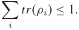

� tr ( ρi ) ≤ 1 . i 

For simplicity, we identify a singleton {| ⟨ _P , ρ_ ⟩|} with the configuration ⟨ _P , ρ_ ⟩.

**Definition 10** The transition relation between configuration ensembles is of the form:

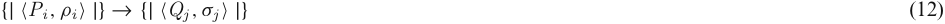

{| ⟨ Pi , ρi ⟩|} →{| ⟨ Qj , σj  ⟩|} (12) 

and defined by rules (Sk), (In), (UT), (SC) in Fig. 1 together with the rules presented in Fig. 6.

Now we are ready to present the strong soundness of the quantum Hoare logic.

Toward automatic verification of quantum programs

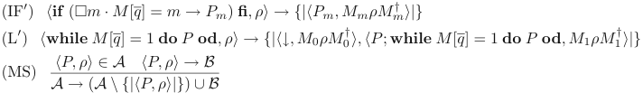

(IF ′ ) ⟨ if (□ m · M [ q ]  =  m → Pm )  fi , ρ⟩→{|⟨Pm, MmρMm † ⟩|} (L ′ ) ⟨ while  M [ q ]  = 1  do  P od , ρ⟩→{|⟨↓, M 0 ρM 0 †⟩, ⟨P ;  while  M [ q ]  = 1  do  P od , M 1 ρM 1 †⟩|} ⟨P, ρ⟩ ∈A ⟨P, ρ⟩ →B (MS) A → ( A \ {|⟨P, ρ⟩|} )  ∪B 

**Fig. 6.** Extended transition rules for quantum **while** -programs. In (MU), _A, B_ are configuration ensembles

**Theorem 2 (** Strong Soundness) Let { _A_ } _P_∗ { _B_ } be a standard proof outline for partial correctness. If

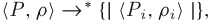

⟨ P , ρ ⟩→ ∗ {| ⟨ Pi , ρi ⟩|} , 

then:

1. for each _i_ , _Pi_ ≡ _at_ ( _Ti , P_ ) for some subprogram _Ti_ of _P_ or _Pi_ ≡↓; and 2. _tr_ ( _Aρ_ ) ≤� _i__tr_(_Biρi_), where

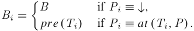

if Pi ≡↓ , Bi � � Bpre  ( Ti ) if Pi ≡ at  ( Ti , P )  . 

_Proof_ See Appendix C.1. _2_

A difference between the above theorem and the strong soundness for classical **while** -programs (see [ABO09], Theorem 3.3) should be noticed. The summation in the right-hand side of the inequality in clause 2 of the above theorem indicates that we have to consider all the reached programs _Pi_ collectively in the quantum case. The reason behind it is that certain nondeterminism is introduced in the operational semantics of case statements and **while** -loops in quantum computation.

## 5. Auxiliary axioms and rules

Several auxiliary axioms and rules introduced in [Gor75, Har79] (see also [ABO09], Section 3.8) are very useful for simplifying the presentation of correctness proofs of classical programs. In this section, we generalise some of them into the quantum case. For this purpose, we first introduce several notations. Let _X_ ⊆ _Y_ ⊆ _Var_ , and let _A_ be an operator in

HX � � Hq . q ∈ X 

Then operator:

cl Y  ( A ) � A  ⊗ IHY  \ X 

is called the cylindric extension of _A_ in _HY_ . If _X , Y_ ⊆ _Var_ and _X_ ∩ _Y_ �∅. Then partial trace _tr Y_ is a mapping from operators in _HX_ ∪ _Y_ to operators in _HX_ defined by

tr Y  (|  ϕ ⟩⟨ ψ | ⊗|  ϕ ′ ⟩⟨ ψ ′ |) �⟨ ψ ′ |  ϕ ′ ⟩· |  ϕ ⟩⟨ ψ | 

for every | _ϕ_ ⟩ _,_ | _ψ_ ⟩ in _HX_ and | _ϕ_′ ⟩ _,_ | _ψ_′ ⟩ in _HY_ .

Now we can present the auxiliary axioms and rules for quantum programs in Fig. 7.

It is interesting to compare our auxiliary axioms and rules for quantum programs with those for classical programs:

- The appearance of axiom (Ax.Inv) is the same as axiom (INVARIANCE) in Section 3.8 of [ABO09].

- Obviously, rule (R.SO) is quantum generalisations of rule (SUBSTITUTION) in [ABO09], with the substitution _<u>z</u>_ :� _t_ being replaced by an arbitrary super-operator _E_ .

- It is easy to see that rules (R.CC) and (R.Inv) are generalisations of rules (CONJUNCTION) and (INVARIANCE), respectively, in [ABO09], with logical conjunction being replaced by a probabilistic (convex) combination.

- It is more interesting to note that rule (R.TI) is a quantum generalisation of two rules (DISJUNCTION) and (∃-INTRODUCTION) in [ABO09], where partial trace is considered as a quantum counterpart of logical disjunction and existence quantifier.

M. Ying

(Ax . Inv) {A} P {A} {A}P {B} (R . TI) {tr W A} P {B} {Ai} P {Bi} ( i  = 1 , ..., m ) (R . CC) { � m i =1 piAi} P { � m i =1 piBi} {A}P {B} (R . Inv) {pA  +  qC}P {pB  +  qC} {A}P {B} (R . SO) {E ∗ ( A ) } P {E ∗ ( B ) } lim n→∞ An =  A {An} P {Bn} lim n→∞ Bn =  B (R . Lim) {A}P {B} 

**Fig. 7.** Auxiliary axioms and rules. In (Ax.Inv), _var_ ( _P_ ) ∩ _V_ �∅ and _A_ � _clV_ ∪ _var_ ( _P_ )( _B_ ) for some _V_ ⊆ _Var_ and for some quantum predicate _B_ in _HV ._ In (R.TI), _V , W_ ⊆ _Var , V_ ∩ _W_ �∅ _, A, B_ are quantum predicates in _HV_ ∪ _W_ and _HV ,_ respectively, and _var_ ( _P_ ) ⊆ _V ._ In (R.CC), _pi_ ≥ 0 ( _i_ � 1 _, . . . , m_ ) and�_m_ _i_ �1_pj_≤1_._In (R.Inv),_p, q_≥0,_p_+_q_≤1, and_C_is a quantum predicate in_HV_for some_V_⊆_Var_ with _V_ ∩ _var_ ( _P_ ) �∅. In (R.SO), _E_ is a quantum operation (or super-operator) in _HV_ for some _V_ ⊆ _Var_ with _V_ ∩ _var_ ( _P_ ) �∅. In (R.Lim), { _An_ } and { _Bn_ } are increasing and decreasing, respectively sequences with respect to the L¨owner order

The following theorem establishes soundness of the auxiliary axioms and rules in Fig. 7.

**Theorem 3** 1. The axiom (Ax.Inv) is sound for partial correctness. 2. The rules (R.TI), (R.CC), (R.Inv), (R.SO) and (R.Lim) are sound both for partial and total correctness.

_Proof_ See Appendix C.2

2 

Before concluding this section, let us see a simple example to show how the auxiliary axioms and rules can be used to derive some new properties of a quantum program.

**Example 11** Let _q_ be a qubit variable. Then by (Ax.UT) in Fig. 3 we obtain:

{| −⟩⟨−|}  q :� H  [ q ] {| 1⟩⟨1 |} (13) 

where _H_ is the Hadamard gate and | −⟩� ~~√~~ <u>12</u>(|0⟩−|1⟩).Therule(R.SO)inFig.7isespeciallyusefulfor reasoning about quantum computation with noise. The amplitude damping channel is an important type of quantum noise where energy is lost from a quantum system with a certain probability _γ_ . It can be modelled by quantum operation:

E ( ρ ) � E 0 ρE 0 +  E 1 ρE 1 

for any density operator _ρ_ , where

E 0 � 0 , E 1 � 1 √ γ . � 01 √ 1 − γ � � 0 0 � Then applying (R.SO) to (13) yields:13) yields:) yields: √ 1 − γ | 0⟩⟨0 | − (| 0⟩⟨1 | + | 1⟩⟨0 |) + 1 − γ | 1⟩⟨1 | q :� H  [ q ] { γ | 0⟩⟨0 | +(1 − γ  ) | 1⟩⟨1 |}  . � 1 +2 γ 2 2 � 

Then applying (R.SO) to (13) yields:13) yields:) yields:

## 6. Mechanising quantum program verification

Proving correctness of classical programs using Hoare logic is very fiddly and tedious. As we saw from the example given in Fig. 5, it is even worse to prove correctness of quantum programs because a huge amount of vector and matrix calculations is involved. Thus, automatic tools will be very helpful.

Similar to the case of classical programs, a verifier can prove the correctness:

⊢ _par_ { _A_ } _P_ { _B_ } (or ⊢ _tot_ { _A_ } _P_ { _B_ })

of a quantum program _P_ in the following three steps:

Toward automatic verification of quantum programs

- _Annotating the program_ : insert quantum predicates at the intermediate points (in a way similar to a proof outline described in Sect. 4). Intuitively, an inserted statement is intended to hold when the control reaches the corresponding point.

- _Generating verification conditions (VCs)_ : a set of mathematical statements, usually of the form _Ai_ ⊑ _Bi_ (see Lemma 1), is generated from the annotated program, where _Ai , Bi_ are matrices, and ⊑ stands for the L¨owner order. It is required that if all the generated VCs are true, then ⊢ _par_ { _A_ } _P_ { _B_ } (or ⊢ _tot_ { _A_ } _P_ { _B_ }).

- _Proving VCs_ : prove that matrix _Bi_ − _Ai_ is positive semi-definite for each VC _Ai_ ⊑ _Bi_ .

Recently, a theorem prover was built by Liu, Li, Wang et al. in [LLW16] for the quantum Hoare logic based on the proof assistant Isabelle/HOL. It has been used to verify several quantum programs, including Grover search and phase estimation, which is a key in Shor’s factoring algorithm. We can expect that more automatic tools for verification of quantum programs and quantum cryptographic protocols will be built after quantum computers be commercialised.

## 7. Invariants of quantum programs

It has been well-understood since the very beginning that invariant generation is crucial for automatic verification of programs, and the problem of invariant generation has been intensively studied for classical programs. At this moment, invariants are provided by humans to the theorem prover for quantum programs developed in [LLW16] rather than generated by the system itself. But the issue of generating quantum invariants was recently considered in [YYW17]. In this section, we briefly review the main results in [YYW17].

We first observed that the control flow of a quantum program can be represented by a super-operator-valued transition system (SVTS):

**Definition 11 (** _Super-Operator-Valued Transition Systems_ **[YYW17])** An SVTS is a 5-tuple:

S �⟨ H, L, l 0 , T , � ⟩ , 

where:

1. _H_ is a Hilbert space;

2. _L_ is a finite set of locations;

3. _l_ 0 ∈ _L_ is the initial location;

4. _�_ is a quantum predicate in _H_ denoting the initial condition; and

5. _T_ is a set of transitions. Each transition _τ_ ∈ _T_ is written as _τ_ � _l_ → _E l_ ′ with _l , l_ ′ ∈ _L_ and _E_ being a super-operator in _H_ . For each _l_ ∈ _L_ , it is required that

El � �{|  E :  l → E l ′ ∈ T |} 

is trace-preserving, i.e. _tr_ ( _El_ ( _ρ_ )) � _tr_ ( _ρ_ ) for all _ρ_ .

Now we assume that the control flow SVTS of quantum program _P_ is _SP_ with state Hilbert space _HP_ (see [YYW17] for detailed construction of _SP_ ). A set _�_ of paths in _HP_ is said to be prime if for each

E 1 En −1 π � l 1 →· · · → ln ∈ �, 

its proper initial segments

E 1 Ek −1 l 1 →· · · → lk ̸ ∈ � 

for all _k < n_ . We write _Eπ_ for the composition of _E_ 1 _, . . . , En_ −1 and _E�_ �� {| _Eπ_ : _π_ ∈ _�_ |}. Then we can define invariants for quantum programs:

**Definition 12 (** _Invariants of Quantum Programs_ **[YYW17])** Let _SP_ �⟨ _HP , L, l_ 0 _, T , �_ ⟩ be the control flow SVTS of quantum program _P_ and _l_ ∈ _L_ . An invariant at location _l_ ∈ _L_ is a quantum predicate _O_ in _HP_ satisfying the condition: for any density operator _ρ_ and prime set _�_ of paths from _l_ 0 to _l_ , we have:

tr( _�ρ_ ) ≤ 1 − tr ( _E�_ ( _ρ_ )) + tr ( _OE�_ ( _ρ_ )) _._

M. Ying

It was shown in [YYW17] that invariants can be used to establish partial correctness of quantum programs. We can also introduce the notion of inductive assertion for quantum programs. It is not easy to identify the invariant in the proof rules (R.LP) and (R.LT) for quantum loops, at least not as explicit as in the Hoare rule for classical loops. Example 4.1 in [YYW17] indicates that the quantum predicate _M_ 0†_AM_0 +_M_† 1_BM_1 in rules (R.LP) and (R.LT) can be viewed as an inductive assertion (invariant). Furthermore, by generalising the constraintbased technique of Col´on et al. [CSS03], [SSM04], it was demonstrated in [YYW17] that invariant generation for quantum programs can be reduced to an SDP (Semidefinite Programming) problem. In particular, the method proposed in [YYW17] was actually applied to generate the invariants of the quantum walk in Example 2 and quantum Metropolis sampling [TOVPV11].

## 8. Terminations analysis of quantum programs

As is well-known, termination analysis is a key step in proving total correctness of programs. Termination of quantum programs has been researched along the following two lines:

- Algorithmic analysis of termination for quantum programs was first considered in [YF10] where the Jordan decomposition of complex matrices was employed as the main tool. In [YYFD13], the author and his collaborators introduced quantum Markov chains as a semantic model of quantum programs. Then in a series of their papers [YFYY13], [YY12], [LYY14], termination of quantum programs was reduced to the reachability problem of quantum Markov chains, which is in turn tackled by developing a theory of quantum graphs (see [Yin16], Section 5.2). Indeed, this line of research also paves a way to model-checking quantum systems.

- Thenotionofrankingfunctionwasdefinedin[Yin11]inordertopresenttheproofrule(R.LT)fortotalcorrectness of quantum loops. It was recalled as Definition 6 in this paper. In the last few years, (super)martingales have been employed as a powerful mathematical tools for termination analysis of probabilistic programs [CS13], [FH15], [CFNH16]. Recently, a notion of quantum (super)martingales was introduced in [LY18] as a generalisation of Definition 6 and used to characterise the termination of quantum programs. The synthesis problem of (super)martingales for quantum programs was also investigated there. The basic idea is that the fundamental Gleason theorem [Gle57] in quantum foundations can be used to determine the template of ranking functions, and then the synthesis problem of quantum (super)martingales with certain templates can also be reduced to an SDP problem. It seems that a further development of this line of research requires us to systematically establish a mathematical theory of quantum (super)martingales first.

The termination of the quantum walk in Example 2 was analysed by both of the above approaches [YYFD13, LY18], and the second approach was also used in [LY18] to analyse the termination of quantum Bernoulli factory, a quantum algorithm for random number generation [DJR15].

## 9. Conclusion

We conclude this paper by pointing out several problems for future research:

- _Combining Classical Computation and Quantum Computation_ : We have been focusing on pure quantum programs without classical computation. This allows us to have a clean theory of quantum programming. But almost all existing quantum algorithms involves both quantum and classical computation, and the state-of-art quantum programming languages like Quipper [GLR13], LIQUi|> [WS14], Q# [SGT18], Scaffold [JPK15] and QWire [PRZ17] include both classical and quantum variables. So, it is desirable to generalise the verification techniques discussed in this paper to quantum programs involving classical computation. Indeed, a kind of correctness formulas (Hoare triples) involving both classical and quantum variables were already introduced in [YF11], but a Hoare-like logic for programs with both classical and quantum variables is still to be developed.

- _Parallel and Distributed Quantum Programs_ : Distributed quantum computing has been studied for 20 years since [Gro97] and [CB97], including finding quantum algorithms for solving paradigmatic problems from classical distributed computing [TKM05], experiments toward physical implementation of distributed quantum computing [SMB06] and architecture of distributed quantum hardware systems [MMN08]. In particular, since practical quantum computers with large qubit capacity are still out of the current technology’s reach, it is an attractive idea to use the physical resources of two or more small-capacity quantum computers to realise a large-capacity quantum computing system. So, another interesting problem is how the program logic and related techniques considered in this paper can be extended for reasoning about parallel and distributed

Toward automatic verification of quantum programs

quantum programs. The notion of proof outline for quantum programs introduced in Sect. 4 should be helpful in dealing with the (non)interference of the variables shared by component quantum programs.

- _Verification of Quantum Cryptographic Protocols_ : Over the last 10 years, quantum communication has blossomed into a viable commercial technology. But verifying correctness and security of quantum communication protocols is a notoriously difficult problem. Process algebra approach has been introduced for verification of quantum cryptographic protocols [AGN14, FY15, KKK16]. On the other hand, a (probabilistic) relational Hoare logic (pRHL) and a machine-checked framework for reasoning about security and privacy in classical computing and communicating systems were established by Barthe et al. [BFG14, BKO13]. The success of this line of research suggests us to develop verification techniques for quantum cryptographic protocols by extending our quantum Hoare logic. Indeed, the first attempt to develop a quantum relational Hoare logic (qRHL) was already made by Unruh [Unruh18], where a tool for the verification based on qRHL was implemented and successfully used to the security proof of several quantum cryptographic protocols.

## Acknowledgements

The author likes to thank Professors Martin Fr¨anzle, Deepak Kapur and Naijun Zhan for inviting me to give a talk at SETTA’2016. This work was partly supported by the Australian Research Council (Grant No: DP160101652) and the Key Research Program of Frontier Sciences, Chinese Academy of Sciences.

## A. Basic properties of operators in Hilbert spaces

For convenience of the reader, we first review some basic properties of operators and super-operators needed in the proofs presented in Appendix C. The following lemma gives a characterisation of the L¨owner order in terms of trace.

**Lemma 2** Let _A, B_ be observables (i.e. Hermitian operators) in Hilbert space _H_ . Then _A_ ⊑ _B_ if and only if _tr_ ( _Aρ_ ) ≤ _tr_ ( _B ρ_ ) for all density operators in _H_ .

Thenotionofdualsuper-operatorisintroducedinthenextdefinition.ItwillbeextensivelyusedinAppendix C.

**Definition 13** Let _E_ be a quantum operation (i.e. super-operator) in Hilbert space _H_ with the Kraus representation _E_ �� _i__Ei_◦_E_† _i_. Then its (Schr¨odinger–Heisenberg) dual is the super-operator_E_∗defined by

E ∗ ( A ) � � Ei † AEi i 

for any observable _A_ in _H_ .

The next lemma presents a characterisation of duality between super-operators in terms of trace.

**Lemma 3** For any quantum operation _E_ , observable _A_ and density operator _ρ_ in _H_ , we have:

tr ( AE ( ρ )) � tr ( E ∗ ( A ) ρ ) . 

In particular, _tr_ ( _E_ ( _ρ_ )) � _tr_ ( _E_∗ ( _I_ ) _ρ_ ), where _I_ is the identity operator in _H_ .

Positivity of operators and the L¨owner order between operators in a tensor product of Hilbert spaces are considered in the following:

- **Lemma 4** 1. If _A_ 1 _, A_ 2 are positive operators in _H_ 1 and _H_ 2, respectively, then _A_ 1 ⊗ _A_ 2 is a positive operator in _H_ 1 ⊗ _H_ 2.

2. For any operators _A_ 1 _, B_ 1 in _H_ 1 and _A_ 2 _, B_ 2 in _H_ 2, _A_ 1 ⊑ _B_ 1 and _A_ 2 ⊑ _B_ 2 implies _A_ 1 ⊗ _A_ 2 ⊑ _B_ 1 ⊗ _B_ 2 _._

The proofs of all of the above lemmas can be found in any standard textbook on the theory of operators in Hilbert spaces.

M. Ying

## B. Compositions of quantum relations

In Sect. 3, we already saw some simple quantum relations (i.e. quantum predicates in the tensor product of more than one state Hilbert spaces) in specifying correctness of quantum programs. The notion of composition of classical relations is well-defined and widely used to construct complicated relations from simple ones. However, it is highly nontrivial to find an appropriate definition of the notion of composition of quantum relations. Here, we give several tentative definitions:

**Definition 14** Let _A_ be a quantum relation between _H_ 1 and _H_ 2 (i.e. an observable in _H_ 1 ⊗ _H_ 2 between the zero and identity operators) and _B_ a quantum relation between _H_ 2 and _H_ 3. We define three kinds of their compositions:

1. Circle composition:

A  ◦ B B � 1 �⟨ ii |  A  ⊗ B |  ii ⟩ d 2 i 

where and in the sequel _d_ 2 � dim _H_ 2 and _B_ �{| _i_ ⟩} is an orthonormal basis of _H_ 2.

2. Bullet composition:

_A_ • _B B_ �⟨ _�_ | _A_ ⊗ _B_ | _�_ ⟩

where | _�_ ⟩ _B_ � ~~√~~ <u>1</u> _d_ 2 � _i_|_ii_⟩isthe(unnormalised)maximalentanglementdefinedbyanorthonormalbasis _B_ �{| _i_ ⟩} of _H_ 2.

3. Diamond composition:

A  ⋄ v B � tr H 2⊗2 [ Sv ( A  ⊗ B ) Sv ] 

where _v_ ∈{+ _,_ −}, _S_ ± are the symmetrisation and anti-symmetrisation operators (see Example 6), and _tr H_ 2⊗2 stands for tracing out the middle two _H_ 2’s in _H_ 1 ⊗ _H_ 2 ⊗ _H_ 2 ⊗ _H_ 3.

The algebraic structure of quantum relations equipped with the above composition operations and corresponding transitive closures is a very interesting topic for future research.

## C. Proofs of Theorems

In this section, we provide the proofs of theorems omitted in the main part of this paper.

### C.1. Proof of Theorem 2

To prove the strong soundness, suppose that

⟨ P , ρ ⟩→ n {| ⟨ Pi , ρi ⟩|} . 

We proceed by induction on the length _n_ of computation.

**Induction Basis** : For _n_ � 0, {| ⟨ _Pi , ρi_ ⟩|} is a singleton {| ⟨ _P_ 1 _, ρ_ 1⟩|} with _P_ 1 ≡ _P_ and _ρ_ 1 ≡ _ρ_ . Then we can choose _T_ 1 ≡ _P_ and it holds that _P_ 1 ≡ _at_ ( _T_ 1 _, P_ ). Note that in the proof outline { _A_ } _P_∗ { _B_ }, we have _A_ ⊑ _pre_ ( _P_ ) � _B_ 1. Thus,

tr ( Aρ ) ≤ tr ( B 1 ρ 1) � � tr ( Bi ρi ) . i 

**Induction Step** : Now we assume that

⟨ P , ρ ⟩→ n −1 {| ⟨ Pi , ρi ⟩|} →{| ⟨ Pi , ρi ⟩|  i ̸ � i 0 |} ∪{| ⟨ Qj , σj  ⟩|} 

where

⟨ Pi 0 , ρi 0 ⟩→{| ⟨ Qj , σj  ⟩|} 

Toward automatic verification of quantum programs

is derived by one of the rules used in defining transition relation (12). Then we need to consider the following cases:

▶ Case 1. The last step uses rule (IF′ ). Then _Pi_ 0 can be written in the following form:

Pi 0 ≡ if (□ m  ·  M [ q ]  � m → Rm ) fi , 

and for each _j_ , _Qj_ ≡ _Rm_ ≡ _at_ ( _Rm , P_ ) and _σj_ � _Mm ρi_ 0 _Mm_†for some_m_. On the other hand, a segment of the proof outline { _A_ } _P_∗ { _B_ } must be derived by the following inference:

{ Am } Rm ∗ { C } for every  m �� m M  † m Am Mm � if � □ m  ·  M [ q ]  � m →{ Am }  Rm ∗ � fi { C } 

and

Bi 0 � pre  ( Pi 0 ) ⊑ � Mm † Am Mm , Am � pre  ( Rm )  . m 

Therefore,

tr  ( Bi 0 ρi 0 ) ≤ tr Mm † Am Mm ρi 0 �� m � � � tr � Mm † Am Mm ρi 0 � m � � tr � Am Mm ρi 0 Mm † � m � � tr � pre � Qj � σj � . j 

By the induction hypothesis, we obtain:

tr ( Aρ ) ≤ � tr  ( Bi ρi ) +  tr  ( Bi 0 ρi 0 ) i ̸� i 0 ≤ � tr  ( Bi ρi ) + � tr � pre � Qj � σj � . i ̸� i 0 j 

So, the conclusion is true in this case.

▶ Case 2. The last step uses rule (L′ ). Then _Pi_ 0 must be in the following form: _Pi_ 0 ≡ **while** _M_ ~~[~~ _<u>q</u>_ ~~]~~ � 1 **do** _R_ **od**

and

{| ⟨ Qj , σj  ⟩|} �{| ⟨ Q 0 , σ 0⟩ ,  ⟨ Q 1 , σ 1⟩|} 

with _Q_ 0 ≡ **skip** _, σ_ 0 � _M_ 0 _ρi_ 0 _M_ 0†_, Q_1≡_R_;_Pi_ 0and_σ_1�_M_1_ρi_ 0_M_† 1. A segment of {_A_}_P_∗{_B_} must be derived by the following inference:

{ D } R ∗ { M 0 CM 0 † +  M 1 DM  † 1 } { M 0 CM 0 † +  M 1 DM  † 1 }  while  M [ q ]  � 0  do  { C }  skip  { C } � 1  do  R ∗ { M 0 CM 0 † +  M 1 DM  † 1 }  od  { C } 

and Bi 0 ⊑ M 0 CM 0 † +  M 1 DM  † 1 . Then Q 0 ≡ at ( skip , P ) , pre ( Q 0) � C , Q 1 ≡ at ( R, P ) and pre ( Q 1) � D . It follows that tr  ( Bi 0 ρi 0 ) ≤ tr �� M 0 CM 0 † +  M 1 DM  † 1 � ρi 0 � � tr M 0 CM 0 † ρi 0 +  tr M 1 DM 1 † ρi 0 � � � � 

M. Ying

� tr CM 0 † ρi 0 M 0 +  tr DM 1 † ρi 0 M 1 � � � � 

� tr  ( pre ( Q 0) σ 0) +  tr  ( pre ( Q 1) σ 1)  . 

Furthermore, by the induction hypothesis, we have:

tr ( Aρ ) ≤ � tr  ( Bi ρi ) +  tr  ( Bi 0 ρi 0 ) i ̸� i 0 ≤ � tr  ( Bi ρi ) + � tr � pre � Qj � σj � . i ̸� i 0 j 

Thus, the conclusion is true in this case.

▶ Case 3. The last step uses rule (Sk), (In) or (UT). Similar but easier.

### C.2. Proof of Theorem 3

We only prove the theorem for partial correctness; the case of total correctness is simpler.

1. We first prove that rule (Ax.Inv) is sound for partial correctness. Since _var_ ( _P_ ) ∩ _V_ �∅, � _P_ � can be seen as a super-operator _E_ in _HV__c_ . Then when considering � _P_ � as a super-operator in _H_ , we have:

� P � ∗ ( A ) + � I − � P � ∗ ( I  )� 

- _B_ ⊗ _E_∗ ( _IV__c_ ) + [ _I_ − _IV_ ⊗ _E_∗ ( _IV__c_ )]

- _B_ ⊗ _E_∗ ( _IV__c_ ) + _IV_ ⊗ [ _IV__c_ − _E_∗ ( _IV__c_ )]

- ⊒ _B_ ⊗ _E_∗ ( _IV__c_ ) + _B_ ⊗ [ _IV__c_ − _E_∗ ( _IV__c_ )]

- _B_ ⊗ _IV__c_ � _A_

because _B_ ⊑ _IV__c_ and _E_∗ ( _IV__c_ ) ⊑ _IV__c_ , where _I_ stands for the identity operator in _H_ .

2. Now we prove the soundness of rule (R.TI) for partial correctness. Assume that |� _par_ { _A_ } _P_ { _B_ }. Then it holds that

A  ⊑ � P � ∗ ( B ⊗ IW  ) + ( I − � P � ∗ ( I  )) 

where _I_ is the identity operator in _HV_ ∪ _W_ . Note that _var_ ( _P_ ) ⊆ _V_ . Then we have:

tr W (� P � ∗ ( B ⊗ IW  )) � � P � ∗ ( B ) 

where the occurrences of � _P_ � in the left-hand side and right-hand side are seen as a super-operator in _HV_ ∪ _W_ and one in _HV_ , respectively. Similarly, we have _tr W_ (� _P_ �∗ ( _I_ )) � � _P_ �∗ ( _IV_ ) _._ Therefore, it follows that

_tr W A_ ⊑ _tr W_ � _P_ �∗ ( _B_ ⊗ _IW_ ) + _tr W_ ( _I_ − � _P_ �∗ ( _I_ ))

� � P � ∗ ( B ) + ( IV − � P � ∗ ( IV  )) 

and |� _par_ { _tr W A_ } _P_ { _B_ } _._

3. We prove the soundness of (R.CC) for partial correctness. If for every _i_ � 1 _, . . . , m_ , |� _par_ { _Ai_ } _P_ { _Bi_ }, then by Lemma 1 we have:

Ai ⊑ � P � ∗ ( Bi ) + � I − � P � ∗ ( I  )� . 

Consequently, it holds that

m m � pi Ai ⊑ � pj �� P � ∗ ( Aj ) + [ I − � P � ∗ ( I  )]� i �1 i �1 � � P � ∗ � pi Bi + [ I − � P � ∗ ( I  )] � im �1 � 

Toward automatic verification of quantum programs

because � _P_ �∗ (·) is linear, and _I_ − � _P_ �∗ ( _I_ ) is positive. Thus, we have:

|� par � pi Ai P � pi Bi . � im �1 � � im �1 � 

4. We prove the soundness of (R.Inv) for partial correctness. From |� _par_ { _A_ } _P_ { _B_ }, i.e. _A_ ⊑ � _P_ �∗ ( _B_ ) +

( _I_ − � _P_ �∗ ( _I_ )), we derive that

_pA_ + _qC_ ⊑ _p_ � _P_ �∗ ( _B_ ) + _p_ ( _I_ − � _P_ �∗ ( _I_ ))

� ( _p_ � _P_ �∗ ( _B_ ) + _qC_ ) + _p_ ( _I_ − � _P_ �∗ ( _I_ ))

⊑ ( _p_ � _P_ �∗ ( _B_ ) + _qC_ ) + ( _I_ − � _P_ �∗ ( _I_ )) � � _P_ �∗ ( _pB_ + _qC_ ) + ( _I_ − � _P_ �∗ ( _I_ ))

because _p_ ≤ 1 and _V_ ∩ _var_ ( _P_ ) �∅ implies � _P_ �∗ ( _C_ ) � _C_ . Therefore, we have |� _par_ { _pA_ + _qC_ } _P_ { _pB_ + _qC_ }.

5. We prove that rule (R.SO) is sound for partial correctness. Suppose that |� _par_ { _A_ } _P_ { _B_ }, i.e. _A_ ⊑ � _P_ �∗ ( _B_ )+ ( _I_ − � _P_ �∗ ( _I_ )). Note that _E_ is a super-operator in _HV_ and _V_ ∩ _var_ ( _P_ ) �∅. Then _E_∗ and � _P_ �∗ commutes, i.e. _E_∗ ◦ � _P_ �∗ � � _P_ �∗ ◦ _E_∗ . Moreover, it holds that _E_∗ ( _I_ ) ⊑ _I_ and thus

( _I_ − � _P_ �∗ ) ( _E_∗ ( _I_ )) ⊑ ( _I_ − � _P_ �∗ ) ( _I_ )

where _I_ is the identity super-operator. Therefore, we obtain:

E ∗ ( A ) ⊑ E ∗ � � P � ∗ ( B ) + ( I − � P � ∗ ( I  ))� � E ∗ (� P � ∗ ( B )) + � E ∗ ( I  ) − E ∗ (� P � ∗ ( I  ))� 

� � _P_ �∗ ( _E_∗ ( _B_ )) + ( _I_ − � _P_ �∗ ) ( _E_∗ ( _I_ )) ⊑ � _P_ �∗ ( _E_∗ ( _B_ )) + ( _I_ − � _P_ �∗ ) ( _I_ )

� � _P_ �∗ ( _E_∗ ( _B_ )) + ( _I_ − � _P_ �∗ ( _I_ ))

and |� _par_ { _E_∗ ( _A_ )} _P_ { _E_∗ ( _B_ )}.

6. Finally, we prove the soundness of (R.Lim) for partial correctness. The existence of lim _n_ →∞ _An_ and

lim _n_ →∞ _Bn_ is guaranteed by Lemma 4.1.3 in [Yin16]. Assume that |� _par_ { _An_ } _P_ { _Bn_ }. Then

An ⊑ � P � ∗ ( Bn ) + � I − � P � ∗ ( I  )� 

and the continuity of super-operator � _P_ �∗ yields:

A  � n lim→∞ An ⊑ n lim →∞ �� P � ∗ ( Bn ) + � I − � P � ∗ ( I  )�� � � P � ∗ ( n lim→∞ Bn ) + � I − � P � ∗ ( I  )� � � P � ∗ ( B ) + � I − � P � ∗ ( I  )� . 

Thus, |� _par_ { _A_ } _P_ { _B_ }.

## References

- [AG05] Altenkirch T, Grattage J (2005) A functional quantum programming language. In: Proceedings of the 20th IEEE symposium on logic in computer science (LICS), pp 249–258

- [ABNVW01] Ambainis A, Bach E, Nayak A, Vishwanath A, Watrous J (2001) One-dimensional quantum walks. In: Proceedings of the 33rd ACM symposium on theory of computing (STOC), pp 37–49

- [ABO09] Apt KR, de Boer FS, Olderog E-R (2009) Verification of sequential and concurrent programs. Springer, London

- [AGN14] Ardeshir-Larijani E, Gay SJ, Nagarajan R (2014) Verification of concurrent quantum protocols by equivalence checking. In: Proceedings of the 20th international conference on tools and algorithms for the construction and analysis of systems (TACAS), pp 500–514

- [BS06] Baltag A, Smets S (2006) LQP: the dynamic logic of quantum information. Math Struct Comput Sci 16:491–525

- [BFG14] Barthe G, Fournet C, Gr´egoire B, Strub P-Y, Swamy N, Zanella B´eguelin S (2014) Probabilistic relational verification for cryptographic implementations. In: Proceedings of the 41st annual ACM symposium on principles of programming languages (POPL), pp 193–206

M. Ying

|[BKO13]|Barthe G, K¨opf B, Olmedo F, Zanella B´eguelin Z (2013) Probabilistic relational reasoning for differential privacy. In: ACM transactions on rorammin lanuaes and sstems vol 35 No 9|
|---|---|
|[BJ04] [CMS06]|pgg gg  y,  , . Brunet O, Jorrand P (2004) Dynamic quantum logic for quantum programs. Int J Quantum Inf 2:45–54 Chadha R, Mateus P, Sernadas A (2006) Reasoning about imperative quantum programs. Electron Notes Theor Comput Sci 158:19–39|
|[CS13]|Chakarov A, Sankaranarayanan S (2013) Probabilistic program analysis with martingales. In: Proceedings of the 25th inter- national conference on computer aided verification (CAV). Springer LNCS 8044, pp 511–526|
|[CFNH16]|Chatterjee K, Fu HF, Novotn´y P, Hasheminezhad R (2016) Algorithmic analysis of qualitative and quantitative termination problems for affine probabilistic programs. In: Proceedings of the 43rd annual ACM symposium on principles of programming languages (POPL), pp 327–342|
|[CB97] [CSS03]| Cleve R, Buhrman H (1997) Substituting quantum entanglement for communication. Phys Rev A 56:1201–1204 Col´on MA, Sankaranarayanan S, Sipma HB (2003) Linear invariant generation using non-linear constraint solving. In: Proceedings of the 15th international conference on computer aided verification (CAV). Springer LNCS, pp 420–433|
|[DJR15] [DP06]|Dale H, Jennings D, Rudolph T (2015) Provable quantum advantage in randomness processing. Nat Commun 6:8203 D’Hondt E, Panangaden P (2006) Quantum weakest preconditions. Math Struct Comput Sci 16:429–451|
|[FDJY07] [FHTZ15]|Feng Y, Duan RY, Ji ZF, Ying MS (2007) Proof rules for the correctness of quantum programs. Theor Comput Sci 386:151–166 Feng Y, Hahn EM, Turrini A, Zhang LJ (2015) QPMC: a model checker for quantum programs and protocols. In: Proceedings of the 20th international symposium on formal methods (FM). Springer LNCS 9109 pp 265–272|
|[FY15]|, Feng Y, Ying MS (2015) Toward automatic verification of quantum cryptographic protocols. In: Proceedings of the 26th international conference on concurrency theory (CONCUR), pp 441–455|
|[FYY13] [FH15]| Feng Y, Yu NK, Ying MS (2013) Model checking quantum Markov chains. J Comput Syst Sci 79:1181–1198 Fioriti LMF, Hermanns H (2015) Probabilistic termination: soundness, completeness, and compositionality. In: Proceedings f h 42d l ACM i  iil f i l POPL  489501|
|[GPN08]|o te n annua  symposum on prncpes o programmng anguages (), pp – Gay SJ, Papanikolaou N, Nagarajan R (2008) QMC: a model checker for quantum systems. In: Proceedings of the 20th international conference on computer aided verification (CAV). Springer LNCS 5123, pp 543–547|
|[Gle57]|Gleason AM (1957) Measures on the closed subspaces of a Hilbert space. J Math Mech 6:885–893|
|[Gor75]| Gorelick GA (1975) A complete axiomatic system for proving assertions about recursive and non-recursive programs. Technical Report, Department of Computer Science, University of Toronto|
|[GLR13]| Green A, Lumsdaine PL, Ross NJ, Selinger P, Valiron B (2013) Quipper: a scalable quantum programming language. In: Proceedings of the 34th ACM conference on programming language design and implementation (PLDI), pp 333–342|
|[Gro97] |Grover LK (1997) Quantum telecomputation.arXiv:quant-ph/9704012 |
|[Har79]|Harel D (1979) First-order dynamic logic, LNCS 68. Springer|
|[KV02] |Den Hartog J, de Vink EP (2002) Verifying probabilistic programs using a Hoare like logic. Int J Found Comput Sci 13:315–340 |
|[Kle99] [KMMM10]|Leymann T (1999) Hoare logic and auxiliary variables. Formal Asp Comput 11:541–566 Katoen J-P, McIver A, Meinicke L, Morgan CC (2010) Linear-invariant generation for probabilistic programs—automated support for proof-based methods. In: Proceedings 17th international symposium on static analysis (SAS). Springer LNCS 6337 pp 390–406|
|[KKK16]|, Kubota T, Kakutani Y, Kato G, Kawano Y, Sakurada H (2016) Semi-automated verification of security proofs of quantum cryptographic protocols J Symb Comput 73:192–220|
|[JPK15]|. JavadiAbhari A, Patil S, Kudrow D, Heckey J, Lvov A, Chong FT, Martonosi M (2015) ScaffCC: scalable compilation and analysis of quantum programs. Parallel Comput 45:2–17|
|[Ka09]| Kakutani Y (2009) A logic for formal verification of quantum programs. In: Proceedings of the 13th Asian computing science conference (ASIAN 2009) Springer LNCS 5913 pp 79–93|
|[LY18]|.   , Li YJ, Ying MS (2018) Algorithmic analysis of termination problems for quantum programs. In: Proceedings of the 45th annual ACM symposium on principles of programming languages (POPL), pp 35.1–35.29|
|[LYY14]| Li YJ, Yu NK, Ying MS (2014) Termination of nondeterministic quantum programs. Acta Inf 51:1–24|
|[LLW16] [MS06]|Liu T, Li YJ, Wang SL, et al A theorem prover for quantum Hoare logic and its applications.arXiv:1601.03835 MateusP,SernadasA(2006)Weaklycompleteaxiomatizationofexogenousquantumpropositionallogic.InfComput204:771– 794|
|[MMN08]|van Meter R, Munro WJ, Nemoto K, Itoh KM (2008) Arithmetic on a distributed-memory quantum multicomputer. ACM J Emerg Technol Comput Syst 3, Art. No. 17|
|[MM05]| McIver A, Morgan C (2005) Abstraction, refinement and proof for probabilistic systems. Springer, Berlin |
|[NC00]|Nielsen MA, Chuang IL (2000) Quantum computation and quantum information. Cambridge University Press, Cambridge|
|[PRZ17]| Paykin J, Rand R, Zdancewic S (2017) QWIRE: a core language for quantum circuits. In: Proceedings of the 44th annual ACM symposium on principles of programming languages (POPL), pp 846–858|
|[Rand17]| Rand R Verification logics for quantum programs.http://www.cis.upenn.edu/~rrand/wpe.pdf|
|[SSM04]|Sankaranarayanan S, Sipma HB, Manna Z (2004) Non-linear loop invariant generation using Gr¨obner bases. In: Proceedings of the 31st ACM smosium on rinciles of rorammin lanuaes (POPL)  318–329|
|[Sel04] [SMB06]|yp  pp  pgg gg , pp Selinger P (2004) Towards a quantum programming language. Math Struct Comput Sci 14:527–586 Serafini A, Mancinians S, Bose S (2006) Distributed quantum computation via optical fibers. Phys Rev Lett 96, Art. No. 010503|
|[SGT18]|Svore K, Geller A, Troyer M, Azariah J, Granade C, Heim B, Kliuchnikov V, Mykhailova M, Paz A, Roetteler M (2018) Q#: enabling scalable quantum computing and development with a high-level DSL. In: Proceedings of the real world domain specific languages workshop 2018 Art no 8|
|[TKM05]|i   , . . Tani S, Kobayashi H, Matsumoto K (2012) Exact quantum algorithms for the leader election problem. ACM Trans Comput Th 4 A N 1|
|[TOVPV11]|eory , rt. o. Temme K, Osborne TJ, Vollbrecht KG, Poulin D, Verstraete F (2011) Quantum metropolis sampling. Nature 471:87–90|

Toward automatic verification of quantum programs

|[Unruh18]|Unruh D Quantum relational Hoare logic.https://arxiv.org/pdf/1802.03188.pdf|
|---|---|
|[WS14]|Wecker D, Svore KM (2014) LIQUi|>: a software design architecture and domain-specific language for quantum computing. arXiv:1402.4467|
|[Yin11]|Ying MS (2011) Floyd-Hoare logic for quantum programs. ACM Trans Program Lang Syst 39, Art. no. 19|
|[Yin16]|Ying MS (2016) Foundations of quantum programs. Morgan-Kaufmann|
|[Yin16a]|Ying MS (2016) Toward automatic verification of quantum programs (extended abstract). In: Proceedings of the 2nd interna- tional symposium on dependable software engineering: theories, tools, and applications (SETTA)|
|[YCFD07] [YF10]|Ying MS, Chen JX, Feng Y, Duan RY (2007) Commutativity of quantum weakest preconditions. Inf Process Lett 104:152–158 Ying MS, Feng Y (2010) Quantum loop programs. Acta Inf 47:221–250|
|[YF11]|Ying MS, Feng Y (2011) A flow-chart language for quantum programming. IEEE Trans Softw Eng 37:466–485|
|[YLYF14]|Ying MS, Li YJ, Yu NK, Feng Y (2014) Model-checking linear-time properties of quantum systems. ACM Trans Comput Logic 15, Art. no. 22|
|[YYW17]|Ying MS, Ying SG, Wu XD (2017) Invariants of quantum programs: characterisations and generation. In: Proceedings of the 44th annual ACM symposium on principles of programming languages (POPL), pp 818–832|
|[YYFD13]|Ying MS, Yu NK, Feng Y, Duan RY (2013) Verification of quantum programs. Sci Comput Program 78:1679–1700|
|[YFYY13]|Ying SG, Feng Y, Yu NK, Ying MS (2013) Reachability analysis of quantum Markov chains. In: Proceedings of the 24th Int Conf Concurr Theory (CONCUR), pp 334–348|
|[YY12]|Yu NK, Ying MS (2012) Reachability and termination analysis of concurrent quantum programs. In: Proceedings of the 23th international conference on concurrency theory (CONCUR), pp 69–83|

_Received 30 May 2017_

_Accepted in revised form 20 July 2018 by Naijun Zhan, Martin Fraenzle, Deepak Kapur, and Heike Wehrheim_
